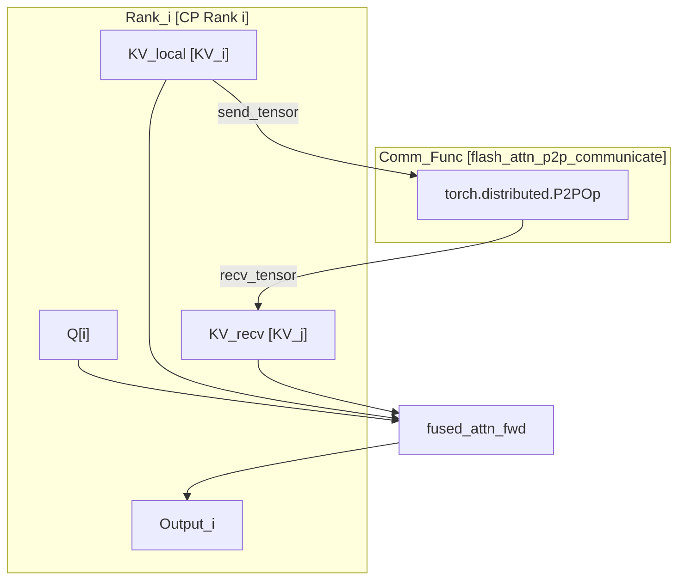
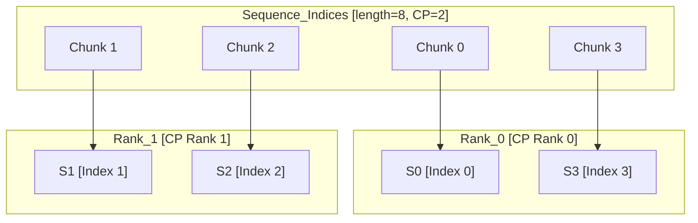
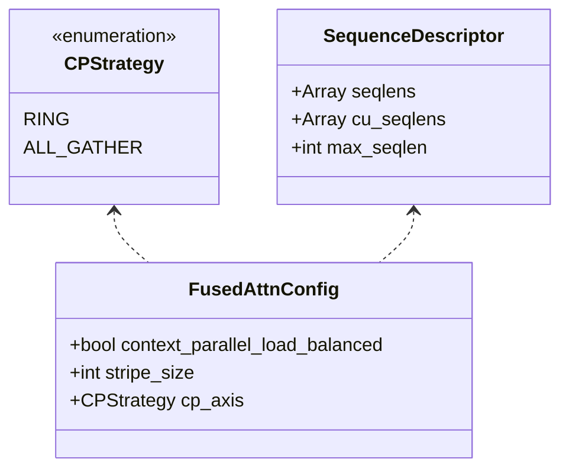
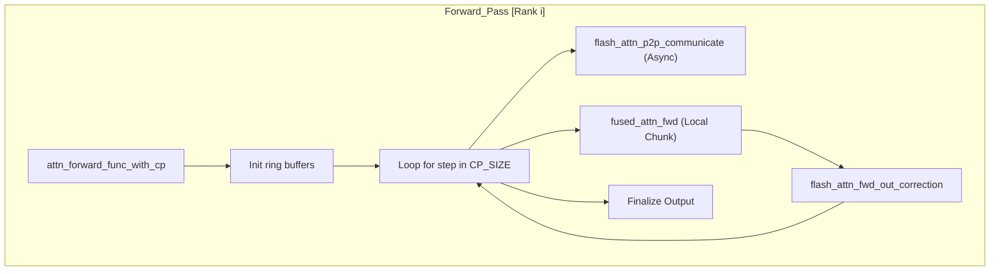

<!-- source: DeepWiki mcp.deepwiki.com · repo NVIDIA/TransformerEngine · page 7.1 Context Parallelism · fetched 2026-10-26 -->

# Context Parallelism

Relevant source files

The following files were used as context for generating this wiki page:

- [qa/L3_pytorch_FA_versions_test/test.sh](qa/L3_pytorch_FA_versions_test/test.sh)
- [tests/jax/test_distributed_fused_attn.py](tests/jax/test_distributed_fused_attn.py)
- [tests/jax/test_fused_attn.py](tests/jax/test_fused_attn.py)
- [tests/jax/test_fused_attn_score_mod.py](tests/jax/test_fused_attn_score_mod.py)
- [tests/jax/test_layer.py](tests/jax/test_layer.py)
- [tests/jax/utils.py](tests/jax/utils.py)
- [tests/pytorch/attention/run_attention_with_cp.py](tests/pytorch/attention/run_attention_with_cp.py)
- [tests/pytorch/attention/run_attention_with_cp_pool.py](tests/pytorch/attention/run_attention_with_cp_pool.py)
- [tests/pytorch/attention/test_attention.py](tests/pytorch/attention/test_attention.py)
- [tests/pytorch/attention/test_attention_with_cp.py](tests/pytorch/attention/test_attention_with_cp.py)
- [tests/pytorch/attention/test_cp_utils.py](tests/pytorch/attention/test_cp_utils.py)
- [tests/pytorch/utils.py](tests/pytorch/utils.py)
- [transformer_engine/common/fused_attn/context_parallel.cu](transformer_engine/common/fused_attn/context_parallel.cu)
- [transformer_engine/jax/attention.py](transformer_engine/jax/attention.py)
- [transformer_engine/jax/cpp_extensions/__init__.py](transformer_engine/jax/cpp_extensions/__init__.py)
- [transformer_engine/jax/cpp_extensions/attention.py](transformer_engine/jax/cpp_extensions/attention.py)
- [transformer_engine/jax/csrc/extensions/attention.cpp](transformer_engine/jax/csrc/extensions/attention.cpp)
- [transformer_engine/jax/flax/module.py](transformer_engine/jax/flax/module.py)
- [transformer_engine/jax/flax/transformer.py](transformer_engine/jax/flax/transformer.py)
- [transformer_engine/pytorch/attention/dot_product_attention/backends.py](transformer_engine/pytorch/attention/dot_product_attention/backends.py)
- [transformer_engine/pytorch/attention/dot_product_attention/context_parallel.py](transformer_engine/pytorch/attention/dot_product_attention/context_parallel.py)
- [transformer_engine/pytorch/attention/dot_product_attention/dot_product_attention.py](transformer_engine/pytorch/attention/dot_product_attention/dot_product_attention.py)
- [transformer_engine/pytorch/attention/dot_product_attention/utils.py](transformer_engine/pytorch/attention/dot_product_attention/utils.py)
- [transformer_engine/pytorch/csrc/extensions/attention.cpp](transformer_engine/pytorch/csrc/extensions/attention.cpp)

## Purpose and Scope

Context Parallelism (CP) is a distributed attention technique that partitions sequences across multiple GPUs to enable training with longer sequence lengths than can fit in a single GPU's memory. This page covers the CP implementation in Transformer Engine's attention system, including communication patterns, load balancing strategies, and integration with attention backends for both PyTorch and JAX.

For general distributed training strategies including tensor and sequence parallelism for linear layers, see [7.2 Tensor and Sequence Parallelism](). For communication-computation overlap using userbuffers, see [7.3 Communication Overlap with Userbuffers]().

## Overview

Context Parallelism splits the key-value (KV) sequence dimension across multiple GPUs, allowing each GPU to compute attention over a subset of the sequence. Unlike sequence parallelism which operates on the batch dimension, CP partitions the actual sequence length, enabling models to handle sequences that exceed single-GPU memory capacity.

**Key characteristics:**
- Requires `seq_len % (cp_size * 2) == 0` for each sequence in Q, K, V (for dual-chunking strategies) [transformer_engine/pytorch/attention/dot_product_attention/dot_product_attention.py:1086-1100]().
- Supports multiple communication patterns: Point-to-Point (P2P/Ring), All-Gather (AG), All-to-All (A2A), and A2A+P2P [transformer_engine/pytorch/attention/dot_product_attention/context_parallel.py:6-35]().
- Uses sequence reordering (DualChunkSwap, Striped) for load balancing with causal masks [transformer_engine/jax/attention.py:237-268]().
- Compatible with FlashAttention and FusedAttention backends [transformer_engine/pytorch/attention/dot_product_attention/backends.py:53-60]().
- Supports FP8 quantization through the `FusedAttention` backend [transformer_engine/pytorch/attention/dot_product_attention/context_parallel.py:58-82]().

Sources: [transformer_engine/pytorch/attention/dot_product_attention/dot_product_attention.py:1086-1100](), [transformer_engine/pytorch/attention/dot_product_attention/context_parallel.py:6-35](), [transformer_engine/jax/attention.py:237-268](), [transformer_engine/pytorch/attention/dot_product_attention/backends.py:53-60](), [transformer_engine/pytorch/attention/dot_product_attention/context_parallel.py:58-82]()

## Communication Patterns

Context Parallelism supports several communication strategies, each with different trade-offs between communication overhead and computational overlap.

### Communication Pattern Comparison

| Pattern | Description | Communication Type | Overlapping | Framework Support |
|---------|-------------|-------------------|-------------|-------------------|
| **P2P (Ring)** | Ring-based point-to-point KV exchange | Async P2P | Yes | PyTorch, JAX |
| **All-Gather** | Gather full KV before attention | Collective | No | PyTorch, JAX |
| **A2A (Ulysses)** | Ulysses-style head scattering | All-to-all | Partial | PyTorch |
| **A2A+P2P** | Hierarchical combination | Both | Yes | PyTorch |

Sources: [transformer_engine/pytorch/attention/dot_product_attention/context_parallel.py:62-101](), [transformer_engine/jax/cpp_extensions/attention.py:96-101]()

### P2P (Ring) Communication Pattern

The P2P pattern implements ring attention, where each GPU exchanges KV tensors with its neighbors in a ring topology. The communication is asynchronous and overlaps with attention computation.

**Key implementation functions:**
- `flash_attn_p2p_communicate()`: Manages P2P send/recv operations using `batch_isend_irecv` or individual `isend`/`irecv` [transformer_engine/pytorch/attention/dot_product_attention/context_parallel.py:96-135]().
- `attn_forward_func_with_cp()`: Orchestrates the ring exchange loop in PyTorch [transformer_engine/pytorch/attention/dot_product_attention/context_parallel.py:1086-1467]().

Sources: [transformer_engine/pytorch/attention/dot_product_attention/context_parallel.py:96-135](), [transformer_engine/pytorch/attention/dot_product_attention/context_parallel.py:1086-1467]()

## Load Balancing with Sequence Reordering

For causal masks, CP uses sequence reordering strategies to ensure each rank performs an equal amount of computation.

### Dual Chunking (DualChunkSwap)

In causal attention, the attention matrix is lower-triangular. Without reordering, ranks processing later parts of the sequence would have significantly more work. Dual chunking splits the sequence into $2 \times CP\_SIZE$ chunks and assigns two non-contiguous chunks to each rank.

**Implementation in JAX:**
The functions `reorder_causal_load_balancing` and `inverse_reorder_causal_load_balancing` implement this logic for JAX [transformer_engine/jax/attention.py:271-333]().

### Striped Reordering

Striped reordering is an alternative where tokens are distributed in a round-robin fashion (stride = `cp_size`). This is particularly useful for Sliding Window Attention (SWA).

**Key implementation functions:**
- `get_seq_chunk_ids_for_reordering_before_attn()`: Computes indices for dual chunking in PyTorch [transformer_engine/pytorch/attention/dot_product_attention/context_parallel.py:202-234]().
- `reorder_causal_load_balancing()`: JAX implementation of load balancing [transformer_engine/jax/attention.py:271-300]().

Sources: [transformer_engine/pytorch/attention/dot_product_attention/context_parallel.py:202-234](), [transformer_engine/jax/attention.py:271-333]()

## Framework Integration

### PyTorch Integration

The `DotProductAttention` module uses `attn_forward_func_with_cp` when `cp_group` is provided [transformer_engine/pytorch/attention/dot_product_attention/backends.py:53-55]().

| Parameter | Role |
|-----------|------|
| `cp_group` | The distributed process group for CP ranks [transformer_engine/pytorch/attention/dot_product_attention/dot_product_attention.py:38-44](). |
| `cp_comm_type` | Strategy: `p2p`, `all_gather`, `a2a`, `a2a+p2p` [transformer_engine/pytorch/attention/dot_product_attention/context_parallel.py:29-34](). |
| `out_correction` | Logic to merge partial Softmax LSE and Output results from ring steps [transformer_engine/pytorch/attention/dot_product_attention/context_parallel.py:138-166](). |

Sources: [transformer_engine/pytorch/attention/dot_product_attention/dot_product_attention.py:38-44](), [transformer_engine/pytorch/attention/dot_product_attention/context_parallel.py:29-34](), [transformer_engine/pytorch/attention/dot_product_attention/context_parallel.py:138-166]()

### JAX Integration

JAX utilizes `CPStrategy` and `SequenceDescriptor` to handle context parallelism.

In JAX, `fused_attn` primitives accept a `cp_group` and `cp_strategy` [transformer_engine/jax/attention.py:465-475](). The system supports `SequenceDescriptor` for ragged/packed tensors (THD format) in a CP environment [transformer_engine/jax/attention.py:192-235]().

Sources: [transformer_engine/jax/attention.py:35-51](), [transformer_engine/jax/attention.py:192-235](), [transformer_engine/jax/cpp_extensions/attention.py:80-102]()

## FP8 Support in Context Parallelism

FP8 quantization is supported in CP through the `FusedAttention` backend (cuDNN).

1. **Amax Reduction**: For `DelayedScaling`, amax values must be reduced across the CP group to maintain consistent scaling factors [transformer_engine/pytorch/attention/dot_product_attention/context_parallel.py:1141-1148]().
2. **Re-quantization**: During ring attention, tensors may be re-quantized between steps to maintain precision [transformer_engine/pytorch/attention/dot_product_attention/context_parallel.py:706-725]().
3. **Current Scaling**: Supports `Float8CurrentScaling` where scaling factors are calculated on-the-fly [transformer_engine/pytorch/attention/dot_product_attention/context_parallel.py:58-59]().

Sources: [transformer_engine/pytorch/attention/dot_product_attention/context_parallel.py:58-82](), [transformer_engine/pytorch/attention/dot_product_attention/context_parallel.py:1141-1148]()

## Implementation Architecture

### Forward Pass Data Flow (Ring Attention)

**Key Functions:**
- `flash_attn_fwd_out_correction`: Merges partial attention outputs using the formula $O_{new} = O_{old} \cdot \exp(LSE_{old} - LSE_{new}) + O_{step} \cdot \exp(LSE_{step} - LSE_{new})$ [transformer_engine/pytorch/attention/dot_product_attention/context_parallel.py:153-166]().
- `flash_attn_fwd_softmax_lse_correction`: Updates the running log-sum-exp (LSE) [transformer_engine/pytorch/attention/dot_product_attention/context_parallel.py:167-175]().

Sources: [transformer_engine/pytorch/attention/dot_product_attention/context_parallel.py:153-175](), [transformer_engine/pytorch/attention/dot_product_attention/context_parallel.py:1086-1467]()

## Performance and Backend Support

### Backend Selection Matrix

| Backend | CP Pattern | FP8 Support | Ragged (THD) |
|---------|------------|-------------|--------------|
| **FlashAttention** | Ring, A2A | No | Yes |
| **FusedAttention** | Ring, AG, A2A | Yes | Yes (sm90+) |

Sources: [transformer_engine/pytorch/attention/dot_product_attention/utils.py:191-230](), [transformer_engine/jax/cpp_extensions/attention.py:126-150]()

### Performance Considerations
- **Communication Overlap**: P2P (Ring) allows overlapping KV exchange with the computation of the *previous* chunk [transformer_engine/pytorch/attention/dot_product_attention/context_parallel.py:1186-1210]().
- **Memory**: DualChunkSwap ensures that peak memory is balanced across ranks by avoiding idle compute on the upper-triangle of causal masks [transformer_engine/jax/attention.py:271-285]().
- **THD Format**: Ragged tensors in CP require careful `cu_seqlens` adjustment as sequences are split across ranks [transformer_engine/pytorch/attention/dot_product_attention/context_parallel.py:170-199]().

Sources: [transformer_engine/pytorch/attention/dot_product_attention/context_parallel.py:170-199](), [transformer_engine/pytorch/attention/dot_product_attention/context_parallel.py:1086-1467](), [transformer_engine/jax/attention.py:271-285]()

---

