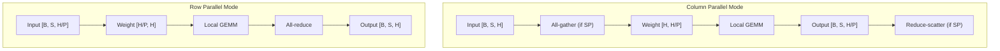
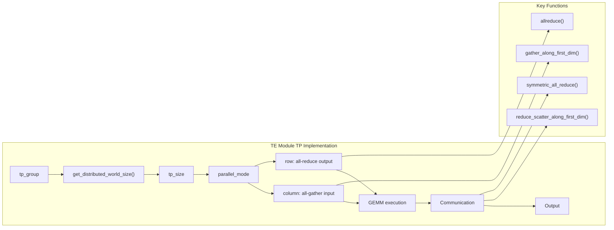
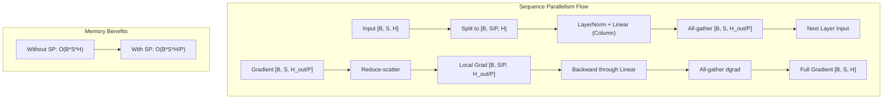
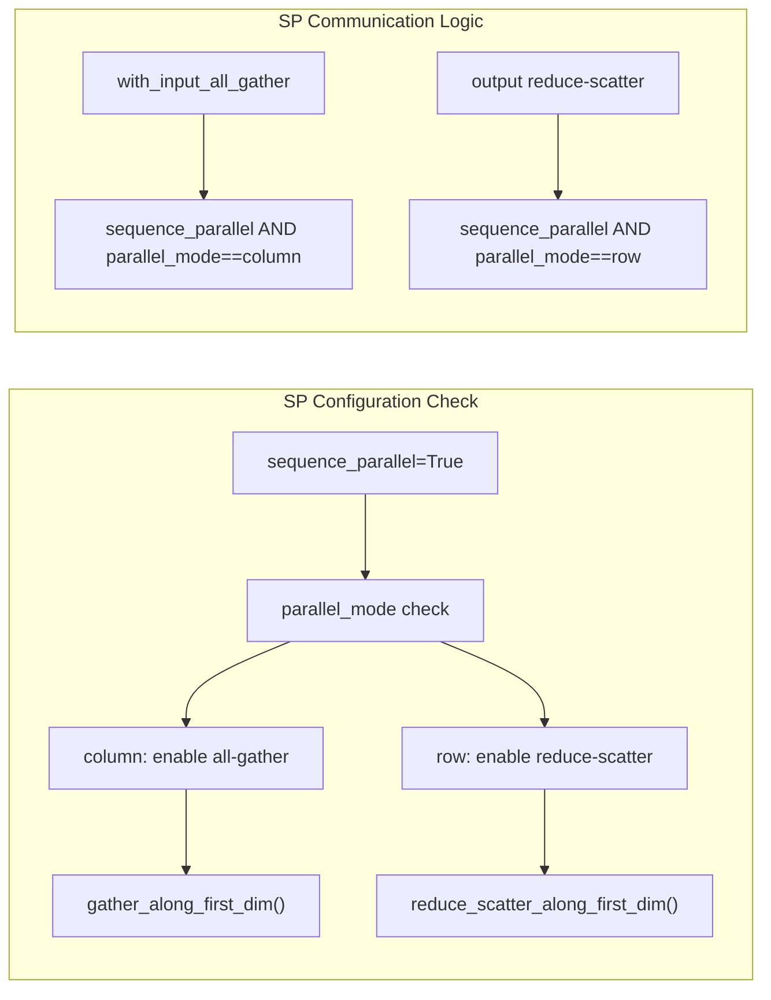
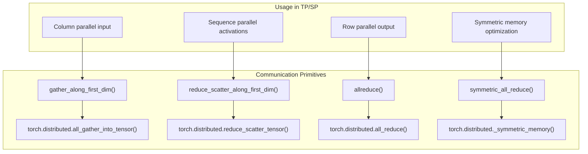
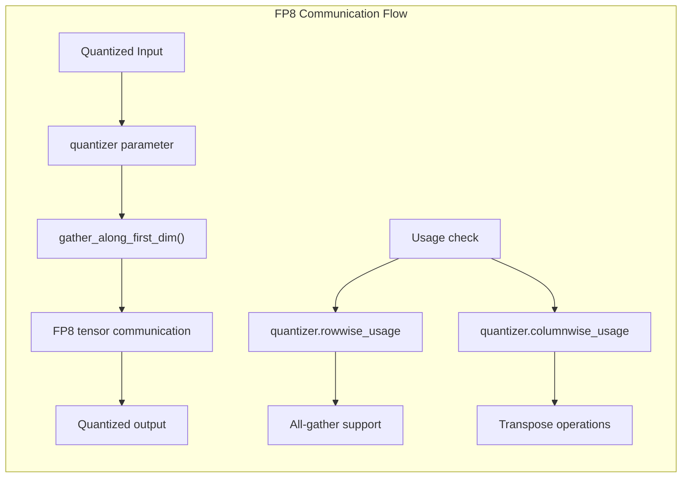
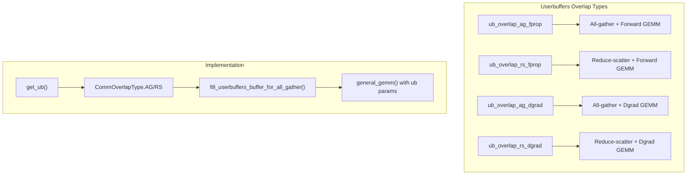
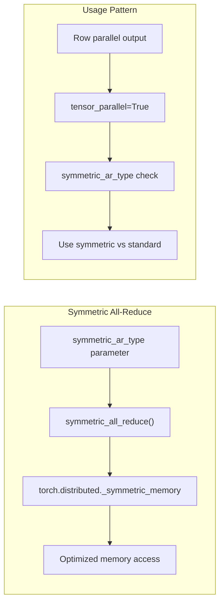
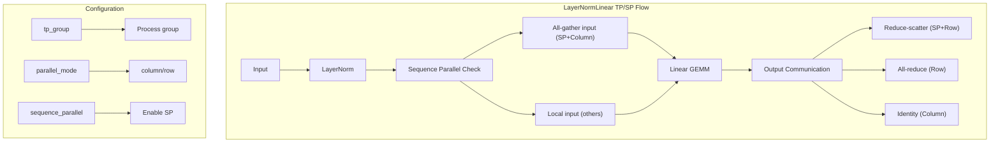
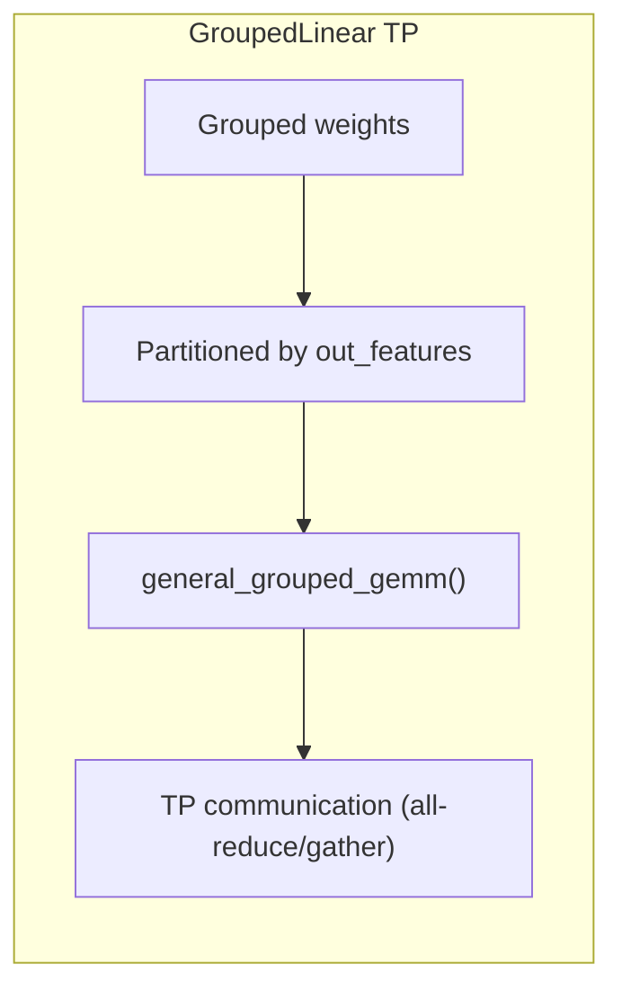

<!-- source: DeepWiki mcp.deepwiki.com · repo NVIDIA/TransformerEngine · page 7.2 Tensor and Sequence Parallelism · fetched 2026-10-26 -->

# Tensor and Sequence Parallelism

Relevant source files

The following files were used as context for generating this wiki page:

- [qa/L0_pytorch_unittest/test.sh](qa/L0_pytorch_unittest/test.sh)
- [tests/pytorch/distributed/run_numerics.py](tests/pytorch/distributed/run_numerics.py)
- [tests/pytorch/distributed/test_numerics.py](tests/pytorch/distributed/test_numerics.py)
- [tests/pytorch/layernorm_mlp/test_selective_activation_checkpoint.py](tests/pytorch/layernorm_mlp/test_selective_activation_checkpoint.py)
- [transformer_engine/jax/layernorm_dense.py](transformer_engine/jax/layernorm_dense.py)
- [transformer_engine/jax/layernorm_mlp.py](transformer_engine/jax/layernorm_mlp.py)
- [transformer_engine/jax/sharding.py](transformer_engine/jax/sharding.py)
- [transformer_engine/pytorch/distributed.py](transformer_engine/pytorch/distributed.py)
- [transformer_engine/pytorch/module/_common.py](transformer_engine/pytorch/module/_common.py)
- [transformer_engine/pytorch/module/base.py](transformer_engine/pytorch/module/base.py)
- [transformer_engine/pytorch/module/grouped_linear.py](transformer_engine/pytorch/module/grouped_linear.py)
- [transformer_engine/pytorch/module/layernorm_linear.py](transformer_engine/pytorch/module/layernorm_linear.py)
- [transformer_engine/pytorch/module/layernorm_mlp.py](transformer_engine/pytorch/module/layernorm_mlp.py)
- [transformer_engine/pytorch/module/linear.py](transformer_engine/pytorch/module/linear.py)
- [transformer_engine/pytorch/utils.py](transformer_engine/pytorch/utils.py)

This document covers tensor parallelism and sequence parallelism implementations in Transformer Engine. These parallelism strategies enable distributing model parameters and computations across multiple GPUs to scale model size and training throughput.

For context parallelism (splitting attention across sequence length), see [Context Parallelism](7.1). For communication optimization techniques, see [Communication Overlap](7.3).

## Overview

Transformer Engine implements two primary intra-layer parallelism strategies:

- **Tensor Parallelism (TP)**: Splits weight matrices across multiple GPUs along specific dimensions.
- **Sequence Parallelism (SP)**: Splits activations along the sequence dimension, typically used in conjunction with tensor parallelism to reduce activation memory.

Both strategies are supported across core modules including `Linear`, `LayerNormLinear`, and `LayerNormMLP`, with automatic communication handling and optional overlap optimizations.

## Tensor Parallelism Modes

### Parallel Mode Configuration

Tensor parallelism is configured via the `parallel_mode` parameter which determines how weight matrices are partitioned. The primary modes are defined in `GemmParallelModes` [transformer_engine/pytorch/constants.py:56]():

| Mode | Weight Partitioning | Input Communication | Output Communication |
|------|-------------------|-------------------|---------------------|
| `"column"` | Split along output dimension | All-gather (if SP) | Identity or reduce-scatter (if SP) |
| `"row"` | Split along input dimension | Identity | All-reduce |

**Tensor Parallelism Communication Patterns**

Sources: [transformer_engine/pytorch/constants.py:56](), [transformer_engine/pytorch/module/layernorm_linear.py:128-133](), [transformer_engine/pytorch/module/linear.py:132-137]()

### Implementation in Core Modules

The tensor parallelism implementation is consistent across core modules. Modules use `get_distributed_world_size(tp_group)` [transformer_engine/pytorch/distributed.py:167-171]() to determine the partitioning factor.

**Core Tensor Parallelism Implementation**

Sources: [transformer_engine/pytorch/distributed.py:150-164](), [transformer_engine/pytorch/module/layernorm_linear.py:188](), [transformer_engine/pytorch/module/linear.py:133-136]()

## Sequence Parallelism

### Sequence Dimension Splitting

Sequence parallelism splits the sequence dimension across GPUs. This is particularly effective in `LayerNormLinear` [transformer_engine/pytorch/module/layernorm_linear.py:94]() and `LayerNormMLP` [transformer_engine/pytorch/module/layernorm_mlp.py:171]() because the normalization is applied locally before the all-gather.

**Sequence Parallelism Memory and Communication**

Sources: [transformer_engine/pytorch/module/layernorm_linear.py:165](), [transformer_engine/pytorch/module/layernorm_linear.py:224-260](), [transformer_engine/pytorch/module/layernorm_linear.py:366-367]()

### Sequence Parallel Configuration

Sequence parallelism is enabled via the `sequence_parallel` flag. In JAX, this is handled through logical axis naming like `SEQLEN_TP_AXES` [transformer_engine/jax/sharding.py:28]() and `MeshResource` configuration. In PyTorch, the logic is embedded in the autograd functions:

**Sequence Parallelism Logic Flow**

Sources: [transformer_engine/pytorch/module/layernorm_linear.py:165](), [transformer_engine/pytorch/module/linear.py:136-137](), [transformer_engine/pytorch/module/layernorm_linear.py:366-367]()

## Communication Implementation

### Core Communication Functions

Distributed communication is implemented through several key functions in `distributed.py`. For example, `gather_along_first_dim` [transformer_engine/pytorch/distributed.py:795]() and `reduce_scatter_along_first_dim` [transformer_engine/pytorch/distributed.py:845]() handle the SP communication patterns.

**Communication Function Mapping**

Sources: [transformer_engine/pytorch/distributed.py:795-843](), [transformer_engine/pytorch/distributed.py:845-897](), [transformer_engine/pytorch/distributed.py:899-935](), [transformer_engine/pytorch/distributed.py:937-979]()

### FP8 Communication Support

Tensor and sequence parallelism support FP8 quantized tensors with specialized communication handling. The `gather_along_first_dim` function handles `QuantizedTensorStorage` by gathering the underlying data and potentially scales [transformer_engine/pytorch/distributed.py:807-820]().

**FP8 Quantized Communication**

Sources: [transformer_engine/pytorch/distributed.py:807-820](), [transformer_engine/pytorch/module/layernorm_linear.py:217-220](), [transformer_engine/pytorch/module/layernorm_linear.py:238-242]()

## Advanced Optimizations

### Userbuffers Communication Overlap

Transformer Engine supports overlapping communication with computation using the Userbuffers system. This is configured via flags like `ub_overlap_ag_fprop` [transformer_engine/pytorch/module/layernorm_linear.py:141]().

**Userbuffers Communication Overlap**

Sources: [transformer_engine/pytorch/module/layernorm_linear.py:203-212](), [transformer_engine/pytorch/module/base.py:126-162](), [transformer_engine/pytorch/module/layernorm_linear.py:243-255]()

### Symmetric All-Reduce

For optimized all-reduce operations, TE supports symmetric memory allocation patterns via `symmetric_all_reduce` [transformer_engine/pytorch/distributed.py:937](), which leverages `torch.distributed._symmetric_memory`.

**Symmetric All-Reduce Implementation**

Sources: [transformer_engine/pytorch/distributed.py:937-979](), [transformer_engine/pytorch/module/layernorm_linear.py:369-372](), [transformer_engine/pytorch/module/linear.py:327-330]()

## Integration with Core Modules

### LayerNormLinear TP/SP Support

The `LayerNormLinear` module demonstrates comprehensive TP/SP integration in its `forward` and `backward` methods.

**LayerNormLinear Tensor and Sequence Parallelism**

Sources: [transformer_engine/pytorch/module/layernorm_linear.py:128-133](), [transformer_engine/pytorch/module/layernorm_linear.py:165](), [transformer_engine/pytorch/module/layernorm_linear.py:363-378]()

### Grouped Linear TP Support

`GroupedLinear` supports tensor parallelism by allowing weight matrices to be partitioned across output features. It includes specialized logic for handling grouped GEMMs through `general_grouped_gemm` [transformer_engine/pytorch/module/grouped_linear.py:49-52]().

Sources: [transformer_engine/pytorch/module/grouped_linear.py:71-156](), [transformer_engine/pytorch/module/grouped_linear.py:180-191]()

---

