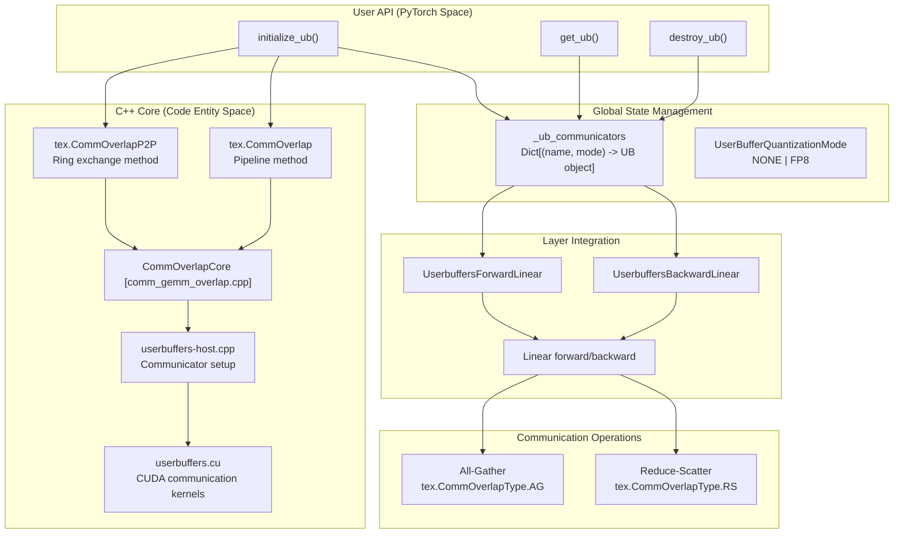
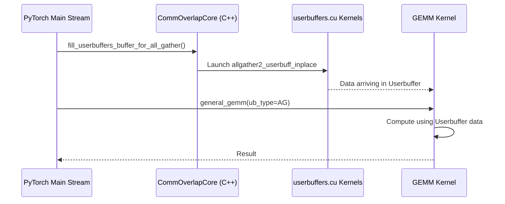

<!-- source: DeepWiki mcp.deepwiki.com · repo NVIDIA/TransformerEngine · page 7.3 Communication Overlap with Userbuffers · fetched 2026-10-26 -->

# Communication Overlap with Userbuffers

Relevant source files

The following files were used as context for generating this wiki page:

- [examples/pytorch/comm_gemm_overlap/te_layer_with_overlap.py](examples/pytorch/comm_gemm_overlap/te_layer_with_overlap.py)
- [tests/pytorch/distributed/run_gemm_with_overlap.py](tests/pytorch/distributed/run_gemm_with_overlap.py)
- [tests/pytorch/distributed/run_layer_with_overlap.py](tests/pytorch/distributed/run_layer_with_overlap.py)
- [tests/pytorch/distributed/test_comm_gemm_overlap.py](tests/pytorch/distributed/test_comm_gemm_overlap.py)
- [tests/pytorch/test_grouped_tensor.py](tests/pytorch/test_grouped_tensor.py)
- [transformer_engine/common/cast/dispatch/quantize.cuh](transformer_engine/common/cast/dispatch/quantize.cuh)
- [transformer_engine/common/comm_gemm_overlap/comm_gemm_overlap.cpp](transformer_engine/common/comm_gemm_overlap/comm_gemm_overlap.cpp)
- [transformer_engine/common/comm_gemm_overlap/userbuffers/userbuffers-host.cpp](transformer_engine/common/comm_gemm_overlap/userbuffers/userbuffers-host.cpp)
- [transformer_engine/common/comm_gemm_overlap/userbuffers/userbuffers.cu](transformer_engine/common/comm_gemm_overlap/userbuffers/userbuffers.cu)
- [transformer_engine/common/comm_gemm_overlap/userbuffers/userbuffers.h](transformer_engine/common/comm_gemm_overlap/userbuffers/userbuffers.h)
- [transformer_engine/common/include/transformer_engine/comm_gemm_overlap.h](transformer_engine/common/include/transformer_engine/comm_gemm_overlap.h)
- [transformer_engine/pytorch/csrc/common.h](transformer_engine/pytorch/csrc/common.h)
- [transformer_engine/pytorch/csrc/extensions.h](transformer_engine/pytorch/csrc/extensions.h)
- [transformer_engine/pytorch/csrc/extensions/cast.cpp](transformer_engine/pytorch/csrc/extensions/cast.cpp)
- [transformer_engine/pytorch/csrc/extensions/comm_gemm_overlap.cpp](transformer_engine/pytorch/csrc/extensions/comm_gemm_overlap.cpp)
- [transformer_engine/pytorch/csrc/extensions/pybind.cpp](transformer_engine/pytorch/csrc/extensions/pybind.cpp)
- [transformer_engine/pytorch/csrc/quantizer.cpp](transformer_engine/pytorch/csrc/quantizer.cpp)
- [transformer_engine/pytorch/ops/fused/backward_linear_add.py](transformer_engine/pytorch/ops/fused/backward_linear_add.py)
- [transformer_engine/pytorch/ops/fused/backward_linear_scale.py](transformer_engine/pytorch/ops/fused/backward_linear_scale.py)
- [transformer_engine/pytorch/ops/fused/userbuffers_backward_linear.py](transformer_engine/pytorch/ops/fused/userbuffers_backward_linear.py)

## Overview

Userbuffers is a system for overlapping tensor-parallel communications (all-gather and reduce-scatter) with GEMM computation in distributed training. By performing communication and computation concurrently, Userbuffers significantly reduces the overhead of tensor parallelism, particularly in sequence-parallel and tensor-parallel configurations.

This page covers the Userbuffers infrastructure, initialization, and integration with linear operations. For context parallelism strategies that use Userbuffers, see [Context Parallelism](7.1). For general distributed training concepts, see [Tensor and Sequence Parallelism](7.2).

**Sources:** [transformer_engine/pytorch/module/base.py:98-494](), [transformer_engine/pytorch/ops/fused/userbuffers_backward_linear.py:5-44]()

## System Architecture

The Userbuffers system bridges high-level PyTorch modules with a low-level C++/CUDA communication library. It utilizes custom CUDA kernels and IPC/Fabric handles to enable direct GPU-to-GPU communication without going through standard collective libraries like NCCL in the critical path.

**Diagram: Userbuffers System Architecture and Code Entities**

The Userbuffers system consists of:
- **Initialization API**: `initialize_ub()` creates communicator objects and stores them in the global `_ub_communicators` dictionary [transformer_engine/pytorch/module/base.py:98-474]().
- **C++ Communicators**: `tex.CommOverlapP2P` for ring exchange and `tex.CommOverlap` for pipeline methods. These wrap the underlying `CommOverlapCore` class [transformer_engine/common/comm_gemm_overlap/comm_gemm_overlap.cpp:58-80]().
- **Low-level Infrastructure**: `userbuffers-host.cpp` handles IPC socket management and MNNVL (Multi-Node NVLink) fabric handles [transformer_engine/common/comm_gemm_overlap/userbuffers/userbuffers-host.cpp:143-174]().
- **Communication Kernels**: `userbuffers.cu` contains the actual CUDA kernels for sum-inplace reductions and data movement.

**Sources:** [transformer_engine/pytorch/module/base.py:62-78](), [transformer_engine/pytorch/module/base.py:98-474](), [transformer_engine/common/comm_gemm_overlap/comm_gemm_overlap.cpp:58-80](), [transformer_engine/common/comm_gemm_overlap/userbuffers/userbuffers-host.cpp:143-174]()

## Initialization and Configuration

### Basic Initialization

The `initialize_ub()` function performs the following steps:
1. **Validates device support**: Checks for CUDA Multicast support via `tex.device_supports_multicast()`.
2. **Creates process groups**: Bootstraps with `torch.distributed`.
3. **Allocates communicators**: Creates `tex.CommOverlapP2P` or `tex.CommOverlap` objects.
4. **Configures overlap methods**: Sets up ring exchange, pipeline, bulk, or external overlap strategies.

The underlying C++ `CommOverlapCore` constructor initializes CUDA streams with specific priorities (`_gemm_priority` and `_comm_priority`) and sets the SM margin to ensure communication kernels have dedicated hardware resources [transformer_engine/common/comm_gemm_overlap/comm_gemm_overlap.cpp:124-144]().

**Sources:** [transformer_engine/pytorch/module/base.py:98-158](), [transformer_engine/common/comm_gemm_overlap/comm_gemm_overlap.cpp:58-80](), [transformer_engine/common/comm_gemm_overlap/comm_gemm_overlap.cpp:124-144]()

### Quantization Modes

| Mode | Value | Description |
|------|-------|-------------|
| `UserBufferQuantizationMode.NONE` | `"none"` | High-precision (BF16/FP16) buffers |
| `UserBufferQuantizationMode.FP8` | `"fp8"` | FP8 quantized buffers for reduced bandwidth |

**Sources:** [transformer_engine/pytorch/module/base.py:72-78](), [transformer_engine/pytorch/module/base.py:166-196]()

## Communication Overlap Modes

### All-Gather Overlap (Column Parallel)

In column-parallel layers, the input is all-gathered while the GEMM computation proceeds. The `CommOverlapCore` uses `_stream_compute` for GEMM and manages events like `_start_comm` and `_stop_comm` to synchronize with the communication stream [transformer_engine/common/comm_gemm_overlap/comm_gemm_overlap.cpp:159-160]().

**Diagram: All-Gather Overlap Flow**

**Sources:** [transformer_engine/pytorch/module/base.py:497-597](), [transformer_engine/common/comm_gemm_overlap/comm_gemm_overlap.cpp:159-160](), [transformer_engine/pytorch/ops/fused/userbuffers_backward_linear.py:110-160]()

### Reduce-Scatter Overlap (Row Parallel)

For row-parallel layers, the GEMM produces partial results that are immediately reduce-scattered. The Userbuffers implementation provides specialized kernels for sum-inplace reductions [transformer_engine/common/comm_gemm_overlap/userbuffers/userbuffers.h:187-192]().

**Sources:** [transformer_engine/pytorch/ops/fused/userbuffers_backward_linear.py:77-86](), [transformer_engine/common/comm_gemm_overlap/userbuffers/userbuffers.h:187-192]()

### Bulk Overlap

Bulk overlap handles dgrad and wgrad GEMMs. For Hopper (SM90) architectures, `CommOverlapCore` can enable `_atomic_gemm`, which uses a `_counter` tensor to synchronize between communication and computation at a fine-grained level [transformer_engine/common/comm_gemm_overlap/comm_gemm_overlap.cpp:146-155]().

**Sources:** [transformer_engine/common/comm_gemm_overlap/comm_gemm_overlap.cpp:146-155](), [transformer_engine/pytorch/ops/fused/userbuffers_backward_linear.py:98-100]()

## Implementation Details

### Communicator Struct

The core `communicator` struct defined in `userbuffers.h` tracks memory regions, peer pointers, and IPC handles.

| Field | Description |
|-------|-------------|
| `mem_ptr[NVTE_MAX_REGIONS]` | Pointers to registered memory regions [transformer_engine/common/comm_gemm_overlap/userbuffers/userbuffers.h:103]() |
| `uchandles[NVTE_MAX_REGIONS]` | cuMem generic allocation handles for IPC [transformer_engine/common/comm_gemm_overlap/userbuffers/userbuffers.h:108]() |
| `mc_handle` | CUDA Multicast handle [transformer_engine/common/comm_gemm_overlap/userbuffers/userbuffers.h:116]() |
| `ub_timeout` | Timeout value for communication kernels [transformer_engine/common/comm_gemm_overlap/userbuffers/userbuffers.h:145]() |

**Sources:** [transformer_engine/common/comm_gemm_overlap/userbuffers/userbuffers.h:90-147]()

### Memory Registration

Before communication can occur, buffers must be registered. `register_user_buffer_collective` handles this by exchanging IPC handles across ranks and mapping them into the local address space [transformer_engine/common/comm_gemm_overlap/userbuffers/userbuffers.h:187-192]().

**Sources:** [transformer_engine/common/comm_gemm_overlap/userbuffers/userbuffers.h:187-192]()

### Multi-Node NVLink (MNNVL)

Userbuffers detects and utilizes MNNVL fabric when available. The `has_mnnvl_fabric` function checks for `CU_DEVICE_ATTRIBUTE_HANDLE_TYPE_FABRIC_SUPPORTED` and queries NVML for the fabric state [transformer_engine/common/comm_gemm_overlap/userbuffers/userbuffers-host.cpp:94-142]().

**Sources:** [transformer_engine/common/comm_gemm_overlap/userbuffers/userbuffers-host.cpp:94-142]()

## Integration with Linear Operations

The PyTorch integration relies on `UserbuffersForwardLinear` and `UserbuffersBackwardLinear` fused operations. These classes manage the complexity of selecting the correct `ub_obj` from the global state and configuring the `general_gemm` call.

- **Forward**: `UserbuffersForwardLinear` handles the logic for AG (column) and RS (row).
- **Backward**: `UserbuffersBackwardLinear` handles dgrad and wgrad overlaps, including support for `ub_bulk_wgrad` [transformer_engine/pytorch/ops/fused/userbuffers_backward_linear.py:37-86]().

**Sources:** [transformer_engine/pytorch/ops/fused/userbuffers_backward_linear.py:37-111](), [transformer_engine/pytorch/module/base.py:497-515]()

---

