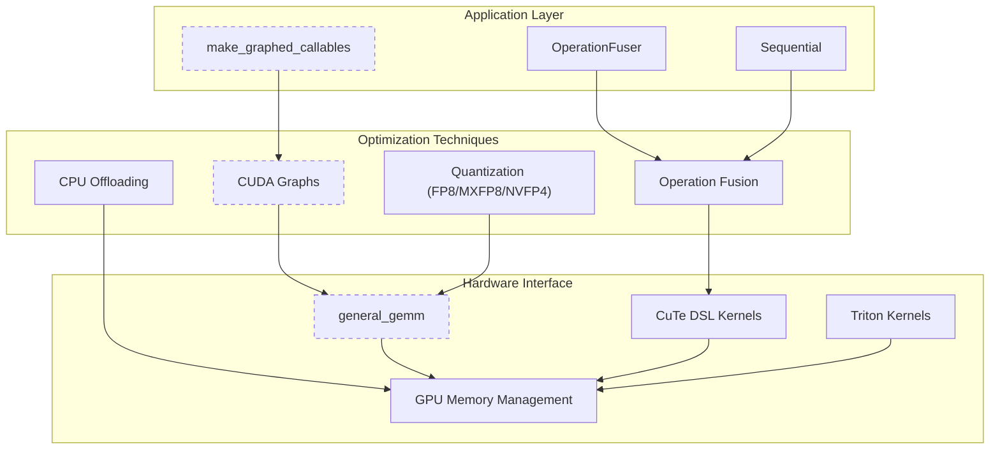
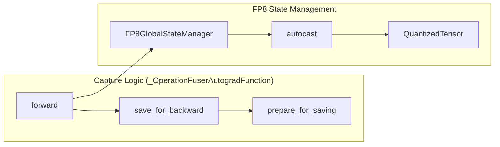

<!-- source: DeepWiki mcp.deepwiki.com · repo NVIDIA/TransformerEngine · page 8 Performance Optimization · fetched 2026-10-26 -->

# Performance Optimization

Relevant source files

The following files were used as context for generating this wiki page:

- [tests/pytorch/test_fusible_ops.py](tests/pytorch/test_fusible_ops.py)
- [tests/pytorch/test_numerics.py](tests/pytorch/test_numerics.py)
- [tests/pytorch/test_onnx_export.py](tests/pytorch/test_onnx_export.py)
- [tests/pytorch/test_sanity.py](tests/pytorch/test_sanity.py)
- [transformer_engine/pytorch/csrc/extensions/activation.cpp](transformer_engine/pytorch/csrc/extensions/activation.cpp)
- [transformer_engine/pytorch/fp8.py](transformer_engine/pytorch/fp8.py)
- [transformer_engine/pytorch/ops/_common.py](transformer_engine/pytorch/ops/_common.py)
- [transformer_engine/pytorch/ops/basic/__init__.py](transformer_engine/pytorch/ops/basic/__init__.py)
- [transformer_engine/pytorch/ops/basic/basic_linear.py](transformer_engine/pytorch/ops/basic/basic_linear.py)
- [transformer_engine/pytorch/ops/fused/__init__.py](transformer_engine/pytorch/ops/fused/__init__.py)
- [transformer_engine/pytorch/ops/fuser.py](transformer_engine/pytorch/ops/fuser.py)
- [transformer_engine/pytorch/ops/op.py](transformer_engine/pytorch/ops/op.py)
- [transformer_engine/pytorch/transformer.py](transformer_engine/pytorch/transformer.py)

This document provides a high-level overview of performance optimization techniques in Transformer Engine (TE). These optimizations are designed to maximize throughput and minimize latency for transformer model training and inference on NVIDIA GPUs, particularly leveraging hardware-specific features like FP8/MXFP8 support, advanced memory hierarchies, and kernel fusion.

For detailed information about specific optimization techniques, see [Fused Attention Operations](#8.1) and [Memory Management](#8.2).

## Core Performance Strategies

Transformer Engine employs several complementary strategies that work together to accelerate transformer workloads:

**Performance Optimization Architecture**: The system provides multiple layers of optimization from high-level API calls down to hardware-specific implementations.

Sources: [transformer_engine/pytorch/ops/fuser.py:53-70](), [transformer_engine/pytorch/ops/op.py:59-75](), [transformer_engine/pytorch/ops/basic/basic_linear.py:15-32]()

## Kernel Fusion and Fusible Operations

Kernel fusion is a primary driver of performance in TE. By combining multiple operations (e.g., GEMM + Bias + Activation) into a single kernel, the library reduces kernel launch overhead and memory traffic.

- **Operation Fuser**: The `OperationFuser` [transformer_engine/pytorch/ops/fuser.py:53-60]() manages a pipeline of `FusibleOperation` [transformer_engine/pytorch/ops/op.py:59-61]() objects. It identifies opportunities to merge operations in both forward and backward passes.
- **Basic Operations**: TE provides a library of "basic" operations like `BasicLinear` [transformer_engine/pytorch/ops/basic/basic_linear.py:54-55](), `LayerNorm` [transformer_engine/pytorch/ops/basic/__init__.py:30-30](), and various activations [transformer_engine/pytorch/ops/basic/__init__.py:7-19]() that can be fused.
- **Fused Implementations**: Specialized classes like `ForwardLinearBiasActivation` [transformer_engine/pytorch/ops/fused/forward_linear_bias_activation.py:12-12]() (not shown in snippet but registered in [transformer_engine/pytorch/ops/fused/__init__.py:12-12]()) implement the actual fused CUDA logic.
- **Grouped Operations**: For Mixture-of-Experts (MoE) and similar architectures, `GroupedLinear` [transformer_engine/pytorch/ops/basic/grouped_linear.py:22-27]() enables executing multiple GEMMs in a single call to improve hardware utilization.

Sources: [transformer_engine/pytorch/ops/fuser.py:5-21](), [transformer_engine/pytorch/ops/fused/__init__.py:19-30](), [transformer_engine/pytorch/ops/basic/basic_linear.py:98-111]()

## CUDA Graphs Integration

CUDA graphs reduce CPU overhead by capturing a sequence of operations and replaying them with a single launch. TE's integration ensures that dynamic states, such as FP8 scaling factors, are handled correctly during graph execution.

**Graph-Compatible Autograd**: The `_OperationFuserAutogradFunction` [transformer_engine/pytorch/ops/fuser.py:53-70]() is designed to be compatible with graph capture by using static-sized buffers and managing `saved_tensors` [transformer_engine/pytorch/ops/op.py:28-42]() efficiently.

Sources: [transformer_engine/pytorch/ops/fuser.py:98-141](), [transformer_engine/pytorch/ops/fuser.py:162-177](), [transformer_engine/pytorch/ops/op.py:28-58]()

## Memory Management and Offloading

To handle large-scale models that exceed GPU memory limits, TE implements sophisticated memory management techniques:

- **CPU Offloading**: Activations can be moved to CPU memory during the forward pass. This is integrated into linear operations via `mark_activation_offload` [transformer_engine/pytorch/ops/basic/basic_linear.py:16-16]().
- **Activation Checkpointing**: TE provides specialized checkpointing [transformer_engine/pytorch/transformer.py:44-44]() to save memory by recomputing activations.
- **Quantized Storage**: Using `Float8Tensor` [transformer_engine/pytorch/ops/_common.py:16-16]() or `MXFP8Tensor` [transformer_engine/pytorch/test_sanity.py:32-32]() for weights and activations significantly reduces the memory footprint.

For details, see [Memory Management](#8.2).

Sources: [transformer_engine/pytorch/ops/basic/basic_linear.py:15-16](), [transformer_engine/pytorch/ops/_common.py:51-67](), [transformer_engine/pytorch/transformer.py:70-130]()

## Distributed Training Optimizations

Performance optimizations are coordinated with distributed strategies to maintain efficiency at scale:

| Optimization | Description | Code Entity |
| :--- | :--- | :--- |
| **Main Grad Fusion** | Writing weight gradients directly into the main gradient buffer to save memory and copies. | `get_main_grad_from_param` [transformer_engine/pytorch/ops/_common.py:107-127]() |
| **Communication Overlap** | Overlapping collective operations (All-Gather, Reduce-Scatter) with GEMM compute. | `UserbuffersForwardLinear` [transformer_engine/pytorch/ops/fused/__init__.py:16-16]() |
| **Sequence Parallelism** | Distributing computation along the sequence dimension to reduce per-GPU memory. | `sequence_parallel` [transformer_engine/pytorch/ops/basic/basic_linear.py:107-107]() |
| **Accumulate into Main Grad** | Direct accumulation into high-precision buffers for distributed optimizers. | `_accumulate_into_main_grad` [transformer_engine/pytorch/ops/basic/basic_linear.py:167-167]() |

Sources: [transformer_engine/pytorch/ops/basic/basic_linear.py:100-111](), [transformer_engine/pytorch/ops/_common.py:130-137](), [transformer_engine/pytorch/ops/fused/__init__.py:15-30]()

## Performance Validation

Transformer Engine includes testing infrastructure to ensure optimizations do not compromise numerical stability:
- **Numerical Parity**: Comparing fused vs. unfused results using `assert_allclose` [tests/pytorch/test_numerics.py:214-225]().
- **Quantization Tolerances**: Using specialized tolerances for different data types (FP8, BF16, etc.) via `dtype_tols` [tests/pytorch/test_numerics.py:199-212]().
- **Sanity Checks**: End-to-end tests for modules like `TransformerLayer` [tests/pytorch/test_sanity.py:199-210]() ensure performance features work correctly in training loops.

Sources: [tests/pytorch/test_numerics.py:199-226](), [tests/pytorch/test_fusible_ops.py:138-162](), [tests/pytorch/test_sanity.py:199-220]()

---

