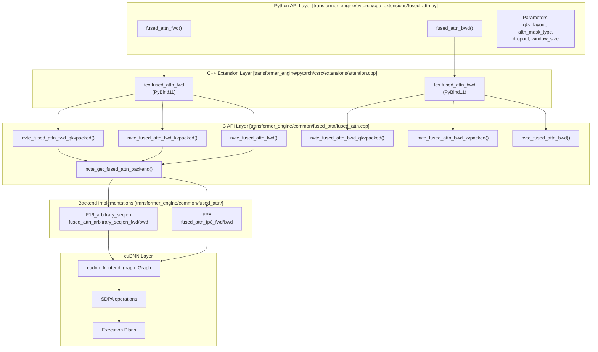
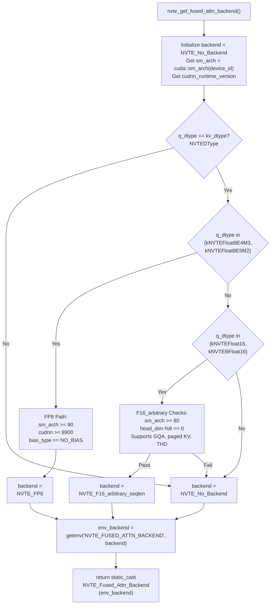
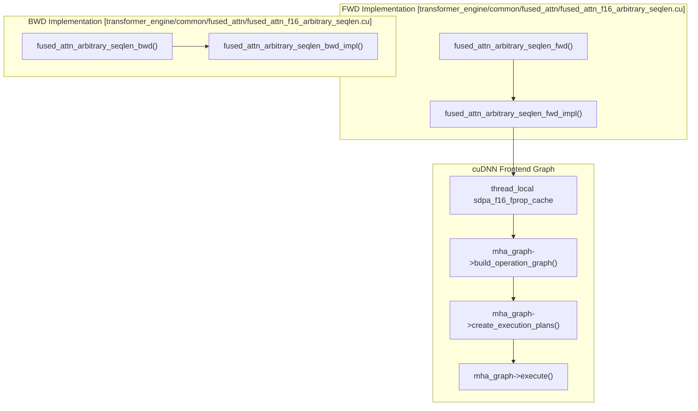
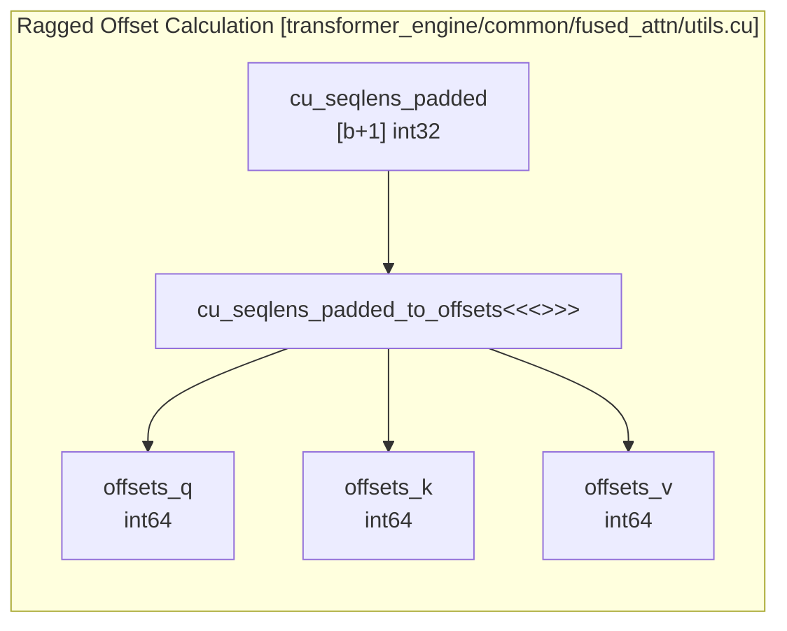
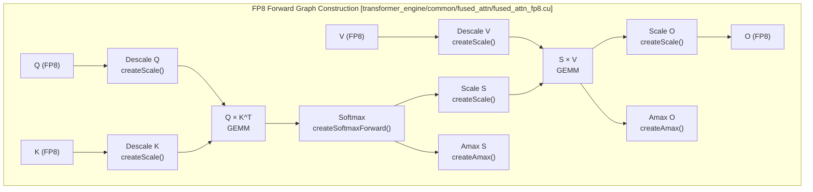
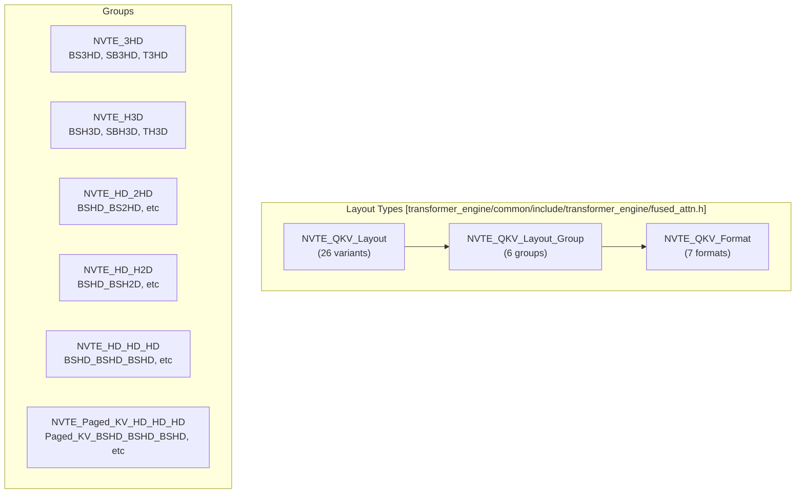
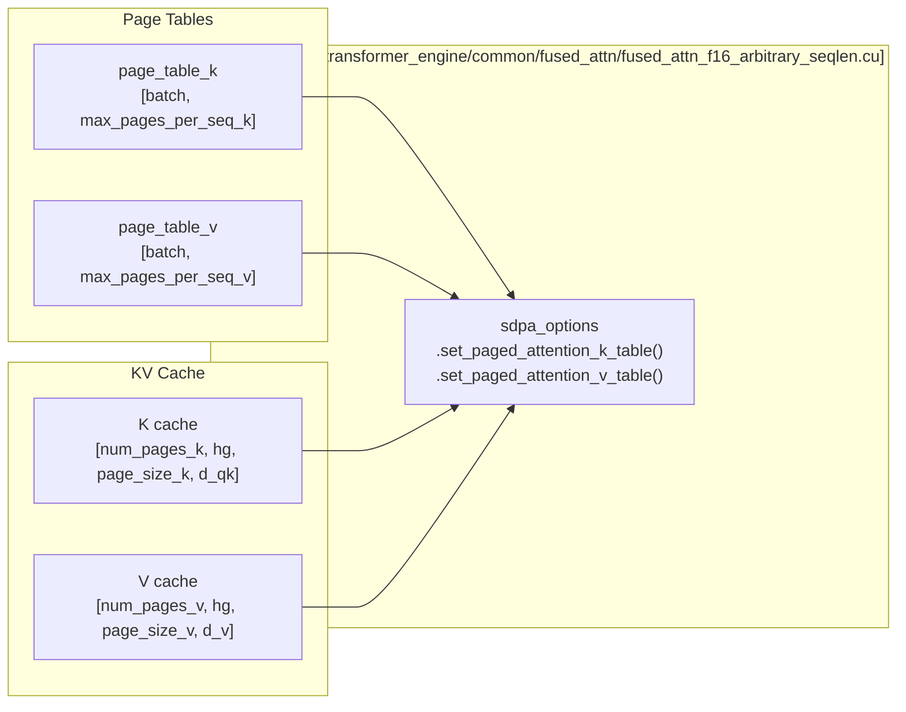

<!-- source: DeepWiki mcp.deepwiki.com · repo NVIDIA/TransformerEngine · page 8.1 Fused Attention Operations · fetched 2026-10-26 -->

# Fused Attention Operations

<details>
<summary>Relevant source files</summary>

The following files were used as context for generating this wiki page:

- [benchmarks/attention/benchmark_attention.py](benchmarks/attention/benchmark_attention.py)
- [docs/envvars.rst](docs/envvars.rst)
- [docs/examples/attention/arbitrary_mask_to_post_scale_bias.py](docs/examples/attention/arbitrary_mask_to_post_scale_bias.py)
- [docs/examples/attention/attention.ipynb](docs/examples/attention/attention.ipynb)
- [docs/examples/attention/example_attention.py](docs/examples/attention/example_attention.py)
- [qa/L3_pytorch_FA_versions_test/test.sh](qa/L3_pytorch_FA_versions_test/test.sh)
- [tests/pytorch/attention/run_attention_with_cp.py](tests/pytorch/attention/run_attention_with_cp.py)
- [tests/pytorch/attention/run_attention_with_cp_pool.py](tests/pytorch/attention/run_attention_with_cp_pool.py)
- [tests/pytorch/attention/test_attention.py](tests/pytorch/attention/test_attention.py)
- [tests/pytorch/attention/test_attention_with_cp.py](tests/pytorch/attention/test_attention_with_cp.py)
- [tests/pytorch/nvfp4/test_nvfp4_quantize_exact.py](tests/pytorch/nvfp4/test_nvfp4_quantize_exact.py)
- [tests/pytorch/utils.py](tests/pytorch/utils.py)
- [transformer_engine/common/cast/nvfp4/quantize_4over6_nvfp4.cuh](transformer_engine/common/cast/nvfp4/quantize_4over6_nvfp4.cuh)
- [transformer_engine/common/fused_attn/fused_attn.cpp](transformer_engine/common/fused_attn/fused_attn.cpp)
- [transformer_engine/common/fused_attn/fused_attn_f16_arbitrary_seqlen.cu](transformer_engine/common/fused_attn/fused_attn_f16_arbitrary_seqlen.cu)
- [transformer_engine/common/fused_attn/fused_attn_f16_arbitrary_seqlen.h](transformer_engine/common/fused_attn/fused_attn_f16_arbitrary_seqlen.h)
- [transformer_engine/common/fused_attn/fused_attn_fp8.cu](transformer_engine/common/fused_attn/fused_attn_fp8.cu)
- [transformer_engine/common/fused_attn/fused_attn_fp8.h](transformer_engine/common/fused_attn/fused_attn_fp8.h)
- [transformer_engine/common/fused_attn/utils.cu](transformer_engine/common/fused_attn/utils.cu)
- [transformer_engine/common/fused_attn/utils.h](transformer_engine/common/fused_attn/utils.h)
- [transformer_engine/common/include/transformer_engine/fused_attn.h](transformer_engine/common/include/transformer_engine/fused_attn.h)
- [transformer_engine/pytorch/attention/dot_product_attention/backends.py](transformer_engine/pytorch/attention/dot_product_attention/backends.py)
- [transformer_engine/pytorch/attention/dot_product_attention/context_parallel.py](transformer_engine/pytorch/attention/dot_product_attention/context_parallel.py)
- [transformer_engine/pytorch/attention/dot_product_attention/dot_product_attention.py](transformer_engine/pytorch/attention/dot_product_attention/dot_product_attention.py)
- [transformer_engine/pytorch/attention/dot_product_attention/utils.py](transformer_engine/pytorch/attention/dot_product_attention/utils.py)
- [transformer_engine/pytorch/cpp_extensions/fused_attn.py](transformer_engine/pytorch/cpp_extensions/fused_attn.py)
- [transformer_engine/pytorch/csrc/extensions/attention.cpp](transformer_engine/pytorch/csrc/extensions/attention.cpp)
- [transformer_engine/pytorch/custom_recipes/quantization_ref_nvfp4.py](transformer_engine/pytorch/custom_recipes/quantization_ref_nvfp4.py)

</details>


## Purpose and Scope

This page documents TransformerEngine's fused attention implementation, which provides optimized attention computation through cuDNN-based kernels. Fused attention combines multiple attention operations ($Q \times K^T$, softmax, dropout, $Attention \times V$) into single optimized kernels for improved performance.

For information about attention modules that use these operations, see [Attention Mechanisms (4.4)](). For distributed training strategies involving attention, see [Context Parallelism (7.1)]().

**Sources:** [transformer_engine/common/fused_attn/fused_attn.cpp:1-50](), [transformer_engine/common/include/transformer_engine/fused_attn.h:1-20]()

## Overview

Fused attention operations provide a performance-critical path for transformer attention computation. Instead of executing attention as separate GEMM, softmax, and dropout operations, fused attention compiles these into optimized cuDNN execution plans that minimize memory bandwidth and kernel launch overhead.

### System Architecture



**Sources:** [transformer_engine/common/fused_attn/fused_attn.cpp:136-414](), [transformer_engine/pytorch/cpp_extensions/fused_attn.py:1-50]()

## Backend Selection

The fused attention system uses `nvte_get_fused_attn_backend()` to select an appropriate backend based on input configuration. This function evaluates hardware capabilities, data types, sequence lengths, and feature requirements to choose the optimal implementation.

### Backend Selection Function

Backend selection in `nvte_get_fused_attn_backend()` evaluates input parameters against hardware and software capabilities:



**Sources:** [transformer_engine/common/fused_attn/fused_attn.cpp:204-414]()

### Selection Criteria by Backend

| Backend | Data Type | SM Arch | cuDNN Version | Max Seqlen | Head Dim | Layout | Special Requirements |
|---------|-----------|---------|---------------|------------|----------|--------|---------------------|
| `F16_arbitrary_seqlen` | FP16/BF16 | 80+ | 8.9.0+ | Any | ≤256 (SM90), any (SM100) | SBHD, BSHD, THD, mixed | GQA support, paged KV |
| `FP8` | E4M3, E5M2 | 90+ | 8.9.0+ | Varies by cuDNN | 64, 128, ≤256 | BSHD, SBHD, T3HD | No bias (except for some versions) |

**Sources:** [transformer_engine/common/fused_attn/fused_attn.cpp:162-414]()

### Environment Variable Override

The environment variable `NVTE_FUSED_ATTN_BACKEND` can override backend selection when multiple backends support a configuration:

```cpp
int env_backend = static_cast<int>(backend);
env_backend = transformer_engine::getenv<int>("NVTE_FUSED_ATTN_BACKEND", env_backend);
```

**Sources:** [transformer_engine/common/fused_attn/fused_attn.cpp:387-394]()

## Backend Implementations

### F16_arbitrary_seqlen Backend

The `F16_arbitrary_seqlen` backend supports arbitrary sequence lengths and advanced features including:
- Grouped Query Attention (GQA)
- Variable sequence lengths (ragged tensors with THD format)
- Paged KV cache for inference
- Sliding window attention
- Multiple softmax types (vanilla, off-by-one, learnable)

#### Implementation Structure



**Thread-Local Caching:** The implementation uses thread-local caches (`sdpa_f16_fprop_cache`, `sdpa_f16_bprop_cache`) to store compiled execution plans, avoiding recompilation overhead for repeated configurations.

**Sources:** [transformer_engine/common/fused_attn/fused_attn_f16_arbitrary_seqlen.cu:51-503](), [transformer_engine/common/fused_attn/fused_attn_f16_arbitrary_seqlen.cu:505-1050]()

#### Ragged Tensor Support

For variable-length sequences, the backend supports ragged tensors with the THD (Total_tokens × Heads × Head_dim) format. Ragged offsets are calculated using `cu_seqlens_padded_to_offsets`. In newer cuDNN versions (>= 9.2.4), `cu_seqlens` can be passed directly to the SDPA engine to avoid manual offset conversion kernels.



**Sources:** [transformer_engine/common/fused_attn/fused_attn_f16_arbitrary_seqlen.cu:100-110](), [transformer_engine/common/fused_attn/utils.cu:422-489]()

### FP8 Backend

The FP8 backend provides native FP8 attention computation on SM90+ (Hopper) and SM100+ (Blackwell) architectures. It constructs complex cuDNN graphs that include quantization and dequantization operations. It supports `FP8DelayedScaling`, `FP8CurrentScaling`, and `MXFP8BlockScaling` recipes.

#### FP8 Forward Pass Graph



**Sources:** [transformer_engine/common/fused_attn/fused_attn_fp8.cu:48-61](), [transformer_engine/common/fused_attn/fused_attn_fp8.cu:121-140]()

#### Tensor ID Mapping

The FP8 implementation uses a string-to-UID mapping for tensor identification in the cuDNN graph:

```cpp
#define Q_ID 1
#define K_ID 2
#define V_ID 3
#define O_ID 4
#define S_ID 5
```

**Sources:** [transformer_engine/common/fused_attn/fused_attn_fp8.cu:19-70](), [transformer_engine/common/fused_attn/fused_attn_f16_arbitrary_seqlen.cu:22-44]()

## QKV Layout System

Fused attention supports multiple tensor layouts to accommodate different memory organization preferences and framework conventions.

### Layout Hierarchy



**Sources:** [transformer_engine/common/include/transformer_engine/fused_attn.h:21-94]()

## Mask and Bias Types

### Attention Mask Types

| Enum Value | Description |
|------------|-------------|
| `NVTE_NO_MASK` | No masking |
| `NVTE_PADDING_MASK` | Variable-length sequences |
| `NVTE_CAUSAL_MASK` | Top-left aligned causal |
| `NVTE_PADDING_CAUSAL_MASK` | Padding + causal |
| `NVTE_CAUSAL_BOTTOM_RIGHT_MASK` | Bottom-right aligned causal |

**Sources:** [transformer_engine/common/include/transformer_engine/fused_attn.h:117-133]()

### Softmax Types

TransformerEngine supports multiple softmax variants, including those used in streaming language models (Attention Sinks):

| Type | Formula |
|------|---------|
| `NVTE_VANILLA_SOFTMAX` | Standard softmax |
| `NVTE_OFF_BY_ONE_SOFTMAX` | $exp(S_i) / (1 + \sum exp(S_j))$ |
| `NVTE_LEARNABLE_SOFTMAX` | $exp(S_i) / (exp(\alpha) + \sum exp(S_j))$ |

**Sources:** [transformer_engine/common/include/transformer_engine/fused_attn.h:135-151]()

## Paged KV Cache

The `F16_arbitrary_seqlen` backend supports paged KV cache for efficient inference serving.

### Paged Attention Architecture



**Sources:** [transformer_engine/common/fused_attn/fused_attn_f16_arbitrary_seqlen.cu:279-295](), [transformer_engine/common/fused_attn/fused_attn.cpp:662-675]()

## Python API

The Python API provides a high-level interface to fused attention operations with PyTorch tensor integration.

### Forward Pass API

The `fused_attn_fwd()` function in `transformer_engine/pytorch/cpp_extensions/fused_attn.py` provides the Python interface:

```python
def fused_attn_fwd(
    is_training: bool,
    max_seqlen_q: int,
    max_seqlen_kv: int,
    cu_seqlens_q: torch.Tensor,
    cu_seqlens_kv: torch.Tensor,
    q: torch.Tensor,
    k: torch.Tensor, 
    v: torch.Tensor,
    fake_dtype: torch.dtype,
    fused_attention_backend: tex.NVTE_Fused_Attn_Backend,
    # ... more parameters
)
```

**Sources:** [transformer_engine/pytorch/cpp_extensions/fused_attn.py:117-321]()

### Layout and Enum Mappings

The Python API maps string names to C++ enums via dictionaries:

```python
QKVLayout = {
    "sb3hd": NVTE_QKV_Layout.NVTE_SB3HD,
    "bshd_bshd_bshd": NVTE_QKV_Layout.NVTE_BSHD_BSHD_BSHD,
}

AttnMaskType = {
    "padding": NVTE_Mask_Type.NVTE_PADDING_MASK,
    "causal": NVTE_Mask_Type.NVTE_CAUSAL_MASK,
}
```

**Sources:** [transformer_engine/pytorch/cpp_extensions/fused_attn.py:49-104]()

## Performance Optimization Strategies

### Workspace Management

Fused attention operations require workspace memory for internal computations. The workspace size is computed in two phases:

1. **Initial sizing call** with `workspace = nullptr`.
2. **Actual execution call** with allocated workspace.

**Sources:** [transformer_engine/common/fused_attn/fused_attn_f16_arbitrary_seqlen.cu:394-412]()

### MXFP8 Block Scaling

For MXFP8, sequence and head dimensions are padded to multiples of the block size (typically 32) to accommodate block-wise scaling factors. The utility function `pad_s_d_for_mxfp8` handles these calculations.

**Sources:** [transformer_engine/common/fused_attn/utils.h:53-69]()

### Optimization Tips

1. **Backend Selection:** Use FP8 backend on Hopper/Blackwell for maximum throughput.
2. **Layout Selection:** BSHD format typically performs best for batch-first frameworks.
3. **THD Format:** Use THD format to reduce memory for variable-length sequences.
4. **Fast Zero Fill:** Enable `fast_zero_fill` for better performance during CUDA graph capture by avoiding explicit zero-initialization of dropout masks.

**Sources:** [transformer_engine/common/fused_attn/fused_attn.cpp:387-394](), [transformer_engine/pytorch/cpp_extensions/fused_attn.py:194-195]()

---

