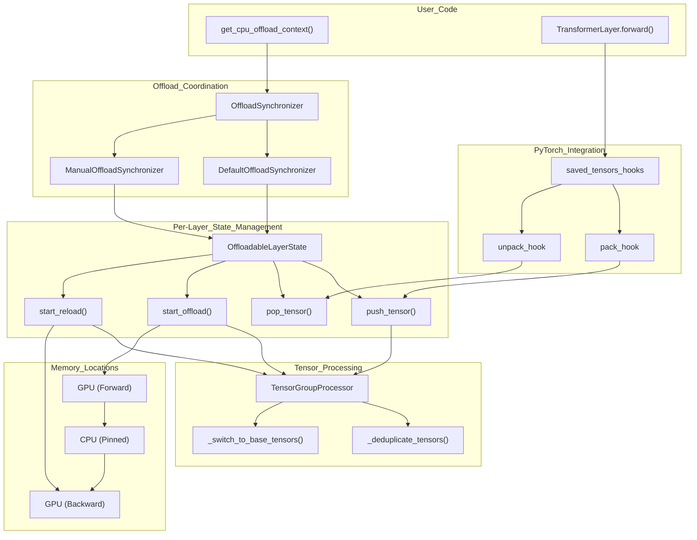
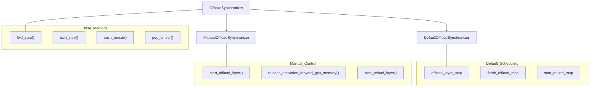
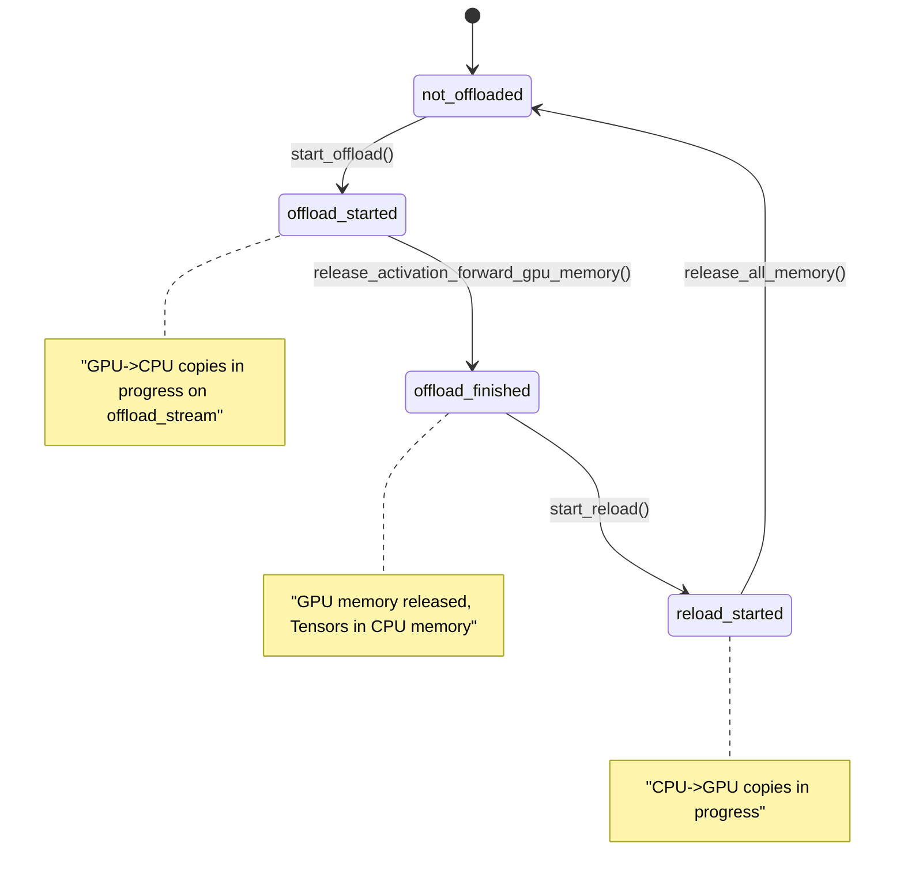
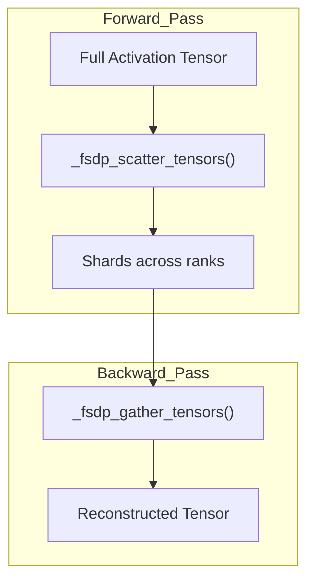

<!-- source: DeepWiki mcp.deepwiki.com · repo NVIDIA/TransformerEngine · page 8.2 Memory Management · fetched 2026-10-26 -->

# Memory Management

<details>
<summary>Relevant source files</summary>

The following files were used as context for generating this wiki page:

- [qa/L0_pytorch_unittest/test.sh](qa/L0_pytorch_unittest/test.sh)
- [tests/pytorch/test_cpu_offloading.py](tests/pytorch/test_cpu_offloading.py)
- [tests/pytorch/test_cuda_graphs.py](tests/pytorch/test_cuda_graphs.py)
- [transformer_engine/pytorch/cpu_offload.py](transformer_engine/pytorch/cpu_offload.py)
- [transformer_engine/pytorch/distributed.py](transformer_engine/pytorch/distributed.py)
- [transformer_engine/pytorch/graph.py](transformer_engine/pytorch/graph.py)
- [transformer_engine/pytorch/module/_common.py](transformer_engine/pytorch/module/_common.py)
- [transformer_engine/pytorch/module/base.py](transformer_engine/pytorch/module/base.py)
- [transformer_engine/pytorch/module/grouped_linear.py](transformer_engine/pytorch/module/grouped_linear.py)
- [transformer_engine/pytorch/module/layernorm_linear.py](transformer_engine/pytorch/module/layernorm_linear.py)
- [transformer_engine/pytorch/module/layernorm_mlp.py](transformer_engine/pytorch/module/layernorm_mlp.py)
- [transformer_engine/pytorch/module/linear.py](transformer_engine/pytorch/module/linear.py)
- [transformer_engine/pytorch/utils.py](transformer_engine/pytorch/utils.py)

</details>


This document describes memory management features and optimizations in TransformerEngine that reduce GPU memory consumption during training. These features are crucial for training large transformer models on limited GPU memory.

For quantization-related memory considerations, see [Quantization System](#3.2). For distributed training memory patterns, see [Tensor and Sequence Parallelism](#7.2).

---

## Overview

TransformerEngine provides several memory optimization techniques:

| Feature | Purpose | Memory Savings | Compute Cost |
|---------|---------|----------------|--------------|
| **CPU Offloading** | Transfer activations to CPU memory | High (50-80% of activation memory) | Moderate (PCIe bandwidth) |
| **Activation Checkpointing** | Recompute activations instead of storing | High (proportional to checkpointed layers) | High (1 extra forward pass) |
| **FSDP Integration** | Shard saved tensors across FSDP ranks | Moderate (proportional to FSDP world size) | Low (intra-node communication) |
| **Weight Gradient Store** | Delay weight gradient computation | Low-Moderate | None (reordered computation) |
| **Manual Cleanup** | Explicitly deallocate tensors | Low | None |

---

## CPU Offloading System

CPU offloading transfers activation tensors from GPU to CPU memory during the forward pass, then reloads them back to GPU for the backward pass. This trades PCIe bandwidth for GPU memory capacity.

### Architecture Overview



**Sources:** [transformer_engine/pytorch/cpu_offload.py:1-896]()

### V2 Implementation (Default)

The V2 implementation uses PyTorch's `saved_tensors_hooks` to transparently intercept tensor save/restore operations during autograd.

#### Core Classes

**OffloadSynchronizer Hierarchy:**



**Sources:** [transformer_engine/pytorch/cpu_offload.py:493-688]()

#### OffloadableLayerState State Machine

Each layer transitions through states during offloading:



**Sources:** [transformer_engine/pytorch/cpu_offload.py:227-491]()

#### Tensor Group Processing

Before offloading, tensors undergo optimization to reduce memory footprint via `TensorGroupProcessor` [transformer_engine/pytorch/cpu_offload.py:101-101]().


**Sources:** [transformer_engine/pytorch/cpu_offload.py:101-225]()

#### Usage Patterns

**Automatic Synchronization (Default):**
Uses `DefaultOffloadSynchronizer` to automatically schedule offload/reload for optimal memory usage based on `num_layers` and `model_layers`.

**Manual Synchronization:**
Uses `ManualOffloadSynchronizer` for fine-grained control in complex training loops like Pipeline Parallelism [transformer_engine/pytorch/cpu_offload.py:690-796]().

**Sources:** [transformer_engine/pytorch/cpu_offload.py:690-796]()

#### Key Implementation Details

**Tensor Eligibility for Offloading:**
Tensors are offloaded only if they are not marked with `_TE_do_not_offload` [transformer_engine/pytorch/cpu_offload.py:56-56](). The system can optionally offload the base tensor of a view if `offload_base_tensor=True` is set [transformer_engine/pytorch/cpu_offload.py:79-79]().

**Stream Synchronization:**
`start_reload_event` is used to mark when a tensor is ready for reload on the main stream [transformer_engine/pytorch/cpu_offload.py:76-76]().

**QuantizedTensor Handling:**
`QuantizedTensor` objects are decomposed into component tensors (data, scales, metadata) during `push_tensor()` via `prepare_for_saving` [transformer_engine/pytorch/cpu_offload.py:21-21]() and reconstructed during `pop_tensor()` via `restore_from_saved` [transformer_engine/pytorch/cpu_offload.py:20-20]().

---

## Activation Checkpointing

Activation checkpointing saves memory by recomputing activations during the backward pass instead of storing them.

### FP8 Integration

Checkpointing with FP8 quantization requires tracking the recomputation phase. The system checks `is_fp8_activation_recompute_enabled()` [transformer_engine/pytorch/distributed.py:65-65]() and `in_fp8_activation_recompute_phase()` [transformer_engine/pytorch/distributed.py:66-66]() to toggle behavior.

**Context Management:**
The `activation_recompute_forward` context manager (implied by distributed utilities) tracks whether the model is in the forward pass or recomputation pass.

**State Preservation:**
During recomputation, the system restores RNG states (CPU and CUDA) via `_get_cuda_rng_state` [transformer_engine/pytorch/distributed.py:98-98]() and `_set_cuda_rng_state` [transformer_engine/pytorch/distributed.py:123-123]().

**Sources:** [transformer_engine/pytorch/distributed.py:54-149]()

---

## FSDP Memory Management

TransformerEngine integrates with PyTorch's Fully Sharded Data Parallel (FSDP) to reduce memory usage of saved activations by sharding them across ranks.

### Scatter and Gather Operations

During forward pass, intermediate tensors are scattered across FSDP ranks before being saved:



**Sources:** [transformer_engine/pytorch/distributed.py:46-47]()

### Integration with Modules

**In Forward Pass (e.g., LayerNormLinear):**
The module reduces arguments to the autograd function `_LayerNormLinear` [transformer_engine/pytorch/module/layernorm_linear.py:94-94]() and uses `_fsdp_scatter_tensors` [transformer_engine/pytorch/module/layernorm_linear.py:56-56]() to shard activations.

**In Backward Pass:**
The module uses `_fsdp_gather_tensors` [transformer_engine/pytorch/module/layernorm_linear.py:57-57]() to reconstruct tensors for gradient computation.

**Sources:** [transformer_engine/pytorch/module/layernorm_linear.py:56-154]()

---

## Manual Memory Management Utilities

TransformerEngine provides utilities for explicit memory management when PyTorch's garbage collector is insufficient.

### clear_tensor_data Function

This function deallocates tensor memory by replacing the tensor's data with an empty tensor [transformer_engine/pytorch/utils.py:56-56]():

```python
def clear_tensor_data(*tensors: Tuple[Optional[torch.Tensor], ...]) -> None:
    for t in tensors:
        if t is not None:
            if hasattr(t, "_do_not_clear"): continue
            if hasattr(t, "clear"):
                t.clear()
            else:
                t.data = _empty_tensor()
```

**Sources:** [transformer_engine/pytorch/utils.py:56-79]()

### Usage in Modules

Modules like `LayerNormLinear` [transformer_engine/pytorch/module/layernorm_linear.py:91-91]() and `Linear` [transformer_engine/pytorch/module/linear.py:83-83]() call `clear_tensor_data` to free memory for tensors like `ln_out` or intermediate GEMM results when they are no longer required for the backward pass.

**Sources:** [transformer_engine/pytorch/module/layernorm_linear.py:38-38](), [transformer_engine/pytorch/module/linear.py:37-37]()

---

## Weight Gradient Store

The `WeightGradStore` [transformer_engine/pytorch/module/_common.py:66-66]() allows delaying weight gradient (wgrad) computation to reduce peak memory usage by reordering computation.

### Implementation

`WeightGradStore` is used in modules like `Linear` and `LayerNormMLP` to buffer inputs and gradients for a fused or delayed wgrad kernel call.

**Sources:** [transformer_engine/pytorch/module/linear.py:33-33](), [transformer_engine/pytorch/module/layernorm_mlp.py:77-77]()

---

## Userbuffers Memory Management

Userbuffers allocate communication buffers for overlapping tensor-parallel communication with computation.

### Buffer Allocation and Initialization

Userbuffers are initialized via `initialize_ub` [transformer_engine/pytorch/module/base.py:126-126](). This function sets up communicators and allocates buffers based on the provided `shape`, `tp_size`, and `quantization_modes` [transformer_engine/pytorch/module/base.py:130-130]().

**Sources:** [transformer_engine/pytorch/module/base.py:126-185]()

### Buffer Access and State

The system tracks initialization state via `is_ub_initialized()` [transformer_engine/pytorch/module/base.py:90-90](). Communication buffers are managed via `_ub_communicators` [transformer_engine/pytorch/module/base.py:83-83]().

**Sources:** [transformer_engine/pytorch/module/base.py:83-97]()

---

