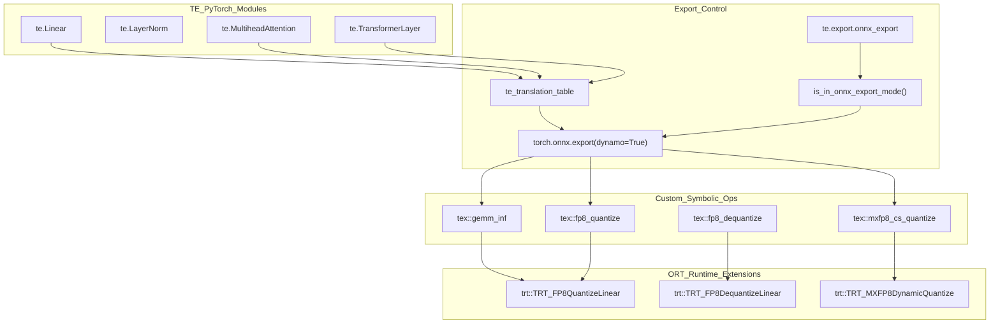
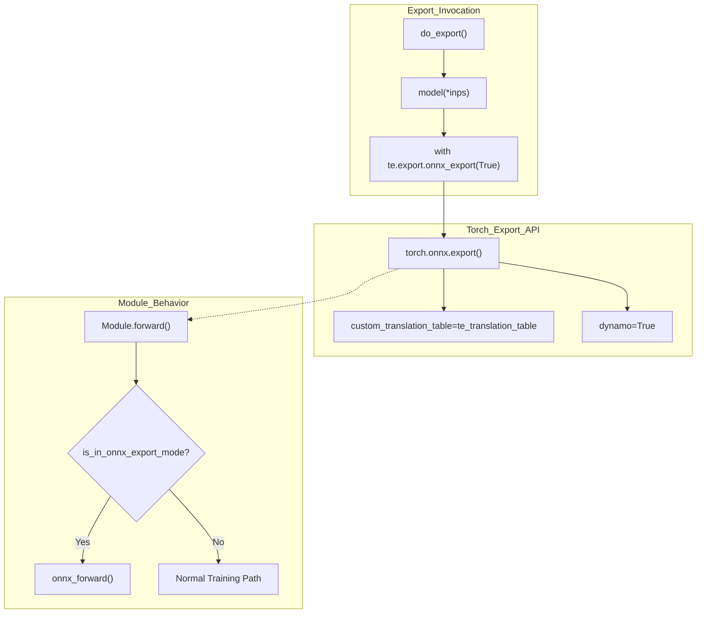
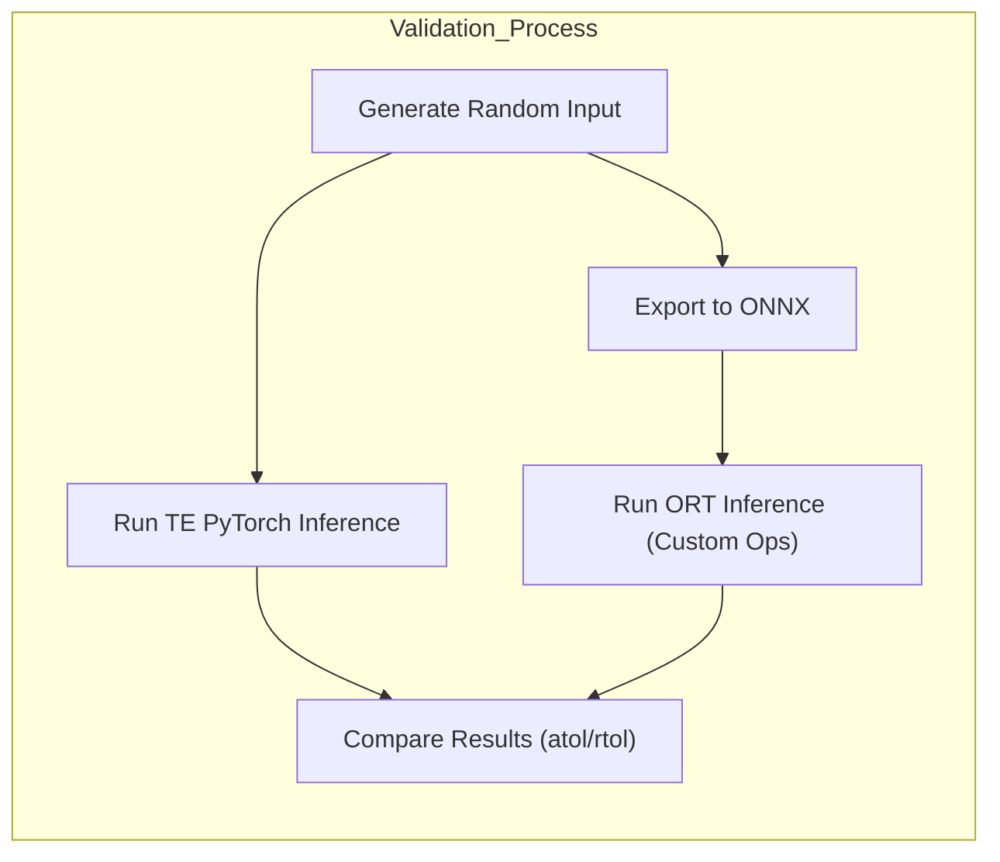

<!-- source: DeepWiki mcp.deepwiki.com · repo NVIDIA/TransformerEngine · page 9 ONNX Export · fetched 2026-10-26 -->

# ONNX Export

Relevant source files

The following files were used as context for generating this wiki page:

- [docs/api/jax.rst](docs/api/jax.rst)
- [docs/examples/onnx/onnx_export.ipynb](docs/examples/onnx/onnx_export.ipynb)
- [docs/examples/onnx/utils.py](docs/examples/onnx/utils.py)
- [qa/L0_pytorch_debug_unittest/test.sh](qa/L0_pytorch_debug_unittest/test.sh)
- [qa/L1_pytorch_onnx_unittest/test.sh](qa/L1_pytorch_onnx_unittest/test.sh)
- [tests/pytorch/test_numerics.py](tests/pytorch/test_numerics.py)
- [tests/pytorch/test_onnx_export.py](tests/pytorch/test_onnx_export.py)
- [tests/pytorch/test_sanity.py](tests/pytorch/test_sanity.py)
- [transformer_engine/jax/__init__.py](transformer_engine/jax/__init__.py)
- [transformer_engine/pytorch/export.py](transformer_engine/pytorch/export.py)
- [transformer_engine/pytorch/fp8.py](transformer_engine/pytorch/fp8.py)
- [transformer_engine/pytorch/onnx_extensions.py](transformer_engine/pytorch/onnx_extensions.py)
- [transformer_engine/pytorch/transformer.py](transformer_engine/pytorch/transformer.py)

This page documents Transformer Engine's ONNX export capabilities for PyTorch models, including custom FP8 operators for ONNX Runtime, validation workflows, and export context management. The system enables high-performance inference by converting TE PyTorch modules to ONNX format while preserving FP8 quantization through custom operations registered with ONNX Runtime.

The ONNX export functionality is primarily implemented in `transformer_engine.pytorch.export` [transformer_engine/pytorch/export.py:1-40]() and supported by symbolic definitions in `transformer_engine.pytorch.onnx_extensions.py` [transformer_engine/pytorch/onnx_extensions.py:1-350]().

## ONNX Export System Architecture

The system bridges the gap between complex TE PyTorch modules (which often use custom C++ kernels and Python-heavy quantizers) and the ONNX standard. It uses PyTorch's `torch.onnx.export` with `dynamo=True` mode [tests/pytorch/test_onnx_export.py:199-204]() and a custom translation table (`te_translation_table`) [transformer_engine/pytorch/export.py:36-38]().

**ONNX Export System Components and Data Flow**

The export workflow starts with TE modules, uses a context manager to switch modules into export-compatible `onnx_forward` paths [transformer_engine/pytorch/onnx_extensions.py:13-16](), and maps these to custom ONNX operators that execute via TensorRT-compatible kernels in ONNX Runtime.

Sources: [tests/pytorch/test_onnx_export.py:168-212](), [transformer_engine/pytorch/onnx_extensions.py:7-21](), [transformer_engine/pytorch/export.py:35-38]()

## Export Context and Translation Table

The export process is controlled by the `te.export.onnx_export(enabled)` context manager [transformer_engine/pytorch/export.py:14-34](). When active, `is_in_onnx_export_mode()` [transformer_engine/pytorch/export.py:36-38]() returns `True`, triggering modules like `TransformerLayer` [transformer_engine/pytorch/transformer.py:70-73]() to bypass training-specific fusions and use ONNX-compatible logic.

**Export Context and Module Dispatch**

TE modules must perform a "warm-up" run before export [docs/examples/onnx/onnx_export.ipynb:142-146]() to initialize FP8 metadata. The actual export happens within the `onnx_export` context, which forces modules to use simplified operators that have known symbolic mappings.

Sources: [tests/pytorch/test_onnx_export.py:196-199](), [transformer_engine/pytorch/transformer.py:35](), [docs/examples/onnx/onnx_export.ipynb:102-107]()

## Custom ONNX Operations for FP8 Support

Because FP8 is not natively part of the standard ONNX opset, TE implements custom operators using the `trt` domain (TensorRT) via `onnxruntime_extensions` [tests/pytorch/test_onnx_export.py:32-35]().

### Custom Operator Definitions

| PyTorch Custom Op | ONNX Op Type | Domain | Purpose |
|:---|:---|:---|:---|
| `tex::gemm_inf` | `Gemm` | `onnx` | Transposed weight GEMM for inference [transformer_engine/pytorch/onnx_extensions.py:51-78]() |
| `tex::fp8_quantize` | `TRT_FP8QuantizeLinear` | `trt` | FP8 Quantization [transformer_engine/pytorch/onnx_extensions.py:83-104]() |
| `tex::fp8_dequantize` | `TRT_FP8DequantizeLinear` | `trt` | FP8 Dequantization [transformer_engine/pytorch/onnx_extensions.py:130-150]() |
| `tex::fp8_cs_quantize` | `TRT_FP8QuantizeLinear` | `trt` | Current Scaling FP8 Quant [transformer_engine/pytorch/onnx_extensions.py:174-186]() |
| `tex::mxfp8_cs_quantize` | `TRT_MXFP8DynamicQuantize` | `trt` | MXFP8 Block Scaling Quant [transformer_engine/pytorch/onnx_extensions.py:214-228]() |

### Implementation Details
Custom ops are registered using the `@onnx_op` decorator [tests/pytorch/test_onnx_export.py:76-85](). These functions bridge NumPy arrays used by ONNX Runtime and PyTorch tensors used by TE's internal quantizers like `Float8Quantizer` [transformer_engine/pytorch/onnx_extensions.py:88-90]() or `MXFP8Quantizer` [transformer_engine/pytorch/onnx_extensions.py:218-220]().

Sources: [transformer_engine/pytorch/onnx_extensions.py:37-40](), [tests/pytorch/test_onnx_export.py:76-147]()

## Supported Modules and Validation Workflow

### Supported Module Types
Transformer Engine supports ONNX export for the following modules [tests/pytorch/test_onnx_export.py:33-35]():
* **Linear Layers**: `te.Linear`, `te.LayerNormLinear`, `te.LayerNormMLP`.
* **Normalizations**: `te.LayerNorm`, `te.RMSNorm`.
* **Attention**: `te.MultiheadAttention`, `te.TransformerLayer`.

### Validation Workflow
The validation workflow in `tests/pytorch/test_onnx_export.py` ensures that the exported ONNX model produces results matching the original TE PyTorch module [tests/pytorch/test_onnx_export.py:8-11]().

**Validation Data Flow**

Validation involves creating an `ort.InferenceSession` with `CUDAExecutionProvider` and loading custom op libraries via `get_library_path()` from `onnxruntime_extensions` [tests/pytorch/test_onnx_export.py:245-265]().

Sources: [tests/pytorch/test_onnx_export.py:278-304](), [tests/pytorch/test_onnx_export.py:306-331]()

## Export Configuration and Constraints

### FP8 Recipe Support
ONNX export is supported for the following quantization recipes [docs/examples/onnx/onnx_export.ipynb:13-15]():
1. **High Precision**: FP32/FP16/BF16.
2. **Delayed Scaling**: Standard FP8 training recipe.
3. **Current Scaling**: `Float8CurrentScaling`.
4. **MXFP8**: Microscaling block formats.

### Dynamic Shapes
The system supports dynamic shapes for batch size and sequence length using `torch.export.Dim` or standard ONNX dynamic axes [tests/pytorch/test_onnx_export.py:1140-1145](). This is critical for inference servers where batch sizes vary at runtime.

### Key Environment Variables
* `NVTE_ONNX_KVCACHE_MAX_SEQ_LEN`: Sets the maximum sequence length for attention masking during export [tests/pytorch/test_onnx_export.py:159]().
* `NVTE_ONNX_EXPORT_SAVE_TEST_IO`: If set to `1`, serializes test inputs/outputs to JSON for offline debugging [tests/pytorch/test_onnx_export.py:44-49]().

Sources: [tests/pytorch/test_onnx_export.py:157-160](), [docs/examples/onnx/onnx_export.ipynb:148-152]()

---

