# Page: Overview

# Overview

<details>
<summary>Relevant source files</summary>

The following files were used as context for generating this wiki page:

- [.github/workflows/build.yml](.github/workflows/build.yml)
- [.github/workflows/lint.yml](.github/workflows/lint.yml)
- [README.rst](README.rst)
- [build_tools/build_ext.py](build_tools/build_ext.py)
- [docs/api/jax.rst](docs/api/jax.rst)
- [docs/api/pytorch.rst](docs/api/pytorch.rst)
- [docs/installation.rst](docs/installation.rst)
- [examples/README.md](examples/README.md)
- [transformer_engine/jax/__init__.py](transformer_engine/jax/__init__.py)
- [transformer_engine/jax/setup.py](transformer_engine/jax/setup.py)
- [transformer_engine/pytorch/__init__.py](transformer_engine/pytorch/__init__.py)
- [transformer_engine/pytorch/export.py](transformer_engine/pytorch/export.py)
- [transformer_engine/pytorch/setup.py](transformer_engine/pytorch/setup.py)

</details>


TransformerEngine (TE) is a library for accelerating Transformer models on NVIDIA GPUs through optimized CUDA kernels and low-precision training with FP8, MXFP8, and NVFP4 quantization. It provides framework-specific APIs (PyTorch, JAX) built on a shared C++/CUDA core library, enabling efficient training and inference with minimal code changes. On Blackwell GPUs, TE supports MXFP8 (Microscaling FP8) and NVFP4 formats for even greater efficiency.

This page provides a high-level introduction to TransformerEngine's architecture, capabilities, and design principles.

## Purpose and Capabilities

TransformerEngine addresses key challenges in large-scale Transformer training:

1.  **Low-precision training**: Enables FP8, MXFP8, and NVFP4 training on Hopper, Ada, and Blackwell GPUs without accuracy degradation [README.rst:37-40]().
2.  **Kernel optimization**: Provides fused operations (LayerNorm+Linear, fused attention) and optimized GEMM implementations [README.rst:64]().
3.  **Distributed training**: Supports tensor parallelism, sequence parallelism, and communication-computation overlap via Userbuffers [README.rst:53-55]().
4.  **Ease of Use**: Modules internally maintain scaling factors and amax history, simplifying mixed-precision training [README.rst:57-58]().

The library supports CUDA 12.1+ (12.8+ for Blackwell) and cuDNN 9.3+ [docs/installation.rst:15-17]().

Sources: [README.rst:33-68](), [docs/installation.rst:9-21]()

## Three-Tier Architecture

TransformerEngine uses a layered architecture that separates framework-specific logic from optimized CUDA kernels:

Title: System Architecture Layers
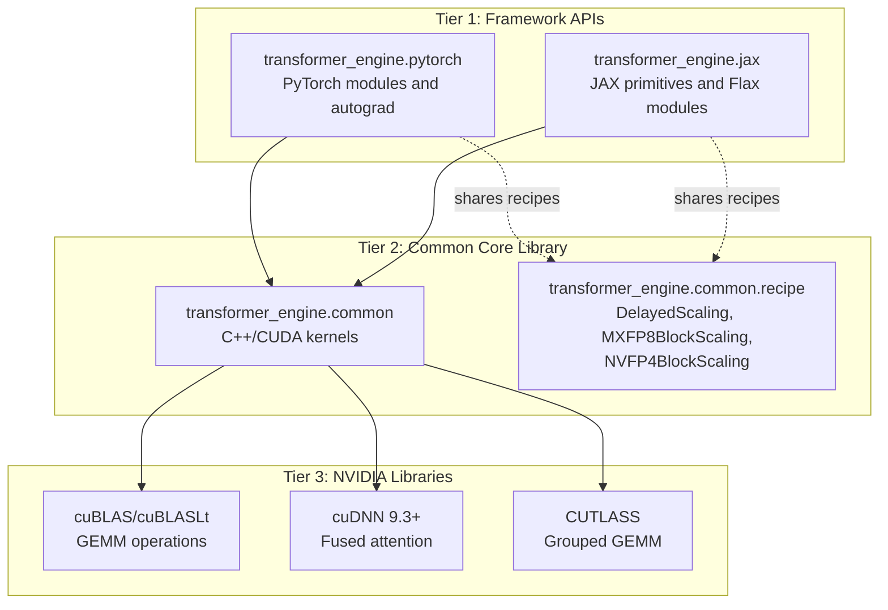

**Tier 1 (Framework APIs)**: Each framework provides high-level modules like `Linear`, `LayerNorm`, and `TransformerLayer`. PyTorch modules are exported in `transformer_engine.pytorch` [transformer_engine/pytorch/__init__.py:21-35](), while JAX bindings are in `transformer_engine.jax` [transformer_engine/jax/__init__.py:4-21]().

**Tier 2 (Common Core)**: A framework-agnostic C++ API that provides the logic for FP8 support, GEMM dispatch, and fused kernels [README.rst:55-56](). It includes scaling recipes defined in `transformer_engine.common.recipe` [README.rst:91]().

**Tier 3 (NVIDIA Libraries)**: TE integrates with cuBLAS for GEMM, cuDNN for fused attention, and CUTLASS for advanced kernel logic [README.rst:37-44]().

Sources: [README.rst:33-58](), [transformer_engine/pytorch/__init__.py:18-72](), [transformer_engine/jax/__init__.py:30-54]()

## Supported Frameworks and Integration Pattern

TransformerEngine supports PyTorch and JAX through a consistent integration pattern that bridges high-level Python code to low-level C++ kernels.

Title: Framework to Core Mapping
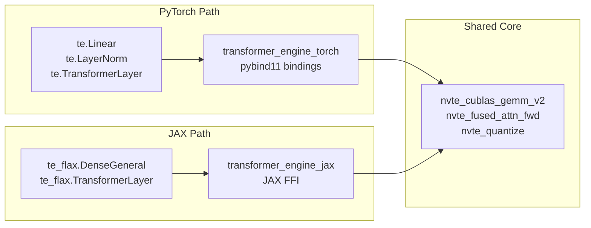

Both frameworks follow a modular pattern:
1.  **User-facing modules**: `te.Linear` [transformer_engine/pytorch/__init__.py:22]() in PyTorch and `te_flax.DenseGeneral` [transformer_engine/jax/flax/__init__.py]() (referenced in [README.rst:130]()) in JAX.
2.  **Binding layer**: PyTorch uses the `transformer_engine_torch` extension [transformer_engine/pytorch/setup.py:28](), while JAX uses `transformer_engine_jax` [transformer_engine/jax/setup.py:131]().
3.  **Shared Kernels**: Both frameworks ultimately call the same optimized C++ API for performance-critical operations [README.rst:42-44]().

Sources: [README.rst:72-145](), [transformer_engine/pytorch/__init__.py:18-107](), [transformer_engine/pytorch/setup.py:155-185](), [transformer_engine/jax/setup.py:112-140]()

## Quantization System Overview

TransformerEngine provides multiple quantization strategies controlled by recipes. Users select a precision format and scaling method via `te.autocast` [transformer_engine/pytorch/__init__.py:46]().

| Feature | Precision Formats | Hardware Support |
| :--- | :--- | :--- |
| **FP8** | E4M3, E5M2, Hybrid | Hopper, Ada, Blackwell |
| **MXFP8** | Microscaling FP8 | Blackwell |
| **NVFP4** | 4-bit (E2M1) | Blackwell |

### Quantization Data Flow

Title: Quantization and Scaling Flow
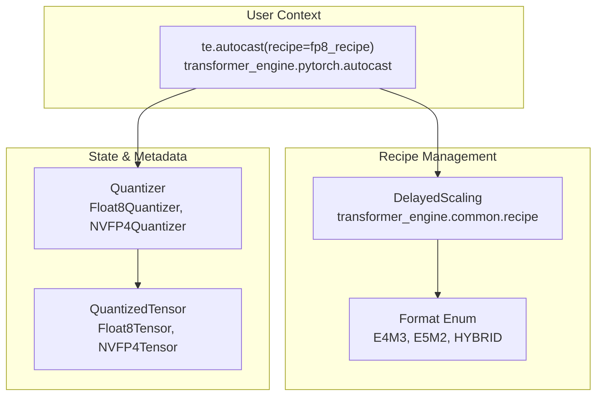

**Scaling Strategies**:
*   **Delayed Scaling**: Uses `amax` history to compute scaling factors for the next iteration [README.rst:91]().
*   **Current Scaling**: Computes scaling factors based on the current tensor's values [transformer_engine/pytorch/__init__.py:84]().
*   **Block Scaling**: Applies scaling factors to sub-blocks of the tensor for higher precision [transformer_engine/pytorch/__init__.py:86]().

Sources: [README.rst:37-58](), [transformer_engine/pytorch/__init__.py:44-55](), [transformer_engine/pytorch/__init__.py:77-95]()

## Build System and Distribution

TransformerEngine uses a unified build system to handle multi-framework support and CUDA kernel compilation.

**Build Orchestration**: The library uses `setuptools` integrated with `CMake` to compile the core C++ library and framework-specific extensions [build_tools/build_ext.py:30-102]().
**Framework Detection**: The environment variable `NVTE_FRAMEWORK` controls which framework extensions are built (`pytorch`, `jax`, `all`, or `none`) [.github/workflows/build.yml:87, 110, 157]().
**Distribution**:
*   **NGC Containers**: Pre-installed in NVIDIA PyTorch/JAX containers [docs/installation.rst:26-27]().
*   **PyPI**: Available as `transformer_engine` with extras like `[pytorch]` or `[jax]` [docs/installation.rst:33-37]().
*   **Source**: Built using `pip install .` which triggers `CMakeBuildExtension` [transformer_engine/pytorch/setup.py:63, 135]().

Sources: [build_tools/build_ext.py:1-140](), [transformer_engine/pytorch/setup.py:1-185](), [docs/installation.rst:23-124]()

---

# Page: Getting Started

# Getting Started

<details>
<summary>Relevant source files</summary>

The following files were used as context for generating this wiki page:

- [.github/workflows/build.yml](.github/workflows/build.yml)
- [.github/workflows/deploy_nightly_docs.yml](.github/workflows/deploy_nightly_docs.yml)
- [.github/workflows/docs.yml](.github/workflows/docs.yml)
- [.github/workflows/lint.yml](.github/workflows/lint.yml)
- [.gitmodules](.gitmodules)
- [MANIFEST.in](MANIFEST.in)
- [README.rst](README.rst)
- [build_tools/build_ext.py](build_tools/build_ext.py)
- [build_tools/jax.py](build_tools/jax.py)
- [build_tools/pytorch.py](build_tools/pytorch.py)
- [build_tools/utils.py](build_tools/utils.py)
- [build_tools/wheel_utils/Dockerfile.aarch](build_tools/wheel_utils/Dockerfile.aarch)
- [build_tools/wheel_utils/Dockerfile.x86](build_tools/wheel_utils/Dockerfile.x86)
- [build_tools/wheel_utils/build_wheels.sh](build_tools/wheel_utils/build_wheels.sh)
- [build_tools/wheel_utils/launch_aarch.sh](build_tools/wheel_utils/launch_aarch.sh)
- [build_tools/wheel_utils/launch_x86.sh](build_tools/wheel_utils/launch_x86.sh)
- [docs/_static/css/nvidia_font.css](docs/_static/css/nvidia_font.css)
- [docs/_templates/layout.html](docs/_templates/layout.html)
- [docs/api/c/softmax.rst](docs/api/c/softmax.rst)
- [docs/conf.py](docs/conf.py)
- [docs/examples/advanced_optimizations.ipynb](docs/examples/advanced_optimizations.ipynb)
- [docs/index.rst](docs/index.rst)
- [docs/installation.rst](docs/installation.rst)
- [examples/README.md](examples/README.md)
- [pyproject.toml](pyproject.toml)
- [qa/L1_cpp_distributed/test.sh](qa/L1_cpp_distributed/test.sh)
- [setup.py](setup.py)
- [tests/cpp_distributed/CMakeLists.txt](tests/cpp_distributed/CMakeLists.txt)
- [tests/cpp_distributed/run_test_ep.sh](tests/cpp_distributed/run_test_ep.sh)
- [transformer_engine/__init__.py](transformer_engine/__init__.py)
- [transformer_engine/common/CMakeLists.txt](transformer_engine/common/CMakeLists.txt)
- [transformer_engine/common/__init__.py](transformer_engine/common/__init__.py)
- [transformer_engine/jax/cpp_extensions/flex_attention.py](transformer_engine/jax/cpp_extensions/flex_attention.py)
- [transformer_engine/jax/pyproject.toml](transformer_engine/jax/pyproject.toml)
- [transformer_engine/jax/setup.py](transformer_engine/jax/setup.py)
- [transformer_engine/pytorch/setup.py](transformer_engine/pytorch/setup.py)

</details>


## Purpose and Scope

This page provides step-by-step instructions for installing Transformer Engine and running your first accelerated model. It covers system requirements, multiple installation methods (pip, source, NGC containers), configuration options, and basic usage examples for both PyTorch and JAX frameworks.

Transformer Engine (TE) is designed to accelerate Transformer models on NVIDIA GPUs, specifically utilizing 8-bit floating point (FP8) precision on Hopper, Ada, and Blackwell architectures, as well as MXFP8 and NVFP4 on Blackwell [README.rst:37-44]().

**Sources:** [README.rst:33-59]()

---

## System Requirements

### Hardware Requirements

| Component | Requirement |
|-----------|-------------|
| **GPU Architecture** | Blackwell, Hopper, Ada, or Ampere [README.rst:65-67]() |
| **FP8 Support** | Hopper (CC 9.0), Ada (CC 8.9), Blackwell (CC 10.0+) [README.rst:37-40]() |
| **Advanced Formats** | MXFP8 and NVFP4 support requires Blackwell GPUs [README.rst:66]() |

### Software Requirements

| Component | Version |
|-----------|---------|
| **Operating System** | Linux x86_64 [docs/installation.rst:14]() |
| **CUDA** | 12.1+ (12.8+ for Blackwell support) [docs/installation.rst:15](), [transformer_engine/common/CMakeLists.txt:24-26]() |
| **cuDNN** | 9.3+ [docs/installation.rst:17]() |
| **Python** | 3.10+ [build_tools/utils.py:23-37]() |
| **CMake** | 3.18+ (3.21+ recommended for core build) [build_tools/utils.py:105](), [transformer_engine/common/CMakeLists.txt:5]() |
| **PyTorch** | 2.1+ (for PyTorch integration) [build_tools/pytorch.py:26]() |
| **JAX** | 0.4.7+ (for JAX integration) [docs/installation.rst:56]() |

**Sources:** [docs/installation.rst:9-21](), [build_tools/utils.py:23-37](), [transformer_engine/common/CMakeLists.txt:5-26](), [build_tools/pytorch.py:23-34]()

---

## Installation Methods

### Installation Flow Overview

The following diagram illustrates how the build system dispatches to framework-specific extensions based on environment variables and detected dependencies.

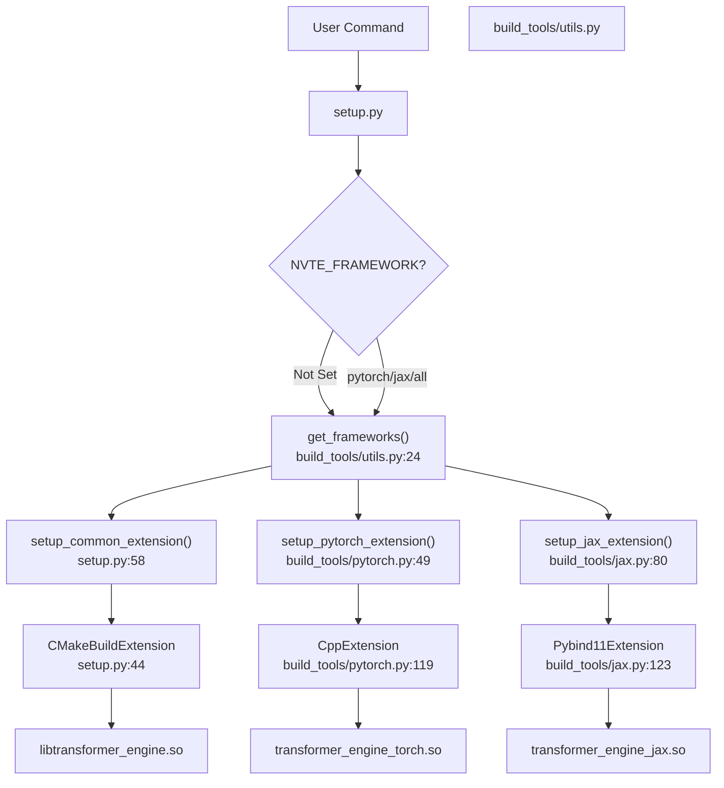

**Sources:** [setup.py:38-44](), [setup.py:58-111](), [build_tools/pytorch.py:49-126](), [build_tools/jax.py:80-129]()

---

### Docker Installation (Recommended)

Transformer Engine is preinstalled in the NVIDIA PyTorch container (NGC) version 22.09 and later [docs/installation.rst:26-27]().

#### PyTorch Container
```bash
docker run --gpus all -it --rm nvcr.io/nvidia/pytorch:24.12-py3
```

#### JAX Container
```bash
docker run --gpus all -it --rm ghcr.io/nvidia/jax:jax
```

**Sources:** [docs/installation.rst:23-27](), [.github/workflows/build.yml:73](), [.github/workflows/build.yml:95]()

---

### pip Installation

#### Install from PyPI
Transformer Engine provides wheels for the core library and source distributions for framework extensions [docs/installation.rst:39]().

```bash
# Install with PyTorch support
pip3 install --no-build-isolation transformer_engine[pytorch]

# Install with JAX support
pip3 install --no-build-isolation transformer_engine[jax]

# Install core library only (CUDA 12 default)
pip3 install transformer_engine[core]
```

#### Install from GitHub
```bash
# Latest stable version
pip3 install --no-build-isolation git+https://github.com/NVIDIA/TransformerEngine.git@stable

# Development build
pip3 install --no-build-isolation git+https://github.com/NVIDIA/TransformerEngine.git@main
```

**Sources:** [docs/installation.rst:30-48](), [docs/installation.rst:58-84]()

---

### Source Installation

For custom builds or development, install directly from a local clone.

```bash
git clone --branch stable --recursive https://github.com/NVIDIA/TransformerEngine.git
cd TransformerEngine
export NVTE_FRAMEWORK=pytorch         # Specify framework
pip3 install --no-build-isolation .   # Build and install
```

To enable debug symbols during source build, set `NVTE_BUILD_DEBUG=1` [docs/installation.rst:123]().

**Sources:** [docs/installation.rst:93-124](), [setup.py:38-42]()

---

## Build Configuration

### Environment Variables

| Variable | Purpose | Default |
|----------|---------|---------|
| `NVTE_FRAMEWORK` | Target frameworks: `pytorch`, `jax`, `all`, `none` [docs/installation.rst:84]() | Auto-detect |
| `NVTE_BUILD_DEBUG` | Build with `-g` and disable optimizations [build_tools/utils.py:41-43]() | `0` |
| `MAX_JOBS` | Parallel build threads for Ninja [build_tools/utils.py:56-58]() | System CPU count |
| `NVTE_UB_WITH_MPI` | Enable MPI for Userbuffers [setup.py:64-68]() | `0` |
| `NVTE_WITH_CUBLASMP` | Enable cuBLASMp support [setup.py:79-84]() | `0` |
| `NVTE_ENABLE_NVSHMEM` | Enable NVSHMEM support [setup.py:70-75]() | `0` |

**Sources:** [setup.py:58-102](), [build_tools/utils.py:41-65](), [docs/installation.rst:80-85]()

---

## Quick Start Examples

### PyTorch Usage

This example uses `te.Linear` and `te.autocast` to enable FP8 precision [README.rst:75-99]().

```python
import torch
import transformer_engine.pytorch as te
from transformer_engine.common import recipe

# Define dimensions
in_features, out_features = 768, 3072

# Initialize model and input
model = te.Linear(in_features, out_features, bias=True).cuda()
inp = torch.randn(2048, in_features, device="cuda")

# Configure FP8 recipe
fp8_recipe = recipe.DelayedScaling(margin=0, fp8_format=recipe.Format.E4M3)

# Forward pass with autocast
with te.autocast(enabled=True, recipe=fp8_recipe):
    out = model(inp)

out.sum().backward()
```

**Sources:** [README.rst:72-99]()

---

### JAX/Flax Usage

Using the `te_flax.DenseGeneral` module for FP8 execution in JAX [README.rst:107-141]().

```python
import jax
import transformer_engine.jax as te
import transformer_engine.jax.flax as te_flax
from transformer_engine.common import recipe

# Setup recipe
fp8_recipe = recipe.DelayedScaling(margin=0, fp8_format=recipe.Format.HYBRID)

# Use TE Flax module within autocast context
with te.autocast(enabled=True, recipe=fp8_recipe):
    model = te_flax.DenseGeneral(features=1024)
    # ... standard Flax initialization and application ...
```

**Sources:** [README.rst:101-141]()

---

## Troubleshooting

### Runtime Library Resolution

Transformer Engine uses a dynamic loading mechanism to find its framework-specific shared objects (`.so` files). If you encounter `FileNotFoundError` during import, ensure the libraries were built and are located in the expected search paths [transformer_engine/common/__init__.py:59-95]().

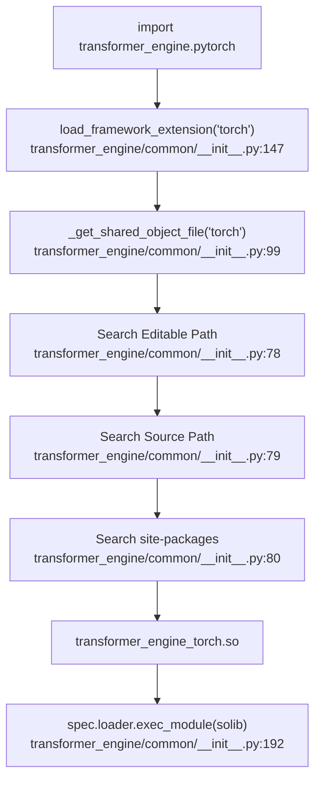

**Sources:** [transformer_engine/common/__init__.py:59-132](), [transformer_engine/common/__init__.py:147-194]()

### Common Issues

1.  **CUDA Version Mismatch:** Blackwell GPUs require CUDA 12.8+; Hopper/Ada require 12.1+ [docs/installation.rst:15]().
2.  **Missing Headers:** If CUDA headers are not found, set `NVTE_CUDA_INCLUDE_PATH` or `CUDA_HOME` [docs/installation.rst:21](), [build_tools/utils.py:185]().
3.  **NCCL Version:** The NCCL EP backend requires a minimum runtime version of 2.30.4 [transformer_engine/__init__.py:17-18]().
4.  **PyPI Version Mismatch:** If installing via PyPI, the `transformer-engine` (metapackage), `transformer-engine-cu*` (core), and framework extensions must have matching versions [transformer_engine/common/__init__.py:180-186]().

**Sources:** [docs/installation.rst:19-22](), [transformer_engine/__init__.py:17-55](), [transformer_engine/common/__init__.py:164-187]()

---

# Page: Architecture

# Architecture

<details>
<summary>Relevant source files</summary>

The following files were used as context for generating this wiki page:

- [.github/workflows/build.yml](.github/workflows/build.yml)
- [.github/workflows/lint.yml](.github/workflows/lint.yml)
- [.gitmodules](.gitmodules)
- [README.rst](README.rst)
- [build_tools/build_ext.py](build_tools/build_ext.py)
- [docs/installation.rst](docs/installation.rst)
- [examples/README.md](examples/README.md)
- [qa/L1_cpp_distributed/test.sh](qa/L1_cpp_distributed/test.sh)
- [setup.py](setup.py)
- [tests/cpp/test_common.cu](tests/cpp/test_common.cu)
- [tests/cpp/test_common.h](tests/cpp/test_common.h)
- [tests/cpp_distributed/CMakeLists.txt](tests/cpp_distributed/CMakeLists.txt)
- [tests/cpp_distributed/run_test_ep.sh](tests/cpp_distributed/run_test_ep.sh)
- [transformer_engine/__init__.py](transformer_engine/__init__.py)
- [transformer_engine/common/CMakeLists.txt](transformer_engine/common/CMakeLists.txt)
- [transformer_engine/common/__init__.py](transformer_engine/common/__init__.py)
- [transformer_engine/common/common.h](transformer_engine/common/common.h)
- [transformer_engine/common/include/transformer_engine/transformer_engine.h](transformer_engine/common/include/transformer_engine/transformer_engine.h)
- [transformer_engine/common/transformer_engine.cpp](transformer_engine/common/transformer_engine.cpp)
- [transformer_engine/jax/setup.py](transformer_engine/jax/setup.py)
- [transformer_engine/pytorch/setup.py](transformer_engine/pytorch/setup.py)

</details>


## Purpose and Scope

This page provides a high-level overview of Transformer Engine's architecture, including the multi-layered design that enables framework-agnostic FP8 optimizations. For detailed information on specific aspects:
- For in-depth layer-by-layer architecture details, see [System Architecture](#3.1)
- For FP8, MXFP8, and NVFP4 quantization design and scaling recipes, see [Quantization System](#3.2)
- For build system mechanics and installation, see [Build System and Installation](#3.3)
- For PyTorch-specific implementation, see [PyTorch Integration](#4)
- For JAX-specific implementation, see [JAX Integration](#5)

## Architectural Overview

Transformer Engine is designed as a multi-layered library that provides low-precision accelerated Transformer building blocks for multiple deep learning frameworks. The architecture separates framework-specific concerns from core computational kernels, enabling code reuse and consistent behavior across PyTorch and JAX. While it originally focused on FP8 for Hopper GPUs, it now extends support to MXFP8 (Microscaling FP8) and NVFP4 formats on Blackwell GPUs [README.rst:37-44]().

### High-Level Component Diagram

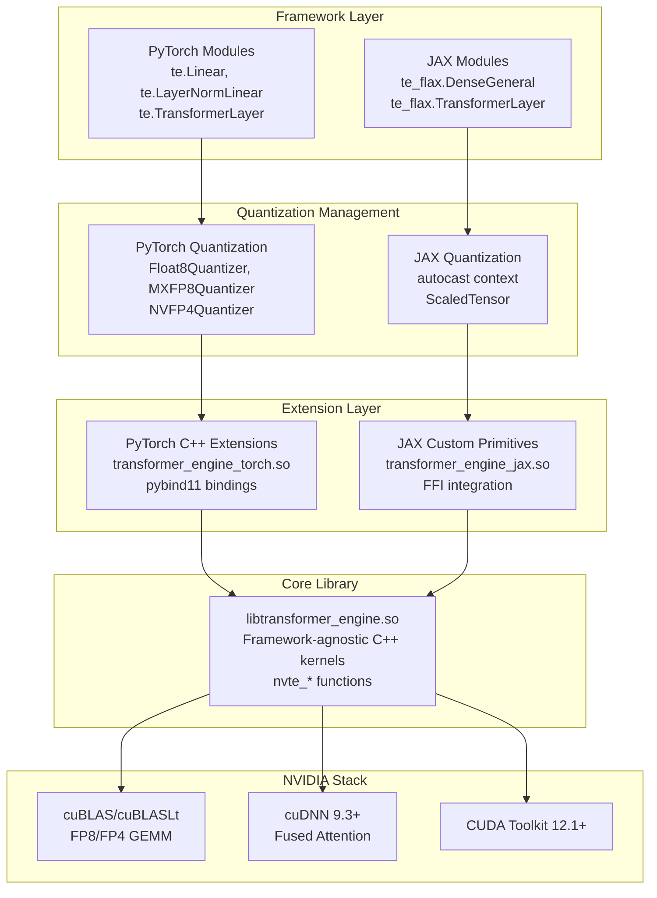

Sources: [setup.py:58-111](), [transformer_engine/common/CMakeLists.txt:173-200](), [README.rst:37-58]()

## Multi-Framework Support

Transformer Engine supports multiple deep learning frameworks through a unified core library. Each framework has its own Python API and extension mechanism, but all converge on the same C++ computational kernels defined in the core library [transformer_engine/common/CMakeLists.txt:173-200]().

### Framework-Specific Paths to Core GEMM

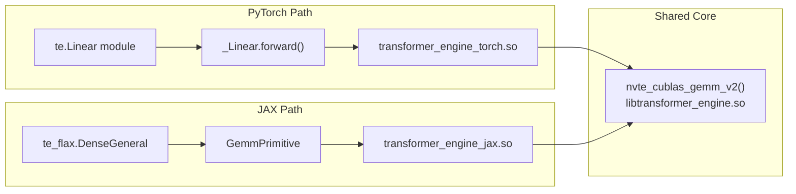

Sources: [transformer_engine/common/__init__.py:109-115](), [transformer_engine/common/CMakeLists.txt:173-200](), [README.rst:72-141]()

## Layered Architecture

The architecture follows a clear separation of concerns across four distinct layers:

### Layer 1: Python API
Framework-specific Python modules that users interact with directly. These handle integration with framework-specific autograd systems and distributed training coordination.
- **PyTorch**: Modules like `te.Linear` and `te.TransformerLayer` [README.rst:75-99]().
- **JAX**: Flax modules like `te_flax.DenseGeneral` [README.rst:107-141]().

### Layer 2: Quantization Management
Framework-specific systems for managing quantization state and scaling factors. Modules internally maintain scaling factors and amax values needed for training [README.rst:55-58](). Scaling modes include `NVTE_DELAYED_TENSOR_SCALING`, `NVTE_MXFP8_1D_SCALING`, and `NVTE_NVFP4_1D_SCALING` [transformer_engine/common/include/transformer_engine/transformer_engine.h:99-119]().

### Layer 3: C++ Extensions
Framework-specific C++ extensions bridge Python to the core library. These are compiled as shared objects such as `transformer_engine_torch.so` and `transformer_engine_jax.so` [transformer_engine/common/__init__.py:110-115]().

### Layer 4: Core C++ Library
The framework-agnostic computational core in `libtransformer_engine.so` [transformer_engine/common/__init__.py:111-112](). This layer contains the CUDA/C++ implementations for GEMM, attention, and normalization [transformer_engine/common/CMakeLists.txt:173-200]().

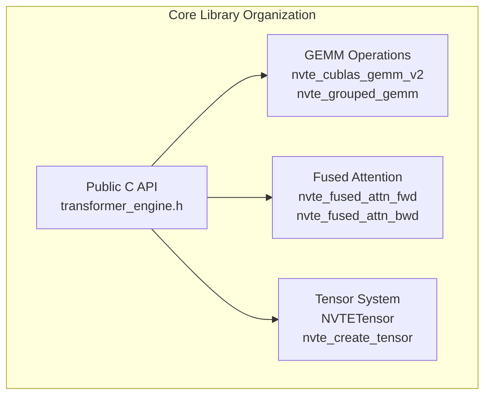

Sources: [transformer_engine/common/include/transformer_engine/transformer_engine.h:130-162](), [transformer_engine/common/CMakeLists.txt:173-200]()

## Build System Architecture

The build system orchestrates compilation of the core library and framework-specific extensions using CMake and Python's `setuptools` [setup.py:5-44]().

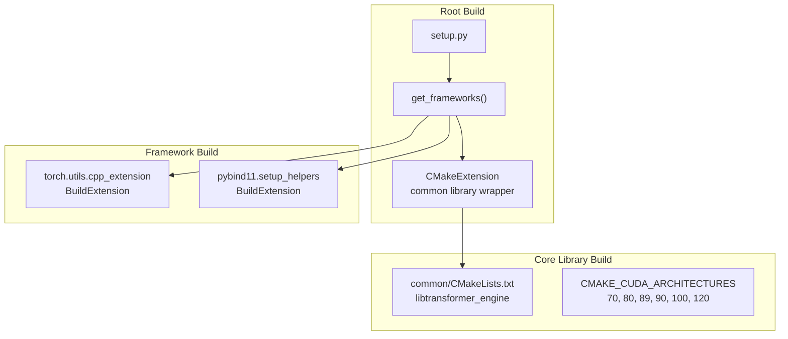

Sources: [setup.py:30-44](), [setup.py:107-111](), [transformer_engine/common/CMakeLists.txt:28-88]()

## Data Flow Through the Stack

For a typical forward pass (e.g., `te.Linear` in PyTorch):
1. **Python Entry**: User calls `model(inp)` within a `te.autocast` context [README.rst:93-95]().
2. **Quantization**: Input tensors are prepared with metadata like `scale_inv` and `amax` [transformer_engine/common/transformer_engine.cpp:143-165]().
3. **C++ Dispatch**: The framework extension calls the core library's GEMM interface, such as `nvte_cublas_gemm_v2` [transformer_engine/common/include/transformer_engine/transformer_engine.h:234]().
4. **CUDA Execution**: Optimized CUDA kernels (cuBLASLt or cuDNN) execute the operation on the GPU [transformer_engine/common/CMakeLists.txt:90-96]().

Sources: [README.rst:93-95](), [transformer_engine/common/transformer_engine.cpp:143-165](), [transformer_engine/common/include/transformer_engine/transformer_engine.h:234]()

## Distributed Training Features

Transformer Engine is designed for large-scale training, providing features to optimize communication and memory:
- **Userbuffers**: System for overlapping communication with computation (e.g., via `NVTE_UB_WITH_MPI`) [setup.py:64-69]().
- **Parallelism**: Support for tensor, sequence, and context parallelism [README.rst:53-56]().
- **Memory Management**: Support for activation checkpointing and memory optimizations across all precisions (FP16, BF16, FP8, FP4) [README.rst:60-67]().

Sources: [setup.py:64-69](), [README.rst:53-67]()

---

# Page: System Architecture

# System Architecture

<details>
<summary>Relevant source files</summary>

The following files were used as context for generating this wiki page:

- [.github/workflows/build.yml](.github/workflows/build.yml)
- [.github/workflows/lint.yml](.github/workflows/lint.yml)
- [README.rst](README.rst)
- [build_tools/build_ext.py](build_tools/build_ext.py)
- [docs/installation.rst](docs/installation.rst)
- [examples/README.md](examples/README.md)
- [tests/cpp/test_common.cu](tests/cpp/test_common.cu)
- [tests/cpp/test_common.h](tests/cpp/test_common.h)
- [tests/pytorch/test_grouped_tensor.py](tests/pytorch/test_grouped_tensor.py)
- [transformer_engine/common/cast/dispatch/quantize.cuh](transformer_engine/common/cast/dispatch/quantize.cuh)
- [transformer_engine/common/common.h](transformer_engine/common/common.h)
- [transformer_engine/common/include/transformer_engine/transformer_engine.h](transformer_engine/common/include/transformer_engine/transformer_engine.h)
- [transformer_engine/common/transformer_engine.cpp](transformer_engine/common/transformer_engine.cpp)
- [transformer_engine/jax/csrc/extensions.h](transformer_engine/jax/csrc/extensions.h)
- [transformer_engine/jax/csrc/extensions/activation.cpp](transformer_engine/jax/csrc/extensions/activation.cpp)
- [transformer_engine/jax/csrc/extensions/ffi.cpp](transformer_engine/jax/csrc/extensions/ffi.cpp)
- [transformer_engine/jax/csrc/extensions/ffi.h](transformer_engine/jax/csrc/extensions/ffi.h)
- [transformer_engine/jax/csrc/extensions/normalization.cpp](transformer_engine/jax/csrc/extensions/normalization.cpp)
- [transformer_engine/jax/csrc/extensions/pybind.cpp](transformer_engine/jax/csrc/extensions/pybind.cpp)
- [transformer_engine/jax/csrc/extensions/quantization.cpp](transformer_engine/jax/csrc/extensions/quantization.cpp)
- [transformer_engine/jax/setup.py](transformer_engine/jax/setup.py)
- [transformer_engine/pytorch/csrc/common.h](transformer_engine/pytorch/csrc/common.h)
- [transformer_engine/pytorch/csrc/extensions.h](transformer_engine/pytorch/csrc/extensions.h)
- [transformer_engine/pytorch/csrc/extensions/cast.cpp](transformer_engine/pytorch/csrc/extensions/cast.cpp)
- [transformer_engine/pytorch/csrc/extensions/pybind.cpp](transformer_engine/pytorch/csrc/extensions/pybind.cpp)
- [transformer_engine/pytorch/csrc/quantizer.cpp](transformer_engine/pytorch/csrc/quantizer.cpp)
- [transformer_engine/pytorch/setup.py](transformer_engine/pytorch/setup.py)

</details>


This document describes the multi-layered architecture of Transformer Engine (TE), detailing how Python APIs, C++ extensions, and common CUDA kernels interact across framework boundaries. The architecture enables multiple deep learning frameworks (PyTorch, JAX) to share optimized FP8/FP4 kernels while maintaining framework-specific interfaces.

## Overview

Transformer Engine employs a three-layer architecture that separates framework-specific logic from shared computational kernels. The core logic is implemented in a framework-agnostic C++ library, which is then exposed to PyTorch and JAX through specialized extension layers.

### Three-Tier Architecture

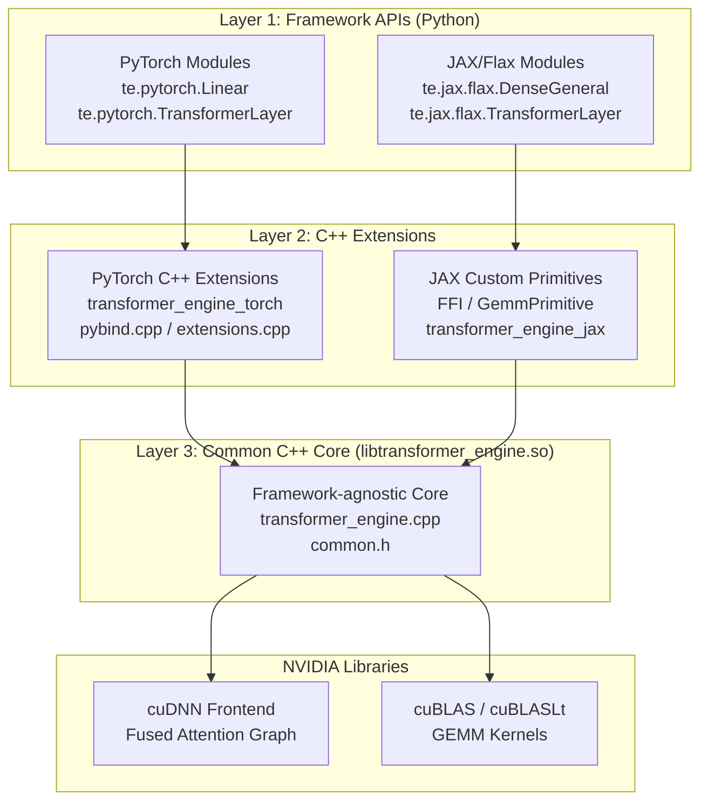

**Sources:** [README.rst:33-58](), [transformer_engine/pytorch/csrc/extensions/pybind.cpp:122-130](), [transformer_engine/common/transformer_engine.cpp:7-24]()

## Layer 1: Framework APIs

The Python API layer provides framework-specific modules that users interact with directly. These modules handle framework-specific logic such as autograd, parameter registration, and distributed training strategies.

### PyTorch Integration
PyTorch modules like `te.Linear` leverage the `torch.autograd.Function` pattern. For example, the forward pass of a linear layer calls into C++ extensions to perform quantized operations.

### JAX Integration
JAX integration uses a custom primitive system. Modules like `te_flax.DenseGeneral` lower to JAX primitives, which use JAX's FFI (Foreign Function Interface) to call the same underlying C++ kernels as PyTorch.

**Sources:** [README.rst:72-100](), [README.rst:101-141](), [transformer_engine/jax/csrc/extensions/pybind.cpp:135-142]()

## Layer 2: C++ Extensions

The C++ extension layer bridges framework-specific Python objects (like `at::Tensor` in PyTorch) to the common C++ core.

### PyTorch C++ Extensions (`transformer_engine_torch`)
This layer uses `pybind11` to expose C++ functions to Python. It handles the conversion of PyTorch tensors to the `TensorWrapper` abstractions used by the core library.

**Code Entity Mapping (PyTorch):**
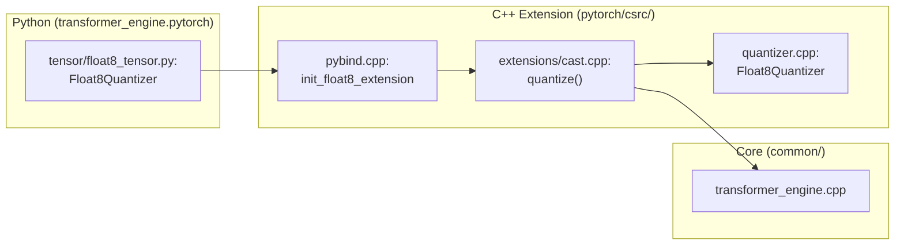

**Key Components:**
- `init_extension()` [transformer_engine/pytorch/csrc/extensions/pybind.cpp:122-130](): Initializes framework-specific bindings for FP8, MXFP8, and NVFP4.
- `quantize()` [transformer_engine/pytorch/csrc/extensions/cast.cpp:52-88](): High-level C++ entry point for tensor quantization.
- `Quantizer` [transformer_engine/pytorch/csrc/common.h:99-149](): Abstract base class for framework-specific quantization logic.

**Sources:** [transformer_engine/pytorch/csrc/extensions/pybind.cpp:1-130](), [transformer_engine/pytorch/csrc/extensions/cast.cpp:52-88](), [transformer_engine/pytorch/csrc/common.h:99-149]()

### JAX C++ Extensions (`transformer_engine_jax`)
JAX integration uses the XLA FFI to register handlers for operations like GEMM, Attention, and Softmax.

**Code Entity Mapping (JAX):**
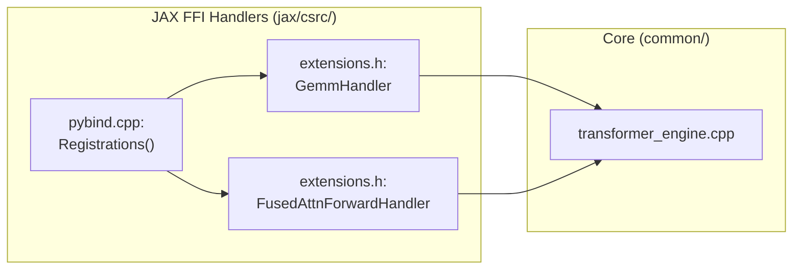

**Sources:** [transformer_engine/jax/csrc/extensions/pybind.cpp:22-133](), [transformer_engine/jax/csrc/extensions.h:178-182]()

## Layer 3: Common C++ Core

The common C++ core is framework-agnostic. It defines the fundamental tensor abstractions and wraps low-level NVIDIA libraries.

### Tensor Abstraction System
The core library uses a `Shape` class to wrap `NVTEShape` and provides a unified `DType` system.

| Code Entity | Description | Location |
| :--- | :--- | :--- |
| `DType` | Enum defining supported data types (FP8, FP4, BF16, etc.). | [transformer_engine/common/include/transformer_engine/transformer_engine.h:25-38]() |
| `NVTEScalingMode` | Defines quantization scaling (Delayed, Block, MXFP8, NVFP4). | [transformer_engine/common/include/transformer_engine/transformer_engine.h:99-119]() |
| `Shape` | C++ class wrapping NVTEShape with std::vector-like interface. | [transformer_engine/common/common.h:130-205]() |

### Core Computational Kernels
The core library dispatches to specialized CUDA kernels or library calls. It includes logic for checking tensor shapes and scaling factors for various precision formats.

**Key Implementations:**
- **Quantization Checks**: `CheckScaleTensorShape` validates that scaling factors (like `scale_inv`) match the expected shapes for formats like MXFP8 and NVFP4 [transformer_engine/common/transformer_engine.cpp:64-141]().
- **Data Type Management**: `typeToNumBits` and `to_string` provide utility functions for handling the wide variety of low-precision types supported by TE [transformer_engine/common/transformer_engine.cpp:27-53]().

**Sources:** [transformer_engine/common/common.h:130-205](), [transformer_engine/common/transformer_engine.cpp:1-141](), [transformer_engine/common/include/transformer_engine/transformer_engine.h:1-119]()

## Cross-Framework Kernel Sharing

Because both PyTorch and JAX call into the same core C++ logic, optimizations applied to the core benefit both frameworks simultaneously.

### Data Flow Example: Quantization
1. **Framework Layer**: PyTorch calls `tex.quantize` [transformer_engine/pytorch/csrc/extensions/cast.cpp:52]().
2. **Extension Layer**: The PyTorch extension converts the `at::Tensor` into a `TensorWrapper` [transformer_engine/pytorch/csrc/extensions/cast.cpp:59]().
3. **Core Layer**: The core quantization logic is invoked, which may include stochastic rounding or amax reduction across groups [transformer_engine/pytorch/csrc/extensions/cast.cpp:144-175]().
4. **Library Layer**: CUDA kernels are launched to perform the actual bit-manipulation and scaling.

**Sources:** [transformer_engine/pytorch/csrc/extensions/cast.cpp:52-88](), [transformer_engine/pytorch/csrc/extensions/cast.cpp:144-175]()

## Build and Compilation

The system is built using `pip` which triggers `cmake` for the C++ components. The build process can be customized to build specific framework integrations using environment variables like `NVTE_FRAMEWORK`.

- **Core Build**: `NVTE_FRAMEWORK=none` builds only the framework-agnostic core [github/workflows/build.yml:36]().
- **PyTorch Build**: `NVTE_FRAMEWORK=pytorch` builds the core plus PyTorch extensions [github/workflows/build.yml:87]().
- **JAX Build**: `NVTE_FRAMEWORK=jax` builds the core plus JAX extensions [github/workflows/build.yml:110]().

**Sources:** [.github/workflows/build.yml:1-161]()

---

# Page: Quantization System

# Quantization System

<details>
<summary>Relevant source files</summary>

The following files were used as context for generating this wiki page:

- [.gitignore](.gitignore)
- [benchmarks/attention/benchmark_attention.py](benchmarks/attention/benchmark_attention.py)
- [docs/api/c/index.rst](docs/api/c/index.rst)
- [docs/api/common.rst](docs/api/common.rst)
- [docs/envvars.rst](docs/envvars.rst)
- [docs/examples/attention/arbitrary_mask_to_post_scale_bias.py](docs/examples/attention/arbitrary_mask_to_post_scale_bias.py)
- [docs/examples/attention/attention.ipynb](docs/examples/attention/attention.ipynb)
- [docs/examples/attention/example_attention.py](docs/examples/attention/example_attention.py)
- [docs/examples/quickstart_utils.py](docs/examples/quickstart_utils.py)
- [tests/pytorch/nvfp4/test_nvfp4_quantize_exact.py](tests/pytorch/nvfp4/test_nvfp4_quantize_exact.py)
- [tests/pytorch/test_checkpoint.py](tests/pytorch/test_checkpoint.py)
- [tests/pytorch/test_grouped_tensor.py](tests/pytorch/test_grouped_tensor.py)
- [tests/pytorch/test_quantized_tensor.py](tests/pytorch/test_quantized_tensor.py)
- [tests/pytorch/test_recipe.py](tests/pytorch/test_recipe.py)
- [transformer_engine/common/cast/dispatch/quantize.cuh](transformer_engine/common/cast/dispatch/quantize.cuh)
- [transformer_engine/common/cast/nvfp4/quantize_4over6_nvfp4.cuh](transformer_engine/common/cast/nvfp4/quantize_4over6_nvfp4.cuh)
- [transformer_engine/common/recipe/__init__.py](transformer_engine/common/recipe/__init__.py)
- [transformer_engine/common/recipe/delayed_scaling.cu](transformer_engine/common/recipe/delayed_scaling.cu)
- [transformer_engine/pytorch/_extra_state.py](transformer_engine/pytorch/_extra_state.py)
- [transformer_engine/pytorch/csrc/common.h](transformer_engine/pytorch/csrc/common.h)
- [transformer_engine/pytorch/csrc/extensions.h](transformer_engine/pytorch/csrc/extensions.h)
- [transformer_engine/pytorch/csrc/extensions/cast.cpp](transformer_engine/pytorch/csrc/extensions/cast.cpp)
- [transformer_engine/pytorch/csrc/extensions/pybind.cpp](transformer_engine/pytorch/csrc/extensions/pybind.cpp)
- [transformer_engine/pytorch/csrc/quantizer.cpp](transformer_engine/pytorch/csrc/quantizer.cpp)
- [transformer_engine/pytorch/custom_recipes/quantization_ref_nvfp4.py](transformer_engine/pytorch/custom_recipes/quantization_ref_nvfp4.py)
- [transformer_engine/pytorch/quantization.py](transformer_engine/pytorch/quantization.py)
- [transformer_engine/pytorch/quantized_tensor.py](transformer_engine/pytorch/quantized_tensor.py)
- [transformer_engine/pytorch/tensor/_quantization_helpers.py](transformer_engine/pytorch/tensor/_quantization_helpers.py)
- [transformer_engine/pytorch/tensor/float8_blockwise_tensor.py](transformer_engine/pytorch/tensor/float8_blockwise_tensor.py)
- [transformer_engine/pytorch/tensor/float8_tensor.py](transformer_engine/pytorch/tensor/float8_tensor.py)
- [transformer_engine/pytorch/tensor/mxfp8_tensor.py](transformer_engine/pytorch/tensor/mxfp8_tensor.py)
- [transformer_engine/pytorch/tensor/nvfp4_tensor.py](transformer_engine/pytorch/tensor/nvfp4_tensor.py)
- [transformer_engine/pytorch/tensor/storage/float8_blockwise_tensor_storage.py](transformer_engine/pytorch/tensor/storage/float8_blockwise_tensor_storage.py)
- [transformer_engine/pytorch/tensor/storage/float8_tensor_storage.py](transformer_engine/pytorch/tensor/storage/float8_tensor_storage.py)
- [transformer_engine/pytorch/tensor/storage/mxfp8_tensor_storage.py](transformer_engine/pytorch/tensor/storage/mxfp8_tensor_storage.py)
- [transformer_engine/pytorch/tensor/storage/nvfp4_tensor_storage.py](transformer_engine/pytorch/tensor/storage/nvfp4_tensor_storage.py)

</details>


## Purpose and Scope

This document describes the quantization system in TransformerEngine, which enables reduced-precision computation (FP8, MXFP8, NVFP4) for training and inference. The system provides framework-agnostic quantization strategies and framework-specific implementations for PyTorch and JAX.

For details on how quantization integrates with specific module types, see:
- PyTorch modules: [4.5 Quantization and FP8 State]()
- JAX implementation: [5.4 GEMM and Quantization Primitives]()
- Core C++ kernels: [6.1 GEMM Operations]()

---

## Quantization Overview

TransformerEngine supports multiple quantization formats and strategies to reduce memory bandwidth and accelerate computation:

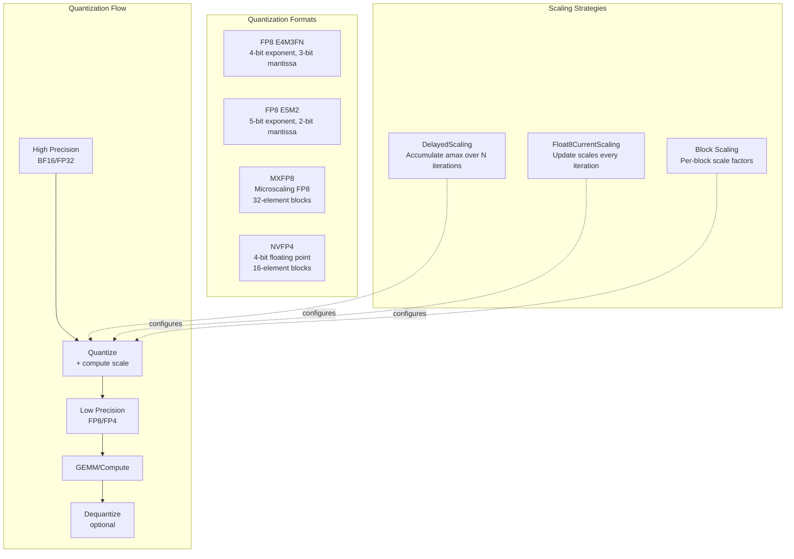

**Diagram: Quantization Formats and Flow**

The quantization system operates on tensors at three key points:
1. **Forward GEMM input**: Activations and weights quantized before matrix multiplication.
2. **Forward GEMM output**: Optional quantization of GEMM results.
3. **Backward GEMM**: Gradients quantized for dgrad and wgrad computations.

Sources: [transformer_engine/pytorch/tensor/float8_tensor.py:41-50](), [transformer_engine/pytorch/tensor/mxfp8_tensor.py:27-34](), [transformer_engine/common/recipe/__init__.py:107-171]()

---

## Quantization Recipes

Recipes define the quantization strategy and are shared across frameworks. Each recipe specifies how to compute and update scaling factors.

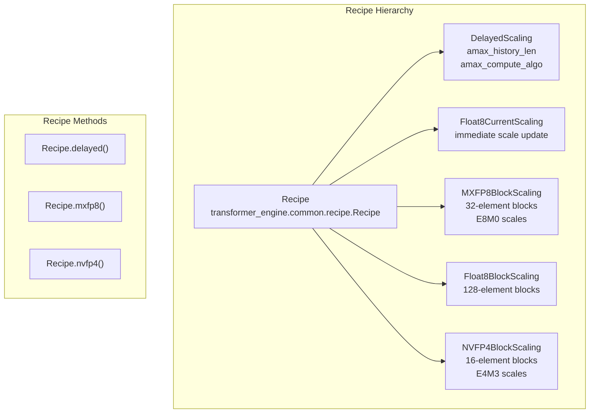

**Diagram: Recipe Class Hierarchy**

### Recipe Types

| Recipe | Scaling Granularity | Scale Update Frequency | Scaling Method |
|--------|-------------------|----------------------|----------------|
| `DelayedScaling` | Per-tensor | Every N iterations | Uses amax history window [transformer_engine/common/recipe/__init__.py:173-210]() |
| `Float8CurrentScaling` | Per-tensor | Every iteration | Scans input high-precision tensor [transformer_engine/pytorch/tensor/float8_tensor.py:185-196]() |
| `MXFP8BlockScaling` | 32-element blocks | Per-block | Microscaling with E8M0 scales [transformer_engine/pytorch/tensor/mxfp8_tensor.py:27-34]() |
| `Float8BlockScaling` | 128-element blocks | Per-block | Current scaling with NxN tiles [transformer_engine/pytorch/tensor/float8_blockwise_tensor.py:24-31]() |
| `NVFP4BlockScaling` | 16-element blocks | Per-block | 4-bit quantization with E4M3 scales [transformer_engine/pytorch/tensor/nvfp4_tensor.py:114-116]() |

Sources: [transformer_engine/common/recipe/__init__.py:173-250](), [transformer_engine/pytorch/tensor/float8_tensor.py:41-50]()

---

## Scaling Modes

Scaling modes determine how quantization scale factors are computed and stored. TransformerEngine supports per-tensor and block-wise scaling.

### Scaling Format Mapping

The `Format` enum defines the bit-width and range for various formats:
- `E2M1`: FP4 tensors (max 6.0) [transformer_engine/common/recipe/__init__.py:47]()
- `E4M3`: FP8 tensors (max 448.0) [transformer_engine/common/recipe/__init__.py:48]()
- `E5M2`: FP8 tensors (max 57344.0) [transformer_engine/common/recipe/__init__.py:49]()
- `HYBRID`: E4M3 for forward, E5M2 for backward [transformer_engine/common/recipe/__init__.py:50]()

Sources: [transformer_engine/common/recipe/__init__.py:29-50]()

---

## PyTorch Quantization Architecture

### Quantizer Classes

PyTorch quantizers encapsulate the logic for converting high-precision tensors to quantized representations.

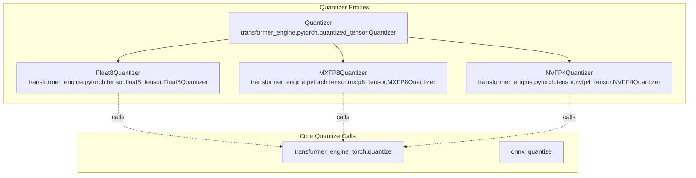

**Diagram: PyTorch Quantizer Code Entities**

### Quantizer Usage Pattern

Quantizers maintain state for rowwise and columnwise usage. This is critical for GEMM operations where the weight matrix may need a transposed layout for weight gradient (wgrad) computation.

- **Rowwise Usage**: Standard layout for forward pass activations and weights [transformer_engine/pytorch/tensor/float8_tensor.py:65]().
- **Columnwise Usage**: Transposed layout often required for optimal GEMM performance in backward pass [transformer_engine/pytorch/tensor/float8_tensor.py:66]().

Sources: [transformer_engine/pytorch/tensor/float8_tensor.py:59-85](), [transformer_engine/pytorch/tensor/mxfp8_tensor.py:38-55]()

### Quantized Tensor Storage

Quantized tensors are split into a storage class and a tensor subclass to minimize autograd overhead.

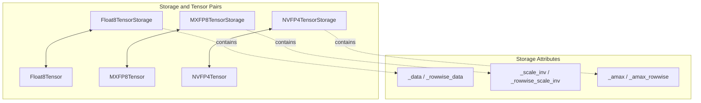

**Diagram: Storage and Tensor Relationships**

- `Float8TensorStorage`: Holds `data`, `fp8_scale_inv`, and `fp8_dtype` [transformer_engine/pytorch/tensor/storage/float8_tensor_storage.py]().
- `MXFP8TensorStorage`: Manages block scaling data with `rowwise_data` and `rowwise_scale_inv` [transformer_engine/pytorch/tensor/storage/mxfp8_tensor_storage.py]().
- `NVFP4TensorStorage`: Supports complex metadata like `_nvfp4_use_4over6` and `_amax_rowwise` [transformer_engine/pytorch/tensor/storage/nvfp4_tensor_storage.py:84-110]().

Sources: [transformer_engine/pytorch/quantized_tensor.py:32-46](), [transformer_engine/pytorch/tensor/storage/nvfp4_tensor_storage.py:73-149]()

---

## Quantization Data Flow

### Quantization and Dequantization

The system flows from high-precision `torch.Tensor` to `QuantizedTensor` via the `quantize` kernel and back via `dequantize`.

| Direction | Code Entity | Implementation Detail |
|-----------|-------------|-----------------------|
| Quantize | `tex.quantize` | Calls into C++/CUDA core kernels [transformer_engine/pytorch/tensor/float8_tensor.py:104]() |
| Dequantize | `_FromFloat8Func` / `_FromMXFP8Func` | Autograd-compatible dequantization [transformer_engine/pytorch/tensor/storage/float8_tensor_storage.py](), [transformer_engine/pytorch/tensor/storage/mxfp8_tensor_storage.py]() |
| ONNX Export | `onnx_quantize` | Uses `torch.ops.tex.fp8_quantize` for ONNX Runtime compatibility [transformer_engine/pytorch/tensor/float8_tensor.py:160-167]() |

### Block Scaling Layouts

For MXFP8 and NVFP4, scaling factors must be swizzled to match the layout expected by cuBLAS.

- **MXFP8 Swizzling**: The `get_scale_shape` method calculates padded shapes (multiples of 128 for inner dims) to satisfy alignment [transformer_engine/pytorch/tensor/mxfp8_tensor.py:103-140]().
- **NVFP4 Swizzling**: Similar padding to multiples of 128/64 for GEMM compatibility [transformer_engine/pytorch/tensor/nvfp4_tensor.py:228-265]().

Sources: [transformer_engine/pytorch/tensor/mxfp8_tensor.py:103-140](), [transformer_engine/pytorch/tensor/nvfp4_tensor.py:228-265]()

---

## C++ Core Quantization Kernels

The underlying C++ implementation handles the heavy lifting of quantization across different formats.

### NVFP4 and Hadamard Transform

NVFP4 quantization often employs a Random Hadamard Transform (RHT) to improve numerical stability in 4-bit precision.

- **RHT Matrix**: Constructed as a 16x16 Hadamard matrix [transformer_engine/pytorch/tensor/nvfp4_tensor.py:62-90]().
- **Sign Masking**: Optional random signs are applied to the transform to prevent systematic bias [transformer_engine/pytorch/tensor/nvfp4_tensor.py:94-111]().
- **Grouped Quantization**: The `group_quantize_nvfp4_impl` function handles CUDA-graph safe quantization of multiple tensors in a single kernel launch [transformer_engine/pytorch/csrc/extensions/cast.cpp:146-174]().

### C++ Extensions and Bindings

The PyTorch C++ extensions bridge the Python `Quantizer` classes to the C++ core via `pybind11`.

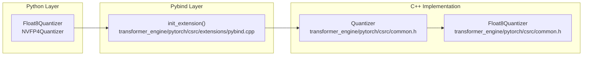

**Diagram: Quantization System Bindings**

The `init_extension` function in `pybind.cpp` registers the Python classes for use within the C++ extension [transformer_engine/pytorch/csrc/extensions/pybind.cpp:122-130]().

Sources: [transformer_engine/pytorch/csrc/common.h:99-200](), [transformer_engine/pytorch/csrc/extensions/pybind.cpp:122-130](), [transformer_engine/pytorch/tensor/nvfp4_tensor.py:62-111]()

---

# Page: Build System and Installation

# Build System and Installation

<details>
<summary>Relevant source files</summary>

The following files were used as context for generating this wiki page:

- [.github/workflows/build.yml](.github/workflows/build.yml)
- [.github/workflows/lint.yml](.github/workflows/lint.yml)
- [.gitmodules](.gitmodules)
- [MANIFEST.in](MANIFEST.in)
- [README.rst](README.rst)
- [build_tools/VERSION.txt](build_tools/VERSION.txt)
- [build_tools/__init__.py](build_tools/__init__.py)
- [build_tools/build_ext.py](build_tools/build_ext.py)
- [build_tools/jax.py](build_tools/jax.py)
- [build_tools/pytorch.py](build_tools/pytorch.py)
- [build_tools/te_version.py](build_tools/te_version.py)
- [build_tools/utils.py](build_tools/utils.py)
- [build_tools/wheel_utils/Dockerfile.aarch](build_tools/wheel_utils/Dockerfile.aarch)
- [build_tools/wheel_utils/Dockerfile.x86](build_tools/wheel_utils/Dockerfile.x86)
- [build_tools/wheel_utils/build_wheels.sh](build_tools/wheel_utils/build_wheels.sh)
- [build_tools/wheel_utils/launch_aarch.sh](build_tools/wheel_utils/launch_aarch.sh)
- [build_tools/wheel_utils/launch_x86.sh](build_tools/wheel_utils/launch_x86.sh)
- [docs/installation.rst](docs/installation.rst)
- [examples/README.md](examples/README.md)
- [pyproject.toml](pyproject.toml)
- [qa/L1_cpp_distributed/test.sh](qa/L1_cpp_distributed/test.sh)
- [setup.py](setup.py)
- [tests/cpp_distributed/CMakeLists.txt](tests/cpp_distributed/CMakeLists.txt)
- [tests/cpp_distributed/run_test_ep.sh](tests/cpp_distributed/run_test_ep.sh)
- [transformer_engine/__init__.py](transformer_engine/__init__.py)
- [transformer_engine/common/CMakeLists.txt](transformer_engine/common/CMakeLists.txt)
- [transformer_engine/common/__init__.py](transformer_engine/common/__init__.py)
- [transformer_engine/jax/cpp_extensions/flex_attention.py](transformer_engine/jax/cpp_extensions/flex_attention.py)
- [transformer_engine/jax/pyproject.toml](transformer_engine/jax/pyproject.toml)
- [transformer_engine/jax/setup.py](transformer_engine/jax/setup.py)
- [transformer_engine/pytorch/setup.py](transformer_engine/pytorch/setup.py)

</details>


This document covers installation methods and the build system for Transformer Engine. It includes system requirements, installation procedures (Docker, pip, source), CMake configuration, framework-specific extensions, and the CI/CD pipeline. The build system handles compilation of C++/CUDA code, Python extensions for PyTorch and JAX, and package distribution across multiple platforms.

For information about the core FP8 concepts and hardware support, see [Quantization System](3.2). For details about framework-specific implementations, see [PyTorch Integration](4) and [JAX Integration](5).

## Installation

### System Requirements

Transformer Engine requires specific hardware, software, and compiler configurations:

| Component | Requirement | Notes |
|-----------|-------------|-------|
| **Hardware** | Blackwell, Hopper, Grace Hopper, Ada, Ampere GPUs | FP8 requires Compute Capability 8.9+ |
| **OS** | Linux x86_64 | Standard support for major distributions |
| **CUDA** | 12.1+ (12.8+ for Blackwell) | Required for kernel compilation and execution |
| **cuDNN** | 9.3+ | Required for fused attention operations |
| **Compiler** | GCC/Clang with C++17 support | Required for C++ core and framework extensions |
| **Python** | 3.10+ | Minimum version check enforced in `build_tools/utils.py` |
| **CMake** | 3.18+ | Required for source builds |

The CUDA version determines which GPU architectures are supported. Transformer Engine automatically selects appropriate architectures based on the detected CUDA version [transformer_engine/common/CMakeLists.txt:28-37]().

Sources: [docs/installation.rst:9-18](), [transformer_engine/common/CMakeLists.txt:5-10](), [build_tools/utils.py:23-37]()

### Docker Installation (Recommended)

NVIDIA provides pre-built containers on the NVIDIA GPU Cloud (NGC) that include Transformer Engine and all necessary dependencies.

```bash
# PyTorch container
docker run --gpus all -it --rm nvcr.io/nvidia/pytorch:25.02-py3

# JAX container  
docker run --gpus all -it --rm nvcr.io/nvidia/jax:25.02-py3
```

Sources: [docs/installation.rst:23-27]()

### pip Installation

#### Installation from PyPI

Transformer Engine is distributed as wheels for the core library and source distributions for framework extensions.

```bash
# For PyTorch integration
pip install --no-build-isolation transformer_engine[pytorch]

# For JAX integration
pip install --no-build-isolation transformer_engine[jax]

# Core library only (framework agnostic)
pip install transformer_engine[core]
```

The `--no-build-isolation` flag is recommended when installing with framework support to ensure the build process uses the existing framework installation in your environment [docs/installation.rst:33-48]().

Sources: [docs/installation.rst:33-48]()

### Source Installation

#### Cloning the Repository

```bash
# Clone with submodules
git clone --branch stable --recursive https://github.com/NVIDIA/TransformerEngine.git
cd TransformerEngine

# If already cloned, initialize submodules
git submodule update --init --recursive
```

Sources: [docs/installation.rst:96-111]()

#### Building from Source

```bash
# Set target framework (optional, auto-detects if not set)
export NVTE_FRAMEWORK=pytorch

# Build and install
pip install --no-build-isolation .
```

The build process uses `setup.py` to orchestrate the compilation of the common C++/CUDA library and the generation of Python bindings [setup.py:5-30]().

Sources: [docs/installation.rst:96-105](), [setup.py:5-30]()

## Build Architecture Overview

The build system leverages `setuptools` integrated with `CMake` to handle the complex requirements of multi-framework CUDA extensions.

### Build System Components

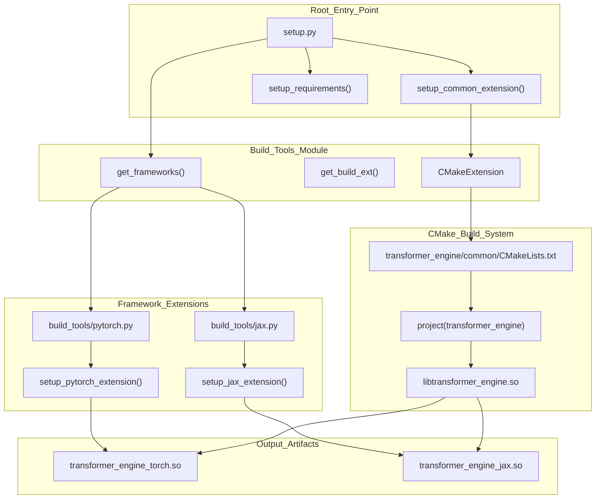

**Build System Component Graph**

The root `setup.py` calls `setup_common_extension` [setup.py:58-111]() to configure the core library build via CMake. It uses `get_frameworks()` [setup.py:30]() to decide which framework-specific extensions to build. Framework-specific logic is encapsulated in `build_tools/pytorch.py` [build_tools/pytorch.py:49-126]() and `build_tools/jax.py` [build_tools/jax.py:80-129]().

Sources: [setup.py:30-111](), [build_tools/pytorch.py:49-126](), [build_tools/jax.py:80-129]()

### Framework Detection Logic

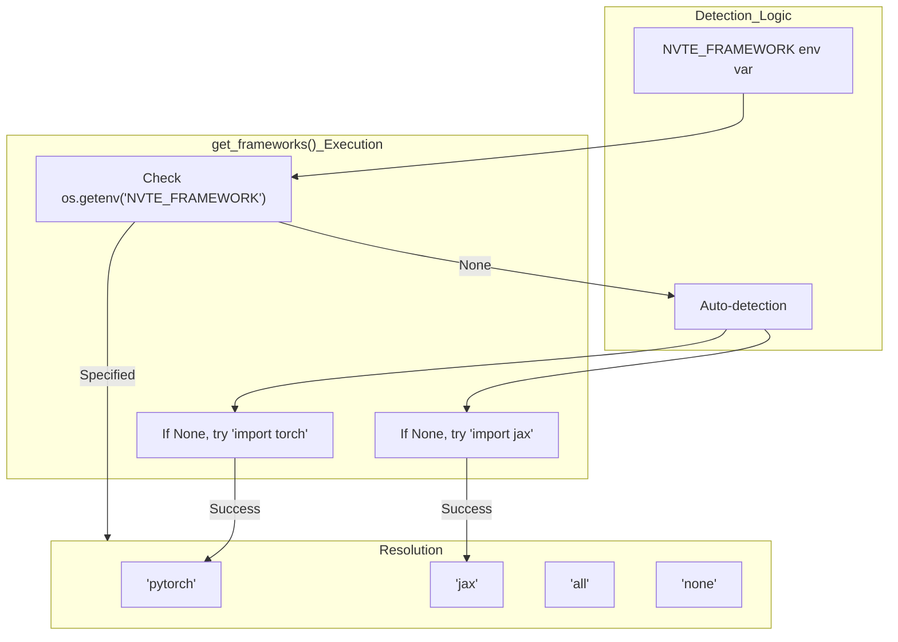

**Framework Detection in get_frameworks()**

The build system identifies which extensions to compile by checking the `NVTE_FRAMEWORK` environment variable. If not set, it attempts to detect installed frameworks by trying to import them [setup.py:38-42]().

Sources: [setup.py:38-42](), [docs/installation.rst:61-67]()

## CMake Build Configuration

The core library `libtransformer_engine.so` is built using CMake [transformer_engine/common/CMakeLists.txt:20](). It handles CUDA toolkit discovery and architecture-specific optimizations.

### CUDA Architecture Selection

The CMake configuration processes `CMAKE_CUDA_ARCHITECTURES` to handle standard and Blackwell-specific (SM100+) targets [transformer_engine/common/CMakeLists.txt:39-85]().

*   **Standard Archs**: Pre-Blackwell (e.g., 70, 80, 89, 90) [transformer_engine/common/CMakeLists.txt:86-88]().
*   **Blackwell (SM100/SM120)**: Automatically maps to specific targets like `100a`, `103a`, or `120f` based on the CUDA Toolkit version [transformer_engine/common/CMakeLists.txt:47-84]().

Sources: [transformer_engine/common/CMakeLists.txt:39-88]()

### Feature Gates and External Libraries

CMake manages several optional features based on environment variables:
*   **Userbuffers (MPI)**: Enabled via `NVTE_UB_WITH_MPI` [setup.py:64-68]().
*   **NVSHMEM**: Enabled via `NVTE_ENABLE_NVSHMEM` [setup.py:70-74]().
*   **cuBLASMp/cuSolverMp**: Multi-process BLAS/Solver support [setup.py:79-89]().
*   **NCCL EP**: Communication backend for distributed operations, automatically enabled for Hopper+ (arch >= 90) [setup.py:91-97]().

Sources: [setup.py:64-97](), [transformer_engine/common/CMakeLists.txt:106-171]()

## Package Loading and Runtime Checks

At runtime, Transformer Engine uses dynamic loading to resolve shared objects.

### Extension Loading Mechanism

The `transformer_engine.common` module provides utilities to locate and load the compiled `.so` files.

```python
# From transformer_engine/common/__init__.py
def load_framework_extension(framework: str) -> None:
    # ... checks version matching ...
    spec = importlib.util.spec_from_file_location(module_name, _get_shared_object_file(framework))
    solib = importlib.util.module_from_spec(spec)
    sys.modules[module_name] = solib
    spec.loader.exec_module(solib)
```

This mechanism ensures that the Python package can find its corresponding C++ extension regardless of whether it was installed via a wheel, source build, or editable install [transformer_engine/common/__init__.py:147-194]().

Sources: [transformer_engine/common/__init__.py:147-194](), [transformer_engine/common/__init__.py:98-131]()

### Version Consistency Checks

For PyPI installations, the system enforces strict version matching between the `transformer-engine` metapackage, the core library (e.g., `transformer-engine-cu12`), and the framework extensions [transformer_engine/common/__init__.py:176-186]().

Sources: [transformer_engine/common/__init__.py:176-186]()

## Environment Variables for Customization

| Variable | Description |
|----------|-------------|
| `NVTE_FRAMEWORK` | Comma-separated list of frameworks to build (`pytorch`, `jax`, `all`, `none`). |
| `NVTE_BUILD_DEBUG` | If `1`, compiles extensions with debug symbols (`-g`) and disables optimizations [build_tools/utils.py:41-43](). |
| `NVTE_CUDA_INCLUDE_PATH` | Manual path to CUDA headers if not found in standard paths [docs/installation.rst:19-21](). |
| `NVTE_UB_WITH_MPI` | Enable MPI support for Userbuffers [setup.py:64-68](). |
| `MAX_JOBS` / `NVTE_BUILD_MAX_JOBS` | Controls parallelism during the build process [build_tools/utils.py:47-65](). |
| `NVTE_WITH_NCCL_EP` | Enable/disable the NCCL Execution Provider [setup.py:91-97](). |

Sources: [build_tools/utils.py:41-65](), [setup.py:64-97](), [docs/installation.rst:19-21]()

## CI/CD and Testing

The repository uses GitHub Actions for automated build validation across different configurations.

*   **Core Build**: Tests framework-agnostic compilation [.github/workflows/build.yml:15-41]().
*   **PyTorch Build**: Validates PyTorch extension build [.github/workflows/build.yml:42-90]().
*   **JAX Build**: Validates JAX extension build [.github/workflows/build.yml:91-114]().
*   **Multi-Framework Build**: Ensures `NVTE_FRAMEWORK=all` works correctly [.github/workflows/build.yml:115-160]().

Sources: [.github/workflows/build.yml:1-160]()

---

# Page: PyTorch Integration

# PyTorch Integration

<details>
<summary>Relevant source files</summary>

The following files were used as context for generating this wiki page:

- [docs/api/pytorch.rst](docs/api/pytorch.rst)
- [tests/pytorch/test_numerics.py](tests/pytorch/test_numerics.py)
- [tests/pytorch/test_onnx_export.py](tests/pytorch/test_onnx_export.py)
- [tests/pytorch/test_sanity.py](tests/pytorch/test_sanity.py)
- [transformer_engine/pytorch/__init__.py](transformer_engine/pytorch/__init__.py)
- [transformer_engine/pytorch/fp8.py](transformer_engine/pytorch/fp8.py)
- [transformer_engine/pytorch/transformer.py](transformer_engine/pytorch/transformer.py)

</details>


## Purpose and Scope

This document describes Transformer Engine's PyTorch integration, which provides optimized Transformer building blocks (`Linear`, `LayerNormLinear`, `LayerNormMLP`, `TransformerLayer`) with FP8/FP4 quantization and distributed training support. The PyTorch API wraps C++ CUDA kernels while integrating seamlessly with PyTorch's autograd system, native AMP, and distributed training frameworks.

For JAX integration, see [JAX Integration](#5). For FP8 quantization concepts, see [Quantization System](#3.2). For distributed training strategies, see [Distributed Training](#7).

## Architecture Overview

The PyTorch integration follows a layered architecture where Python modules wrap custom `torch.autograd.Function` classes that dispatch to C++ extensions:

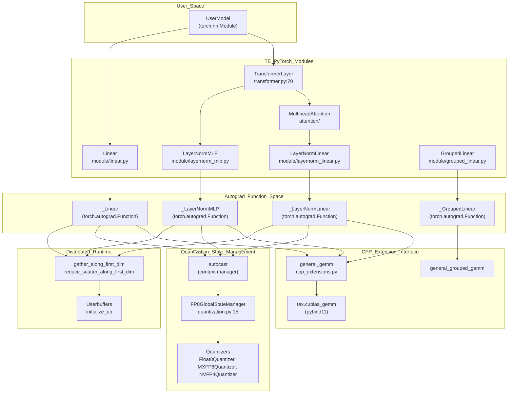

**Sources:**
- [transformer_engine/pytorch/transformer.py:70-71]()
- [transformer_engine/pytorch/__init__.py:21-35]()
- [transformer_engine/pytorch/quantization.py:14-16]()
- [transformer_engine/pytorch/module/layernorm_linear.py:1-20]()

## Module Hierarchy

### TransformerEngineBaseModule

All TE PyTorch modules inherit from `TransformerEngineBaseModule`, which provides common functionality for quantization state management, weight quantization, and distributed group handling. It serves as the foundation for handling FP8 meta-tensors and synchronization across distributed ranks.

**Sources:**
- [transformer_engine/pytorch/module/base.py:36-36]()
- [transformer_engine/pytorch/transformer.py:36-36]()

### Linear Module

`Linear` implements a basic linear layer with FP8 support. It integrates with TE's custom GEMM kernels and manages quantized weight states.

**Key Features:**
- Automatic quantization when `te.autocast` is enabled [transformer_engine/pytorch/__init__.py:44-46]().
- Support for `GroupedLinear` for MoE (Mixture of Experts) workloads, exposing grouped weight parameters [tests/pytorch/test_sanity.py:24-24](), [tests/pytorch/test_sanity.py:170-185]().
- Seamless integration with PyTorch's `autocast` for mixed precision [tests/pytorch/test_sanity.py:218-220]().

**Sources:**
- [transformer_engine/pytorch/__init__.py:22-26]()
- [tests/pytorch/test_sanity.py:170-185]()

### LayerNormLinear Module

`LayerNormLinear` fuses normalization (LayerNorm or RMSNorm) with a Linear layer. This fusion allows for single-kernel execution of normalization and quantization when FP8 is active, reducing memory bandwidth requirements.

**Fusion Benefits:**
- Supports both `LayerNorm` and `RMSNorm` variants [transformer_engine/pytorch/__init__.py:21-25]().
- Integrated quantization logic for the output of the normalization step before the GEMM [tests/pytorch/test_numerics.py:27-29]().

**Sources:**
- [transformer_engine/pytorch/__init__.py:21-21]()
- [tests/pytorch/test_numerics.py:27-29]()

### LayerNormMLP Module

`LayerNormMLP` implements a fused 2-layer MLP with normalization. It supports a wide variety of activation functions, including Gated Linear Units (GLU).

**Supported Activations:**
- Includes `gelu`, `geglu`, `glu`, `relu`, `reglu`, `silu`, `swiglu`, and `clamped_swiglu` [tests/pytorch/test_sanity.py:142-155]().
- Optimized for FP8 execution with fused bias and dropout [transformer_engine/pytorch/transformer.py:17-23]().

**Sources:**
- [transformer_engine/pytorch/__init__.py:23-23]()
- [tests/pytorch/test_sanity.py:142-155]()

### TransformerLayer Module

`TransformerLayer` is the high-level module composing attention and MLP blocks. It is the primary entry point for building Transformer models and supports encoder/decoder modes and parallel attention/MLP execution (Falcon-style).

**Sources:**
- [transformer_engine/pytorch/transformer.py:70-141]()
- [transformer_engine/pytorch/__init__.py:35-35]()

## Autograd and FP8 Integration

TE modules wrap custom `torch.autograd.Function` instances that handle the complex logic of FP8 scaling, communication overlap, and custom backward passes.

### FP8 Quantization Flow

Quantization is managed via specialized Quantizer classes and Tensor types that store the underlying data along with scaling factors.

```mermaid
graph LR
    subgraph "Quantizer_Entities"
        F8Q["Float8Quantizer<br/>pytorch/tensor/float8_tensor.py"]
        MXQ["MXFP8Quantizer<br/>pytorch/tensor/mxfp8_tensor.py"]
        NVQ["NVFP4Quantizer<br/>pytorch/tensor/nvfp4_tensor.py"]
    end
    
    subgraph "Quantized_Tensor_Entities"
        F8T["Float8Tensor"]
        MXT["MXFP8Tensor"]
        NVT["NVFP4Tensor"]
    end
    
    F8Q --> F8T
    MXQ --> MXT
    NVQ --> NVT
```

**Sources:**
- [transformer_engine/pytorch/__init__.py:83-95]()
- [transformer_engine/pytorch/quantized_tensor.py:78-79]()

### Distributed Training Features

TE provides specialized utilities for overlapping communication and computation:
- **Userbuffers (UB)**: Overlaps tensor-parallel collectives with GEMM kernels using `initialize_ub` and `destroy_ub` [transformer_engine/pytorch/__init__.py:28-30]().
- **CPU Offload**: Enables moving activations to CPU memory to reduce GPU memory pressure via `get_cpu_offload_context` [transformer_engine/pytorch/__init__.py:64-68]().
- **Communication Collectives**: Specialized operations like `parallel_cross_entropy` and MoE permutation functions [transformer_engine/pytorch/__init__.py:36-43](), [transformer_engine/pytorch/__init__.py:72-72]().

**Sources:**
- [transformer_engine/pytorch/__init__.py:28-30]()
- [transformer_engine/pytorch/__init__.py:64-68]()
- [transformer_engine/pytorch/__init__.py:36-43]()

---

## Child Pages
- [Module System and Base Classes](#4.1) — Explain `TransformerEngineBaseModule`, the autograd function pattern, and FP8 meta-tensor management.
- [Linear and Fused Operations](#4.2) — Document `Linear`, `GroupedLinear`, `LayerNormLinear`, and `LayerNormMLP` modules.
- [TransformerLayer](#4.3) — Detail the complete `TransformerLayer` implementation and configuration.
- [Attention Mechanisms](#4.4) — Explain `DotProductAttention` and `MultiheadAttention` modules.
- [Quantization and FP8 State](#4.5) — Document the `autocast` context and `FP8GlobalStateManager`.
- [Distributed Training Features](#4.6) — Explain Userbuffers, CPU offload, and communication overlap.
- [C++ Extensions and CUDA Integration](#4.7) — Document the PyTorch C++ extension layer and pybind11 bindings.

---

# Page: Module System and Base Classes

# Module System and Base Classes

<details>
<summary>Relevant source files</summary>

The following files were used as context for generating this wiki page:

- [qa/L0_pytorch_unittest/test.sh](qa/L0_pytorch_unittest/test.sh)
- [transformer_engine/pytorch/distributed.py](transformer_engine/pytorch/distributed.py)
- [transformer_engine/pytorch/module/_common.py](transformer_engine/pytorch/module/_common.py)
- [transformer_engine/pytorch/module/base.py](transformer_engine/pytorch/module/base.py)
- [transformer_engine/pytorch/module/grouped_linear.py](transformer_engine/pytorch/module/grouped_linear.py)
- [transformer_engine/pytorch/module/layernorm_linear.py](transformer_engine/pytorch/module/layernorm_linear.py)
- [transformer_engine/pytorch/module/layernorm_mlp.py](transformer_engine/pytorch/module/layernorm_mlp.py)
- [transformer_engine/pytorch/module/linear.py](transformer_engine/pytorch/module/linear.py)
- [transformer_engine/pytorch/utils.py](transformer_engine/pytorch/utils.py)

</details>


## Purpose and Scope

This page documents the PyTorch module system architecture in TransformerEngine, focusing on the base classes, autograd function patterns, and infrastructure for FP8 quantization and distributed training. This includes:

- `TransformerEngineBaseModule` base class and common infrastructure.
- Custom autograd function pattern (`_Linear`, `_LayerNormLinear`, etc.).
- FP8 meta-tensor management and quantizer integration.
- Weight workspace caching for quantized weights.
- `WeightGradStore` for delayed gradient computation.
- Userbuffers system for communication-computation overlap.

For high-level module APIs like `Linear`, `LayerNormLinear`, and `LayerNormMLP`, see [Linear and Fused Operations](4.2). For attention modules, see [Attention Mechanisms](4.4). For quantization recipes and global state, see [Quantization and FP8 State](4.5).

**Sources:** [transformer_engine/pytorch/module/base.py:1-112](), [transformer_engine/pytorch/module/linear.py:1-83](), [transformer_engine/pytorch/module/layernorm_linear.py:1-91]()

---

## Module Hierarchy and Design Pattern

TransformerEngine modules follow a three-layer design pattern that separates user-facing `nn.Module` classes from custom autograd functions and C++ kernels.

### Code Entity Space Bridge

The following diagram maps the high-level system concepts to the specific code entities implementing them.

Title: Module System Entity Mapping
```mermaid
graph TB
    subgraph "User API Layer (nn.Module)"
        [Linear] --> [linear.py]
        [LNLIN] --> [layernorm_linear.py]
        [LNMLP] --> [layernorm_mlp.py]
        [GroupedLinear] --> [grouped_linear.py]
    end
    
    subgraph "Base Infrastructure"
        [TEBase] --> [TransformerEngineBaseModule]
    end
    
    subgraph "Autograd Functions (torch.autograd.Function)"
        [_Linear] --> [linear.py]
        [_LNLIN] --> [layernorm_linear.py]
        [_LNMLP] --> [layernorm_mlp.py]
        [_GroupedLinear] --> [grouped_linear.py]
    end
    
    subgraph "C++ Kernel Interface (transformer_engine_torch)"
        [general_gemm] --> [cpp_extensions]
        [general_grouped_gemm] --> [cpp_extensions]
        [apply_normalization] --> [_common.py]
    end
    
    [Linear] -- "inherits" --> [TEBase]
    [LNLIN] -- "inherits" --> [TEBase]
    [LNMLP] -- "inherits" --> [TEBase]
    [GroupedLinear] -- "inherits" --> [TEBase]
    
    [Linear] -. "calls apply()" .-> [_Linear]
    [LNLIN] -. "calls apply()" .-> [_LNLIN]
    [LNMLP] -. "calls apply()" .-> [_LNMLP]
    [GroupedLinear] -. "calls apply()" .-> [_GroupedLinear]
    
    [_Linear] --> [general_gemm]
    [_LNLIN] --> [apply_normalization]
    [_LNLIN] --> [general_gemm]
    [_LNMLP] --> [apply_normalization]
    [_LNMLP] --> [general_gemm]
    [_GroupedLinear] --> [general_grouped_gemm]
```

**Key Design Principles:**

1.  **Separation of Concerns**: User-facing modules handle parameter management and configuration. They delegate computation to custom autograd functions.
2.  **Custom Autograd Functions**: Each module has a corresponding `_*` autograd function (e.g., `_Linear` [transformer_engine/pytorch/module/linear.py:633]()) that implements forward and backward passes with FP8 support, tensor-parallel communication, and C++ kernel calls.
3.  **Framework-Agnostic Core**: Autograd functions call into C++ kernels shared across implementations.

**Sources:** [transformer_engine/pytorch/module/base.py:30-41](), [transformer_engine/pytorch/module/linear.py:633-635](), [transformer_engine/pytorch/module/layernorm_linear.py:94-97](), [transformer_engine/pytorch/module/grouped_linear.py:71-74]()

---

## TransformerEngineBaseModule

`TransformerEngineBaseModule` is the abstract base class providing common infrastructure. It manages FP8 meta-tensors, weight workspaces, and gradient preprocessing.

### Key Responsibilities

| Method | Purpose | File Reference |
| :--- | :--- | :--- |
| `get_dummy_wgrad()` | Returns a dummy tensor for fused weight gradient accumulation. | [transformer_engine/pytorch/module/base.py:109-124]() |
| `initialize_ub()` | Initializes Userbuffers for overlapping communication with GEMM. | [transformer_engine/pytorch/module/base.py:126-184]() |
| `quantize_weight()` | Helper to quantize weights based on the active recipe. | [transformer_engine/pytorch/module/base.py:27-27]() |

**Sources:** [transformer_engine/pytorch/module/base.py:1-184]()

---

## Autograd Function Pattern

Each module follows a consistent pattern where the `nn.Module` class delegates to a custom `autograd.Function`.

### Forward Pass Argument Packing

To reduce PyTorch's CPU overhead from argument checking, configuration is packed into a `LinearFwdArgs` dataclass or a tuple.

Title: Forward Path Data Flow
```mermaid
graph TB
    [ModuleFwd] --> [Module.forward]
    [FwdArgs] --> [LinearFwdArgs]
    [AutogradFwd] --> [_Linear.forward]
    
    [PrepareInput] --> ["1. Prepare Input Tensor<br/>- Cast via cast_if_needed()<br/>- Quantize if FP8<br/>- TP All-Gather if sequence_parallel"]
    
    [PrepareWeight] --> ["2. Prepare Weight Tensor<br/>- Get from workspace<br/>- Quantize if needed<br/>- Cache on first microbatch"]
    
    [GEMM] --> ["3. Execute GEMM<br/>- general_gemm()<br/>- Userbuffers overlap if enabled"]
    
    [SaveCtx] --> ["4. Save for Backward<br/>- prepare_for_saving()<br/>- ctx.save_for_backward()"]
    
    [ModuleFwd] --> [FwdArgs]
    [FwdArgs] --> [AutogradFwd]
    [AutogradFwd] --> [PrepareInput]
    [PrepareInput] --> [PrepareWeight]
    [PrepareWeight] --> [GEMM]
    [GEMM] --> [SaveCtx]
```

**Example from `_Linear.forward`:**
- **Input preparation**: [transformer_engine/pytorch/module/linear.py:36-45]() (utils like `cast_if_needed`).
- **GEMM execution**: Calls `general_gemm` [transformer_engine/pytorch/module/linear.py:58-60]().
- **Context saving**: Uses `prepare_for_saving` [transformer_engine/pytorch/module/linear.py:68-69]().

**Sources:** [transformer_engine/pytorch/module/linear.py:89-160](), [transformer_engine/pytorch/module/layernorm_linear.py:100-154]()

### Backward Pass Pattern

The backward pass restores state and computes gradients for input (dgrad) and weight (wgrad).

**Example from `_Linear.backward`:**
- **Restore tensors**: Uses `restore_from_func_ctx` [transformer_engine/pytorch/module/linear.py:69-70]().
- **Differentiability**: Checks `requires_grad` [transformer_engine/pytorch/utils.py:42-47]().
- **Wgrad Store**: If `WeightGradStore` is used, wgrad computation is deferred [transformer_engine/pytorch/module/linear.py:33-33]().

**Sources:** [transformer_engine/pytorch/module/linear.py:163-233](), [transformer_engine/pytorch/module/layernorm_linear.py:66-67]()

---

## FP8 Meta-Tensor Management

TransformerEngine manages FP8 scaling factors through a hierarchical system of meta-tensors and quantizers.

### Scaling Mode Support

| Scaling Mode | Quantizer Class | File Reference |
| :--- | :--- | :--- |
| **Delayed Scaling** | `Float8Quantizer` | [transformer_engine/pytorch/module/base.py:51-51]() |
| **Current Scaling** | `Float8CurrentScalingQuantizer` | [transformer_engine/pytorch/module/base.py:51-51]() |
| **MXFP8** | `MXFP8Quantizer` | [transformer_engine/pytorch/module/base.py:52-52]() |
| **NVFP4** | `NVFP4Quantizer` | [transformer_engine/pytorch/module/base.py:53-53]() |
| **Blockwise** | `Float8BlockQuantizer` | [transformer_engine/pytorch/module/base.py:54-54]() |

**Sources:** [transformer_engine/pytorch/module/base.py:30-57](), [transformer_engine/pytorch/module/layernorm_mlp.py:69-76]()

---

## WeightGradStore

`WeightGradStore` enables delayed weight gradient computation, allowing overlap of gradient communication with computation.

Title: WeightGradStore Logic
```mermaid
graph LR
    [Bwd] --> [Backward Pass]
    [WGS] --> [WeightGradStore]
    [Closure] --> [wgrad_closure]
    [GEMM] --> [general_gemm]

    [Bwd] -- "delay_wgrad_compute=True" --> [Closure]
    [Closure] -- "put()" --> [WGS]
    [WGS] -- "execute later" --> [GEMM]
```

**Sources:** [transformer_engine/pytorch/module/_common.py:66-66](), [transformer_engine/pytorch/module/linear.py:33-33]()

---

## Userbuffers System

Userbuffers infrastructure overlaps tensor-parallel communication with GEMM computation using CUDA Multicast.

### Key Functions
- `initialize_ub()`: Sets up the communication buffers and process groups [transformer_engine/pytorch/module/base.py:126-184]().
- `get_ub()`: Retrieves the communicator object for a specific layer [transformer_engine/pytorch/module/layernorm_linear.py:207-207]().
- `fill_userbuffers_buffer_for_all_gather()`: Prepares data for overlapping all-gather [transformer_engine/pytorch/module/layernorm_linear.py:22-22]().

**Sources:** [transformer_engine/pytorch/module/base.py:126-184](), [transformer_engine/pytorch/module/layernorm_linear.py:193-211]()

---

## Normalization Utilities

The `apply_normalization` function in `_common.py` abstracts LayerNorm and RMSNorm for fused modules.

| Function | Normalization Types | Kernels |
| :--- | :--- | :--- |
| `apply_normalization` | `LayerNorm`, `RMSNorm` | `layernorm_fwd`, `rmsnorm_fwd` |

**Sources:** [transformer_engine/pytorch/module/_common.py:34-74]()

---

# Page: Linear and Fused Operations

# Linear and Fused Operations

<details>
<summary>Relevant source files</summary>

The following files were used as context for generating this wiki page:

- [qa/L0_pytorch_unittest/test.sh](qa/L0_pytorch_unittest/test.sh)
- [tests/cpp/operator/test_grouped_gemm.cu](tests/cpp/operator/test_grouped_gemm.cu)
- [tests/pytorch/test_fusible_ops.py](tests/pytorch/test_fusible_ops.py)
- [tests/pytorch/test_grouped_linear.py](tests/pytorch/test_grouped_linear.py)
- [tests/pytorch/test_grouped_mlp.py](tests/pytorch/test_grouped_mlp.py)
- [transformer_engine/common/gemm/cublaslt_grouped_gemm.cu](transformer_engine/common/gemm/cublaslt_grouped_gemm.cu)
- [transformer_engine/pytorch/csrc/extensions/activation.cpp](transformer_engine/pytorch/csrc/extensions/activation.cpp)
- [transformer_engine/pytorch/distributed.py](transformer_engine/pytorch/distributed.py)
- [transformer_engine/pytorch/module/_common.py](transformer_engine/pytorch/module/_common.py)
- [transformer_engine/pytorch/module/base.py](transformer_engine/pytorch/module/base.py)
- [transformer_engine/pytorch/module/grouped_linear.py](transformer_engine/pytorch/module/grouped_linear.py)
- [transformer_engine/pytorch/module/layernorm_linear.py](transformer_engine/pytorch/module/layernorm_linear.py)
- [transformer_engine/pytorch/module/layernorm_mlp.py](transformer_engine/pytorch/module/layernorm_mlp.py)
- [transformer_engine/pytorch/module/linear.py](transformer_engine/pytorch/module/linear.py)
- [transformer_engine/pytorch/ops/_common.py](transformer_engine/pytorch/ops/_common.py)
- [transformer_engine/pytorch/ops/basic/__init__.py](transformer_engine/pytorch/ops/basic/__init__.py)
- [transformer_engine/pytorch/ops/basic/basic_linear.py](transformer_engine/pytorch/ops/basic/basic_linear.py)
- [transformer_engine/pytorch/ops/basic/grouped_linear.py](transformer_engine/pytorch/ops/basic/grouped_linear.py)
- [transformer_engine/pytorch/ops/fused/__init__.py](transformer_engine/pytorch/ops/fused/__init__.py)
- [transformer_engine/pytorch/ops/fused/grouped_mlp.py](transformer_engine/pytorch/ops/fused/grouped_mlp.py)
- [transformer_engine/pytorch/ops/fuser.py](transformer_engine/pytorch/ops/fuser.py)
- [transformer_engine/pytorch/ops/op.py](transformer_engine/pytorch/ops/op.py)
- [transformer_engine/pytorch/ops/sequential.py](transformer_engine/pytorch/ops/sequential.py)
- [transformer_engine/pytorch/utils.py](transformer_engine/pytorch/utils.py)

</details>


This page documents the linear transformation and MLP (Multi-Layer Perceptron) modules in TransformerEngine's PyTorch API. These modules provide optimized implementations of fundamental operations like matrix multiplication (GEMM), with support for FP8 quantization, operator fusion, and distributed training.

**Scope**: This page covers `Linear`, `GroupedLinear`, `LayerNormLinear`, and `LayerNormMLP` modules. It explains implementation details, bias handling, fused kernels, and custom VJP (Vector-Jacobian Product) implementations.

---

## Module Overview

TransformerEngine provides four primary linear operation modules:

| Module | Purpose | Key Features | File |
|--------|---------|--------------|------|
| `Linear` | Basic linear transformation $y = xW^T + b$ | FP8 support, tensor parallelism, Userbuffers overlap | [transformer_engine/pytorch/module/linear.py:83-160]() |
| `LayerNormLinear` | Fused LayerNorm + Linear | Quantized normalization, all-gather overlap | [transformer_engine/pytorch/module/layernorm_linear.py:91-154]() |
| `LayerNormMLP` | Fused LayerNorm + FC1 + Activation + FC2 | Activation fusion, reduce-scatter overlap, checkpointing | [transformer_engine/pytorch/module/layernorm_mlp.py:96-188]() |
| `GroupedLinear` | Grouped GEMM for MoE | Multi-stream execution, per-expert quantization | [transformer_engine/pytorch/module/grouped_linear.py:68-156]() |

All modules inherit from `TransformerEngineBaseModule` [transformer_engine/pytorch/module/base.py:28-30]() and implement custom `torch.autograd.Function` classes for precise control over forward and backward passes.

**Sources**: [transformer_engine/pytorch/module/linear.py:83-83](), [transformer_engine/pytorch/module/layernorm_linear.py:91-91](), [transformer_engine/pytorch/module/layernorm_mlp.py:96-96](), [transformer_engine/pytorch/module/grouped_linear.py:68-68]()

---

## Module Hierarchy and Composition

The following diagram bridges the high-level PyTorch modules to their underlying autograd implementations and C++ dispatch logic.

```mermaid
graph TB
    subgraph "User-Facing Modules"
        Linear["Linear<br/>linear.py:83"]
        LNLinear["LayerNormLinear<br/>layernorm_linear.py:91"]
        LNMLP["LayerNormMLP<br/>layernorm_mlp.py:96"]
        GroupedLinear["GroupedLinear<br/>grouped_linear.py:68"]
    end
    
    subgraph "Autograd Functions (VJP Implementations)"
        _Linear["_Linear<br/>linear.py:255"]
        _LNLinear["_LayerNormLinear<br/>layernorm_linear.py:94"]
        _LNMLP["_LayerNormMLP<br/>layernorm_mlp.py:171"]
        _GroupedLinear["_GroupedLinear<br/>grouped_linear.py:71"]
    end
    
    subgraph "Base Classes and Utilities"
        TEBase["TransformerEngineBaseModule<br/>base.py:30"]
        apply_norm["apply_normalization()<br/>_common.py:63"]
        WeightGradStore["WeightGradStore<br/>_common.py:66"]
    end
    
    subgraph "GEMM Dispatch"
        general_gemm["general_gemm()<br/>cpp_extensions/__init__.py"]
        general_grouped_gemm["general_grouped_gemm()<br/>cpp_extensions/__init__.py"]
    end
    
    subgraph "C++ Extensions"
        tex_gemm["tex.nvte_cublas_gemm_v2"]
        tex_grouped["tex.nvte_grouped_gemm"]
    end
    
    Linear --> TEBase
    LNLinear --> TEBase
    LNMLP --> TEBase
    GroupedLinear --> TEBase
    
    Linear --> _Linear
    LNLinear --> _LNLinear
    LNMLP --> _LNMLP
    GroupedLinear --> _GroupedLinear
    
    _LNLinear --> apply_norm
    _LNMLP --> apply_norm
    
    _Linear --> general_gemm
    _LNLinear --> general_gemm
    _LNMLP --> general_gemm
    _GroupedLinear --> general_grouped_gemm
    
    general_gemm --> tex_gemm
    general_grouped_gemm --> tex_grouped
    
    _Linear --> WeightGradStore
    _LNLinear --> WeightGradStore
    _LNMLP --> WeightGradStore
    _GroupedLinear --> WeightGradStore
```

**Sources**: [transformer_engine/pytorch/module/linear.py:255-255](), [transformer_engine/pytorch/module/layernorm_linear.py:94-94](), [transformer_engine/pytorch/module/layernorm_mlp.py:171-171](), [transformer_engine/pytorch/module/grouped_linear.py:71-71](), [transformer_engine/pytorch/module/_common.py:63-63](), [transformer_engine/pytorch/module/_common.py:66-66]()

---

## Linear Module and Bias Handling

The `Linear` module implements basic matrix multiplication with optimizations for FP8 training and distributed execution.

### Bias Handling and Fusion
In the forward pass, bias addition is typically fused into the GEMM kernel when possible. The `_Linear` autograd function manages bias as a differentiable tensor. If bias is provided, it is passed to `general_gemm` [transformer_engine/pytorch/module/linear.py:96]().

During the backward pass, bias gradients are computed alongside weight gradients. If `fuse_wgrad_accumulation` is enabled, bias gradients can also be managed via the `WeightGradStore` [transformer_engine/pytorch/module/linear.py:155]().

### Tensor Parallel Modes
The module supports sharding patterns defined in `GemmParallelModes` [transformer_engine/pytorch/module/linear.py:61]():
- **Column Parallel**: Weight is sharded along the output dimension.
- **Row Parallel**: Weight is sharded along the input dimension.

**Sources**: [transformer_engine/pytorch/module/linear.py:83-160](), [transformer_engine/pytorch/module/linear.py:255-255]()

---

## Forward Pass Data Flow

```mermaid
graph TD
    subgraph "Input Processing"
        Input["Input Tensor<br/>shape: [*, in_features]"]
        InputCast["cast_if_needed()<br/>utils.py:36"]
        InputQuant["input_quantizer()<br/>FP8 conversion"]
    end
    
    subgraph "Weight Processing"
        Weight["Weight Parameter<br/>shape: [out_features, in_features]"]
        WeightQuant["quantize_weight()<br/>base.py:27"]
    end
    
    subgraph "GEMM Execution"
        GEMMDispatch["general_gemm()<br/>cpp_extensions.py:88"]
        TexGEMM["tex.gemm()"]
        BiasAdd["Bias Addition<br/>fused in kernel"]
    end
    
    subgraph "Communication"
        OutputRS["reduce_scatter_along_first_dim()"]
        OutputAR["allreduce()"]
        Output["Output Tensor"]
    end
    
    Input --> InputCast
    InputCast --> InputQuant
    
    Weight --> WeightQuant
    
    InputQuant --> GEMMDispatch
    WeightQuant --> GEMMDispatch
    GEMMDispatch --> TexGEMM
    TexGEMM --> BiasAdd
    
    BiasAdd --> OutputRS
    BiasAdd --> OutputAR
    OutputRS --> Output
    OutputAR --> Output
```

### Forward Pass Steps
1. **Casting**: Inputs are cast to the activation dtype if necessary [transformer_engine/pytorch/module/linear.py:115]().
2. **Quantization**: If FP8 is enabled, inputs and weights are quantized using their respective quantizers [transformer_engine/pytorch/module/linear.py:107-108]().
3. **Dispatch**: The operation is dispatched to `general_gemm` which interfaces with the core C++ library [transformer_engine/pytorch/module/linear.py:59]().

**Sources**: [transformer_engine/pytorch/module/linear.py:90-160](), [transformer_engine/pytorch/module/linear.py:115-115]()

---

## LayerNormLinear and LayerNormMLP Fused Kernels

These modules leverage kernel fusion to reduce memory bandwidth and improve performance.

### LayerNormLinear
`LayerNormLinear` fuses the normalization step with the linear projection. The normalization (LayerNorm or RMSNorm) is applied via `apply_normalization` [transformer_engine/pytorch/module/layernorm_linear.py:63]().
- **Quantized Normalization**: The kernel can directly output FP8 tensors, bypassing the need for a separate quantization step [transformer_engine/pytorch/module/layernorm_linear.py:214-225]().

### LayerNormMLP
`LayerNormMLP` fuses `LayerNorm → FC1 → Activation → FC2`. It supports multiple activation functions including GELU, SwiGLU, and ReLU [transformer_engine/pytorch/module/layernorm_mlp.py:99-156]().
- **Activation Fusion**: For specific activations like GELU, the bias addition and activation are fused using `bias_gelu_fused` [transformer_engine/pytorch/module/layernorm_mlp.py:37]().
- **Backward Fusion**: The backward pass uses fused kernels like `bgrad_dgelu_fused` to compute bias gradients and activation derivatives in one pass [transformer_engine/pytorch/module/layernorm_mlp.py:38]().

**Sources**: [transformer_engine/pytorch/module/layernorm_linear.py:94-154](), [transformer_engine/pytorch/module/layernorm_mlp.py:171-188](), [transformer_engine/pytorch/module/layernorm_mlp.py:37-38]()

---

## GroupedLinear for MoE

`GroupedLinear` is designed for Mixture-of-Experts (MoE) workloads where different experts process different numbers of tokens.

### Implementation and Data Flow
- **M-Splits**: The module accepts `split_sizes`, representing the number of tokens assigned to each expert [transformer_engine/pytorch/module/grouped_linear.py:163]().
- **Grouped GEMM**: The computation is dispatched to `general_grouped_gemm` or `general_grouped_gemm_for_grouped_tensor` [transformer_engine/pytorch/module/grouped_linear.py:50-52]().
- **Fusing Options**: It can use cuBLASLt grouped GEMM through `GroupedTensor` metadata if the environment variable `NVTE_GROUPED_LINEAR_USE_FUSED_GROUPED_GEMM` is enabled [transformer_engine/pytorch/module/grouped_linear.py:120]().

### Precision Support
On Hopper (CC 9.0) and Blackwell (CC 10.x/11.0), `GroupedLinear` supports BF16/FP16 and FP8 per-tensor current scaling [transformer_engine/pytorch/module/grouped_linear.py:106-108]().

**Sources**: [transformer_engine/pytorch/module/grouped_linear.py:71-156](), [transformer_engine/pytorch/module/grouped_linear.py:50-52]()

---

## Custom VJP Implementations

Each fused module implements a custom `torch.autograd.Function` to provide optimized Vector-Jacobian Products (VJP).

### Weight Gradient Accumulation
TransformerEngine supports "Main Grad" fusion, where weight gradients are accumulated directly into a provided buffer (e.g., for Megatron-LM).
- **WeightGradStore**: This utility manages delayed weight gradient computation to allow for communication-computation overlap [transformer_engine/pytorch/module/_common.py:66]().
- **Fused Accumulation**: The `fuse_wgrad_accumulation` flag in modules like `Linear` [transformer_engine/pytorch/module/linear.py:154]() controls whether gradients are added to `main_grad` during the backward pass.

### Implementation Details
The backward passes (e.g., `_Linear.backward`) explicitly manage:
1. **DGRAD**: Gradient with respect to input.
2. **WGRAD**: Gradient with respect to weight.
3. **BGRAD**: Gradient with respect to bias.

These are computed using optimized GEMM layouts, often utilizing split accumulators for improved precision in FP8 training (`_2X_ACC_DGRAD`, `_2X_ACC_WGRAD`) [transformer_engine/pytorch/module/base.py:80-81]().

**Sources**: [transformer_engine/pytorch/module/linear.py:83-160](), [transformer_engine/pytorch/module/_common.py:66-66](), [transformer_engine/pytorch/module/base.py:79-81]()

---

# Page: TransformerLayer

# TransformerLayer

<details>
<summary>Relevant source files</summary>

The following files were used as context for generating this wiki page:

- [tests/pytorch/test_numerics.py](tests/pytorch/test_numerics.py)
- [tests/pytorch/test_onnx_export.py](tests/pytorch/test_onnx_export.py)
- [tests/pytorch/test_sanity.py](tests/pytorch/test_sanity.py)
- [transformer_engine/pytorch/fp8.py](transformer_engine/pytorch/fp8.py)
- [transformer_engine/pytorch/transformer.py](transformer_engine/pytorch/transformer.py)

</details>


`TransformerLayer` is the primary high-level building block for constructing transformer models in PyTorch using Transformer Engine. It implements a standard transformer layer consisting of a self-attention block followed by a feedforward network (MLP), based on the "Attention Is All You Need" paper. The module provides comprehensive support for FP8/FP4 quantization, distributed training, and various architectural variants including encoder-only, decoder, and parallel attention configurations.

**Key Features:**
- Complete transformer layer with attention and MLP blocks [transformer_engine/pytorch/transformer.py:71-73]()
- Extensive quantization support including FP8 (Delayed, Current, Block Scaling), MXFP8, and NVFP4 [transformer_engine/pytorch/transformer.py:578](), [transformer_engine/pytorch/fp8.py:25-34]()
- Multiple architectural variants (GPT, BERT, T5) [transformer_engine/pytorch/transformer.py:127-130]()
- Tensor, Sequence, and Context parallelism [transformer_engine/pytorch/transformer.py:206-221](), [transformer_engine/pytorch/transformer.py:538-578]()
- Fused operations for improved performance [transformer_engine/pytorch/transformer.py:17-23]()
- Grouped Query Attention (GQA) and Multi-Query Attention (MQA) [transformer_engine/pytorch/transformer.py:88-95]()
- Flexible normalization (LayerNorm, RMSNorm) and wide activation function support [transformer_engine/pytorch/transformer.py:157-179]()

## Architecture Overview

The `TransformerLayer` module composes two major components: a `MultiheadAttention` block and a `LayerNormMLP` block. The standard architecture follows a pre-normalization pattern where layer normalization is applied before each sub-block.

**TransformerLayer Structure Diagram**
```mermaid
graph TD
    Input["Input Tensor<br/>(seq_len, batch, hidden)"] --> SelfAttn["MultiheadAttention<br/>self_attention"]
    
    SelfAttn --> BiasDropAdd1["get_bias_dropout_add<br/>fused_op"]
    Input --> BiasDropAdd1
    
    BiasDropAdd1 --> CrossAttn{"layer_type == 'decoder'?"}
    CrossAttn -->|Yes| InterAttn["MultiheadAttention<br/>inter_attention"]
    CrossAttn -->|No| MLP
    
    InterAttn --> BiasDropAdd2["get_bias_dropout_add<br/>fused_op"]
    BiasDropAdd1 --> BiasDropAdd2
    
    BiasDropAdd2 --> MLP["LayerNormMLP<br/>layernorm_mlp"]
    
    MLP --> BiasDropAdd3["get_bias_dropout_add<br/>fused_op"]
    BiasDropAdd2 --> BiasDropAdd3
    BiasDropAdd1 --> BiasDropAdd3
    
    BiasDropAdd3 --> OutputLN{"output_layernorm?"}
    OutputLN -->|Yes| FinalLN["LayerNorm/RMSNorm"]
    OutputLN -->|No| Output
    FinalLN --> Output["Output Tensor"]
```

**Sources:** [transformer_engine/pytorch/transformer.py:71-872](), [transformer_engine/pytorch/transformer.py:416-481](), [transformer_engine/pytorch/jit.py:20-22]()

### Parallel Attention MLP Variant

When `parallel_attention_mlp=True`, the attention and MLP blocks operate in parallel on the same input, a configuration used in architectures like Falcon:

**Parallel Path Diagram**
```mermaid
graph TD
    Input["Input Tensor"] --> Fork{" "}
    
    Fork --> AttnPath["Self-Attention Path"]
    Fork --> MLPPath["MLP Path"]
    
    AttnPath --> SelfAttn["MultiheadAttention<br/>with input_layernorm=True"]
    MLPPath --> MLP["LayerNormMLP<br/>with independent norm"]
    
    SelfAttn --> Combine["bias_dropout_add_fused"]
    MLP --> Combine
    Input --> Combine
    
    Combine --> Output["Output Tensor"]
```

**Sources:** [transformer_engine/pytorch/transformer.py:123-126](), [transformer_engine/pytorch/transformer.py:341-351](), [transformer_engine/pytorch/transformer.py:829-835]()

## Key Components

### Self-Attention Block

The self-attention mechanism is implemented via the `MultiheadAttention` module:

| Component | Class | Purpose |
|-----------|-------|---------|
| QKV Projection | `LayerNormLinear` | Fused layer norm + linear for Q, K, V computation [transformer_engine/pytorch/transformer.py:421]() |
| Core Attention | `DotProductAttention` | Scaled dot-product attention with fused backends [transformer_engine/pytorch/transformer.py:15]() |
| Output Projection | `Linear` | Projects attention output back to hidden dimension [transformer_engine/pytorch/transformer.py:429]() |

The block supports:
- Query, Key, Value projections with support for GQA/MQA [transformer_engine/pytorch/transformer.py:88-95]()
- Rotary position embeddings (RoPE) [transformer_engine/pytorch/transformer.py:764]()
- Query-Key normalization (L2, RMS, or LayerNorm) [transformer_engine/pytorch/transformer.py:251-267]()

**Sources:** [transformer_engine/pytorch/transformer.py:416-429](), [transformer_engine/pytorch/attention/multi_head_attention.py:46-130]()

### Cross-Attention Block (Decoder Mode)

When `layer_type="decoder"`, an additional `inter_attention` block is instantiated to attend to encoder outputs, enabling T5-style architectures [transformer_engine/pytorch/transformer.py:128-130]().

**Sources:** [transformer_engine/pytorch/transformer.py:353-354](), [transformer_engine/pytorch/transformer.py:431-446]()

### MLP Block

The feedforward network is implemented via `LayerNormMLP`:

| Layer | Function |
|-------|----------|
| Layer Norm | Normalizes input (LayerNorm or RMSNorm) [transformer_engine/pytorch/transformer.py:448-450]() |
| FC1 | First linear transformation (hidden → ffn_hidden_size) [transformer_engine/pytorch/transformer.py:461]() |
| Activation | GELU, SiLU, ReLU, or gated variants (GEGLU, SwiGLU, etc.) [transformer_engine/pytorch/transformer.py:176-179]() |
| FC2 | Second linear transformation (ffn_hidden_size → hidden) [transformer_engine/pytorch/transformer.py:471]() |

For gated activations, FC1 outputs `2 * ffn_hidden_size` dimensions, which are split and gated before FC2 [transformer_engine/pytorch/transformer.py:461-465]().

**Sources:** [transformer_engine/pytorch/transformer.py:448-481]()

## Configuration Parameters

### Basic Configuration

| Parameter | Type | Default | Description |
|-----------|------|---------|-------------|
| `hidden_size` | int | Required | Size of each input sample [transformer_engine/pytorch/transformer.py:82]() |
| `ffn_hidden_size` | int | Required | Intermediate size for MLP projection [transformer_engine/pytorch/transformer.py:84]() |
| `num_attention_heads` | int | Required | Number of attention heads [transformer_engine/pytorch/transformer.py:86]() |
| `num_gqa_groups` | int | `None` | Number of GQA groups (GQA-1 = MQA) [transformer_engine/pytorch/transformer.py:88-95]() |

### Normalization and Dropout

| Parameter | Type | Default | Description |
|-----------|------|---------|-------------|
| `normalization` | str | `'LayerNorm'` | Type: `'LayerNorm'` or `'RMSNorm'` [transformer_engine/pytorch/transformer.py:157]() |
| `hidden_dropout` | float | `0.1` | Dropout after FC2 layer [transformer_engine/pytorch/transformer.py:99]() |
| `drop_path_rate` | float | `0.0` | Stochastic depth rate [transformer_engine/pytorch/transformer.py:243]() |

**Sources:** [transformer_engine/pytorch/transformer.py:82-245]()

## Forward Pass and Data Flow

The forward method accepts inputs in `'sbhd'`, `'bshd'`, or `'thd'` formats [transformer_engine/pytorch/transformer.py:184-192]().

**Data Flow Diagram**
```mermaid
graph LR
    subgraph "TransformerLayer::forward"
        In["hidden_states"] --> SP_Check{"sequence_parallel?"}
        SP_Check -->|Yes| AllGather["All-Gather<br/>(Distributed)"]
        SP_Check -->|No| SelfAttn["self_attention"]
        AllGather --> SelfAttn
        
        SelfAttn --> Res1["Residual + Dropout"]
        Res1 --> Cross{"is_decoder?"}
        
        Cross -->|Yes| InterAttn["inter_attention"]
        Cross -->|No| MLP["layernorm_mlp"]
        InterAttn --> Res2["Residual + Dropout"]
        Res2 --> MLP
        
        MLP --> Res3["Residual + Dropout"]
        Res3 --> OutLN{"output_layernorm?"}
        OutLN -->|Yes| FinalLN["Final Norm"]
        OutLN -->|No| FinalOut["Output"]
        FinalLN --> FinalOut
    end
```

**Sources:** [transformer_engine/pytorch/transformer.py:580-842](), [transformer_engine/pytorch/transformer.py:730-733]()

## Quantization and FP8/FP4

`TransformerLayer` is a primary entry point for low-precision training. It utilizes the quantization recipes defined in `transformer_engine.common.recipe`.

| Recipe Type | Purpose | File Pointer |
|-------------|---------|--------------|
| `DelayedScaling` | History-based FP8 scaling | [transformer_engine/pytorch/fp8.py:27]() |
| `Float8CurrentScaling` | Per-tensor FP8 scaling | [transformer_engine/pytorch/fp8.py:30]() |
| `MXFP8BlockScaling` | Microscaling for Blackwell | [transformer_engine/pytorch/fp8.py:29]() |
| `NVFP4BlockScaling` | 4-bit block scaling | [transformer_engine/pytorch/fp8.py:32]() |

The `is_first_microbatch` argument [transformer_engine/pytorch/transformer.py:589]() allows the layer to cache quantized weights, optimizing performance in pipeline-parallel training [transformer_engine/pytorch/transformer.py:650-662]().

**Sources:** [transformer_engine/pytorch/transformer.py:578-662](), [transformer_engine/pytorch/fp8.py:25-68]()

## Distributed Training Features

- **Tensor Parallelism**: Supports sharding across GPUs using `tp_group` [transformer_engine/pytorch/transformer.py:211]().
- **Sequence Parallelism**: If enabled, performs `ReduceScatter` and `AllGather` to shard activations across the sequence dimension [transformer_engine/pytorch/transformer.py:730-733]().
- **Context Parallelism**: Configures sequence-splitting for long-context training using `set_context_parallel_group` [transformer_engine/pytorch/transformer.py:538]().
- **Communication Overlap**: Utilizes `Userbuffers` to overlap GEMM operations with collective communications [transformer_engine/pytorch/transformer.py:305-310]().

**Sources:** [transformer_engine/pytorch/transformer.py:206-221](), [transformer_engine/pytorch/transformer.py:538-578]()

## Performance Optimizations

- **Fused Kernels**: Bias, dropout, and residual additions are fused via `get_bias_dropout_add` [transformer_engine/pytorch/jit.py:20]().
- **JIT Fusion**: Uses `torch.jit` for fusing activation functions and custom epilogues [transformer_engine/pytorch/jit.py:102-115]().
- **ONNX Export**: Optimized for export to ONNX with custom FP8 operators [transformer_engine/pytorch/transformer.py:35](), [tests/pytorch/test_onnx_export.py:195-204]().

**Sources:** [transformer_engine/pytorch/transformer.py:17-23](), [transformer_engine/pytorch/jit.py:5-150]()

---

# Page: Attention Mechanisms

# Attention Mechanisms

<details>
<summary>Relevant source files</summary>

The following files were used as context for generating this wiki page:

- [qa/L3_pytorch_FA_versions_test/test.sh](qa/L3_pytorch_FA_versions_test/test.sh)
- [tests/pytorch/attention/run_attention_with_cp.py](tests/pytorch/attention/run_attention_with_cp.py)
- [tests/pytorch/attention/run_attention_with_cp_pool.py](tests/pytorch/attention/run_attention_with_cp_pool.py)
- [tests/pytorch/attention/test_attention.py](tests/pytorch/attention/test_attention.py)
- [tests/pytorch/attention/test_attention_with_cp.py](tests/pytorch/attention/test_attention_with_cp.py)
- [tests/pytorch/attention/test_kv_cache.py](tests/pytorch/attention/test_kv_cache.py)
- [tests/pytorch/test_fused_rope.py](tests/pytorch/test_fused_rope.py)
- [tests/pytorch/test_jit.py](tests/pytorch/test_jit.py)
- [tests/pytorch/test_qk_norm.py](tests/pytorch/test_qk_norm.py)
- [tests/pytorch/utils.py](tests/pytorch/utils.py)
- [transformer_engine/common/fused_rope/fused_rope.cu](transformer_engine/common/fused_rope/fused_rope.cu)
- [transformer_engine/common/include/transformer_engine/fused_rope.h](transformer_engine/common/include/transformer_engine/fused_rope.h)
- [transformer_engine/pytorch/attention/dot_product_attention/backends.py](transformer_engine/pytorch/attention/dot_product_attention/backends.py)
- [transformer_engine/pytorch/attention/dot_product_attention/context_parallel.py](transformer_engine/pytorch/attention/dot_product_attention/context_parallel.py)
- [transformer_engine/pytorch/attention/dot_product_attention/dot_product_attention.py](transformer_engine/pytorch/attention/dot_product_attention/dot_product_attention.py)
- [transformer_engine/pytorch/attention/dot_product_attention/utils.py](transformer_engine/pytorch/attention/dot_product_attention/utils.py)
- [transformer_engine/pytorch/attention/multi_head_attention.py](transformer_engine/pytorch/attention/multi_head_attention.py)
- [transformer_engine/pytorch/attention/rope.py](transformer_engine/pytorch/attention/rope.py)
- [transformer_engine/pytorch/csrc/extensions/apply_rope.cpp](transformer_engine/pytorch/csrc/extensions/apply_rope.cpp)
- [transformer_engine/pytorch/csrc/extensions/attention.cpp](transformer_engine/pytorch/csrc/extensions/attention.cpp)
- [transformer_engine/pytorch/jit.py](transformer_engine/pytorch/jit.py)
- [transformer_engine/pytorch/module/layernorm.py](transformer_engine/pytorch/module/layernorm.py)
- [transformer_engine/pytorch/module/rmsnorm.py](transformer_engine/pytorch/module/rmsnorm.py)

</details>


## Purpose and Scope

This document describes the attention mechanisms implemented in TransformerEngine, covering both the high-level PyTorch API modules and the underlying fused attention backends. It explains the various attention configurations, QKV layouts, masking types, and backend selection logic.

For information about the broader TransformerLayer architecture, see [TransformerLayer](4.3). For FP8 quantization details, see [Quantization and FP8 State](4.5).

## Overview

TransformerEngine provides optimized attention implementations through a multi-layer architecture:

- **Python API Layer**: `MultiheadAttention` and `DotProductAttention` modules provide PyTorch-native interfaces.
- **Backend Layer**: Multiple optimized backends including FlashAttention (v2, v3, v4), cuDNN-based fused attention, and a fallback unfused implementation.
- **Configuration System**: Flexible support for various QKV layouts, mask types, bias types, and precision formats (FP16, BF16, FP8, MXFP8).

The system automatically selects the optimal backend based on hardware capabilities, sequence lengths, precision requirements, and other parameters via `get_attention_backend` [transformer_engine/pytorch/attention/dot_product_attention/utils.py:1026-1026]().

**Key Attention Modules and Entities**

```mermaid
graph TB
    subgraph "PyTorch API Space"
        MHA["MultiheadAttention"]
        DPA["DotProductAttention"]
    end
    
    subgraph "Backend Selection (utils.py)"
        GET_BACKEND["get_attention_backend()"]
        PARAMS["AttentionParams"]
    end
    
    subgraph "Backend Entity Space (backends.py)"
        FLASH["FlashAttention"]
        FUSED["FusedAttention"]
        UNFUSED["UnfusedDotProductAttention"]
    end

    subgraph "C++ / CUDA Kernel Space"
        F_FWD["fused_attn_fwd"]
        F_BWD["fused_attn_bwd"]
        FA_V2["flash_attn_func"]
        FA_V3["flash_attn_func_v3"]
        FA_V4["flash_attn_func_v4"]
    end
    
    MHA --> DPA
    DPA --> GET_BACKEND
    GET_BACKEND --> PARAMS
    PARAMS --> FLASH
    PARAMS --> FUSED
    PARAMS --> UNFUSED
    
    FLASH --> FA_V2
    FLASH --> FA_V3
    FLASH --> FA_V4
    FUSED --> F_FWD
    FUSED --> F_BWD
```
Sources: [transformer_engine/pytorch/attention/dot_product_attention/dot_product_attention.py:67-75](), [transformer_engine/pytorch/attention/dot_product_attention/backends.py:59-60](), [transformer_engine/pytorch/attention/dot_product_attention/utils.py:191-231](), [transformer_engine/pytorch/attention/dot_product_attention/backends.py:169-173]()

## PyTorch Attention Modules

### MultiheadAttention
The `MultiheadAttention` module is the high-level interface that manages projections and the attention computation. It supports Tensor Parallelism (TP) by sharding heads across devices [transformer_engine/pytorch/attention/multi_head_attention.py:381-384]().

**Key Features**:
- **QKV Projections**: Can use a single fused linear layer for QKV or separate layers [transformer_engine/pytorch/attention/multi_head_attention.py:431-438]().
- **GQA/MQA Support**: Configurable `num_gqa_groups` to support Grouped Query Attention and Multi-Query Attention [transformer_engine/pytorch/attention/multi_head_attention.py:222-224]().
- **Rotary Embeddings**: Integrated support for `RotaryPositionEmbedding` [transformer_engine/pytorch/attention/multi_head_attention.py:654-660]().

### DotProductAttention
`DotProductAttention` implements the core scaled dot-product mechanism. It encapsulates the logic for choosing between backends like `FlashAttention`, `FusedAttention`, and `UnfusedDotProductAttention` [transformer_engine/pytorch/attention/dot_product_attention/dot_product_attention.py:56-60]().

Sources: [transformer_engine/pytorch/attention/multi_head_attention.py:183-183](), [transformer_engine/pytorch/attention/dot_product_attention/dot_product_attention.py:246-246]()

## QKV Layout and Format System

TransformerEngine uses a flexible layout system to optimize memory access. The `QKVLayout` enum defines how Query, Key, and Value tensors are packed in memory [transformer_engine/pytorch/cpp_extensions/fused_attn.py:25-36]().

| Layout | Code Symbol | Description |
| :--- | :--- | :--- |
| Interleaved | `SB3HD` / `BS3HD` | Q, K, and V are interleaved in a single tensor. |
| Grouped | `SBHD_SB2HD` | Q is separate; K and V are interleaved. |
| Separate | `SBHD_SBHD_SBHD` | Q, K, and V are three distinct tensors. |
| Ragged | `THD` | Packed format for variable sequence lengths (Total tokens, Heads, Dim). |

The layout is often determined by whether the model uses Self-Attention or Cross-Attention [transformer_engine/pytorch/attention/dot_product_attention/utils.py:191-231]().

Sources: [transformer_engine/pytorch/cpp_extensions/fused_attn.py:25-36](), [transformer_engine/pytorch/attention/dot_product_attention/utils.py:191-231]()

## Attention Backends

### Fused vs. Unfused
1. **FusedAttention**: Uses cuDNN's fused kernels for performance. It is the preferred path for FP8 and specific F16/BF16 configurations [transformer_engine/pytorch/attention/dot_product_attention/backends.py:1145-1145]().
2. **FlashAttention**: Leverages the FlashAttention library (v2, v3, or v4) when installed and compatible with the hardware/layout [transformer_engine/pytorch/attention/dot_product_attention/backends.py:95-176]().
3. **UnfusedDotProductAttention**: A fallback implementation using standard PyTorch operations (`matmul`, `softmax`) for cases where fused kernels are unsupported [transformer_engine/pytorch/attention/dot_product_attention/backends.py:1560-1560]().

### Backend Selection
The selection logic resides in `get_attention_backend` [transformer_engine/pytorch/attention/dot_product_attention/utils.py:1026-1026](). It evaluates an `AttentionParams` object against hardware constraints:
- **FP8 Support**: Requires SM90+ (Hopper) and cuDNN 8.9+ [transformer_engine/pytorch/attention/dot_product_attention/utils.py:1095-1098]().
- **FlashAttention**: Selected if `NVTE_FLASH_ATTN=1` and the sequence/head dimensions are supported [transformer_engine/pytorch/attention/dot_product_attention/backends.py:124-125]().
- **FlashAttention v4**: Support is detected and validated via `_fa4_validate_head_dims` [transformer_engine/pytorch/attention/dot_product_attention/backends.py:172-175]().

Sources: [transformer_engine/pytorch/attention/dot_product_attention/backends.py:1145-1145](), [transformer_engine/pytorch/attention/dot_product_attention/utils.py:1026-1026]()

## Context Parallelism (CP)

For very long sequences, TransformerEngine supports Context Parallelism, which shards the sequence dimension across multiple GPUs [transformer_engine/pytorch/attention/dot_product_attention/context_parallel.py:5-5]().

**Implementation Detail**:
- **KV Communication**: Uses P2P communication (`isend`/`irecv`) to circulate Key and Value chunks across the CP group [transformer_engine/pytorch/attention/dot_product_attention/context_parallel.py:96-135]().
- **Partial Results**: Each rank computes partial attention outputs and Softmax LSE (Log-Sum-Exp). These are merged using `flash_attn_fwd_out_correction` [transformer_engine/pytorch/attention/dot_product_attention/context_parallel.py:153-164]().
- **Recipe Support**: CP supports `DelayedScaling`, `Float8CurrentScaling`, and `MXFP8BlockScaling` recipes [transformer_engine/pytorch/attention/dot_product_parallel.py:78-80]().

```mermaid
graph TD
    subgraph "Context Parallel Loop"
        STEP["Step i: Local Q, Remote KV"]
        COMP["Local Attention Computation"]
        COMM["P2P KV Exchange (isend/irecv)"]
        MERGE["Merge Partial Results (LSE Correction)"]
    end
    
    STEP --> COMP
    COMP --> COMM
    COMM --> MERGE
    MERGE --> STEP
```
Sources: [transformer_engine/pytorch/attention/dot_product_attention/context_parallel.py:96-135](), [transformer_engine/pytorch/attention/dot_product_attention/context_parallel.py:153-164]()

## Rotary Position Embeddings (RoPE)

The `RotaryPositionEmbedding` module applies position-dependent rotations to Q and K tensors [transformer_engine/pytorch/attention/rope.py:22-22]().

- **Fusion**: RoPE is often fused with other kernels to minimize memory bandwidth. The `apply_rope` C++ extension provides the optimized CUDA implementation [transformer_engine/pytorch/csrc/extensions/apply_rope.cpp:11-11]().
- **Interleaved vs. Non-interleaved**: Supports both `interleaved=True` (complex-like rotation) and standard RoPE [transformer_engine/pytorch/attention/rope.py:34-36]().

Sources: [transformer_engine/pytorch/attention/rope.py:22-22](), [transformer_engine/pytorch/csrc/extensions/apply_rope.cpp:11-11]()

## Masking and Bias Types

The attention system supports a variety of masks and biases via `AttnMaskType` and `AttnBiasType` [transformer_engine/pytorch/cpp_extensions/fused_attn.py:38-60]().

- **Masking**: Supports `CAUSAL`, `PADDING`, and `USER_MASK` [transformer_engine/pytorch/cpp_extensions/fused_attn.py:47-53]().
- **Bias**: Supports `NO_BIAS`, `PRE_SCALE_BIAS`, `POST_SCALE_BIAS`, and `ALIBI` [transformer_engine/pytorch/cpp_extensions/fused_attn.py:38-45]().
- **Sliding Window**: Integrated sliding window attention for long-context models [transformer_engine/pytorch/attention/dot_product_attention/utils.py:1174-1181]().

Sources: [transformer_engine/pytorch/cpp_extensions/fused_attn.py:38-60](), [transformer_engine/pytorch/attention/dot_product_attention/utils.py:1174-1181]()

---

# Page: Quantization and FP8 State

# Quantization and FP8 State

<details>
<summary>Relevant source files</summary>

The following files were used as context for generating this wiki page:

- [.gitignore](.gitignore)
- [docs/api/c/index.rst](docs/api/c/index.rst)
- [docs/api/common.rst](docs/api/common.rst)
- [docs/examples/quickstart_utils.py](docs/examples/quickstart_utils.py)
- [tests/pytorch/test_checkpoint.py](tests/pytorch/test_checkpoint.py)
- [tests/pytorch/test_numerics.py](tests/pytorch/test_numerics.py)
- [tests/pytorch/test_onnx_export.py](tests/pytorch/test_onnx_export.py)
- [tests/pytorch/test_quantized_tensor.py](tests/pytorch/test_quantized_tensor.py)
- [tests/pytorch/test_recipe.py](tests/pytorch/test_recipe.py)
- [tests/pytorch/test_sanity.py](tests/pytorch/test_sanity.py)
- [transformer_engine/common/recipe/__init__.py](transformer_engine/common/recipe/__init__.py)
- [transformer_engine/pytorch/_extra_state.py](transformer_engine/pytorch/_extra_state.py)
- [transformer_engine/pytorch/float8_tensor.py](transformer_engine/pytorch/float8_tensor.py)
- [transformer_engine/pytorch/fp8.py](transformer_engine/pytorch/fp8.py)
- [transformer_engine/pytorch/quantization.py](transformer_engine/pytorch/quantization.py)
- [transformer_engine/pytorch/quantized_tensor.py](transformer_engine/pytorch/quantized_tensor.py)
- [transformer_engine/pytorch/tensor/_quantization_helpers.py](transformer_engine/pytorch/tensor/_quantization_helpers.py)
- [transformer_engine/pytorch/tensor/float8_blockwise_tensor.py](transformer_engine/pytorch/tensor/float8_blockwise_tensor.py)
- [transformer_engine/pytorch/tensor/float8_tensor.py](transformer_engine/pytorch/tensor/float8_tensor.py)
- [transformer_engine/pytorch/tensor/mxfp8_tensor.py](transformer_engine/pytorch/tensor/mxfp8_tensor.py)
- [transformer_engine/pytorch/tensor/nvfp4_tensor.py](transformer_engine/pytorch/tensor/nvfp4_tensor.py)
- [transformer_engine/pytorch/tensor/storage/float8_blockwise_tensor_storage.py](transformer_engine/pytorch/tensor/storage/float8_blockwise_tensor_storage.py)
- [transformer_engine/pytorch/tensor/storage/float8_tensor_storage.py](transformer_engine/pytorch/tensor/storage/float8_tensor_storage.py)
- [transformer_engine/pytorch/tensor/storage/mxfp8_tensor_storage.py](transformer_engine/pytorch/tensor/storage/mxfp8_tensor_storage.py)
- [transformer_engine/pytorch/tensor/storage/nvfp4_tensor_storage.py](transformer_engine/pytorch/tensor/storage/nvfp4_tensor_storage.py)
- [transformer_engine/pytorch/transformer.py](transformer_engine/pytorch/transformer.py)

</details>


This page documents the technical implementation of quantization and FP8 state management in TransformerEngine (TE). It covers the global state manager, autocast contexts, the hierarchy of quantizer classes, and the specialized quantized tensor types.

## System Overview

TransformerEngine uses a centralized state management system to coordinate quantization across modules. The system provides high-level context managers for users while maintaining low-level global buffers for scaling factors and absolute maximum (amax) values.

```mermaid
graph TB
    subgraph "User_Interface"
        autocast_ctx["autocast()"]
        model_init_ctx["quantized_model_init()"]
    end
    
    subgraph "State_Management"
        GSM["FP8GlobalStateManager"]
        recipe["Recipe (Delayed, Current, Block, MX, NVFP4)"]
    end
    
    subgraph "Quantizer_Hierarchy"
        BaseQ["Quantizer (Base)"]
        F8Q["Float8Quantizer"]
        F8CSQ["Float8CurrentScalingQuantizer"]
        MXQ["MXFP8Quantizer"]
        NVQ["NVFP4Quantizer"]
    end
    
    subgraph "Tensor_Types"
        QT["QuantizedTensor (Base)"]
        F8T["Float8Tensor"]
        MXT["MXFP8Tensor"]
        NVT["NVFP4Tensor"]
    end
    
    autocast_ctx --> GSM
    model_init_ctx --> GSM
    GSM --> recipe
    recipe --> BaseQ
    BaseQ -- "creates" --> QT
    F8Q -- "manages" --> F8T
    MXQ -- "manages" --> MXT
    NVQ -- "manages" --> NVT
```

**Quantization System Architecture**

Sources: [transformer_engine/pytorch/quantization.py:16-51](), [transformer_engine/pytorch/quantized_tensor.py:33-47](), [transformer_engine/pytorch/tensor/float8_tensor.py:41-110]()

## FP8GlobalStateManager

The `FP8GlobalStateManager` is the central singleton responsible for maintaining global FP8 state, including whether FP8 is enabled, the current recipe, and global buffers for amax history and scaling factors.

### Key Responsibilities
- **Global Buffers**: Manages `global_amax_buffer`, `global_scale_buffer`, and `global_amax_history_buffer` to coordinate scaling across distributed ranks [transformer_engine/pytorch/quantization.py:155-166]().
- **State Tracking**: Tracks `FP8_AUTOCAST_DEPTH` to ensure global reductions only occur at the end of the outermost autocast scope [transformer_engine/pytorch/quantization.py:465-513]().
- **Hardware Detection**: Provides methods like `is_fp8_available`, `is_mxfp8_available`, and `is_nvfp4_available` to check device compute capability [transformer_engine/pytorch/quantization.py:36-73]().

Sources: [transformer_engine/pytorch/quantization.py:132-231](), [transformer_engine/pytorch/quantization.py:408-461]()

## Autocast and Model Initialization

The system provides two primary context managers to control quantization behavior.

### `autocast` Context
The `autocast` context manager enables FP8 execution. It interacts with the `FP8GlobalStateManager` to set the active recipe and distributed group.

| Parameter | Description |
|-----------|-------------|
| `enabled` | Whether to enable quantization in the current scope. |
| `recipe` | The `Recipe` object (e.g., `DelayedScaling`, `MXFP8BlockScaling`) defining quantization parameters. |
| `fp8_group` | The process group for amax reduction. |

Sources: [transformer_engine/pytorch/quantization.py:645-704](), [transformer_engine/pytorch/quantization.py:41-53]()

### `quantized_model_init` Context
Formerly `fp8_model_init`, this context allows initializing models with quantized parameters (e.g., weights stored directly in FP8/FP4) to save memory [transformer_engine/pytorch/quantization.py:583-642]().

Sources: [transformer_engine/pytorch/quantization.py:583-642](), [tests/pytorch/test_numerics.py:24-47]()

## Quantizer Hierarchy

TransformerEngine uses a quantizer factory pattern. Each quantization strategy is implemented as a subclass of the `Quantizer` base class.

### Quantizer Class Comparison

| Class | Strategy | Scaling Type | Block Size |
|-------|----------|--------------|------------|
| `Float8Quantizer` | Delayed Scaling | Per-tensor | N/A |
| `Float8CurrentScalingQuantizer` | Current Scaling | Per-tensor | N/A |
| `MXFP8Quantizer` | MX Block Scaling | Block-wise | 32 |
| `Float8BlockQuantizer` | Block Scaling | Block-wise (NxN) | 128 |
| `NVFP4Quantizer` | NV Block Scaling | Block-wise | 16 |

Sources: [transformer_engine/pytorch/tensor/float8_tensor.py:41-72](), [transformer_engine/pytorch/tensor/mxfp8_tensor.py:27-47](), [transformer_engine/pytorch/tensor/nvfp4_tensor.py:114-160](), [transformer_engine/pytorch/tensor/float8_blockwise_tensor.py:28-55]()

### Implementation Detail: `NVFP4Quantizer`
The `NVFP4Quantizer` supports advanced features like the Random Hadamard Transform (RHT) and 2D quantization for weights. It uses a 16x16 Hadamard matrix to spread outliers before quantization [transformer_engine/pytorch/tensor/nvfp4_tensor.py:62-90]().

Sources: [transformer_engine/pytorch/tensor/nvfp4_tensor.py:114-181](), [transformer_engine/pytorch/tensor/nvfp4_tensor.py:62-90]()

## Quantized Tensor Types

Quantized tensors are implemented as subclasses of `torch.Tensor` (via `__torch_dispatch__`) and `QuantizedTensor`. They wrap raw data and associated scaling metadata.

```mermaid
graph LR
    subgraph "Float8Tensor_Internal"
        F8T["Float8Tensor"]
        F8D["_data (uint8)"]
        F8S["_scale_inv (float32)"]
        F8DT["_fp8_dtype (kFloat8E4M3/E5M2)"]
    end
    
    subgraph "MXFP8Tensor_Internal"
        MXT["MXFP8Tensor"]
        MXRD["_rowwise_data (uint8)"]
        MXRS["_rowwise_scale_inv (uint8)"]
    end
    
    subgraph "NVFP4Tensor_Internal"
        NVT["NVFP4Tensor"]
        NVRD["_rowwise_data (uint8)"]
        NVRS["_rowwise_scale_inv (uint8)"]
    end
    
    F8T --> F8D
    F8T --> F8S
    F8T --> F8DT
    
    MXT --> MXRD
    MXT --> MXRS
    
    NVT --> NVRD
    NVT --> NVRS
```

**Internal Structure of Quantized Tensors**

Sources: [transformer_engine/pytorch/tensor/float8_tensor.py:185-210](), [transformer_engine/pytorch/tensor/mxfp8_tensor.py:187-210](), [transformer_engine/pytorch/tensor/nvfp4_tensor.py:114-140]()

### `Float8Tensor`
Standard FP8 tensor used for delayed and current scaling. It stores a single `_scale_inv` for the entire tensor [transformer_engine/pytorch/tensor/float8_tensor.py:148-158]().

### `MXFP8Tensor` and `NVFP4Tensor`
These tensors implement block-wise scaling. Instead of a single scalar, they store scaling factors in a separate tensor (e.g., `_rowwise_scale_inv`) where each element scales a block of the data [transformer_engine/pytorch/tensor/mxfp8_tensor.py:154-165](), [transformer_engine/pytorch/tensor/nvfp4_tensor.py:114-140]().

Sources: [transformer_engine/pytorch/tensor/float8_tensor.py:148-158](), [transformer_engine/pytorch/tensor/mxfp8_tensor.py:154-165](), [transformer_engine/pytorch/tensor/nvfp4_tensor.py:114-140]()

## Data Flow: Quantization Process

The quantization process involves casting a high-precision tensor (BF16/FP16/FP32) to a `QuantizedTensor` using a `Quantizer`.

1. **Quantizer Selection**: The `RecipeState` determines which `Quantizer` class to instantiate [transformer_engine/pytorch/quantization.py:819-878]().
2. **Kernel Invocation**: The `quantize_impl` method calls the C++ extension `tex.quantize` [transformer_engine/pytorch/tensor/float8_tensor.py:111-113]().
3. **Amax Collection**: For delayed scaling, the `amax` of the input is calculated and stored in the quantizer's `amax` buffer to be reduced globally later [transformer_engine/pytorch/tensor/float8_tensor.py:115-117]().
4. **Storage Creation**: A `QuantizedTensor` (e.g., `Float8Tensor`) is returned, wrapping the resulting data [transformer_engine/pytorch/tensor/float8_tensor.py:123-158]().

Sources: [transformer_engine/pytorch/tensor/float8_tensor.py:87-113](), [transformer_engine/pytorch/quantization.py:819-878](), [transformer_engine/pytorch/quantized_tensor.py:115-121]()

---

# Page: Distributed Training Features

# Distributed Training Features

<details>
<summary>Relevant source files</summary>

The following files were used as context for generating this wiki page:

- [examples/pytorch/comm_gemm_overlap/te_layer_with_overlap.py](examples/pytorch/comm_gemm_overlap/te_layer_with_overlap.py)
- [examples/pytorch/quantized_model_init/fully_shard.py](examples/pytorch/quantized_model_init/fully_shard.py)
- [examples/pytorch/quantized_model_init/main.py](examples/pytorch/quantized_model_init/main.py)
- [qa/L0_pytorch_unittest/test.sh](qa/L0_pytorch_unittest/test.sh)
- [tests/pytorch/distributed/fsdp2_tests/run_fsdp2_fused_adam.py](tests/pytorch/distributed/fsdp2_tests/run_fsdp2_fused_adam.py)
- [tests/pytorch/distributed/fsdp2_tests/run_fsdp2_mem_leak.py](tests/pytorch/distributed/fsdp2_tests/run_fsdp2_mem_leak.py)
- [tests/pytorch/distributed/fsdp2_tests/run_fsdp2_model.py](tests/pytorch/distributed/fsdp2_tests/run_fsdp2_model.py)
- [tests/pytorch/distributed/run_gemm_with_overlap.py](tests/pytorch/distributed/run_gemm_with_overlap.py)
- [tests/pytorch/distributed/run_layer_with_overlap.py](tests/pytorch/distributed/run_layer_with_overlap.py)
- [tests/pytorch/distributed/test_comm_gemm_overlap.py](tests/pytorch/distributed/test_comm_gemm_overlap.py)
- [tests/pytorch/distributed/test_torch_fsdp2.py](tests/pytorch/distributed/test_torch_fsdp2.py)
- [tests/pytorch/test_cpu_offloading.py](tests/pytorch/test_cpu_offloading.py)
- [tests/pytorch/test_cuda_graphs.py](tests/pytorch/test_cuda_graphs.py)
- [tests/pytorch/test_fused_optimizer.py](tests/pytorch/test_fused_optimizer.py)
- [tests/pytorch/test_nvfp4_fsdp2_hooks.py](tests/pytorch/test_nvfp4_fsdp2_hooks.py)
- [transformer_engine/common/comm_gemm_overlap/comm_gemm_overlap.cpp](transformer_engine/common/comm_gemm_overlap/comm_gemm_overlap.cpp)
- [transformer_engine/common/comm_gemm_overlap/userbuffers/userbuffers-host.cpp](transformer_engine/common/comm_gemm_overlap/userbuffers/userbuffers-host.cpp)
- [transformer_engine/common/comm_gemm_overlap/userbuffers/userbuffers.cu](transformer_engine/common/comm_gemm_overlap/userbuffers/userbuffers.cu)
- [transformer_engine/common/comm_gemm_overlap/userbuffers/userbuffers.h](transformer_engine/common/comm_gemm_overlap/userbuffers/userbuffers.h)
- [transformer_engine/common/include/transformer_engine/comm_gemm_overlap.h](transformer_engine/common/include/transformer_engine/comm_gemm_overlap.h)
- [transformer_engine/pytorch/cpu_offload.py](transformer_engine/pytorch/cpu_offload.py)
- [transformer_engine/pytorch/csrc/extensions/comm_gemm_overlap.cpp](transformer_engine/pytorch/csrc/extensions/comm_gemm_overlap.cpp)
- [transformer_engine/pytorch/distributed.py](transformer_engine/pytorch/distributed.py)
- [transformer_engine/pytorch/graph.py](transformer_engine/pytorch/graph.py)
- [transformer_engine/pytorch/module/_common.py](transformer_engine/pytorch/module/_common.py)
- [transformer_engine/pytorch/module/base.py](transformer_engine/pytorch/module/base.py)
- [transformer_engine/pytorch/module/grouped_linear.py](transformer_engine/pytorch/module/grouped_linear.py)
- [transformer_engine/pytorch/module/layernorm_linear.py](transformer_engine/pytorch/module/layernorm_linear.py)
- [transformer_engine/pytorch/module/layernorm_mlp.py](transformer_engine/pytorch/module/layernorm_mlp.py)
- [transformer_engine/pytorch/module/linear.py](transformer_engine/pytorch/module/linear.py)
- [transformer_engine/pytorch/optimizers/fused_adam.py](transformer_engine/pytorch/optimizers/fused_adam.py)
- [transformer_engine/pytorch/optimizers/fused_sgd.py](transformer_engine/pytorch/optimizers/fused_sgd.py)
- [transformer_engine/pytorch/utils.py](transformer_engine/pytorch/utils.py)

</details>


This page documents distributed training optimizations in TransformerEngine's PyTorch integration. These features enable efficient training of large transformer models across multiple GPUs through communication-computation overlap, memory management, and gradient computation strategies.

For tensor/sequence parallelism concepts and communication primitives, see [Distributed Training](#7). For module-level API details, see [Module System and Base Classes](#4.1).

---

## Overview

TransformerEngine provides four main categories of distributed training optimizations:

| Feature | Purpose | Key Classes/Functions |
|---------|---------|----------------------|
| **Userbuffers** | Overlap tensor-parallel communication with GEMM computation | `initialize_ub()`, `get_ub()`, `UserBufferQuantizationMode` |
| **CPU Offload** | Reduce GPU memory by offloading activations to CPU | `get_cpu_offload_context()`, `start_offload()`, `TensorGroupProcessor` |
| **Activation Checkpointing** | Trade compute for memory via activation recomputation | `checkpoint()`, `CudaRNGStatesTracker` |
| **Delayed Weight Gradients** | Defer wgrad computation to reduce memory pressure | `WeightGradStore` |

Sources: [transformer_engine/pytorch/module/base.py:126-184](), [transformer_engine/pytorch/distributed.py:54-55](), [transformer_engine/pytorch/cpu_offload.py:26-37](), [transformer_engine/pytorch/module/_common.py:66-67]()

---

## Userbuffers: Communication-Computation Overlap

Userbuffers (UB) enable overlapping all-gather (AG) and reduce-scatter (RS) communications with GEMM operations in tensor-parallel training. This reduces the effective communication overhead by performing communication and computation concurrently.

### System Architecture

```mermaid
graph TB
    subgraph "Initialization (base.py)"
        INIT["initialize_ub()"]
        COMM_MAP["_ub_communicators (Global Dict)"]
        CONFIG["ub_cfgs (Method: ring_exchange | pipeline)"]
    end
    
    subgraph "UB Communicator Objects"
        UB_CORE["CommOverlapCore (C++)"]
        AG_TYPE["CommOverlapType.AG"]
        RS_TYPE["CommOverlapType.RS"]
    end
    
    subgraph "Module Usage (layernorm_linear.py / linear.py)"
        GET_UB["get_ub(name, use_fp8)"]
        FILL_UB["fill_userbuffers_buffer_for_all_gather()"]
        GEMM_CALL["general_gemm(..., ub=ub_obj)"]
    end
    
    INIT --> COMM_MAP
    CONFIG --> INIT
    COMM_MAP --> UB_CORE
    
    UB_CORE --> GET_UB
    GET_UB --> GEMM_CALL
    FILL_UB --> GEMM_CALL
    
    GEMM_CALL --> AG_TYPE
    GEMM_CALL --> RS_TYPE
```

**Figure 1: Userbuffers Initialization and Usage Flow**

Sources: [transformer_engine/pytorch/module/base.py:126-184](), [transformer_engine/pytorch/module/layernorm_linear.py:203-212](), [transformer_engine/pytorch/module/linear.py:140-147](), [transformer_engine/common/comm_gemm_overlap/comm_gemm_overlap.cpp:58-63]()

### Initialization and Configuration

Userbuffers are initialized globally via `initialize_ub()` before training begins. It supports multiple quantization modes and specific configurations for different GEMM layers.

```python
# Example initialization
import transformer_engine.pytorch as te

te.initialize_ub(
    shape=[sequence_length * batch_size, hidden_size],
    tp_size=8,
    quantization_modes=[te.UserBufferQuantizationMode.FP8],
    ub_cfgs={
        "qkv_fprop": {
            "method": "ring_exchange", # Uses CUDA Multicast
            "num_sm": 1,
            "atomic_gemm": False
        },
        "proj_fprop": {
            "method": "pipeline",      # Split communication
            "num_splits": 4
        }
    }
)
```

The system manages different overlap methods:
- **ring_exchange**: Point-to-point communication using CUDA Multicast for peer-to-peer data exchange. Used for `qkv_fprop`, `fc1_fprop`, `proj_dgrad`, `fc2_dgrad`. [transformer_engine/pytorch/module/base.py:161-161]()
- **pipeline**: Splits communication into multiple pipeline stages. Used for `proj_fprop`, `fc2_fprop`. [transformer_engine/pytorch/module/base.py:161-161]()
- **bulk**: Overlaps input all-gather with dgrad GEMM or dgrad reduce-scatter with wgrad GEMM. [transformer_engine/pytorch/module/layernorm_linear.py:145-146]()

### Module Integration

Modules use Userbuffers through `general_gemm` and specialized buffer filling functions:
- `get_ub(name, use_fp8)`: Retrieves the UB communicator object from the global registry. [transformer_engine/pytorch/module/base.py:23-23]()
- `fill_userbuffers_buffer_for_all_gather()`: Prepares the communication buffer by copying local input data. [transformer_engine/pytorch/module/base.py:21-21]()
- `general_gemm()`: The C++ extension receives the `ub_obj` and `ub_type` (AG/RS) to trigger the overlapped kernel. [transformer_engine/pytorch/module/layernorm_linear.py:88-89]()

Sources: [transformer_engine/pytorch/module/layernorm_linear.py:203-212](), [transformer_engine/pytorch/module/linear.py:58-60]()

---

## CPU Offload for Memory Management

CPU offload transfers intermediate activations to CPU memory during the forward pass and reloads them just-in-time for the backward pass, utilizing asynchronous CUDA streams to hide transfer latency.

### Offload Architecture

```mermaid
graph TB
    subgraph "Control API (cpu_offload.py)"
        START_OFF["start_offload(tensors)"]
        MARK_OFF["mark_activation_offload(tensors)"]
        CTX["get_cpu_offload_context()"]
    end
    
    subgraph "Internal Processing"
        PROC["TensorGroupProcessor"]
        DEDUP["_deduplicate_tensors()"]
        BASE["_switch_to_base_tensors()"]
    end
    
    subgraph "PyTorch Integration"
        HOOKS["torch.autograd.graph.saved_tensors_hooks"]
        PACK["pack_hook (Offload)"]
        UNPACK["unpack_hook (Reload)"]
    end
    
    subgraph "Execution"
        OFF_SYNC["OFFLOAD_SYNCHRONIZER"]
        EVENT["torch.cuda.Event"]
    end
    
    START_OFF --> PROC
    PROC --> DEDUP
    PROC --> BASE
    CTX --> HOOKS
    HOOKS --> PACK
    HOOKS --> UNPACK
    PACK --> OFF_SYNC
    UNPACK --> OFF_SYNC
    OFF_SYNC --> EVENT
```

**Figure 2: CPU Offload System Architecture**

Sources: [transformer_engine/pytorch/cpu_offload.py:61-87](), [transformer_engine/pytorch/cpu_offload.py:112-135](), [transformer_engine/pytorch/cpu_offload.py:15-23]()

### Offload Workflow

1. **Marking**: Tensors are marked for offload via `start_offload()`. This records a `start_reload_event` on the current stream to ensure the tensor is fully computed before transfer. [transformer_engine/pytorch/cpu_offload.py:76-77]()
2. **Processing**: `TensorGroupProcessor` optimizes memory by deduplicating tensors (`_deduplicate_tensors`) and switching views to base tensors (`_switch_to_base_tensors`). [transformer_engine/pytorch/cpu_offload.py:138-171](), [transformer_engine/pytorch/cpu_offload.py:174-200]()
3. **Asynchronous Transfer**: Transfers occur on a dedicated stream managed by `OFFLOAD_SYNCHRONIZER`. The system supports a "V1" legacy path controlled by `NVTE_CPU_OFFLOAD_V1`. [transformer_engine/pytorch/cpu_offload.py:28-30]()
4. **Reload**: During backward, the `unpack_hook` triggers a reload from CPU to GPU. The system uses `torch.cuda.Event` to synchronize the backward GEMM with the completion of the reload. [transformer_engine/pytorch/cpu_offload.py:76-77]()

Sources: [transformer_engine/pytorch/cpu_offload.py:138-171](), [transformer_engine/pytorch/cpu_offload.py:174-182]()

---

## Activation Checkpointing

Activation checkpointing trades compute for memory by discarding intermediate activations during forward and recomputing them during backward. TransformerEngine provides an implementation that is compatible with FP8 state management.

### Checkpoint Logic

TransformerEngine supports two checkpointing methods:
- **Reentrant**: Uses `CudaRNGStatesTracker` to fork and restore RNG states to ensure consistency during re-run. [transformer_engine/pytorch/distributed.py:204-205]()
- **FP8 Compatibility**: During recomputation, the system must track whether it is in a "recompute phase" to avoid updating FP8 statistics (like maximum values) twice. [transformer_engine/pytorch/distributed.py:65-66]()

### FP8 Recompute Phase

- `in_fp8_activation_recompute_phase()`: Returns `True` if the current execution is a recomputation for checkpointing. [transformer_engine/pytorch/distributed.py:66-66]()
- `is_fp8_activation_recompute_enabled()`: Checks if the feature is active. [transformer_engine/pytorch/distributed.py:65-65]()

Sources: [transformer_engine/pytorch/distributed.py:63-67](), [transformer_engine/pytorch/distributed.py:200-205]()

---

## Delayed Weight Gradient Computation

The `WeightGradStore` class enables deferring the computation of weight gradients (`wgrad`). This is particularly useful for overlapping the wgrad GEMM with other backward operations or reducing peak memory by deallocating activations earlier.

### WeightGradStore Workflow

```mermaid
graph LR
    subgraph "Backward Pass"
        BWD_OP["Module Backward"]
        STORE["WeightGradStore.put()"]
        EXEC["WeightGradStore.execute()"]
    end
    
    subgraph "Storage"
        FUNCS["_functions (List of Callables)"]
        ARGS["_args (List of Argument Tuples)"]
    end
    
    BWD_OP -->|delay_wgrad_compute| STORE
    STORE --> FUNCS
    STORE --> ARGS
    EXEC --> FUNCS
    EXEC --> ARGS
```

**Figure 3: Delayed Weight Gradient Execution**

1. **Storage**: In the backward pass of `Linear` or `LayerNormLinear`, if a `wgrad_store` is provided, the GEMM call is wrapped in a closure and stored via `wgrad_store.put()`. [transformer_engine/pytorch/module/linear.py:154-155]()
2. **Execution**: The gradients are not computed until `wgrad_store.execute()` is called explicitly by the user or the framework at the end of the backward pass. [transformer_engine/pytorch/module/_common.py:66-67]()
3. **Fusion**: This mechanism supports `fuse_wgrad_accumulation`, which allows the deferred GEMM to accumulate directly into a main gradient buffer. [transformer_engine/pytorch/module/layernorm_linear.py:119-120]()

Sources: [transformer_engine/pytorch/module/linear.py:218-219](), [transformer_engine/pytorch/module/layernorm_linear.py:119-120](), [transformer_engine/pytorch/module/_common.py:66-67]()

---

# Page: C++ Extensions and CUDA Integration

# C++ Extensions and CUDA Integration

<details>
<summary>Relevant source files</summary>

The following files were used as context for generating this wiki page:

- [tests/cpp/operator/test_normalization.cu](tests/cpp/operator/test_normalization.cu)
- [tests/cpp/operator/test_normalization.h](tests/cpp/operator/test_normalization.h)
- [tests/pytorch/test_grouped_tensor.py](tests/pytorch/test_grouped_tensor.py)
- [transformer_engine/common/cast/dispatch/quantize.cuh](transformer_engine/common/cast/dispatch/quantize.cuh)
- [transformer_engine/common/gemm/cublaslt_gemm.cu](transformer_engine/common/gemm/cublaslt_gemm.cu)
- [transformer_engine/common/include/transformer_engine/gemm.h](transformer_engine/common/include/transformer_engine/gemm.h)
- [transformer_engine/common/include/transformer_engine/normalization.h](transformer_engine/common/include/transformer_engine/normalization.h)
- [transformer_engine/common/normalization/common.cpp](transformer_engine/common/normalization/common.cpp)
- [transformer_engine/common/normalization/common.h](transformer_engine/common/normalization/common.h)
- [transformer_engine/common/normalization/layernorm/ln_api.cpp](transformer_engine/common/normalization/layernorm/ln_api.cpp)
- [transformer_engine/common/normalization/layernorm/ln_fwd_kernels.cuh](transformer_engine/common/normalization/layernorm/ln_fwd_kernels.cuh)
- [transformer_engine/common/normalization/rmsnorm/rmsnorm_api.cpp](transformer_engine/common/normalization/rmsnorm/rmsnorm_api.cpp)
- [transformer_engine/common/normalization/rmsnorm/rmsnorm_fwd_kernels.cuh](transformer_engine/common/normalization/rmsnorm/rmsnorm_fwd_kernels.cuh)
- [transformer_engine/pytorch/cpp_extensions/gemm.py](transformer_engine/pytorch/cpp_extensions/gemm.py)
- [transformer_engine/pytorch/csrc/common.cpp](transformer_engine/pytorch/csrc/common.cpp)
- [transformer_engine/pytorch/csrc/common.h](transformer_engine/pytorch/csrc/common.h)
- [transformer_engine/pytorch/csrc/extensions.h](transformer_engine/pytorch/csrc/extensions.h)
- [transformer_engine/pytorch/csrc/extensions/cast.cpp](transformer_engine/pytorch/csrc/extensions/cast.cpp)
- [transformer_engine/pytorch/csrc/extensions/gemm.cpp](transformer_engine/pytorch/csrc/extensions/gemm.cpp)
- [transformer_engine/pytorch/csrc/extensions/normalization.cpp](transformer_engine/pytorch/csrc/extensions/normalization.cpp)
- [transformer_engine/pytorch/csrc/extensions/padding.cpp](transformer_engine/pytorch/csrc/extensions/padding.cpp)
- [transformer_engine/pytorch/csrc/extensions/pybind.cpp](transformer_engine/pytorch/csrc/extensions/pybind.cpp)
- [transformer_engine/pytorch/csrc/extensions/recipe.cpp](transformer_engine/pytorch/csrc/extensions/recipe.cpp)
- [transformer_engine/pytorch/csrc/extensions/transpose.cpp](transformer_engine/pytorch/csrc/extensions/transpose.cpp)
- [transformer_engine/pytorch/csrc/quantizer.cpp](transformer_engine/pytorch/csrc/quantizer.cpp)

</details>


## Purpose and Scope

This page documents the PyTorch C++ extensions that form the bridge between Python modules and CUDA kernels in Transformer Engine. These extensions use pybind11 to expose high-performance CUDA operations to Python, enabling efficient execution of quantized operations, fused kernels, and distributed communication patterns.

For information about the high-level PyTorch modules that use these extensions, see **4.2 Linear and Fused Operations** and **4.4 Attention Mechanisms**. For details on the underlying CUDA kernels in the common library, refer to **6. Core C++ Library**.

## Architecture Overview

The CUDA extensions provide a three-layer architecture connecting Python to CUDA:

```mermaid
graph TB
    subgraph "Python Layer"
        PyModules["PyTorch Modules<br/>Linear, LayerNormLinear, etc."]
        PyWrappers["Python Wrappers<br/>cpp_extensions/gemm.py<br/>cpp_extensions/attention.py"]
    end
    
    subgraph "C++ Extension Layer"
        Pybind["Pybind11 Bindings<br/>TORCH_EXTENSION_NAME<br/>pybind.cpp"]
        ExtensionsH["extensions.h<br/>Function declarations"]
        ExtensionsImpl["extensions/*.cpp<br/>Implementation"]
    end
    
    subgraph "Quantizer Integration"
        QuantizerBase["Quantizer Base Class<br/>NVTEScalingMode"]
        Float8Q["Float8Quantizer"]
        MXFP8Q["MXFP8Quantizer"]
        NVFP4Q["NVFP4Quantizer"]
    end
    
    subgraph "C++ Wrapper Layer"
        TensorWrapper["TensorWrapper<br/>NVTETensor abstraction"]
        CommOverlap["CommOverlap/CommOverlapP2P<br/>Userbuffers"]
    end
    
    subgraph "Core CUDA Library"
        TELib["libtransformer_engine.so<br/>nvte_* functions"]
        Kernels["CUDA Kernels<br/>GEMM, Attention, etc."]
    end
    
    PyModules --> PyWrappers
    PyWrappers --> Pybind
    Pybind --> ExtensionsH
    ExtensionsH --> ExtensionsImpl
    
    ExtensionsImpl --> QuantizerBase
    QuantizerBase --> Float8Q
    QuantizerBase --> MXFP8Q
    QuantizerBase --> NVFP4Q
    
    ExtensionsImpl --> TensorWrapper
    ExtensionsImpl --> CommOverlap
    
    TensorWrapper --> TELib
    CommOverlap --> TELib
    TELib --> Kernels
```

Sources: [transformer_engine/pytorch/csrc/extensions.h:1-150](), [transformer_engine/pytorch/csrc/extensions/pybind.cpp:136-150](), [transformer_engine/pytorch/csrc/common.h:60-149]()

## Pybind11 Module Definition

The C++ extensions are exposed through a pybind11 module named `transformer_engine_torch` (defined by `TORCH_EXTENSION_NAME`). The module initialization sets up all extension functions and classes:

```mermaid
graph LR
    subgraph "Module Registration"
        Init["PYBIND11_MODULE<br/>TORCH_EXTENSION_NAME"]
        InitExt["init_extension()"]
    end
    
    subgraph "Type Registration"
        Float8Types["Float8TensorStorage<br/>Float8Quantizer"]
        MXFP8Types["MXFP8TensorStorage<br/>MXFP8Quantizer"]
        NVFP4Types["NVFP4TensorStorage<br/>NVFP4Quantizer"]
        GroupedTypes["GroupedTensor<br/>GroupedTensorStorage"]
    end
    
    subgraph "Function Categories"
        GEMMFuncs["gemm<br/>te_general_grouped_gemm"]
        AttnFuncs["fused_attn_fwd<br/>fused_attn_bwd<br/>get_fused_attn_backend"]
        ActFuncs["gelu, relu, swiglu<br/>dgelu, drelu, dswiglu"]
        NormFuncs["layernorm_fwd/bwd<br/>rmsnorm_fwd/bwd"]
        CastFuncs["quantize<br/>dequantize<br/>group_quantize"]
    end
    
    Init --> InitExt
    InitExt --> Float8Types
    InitExt --> MXFP8Types
    InitExt --> NVFP4Types
    InitExt --> GroupedTypes
    
    Init --> GEMMFuncs
    Init --> AttnFuncs
    Init --> ActFuncs
    Init --> NormFuncs
    Init --> CastFuncs
```

**Key Initialization Functions:**

| Function | Purpose | Source |
|----------|---------|--------|
| `init_float8_extension()` | Imports Float8 Python classes and caches PyTypeObject pointers | [transformer_engine/pytorch/csrc/extensions/pybind.cpp:42-56]() |
| `init_mxfp8_extension()` | Imports MXFP8 Python classes | [transformer_engine/pytorch/csrc/extensions/pybind.cpp:58-70]() |
| `init_nvfp4_extensions()` | Imports NVFP4 quantization classes | [transformer_engine/pytorch/csrc/extensions/pybind.cpp:92-104]() |
| `init_grouped_tensor_extension()` | Imports GroupedTensor classes | [transformer_engine/pytorch/csrc/extensions/pybind.cpp:106-120]() |

Sources: [transformer_engine/pytorch/csrc/extensions/pybind.cpp:122-150](), [transformer_engine/pytorch/csrc/common.h:99-149]()

## GEMM Operations

The GEMM (General Matrix Multiply) operations are the core computational primitives exposed by the extensions.

### GEMM Call Flow

```mermaid
sequenceDiagram
    participant PyMod as "Python Module<br/>_Linear.forward()"
    participant PyWrap as "cpp_extensions/gemm.py<br/>general_gemm()"
    participant Bind as "tex.gemm()"
    participant Ext as "gemm() in extensions/gemm.cpp"
    participant Q as "Quantizer"
    participant TE as "nvte_cublas_gemm_v2()"
    
    PyMod->>PyWrap: A, B, quantization_params
    PyWrap->>PyWrap: Validate args, get workspace
    PyWrap->>Bind: A, B, workspace, quantization_params
    Bind->>Ext: C++ function call
    Ext->>Q: convert_quantizer()
    Q-->>Ext: Quantizer object
    Ext->>TE: TensorWrapper inputs
    TE->>TE: cuBLASLt dispatch
    TE-->>Ext: output tensor
    Ext-->>Bind: py::object output
    Bind-->>PyWrap: tuple of tensors
    PyWrap-->>PyMod: out, bias_grad, etc.
```

**GEMM Function Signature:**

The C++ extension exposes a robust GEMM interface in `extensions/gemm.cpp`:
```cpp
std::vector<py::object> gemm(
    py::handle A, bool transa, py::handle B, bool transb, py::object D,
    py::handle quantizer, std::optional<DType> out_dtype, MaybeTensor bias,
    DType bias_type, bool gelu, MaybeTensor gelu_in, bool grad,
    at::Tensor workspace, size_t workspaceSize, bool accumulate,
    bool use_split_accumulator, CommOverlapCore* comm_overlap,
    std::optional<CommOverlapType> comm_type, MaybeTensor extra_output,
    bool bulk_overlap, float alpha, std::optional<float> beta
);
```
[transformer_engine/pytorch/csrc/extensions/gemm.cpp:144-150]()

Sources: [transformer_engine/pytorch/csrc/extensions/gemm.cpp:144-181](), [transformer_engine/pytorch/cpp_extensions/gemm.py:105-211]()

### Python Wrapper for GEMM

The Python-side wrapper in `cpp_extensions/gemm.py` provides workspace management and argument validation:

**Workspace Management:**

| Function | Purpose | Strategy |
|----------|---------|----------|
| `get_cublas_workspace_size_bytes()` | Returns 32 MiB for Hopper+ (NVFP4), 4 MiB otherwise | Architecture-based [transformer_engine/pytorch/cpp_extensions/gemm.py:34-39]() |
| `get_cublas_workspace()` | Allocates workspace tensor | `@functools.lru_cache` per device [transformer_engine/pytorch/cpp_extensions/gemm.py:42-61]() |

The workspace supports:
- Standard GEMM: Single workspace buffer [transformer_engine/pytorch/cpp_extensions/gemm.py:61]().
- Userbuffers (UB): `_NUM_MAX_UB_STREAMS` (3) workspaces [transformer_engine/pytorch/cpp_extensions/gemm.py:31-52]().
- Grouped GEMM: Multiple workspaces based on `get_num_cublas_streams()` [transformer_engine/pytorch/cpp_extensions/gemm.py:53-59]().

Sources: [transformer_engine/pytorch/cpp_extensions/gemm.py:31-61](), [transformer_engine/pytorch/cpp_extensions/gemm.py:105-211]()

## Quantizer Integration

The C++ extension layer implements a `Quantizer` base class hierarchy that abstracts different quantization schemes:

```mermaid
classDiagram
    class Quantizer {
        <<abstract>>
        +get_scaling_mode() NVTEScalingMode
        +set_quantization_params(TensorWrapper*)
        +create_tensor(shape, dtype)
        +convert_and_update_tensor(py::object)
        +quantize(input, out, noop_flag)
        +bool rowwise_usage
        +bool columnwise_usage
    }
    
    class NoneQuantizer {
        +get_scaling_mode() NVTE_DELAYED_TENSOR_SCALING
    }
    
    class Float8Quantizer {
        +at::Tensor scale
        +at::Tensor scale_inv
        +at::Tensor amax
    }
    
    class MXFP8Quantizer {
        +DType dtype
        +int block_scaling_dim
    }

    class NVFP4Quantizer {
        +bool with_rht
        +bool stochastic_rounding
    }
    
    Quantizer <|-- NoneQuantizer
    Quantizer <|-- Float8Quantizer
    Quantizer <|-- MXFP8Quantizer
    Quantizer <|-- NVFP4Quantizer
```

The `quantize` extension function in `extensions/cast.cpp` bridges the Python quantizer to C++ logic:
1. Calls `convert_quantizer(quantizer)` to get the C++ object [transformer_engine/pytorch/csrc/extensions/cast.cpp:55]().
2. Invokes `quantizer_cpp->quantize(...)` which dispatches to optimized CUDA kernels [transformer_engine/pytorch/csrc/extensions/cast.cpp:79]().

Sources: [transformer_engine/pytorch/csrc/common.h:99-265](), [transformer_engine/pytorch/csrc/extensions/cast.cpp:52-88]()

## Attention Operations

Fused attention operations integrate cuDNN and custom CUDA kernels through the C++ extension layer:

| Function | Purpose | Signature |
|----------|---------|-----------|
| `get_fused_attn_backend` | Determines optimal backend based on seqlen, dtype, and hardware | [transformer_engine/pytorch/csrc/extensions.h:89-94]() |
| `fused_attn_fwd` | Forward attention computation (Q, K, V → O) | [transformer_engine/pytorch/csrc/extensions.h:96-108]() |
| `fused_attn_bwd` | Backward attention computation (dO → dQ, dK, dV) | [transformer_engine/pytorch/csrc/extensions.h:110-122]() |

**Backend Selection Logic:**
The `get_fused_attn_backend` function checks hardware compatibility (e.g., FP8 requires SM90+) and tensor layouts to select between backends like `NVTE_F16_max512`, `NVTE_F16_arbitrary`, or `NVTE_FP8` [transformer_engine/pytorch/csrc/extensions.h:89-94]().

Sources: [transformer_engine/pytorch/csrc/extensions.h:89-122]()

## Normalization Operations

LayerNorm and RMSNorm operations are implemented with high-performance C++ wrappers that manage workspace allocation and kernel dispatch.

**Forward Pass Flow (`layernorm_fwd`):**
1. Resolves implementation (UNFUSED, FULLY_FUSED, or FUSED_NORM_AMAX) based on the provided quantizer [transformer_engine/pytorch/csrc/extensions/normalization.cpp:95-130]().
2. Allocates `mu` and `rsigma` tensors to save for the backward pass [transformer_engine/pytorch/csrc/extensions/normalization.cpp:86-89]().
3. Dispatches to `nvte_layernorm_fwd` or cuDNN equivalents [transformer_engine/pytorch/csrc/extensions/normalization.cpp:170-185]().

**Backward Pass Flow (`layernorm_bwd`):**
1. First call to `nvte_layernorm_bwd` populates the required workspace size [transformer_engine/pytorch/csrc/extensions/normalization.cpp:38-43]().
2. Allocates the workspace using `allocateSpace` [transformer_engine/pytorch/csrc/extensions/normalization.cpp:46-48]().
3. Second call executes the actual backward kernel [transformer_engine/pytorch/csrc/extensions/normalization.cpp:51-56]().

Sources: [transformer_engine/pytorch/csrc/extensions/normalization.cpp:13-59](), [transformer_engine/pytorch/csrc/extensions/normalization.cpp:61-190]()

## Scale Swizzling for GEMM

For certain formats like MXFP8 and NVFP4, scaling factors must be "swizzled" (reordered) to match the hardware's expected layout during GEMM.

**Swizzling Logic (`swizzle_scales_for_gemm`):**
- Checks `scaling_mode` (e.g., `NVTE_MXFP8_1D_SCALING`) [transformer_engine/pytorch/csrc/extensions/swizzle.cpp:52-61]().
- Launches the `nvte_swizzle_scaling_factors` kernel [transformer_engine/pytorch/csrc/extensions/swizzle.cpp:97-98]().
- Updates the `TensorWrapper` to point to the new swizzled buffer [transformer_engine/pytorch/csrc/extensions/swizzle.cpp:101]().

Sources: [transformer_engine/pytorch/csrc/extensions/swizzle.cpp:47-142]()

## Build System and Architecture Support

The extensions are built using CMake, which manages complex CUDA architecture requirements.

**Architecture Specialization:**
- `NVTE_STANDARD_ARCHS`: Applied to all sources (e.g., SM75, SM80, SM90).
- The build system detects capabilities like Hopper (SM90) to enable specific kernels such as FP8 block-scaling [tests/pytorch/test_grouped_tensor.py:40-41]().
- NVFP4 and MXFP8 require Blackwell (SM100+) or specific Hopper revisions [tests/pytorch/test_grouped_tensor.py:29-34]().

Sources: [tests/pytorch/test_grouped_tensor.py:29-49]()

---

# Page: JAX Integration

# JAX Integration

<details>
<summary>Relevant source files</summary>

The following files were used as context for generating this wiki page:

- [docs/api/jax.rst](docs/api/jax.rst)
- [tests/jax/test_distributed_fused_attn.py](tests/jax/test_distributed_fused_attn.py)
- [tests/jax/test_fused_attn.py](tests/jax/test_fused_attn.py)
- [tests/jax/test_fused_attn_score_mod.py](tests/jax/test_fused_attn_score_mod.py)
- [tests/jax/test_layer.py](tests/jax/test_layer.py)
- [tests/jax/utils.py](tests/jax/utils.py)
- [transformer_engine/jax/__init__.py](transformer_engine/jax/__init__.py)
- [transformer_engine/jax/attention.py](transformer_engine/jax/attention.py)
- [transformer_engine/jax/cpp_extensions/__init__.py](transformer_engine/jax/cpp_extensions/__init__.py)
- [transformer_engine/jax/cpp_extensions/attention.py](transformer_engine/jax/cpp_extensions/attention.py)
- [transformer_engine/jax/csrc/extensions/attention.cpp](transformer_engine/jax/csrc/extensions/attention.cpp)
- [transformer_engine/jax/flax/module.py](transformer_engine/jax/flax/module.py)
- [transformer_engine/jax/flax/transformer.py](transformer_engine/jax/flax/transformer.py)
- [transformer_engine/pytorch/export.py](transformer_engine/pytorch/export.py)

</details>


## Purpose and Scope

The JAX integration provides a functional programming interface to TransformerEngine's optimized transformer kernels. This integration enables JAX/Flax users to leverage FP8/FP4 quantization, fused attention, and optimized GEMM operations while maintaining full compatibility with JAX's transformation system (`jit`, `grad`, `vmap`, `pmap`).

For details on Flax modules and sharding, see [Flax Modules and Sharding](#5.1). For details on the underlying primitive system, see [Custom Primitives System](#5.2). Specific operations are covered in [Attention Primitives](#5.3) and [GEMM and Quantization Primitives](#5.4).

**Sources:** [transformer_engine/jax/__init__.py:4-21](), [transformer_engine/jax/flax/transformer.py:1-43]()

---

## System Architecture

The JAX integration follows a multi-layer architecture that maintains functional purity while interfacing with imperative C++ kernels. It leverages JAX's Foreign Function Interface (FFI) to call the same core C++ kernels used by the PyTorch integration.

### Natural Language to Code Entity Space: JAX Execution Flow

The following diagram maps high-level system components to their specific code entities and file locations.

```mermaid
graph TB
    subgraph "High-Level API (Natural Language Space)"
        USER["User Model Code"]
        MOD["Flax Modules"]
        FUNC["Functional Ops"]
    end

    subgraph "Implementation (Code Entity Space)"
        TL["TransformerLayer<br/>[transformer_engine/jax/flax/transformer.py:1185-1825]()"]
        DG["DenseGeneral<br/>[transformer_engine/jax/flax/module.py:418-585]()"]
        DENSE_FN["dense()<br/>[transformer_engine/jax/dense.py:123-169]()"]
        GEMM_P["GemmPrimitive<br/>[transformer_engine/jax/cpp_extensions/gemm.py:410-614]()"]
        FFI_H["GemmV2FFI<br/>[transformer_engine/jax/csrc/extensions/gemm.cpp:196-299]()"]
        CORE["nvte_cublas_gemm_v2<br/>(Core C++ Library)"]
    end

    USER --> TL
    TL --> DG
    DG --> DENSE_FN
    DENSE_FN --> GEMM_P
    GEMM_P --> FFI_H
    FFI_H --> CORE
```

**Sources:** [transformer_engine/jax/flax/transformer.py:1185-1825](), [transformer_engine/jax/flax/module.py:418-585](), [transformer_engine/jax/dense.py:123-169](), [transformer_engine/jax/cpp_extensions/gemm.py:410-614](), [transformer_engine/jax/csrc/extensions/gemm.cpp:196-299]()

---

## Flax Module Hierarchy

TransformerEngine provides Flax modules that wrap functional operations with parameter management, logical axis sharding, and initialization.

### Module Relationship Diagram

This diagram shows how complex modules are composed of atomic components and how they relate to the underlying quantization system.

```mermaid
graph TD
    subgraph "Composite Layers"
        TL["TransformerLayer<br/>[transformer_engine/jax/flax/transformer.py:1185]()"]
    end

    subgraph "Intermediate Modules"
        MHA["MultiHeadAttention<br/>[transformer_engine/jax/flax/transformer.py:958]()"]
        LNMLP["LayerNormMLP<br/>[transformer_engine/jax/flax/module.py:678]()"]
    end

    subgraph "Atomic Components"
        DG["DenseGeneral<br/>[transformer_engine/jax/flax/module.py:418]()"]
        LN["LayerNorm<br/>[transformer_engine/jax/flax/module.py:24]()"]
        SM["Softmax<br/>[transformer_engine/jax/flax/module.py:164]()"]
    end

    subgraph "Quantization State"
        QS["QuantizerSet<br/>[transformer_engine/jax/quantize/helper.py]()"]
        AMAX["Amax History"]
    end

    TL --> MHA
    TL --> LNMLP
    MHA --> SM
    LNMLP --> DG
    LNMLP --> LN
    DG --> QS
    QS --> AMAX
```

### Key Modules

| Module | Description | Key Code Reference |
| :--- | :--- | :--- |
| `TransformerLayer` | Complete encoder/decoder block including attention and MLP. | [transformer_engine/jax/flax/transformer.py:1185-1825]() |
| `MultiHeadAttention` | Supports MHA, GQA, and MQA with fused/unfused backends. | [transformer_engine/jax/flax/transformer.py:958-1182]() |
| `LayerNormMLP` | Fused implementation of LayerNorm/RMSNorm and a 2-layer MLP. | [transformer_engine/jax/flax/module.py:678-956]() |
| `DenseGeneral` | Optimized linear layer with support for LoRA and FP8/FP4. | [transformer_engine/jax/flax/module.py:418-585]() |

For details on sharding rules and logical axes like `BATCH_AXES` and `HEAD_AXES`, see [Flax Modules and Sharding](#5.1).

**Sources:** [transformer_engine/jax/flax/transformer.py:958-1825](), [transformer_engine/jax/flax/module.py:164-956](), [docs/api/jax.rst:13-20]()

---

## Custom Primitives and FFI

JAX primitives are the bridge between functional Python code and high-performance C++ kernels. Every optimized operation in TransformerEngine JAX (GEMM, Attention, LayerNorm) is implemented as a JAX primitive.

### Primitive Lifecycle
1. **Abstract Evaluation**: Infers output shapes and dtypes [transformer_engine/jax/cpp_extensions/gemm.py:422-569]().
2. **Lowering**: Binds the operation to an XLA FFI handler [transformer_engine/jax/cpp_extensions/gemm.py:577-614]().
3. **Batching**: Defines rules for `jax.vmap` support.
4. **Partitioning**: Defines SPMD sharding rules for distributed execution via custom partitioning rules like `SdyShardingRule` [transformer_engine/jax/cpp_extensions/attention.py:16-17]().

For details on how custom VJPs enable automatic differentiation for these primitives, see [Custom Primitives System](#5.2).

**Sources:** [transformer_engine/jax/cpp_extensions/gemm.py:410-614](), [transformer_engine/jax/cpp_extensions/attention.py:12-156]()

---

## Quantization and Performance

The JAX integration supports multiple quantization recipes including `DelayedScaling` and `MXFP8BlockScaling` [transformer_engine/jax/flax/module.py:19-21]().

### Performance Features
* **Fused Attention**: The `FusedAttnHelper` automatically selects the best available backend (e.g., cuDNN) by calling `nvte_get_fused_attn_backend` [transformer_engine/jax/cpp_extensions/attention.py:130-150]().
* **Collective GEMM**: Integrates NCCL communication (All-Gather, Reduce-Scatter) directly into the GEMM primitive to overlap communication with computation [transformer_engine/jax/cpp_extensions/gemm.py:210-317]().
* **THD Format**: Support for `QKVFormat.THD` allows multiple segments packed in a sequence for efficient variable-length handling [transformer_engine/jax/attention.py:106-117]().
* **Softmax Fusion**: Specialized primitives like `jax_scaled_masked_softmax` provide optimized kernels for attention scoring [transformer_engine/jax/flax/module.py:33-38]().

For details on GEMM optimization and block scaling, see [GEMM and Quantization Primitives](#5.4). For ragged tensor handling in attention, see [Attention Primitives](#5.3).

**Sources:** [transformer_engine/jax/flax/module.py:19-21](), [transformer_engine/jax/cpp_extensions/attention.py:130-150](), [transformer_engine/jax/cpp_extensions/gemm.py:210-317](), [transformer_engine/jax/attention.py:106-117](), [transformer_engine/jax/flax/module.py:33-38]()

---

# Page: Flax Modules and Sharding

# Flax Modules and Sharding

<details>
<summary>Relevant source files</summary>

The following files were used as context for generating this wiki page:

- [examples/jax/encoder/common.py](examples/jax/encoder/common.py)
- [examples/jax/encoder/test_model_parallel_encoder.py](examples/jax/encoder/test_model_parallel_encoder.py)
- [examples/jax/encoder/test_multigpu_encoder.py](examples/jax/encoder/test_multigpu_encoder.py)
- [examples/jax/encoder/test_multiprocessing_encoder.py](examples/jax/encoder/test_multiprocessing_encoder.py)
- [examples/jax/encoder/test_single_gpu_encoder.py](examples/jax/encoder/test_single_gpu_encoder.py)
- [examples/jax/mnist/test_single_gpu_mnist.py](examples/jax/mnist/test_single_gpu_mnist.py)
- [tests/jax/test_distributed_fused_attn.py](tests/jax/test_distributed_fused_attn.py)
- [tests/jax/test_distributed_layernorm_mlp.py](tests/jax/test_distributed_layernorm_mlp.py)
- [tests/jax/test_fused_attn.py](tests/jax/test_fused_attn.py)
- [tests/jax/test_fused_attn_score_mod.py](tests/jax/test_fused_attn_score_mod.py)
- [tests/jax/test_layer.py](tests/jax/test_layer.py)
- [tests/jax/utils.py](tests/jax/utils.py)
- [transformer_engine/jax/attention.py](transformer_engine/jax/attention.py)
- [transformer_engine/jax/cpp_extensions/__init__.py](transformer_engine/jax/cpp_extensions/__init__.py)
- [transformer_engine/jax/cpp_extensions/attention.py](transformer_engine/jax/cpp_extensions/attention.py)
- [transformer_engine/jax/csrc/extensions/attention.cpp](transformer_engine/jax/csrc/extensions/attention.cpp)
- [transformer_engine/jax/flax/module.py](transformer_engine/jax/flax/module.py)
- [transformer_engine/jax/flax/transformer.py](transformer_engine/jax/flax/transformer.py)
- [transformer_engine/jax/layernorm_dense.py](transformer_engine/jax/layernorm_dense.py)
- [transformer_engine/jax/layernorm_mlp.py](transformer_engine/jax/layernorm_mlp.py)
- [transformer_engine/jax/sharding.py](transformer_engine/jax/sharding.py)

</details>


This page documents the Flax modules and sharding infrastructure in Transformer Engine's JAX integration. It covers the Flax-compatible transformer modules (`TransformerLayer`, `MultiHeadAttention`) and supporting building blocks (`DenseGeneral`, `LayerNormMLP`), as well as the `MeshResource` system for distributed training.

## Flax Module Overview

TransformerEngine provides Flax-compatible modules that extend `flax.linen.Module` for building transformer models with FP8/MXFP8 quantization and distributed training support. These modules are designed to integrate seamlessly with JAX's transformation system while calling into high-performance C++ kernels.

**Diagram: Flax Module Hierarchy**
```mermaid
graph TD
    TEBase["TransformerEngineBase<br/>(module.py:342)"] --> DenseGen["DenseGeneral<br/>(module.py:383)"]
    TEBase --> LNDenseGen["LayerNormDenseGeneral<br/>(module.py:546)"]
    TEBase --> LNMLP["LayerNormMLP<br/>(module.py:841)"]
    
    FlaxModule["flax.linen.Module"] --> LayerNorm["LayerNorm<br/>(module.py:221)"]
    FlaxModule --> Softmax["Softmax<br/>(module.py:164)"]
    FlaxModule --> DPA["DotProductAttention<br/>(transformer.py:393)"]
    FlaxModule --> MHA["MultiHeadAttention<br/>(transformer.py:875)"]
    FlaxModule --> TL["TransformerLayer<br/>(transformer.py:1416)"]
    
    TL --> MHA
    TL --> LNMLP
    MHA --> DPA
    DPA --> UnfusedDPA["_UnfusedDotProductAttention<br/>(transformer.py:120)"]
    DPA --> FusedDPA["_FusedDotProductAttention<br/>(transformer.py:267)"]
```

**Sources:** [transformer_engine/jax/flax/module.py:342-380](), [transformer_engine/jax/flax/transformer.py:120-1500]()

## MeshResource and Sharding

The sharding system maps logical axis names to physical mesh axes defined in a JAX `Mesh`. This allows developers to write code using abstract concepts like "batch" or "hidden" while the library handles the actual distribution across devices.

### Logical Axis Naming
The following constants are used throughout the codebase to define sharding constraints and partition specifications:
- `BATCH_AXES`: "nvte_batch" [transformer_engine/jax/sharding.py:26]()
- `SEQLEN_AXES`: "nvte_seqlen" [transformer_engine/jax/sharding.py:27]()
- `SEQLEN_TP_AXES`: "nvte_seqlen_tp" [transformer_engine/jax/sharding.py:28]()
- `SEQLEN_CP_AXES`: "nvte_seqlen_cp" [transformer_engine/jax/sharding.py:29]()
- `HEAD_AXES`: "nvte_head" [transformer_engine/jax/sharding.py:30]()
- `HIDDEN_AXES`: "nvte_hidden" [transformer_engine/jax/sharding.py:31]()
- `HIDDEN_TP_AXES`: "nvte_hidden_tp" [transformer_engine/jax/sharding.py:32]()
- `W_TP_AXES`: "nvte_w_tp" [transformer_engine/jax/sharding.py:36]()

### MeshResource Configuration
The `MeshResource` dataclass manages the mapping between these logical axes and the user's mesh axes. It supports Data Parallelism (DP), Tensor Parallelism (TP), Fully Sharded Data Parallelism (FSDP), and Context Parallelism (CP). The `get_sharding_map_logic_axis_to_mesh_axis` function generates the dictionary used for these mappings [transformer_engine/jax/sharding.py:79-112]().

**Diagram: Logical to Mesh Axis Mapping**
```mermaid
graph LR
    subgraph "NaturalLanguageSpace"
        DP["Data Parallel"]
        TP["Tensor Parallel"]
        FSDP["Fully Sharded DP"]
        CP["Context Parallel"]
    end

    subgraph "CodeEntitySpace"
        GSR["global_mesh_resource()<br/>(sharding.py:93)"]
        MAP["get_sharding_map_logic_axis_to_mesh_axis()<br/>(sharding.py:79)"]
        
        GSR --> DP_R["dp_resource"]
        GSR --> TP_R["tp_resource"]
        GSR --> FSDP_R["fsdp_resource"]
        GSR --> CP_R["cp_resource"]
        
        MAP --> B_AX["BATCH_AXES -> fsdp_resource or dp_resource"]
        MAP --> H_AX["HEAD_AXES -> tpsp_resource or tp_resource"]
        MAP --> CP_AX["SEQLEN_CP_AXES -> cp_resource"]
    end
```

**Sources:** [transformer_engine/jax/sharding.py:12-112]()

## Core Flax Modules

### DenseGeneral
`DenseGeneral` implements a flexible linear layer with optional FP8/MXFP8 quantization and sharding constraints. It is the fundamental building block for MLP and Attention projections.

**Implementation Details:**
- Uses `with_sharding_constraint_by_logical_axes` to apply sharding to inputs, kernels, and biases [transformer_engine/jax/flax/module.py:469-478]().
- Calls the `dense()` or `grouped_dense()` primitives to execute the GEMM operations [transformer_engine/jax/flax/module.py:491-523]().
- Supports Low Rank Adaptation (LoRA) via `_apply_low_rank_adaptation` which performs an additional low-rank update to the weights [transformer_engine/jax/flax/module.py:137-161]().

### LayerNormMLP
`LayerNormMLP` fuses LayerNorm/RMSNorm with a two-layer MLP (Feed-Forward Network). This fusion reduces memory bandwidth by combining normalization and the first GEMM operation.

**Data Flow:**
1. Input normalization (LayerNorm or RMSNorm) using `layernorm_mlp` primitive [transformer_engine/jax/flax/module.py:1222]().
2. Expansion GEMM (`fc1`) with activation (e.g., GEGLU, SwiGLU) [transformer_engine/jax/flax/module.py:1230]().
3. Contraction GEMM (`fc2`) using `dense` primitive [transformer_engine/jax/flax/module.py:1255]().
4. Optional dropout and residual connection handling [transformer_engine/jax/flax/module.py:1270]().

**Sources:** [transformer_engine/jax/flax/module.py:841-1286](), [transformer_engine/jax/layernorm_mlp.py:35-146]()

### MultiHeadAttention
`MultiHeadAttention` manages QKV projections, attention computation (fused or unfused), and output projection.

**Key Features:**
- **Fused QKV**: Can pack Query, Key, and Value into a single GEMM for efficiency by setting `fuse_qkv_params=True` [transformer_engine/jax/flax/transformer.py:1095-1123]().
- **GQA/MQA Support**: Supports Grouped Query Attention and Multi-Query Attention by specifying `num_gqa_groups` [transformer_engine/jax/flax/transformer.py:922]().
- **Rotary Embeddings**: Integrates RoPE via `rotary_pos_emb` function applied to Q and K tensors [transformer_engine/jax/flax/transformer.py:740-816]().

**Sources:** [transformer_engine/jax/flax/transformer.py:875-1387]()

### TransformerLayer
The `TransformerLayer` module combines attention and MLP blocks into a standard transformer stage, handling residuals and layer normalization.

**Diagram: TransformerLayer Internal Structure**
```mermaid
graph TD
    Input["Input Tensor"] --> LN1["LayerNorm/RMSNorm"]
    LN1 --> MHA["MultiHeadAttention<br/>(transformer.py:875)"]
    MHA --> Res1["Residual + Dropout"]
    Res1 --> LN2["LayerNorm/RMSNorm"]
    LN2 --> MLP["LayerNormMLP<br/>(module.py:841)"]
    MLP --> Res2["Residual + Dropout"]
    Res2 --> Output["Output Tensor"]
```

**Implementation Details:**
- Supports both Encoder and Decoder configurations via `TransformerLayerType` [transformer_engine/jax/flax/transformer.py:1416]().
- Handles sequence parallelism by sharding along the sequence dimension when `enable_sequence_parallel` is True, ensuring that LayerNorm and Dropout are performed on sharded data [transformer_engine/jax/flax/transformer.py:1425]().
- Extends logical axis rules using `extend_logical_axis_rules` to ensure consistent sharding across the layer when using Flax's partitioning [transformer_engine/jax/flax/transformer.py:63-117]().

**Sources:** [transformer_engine/jax/flax/transformer.py:1416-1680]()

## Attention Mechanisms

The `DotProductAttention` module selects between fused and unfused backends based on availability and configuration.

### Fused Attention
`_FusedDotProductAttention` calls the `fused_attn` primitive, which interfaces with cuDNN/TE C++ kernels [transformer_engine/jax/flax/transformer.py:267-390](). It provides high-performance execution for:
- **THD Layout**: Support for ragged/packed sequences where multiple sequences are packed into a single tensor [transformer_engine/jax/attention.py:110-117]().
- **Context Parallelism**: Integration with `CPStrategy` (RING or ALL_GATHER) for handling extremely long sequences across multiple GPUs [transformer_engine/jax/attention.py:214-222]().
- **Backend Selection**: Uses `FusedAttnHelper` to determine if a specific configuration is supported by the C++ core [transformer_engine/jax/cpp_extensions/attention.py:105-151]().

### Unfused Attention
`_UnfusedDotProductAttention` provides a JAX-native implementation using `einsum` and the `Softmax` module [transformer_engine/jax/flax/transformer.py:120-264](). This is used as a fallback or for platforms where fused kernels are unavailable. It also handles specialized softmax types like `LEARNABLE_SOFTMAX` and `OFF_BY_ONE_SOFTMAX` [transformer_engine/jax/flax/transformer.py:161-169]().

**Sources:** [transformer_engine/jax/flax/transformer.py:120-390](), [transformer_engine/jax/attention.py:1-250](), [transformer_engine/jax/cpp_extensions/attention.py:105-151]()

---

# Page: Custom Primitives System

# Custom Primitives System

<details>
<summary>Relevant source files</summary>

The following files were used as context for generating this wiki page:

- [tests/jax/test_custom_call_compute.py](tests/jax/test_custom_call_compute.py)
- [tests/jax/test_softmax.py](tests/jax/test_softmax.py)
- [transformer_engine/jax/cpp_extensions/activation.py](transformer_engine/jax/cpp_extensions/activation.py)
- [transformer_engine/jax/cpp_extensions/base.py](transformer_engine/jax/cpp_extensions/base.py)
- [transformer_engine/jax/cpp_extensions/gemm.py](transformer_engine/jax/cpp_extensions/gemm.py)
- [transformer_engine/jax/cpp_extensions/normalization.py](transformer_engine/jax/cpp_extensions/normalization.py)
- [transformer_engine/jax/cpp_extensions/quantization.py](transformer_engine/jax/cpp_extensions/quantization.py)
- [transformer_engine/jax/cpp_extensions/softmax.py](transformer_engine/jax/cpp_extensions/softmax.py)
- [transformer_engine/jax/csrc/extensions.h](transformer_engine/jax/csrc/extensions.h)
- [transformer_engine/jax/csrc/extensions/activation.cpp](transformer_engine/jax/csrc/extensions/activation.cpp)
- [transformer_engine/jax/csrc/extensions/ffi.cpp](transformer_engine/jax/csrc/extensions/ffi.cpp)
- [transformer_engine/jax/csrc/extensions/ffi.h](transformer_engine/jax/csrc/extensions/ffi.h)
- [transformer_engine/jax/csrc/extensions/gemm.cpp](transformer_engine/jax/csrc/extensions/gemm.cpp)
- [transformer_engine/jax/csrc/extensions/normalization.cpp](transformer_engine/jax/csrc/extensions/normalization.cpp)
- [transformer_engine/jax/csrc/extensions/pybind.cpp](transformer_engine/jax/csrc/extensions/pybind.cpp)
- [transformer_engine/jax/csrc/extensions/quantization.cpp](transformer_engine/jax/csrc/extensions/quantization.cpp)
- [transformer_engine/jax/dense.py](transformer_engine/jax/dense.py)
- [transformer_engine/jax/layernorm.py](transformer_engine/jax/layernorm.py)
- [transformer_engine/jax/quantize/dequantizer.py](transformer_engine/jax/quantize/dequantizer.py)
- [transformer_engine/jax/quantize/helper.py](transformer_engine/jax/quantize/helper.py)
- [transformer_engine/jax/quantize/quantizer.py](transformer_engine/jax/quantize/quantizer.py)
- [transformer_engine/jax/quantize/scaling_modes.py](transformer_engine/jax/quantize/scaling_modes.py)
- [transformer_engine/jax/quantize/tensor.py](transformer_engine/jax/quantize/tensor.py)
- [transformer_engine/jax/softmax.py](transformer_engine/jax/softmax.py)

</details>


## Purpose and Scope

The Custom Primitives System provides the infrastructure for integrating high-performance CUDA kernels with JAX's operation system. This system defines how TransformerEngine's C++/CUDA operations are exposed as JAX primitives that can be traced, differentiated, batched, and sharded.

This document covers the primitive architecture, lifecycle methods, and registration system. For information about specific operation implementations (GEMM, attention, etc.), see [Attention Primitives](5.3) and [GEMM and Quantization Primitives](5.4).

---

## System Architecture

The custom primitives system bridges three layers: Python APIs, JAX's tracing system, and native CUDA kernels through XLA FFI (Foreign Function Interface).

**Architecture: Python API to CUDA Kernels via Primitives**

```mermaid
graph TB
    subgraph "Python Layer"
        API["High-Level Functions<br/>dense(), layernorm(), etc."]
        PRIM_CALL["Primitive Bind Call<br/>primitive.bind(...)"]
    end
    
    subgraph "Primitive Layer"
        OUTER["Outer Primitive<br/>name_wrapper"]
        CUSTOM_PART["Custom Partitioning<br/>impl + static_argnums"]
        INNER["Inner Primitive<br/>name"]
        ABSTRACT["abstract()<br/>Shape/dtype inference"]
        LOWERING["lowering()<br/>MLIR/FFI generation"]
        IMPL["impl()<br/>Execution logic"]
        BATCHER["batcher()<br/>vmap rules"]
        PARTITION["partition()<br/>Sharding logic"]
    end
    
    subgraph "XLA FFI Layer"
        FFI_REG["ffi.register_ffi_target()"]
        FFI_LOW["ffi.ffi_lowering()"]
        FFI_HANDLER["XLA_FFI_DEFINE_HANDLER_SYMBOL"]
    end
    
    subgraph "C++ Extension Layer"
        CPP_HANDLER["FFI Handler Function<br/>GemmHandler, NormForwardHandler, etc."]
        WRAPPER["TensorWrapper<br/>Buffer conversion"]
    end
    
    subgraph "CUDA Kernel Layer"
        NVTE["TE Core Functions<br/>nvte_cublas_gemm<br/>nvte_layernorm_fwd"]
    end
    
    API --> PRIM_CALL
    PRIM_CALL --> OUTER
    OUTER --> CUSTOM_PART
    CUSTOM_PART --> INNER
    OUTER --> BATCHER
    CUSTOM_PART --> PARTITION
    INNER --> ABSTRACT
    INNER --> LOWERING
    INNER --> IMPL
    
    LOWERING --> FFI_LOW
    FFI_LOW --> FFI_REG
    FFI_REG --> FFI_HANDLER
    FFI_HANDLER --> CPP_HANDLER
    CPP_HANDLER --> WRAPPER
    WRAPPER --> NVTE
    
    IMPL --> INNER
```

**Sources:**
- [transformer_engine/jax/cpp_extensions/base.py:29-181]()
- [transformer_engine/jax/csrc/extensions/pybind.cpp:22-108]()
- [transformer_engine/jax/csrc/extensions/activation.cpp:152-160]()

---

## BasePrimitive Class

The `BasePrimitive` abstract class defines the interface that all custom primitives must implement. It provides the structure for defining operations that integrate with JAX's tracing, differentiation, and compilation systems.

**Key Components of BasePrimitive**

```mermaid
classDiagram
    class BasePrimitive {
        <<abstract>>
        +str name
        +bool multiple_results
        +tuple impl_static_args
        +Primitive inner_primitive
        +Primitive outer_primitive
        +bool _is_enabled
        
        +enabled() bool
        +set_enabled(enabled)
        +abstract() ShapedArray
        +outer_abstract() ShapedArray
        +lowering() MLIR
        +impl() Array
        +outer_impl() Array
        +batcher() tuple
        +infer_sharding_from_operands() Sharding
        +partition() tuple
        +shardy_sharding_rule() SdyShardingRule
    }
    
    class NormFwdPrimitive {
        +name = "te_norm_forward_ffi"
        +multiple_results = True
        +impl_static_args = (5,6,7,...)
        +abstract(x_aval, ...) tuple
        +lowering(ctx, ...) MLIR
        +impl(x, ...) tuple
    }
    
    class ActLuPrimitive {
        +name = "te_act_lu_ffi"
        +multiple_results = True
        +impl_static_args = (3,4,5,...)
        +abstract(x_aval, ...) tuple
        +lowering(ctx, ...) MLIR
        +impl(x, ...) tuple
    }
    
    BasePrimitive <|-- NormFwdPrimitive
    BasePrimitive <|-- ActLuPrimitive
```

### Primitive Attributes

| Attribute | Type | Description |
|-----------|------|-------------|
| `name` | `str` | Unique identifier for the FFI target (e.g., `"te_norm_forward_ffi"`) |
| `multiple_results` | `bool` | Whether primitive returns multiple outputs |
| `impl_static_args` | `tuple[int]` | Indices of static (compile-time) arguments |
| `inner_primitive` | `Primitive` | JAX primitive for direct lowering |
| `outer_primitive` | `Primitive` | Wrapper primitive with custom partitioning |
| `_is_enabled` | `bool` | Runtime enable/disable flag |

**Sources:**
- [transformer_engine/jax/cpp_extensions/base.py:29-181]()
- [transformer_engine/jax/cpp_extensions/normalization.py:91-101]()
- [transformer_engine/jax/cpp_extensions/activation.py:147-169]()

---

## Inner and Outer Primitive Pattern

TransformerEngine uses a two-level primitive pattern: an **inner primitive** for direct lowering to XLA FFI, and an **outer primitive** that adds custom partitioning for distributed execution.

**Dual Primitive Architecture**

```mermaid
graph TB
    subgraph "User Code"
        CALL["primitive.bind(x, y, static_arg=value)"]
    end
    
    subgraph "Outer Primitive Layer"
        OUTER_P["outer_primitive<br/>(name_wrapper)"]
        BATCHER_RULE["batching.primitive_batchers"]
        CUSTOM_PART["custom_partitioning<br/>with static_argnums"]
        INFER_SHARD["infer_sharding_from_operands()"]
        PART_IMPL["partition() → sharded_impl"]
    end
    
    subgraph "Inner Primitive Layer"  
        INNER_P["inner_primitive<br/>(name)"]
        ABSTRACT["abstract_eval<br/>Shape inference"]
        LOWER["lowering<br/>ffi.ffi_lowering()"]
    end
    
    subgraph "XLA Compilation"
        FFI["XLA FFI Call"]
    end
    
    CALL --> OUTER_P
    OUTER_P --> CUSTOM_PART
    CUSTOM_PART --> INFER_SHARD
    CUSTOM_PART --> PART_IMPL
    PART_IMPL --> INNER_P
    OUTER_P --> BATCHER_RULE
    
    INNER_P --> ABSTRACT
    INNER_P --> LOWER
    LOWER --> FFI
```

### Why Two Primitives?

The dual-primitive pattern separates concerns:

- **Inner Primitive**: Handles shape inference (`abstract`) and lowering to FFI (`lowering`). Has a simple 1:1 mapping to the C++ FFI handler.
  
- **Outer Primitive**: Wraps the inner primitive with:
  - `custom_partitioning` for distributed sharding.
  - Batching rules for `vmap`.
  - Workspace tensor management (excluded from outer abstract).
  - Static argument handling via `impl_static_args`.

**Sources:**
- [transformer_engine/jax/cpp_extensions/base.py:117-170]()
- [transformer_engine/jax/cpp_extensions/base.py:202-214]()

---

## Primitive Lifecycle Methods

### 1. abstract() - Shape and Dtype Inference

The `abstract` method performs shape and dtype inference without executing the operation. It validates inputs and determines output shapes.

**Example from NormFwdPrimitive:**
[transformer_engine/jax/cpp_extensions/normalization.py:102-215]() implements the abstract evaluator:
- Validates that input dtypes are floating point (float32, float16, bfloat16).
- Computes output shapes for `mu` and `rsigma` (reduced over the hidden dimension).
- Determines `amax` and `scale_inv` shapes based on the `ScalingMode`.
- Queries the C++ extension for required workspace sizes using `transformer_engine_jax.get_norm_fwd_workspace_sizes`.

### 2. lowering() - MLIR/FFI Code Generation

The `lowering` method generates MLIR code that calls the XLA FFI handler. It passes static arguments as attributes.

**Example from SoftmaxPrimitive:**
[transformer_engine/jax/cpp_extensions/softmax.py:112-116]() shows:
- Uses `ffi.ffi_lowering(name)` to create the FFI call.
- Passes `scale_factor` as a static attribute.

### 3. impl() - Execution Implementation

The `impl` method defines the actual execution logic. For the inner/outer pattern, it typically calls `inner_primitive.bind()`.

**Implementation Flow for ActLu:**
[transformer_engine/jax/cpp_extensions/activation.py:270-344]() implements `impl`:
- Handles `transpose_batch_sequence` logic.
- Binds to the `inner_primitive` with all arguments.
- Unpacks the result (output, scale_inv, amax, workspace).

### 4. batcher() - Vectorized Map Rules

The `batcher` method defines how the primitive handles `jax.vmap`.

**Example from Softmax:**
[transformer_engine/jax/cpp_extensions/softmax.py:128-137]() shows the batcher binds the primitive while maintaining the batch dimension for the logits.

### 5. partition() - Distributed Execution Logic

The `partition` method implements the actual sharded computation, including any necessary collectives for amax or gradients.

**Example from Quantization:**
[transformer_engine/jax/cpp_extensions/quantization.py:566-611]() shows:
- Local quantization via `impl()`.
- Global amax reduction using `all_reduce_max_along_all_axes_except_PP()`.
- Global dbias sum using `all_reduce_sum_along_dp_fsdp()`.

**Sources:**
- [transformer_engine/jax/cpp_extensions/normalization.py:102-215]()
- [transformer_engine/jax/cpp_extensions/activation.py:270-344]()
- [transformer_engine/jax/cpp_extensions/quantization.py:566-611]()

---

## XLA FFI Integration

The XLA Foreign Function Interface (FFI) enables JAX primitives to call native C++/CUDA code. TransformerEngine uses FFI handlers to bridge Python primitives to CUDA kernels.

**FFI Handler Definition (C++)**

```mermaid
graph TB
    subgraph "C++ Handler Definition"
        HANDLER_FUNC["Error_Type ActLuFFI(<br/>  cudaStream_t,<br/>  Buffer_Type input,<br/>  Result_Type output,<br/>  ActivationConfig params)"]
        MACRO["XLA_FFI_DEFINE_HANDLER_SYMBOL<br/>(ActLuHandler, ActLuFFI,<br/> FFI::Bind()...)"]
    end
    
    subgraph "Execution"
        XLA_CALL["XLA FFI Call<br/>During execution"]
        CPP_EXEC["C++ Handler Execution<br/>• Convert buffers<br/>• Call TE core"]
        CUDA["CUDA Kernel Launch"]
    end
    
    XLA_CALL --> HANDLER_FUNC
    HANDLER_FUNC --> CPP_EXEC
    CPP_EXEC --> CUDA
```

### Buffer Type Conversion

FFI handlers must convert XLA buffers to TE's `TensorWrapper` format.

**Example conversion from Activation:**
[transformer_engine/jax/csrc/extensions/activation.cpp:40-51]() shows:
- Extracting dimensions and raw pointers from `Buffer_Type`.
- Calculating `m` and `n` for 2D matrix operations.
- Initializing `TensorWrapper` with the appropriate `DType` and shape.

### FFI Registration

All FFI handlers are registered with JAX during module initialization.
[transformer_engine/jax/csrc/extensions/pybind.cpp:22-108]() defines the `Registrations()` function which creates a dictionary mapping string names (e.g., `"te_norm_forward_ffi"`) to encapsulated FFI handlers.

**Sources:**
- [transformer_engine/jax/csrc/extensions/activation.cpp:17-150]()
- [transformer_engine/jax/csrc/extensions/pybind.cpp:22-108]()
- [transformer_engine/jax/csrc/extensions/ffi.h:17-25]()

---

## Custom VJP and Automatic Differentiation

Automatic differentiation for custom primitives is achieved using JAX's `custom_vjp` mechanism.

**Layernorm VJP Implementation:**
[transformer_engine/jax/layernorm.py:73-145]() implements the VJP pattern:
1. `_layernorm` is decorated with `@jax.custom_vjp`.
2. `_layernorm_fwd_rule` executes the forward primitive (`tex.normalization_fwd`) and returns the result plus a context containing tensors needed for the backward pass (input, mu, rsigma, etc.).
3. `_layernorm_bwd_rule` receives the context and the upstream gradient (`dz`), then calls the backward primitive (`tex.normalization_bwd`).

**Sources:**
- [transformer_engine/jax/layernorm.py:73-145]()
- [transformer_engine/jax/cpp_extensions/normalization.py:44-51]()

---

## Runtime Control

Primitives can be dynamically enabled or disabled through environment variables.

| Method | Variable | Example |
|--------|-------|---------|
| Key=Value | `NVTE_JAX_CUSTOM_CALLS` | `NVTE_JAX_CUSTOM_CALLS=NormFwdPrimitive=false` |
| Global | `NVTE_JAX_CUSTOM_CALLS` | `NVTE_JAX_CUSTOM_CALLS=false` |
| Regex (Deprecated) | `NVTE_JAX_CUSTOM_CALLS_RE` | `NVTE_JAX_CUSTOM_CALLS_RE=.*Norm.*` |

**Sources:**
- [transformer_engine/jax/cpp_extensions/base.py:41-100]()

---

# Page: Attention Primitives

# Attention Primitives

<details>
<summary>Relevant source files</summary>

The following files were used as context for generating this wiki page:

- [tests/jax/distributed_test_base.py](tests/jax/distributed_test_base.py)
- [tests/jax/test_distributed_fused_attn.py](tests/jax/test_distributed_fused_attn.py)
- [tests/jax/test_distributed_layernorm.py](tests/jax/test_distributed_layernorm.py)
- [tests/jax/test_distributed_softmax.py](tests/jax/test_distributed_softmax.py)
- [tests/jax/test_fused_attn.py](tests/jax/test_fused_attn.py)
- [tests/jax/test_fused_attn_score_mod.py](tests/jax/test_fused_attn_score_mod.py)
- [tests/jax/test_layer.py](tests/jax/test_layer.py)
- [tests/jax/utils.py](tests/jax/utils.py)
- [transformer_engine/jax/attention.py](transformer_engine/jax/attention.py)
- [transformer_engine/jax/cpp_extensions/__init__.py](transformer_engine/jax/cpp_extensions/__init__.py)
- [transformer_engine/jax/cpp_extensions/attention.py](transformer_engine/jax/cpp_extensions/attention.py)
- [transformer_engine/jax/csrc/extensions/attention.cpp](transformer_engine/jax/csrc/extensions/attention.cpp)
- [transformer_engine/jax/flax/module.py](transformer_engine/jax/flax/module.py)
- [transformer_engine/jax/flax/transformer.py](transformer_engine/jax/flax/transformer.py)

</details>


## Overview

The Attention Primitives system provides JAX custom primitives that wrap high-performance cuDNN fused attention kernels for TransformerEngine. These primitives serve as the bridge between JAX's automatic differentiation system and optimized CUDA implementations of multi-head attention, supporting various layouts including BSHD and THD (ragged tensors).

This page covers the JAX primitive layer for attention operations. For high-level Flax attention modules, see [5.1](). For details on the custom primitive system architecture, see [5.2]().

**Sources:** [transformer_engine/jax/cpp_extensions/attention.py:1-57](), [transformer_engine/jax/attention.py:1-23]()

---

## System Architecture

The attention primitive system consists of three main layers:

Title: Attention Primitive System Layers
```mermaid
graph TB
    subgraph "Python API Layer"
        FUSED_ATTN["fused_attn()"]
        SEQ_DESC["SequenceDescriptor"]
        ENUM["Configuration Enums<br/>AttnBiasType<br/>AttnMaskType<br/>QKVLayout"]
    end
    
    subgraph "JAX Primitive Layer"
        FWD_PRIM["FusedAttnFwdPrimitive"]
        BWD_PRIM["FusedAttnBwdPrimitive"]
        HELPER["FusedAttnHelper"]
        CONFIG["_FusedAttnConfig"]
    end
    
    subgraph "XLA FFI Layer"
        FWD_FFI["FusedAttnForwardFFI"]
        BWD_FFI["FusedAttnBackwardFFI"]
        WORKSPACE["GetFusedAttnForwardWorkspaceSizes<br/>GetFusedAttnBackwardWorkspaceSizes"]
    end
    
    subgraph "CUDA Kernel Layer"
        GET_BACKEND["GetFusedAttnBackend"]
        NVTE_API["nvte_fused_attn_fwd<br/>nvte_fused_attn_bwd"]
    end
    
    FUSED_ATTN --> FWD_PRIM
    FUSED_ATTN --> BWD_PRIM
    SEQ_DESC --> FWD_PRIM
    SEQ_DESC --> BWD_PRIM
    ENUM --> CONFIG
    
    FWD_PRIM --> FWD_FFI
    BWD_PRIM --> BWD_FFI
    HELPER --> FWD_PRIM
    CONFIG --> FWD_PRIM
    CONFIG --> BWD_PRIM
    
    FWD_FFI --> GET_BACKEND
    BWD_FFI --> GET_BACKEND
    WORKSPACE --> FWD_FFI
    WORKSPACE --> BWD_FFI
    
    GET_BACKEND --> NVTE_API
```

The system follows JAX's custom primitive pattern:
1. **Python API Layer**: User-facing functions like `fused_attn` with Pythonic interfaces [transformer_engine/jax/attention.py:858-1001]().
2. **JAX Primitive Layer**: `FusedAttnFwdPrimitive` and `FusedAttnBwdPrimitive` with abstract/lowering/partition rules [transformer_engine/jax/cpp_extensions/attention.py:250-703]().
3. **XLA FFI Layer**: Foreign function interface handlers for XLA implemented in C++ [transformer_engine/jax/csrc/extensions/attention.cpp:336-405]().
4. **CUDA Kernel Layer**: Optimized cuDNN backend selection and kernel execution [transformer_engine/jax/csrc/extensions/attention.cpp:27-39]().

**Sources:** [transformer_engine/jax/cpp_extensions/attention.py:250-703](), [transformer_engine/jax/attention.py:858-1001](), [transformer_engine/jax/csrc/extensions/attention.cpp:336-405]()

---

## Core Primitives

### FusedAttnFwdPrimitive

The forward primitive implements scaled dot-product attention with optional bias, masking, and dropout:

Title: FusedAttnFwdPrimitive Data Flow
```mermaid
graph LR
    subgraph "Inputs"
        Q["q"]
        K["k"]
        V["v"]
        BIAS["bias"]
        SEED["seed"]
        CU_Q["q_cu_seqlen"]
        CU_KV["kv_cu_seqlen"]
        OFFSETS["seq_offsets"]
    end
    
    subgraph "FusedAttnFwdPrimitive"
        ABSTRACT["abstract()"]
        LOWERING["lowering()"]
        IMPL["impl()"]
        PARTITION["partition()"]
    end
    
    subgraph "Outputs"
        OUTPUT["output"]
        SOFTMAX["softmax_aux"]
        RNG["rng_state"]
        WKSPACE["workspace"]
    end
    
    Q --> ABSTRACT
    K --> ABSTRACT
    V --> ABSTRACT
    BIAS --> ABSTRACT
    SEED --> ABSTRACT
    CU_Q --> ABSTRACT
    CU_KV --> ABSTRACT
    OFFSETS --> ABSTRACT
    
    ABSTRACT --> LOWERING
    LOWERING --> IMPL
    IMPL --> PARTITION
    
    PARTITION --> OUTPUT
    PARTITION --> SOFTMAX
    PARTITION --> RNG
    PARTITION --> WKSPACE
```

| Method | Purpose | Key Responsibilities |
|--------|---------|---------------------|
| `abstract()` | Define output shapes/dtypes | Compute `softmax_aux` shape based on backend (e.g., `{B,H,Qs,1}` for arbitrary seqlen), determine workspace size [transformer_engine/jax/cpp_extensions/attention.py:273-356](). |
| `lowering()` | Generate XLA computation | Call FFI with `_FusedAttnConfig` attributes, handle QKV layout variations [transformer_engine/jax/cpp_extensions/attention.py:402-484](). |
| `impl()` | Python implementation | Convert `SequenceDescriptor` to `cu_seqlen` and `seq_offsets` for THD format [transformer_engine/jax/cpp_extensions/attention.py:521-593](). |
| `partition()` | Define sharding rules | Specify output sharding based on input sharding using `HEAD_AXES` and `SEQLEN_AXES` [transformer_engine/jax/cpp_extensions/attention.py:613-703](). |

**Key Features:**
- **Backend Selection**: Uses `FusedAttnHelper` to detect available kernels (e.g., `NVTE_F16_arbitrary_seqlen` or `NVTE_FP8`) [transformer_engine/jax/cpp_extensions/attention.py:130-150]().
- **Variable Length Support**: Handles ragged sequences (THD) via `cu_seqlen` and `seq_offsets` provided by `SequenceDescriptor` [transformer_engine/jax/attention.py:382-414]().

**Sources:** [transformer_engine/jax/cpp_extensions/attention.py:250-703](), [transformer_engine/jax/csrc/extensions/attention.cpp:241-334](), [transformer_engine/jax/attention.py:382-414]()

### FusedAttnBwdPrimitive

The backward primitive computes gradients for query, key, value, and optionally bias:

Title: FusedAttnBwdPrimitive Gradient Flow
```mermaid
graph LR
    subgraph "Forward Outputs (Saved)"
        Q_FWD["q"]
        K_FWD["k"]
        V_FWD["v"]
        BIAS_FWD["bias"]
        SOFTMAX_FWD["softmax_aux"]
        RNG_FWD["rng_state"]
        OUTPUT_FWD["output"]
    end
    
    subgraph "Backward Inputs"
        DOUTPUT["doutput"]
    end
    
    subgraph "FusedAttnBwdPrimitive"
        ABSTRACT_BWD["abstract()"]
        LOWERING_BWD["lowering()"]
        IMPL_BWD["impl()"]
    end
    
    subgraph "Backward Outputs"
        DQ["dq"]
        DK["dk"]
        DV["dv"]
        DBIAS["dbias"]
    end
    
    Q_FWD --> ABSTRACT_BWD
    K_FWD --> ABSTRACT_BWD
    V_FWD --> ABSTRACT_BWD
    BIAS_FWD --> ABSTRACT_BWD
    SOFTMAX_FWD --> ABSTRACT_BWD
    RNG_FWD --> ABSTRACT_BWD
    OUTPUT_FWD --> ABSTRACT_BWD
    DOUTPUT --> ABSTRACT_BWD
    
    ABSTRACT_BWD --> LOWERING_BWD
    LOWERING_BWD --> IMPL_BWD
    
    IMPL_BWD --> DQ
    IMPL_BWD --> DK
    IMPL_BWD --> DV
    IMPL_BWD --> DBIAS
```

The backward pass utilizes auxiliary tensors saved from the forward pass:
- **softmax_aux**: Contains softmax statistics (shape and dtype depend on backend) [transformer_engine/jax/csrc/extensions/attention.cpp:43-51]().
- **rng_state**: RNG state for dropout recomputation [transformer_engine/jax/csrc/extensions/attention.cpp:56-61]().
- **output**: The forward pass result, required by some backends for gradient calculation [transformer_engine/jax/cpp_extensions/attention.py:734-750]().

**Sources:** [transformer_engine/jax/cpp_extensions/attention.py:706-1046](), [transformer_engine/jax/csrc/extensions/attention.cpp:113-128]()

---

## Configuration System

### Configuration Enums

Title: Attention Configuration Enums
```mermaid
graph TB
    subgraph "AttnBiasType"
        NO_BIAS["NO_BIAS"]
        PRE_SCALE["PRE_SCALE_BIAS"]
        POST_SCALE["POST_SCALE_BIAS"]
    end
    
    subgraph "AttnMaskType"
        NO_MASK["NO_MASK"]
        PADDING["PADDING_MASK"]
        CAUSAL["CAUSAL_MASK"]
        PAD_CAUSAL["PADDING_CAUSAL_MASK"]
        BOTTOM_RIGHT["CAUSAL_BOTTOM_RIGHT_MASK"]
    end
    
    subgraph "QKVLayout"
        BS3HD["BS3HD"]
        BSHD_BS2HD["BSHD_BS2HD"]
        BSHD_BSHD_BSHD["BSHD_BSHD_BSHD"]
        T3HD["T3HD"]
        THD_T2HD["THD_T2HD"]
        THD_THD_THD["THD_THD_THD"]
    end
    
    subgraph "QKVFormat"
        BSHD["BSHD"]
        SBHD["SBHD"]
        THD["THD"]
    end
    
    QKVLayout --> QKVFormat
```

| Configuration Class | Purpose | Key Values |
|-------------------|---------|------------|
| `AttnBiasType` | Controls bias application | `NO_BIAS`, `PRE_SCALE_BIAS`, `POST_SCALE_BIAS` [transformer_engine/jax/attention.py:25-35](). |
| `AttnMaskType` | Specifies masking pattern | `NO_MASK`, `PADDING_MASK`, `CAUSAL_MASK`, `PADDING_CAUSAL_MASK` [transformer_engine/jax/attention.py:37-51](). |
| `AttnSoftmaxType` | Specifies softmax variant | `VANILLA_SOFTMAX`, `OFF_BY_ONE_SOFTMAX`, `LEARNABLE_SOFTMAX` [transformer_engine/jax/attention.py:77-88](). |
| `QKVLayout` | Defines tensor packing | `BS3HD` (packed), `BSHD_BS2HD` (kv-packed), `BSHD_BSHD_BSHD` (separate) [transformer_engine/jax/attention.py:118-136](). |

**Sources:** [transformer_engine/jax/attention.py:25-205]()

### _FusedAttnConfig

The `_FusedAttnConfig` dataclass encapsulates static configuration for primitives [transformer_engine/jax/cpp_extensions/attention.py:81-102](). This configuration is passed as static arguments to primitives, allowing JAX to specialize compilation.

**Sources:** [transformer_engine/jax/cpp_extensions/attention.py:60-102]()

---

## SequenceDescriptor

The `SequenceDescriptor` class provides a flexible interface for describing sequence layouts, especially for ragged tensors (THD format) [transformer_engine/jax/attention.py:382-414]().

Title: SequenceDescriptor Structure
```mermaid
graph TB
    subgraph "Factory Methods"
        FROM_SEQLENS["from_seqlens()"]
        FROM_SEQLENS_OFFSETS["from_seqlens_and_offsets()"]
        FROM_SEGMENT_IDS["from_segment_ids_and_pos()"]
    end
    
    subgraph "SequenceDescriptor"
        SEQLENS["seqlens: Tuple[ndarray, ndarray]"]
        OFFSETS["seq_offsets: Tuple[ndarray, ndarray]"]
        SEG_IDS["segment_ids: Tuple[ndarray, ndarray]"]
        SEG_POS["segment_pos: Tuple[ndarray, ndarray]"]
        GET_METHOD["get_seqlens_and_offsets()"]
    end
    
    subgraph "Internal Processing"
        TO_SEQLENS["_segment_ids_to_seqlens()"]
        TO_OFFSETS["_segment_ids_pos_to_seqlens_offsets()"]
    end
    
    FROM_SEQLENS --> SEQLENS
    FROM_SEQLENS_OFFSETS --> SEQLENS
    FROM_SEQLENS_OFFSETS --> OFFSETS
    FROM_SEGMENT_IDS --> SEG_IDS
    FROM_SEGMENT_IDS --> SEG_POS
    
    GET_METHOD --> TO_SEQLENS
    GET_METHOD --> TO_OFFSETS
```

### Internal Conversion Logic

The `get_seqlens_and_offsets()` method converts high-level descriptors to low-level formats:

1. **For THD with segment_ids/segment_pos**: Calls `_segment_ids_pos_to_seqlens_offsets()` which computes segment lengths from segment IDs and finds segment start offsets [transformer_engine/jax/attention.py:628-677]().
2. **For BSHD with segment_ids**: Calls `_segment_ids_to_seqlens()` which sums non-zero segment IDs to get actual lengths [transformer_engine/jax/attention.py:594-626]().

**Sources:** [transformer_engine/jax/attention.py:494-677]()

---

## XLA FFI Integration

The primitives connect to CUDA kernels via XLA's Foreign Function Interface (FFI). Static configuration is passed as FFI attributes [transformer_engine/jax/csrc/extensions/attention.cpp:336-362]().

Title: XLA FFI Call Flow
```mermaid
graph TB
    subgraph "JAX Primitive"
        LOWERING["lowering() method"]
        FFI_LOWERING["ffi.ffi_lowering()"]
    end
    
    subgraph "XLA FFI Handler"
        FFI_HANDLER["FusedAttnForwardFFI"]
        GET_ATTRS["FUSED_ATTN_FFI_GET_ATTRS"]
    end
    
    subgraph "C++ Implementation"
        IMPL["FusedAttnForwardImpl()"]
    end
    
    subgraph "cuDNN API"
        NVTE_FWD["nvte_fused_attn_fwd"]
    end
    
    LOWERING --> FFI_LOWERING
    FFI_LOWERING --> FFI_HANDLER
    
    FFI_HANDLER --> GET_ATTRS
    GET_ATTRS --> IMPL
    
    IMPL --> NVTE_FWD
```

**Sources:** [transformer_engine/jax/cpp_extensions/attention.py:402-484](), [transformer_engine/jax/csrc/extensions/attention.cpp:364-405]()

---

## Context Parallelism Support

The attention primitives support context parallelism strategies including `ALL_GATHER` and `RING` [transformer_engine/jax/attention.py:172-184]().

### Load Balancing for Causal Attention

When using causal masks with context parallelism, load imbalance occurs because earlier ranks process less data. TransformerEngine provides reordering strategies like `DualChunkSwap` and `Striped` [transformer_engine/jax/attention.py:186-205]().

The reordering functions are:
- `reorder_causal_load_balancing()`: Reorders sequences to balance workload [transformer_engine/jax/attention.py:338-356]().
- `inverse_reorder_causal_load_balancing()`: Restores original sequence order [transformer_engine/jax/attention.py:358-376]().

**Sources:** [transformer_engine/jax/attention.py:172-205](), [transformer_engine/jax/attention.py:338-376]()

---

## Workspace and Auxiliary Tensor Management

The system pre-computes workspace requirements during lowering by calling cuDNN planning APIs via `GetFusedAttnForwardWorkspaceSizes` [transformer_engine/jax/csrc/extensions/attention.cpp:130-212]().

| Tensor | Purpose |
|--------|---------|
| `softmax_aux` | Softmax statistics for backward (saved from forward) [transformer_engine/jax/csrc/extensions/attention.cpp:43-51](). |
| `rng_state` | RNG state for dropout (saved from forward) [transformer_engine/jax/csrc/extensions/attention.cpp:56-61](). |
| `workspace` | Temporary buffer for cuDNN kernels [transformer_engine/jax/csrc/extensions/attention.cpp:214-239](). |

**Sources:** [transformer_engine/jax/csrc/extensions/attention.cpp:29-117](), [transformer_engine/jax/csrc/extensions/attention.cpp:130-212]()

---

# Page: GEMM and Quantization Primitives

# GEMM and Quantization Primitives

<details>
<summary>Relevant source files</summary>

The following files were used as context for generating this wiki page:

- [examples/jax/collective_gemm/common.py](examples/jax/collective_gemm/common.py)
- [examples/jax/collective_gemm/conftest.py](examples/jax/collective_gemm/conftest.py)
- [examples/jax/collective_gemm/run_test_cgemm.sh](examples/jax/collective_gemm/run_test_cgemm.sh)
- [examples/jax/collective_gemm/test_dense_grad.py](examples/jax/collective_gemm/test_dense_grad.py)
- [examples/jax/collective_gemm/test_gemm.py](examples/jax/collective_gemm/test_gemm.py)
- [examples/jax/collective_gemm/test_layernorm_mlp_grad.py](examples/jax/collective_gemm/test_layernorm_mlp_grad.py)
- [tests/jax/test_custom_call_compute.py](tests/jax/test_custom_call_compute.py)
- [transformer_engine/jax/cpp_extensions/gemm.py](transformer_engine/jax/cpp_extensions/gemm.py)
- [transformer_engine/jax/cpp_extensions/quantization.py](transformer_engine/jax/cpp_extensions/quantization.py)
- [transformer_engine/jax/csrc/extensions/gemm.cpp](transformer_engine/jax/csrc/extensions/gemm.cpp)
- [transformer_engine/jax/dense.py](transformer_engine/jax/dense.py)
- [transformer_engine/jax/layernorm_dense.py](transformer_engine/jax/layernorm_dense.py)
- [transformer_engine/jax/layernorm_mlp.py](transformer_engine/jax/layernorm_mlp.py)
- [transformer_engine/jax/quantize/dequantizer.py](transformer_engine/jax/quantize/dequantizer.py)
- [transformer_engine/jax/quantize/helper.py](transformer_engine/jax/quantize/helper.py)
- [transformer_engine/jax/quantize/quantizer.py](transformer_engine/jax/quantize/quantizer.py)
- [transformer_engine/jax/quantize/scaling_modes.py](transformer_engine/jax/quantize/scaling_modes.py)
- [transformer_engine/jax/quantize/tensor.py](transformer_engine/jax/quantize/tensor.py)
- [transformer_engine/jax/sharding.py](transformer_engine/jax/sharding.py)

</details>


This page documents the GEMM (General Matrix Multiply) and quantization primitives in TransformerEngine's JAX integration. These primitives provide the computational foundation for all dense layer operations, implementing optimized cuBLAS and cuDNN kernels with FP8/FP4 quantization support.

## Overview

JAX primitives are the building blocks for custom operations that extend JAX's automatic differentiation and compilation capabilities. TransformerEngine implements GEMM and quantization as custom JAX primitives that dispatch to optimized CUDA kernels via XLA's Foreign Function Interface (FFI).

```mermaid
graph TB
    subgraph "High-Level API"
        A["dense()"] --> B["gemm()"]
        C["layernorm_mlp()"] --> B
        D["grouped_dense()"] --> E["grouped_gemm()"]
    end
    
    subgraph "JAX Primitive Layer"
        B --> F["GemmPrimitive"]
        E --> G["GroupedGemmPrimitive"]
        
        F --> H["abstract()"]
        F --> I["lowering()"]
        F --> J["batcher()"]
        F --> K["partition()"]
    end
    
    subgraph "XLA FFI Handlers"
        I --> L["te_gemm_v2_ffi"]
        I --> M["GemmV2Handler"]
    end
    
    subgraph "C++ Implementation"
        L --> N["GemmInitV2FFI()"]
        N --> O["nvte_cublas_gemm_v2()"]
        N --> P["CollectiveGemmPlanRegistry"]
    end
    
    K -.->|"sharding propagation"| F
    H -.->|"shape inference"| F
```

**GEMM Primitive Architecture: High-Level API to CUDA Kernels**

The primitive system provides:
- **Shape inference** via `abstract()` methods that determine output shapes and dtypes.
- **Compilation** via `lowering()` that emits XLA FFI calls.
- **Batching** via `batcher()` for `vmap` support.
- **Sharding** via `partition()` for distributed execution with SPMD (Single Program Multiple Data).

Sources: [transformer_engine/jax/cpp_extensions/gemm.py:410-569](), [transformer_engine/jax/dense.py:61-121](), [transformer_engine/jax/csrc/extensions/gemm.cpp:117-153]()

## GemmPrimitive Architecture

The `GemmPrimitive` class implements matrix multiplication with support for quantized operands, bias fusion, and collective communication overlap.

### Core Methods

```mermaid
graph TB
    subgraph "Primitive Definition"
        A["GemmPrimitive"] --> B["name = 'te_gemm_v2_ffi'"]
        A --> C["multiple_results = True"]
        A --> D["impl_static_args"]
    end
    
    subgraph "Required Methods"
        E["abstract()"] --> F["Shape/dtype inference"]
        G["lowering()"] --> H["XLA FFI call emission"]
        I["impl()"] --> J["Python fallback"]
        K["batcher()"] --> L["vmap support"]
    end
    
    subgraph "SPMD Methods"
        M["partition()"] --> N["Input sharding rules"]
        M --> O["Output sharding rules"]
        M --> P["Collective op handling"]
    end
    
    A --> E
    A --> G
    A --> I
    A --> K
    A --> M
    
    F -.->|"validates layouts"| Q["_get_gemm_layout()"]
    F -.->|"checks alignment"| R["assert_cublas_requirements()"]
```

**GemmPrimitive Method Structure**

The primitive uses a two-primitive pattern with `inner_primitive` and `outer_primitive`:
- `inner_primitive`: Performs actual computation, returns `(output, workspace)`.
- `outer_primitive`: Wrapper for user-facing API, returns only `(output,)`.

This allows the implementation to manage workspace allocation internally while presenting a clean interface to users.

Sources: [transformer_engine/jax/cpp_extensions/gemm.py:410-418](), [transformer_engine/jax/cpp_extensions/gemm.py:571-574]()

### Abstract Method: Shape and Dtype Inference

The `abstract()` method validates inputs and determines output shapes:

```mermaid
graph TB
    subgraph "Input Validation"
        A["Check contracting_dims consecutive"] --> B["Validate lhs/rhs shapes"]
        B --> C["Check scaling_mode compatibility"]
        C --> D["Validate scale_inv shapes"]
    end
    
    subgraph "Layout Detection"
        E["sanitize_dims()"] --> F["lhs_contracting_dims"]
        E --> G["rhs_contracting_dims"]
        F --> H["_get_gemm_layout()"]
        G --> H
        H --> I["lhs_is_transposed, rhs_is_transposed"]
    end
    
    subgraph "Output Shape"
        J["lhs_non_contracting_shape"] --> K["output_shape"]
        L["rhs_non_contracting_shape"] --> K
        M["Collective op adjustments"] --> K
    end
    
    subgraph "Workspace Allocation"
        N["get_cublas_workspace_size_bytes()"] --> O["Base workspace size"]
        P["NVFP4 scale swizzle space"] --> O
        Q["Collective GEMM streams"] --> O
        R["256-byte alignment padding"] --> O
        O --> S["workspace ShapedArray"]
    end
```

**Abstract Method Validation and Shape Computation**

Key validations include:
- Contracting dimensions must be consecutive (e.g., `(1,)` or `(1, 2)`).
- For quantized GEMM: contracting size must be multiple of 16 (FP8) or 32 (NVFP4).
- Pre-Blackwell hardware (CC < 10.0) requires NT layout for FP8 GEMM [transformer_engine/jax/cpp_extensions/gemm.py:465-468]().
- Bias shape must match RHS non-contracting dimensions.

Sources: [transformer_engine/jax/cpp_extensions/gemm.py:421-569](), [transformer_engine/jax/cpp_extensions/gemm.py:397-408](), [transformer_engine/jax/cpp_extensions/gemm.py:92-97]()

### Lowering: FFI Call Emission

The `lowering()` method emits XLA FFI calls with configuration packed into attributes. The configuration includes `scaling_mode`, `collective_op`, and boundary information for collapsing N-D tensors into 2D matrices.

Sources: [transformer_engine/jax/cpp_extensions/gemm.py:576-614]()

## Quantization System and ScaledTensor

The quantization system is built around the `Quantizer` abstraction and the `ScaledTensor` data structures, which encapsulate data, scale factors, and metadata.

### ScaledTensor Abstractions

TransformerEngine JAX defines several tensor types to handle different quantization schemes:

| Class | Description | Key Attributes |
| :--- | :--- | :--- |
| `ScaledTensor1x` | Single-scale quantized tensor. | `data`, `scale_inv`, `amax`, `scaling_mode`, `flatten_axis` |
| `ScaledTensor2x` | Double-scale tensor (rowwise + colwise). | `rowwise_tensor`, `colwise_tensor` |
| `NoScaleTensor` | Higher-precision tensor (e.g., BF16) without scaling. | `data`, `amax` |
| `GroupedScaledTensor1x` | Quantized tensor with per-group scales for MoE. | `data`, `scale_inv`, `group_sizes` |

Sources: [transformer_engine/jax/quantize/tensor.py:116-211](), [transformer_engine/jax/quantize/tensor.py:185-212](), [transformer_engine/jax/quantize/tensor.py:382-414]()

### Quantizer Types

The `Quantizer` hierarchy implements the logic for converting standard arrays into `ScaledTensor` objects:

*   **`DelayedScaleQuantizer`**: Uses a history of `amax` values to compute scales, avoiding synchronization in the forward pass. [transformer_engine/jax/quantize/quantizer.py:257-260]()
*   **`CurrentScaleQuantizer`**: Computes scales based on the current tensor's `amax` immediately. [transformer_engine/jax/quantize/quantizer.py:218-220]()
*   **`BlockScaleQuantizer`**: Implements fine-grained scaling for MXFP8 and NVFP4 formats. [transformer_engine/jax/quantize/quantizer.py:302-304]()

Sources: [transformer_engine/jax/quantize/quantizer.py:218-350]()

### Operand Quantization Strategy for GEMM

The `_quantize_gemm_operands()` helper function determines the appropriate quantization layout based on GEMM operand transpose patterns.

```mermaid
graph TB
    subgraph "Layout Detection"
        A["lhs_contracting_dims"] --> B["lhs_is_transposed?"]
        C["rhs_contracting_dims"] --> D["rhs_is_transposed?"]
    end
    
    subgraph "Quantization Decision"
        B --> E{"Transposed?"}
        E -->|"Yes"| F["Need colwise quantization"]
        E -->|"No"| G["Use rowwise quantization"]
        
        D --> H{"Transposed?"}
        H -->|"Yes"| I["Use rowwise quantization"]
        H -->|"No"| J["Need colwise quantization"]
    end
    
    subgraph "Special Cases"
        K["Block scaling modes"] --> F
        K --> J
        L["NVFP4 scaling"] --> F
        L --> J
    end
```

**GEMM Quantization Layout Selection Logic**

The quantization layout selection follows these rules:
- For non-transposed operands: rowwise quantization.
- For transposed operands with block scaling: colwise quantization required.
- For NVFP4: always use colwise quantization for transposed operands.
- On CC < 10.0: enforce NT layout to avoid unsupported FP8 GEMM configurations [transformer_engine/jax/cpp_extensions/gemm.py:157-159]().

Sources: [transformer_engine/jax/cpp_extensions/gemm.py:150-202]()

## Collective GEMM for Distributed Training

The `GemmPrimitive` supports overlapping collective communications (AllGather, ReduceScatter) with GEMM computation for tensor-parallel training.

### CollectiveOp and CollectiveOpSet

The `CollectiveOpSet` dataclass ensures forward and backward collective operations are properly paired (e.g., AllGather in forward is paired with ReduceScatter in backward).

Sources: [transformer_engine/jax/cpp_extensions/gemm.py:342-363](), [transformer_engine/jax/dense.py:66-67]()

### Collective GEMM Bootstrap

Before using collective GEMM, the NCCL communicator must be initialized per-process via `collective_gemm_bootstrap`. This creates a `CommunicatorHandler` that manages NCCL communicators and CUDA streams for overlapping computation and communication.

Sources: [transformer_engine/jax/cpp_extensions/gemm.py:210-316](), [transformer_engine/jax/csrc/extensions/gemm.cpp:124-132]()

### Sharding Propagation with Collective Ops

The `partition()` method implements sharding rules that account for collective operations. For example, in an `ALL_GATHER` GEMM, the input LHS is sharded along the sequence dimension, but the GEMM gather logic ensures the full tensor is available for the multiplication.

Sources: [transformer_engine/jax/cpp_extensions/gemm.py:809-943]()

## Grouped GEMM Primitive

The `GroupedGemmPrimitive` performs batched GEMM operations where each group can have different dimensions, commonly used for mixture-of-experts (MoE) layers.

```mermaid
graph TB
    subgraph "Inputs"
        A["x: input (M, K)"] --> B["GroupedGemmPrimitive"]
        C["kernel: weights (G, K, N)"] --> B
        D["group_sizes: (G,)"] --> B
        E["contracting_dims"] --> B
        F["bias: optional (G, N)"] --> B
    end
    
    subgraph "Implementation Variants"
        K["v2 grouped GEMM"] -.->|"cuBLAS 13.2+"| B
        L["Fallback: split + loop"] -.->|"older cuBLAS"| B
    end
    
    subgraph "Output"
        B --> J["output: (M, N)"]
    end
```

**GroupedGemmPrimitive Data Flow**

The grouped GEMM implementation automatically selects between:
- **V2 path** (CUDA-graphable): Uses `nvte_grouped_gemm_v2()` for cuBLAS >= 13.2. [transformer_engine/jax/cpp_extensions/gemm.py:77-83]()
- **Fallback path**: Splits input by groups and loops over `nvte_cublas_gemm_v2()`. [transformer_engine/jax/cpp_extensions/gemm.py:1225-1274]()

Sources: [transformer_engine/jax/cpp_extensions/gemm.py:1117-1274]()

## C++ FFI Implementation

The JAX primitives call into C++ FFI handlers that manage CUDA kernel invocation and workspace allocation.

### FFI Handler Structure

The FFI system uses two handlers:
- **`GemmInitV2FFI`**: Prepare stage, initializes cuBLAS handles and allocates communication buffers for collective GEMM [transformer_engine/jax/csrc/extensions/gemm.cpp:117-153]().
- **`GemmV2Handler`** (implied execute phase): Performs actual GEMM computation by converting XLA buffers to TE operands.

### Buffer to TensorWrapper Conversion

The `xla_buffer_to_nvte_gemm_operand()` function converts XLA FFI buffers to TE's `TensorWrapper` format. It handles N-D tensor collapsing to 2D matrices and performs scale factor swizzling for NVFP4 quantization via `nvte_swizzle_scaling_factors` [transformer_engine/jax/csrc/extensions/gemm.cpp:86-89]().

Sources: [transformer_engine/jax/csrc/extensions/gemm.cpp:36-99]()

---

# Page: Core C++ Library

# Core C++ Library

<details>
<summary>Relevant source files</summary>

The following files were used as context for generating this wiki page:

- [tests/cpp/test_common.cu](tests/cpp/test_common.cu)
- [tests/cpp/test_common.h](tests/cpp/test_common.h)
- [transformer_engine/common/common.h](transformer_engine/common/common.h)
- [transformer_engine/common/gemm/cublaslt_gemm.cu](transformer_engine/common/gemm/cublaslt_gemm.cu)
- [transformer_engine/common/include/transformer_engine/gemm.h](transformer_engine/common/include/transformer_engine/gemm.h)
- [transformer_engine/common/include/transformer_engine/transformer_engine.h](transformer_engine/common/include/transformer_engine/transformer_engine.h)
- [transformer_engine/common/transformer_engine.cpp](transformer_engine/common/transformer_engine.cpp)
- [transformer_engine/pytorch/cpp_extensions/gemm.py](transformer_engine/pytorch/cpp_extensions/gemm.py)
- [transformer_engine/pytorch/csrc/common.cpp](transformer_engine/pytorch/csrc/common.cpp)
- [transformer_engine/pytorch/csrc/extensions/gemm.cpp](transformer_engine/pytorch/csrc/extensions/gemm.cpp)
- [transformer_engine/pytorch/csrc/extensions/padding.cpp](transformer_engine/pytorch/csrc/extensions/padding.cpp)
- [transformer_engine/pytorch/csrc/extensions/recipe.cpp](transformer_engine/pytorch/csrc/extensions/recipe.cpp)
- [transformer_engine/pytorch/csrc/extensions/transpose.cpp](transformer_engine/pytorch/csrc/extensions/transpose.cpp)

</details>


The Core C++ Library provides framework-agnostic implementations of all computational kernels used by TransformerEngine. This layer contains CUDA/C++ code for GEMM operations, fused attention, normalization, and quantization that is shared across PyTorch, JAX, and Paddle integrations. Framework-specific bindings call into this common implementation through C API functions.

The core library is built first during compilation and produces `libtransformer_engine.so`, which framework extensions link against [transformer_engine/common/CMakeLists.txt:19-20](). This design ensures consistent behavior across frameworks while allowing each to provide idiomatic APIs.

---

## Tensor Abstraction System

The C++ library uses opaque pointer types and internal structures to represent tensors without depending on any framework's tensor implementation. This abstraction enables framework-agnostic operations while supporting advanced features like FP8/FP4 quantization and multi-format storage.

### NVTETensor Opaque Pointers

The primary external interface is `NVTETensor`, an opaque pointer type that framework code uses to pass tensors to C API functions [transformer_engine/common/include/transformer_engine/transformer_engine.h:136](). These pointers index into internal `Tensor` objects managed by the library.

```mermaid
graph TB
    subgraph "Framework Layer"
        PT_Tensor["torch.Tensor / QuantizedTensor"]
        JAX_Array["JAX DeviceArray / ScaledTensor"]
    end
    
    subgraph "C API Layer (transformer_engine.h)"
        nvte_create["nvte_create_tensor()"]
        nvte_set_param["nvte_set_tensor_param_v2()"]
        nvte_get_data["nvte_tensor_data()"]
        nvte_destroy["nvte_destroy_tensor()"]
    end
    
    subgraph "Internal C++ Layer (common.h)"
        NVTETensorPtr["NVTETensor (void*)"]
        TensorWrapper["transformer_engine::TensorWrapper"]
        TensorStruct["transformer_engine::Tensor"]
    end
    
    PT_Tensor -->|"makeTransformerEngineTensor"| nvte_create
    JAX_Array -->|"Primitive lowering"| nvte_create
    nvte_create --> NVTETensorPtr
    nvte_set_param --> NVTETensorPtr
    NVTETensorPtr -->|"Internal Cast"| TensorStruct
    TensorStruct -->|"Data access"| nvte_get_data
```

**Tensor Lifecycle**
For details, see [Tensor Abstraction System](#6.3).

Sources: [transformer_engine/common/include/transformer_engine/transformer_engine.h:130-157](), [transformer_engine/common/transformer_engine.cpp:148-158](), [transformer_engine/pytorch/csrc/common.cpp:114-147]()

### Tensor Metadata and Scaling

The library supports multiple scaling modes to handle various quantization formats [transformer_engine/common/include/transformer_engine/transformer_engine.h:99-119]().

**Scaling Modes:**
- `NVTE_DELAYED_TENSOR_SCALING`: Single FP32 scale per tensor, typically used for FP8 [transformer_engine/common/include/transformer_engine/transformer_engine.h:105]().
- `NVTE_MXFP8_1D_SCALING`: 32-element blocks with E8M0 scales [transformer_engine/common/include/transformer_engine/transformer_engine.h:108]().
- `NVTE_BLOCK_SCALING_1D / 2D`: Tensor split into NxN or 1xN quantization tiles [transformer_engine/common/include/transformer_engine/transformer_engine.h:113-114]().
- `NVTE_NVFP4_1D_SCALING`: 16-element blocks with E4M3 scales [transformer_engine/common/include/transformer_engine/transformer_engine.h:117]().

Sources: [transformer_engine/common/include/transformer_engine/transformer_engine.h:99-119](), [transformer_engine/common/transformer_engine.cpp:37-53]()

---

## GEMM Operations

The GEMM subsystem provides high-performance matrix multiplication with support for FP8/FP4 quantization, epilogue fusion (Bias, GELU), and communication overlap.

### Main GEMM Interface

The primary entry point is `nvte_cublas_gemm_v2`, which performs matrix multiplication using `cublasLt`. It handles the canonicalization of inputs, including layout management for Hopper (TN only for FP8) and Blackwell (arbitrary layout support) [transformer_engine/common/gemm/cublaslt_gemm.cu:124-157]().

```mermaid
graph TB
    subgraph "C API Entry (gemm.h)"
        nvte_gemm_v2["nvte_cublas_gemm_v2()"]
        nvte_grouped["nvte_grouped_gemm()"]
    end
    
    subgraph "Configuration (NVTEMatmulConfig)"
        attr_bias["kNVTEMatmulConfigBiasTensor"]
        attr_gelu["kNVTEMatmulConfigWithGELUEpilogue"]
        attr_sm["kNVTEMatmulConfigSMCount"]
    end
    
    subgraph "Internal Implementation (cublaslt_gemm.cu)"
        Canonicalize["CanonicalizeGemmInput()"]
        CheckScaling["is_nvfp_scaling / is_mxfp_scaling"]
        SplitAcc["kNVTEMatmulConfigUseSplitAccumulator"]
        Execute["cublasLtMatmul()"]
    end
    
    nvte_gemm_v2 --> attr_bias
    nvte_gemm_v2 --> attr_gelu
    attr_bias --> Canonicalize
    Canonicalize --> CheckScaling
    CheckScaling --> Execute
```

For details, see [GEMM Operations](#6.1).

Sources: [transformer_engine/common/include/transformer_engine/gemm.h:154-180](), [transformer_engine/common/gemm/cublaslt_gemm.cu:102-180](), [transformer_engine/pytorch/cpp_extensions/gemm.py:105-200]()

---

## Fused Attention Backend

The fused attention subsystem provides high-performance scaled dot-product attention with dynamic backend selection based on input parameters.

### Backend Selection Logic

The library analyzes sequence length, data type, and hardware capabilities to dispatch to the optimal cuDNN-based kernel.

**Backend Types:**
- `NVTE_F16_max512_seqlen`: Fast path for short sequences (≤ 512 tokens).
- `NVTE_F16_arbitrary_seqlen`: General-purpose for any sequence length.
- `NVTE_FP8`: Specialized path for FP8 attention on Hopper+ architectures.

For details, see [Fused Attention Backend](#6.2).

Sources: [transformer_engine/pytorch/csrc/extensions.h:78-111](), [transformer_engine/common/CMakeLists.txt:183-187]()

---

## API Entry Points

Framework bindings call into the C++ library through C API functions defined in `transformer_engine.h`. These functions perform validation and convert opaque pointers to internal structures.

### Tensor Parameter API

Framework code sets tensor parameters using the v2 API, which writes directly to tensor structure fields. This includes data pointers, shapes, and quantization metadata like `scale_inv` and `amax` [transformer_engine/common/include/transformer_engine/transformer_engine.h:66-94]().

**Tensor Parameters:**
- `kNVTERowwiseData`: Primary data buffer.
- `kNVTEColumnwiseData`: Transposed data buffer (used for TN GEMMs).
- `kNVTEScale`: Quantization scale.
- `kNVTEAmax`: Absolute max values used for dynamic scaling.
- `kNVTERowwiseScaleInv`: Inverse scale for dequantizing Rowwise Data.

Sources: [transformer_engine/common/include/transformer_engine/transformer_engine.h:66-94](), [transformer_engine/common/transformer_engine.cpp:143-165]()

### Framework Integration (PyTorch Example)

The library provides pybind11 bindings and utility wrappers like `TensorWrapper` to bridge the Python and C++ layers [transformer_engine/pytorch/csrc/common.cpp:114-147]().

```mermaid
graph TB
    subgraph "PyTorch Python"
        PT_Ext["transformer_engine.pytorch.cpp_extensions.gemm"]
        general_gemm["general_gemm()"]
    end
    
    subgraph "C++ Extension (pybind11)"
        gemm_cpp["transformer_engine::pytorch::gemm()"]
        makeTE["makeTransformerEngineTensor()"]
    end
    
    subgraph "Core C++ (Common)"
        nvte_gemm["nvte_cublas_gemm_v2()"]
        cublas_impl["transformer_engine::cublas_gemm()"]
    end
    
    general_gemm --> gemm_cpp
    gemm_cpp --> makeTE
    makeTE --> nvte_gemm
    nvte_gemm --> cublas_impl
```

Sources: [transformer_engine/pytorch/csrc/extensions/gemm.cpp:144-150](), [transformer_engine/pytorch/csrc/common.cpp:114-147](), [transformer_engine/pytorch/cpp_extensions/gemm.py:105-124]()

---

# Page: GEMM Operations

# GEMM Operations

<details>
<summary>Relevant source files</summary>

The following files were used as context for generating this wiki page:

- [tests/cpp/operator/test_grouped_gemm.cu](tests/cpp/operator/test_grouped_gemm.cu)
- [tests/pytorch/distributed/run_newton_schulz.py](tests/pytorch/distributed/run_newton_schulz.py)
- [tests/pytorch/distributed/test_newton_schulz.py](tests/pytorch/distributed/test_newton_schulz.py)
- [tests/pytorch/test_grouped_linear.py](tests/pytorch/test_grouped_linear.py)
- [tests/pytorch/test_grouped_mlp.py](tests/pytorch/test_grouped_mlp.py)
- [transformer_engine/common/comm_gemm/comm_gemm.cpp](transformer_engine/common/comm_gemm/comm_gemm.cpp)
- [transformer_engine/common/gemm/cublaslt_gemm.cu](transformer_engine/common/gemm/cublaslt_gemm.cu)
- [transformer_engine/common/gemm/cublaslt_grouped_gemm.cu](transformer_engine/common/gemm/cublaslt_grouped_gemm.cu)
- [transformer_engine/common/include/transformer_engine/comm_gemm.h](transformer_engine/common/include/transformer_engine/comm_gemm.h)
- [transformer_engine/common/include/transformer_engine/gemm.h](transformer_engine/common/include/transformer_engine/gemm.h)
- [transformer_engine/common/include/transformer_engine/newton_schulz.h](transformer_engine/common/include/transformer_engine/newton_schulz.h)
- [transformer_engine/common/newton_schulz/newton_schulz.cpp](transformer_engine/common/newton_schulz/newton_schulz.cpp)
- [transformer_engine/common/util/logging.h](transformer_engine/common/util/logging.h)
- [transformer_engine/pytorch/cpp_extensions/gemm.py](transformer_engine/pytorch/cpp_extensions/gemm.py)
- [transformer_engine/pytorch/csrc/common.cpp](transformer_engine/pytorch/csrc/common.cpp)
- [transformer_engine/pytorch/csrc/extensions/gemm.cpp](transformer_engine/pytorch/csrc/extensions/gemm.cpp)
- [transformer_engine/pytorch/csrc/extensions/newton_schulz.cpp](transformer_engine/pytorch/csrc/extensions/newton_schulz.cpp)
- [transformer_engine/pytorch/csrc/extensions/padding.cpp](transformer_engine/pytorch/csrc/extensions/padding.cpp)
- [transformer_engine/pytorch/csrc/extensions/recipe.cpp](transformer_engine/pytorch/csrc/extensions/recipe.cpp)
- [transformer_engine/pytorch/csrc/extensions/transpose.cpp](transformer_engine/pytorch/csrc/extensions/transpose.cpp)
- [transformer_engine/pytorch/newton_schulz.py](transformer_engine/pytorch/newton_schulz.py)
- [transformer_engine/pytorch/ops/basic/grouped_linear.py](transformer_engine/pytorch/ops/basic/grouped_linear.py)
- [transformer_engine/pytorch/ops/fused/grouped_mlp.py](transformer_engine/pytorch/ops/fused/grouped_mlp.py)
- [transformer_engine/pytorch/ops/sequential.py](transformer_engine/pytorch/ops/sequential.py)

</details>


## Purpose and Scope

This page documents the core C++/CUDA implementation of general matrix multiplication (GEMM) operations in TransformerEngine. These operations form the computational backbone of transformer models, providing optimized matrix multiplication with support for FP8/FP4 quantization, multiple scaling modes, and epilogue fusion.

The GEMM subsystem provides framework-agnostic kernels that are called from PyTorch ([4.7]()), JAX ([5.4]()), and other framework integrations. For information about quantization concepts and recipes, see [Quantization System](3.2). For attention-specific operations, see [Fused Attention Backend](6.2).

**Sources:** [transformer_engine/common/include/transformer_engine/gemm.h:1-313]()

---

## GEMM Function Hierarchy

The GEMM subsystem provides multiple entry points for different use cases:

Title: GEMM Function Hierarchy
```mermaid
graph TB
    subgraph "Public API Entry Points"
        V2["nvte_cublas_gemm_v2<br/>(primary interface)"]
        LEGACY["nvte_cublas_gemm<br/>(deprecated)"]
        ATOMIC["nvte_cublas_atomic_gemm<br/>(chunked overlap)"]
        MULTI["nvte_multi_tensor_gemm<br/>(multi-stream)"]
        GROUPED["nvte_grouped_gemm<br/>(batched)"]
    end
    
    subgraph "Internal Implementation"
        CUBLAS["cublas_gemm()<br/>transformer_engine namespace"]
        CANON["CanonicalizeGemmInput()<br/>Layout selection"]
        GPARAMS["GemmParam struct<br/>cuBLAS parameters"]
    end
    
    subgraph "cuBLASLt Operations"
        DESC["cublasLtMatmulDesc<br/>Operation descriptor"]
        LAYOUT["cublasLtMatrixLayout<br/>Matrix layouts"]
        HEURISTIC["cublasLtMatmulAlgoGetHeuristic<br/>Algorithm selection"]
        MATMUL["cublasLtMatmul<br/>Execution"]
    end
    
    V2 --> CUBLAS
    LEGACY --> CUBLAS
    ATOMIC --> CUBLAS
    MULTI --> CUBLAS
    GROUPED --> CUBLAS
    
    CUBLAS --> CANON
    CANON --> GPARAMS
    GPARAMS --> DESC
    GPARAMS --> LAYOUT
    DESC --> HEURISTIC
    LAYOUT --> HEURISTIC
    HEURISTIC --> MATMUL
```

**Primary GEMM Function**

The recommended interface is `nvte_cublas_gemm_v2`, which computes `D = alpha * op(A) * op(B) + beta * C`. This function handles architecture-specific logic for FP8, MXFP8, and NVFP4 formats.

**Sources:** [transformer_engine/common/include/transformer_engine/gemm.h:183-202](), [transformer_engine/common/gemm/cublaslt_gemm.cu:315-777]()

---

## Scaling Mode Configuration

TransformerEngine supports five distinct scaling modes for quantized GEMM operations. Each mode requires different data layouts and scaling factor formats:

Title: Scaling Mode Mapping to cuBLASLt
```mermaid
graph TB
    subgraph "Scaling Modes"
        TENSOR["NVTE_DELAYED_TENSOR_SCALING<br/>Per-tensor FP32 scale"]
        MXFP8["NVTE_MXFP8_1D_SCALING<br/>32-element blocks, E8M0"]
        NVFP4["NVTE_NVFP4_1D_SCALING<br/>16-element blocks, E4M3"]
        BLOCK1D["NVTE_BLOCK_SCALING_1D<br/>128-element vectors"]
        BLOCK2D["NVTE_BLOCK_SCALING_2D<br/>128x128 tiles"]
    end
    
    subgraph "Layout Requirements"
        CANON_INPUT["CanonicalizeGemmInput()"]
        ROWWISE["Row-wise data<br/>(standard layout)"]
        COLWISE["Column-wise data<br/>(transposed)"]
        TN_LAYOUT["TN layout requirement<br/>(Hopper FP8)"]
    end
    
    subgraph "Scale Configuration"
        SCALAR["Scalar scale pointer<br/>CUBLASLT_MATMUL_DESC_A_SCALE_POINTER"]
        VEC32["VEC32_UE8M0<br/>MXFP8 microscaling"]
        VEC16["VEC16_UE4M3<br/>NVFP4 scales"]
        VEC128["VEC128_32F<br/>FP8 block scaling"]
        BLK128["BLK128x128_32F<br/>2D block scaling"]
    end
    
    TENSOR --> CANON_INPUT
    MXFP8 --> CANON_INPUT
    NVFP4 --> CANON_INPUT
    BLOCK1D --> CANON_INPUT
    BLOCK2D --> CANON_INPUT
    
    CANON_INPUT --> ROWWISE
    CANON_INPUT --> COLWISE
    CANON_INPUT --> TN_LAYOUT
    
    TENSOR --> SCALAR
    MXFP8 --> VEC32
    NVFP4 --> VEC16
    BLOCK1D --> VEC128
    BLOCK2D --> BLK128
```

### Layout Selection Logic

The `CanonicalizeGemmInput` function handles layout selection based on scaling mode and GPU architecture. This logic is critical for architectures like Hopper which have specific layout restrictions for FP8 Tensor Cores.

| Scaling Mode | Hopper (SM90) | Blackwell+ (SM100+) | Layout Used |
|--------------|------------------|---------------------|-------------|
| `NVTE_DELAYED_TENSOR_SCALING` (FP8) | TN only | Any layout | Column-wise for non-T |
| `NVTE_MXFP8_1D_SCALING` | TN preferred | Any layout | Row/column-wise based on transpose |
| `NVTE_NVFP4_1D_SCALING` | TN only | TN only | Column-wise (transposed) |
| `NVTE_BLOCK_SCALING_1D/2D` | TN only | TN only | Column-wise (transposed) |

**Code Implementation:**

The layout selection occurs in `CanonicalizeGemmInput` [transformer_engine/common/gemm/cublaslt_gemm.cu:102-307](). For example, when Hopper does not support non-TN layouts for FP8, the system checks for column-wise data:

```cpp
if (!is_nvte_non_tn_fp8_gemm_supported && !is_A_transposed) {
    if (A.has_columnwise_data() && is_fp8_dtype(A.columnwise_data.dtype)) {
        ret.A = A.columnwise_data.dptr;
        ret.transA = CUBLAS_OP_T;
        // ...
    }
}
```

**Alignment Requirements:**

Each scaling mode imposes specific alignment constraints:

- **FP8 tensor scaling**: Leading dimension must be multiple of 16 [transformer_engine/common/gemm/cublaslt_gemm.cu:161-163]().
- **MXFP8**: Requires specific alignment for 32-element blocks [transformer_engine/common/gemm/cublaslt_gemm.cu:184-187]().
- **NVFP4**: GEMM is only supported in TN layout with specific alignment [transformer_engine/common/gemm/cublaslt_gemm.cu:174-178]().
- **Block scaling 1D/2D**: 128-element vector/tile alignment [transformer_engine/common/gemm/cublaslt_gemm.cu:209-214]().

**Sources:** [transformer_engine/common/gemm/cublaslt_gemm.cu:102-307](), [transformer_engine/common/include/transformer_engine/transformer_engine.h:49-65]()

---

## cuBLASLt Descriptor Configuration

TransformerEngine configures cuBLASLt through a sequence of descriptor setup operations. The configuration varies significantly based on the `NVTEScalingMode`.

Title: cuBLASLt Initialization and Execution Flow
```mermaid
graph TB
    subgraph "Matrix Descriptors"
        ADESC["cublasLtMatrixLayoutCreate<br/>A matrix: (rows, cols, lda)"]
        BDESC["cublasLtMatrixLayoutCreate<br/>B matrix: (rows, cols, ldb)"]
        CDESC["cublasLtMatrixLayoutCreate<br/>C matrix: (m, n, ldc)"]
        DDESC["cublasLtMatrixLayoutCreate<br/>D matrix: (m, n, ldd)"]
    end
    
    subgraph "Operation Descriptor Attributes"
        OPDESC["cublasLtMatmulDescCreate"]
        TRANS["CUBLASLT_MATMUL_DESC_TRANSA/B<br/>Transpose flags"]
        SCALE_MODE["CUBLASLT_MATMUL_DESC_A/B_SCALE_MODE<br/>Scaling format"]
        SCALE_PTR["CUBLASLT_MATMUL_DESC_A/B_SCALE_POINTER<br/>Scale data"]
        FAST_ACCUM["CUBLASLT_MATMUL_DESC_FAST_ACCUM<br/>Split accumulator"]
        EPILOGUE["CUBLASLT_MATMUL_DESC_EPILOGUE<br/>Fused operations"]
        SM_COUNT["CUBLASLT_MATMUL_DESC_SM_COUNT_TARGET<br/>SM utilization"]
    end
    
    subgraph "Algorithm Selection"
        PREF["cublasLtMatmulPreferenceCreate"]
        HEURISTIC["cublasLtMatmulAlgoGetHeuristic<br/>Returns algorithm"]
        EXECUTE["cublasLtMatmul<br/>Execute GEMM"]
    end
    
    ADESC --> HEURISTIC
    BDESC --> HEURISTIC
    CDESC --> HEURISTIC
    DDESC --> HEURISTIC
    
    OPDESC --> TRANS
    OPDESC --> SCALE_MODE
    OPDESC --> SCALE_PTR
    OPDESC --> FAST_ACCUM
    OPDESC --> EPILOGUE
    OPDESC --> SM_COUNT
    
    OPDESC --> HEURISTIC
    PREF --> HEURISTIC
    HEURISTIC --> EXECUTE
```

### Scale Mode Configuration by Version

The configuration varies based on cuBLAS version and scaling mode [transformer_engine/common/gemm/cublaslt_gemm.cu:482-617]():

**MXFP8 and NVFP4 (cuBLAS 12.8+):**
- **MXFP8**: Uses `CUBLASLT_MATMUL_MATRIX_SCALE_VEC32_UE8M0` [transformer_engine/common/gemm/cublaslt_gemm.cu:545-555]().
- **NVFP4**: Uses `CUBLASLT_MATMUL_MATRIX_SCALE_VEC16_UE4M3` [transformer_engine/common/gemm/cublaslt_gemm.cu:516-526]().

**Block Scaling (cuBLAS 12.9+):**
- **1D**: `CUBLASLT_MATMUL_MATRIX_SCALE_VEC128_32F` [transformer_engine/common/gemm/cublaslt_gemm.cu:573-583]().
- **2D**: `CUBLASLT_MATMUL_MATRIX_SCALE_BLK128x128_32F` [transformer_engine/common/gemm/cublaslt_gemm.cu:602-612]().

**Workspace and Alignment:**
The workspace is aligned to 256 bytes in `nvte_cublas_gemm_v2` [transformer_engine/common/gemm/cublaslt_gemm.cu:738-763]().

**Sources:** [transformer_engine/common/gemm/cublaslt_gemm.cu:434-771](), [transformer_engine/common/gemm/cublaslt_gemm.cu:482-617]()

---

## Epilogue Fusion

TransformerEngine supports fused epilogue operations to reduce memory traffic. These are configured via `NVTEMatmulConfigAttribute` [transformer_engine/common/include/transformer_engine/gemm.h:31-58]().

| Epilogue Type | Forward | Backward | cuBLASLt Constant |
|---------------|---------|----------|-------------------|
| Bias | `CUBLASLT_EPILOGUE_BIAS` | `CUBLASLT_EPILOGUE_BGRADB` | Adds bias, computes bias gradient |
| GELU | `CUBLASLT_EPILOGUE_GELU_AUX` | `CUBLASLT_EPILOGUE_DGELU` | Saves pre-activation for backward |
| Bias + GELU | `CUBLASLT_EPILOGUE_GELU_AUX_BIAS` | `CUBLASLT_EPILOGUE_DGELU_BGRAD` | Combined operation |

Title: Epilogue Fusion Logic
```mermaid
graph TB
    subgraph "Epilogue Configuration"
        CONFIG["NVTEMatmulConfig"]
        BIAS_TENSOR["kNVTEMatmulConfigBiasTensor"]
        DBIAS_TENSOR["kNVTEMatmulConfigDBiasTensor"]
        GELU_FLAG["kNVTEMatmulConfigWithGELUEpilogue"]
        DGELU_FLAG["kNVTEMatmulConfigWithDGELUEpilogue"]
        AUX_TENSOR["kNVTEMatmulConfigEpilogueAuxTensor"]
    end
    
    subgraph "Forward Pass Epilogues"
        BIAS_ONLY["CUBLASLT_EPILOGUE_BIAS"]
        GELU_ONLY["CUBLASLT_EPILOGUE_GELU_AUX"]
        BIAS_GELU["CUBLASLT_EPILOGUE_GELU_AUX_BIAS"]
    end
    
    subgraph "Backward Pass Epilogues"
        BGRAD["CUBLASLT_EPILOGUE_BGRADB"]
        DGELU["CUBLASLT_EPILOGUE_DGELU"]
        DGELU_BGRAD["CUBLASLT_EPILOGUE_DGELU_BGRAD"]
    end
    
    BIAS_TENSOR -->|"bias!=null, gelu=false"| BIAS_ONLY
    GELU_FLAG -->|"bias=null, gelu=true"| GELU_ONLY
    BIAS_TENSOR -->|"bias!=null, gelu=true"| BIAS_GELU
    
    DBIAS_TENSOR -->|"grad=true, bias!=null"| BGRAD
    DGELU_FLAG -->|"grad=true, gelu=true"| DGELU
    DBIAS_TENSOR -->|"grad=true, both!=null"| DGELU_BGRAD
```

The epilogue selection occurs in the main GEMM implementation [transformer_engine/common/gemm/cublaslt_gemm.cu:649-688](). Note that block scaling modes only support a subset of epilogues [transformer_engine/common/gemm/cublaslt_gemm.cu:690-696]().

**Sources:** [transformer_engine/common/gemm/cublaslt_gemm.cu:649-699](), [transformer_engine/common/include/transformer_engine/gemm.h:31-58]()

---

## Grouped GEMM Operations

Grouped GEMM performs batched matrix multiplication on tensors with potentially different shapes. This is implemented using cuBLASLt's grouped API (requires cuBLAS 13.3+ for MXFP8/BF16 and 13.4+ for SM90/NVFP4).

Title: Grouped Tensor and Workspace Structure
```mermaid
graph TB
    subgraph "NVTEGroupedTensor Entities"
        GT["NVTEGroupedTensor"]
        DATA["data_ptr<br/>(Flattened storage)"]
        F_DIMS["first_dims<br/>(int64[N] per-tensor)"]
        L_DIMS["last_dims<br/>(int64[N] per-tensor)"]
        OFFSETS["tensor_offsets<br/>(Cumulative counts)"]
    end
    
    subgraph "Grouped GEMM Setup"
        WS_SETUP["GroupedGemmSetupWorkspace"]
        A_PTRS["void** A_ptrs"]
        B_PTRS["void** B_ptrs"]
        D_PTRS["void** D_ptrs"]
        SCALE_A["void** a_scale_inv_ptrs"]
        DIMS_ARR["int* a_rows, a_cols, etc."]
    end
    
    GT --> DATA
    GT --> F_DIMS
    GT --> L_DIMS
    GT --> OFFSETS
    
    WS_SETUP --> A_PTRS
    WS_SETUP --> B_PTRS
    WS_SETUP --> D_PTRS
    WS_SETUP --> SCALE_A
    WS_SETUP --> DIMS_ARR
```

### Grouped GEMM Execution Flow

The implementation in `nvte_grouped_gemm` handles the task of preparing pointer arrays and matrix dimensions for the cuBLASLt grouped API [transformer_engine/common/gemm/cublaslt_grouped_gemm.cu:22-806]().

1. **Validation**: Checks compatibility of scaling modes and data types across the group [transformer_engine/common/gemm/cublaslt_grouped_gemm.cu:593-605]().
2. **Workspace Setup**: Populates `GroupedGemmSetupWorkspace` with device-side pointer arrays using the `setup_workspace_kernel` [transformer_engine/common/gemm/cublaslt_grouped_gemm.cu:199-266]().
3. **Algorithm Selection**: Uses hints like `AvgM`, `AvgN`, and `AvgK` to help cuBLASLt choose optimal kernels [transformer_engine/common/gemm/cublaslt_grouped_gemm.cu:735-743]().
4. **cuBLAS Call**: Invokes `cublasLtMatmulGroupedBatched` [transformer_engine/common/gemm/cublaslt_grouped_gemm.cu:792-802]().

**Sources:** [transformer_engine/common/gemm/cublaslt_grouped_gemm.cu:22-806](), [transformer_engine/common/include/transformer_engine/gemm.h:25-26](), [transformer_engine/pytorch/cpp_extensions/gemm.py:26-27]()

---

## Configuration and Workspace Management

### MatmulConfig Structure

The `NVTEMatmulConfig` encapsulates GEMM configuration options [transformer_engine/common/include/transformer_engine/gemm.h:23-58]().

| Attribute | Type | Description |
|-----------|------|-------------|
| `kNVTEMatmulConfigBiasTensor` | `NVTETensor` | Bias tensor for epilogue |
| `kNVTEMatmulConfigDBiasTensor` | `NVTETensor` | Bias gradient output |
| `kNVTEMatmulConfigWithGELUEpilogue` | `uint8_t` | Enable GELU fusion |
| `kNVTEMatmulConfigSMCount` | `int32_t` | Target SM count for kernel |
| `kNVTEMatmulConfigUseSplitAccumulator` | `uint8_t` | Enable split accumulation for FP8 |

### Workspace Sizing

TransformerEngine requires a workspace for cuBLASLt operations. The size depends on the architecture and precision mode.

- **Hopper (SM90)**: 32 MiB is standard to support NVFP4 and complex FP8 algorithms [transformer_engine/pytorch/cpp_extensions/gemm.py:36-39]().
- **Other Architectures**: 4 MiB is typically sufficient.

**Workspace Caching:**
PyTorch implementation uses `functools.lru_cache` to reuse workspace allocations across iterations to avoid overhead [transformer_engine/pytorch/cpp_extensions/gemm.py:42-61]().

**Sources:** [transformer_engine/common/include/transformer_engine/gemm.h:31-90](), [transformer_engine/pytorch/cpp_extensions/gemm.py:31-61](), [transformer_engine/common/gemm/cublaslt_grouped_gemm.cu:145-147]()

---

## API Summary

### Core GEMM Functions

| Function | Purpose | Key Features |
|----------|---------|--------------|
| `nvte_cublas_gemm_v2` | Primary GEMM interface | Full control over alpha/beta, config, and FP8/FP4 support |
| `nvte_cublas_gemm` | Legacy interface (deprecated) | Simplified parameter list |
| `nvte_grouped_gemm` | Batched GEMM | Variable-shape matrices, optimized for MoE experts |
| `nvte_multi_tensor_gemm` | Multi-stream GEMM | Parallel execution on multiple streams |

### Configuration Management

| Function | Purpose |
|----------|---------|
| `nvte_create_matmul_config` | Allocate config object |
| `nvte_set_matmul_config_attribute` | Set config parameter |
| `nvte_get_matmul_config_attribute` | Query config parameter |
| `nvte_destroy_matmul_config` | Deallocate config |
| `nvte_create_grouped_matmul_config` | Allocate grouped config |

**Sources:** [transformer_engine/common/include/transformer_engine/gemm.h:1-313]()

---

# Page: Fused Attention Backend

# Fused Attention Backend

<details>
<summary>Relevant source files</summary>

The following files were used as context for generating this wiki page:

- [docs/examples/te_gemma/tutorial_generation_gemma_with_te.ipynb](docs/examples/te_gemma/tutorial_generation_gemma_with_te.ipynb)
- [tests/pytorch/attention/test_cp_utils.py](tests/pytorch/attention/test_cp_utils.py)
- [transformer_engine/common/fused_attn/context_parallel.cu](transformer_engine/common/fused_attn/context_parallel.cu)
- [transformer_engine/common/fused_attn/flash_attn.cu](transformer_engine/common/fused_attn/flash_attn.cu)
- [transformer_engine/common/fused_attn/fused_attn.cpp](transformer_engine/common/fused_attn/fused_attn.cpp)
- [transformer_engine/common/fused_attn/fused_attn_f16_arbitrary_seqlen.cu](transformer_engine/common/fused_attn/fused_attn_f16_arbitrary_seqlen.cu)
- [transformer_engine/common/fused_attn/fused_attn_f16_arbitrary_seqlen.h](transformer_engine/common/fused_attn/fused_attn_f16_arbitrary_seqlen.h)
- [transformer_engine/common/fused_attn/fused_attn_fp8.cu](transformer_engine/common/fused_attn/fused_attn_fp8.cu)
- [transformer_engine/common/fused_attn/fused_attn_fp8.h](transformer_engine/common/fused_attn/fused_attn_fp8.h)
- [transformer_engine/common/fused_attn/kv_cache.cu](transformer_engine/common/fused_attn/kv_cache.cu)
- [transformer_engine/common/fused_attn/utils.cu](transformer_engine/common/fused_attn/utils.cu)
- [transformer_engine/common/fused_attn/utils.h](transformer_engine/common/fused_attn/utils.h)
- [transformer_engine/common/include/transformer_engine/fused_attn.h](transformer_engine/common/include/transformer_engine/fused_attn.h)
- [transformer_engine/pytorch/attention/inference.py](transformer_engine/pytorch/attention/inference.py)
- [transformer_engine/pytorch/cpp_extensions/fused_attn.py](transformer_engine/pytorch/cpp_extensions/fused_attn.py)

</details>


## Purpose and Scope

The Fused Attention Backend is the core C++/CUDA implementation layer that executes scaled dot-product attention (SDPA) operations using optimized cuDNN kernels. This system dynamically selects one of three specialized backends based on input characteristics (data type, sequence length, hardware capabilities) and constructs cuDNN execution graphs that fuse attention operations for maximum performance.

This page covers backend selection logic, cuDNN graph construction, and kernel dispatch. For the Python interface to fused attention, see [4.4](). For JAX-specific attention primitives, see [5.3]().

**Sources:** [transformer_engine/common/fused_attn/fused_attn.cpp:1-659](), [transformer_engine/common/include/transformer_engine/fused_attn.h:1-442]()

---

## Backend Architecture Overview

The fused attention system consists of specialized backends optimized for different scenarios. The logic is primarily driven by cuDNN Frontend and C++ core functions.

```mermaid
graph TB
    subgraph "Entry Points (fused_attn.cpp)"
        FWD["nvte_fused_attn_fwd()"]
        BWD["nvte_fused_attn_bwd()"]
        SELECT["nvte_get_fused_attn_backend()"]
    end
    
    subgraph "Backend Selection Logic"
        SELECT --> CHECK_FP8{"FP8 dtype?"}
        CHECK_FP8 -->|Yes| FP8_CHECKS["Check SM90+<br/>cuDNN 8.9+<br/>constraints"]
        CHECK_FP8 -->|No| F16_CHECKS["Check FP16/BF16<br/>constraints"]
        
        FP8_CHECKS --> FP8_BACKEND["NVTE_FP8"]
        F16_CHECKS --> CHECK_SEQLEN{"seqlen > 512?"}
        CHECK_SEQLEN -->|Yes| ARB_BACKEND["NVTE_F16_arbitrary_seqlen"]
        CHECK_SEQLEN -->|No| CHECK_M512{"seqlen ≤ 512<br/>& constraints?"}
        CHECK_M512 -->|Yes| M512_BACKEND["NVTE_F16_max512_seqlen"]
        CHECK_M512 -->|No| ARB_BACKEND
    end
    
    subgraph "Backend Implementations"
        M512_BACKEND --> M512_FWD["fused_attn_max_512_fwd()"]
        
        ARB_BACKEND --> ARB_FWD["fused_attn_arbitrary_seqlen_fwd_impl()"]
        ARB_BACKEND --> ARB_BWD["fused_attn_arbitrary_seqlen_bwd_impl()"]
        
        FP8_BACKEND --> FP8_FWD["fused_attn_fp8_fwd_impl()"]
        FP8_BACKEND --> FP8_BWD["fused_attn_fp8_bwd_impl()"]
    end
    
    subgraph "cuDNN Integration Layer"
        ARB_FWD --> CUDNN_FE["cudnn_frontend::graph::Graph"]
        FP8_FWD --> CUDNN_OPS["cudnn_frontend::graph::Graph"]
        
        CUDNN_FE --> CUDNN_EXEC["cuDNN Execution"]
        CUDNN_OPS --> CUDNN_EXEC
    end
    
    FWD --> SELECT
    BWD --> SELECT
```

**Backend Characteristics:**

| Backend | Data Types | Max Sequence Length | Target Hardware | cuDNN Version |
|---------|-----------|---------------------|-----------------|---------------|
| `NVTE_F16_max512_seqlen` | FP16/BF16 | ≤ 512 (aligned to 64) | SM80, SM90 | 8.9.1+ |
| `NVTE_F16_arbitrary_seqlen` | FP16/BF16 | Any length | SM80+ | 8.9.0+ |
| `NVTE_FP8` | FP8 E4M3/E5M2 | Any (version dependent) | SM90+ | 8.9.0+ |

**Sources:** [transformer_engine/common/fused_attn/fused_attn.cpp:222-535](), [transformer_engine/common/include/transformer_engine/fused_attn.h:153-164]()

---

## Backend Selection Logic

The `nvte_get_fused_attn_backend()` function implements the decision tree that evaluates input parameters and hardware capabilities.

### Selection Parameters

The system maps Python/JAX inputs to C++ enums for layout and type checking.

```mermaid
graph LR
    subgraph "nvte_get_fused_attn_backend Inputs"
        TRAIN["is_training"]
        DTYPE["q_dtype, kv_dtype"]
        LAYOUT["NVTE_QKV_Layout"]
        BIAS["NVTE_Bias_Type"]
        MASK["NVTE_Mask_Type"]
        SOFTMAX["NVTE_Softmax_Type"]
        HEADS["num_attn_heads<br/>num_gqa_groups"]
        SEQLEN["max_seqlen_q<br/>max_seqlen_kv"]
    end
    
    subgraph "Runtime System Context"
        SM["SM Architecture"]
        CUDNN_VER["cuDNN Version"]
    end
    
    TRAIN --> SELECTOR["nvte_get_fused_attn_backend()"]
    DTYPE --> SELECTOR
    LAYOUT --> SELECTOR
    BIAS --> SELECTOR
    MASK --> SELECTOR
    SOFTMAX --> SELECTOR
    HEADS --> SELECTOR
    SEQLEN --> SELECTOR
    
    SM --> SELECTOR
    CUDNN_VER --> SELECTOR
    
    SELECTOR --> BACKEND["NVTE_Fused_Attn_Backend"]
```

### FP8 Backend Selection Criteria

The FP8 backend is selected for Hopper (SM90) and newer architectures when inputs are FP8.

**Key constraints:**
- **Hardware:** SM90+ (Hopper) [transformer_engine/common/fused_attn/fused_attn.cpp:250]().
- **Bias:** No support for pre/post scale bias or ALiBi in early FP8 versions [transformer_engine/common/fused_attn/fused_attn_fp8.cu:46-47]().
- **Layouts:** Supports standard formats like `BSHD` and `SBHD` [transformer_engine/common/fused_attn/fused_attn.cpp:261]().
- **Sequence Length:** Modern cuDNN versions (9.2.1+) support any sequence length for FP8, often requiring 128-alignment for optimal performance [transformer_engine/common/fused_attn/fused_attn.cpp:265]().

### F16/BF16 Backend Selection Criteria

For high-precision types, the logic prioritizes `NVTE_F16_arbitrary_seqlen` for flexibility or `NVTE_F16_max512_seqlen` for specific optimizations on shorter sequences.

**F16 Max512 Backend (`flag_m512`):**
- **Sequence Length:** `max_seqlen_q <= 512` and `max_seqlen_kv <= 512` [transformer_engine/common/fused_attn/fused_attn.cpp:290-291]().
- **Head Dimension:** Specifically optimized for 64 [transformer_engine/common/fused_attn/fused_attn.cpp:292]().
- **GQA:** Generally requires `num_attn_heads == num_gqa_groups` [transformer_engine/common/fused_attn/fused_attn.cpp:293]().

**F16 Arbitrary Backend (`flag_arb`):**
- Supports Grouped Query Attention (GQA) [transformer_engine/common/fused_attn/fused_attn.cpp:321]().
- Supports ALiBi bias [transformer_engine/common/fused_attn/fused_attn.cpp:333]().
- Supports sliding window attention [transformer_engine/common/fused_attn/fused_attn.cpp:350]().
- Supports Paged KV cache for inference [transformer_engine/common/fused_attn/fused_attn.cpp:359]().

**Sources:** [transformer_engine/common/fused_attn/fused_attn.cpp:248-535]()

---

## Backend Implementations

### F16 Arbitrary Backend

The `fused_attn_arbitrary_seqlen_fwd_impl` function uses the `cudnn_frontend::graph::Graph` API to construct an SDPA node.

**Key Implementation Features:**
- **Ragged Support:** Handles `THD` format by using `set_ragged_offset` on cuDNN tensors to support variable sequence lengths in a batch [transformer_engine/common/fused_attn/fused_attn_f16_arbitrary_seqlen.cu:215-222]().
- **Paged KV Cache:** Integrates `page_table_k` and `page_table_v` into the graph for memory-efficient inference [transformer_engine/common/fused_attn/fused_attn_f16_arbitrary_seqlen.cu:297-313]().
- **Sliding Window:** Configures `diagonal_band_left_bound` and `diagonal_band_right_bound` [transformer_engine/common/fused_attn/fused_attn_f16_arbitrary_seqlen.cu:331-332]().

### FP8 Backend

The `fused_attn_fp8_fwd_impl` manages the quantization flow required for FP8 attention.

**Data Flow in FP8 FWD:**
1. **Descaling:** Q, K, and V are descaled using `devPtrDescaleQ`, `devPtrDescaleK`, and `devPtrDescaleV` [transformer_engine/common/fused_attn/fused_attn_fp8.cu:25-27]().
2. **Softmax Statistics:** The backend generates `M` (max logit) for the backward pass [transformer_engine/common/fused_attn/fused_attn_fp8.cu:25]().
3. **Scaling:** The output `O` and intermediate scores `S` are scaled using `devPtrScaleO` and `devPtrScaleS` before being quantized to FP8 [transformer_engine/common/fused_attn/fused_attn_fp8.cu:26-27]().

**Sources:** [transformer_engine/common/fused_attn/fused_attn_f16_arbitrary_seqlen.cu:50-179](), [transformer_engine/common/fused_attn/fused_attn_fp8.cu:19-128]()

---

## cuDNN Integration and Graph Caching

The backend relies on the `cudnn_frontend` to build and execute operation graphs. To avoid the overhead of graph construction on every call, a caching mechanism is used.

### Descriptor-based Caching

A `FADescriptor_v1` struct captures all parameters that define a unique graph structure.

**Descriptor Fields include:**
- Tensor dimensions (`b`, `h`, `s_q`, `d_qk`, etc.) [transformer_engine/common/fused_attn/utils.h:89-91]().
- Attention metadata (`attnScale`, `isTraining`, `dropoutProbability`) [transformer_engine/common/fused_attn/utils.h:97-99]().
- Masking and Bias types (`mask_type`, `bias_type`) [transformer_engine/common/fused_attn/utils.h:101-104]().
- Data types for I/O tensors [transformer_engine/common/fused_attn/utils.h:108-111]().

The implementation uses a `thread_local` cache (e.g., `sdpa_f16_fprop_cache`) to store pre-built cuDNN graphs, keyed by this descriptor [transformer_engine/common/fused_attn/fused_attn_f16_arbitrary_seqlen.cu:179]().

**Sources:** [transformer_engine/common/fused_attn/utils.h:88-139](), [transformer_engine/common/fused_attn/fused_attn_f16_arbitrary_seqlen.cu:131-155]()

---

## Tensor Layouts and Formats

The backend supports a wide variety of memory layouts defined in `NVTE_QKV_Layout`.

### Layout Mapping

| Layout Enum | Description | Group |
|-------------|-------------|-------|
| `NVTE_SB3HD` | Interleaved QKV, Sequence-Batch-3*Head-Dim | `NVTE_3HD` |
| `NVTE_BSH3D` | Interleaved heads, Batch-Sequence-Head-3*Dim | `NVTE_H3D` |
| `NVTE_THD_T2HD` | Ragged Q, interleaved KV, Tokens-Head-Dim | `NVTE_HD_2HD` |
| `NVTE_Paged_KV_BSHD_BSHD_BSHD` | Batch-Sequence, Paged KV cache | `NVTE_Paged_KV_HD_HD_HD` |

**Utility Functions:**
- `nvte_get_qkv_layout_group`: Maps a layout to its logical group (e.g., separate vs. interleaved) [transformer_engine/common/fused_attn/fused_attn.cpp:100-139]().
- `nvte_get_qkv_format`: Determines the base memory format (e.g., `SBHD` vs `BSHD`) [transformer_engine/common/fused_attn/fused_attn.cpp:142-182]().
- `generateMatrixStridesWithLayout`: Computes memory strides based on the specific layout enum [transformer_engine/common/fused_attn/utils.h:107-212]().

**Sources:** [transformer_engine/common/include/transformer_engine/fused_attn.h:29-101](), [transformer_engine/common/fused_attn/fused_attn.cpp:100-182]()

---

## API Entry Points

### nvte_fused_attn_fwd

The primary forward entry point dispatching to the selected backend.

**Implementation Logic:**
1. Extract batch and sequence dimensions from `input_cu_seqlens_q` and `input_Q` [transformer_engine/common/fused_attn/fused_attn.cpp:569-571]().
2. Determine backend via `nvte_get_fused_attn_backend` [transformer_engine/common/fused_attn/fused_attn.cpp:613]().
3. Dispatch to backend-specific implementation like `fused_attn_arbitrary_seqlen_fwd` [transformer_engine/common/fused_attn/fused_attn.cpp:635-649]().

### nvte_fused_attn_bwd

Computes gradients for Q, K, V, and Bias. It retrieves auxiliary tensors (like softmax statistics `M` or `LSE`) from the `Aux_CTX_Tensors` pack provided by the forward pass [transformer_engine/common/fused_attn/fused_attn.cpp:723-758]().

**Sources:** [transformer_engine/common/fused_attn/fused_attn.cpp:538-778](), [transformer_engine/common/include/transformer_engine/fused_attn.h:220-373]()

---

# Page: Tensor Abstraction System

# Tensor Abstraction System

<details>
<summary>Relevant source files</summary>

The following files were used as context for generating this wiki page:

- [.clang-format](.clang-format)
- [tests/cpp/operator/test_softmax.cu](tests/cpp/operator/test_softmax.cu)
- [tests/cpp/test_common.cu](tests/cpp/test_common.cu)
- [tests/cpp/test_common.h](tests/cpp/test_common.h)
- [tests/cpp/util/CMakeLists.txt](tests/cpp/util/CMakeLists.txt)
- [tests/cpp/util/test_nvrtc.cpp](tests/cpp/util/test_nvrtc.cpp)
- [transformer_engine/common/common.h](transformer_engine/common/common.h)
- [transformer_engine/common/hadamard_transform/customized_pipeline.cuh](transformer_engine/common/hadamard_transform/customized_pipeline.cuh)
- [transformer_engine/common/include/transformer_engine/transformer_engine.h](transformer_engine/common/include/transformer_engine/transformer_engine.h)
- [transformer_engine/common/transformer_engine.cpp](transformer_engine/common/transformer_engine.cpp)
- [transformer_engine/common/util/cuda_runtime.cpp](transformer_engine/common/util/cuda_runtime.cpp)
- [transformer_engine/common/util/cuda_runtime.h](transformer_engine/common/util/cuda_runtime.h)
- [transformer_engine/common/util/rtc.cpp](transformer_engine/common/util/rtc.cpp)
- [transformer_engine/common/util/rtc.h](transformer_engine/common/util/rtc.h)
- [transformer_engine/common/util/system.h](transformer_engine/common/util/system.h)
- [transformer_engine/common/utils.cuh](transformer_engine/common/utils.cuh)
- [transformer_engine/pytorch/csrc/type_converters.cpp](transformer_engine/pytorch/csrc/type_converters.cpp)
- [transformer_engine/pytorch/tensor/grouped_tensor.py](transformer_engine/pytorch/tensor/grouped_tensor.py)
- [transformer_engine/pytorch/tensor/storage/grouped_tensor_storage.py](transformer_engine/pytorch/tensor/storage/grouped_tensor_storage.py)

</details>


## Purpose and Scope

The Tensor Abstraction System provides a framework-agnostic C/C++ layer for representing tensor metadata and memory references in TransformerEngine. This system enables PyTorch, JAX, and other frameworks to interface with the common C++ core library without exposing internal data structures across ABI boundaries.

The system manages:
- **Opaque tensor handles** (`NVTETensor`, `NVTEGroupedTensor`) that act as stable identifiers across language boundaries. [transformer_engine/common/include/transformer_engine/transformer_engine.h:136]()
- **Memory layout abstractions** supporting both rowwise and columnwise data for different GEMM configurations. [transformer_engine/common/include/transformer_engine/transformer_engine.h:66-68]()
- **Quantization metadata** including scaling factors, amaxes, and inverse scales for FP8/FP4 formats. [transformer_engine/common/include/transformer_engine/transformer_engine.h:69-73]()
- **Grouped tensor support** for batched operations with varying tensor shapes. [transformer_engine/common/common.h:291-300]()
- **Parameter setting API** for configuring tensor properties without direct structure access. [transformer_engine/common/include/transformer_engine/transformer_engine.h:290-312]()

Sources: [transformer_engine/common/include/transformer_engine/transformer_engine.h:66-136](), [transformer_engine/common/common.h:291-300](), [transformer_engine/common/include/transformer_engine/transformer_engine.h:290-312]()

---

## Architecture Overview

The tensor abstraction consists of three layers: a public C API with opaque handles, an internal C++ implementation with allocators, and underlying data structures that hold actual metadata.

```mermaid
graph TB
    subgraph "Public C API Layer [transformer_engine.h]"
        NVTE_T["NVTETensor opaque pointer"]
        NVTE_GT["NVTEGroupedTensor opaque pointer"]
        CREATE["nvte_create_tensor()"]
        SET_PARAM["nvte_set_tensor_param_v2()"]
        GET_PARAM["nvte_get_tensor_param_v2()"]
        DESTROY["nvte_destroy_tensor()"]
    end
    
    subgraph "Allocator Layer [transformer_engine.cpp]"
        T_ALLOC["TensorAllocator::instance()"]
        GT_ALLOC["GroupedTensorAllocator::instance()"]
        CONVERT["convertNVTETensor()"]
        FREE_LIST["free_list vector"]
        MEMORY["memory vector"]
    end
    
    subgraph "Data Structure Layer [common.h]"
        TENSOR["Tensor struct"]
        SIMPLE["SimpleTensor struct"]
        GROUPED["GroupedTensor struct"]
        DATA["data: SimpleTensor"]
        COL_DATA["columnwise_data: SimpleTensor"]
        SCALE["scale_inv: SimpleTensor"]
        AMAX["amax: SimpleTensor"]
    end
    
    CREATE --> T_ALLOC
    DESTROY --> T_ALLOC
    NVTE_T -.uintptr_t index.-> CONVERT
    CONVERT --> MEMORY
    MEMORY --> TENSOR
    
    TENSOR --> DATA
    TENSOR --> COL_DATA
    TENSOR --> SCALE
    TENSOR --> AMAX
    DATA --> SIMPLE
    
    SET_PARAM --> CONVERT
    GET_PARAM --> CONVERT
    
    GT_ALLOC --> GROUPED
    NVTE_GT -.uintptr_t index.-> GT_ALLOC
    
    T_ALLOC -.manages.-> FREE_LIST
    T_ALLOC -.manages.-> MEMORY
```

**Figure 1: Tensor Abstraction System Architecture**

The opaque pointer design enables:
1. **ABI stability** - Internal structures can change without breaking framework bindings.
2. **Memory pooling** - Allocators reuse tensor metadata objects via free lists. [transformer_engine/common/transformer_engine.cpp:443-452]()
3. **1-based indexing** - `nullptr` (0) represents invalid tensors, actual indices start at 1. [transformer_engine/common/transformer_engine.cpp:456-464]()
4. **Type safety** - C API uses typed parameters (enums) instead of direct field access. [transformer_engine/common/include/transformer_engine/transformer_engine.h:66-94]()

Sources: [transformer_engine/common/transformer_engine.cpp:414-527](), [transformer_engine/common/common.h:132-289](), [transformer_engine/common/transformer_engine.cpp:443-464](), [transformer_engine/common/include/transformer_engine/transformer_engine.h:66-94]()

---

## Opaque Tensor Handles

### NVTETensor Implementation

`NVTETensor` is defined as `void*` in the C API but internally stores a 1-based index into the `TensorAllocator`'s memory pool. [transformer_engine/common/include/transformer_engine/transformer_engine.h:136](), [transformer_engine/common/transformer_engine.cpp:414-430]()

```mermaid
graph LR
    subgraph "Framework Layer (Python/JAX)"
        HANDLE["NVTETensor handle<br/>(opaque void*)"]
    end
    
    subgraph "C API Boundary [transformer_engine.cpp]"
        CREATE["nvte_create_tensor(mode)"]
        DESTROY["nvte_destroy_tensor(t)"]
        SET["nvte_set_tensor_param_v2(t, param, buf, size)"]
    end
    
    subgraph "C++ Implementation [transformer_engine.cpp]"
        ALLOC["TensorAllocator::Allocate(mode)"]
        FREE["TensorAllocator::Free(t)"]
        CONVERT["convertNVTETensor(t)"]
        INDEX["reinterpret_cast<uintptr_t>(t)"]
        MEMORY["memory[index - 1]"]
        TENSOR_OBJ["Tensor object [common.h]"]
    end
    
    HANDLE --> CREATE
    HANDLE --> DESTROY
    HANDLE --> SET
    
    CREATE --> ALLOC
    DESTROY --> FREE
    SET --> CONVERT
    
    ALLOC --> INDEX
    CONVERT --> INDEX
    INDEX --> MEMORY
    MEMORY --> TENSOR_OBJ
```

**Figure 2: NVTETensor Handle Resolution**

The allocator maintains a fixed-capacity vector and a free list for recycling. [transformer_engine/common/transformer_engine.cpp:443-454]()

| Component | Type | Purpose |
|-----------|------|---------|
| `memory` | `std::vector<Tensor>` | Pre-allocated pool of tensor metadata. [transformer_engine/common/transformer_engine.cpp:513]() |
| `free_list` | `std::vector<uintptr_t>` | Indices of available tensor slots. [transformer_engine/common/transformer_engine.cpp:512]() |
| `size` | `std::atomic<size_t>` | Thread-safe count of allocated tensors. [transformer_engine/common/transformer_engine.cpp:511]() |
| `MAX_TENSOR_NUM` | `const size_t` | Maximum capacity based on memory limits. [transformer_engine/common/transformer_engine.cpp:509-510]() |

Sources: [transformer_engine/common/transformer_engine.cpp:414-527](), [transformer_engine/common/include/transformer_engine/transformer_engine.h:136](), [transformer_engine/common/transformer_engine.cpp:509-513]()

---

## Tensor Data Structures

### SimpleTensor

The basic data structure representing a buffer with shape and datatype. [transformer_engine/common/common.h:120-161]()

| Field | Type | Description |
|-------|------|-------------|
| `dptr` | `void*` | Device pointer to data. [transformer_engine/common/common.h:121]() |
| `shape` | `std::vector<size_t>` | Tensor dimensions. [transformer_engine/common/common.h:122]() |
| `dtype` | `DType` | Element datatype (Float32, Float16, etc.). [transformer_engine/common/common.h:123]() |

Sources: [transformer_engine/common/common.h:120-161]()

### Tensor

A comprehensive structure supporting quantized formats with multiple data layouts and scaling metadata. [transformer_engine/common/common.h:163-225]()

```mermaid
graph TB
    TENSOR["Tensor [common.h]"]
    DATA["data: SimpleTensor<br/>(rowwise layout)"]
    COL_DATA["columnwise_data: SimpleTensor<br/>(transposed layout)"]
    SCALE["scale: SimpleTensor<br/>(FP32 scale factor)"]
    SCALE_INV["scale_inv: SimpleTensor<br/>(rowwise decode scale)"]
    COL_SCALE_INV["columnwise_scale_inv: SimpleTensor<br/>(columnwise decode scale)"]
    AMAX["amax: SimpleTensor<br/>(max absolute value)"]
    COL_AMAX["columnwise_amax: SimpleTensor<br/>(columnwise max)"]
    
    TENSOR --> DATA
    TENSOR --> COL_DATA
    TENSOR --> SCALE
    TENSOR --> SCALE_INV
    TENSOR --> COL_SCALE_INV
    TENSOR --> AMAX
    TENSOR --> COL_AMAX
    TENSOR --> MODE["scaling_mode: NVTEScalingMode"]
    TENSOR --> SWIZZLE["with_gemm_swizzled_scales: bool"]
```

**Figure 3: Tensor Structure Fields**

The `Tensor` struct supports dual data layouts because different GEMM configurations require different memory arrangements (e.g., column-major vs row-major). [transformer_engine/common/common.h:165-166]()

Sources: [transformer_engine/common/common.h:163-225]()

### Scaling Modes

| Mode | Description | Scale Layout |
|------|-------------|--------------|
| `NVTE_DELAYED_TENSOR_SCALING` | Per-tensor scaling. [transformer_engine/common/include/transformer_engine/transformer_engine.h:105]() | 1 element (FP32). [transformer_engine/common/transformer_engine.cpp:69-72]() |
| `NVTE_MXFP8_1D_SCALING` | Microscaling FP8, 32-element blocks. [transformer_engine/common/include/transformer_engine/transformer_engine.h:108]() | 2D array (E8M0 dtype). [transformer_engine/common/transformer_engine.cpp:154-158]() |
| `NVTE_NVFP4_1D_SCALING` | 4-bit FP, 16-element blocks. [transformer_engine/common/include/transformer_engine/transformer_engine.h:116]() | 2D array (E4M3 dtype). [transformer_engine/common/transformer_engine.cpp:191-192]() |
| `NVTE_BLOCK_SCALING_1D` | FP8 with 1D blocks. [transformer_engine/common/include/transformer_engine/transformer_engine.h:113]() | 2D array (FP32). [transformer_engine/common/transformer_engine.cpp:94-96]() |

Sources: [transformer_engine/common/include/transformer_engine/transformer_engine.h:105-117](), [transformer_engine/common/transformer_engine.cpp:69-192]()

---

## Parameter Setting API

The C API uses an enum-based parameter system to set tensor properties without exposing struct fields directly to framework bindings. [transformer_engine/common/include/transformer_engine/transformer_engine.h:290-312]()

```mermaid
graph LR
    subgraph "Parameter Types (NVTETensorParam)"
        ROWWISE["kNVTERowwiseData"]
        COLWISE["kNVTEColumnwiseData"]
        SCALE["kNVTEScale"]
        AMAX["kNVTEAmax"]
        SCALE_INV_R["kNVTERowwiseScaleInv"]
        SCALE_INV_C["kNVTEColumnwiseScaleInv"]
        AMAX_C["kNVTEColumnwiseAmax"]
        SWIZZLE["kNVTEWithGEMMSwizzledScales"]
    end
    
    subgraph "API Functions [transformer_engine.cpp]"
        SET["nvte_set_tensor_param_v2(tensor, param, buf, size)"]
        GET["nvte_get_tensor_param_v2(tensor, param, buf, size, written)"]
    end
    
    subgraph "Internal Fields [common.h]"
        DATA_FIELD["tensor->data"]
        COL_DATA_FIELD["tensor->columnwise_data"]
        SCALE_FIELD["tensor->scale"]
        AMAX_FIELD["tensor->amax"]
    end
    
    ROWWISE --> SET
    COLWISE --> SET
    SCALE --> SET
    AMAX --> SET
    
    SET --> DATA_FIELD
    SET --> COL_DATA_FIELD
    SET --> SCALE_FIELD
    SET --> AMAX_FIELD
    
    GET --> DATA_FIELD
    GET --> COL_DATA_FIELD
```

**Figure 4: Parameter API Design**

The parameter sizes are validated via internal checks to ensure buffers provided by frameworks match expected metadata sizes. [transformer_engine/common/transformer_engine.cpp:91-141]()

Sources: [transformer_engine/common/include/transformer_engine/transformer_engine.h:290-312](), [transformer_engine/common/transformer_engine.cpp:91-141]()

---

## Grouped Tensors

`GroupedTensor` represents a collection of tensors with potentially different shapes but the same dtype and scaling mode, optimized for batched kernels. [transformer_engine/pytorch/tensor/storage/grouped_tensor_storage.py:23-49]()

### GroupedTensor Structure (C++)

Defined in `common.h`, this structure holds flattened buffers for multiple tensors. [transformer_engine/common/common.h:291-325]()

| Field | Type | Description |
|-------|------|-------------|
| `data` | `SimpleTensor` | 1D flattened data for all group members. [transformer_engine/common/common.h:292]() |
| `num_tensors` | `size_t` | Number of tensors in the group. [transformer_engine/common/common.h:303]() |
| `tensor_offsets` | `SimpleTensor` | Element offsets to the start of each member. [transformer_engine/common/common.h:308]() |
| `logical_shape` | `NVTEShape` | Conceptual 2D layout of the grouped data. [transformer_engine/common/common.h:311]() |

Sources: [transformer_engine/common/common.h:291-325]()

### Data Layout (Python Integration)

In the PyTorch integration, `GroupedTensorStorage` manages the physical buffers for grouped tensors and maps them to the C++ abstraction. [transformer_engine/pytorch/tensor/storage/grouped_tensor_storage.py:52-173]()

| Field | Description |
|-------|-------------|
| `logical_shape` | 2D shape representing the conceptual layout of stacked member tensors. [transformer_engine/pytorch/tensor/storage/grouped_tensor_storage.py:30-35]() |
| `tensor_offsets` | Device tensor (int64) used for CSR-style indexing into the contiguous 1D layout. [transformer_engine/pytorch/tensor/storage/grouped_tensor_storage.py:136-141]() |
| `row_scaled_nvfp4` | Flag indicating if NVFP4 tensors use per-row scaling instead of per-tensor scaling. [transformer_engine/pytorch/tensor/storage/grouped_tensor_storage.py:153-154]() |

Sources: [transformer_engine/pytorch/tensor/storage/grouped_tensor_storage.py:30-154]()

---

## Validation and Error Checking

### Input Tensor Validation

TransformerEngine performs strict validation on input tensors to ensure quantization metadata is present for low-precision types. [transformer_engine/common/transformer_engine.cpp:143-165]()

```cpp
void CheckInputTensor(const Tensor &t, std::string_view name, bool check_scale_inv_shapes) {
  const DType type = t.dtype();
  if (is_fp8_dtype(type)) {
    // FP8 input needs to have scale_inv
    if (t.has_data()) {
      NVTE_CHECK(t.scale_inv.has_data(), "FP8 scaling factor input ", name, "_scale_inverse must be allocated");
    }
  }
}
```

Sources: [transformer_engine/common/transformer_engine.cpp:143-165]()

### Scale Tensor Shape Validation

Validation logic ensures that scale buffers match the expected dimensions for the scaling mode (e.g., block alignment for MXFP8 or NVFP4). [transformer_engine/common/transformer_engine.cpp:91-141]()

Sources: [transformer_engine/common/transformer_engine.cpp:91-141]()

---

# Page: Distributed Training

# Distributed Training

<details>
<summary>Relevant source files</summary>

The following files were used as context for generating this wiki page:

- [examples/pytorch/comm_gemm_overlap/te_layer_with_overlap.py](examples/pytorch/comm_gemm_overlap/te_layer_with_overlap.py)
- [qa/L0_pytorch_unittest/test.sh](qa/L0_pytorch_unittest/test.sh)
- [tests/pytorch/distributed/run_gemm_with_overlap.py](tests/pytorch/distributed/run_gemm_with_overlap.py)
- [tests/pytorch/distributed/run_layer_with_overlap.py](tests/pytorch/distributed/run_layer_with_overlap.py)
- [tests/pytorch/distributed/test_comm_gemm_overlap.py](tests/pytorch/distributed/test_comm_gemm_overlap.py)
- [transformer_engine/common/comm_gemm_overlap/comm_gemm_overlap.cpp](transformer_engine/common/comm_gemm_overlap/comm_gemm_overlap.cpp)
- [transformer_engine/common/comm_gemm_overlap/userbuffers/userbuffers-host.cpp](transformer_engine/common/comm_gemm_overlap/userbuffers/userbuffers-host.cpp)
- [transformer_engine/common/comm_gemm_overlap/userbuffers/userbuffers.cu](transformer_engine/common/comm_gemm_overlap/userbuffers/userbuffers.cu)
- [transformer_engine/common/comm_gemm_overlap/userbuffers/userbuffers.h](transformer_engine/common/comm_gemm_overlap/userbuffers/userbuffers.h)
- [transformer_engine/common/include/transformer_engine/comm_gemm_overlap.h](transformer_engine/common/include/transformer_engine/comm_gemm_overlap.h)
- [transformer_engine/pytorch/csrc/extensions/comm_gemm_overlap.cpp](transformer_engine/pytorch/csrc/extensions/comm_gemm_overlap.cpp)
- [transformer_engine/pytorch/distributed.py](transformer_engine/pytorch/distributed.py)
- [transformer_engine/pytorch/module/_common.py](transformer_engine/pytorch/module/_common.py)
- [transformer_engine/pytorch/module/base.py](transformer_engine/pytorch/module/base.py)
- [transformer_engine/pytorch/module/grouped_linear.py](transformer_engine/pytorch/module/grouped_linear.py)
- [transformer_engine/pytorch/module/layernorm_linear.py](transformer_engine/pytorch/module/layernorm_linear.py)
- [transformer_engine/pytorch/module/layernorm_mlp.py](transformer_engine/pytorch/module/layernorm_mlp.py)
- [transformer_engine/pytorch/module/linear.py](transformer_engine/pytorch/module/linear.py)
- [transformer_engine/pytorch/utils.py](transformer_engine/pytorch/utils.py)

</details>


## Purpose and Scope

This page documents TransformerEngine's distributed training capabilities, covering techniques for training large transformer models across multiple GPUs. TransformerEngine provides three primary parallelism strategies: **Tensor Parallelism (TP)**, **Sequence Parallelism (SP)**, and **Context Parallelism (CP)**, along with advanced communication-computation overlap mechanisms via **Userbuffers**.

For details on specific module implementations, see [PyTorch Integration](#4). For JAX-specific sharding and SPMD features, see [JAX Integration](#5). For basic architecture concepts, see [Architecture](#3).

---

## Distributed Training Strategies

TransformerEngine supports multiple parallelism dimensions that can be combined to scale transformer training efficiently.

### Tensor Parallelism

Tensor Parallelism partitions individual weight matrices and computations across multiple GPUs within a tensor-parallel group. TransformerEngine implements two modes:

**Column Parallelism**: The weight matrix is partitioned along the output dimension. Each GPU holds a subset of output features and performs a local GEMM. For sequence parallel mode, an **all-gather** of input activations precedes the GEMM; otherwise, input is replicated. Output requires a **reduce-scatter** (sequence parallel) or **all-reduce** (tensor parallel) across the TP group.

**Row Parallelism**: The weight matrix is partitioned along the input dimension. Each GPU holds a subset of input features. Input typically arrives pre-partitioned from the preceding column-parallel layer. Output from all GPUs must be combined via **reduce-scatter** (sequence parallel) or **all-reduce** (tensor parallel).

```mermaid
graph TB
    subgraph "Column Parallel Linear Layer"
        Input1["Input Activations<br/>[batch, seq, hidden]"]
        AG1["All-Gather<br/>(if sequence_parallel=True)"]
        Input1 --> AG1
        AG1 --> Split1["Split along TP group"]
        Split1 --> GEMM1_0["GEMM on GPU 0<br/>W[:, :hidden/tp_size]"]
        Split1 --> GEMM1_1["GEMM on GPU 1<br/>W[:, hidden/tp_size:]"]
        GEMM1_0 --> RS1["Reduce-Scatter or All-Reduce"]
        GEMM1_1 --> RS1
        RS1 --> Out1["Output<br/>[batch, seq/tp_size, hidden]<br/>(if SP) or [batch, seq, hidden]"]
    end
    
    subgraph "Row Parallel Linear Layer"
        Input2["Input Activations<br/>[batch, seq/tp_size, hidden]<br/>(pre-partitioned)"]
        Input2 --> GEMM2_0["GEMM on GPU 0<br/>W[:hidden/tp_size, :]"]
        Input2 --> GEMM2_1["GEMM on GPU 1<br/>W[hidden/tp_size:, :]"]
        GEMM2_0 --> RS2["Reduce-Scatter or All-Reduce"]
        GEMM2_1 --> RS2
        RS2 --> Out2["Output<br/>[batch, seq, hidden]"]
    end
```

**Sources:**
- [transformer_engine/pytorch/module/linear.py:132-136]()
- [transformer_engine/pytorch/module/layernorm_linear.py:165-166]()
- [transformer_engine/pytorch/distributed.py:150-164]()

### Sequence Parallelism

Sequence Parallelism partitions the sequence dimension across GPUs in the tensor-parallel group, reducing activation memory by a factor of `tp_size`. This is particularly beneficial for long sequences.

**Key Mechanism**: 
- **Column-parallel layers**: Input activations are gathered from all GPUs before GEMM, then output is reduce-scattered back along the sequence dimension.
- [transformer_engine/pytorch/module/linear.py:51-53]() and [transformer_engine/pytorch/module/layernorm_linear.py:53-55]() define the `gather_along_first_dim` and `reduce_scatter_along_first_dim` primitives used.
- **Non-GEMM operations** (LayerNorm, Dropout): Operate on local sequence chunks independently.

**Memory Savings**: Activation memory scales as `O(batch * seq / tp_size * hidden)` instead of `O(batch * seq * hidden)`.

```mermaid
graph LR
    subgraph "GPU 0"
        SEQ0["Sequence tokens 0:S/2"]
        LN0["LayerNorm<br/>(local)"]
        SEQ0 --> LN0
    end
    
    subgraph "GPU 1"
        SEQ1["Sequence tokens S/2:S"]
        LN1["LayerNorm<br/>(local)"]
        SEQ1 --> LN1
    end
    
    LN0 --> AG["All-Gather"]
    LN1 --> AG
    AG --> GEMM["Column-Parallel GEMM<br/>(full sequence)"]
    GEMM --> RS["Reduce-Scatter"]
    RS --> OUT0["Output 0:S/2<br/>(GPU 0)"]
    RS --> OUT1["Output S/2:S<br/>(GPU 1)"]
```

**Sources:**
- [transformer_engine/pytorch/module/linear.py:136-136]()
- [transformer_engine/pytorch/module/layernorm_linear.py:130-130]()
- [transformer_engine/pytorch/distributed.py:208-226]()

### Context Parallelism

Context Parallelism (CP) parallelizes attention computation across extremely long sequences. It partitions the query and key-value sequences across a context-parallel group. For details, see [Context Parallelism](#7.1).

**Strategies**:
1. **ALL_GATHER**: Each GPU computes attention for its local query chunk against the full key-value sequence.
2. **RING**: Implements Ring Attention where key-value pairs are rotated through GPUs in a ring topology.

**Load Balancing**: TransformerEngine provides reordering strategies to mitigate imbalance. The `layers_atomic_ring_exchange` list in [transformer_engine/pytorch/module/base.py:87-87]() tracks layers using this mechanism.

```mermaid
graph TB
    subgraph "Context Parallel Ring Attention"
        GPU0["GPU 0<br/>Q[0:L/4] K[0:L/4] V[0:L/4]"]
        GPU1["GPU 1<br/>Q[L/4:L/2] K[L/4:L/2] V[L/4:L/2]"]
        GPU2["GPU 2<br/>Q[L/2:3L/4] K[L/2:3L/4] V[L/2:3L/4]"]
        GPU3["GPU 3<br/>Q[3L/4:L] K[3L/4:L] V[3L/4:L]"]
        
        GPU0 -->|"Send KV"| GPU1
        GPU1 -->|"Send KV"| GPU2
        GPU2 -->|"Send KV"| GPU3
        GPU3 -->|"Send KV"| GPU0
        
        GPU0 --> COMPUTE0["Compute attention<br/>for 4 KV chunks<br/>Accumulate results"]
        GPU1 --> COMPUTE1["Compute attention<br/>for 4 KV chunks<br/>Accumulate results"]
        GPU2 --> COMPUTE2["Compute attention<br/>for 4 KV chunks<br/>Accumulate results"]
        GPU3 --> COMPUTE3["Compute attention<br/>for 4 KV chunks<br/>Accumulate results"]
    end
```

**Sources:**
- [transformer_engine/pytorch/module/base.py:87-87]()
- [tests/pytorch/distributed/run_layer_with_overlap.py:113-114]()

---

## Communication Overlap with Userbuffers

### Overview

**Userbuffers** is TransformerEngine's mechanism for overlapping communication (all-gather, reduce-scatter) with GEMM computation. For details, see [Communication Overlap with Userbuffers](#7.3).

**Overlap Methods**:

| Method | Description |
|--------|-------------|
| `ring_exchange` | Point-to-point communication in ring topology, atomic GEMM support. |
| `pipeline` | Pipelined communication with GEMM splits. |
| `bulk` | Bulk overlap for dgrad/wgrad phases. |

**Sources:**
- [transformer_engine/pytorch/module/base.py:157-176]()
- [transformer_engine/common/comm_gemm_overlap/comm_gemm_overlap.cpp:57-80]()

### Initialization and Configuration

Userbuffers must be initialized with `initialize_ub()`. This allocates communication buffers and sets up overlap configurations.

```python
import transformer_engine.pytorch as te

te.initialize_ub(
    shape=[batch_size * seq_len, hidden_size],
    tp_size=tp_size,
    quantization_modes=[te.UserBufferQuantizationMode.FP8],
    ub_cfgs={
        "qkv_fprop": {
            "method": "ring_exchange",
            "num_sm": 1,
            "atomic_gemm": True,
        }
    }
)
```

**Sources:**
- [transformer_engine/pytorch/module/base.py:126-184]()
- [transformer_engine/common/comm_gemm_overlap/userbuffers/userbuffers-host.cpp:144-170]()

### Userbuffers Architecture

```mermaid
graph TB
    subgraph "Userbuffers System Architecture"
        INIT["initialize_ub()"]
        INIT --> UB_COMMS["_ub_communicators dict<br/>(name, quantization_mode) → UB object"]
        
        subgraph "Core C++ Core"
            UB_CORE["CommOverlapCore"]
            UB_CORE --> COMM_INIT["create_communicator_grouped2()"]
        end
        
        INIT --> UB_CORE
        
        subgraph "Module Integration"
            LINEAR["Linear module"]
            LNLIN["LayerNormLinear module"]
        end
        
        LINEAR --> GET_UB["get_ub(name, use_fp8)"]
        LNLIN --> GET_UB
        
        GET_UB --> UB_COMMS
    end
```

**Sources:**
- [transformer_engine/pytorch/module/base.py:23-25]()
- [transformer_engine/common/comm_gemm_overlap/comm_gemm_overlap.cpp:57-63]()
- [transformer_engine/common/comm_gemm_overlap/userbuffers/userbuffers-host.cpp:144-148]()

---

## PyTorch Distributed Implementation

### Key Functions and Patterns

**Tensor Partitioning**:

| Function | Purpose |
|----------|---------|
| `split_tensor_into_1d_equal_chunks()` | Partition tensor into equal chunks across TP group. |
| `set_tensor_model_parallel_attributes()` | Mark tensors with TP attributes. |

**Communication Primitives**:

| Function | Operation |
|----------|-----------|
| `allreduce()` | Sum tensors across group. |
| `symmetric_all_reduce()` | Symmetric all-reduce with type selection. |
| `gather_along_first_dim()` | All-gather along first dimension. |
| `reduce_scatter_along_first_dim()` | Reduce-scatter along first dimension. |

**Sources:**
- [transformer_engine/pytorch/distributed.py:150-164]()
- [transformer_engine/pytorch/distributed.py:167-171]()
- [transformer_engine/pytorch/distributed.py:440-523]()

### Activation Checkpointing

TransformerEngine provides a `checkpoint()` function that integrates with distributed training, supporting activation recomputation to save memory.

**Key Features**:
- Compatible with tensor/sequence parallelism.
- Supports FP8 activation recompute phases via `in_fp8_activation_recompute_phase()`.
- Correctly handles RNG states across recomputation via `CudaRNGStatesTracker`.

**Sources:**
- [transformer_engine/pytorch/distributed.py:54-54]()
- [transformer_engine/pytorch/distributed.py:65-66]()
- [transformer_engine/pytorch/distributed.py:98-102]()

---

## Memory Optimization

### CPU Offloading

CPU offloading reduces GPU memory usage by moving saved activations to CPU memory during the forward pass and reloading them for backward.

**Workflow**:
1. **Forward**: Mark tensors with `start_offload()` or `mark_activation_offload()`.
2. **Backward**: Reload tensors asynchronously before they are needed for gradient calculation.

**Sources:**
- [transformer_engine/pytorch/cpu_offload.py:69-74]()
- [transformer_engine/pytorch/module/linear.py:158-158]()
- [transformer_engine/pytorch/module/layernorm_linear.py:127-127]()

---

# Page: Context Parallelism

# Context Parallelism

<details>
<summary>Relevant source files</summary>

The following files were used as context for generating this wiki page:

- [qa/L3_pytorch_FA_versions_test/test.sh](qa/L3_pytorch_FA_versions_test/test.sh)
- [tests/jax/test_distributed_fused_attn.py](tests/jax/test_distributed_fused_attn.py)
- [tests/jax/test_fused_attn.py](tests/jax/test_fused_attn.py)
- [tests/jax/test_fused_attn_score_mod.py](tests/jax/test_fused_attn_score_mod.py)
- [tests/jax/test_layer.py](tests/jax/test_layer.py)
- [tests/jax/utils.py](tests/jax/utils.py)
- [tests/pytorch/attention/run_attention_with_cp.py](tests/pytorch/attention/run_attention_with_cp.py)
- [tests/pytorch/attention/run_attention_with_cp_pool.py](tests/pytorch/attention/run_attention_with_cp_pool.py)
- [tests/pytorch/attention/test_attention.py](tests/pytorch/attention/test_attention.py)
- [tests/pytorch/attention/test_attention_with_cp.py](tests/pytorch/attention/test_attention_with_cp.py)
- [tests/pytorch/attention/test_cp_utils.py](tests/pytorch/attention/test_cp_utils.py)
- [tests/pytorch/utils.py](tests/pytorch/utils.py)
- [transformer_engine/common/fused_attn/context_parallel.cu](transformer_engine/common/fused_attn/context_parallel.cu)
- [transformer_engine/jax/attention.py](transformer_engine/jax/attention.py)
- [transformer_engine/jax/cpp_extensions/__init__.py](transformer_engine/jax/cpp_extensions/__init__.py)
- [transformer_engine/jax/cpp_extensions/attention.py](transformer_engine/jax/cpp_extensions/attention.py)
- [transformer_engine/jax/csrc/extensions/attention.cpp](transformer_engine/jax/csrc/extensions/attention.cpp)
- [transformer_engine/jax/flax/module.py](transformer_engine/jax/flax/module.py)
- [transformer_engine/jax/flax/transformer.py](transformer_engine/jax/flax/transformer.py)
- [transformer_engine/pytorch/attention/dot_product_attention/backends.py](transformer_engine/pytorch/attention/dot_product_attention/backends.py)
- [transformer_engine/pytorch/attention/dot_product_attention/context_parallel.py](transformer_engine/pytorch/attention/dot_product_attention/context_parallel.py)
- [transformer_engine/pytorch/attention/dot_product_attention/dot_product_attention.py](transformer_engine/pytorch/attention/dot_product_attention/dot_product_attention.py)
- [transformer_engine/pytorch/attention/dot_product_attention/utils.py](transformer_engine/pytorch/attention/dot_product_attention/utils.py)
- [transformer_engine/pytorch/csrc/extensions/attention.cpp](transformer_engine/pytorch/csrc/extensions/attention.cpp)

</details>


## Purpose and Scope

Context Parallelism (CP) is a distributed attention technique that partitions sequences across multiple GPUs to enable training with longer sequence lengths than can fit in a single GPU's memory. This page covers the CP implementation in Transformer Engine's attention system, including communication patterns, load balancing strategies, and integration with attention backends for both PyTorch and JAX.

For general distributed training strategies including tensor and sequence parallelism for linear layers, see [7.2 Tensor and Sequence Parallelism](). For communication-computation overlap using userbuffers, see [7.3 Communication Overlap with Userbuffers]().

## Overview

Context Parallelism splits the key-value (KV) sequence dimension across multiple GPUs, allowing each GPU to compute attention over a subset of the sequence. Unlike sequence parallelism which operates on the batch dimension, CP partitions the actual sequence length, enabling models to handle sequences that exceed single-GPU memory capacity.

**Key characteristics:**
- Requires `seq_len % (cp_size * 2) == 0` for each sequence in Q, K, V (for dual-chunking strategies) [transformer_engine/pytorch/attention/dot_product_attention/dot_product_attention.py:1086-1100]().
- Supports multiple communication patterns: Point-to-Point (P2P/Ring), All-Gather (AG), All-to-All (A2A), and A2A+P2P [transformer_engine/pytorch/attention/dot_product_attention/context_parallel.py:6-35]().
- Uses sequence reordering (DualChunkSwap, Striped) for load balancing with causal masks [transformer_engine/jax/attention.py:237-268]().
- Compatible with FlashAttention and FusedAttention backends [transformer_engine/pytorch/attention/dot_product_attention/backends.py:53-60]().
- Supports FP8 quantization through the `FusedAttention` backend [transformer_engine/pytorch/attention/dot_product_attention/context_parallel.py:58-82]().

Sources: [transformer_engine/pytorch/attention/dot_product_attention/dot_product_attention.py:1086-1100](), [transformer_engine/pytorch/attention/dot_product_attention/context_parallel.py:6-35](), [transformer_engine/jax/attention.py:237-268](), [transformer_engine/pytorch/attention/dot_product_attention/backends.py:53-60](), [transformer_engine/pytorch/attention/dot_product_attention/context_parallel.py:58-82]()

## Communication Patterns

Context Parallelism supports several communication strategies, each with different trade-offs between communication overhead and computational overlap.

### Communication Pattern Comparison

| Pattern | Description | Communication Type | Overlapping | Framework Support |
|---------|-------------|-------------------|-------------|-------------------|
| **P2P (Ring)** | Ring-based point-to-point KV exchange | Async P2P | Yes | PyTorch, JAX |
| **All-Gather** | Gather full KV before attention | Collective | No | PyTorch, JAX |
| **A2A (Ulysses)** | Ulysses-style head scattering | All-to-all | Partial | PyTorch |
| **A2A+P2P** | Hierarchical combination | Both | Yes | PyTorch |

Sources: [transformer_engine/pytorch/attention/dot_product_attention/context_parallel.py:62-101](), [transformer_engine/jax/cpp_extensions/attention.py:96-101]()

### P2P (Ring) Communication Pattern

```mermaid
graph TB
    subgraph "Rank_i [CP Rank i]"
        Q0["Q[i]"]
        KV_local["KV_local [KV_i]"]
        KV_recv["KV_recv [KV_j]"]
        Out_i["Output_i"]
    end
    
    subgraph "Comm_Func [flash_attn_p2p_communicate]"
        P2P_Send["torch.distributed.P2POp"]
    end
    
    KV_local -->|"send_tensor"| P2P_Send
    P2P_Send -->|"recv_tensor"| KV_recv
    
    Q0 --> Attn_Compute["fused_attn_fwd"]
    KV_local --> Attn_Compute
    KV_recv --> Attn_Compute
    Attn_Compute --> Out_i
```

The P2P pattern implements ring attention, where each GPU exchanges KV tensors with its neighbors in a ring topology. The communication is asynchronous and overlaps with attention computation.

**Key implementation functions:**
- `flash_attn_p2p_communicate()`: Manages P2P send/recv operations using `batch_isend_irecv` or individual `isend`/`irecv` [transformer_engine/pytorch/attention/dot_product_attention/context_parallel.py:96-135]().
- `attn_forward_func_with_cp()`: Orchestrates the ring exchange loop in PyTorch [transformer_engine/pytorch/attention/dot_product_attention/context_parallel.py:1086-1467]().

Sources: [transformer_engine/pytorch/attention/dot_product_attention/context_parallel.py:96-135](), [transformer_engine/pytorch/attention/dot_product_attention/context_parallel.py:1086-1467]()

## Load Balancing with Sequence Reordering

For causal masks, CP uses sequence reordering strategies to ensure each rank performs an equal amount of computation.

### Dual Chunking (DualChunkSwap)

In causal attention, the attention matrix is lower-triangular. Without reordering, ranks processing later parts of the sequence would have significantly more work. Dual chunking splits the sequence into $2 \times CP\_SIZE$ chunks and assigns two non-contiguous chunks to each rank.

```mermaid
graph TB
    subgraph "Sequence_Indices [length=8, CP=2]"
        S0["Chunk 0"]
        S1["Chunk 1"]
        S2["Chunk 2"]
        S3["Chunk 3"]
    end
    
    subgraph "Rank_0 [CP Rank 0]"
        R0_C1["S0 [Index 0]"]
        R0_C2["S3 [Index 3]"]
    end
    
    subgraph "Rank_1 [CP Rank 1]"
        R1_C1["S1 [Index 1]"]
        R1_C2["S2 [Index 2]"]
    end
    
    S0 --> R0_C1
    S3 --> R0_C2
    S1 --> R1_C1
    S2 --> R1_C2
```

**Implementation in JAX:**
The functions `reorder_causal_load_balancing` and `inverse_reorder_causal_load_balancing` implement this logic for JAX [transformer_engine/jax/attention.py:271-333]().

### Striped Reordering

Striped reordering is an alternative where tokens are distributed in a round-robin fashion (stride = `cp_size`). This is particularly useful for Sliding Window Attention (SWA).

**Key implementation functions:**
- `get_seq_chunk_ids_for_reordering_before_attn()`: Computes indices for dual chunking in PyTorch [transformer_engine/pytorch/attention/dot_product_attention/context_parallel.py:202-234]().
- `reorder_causal_load_balancing()`: JAX implementation of load balancing [transformer_engine/jax/attention.py:271-300]().

Sources: [transformer_engine/pytorch/attention/dot_product_attention/context_parallel.py:202-234](), [transformer_engine/jax/attention.py:271-333]()

## Framework Integration

### PyTorch Integration

The `DotProductAttention` module uses `attn_forward_func_with_cp` when `cp_group` is provided [transformer_engine/pytorch/attention/dot_product_attention/backends.py:53-55]().

| Parameter | Role |
|-----------|------|
| `cp_group` | The distributed process group for CP ranks [transformer_engine/pytorch/attention/dot_product_attention/dot_product_attention.py:38-44](). |
| `cp_comm_type` | Strategy: `p2p`, `all_gather`, `a2a`, `a2a+p2p` [transformer_engine/pytorch/attention/dot_product_attention/context_parallel.py:29-34](). |
| `out_correction` | Logic to merge partial Softmax LSE and Output results from ring steps [transformer_engine/pytorch/attention/dot_product_attention/context_parallel.py:138-166](). |

Sources: [transformer_engine/pytorch/attention/dot_product_attention/dot_product_attention.py:38-44](), [transformer_engine/pytorch/attention/dot_product_attention/context_parallel.py:29-34](), [transformer_engine/pytorch/attention/dot_product_attention/context_parallel.py:138-166]()

### JAX Integration

JAX utilizes `CPStrategy` and `SequenceDescriptor` to handle context parallelism.

```mermaid
classDiagram
    class CPStrategy {
        <<enumeration>>
        RING
        ALL_GATHER
    }
    class SequenceDescriptor {
        +Array seqlens
        +Array cu_seqlens
        +int max_seqlen
    }
    class FusedAttnConfig {
        +bool context_parallel_load_balanced
        +int stripe_size
        +CPStrategy cp_axis
    }
    CPStrategy <.. FusedAttnConfig
    SequenceDescriptor <.. FusedAttnConfig
```

In JAX, `fused_attn` primitives accept a `cp_group` and `cp_strategy` [transformer_engine/jax/attention.py:465-475](). The system supports `SequenceDescriptor` for ragged/packed tensors (THD format) in a CP environment [transformer_engine/jax/attention.py:192-235]().

Sources: [transformer_engine/jax/attention.py:35-51](), [transformer_engine/jax/attention.py:192-235](), [transformer_engine/jax/cpp_extensions/attention.py:80-102]()

## FP8 Support in Context Parallelism

FP8 quantization is supported in CP through the `FusedAttention` backend (cuDNN).

1. **Amax Reduction**: For `DelayedScaling`, amax values must be reduced across the CP group to maintain consistent scaling factors [transformer_engine/pytorch/attention/dot_product_attention/context_parallel.py:1141-1148]().
2. **Re-quantization**: During ring attention, tensors may be re-quantized between steps to maintain precision [transformer_engine/pytorch/attention/dot_product_attention/context_parallel.py:706-725]().
3. **Current Scaling**: Supports `Float8CurrentScaling` where scaling factors are calculated on-the-fly [transformer_engine/pytorch/attention/dot_product_attention/context_parallel.py:58-59]().

Sources: [transformer_engine/pytorch/attention/dot_product_attention/context_parallel.py:58-82](), [transformer_engine/pytorch/attention/dot_product_attention/context_parallel.py:1141-1148]()

## Implementation Architecture

### Forward Pass Data Flow (Ring Attention)

```mermaid
graph TD
    subgraph "Forward_Pass [Rank i]"
        Start["attn_forward_func_with_cp"] --> Init["Init ring buffers"]
        Init --> Loop["Loop for step in CP_SIZE"]
        Loop --> Comm["flash_attn_p2p_communicate (Async)"]
        Loop --> Compute["fused_attn_fwd (Local Chunk)"]
        Compute --> Correct["flash_attn_fwd_out_correction"]
        Correct --> Loop
        Loop --> Final["Finalize Output"]
    end
```

**Key Functions:**
- `flash_attn_fwd_out_correction`: Merges partial attention outputs using the formula $O_{new} = O_{old} \cdot \exp(LSE_{old} - LSE_{new}) + O_{step} \cdot \exp(LSE_{step} - LSE_{new})$ [transformer_engine/pytorch/attention/dot_product_attention/context_parallel.py:153-166]().
- `flash_attn_fwd_softmax_lse_correction`: Updates the running log-sum-exp (LSE) [transformer_engine/pytorch/attention/dot_product_attention/context_parallel.py:167-175]().

Sources: [transformer_engine/pytorch/attention/dot_product_attention/context_parallel.py:153-175](), [transformer_engine/pytorch/attention/dot_product_attention/context_parallel.py:1086-1467]()

## Performance and Backend Support

### Backend Selection Matrix

| Backend | CP Pattern | FP8 Support | Ragged (THD) |
|---------|------------|-------------|--------------|
| **FlashAttention** | Ring, A2A | No | Yes |
| **FusedAttention** | Ring, AG, A2A | Yes | Yes (sm90+) |

Sources: [transformer_engine/pytorch/attention/dot_product_attention/utils.py:191-230](), [transformer_engine/jax/cpp_extensions/attention.py:126-150]()

### Performance Considerations
- **Communication Overlap**: P2P (Ring) allows overlapping KV exchange with the computation of the *previous* chunk [transformer_engine/pytorch/attention/dot_product_attention/context_parallel.py:1186-1210]().
- **Memory**: DualChunkSwap ensures that peak memory is balanced across ranks by avoiding idle compute on the upper-triangle of causal masks [transformer_engine/jax/attention.py:271-285]().
- **THD Format**: Ragged tensors in CP require careful `cu_seqlens` adjustment as sequences are split across ranks [transformer_engine/pytorch/attention/dot_product_attention/context_parallel.py:170-199]().

Sources: [transformer_engine/pytorch/attention/dot_product_attention/context_parallel.py:170-199](), [transformer_engine/pytorch/attention/dot_product_attention/context_parallel.py:1086-1467](), [transformer_engine/jax/attention.py:271-285]()

---

# Page: Tensor and Sequence Parallelism

# Tensor and Sequence Parallelism

<details>
<summary>Relevant source files</summary>

The following files were used as context for generating this wiki page:

- [qa/L0_pytorch_unittest/test.sh](qa/L0_pytorch_unittest/test.sh)
- [tests/pytorch/distributed/run_numerics.py](tests/pytorch/distributed/run_numerics.py)
- [tests/pytorch/distributed/test_numerics.py](tests/pytorch/distributed/test_numerics.py)
- [tests/pytorch/layernorm_mlp/test_selective_activation_checkpoint.py](tests/pytorch/layernorm_mlp/test_selective_activation_checkpoint.py)
- [transformer_engine/jax/layernorm_dense.py](transformer_engine/jax/layernorm_dense.py)
- [transformer_engine/jax/layernorm_mlp.py](transformer_engine/jax/layernorm_mlp.py)
- [transformer_engine/jax/sharding.py](transformer_engine/jax/sharding.py)
- [transformer_engine/pytorch/distributed.py](transformer_engine/pytorch/distributed.py)
- [transformer_engine/pytorch/module/_common.py](transformer_engine/pytorch/module/_common.py)
- [transformer_engine/pytorch/module/base.py](transformer_engine/pytorch/module/base.py)
- [transformer_engine/pytorch/module/grouped_linear.py](transformer_engine/pytorch/module/grouped_linear.py)
- [transformer_engine/pytorch/module/layernorm_linear.py](transformer_engine/pytorch/module/layernorm_linear.py)
- [transformer_engine/pytorch/module/layernorm_mlp.py](transformer_engine/pytorch/module/layernorm_mlp.py)
- [transformer_engine/pytorch/module/linear.py](transformer_engine/pytorch/module/linear.py)
- [transformer_engine/pytorch/utils.py](transformer_engine/pytorch/utils.py)

</details>


This document covers tensor parallelism and sequence parallelism implementations in Transformer Engine. These parallelism strategies enable distributing model parameters and computations across multiple GPUs to scale model size and training throughput.

For context parallelism (splitting attention across sequence length), see [Context Parallelism](7.1). For communication optimization techniques, see [Communication Overlap](7.3).

## Overview

Transformer Engine implements two primary intra-layer parallelism strategies:

- **Tensor Parallelism (TP)**: Splits weight matrices across multiple GPUs along specific dimensions.
- **Sequence Parallelism (SP)**: Splits activations along the sequence dimension, typically used in conjunction with tensor parallelism to reduce activation memory.

Both strategies are supported across core modules including `Linear`, `LayerNormLinear`, and `LayerNormMLP`, with automatic communication handling and optional overlap optimizations.

## Tensor Parallelism Modes

### Parallel Mode Configuration

Tensor parallelism is configured via the `parallel_mode` parameter which determines how weight matrices are partitioned. The primary modes are defined in `GemmParallelModes` [transformer_engine/pytorch/constants.py:56]():

| Mode | Weight Partitioning | Input Communication | Output Communication |
|------|-------------------|-------------------|---------------------|
| `"column"` | Split along output dimension | All-gather (if SP) | Identity or reduce-scatter (if SP) |
| `"row"` | Split along input dimension | Identity | All-reduce |

```mermaid
graph TD
    subgraph "Column Parallel Mode"
        A1["Input [B, S, H]"] --> B1["All-gather (if SP)"]
        B1 --> C1["Weight [H, H/P]"]
        C1 --> D1["Local GEMM"]
        D1 --> E1["Output [B, S, H/P]"]
        E1 --> F1["Reduce-scatter (if SP)"]
    end
    
    subgraph "Row Parallel Mode"
        A2["Input [B, S, H/P]"] --> C2["Weight [H/P, H]"]
        C2 --> D2["Local GEMM"]
        D2 --> E2["All-reduce"]
        E2 --> F2["Output [B, S, H]"]
    end
```

**Tensor Parallelism Communication Patterns**

Sources: [transformer_engine/pytorch/constants.py:56](), [transformer_engine/pytorch/module/layernorm_linear.py:128-133](), [transformer_engine/pytorch/module/linear.py:132-137]()

### Implementation in Core Modules

The tensor parallelism implementation is consistent across core modules. Modules use `get_distributed_world_size(tp_group)` [transformer_engine/pytorch/distributed.py:167-171]() to determine the partitioning factor.

```mermaid
graph LR
    subgraph "TE Module TP Implementation"
        A["tp_group"] --> B["get_distributed_world_size()"]
        B --> C["tp_size"]
        C --> D["parallel_mode"]
        D --> E1["column: all-gather input"]
        D --> E2["row: all-reduce output"]
        E1 --> F["GEMM execution"]
        E2 --> F
        F --> G["Communication"]
        G --> H["Output"]
    end
    
    subgraph "Key Functions"
        I["gather_along_first_dim()"]
        J["reduce_scatter_along_first_dim()"]
        K["allreduce()"]
        L["symmetric_all_reduce()"]
    end
    
    E1 --> I
    E2 --> K
    G --> J
    G --> L
```

**Core Tensor Parallelism Implementation**

Sources: [transformer_engine/pytorch/distributed.py:150-164](), [transformer_engine/pytorch/module/layernorm_linear.py:188](), [transformer_engine/pytorch/module/linear.py:133-136]()

## Sequence Parallelism

### Sequence Dimension Splitting

Sequence parallelism splits the sequence dimension across GPUs. This is particularly effective in `LayerNormLinear` [transformer_engine/pytorch/module/layernorm_linear.py:94]() and `LayerNormMLP` [transformer_engine/pytorch/module/layernorm_mlp.py:171]() because the normalization is applied locally before the all-gather.

```mermaid
graph TD
    subgraph "Sequence Parallelism Flow"
        A["Input [B, S, H]"] --> B["Split to [B, S/P, H]"]
        B --> C["LayerNorm + Linear (Column)"]
        C --> D["All-gather [B, S, H_out/P]"]
        D --> E["Next Layer Input"]
        
        F["Gradient [B, S, H_out/P]"] --> G["Reduce-scatter"]
        G --> H["Local Grad [B, S/P, H_out/P]"]
        H --> I["Backward through Linear"]
        I --> J["All-gather dgrad"]
        J --> K["Full Gradient [B, S, H]"]
    end
    
    subgraph "Memory Benefits"
        L["Without SP: O(B*S*H)"]
        M["With SP: O(B*S*H/P)"]
        L --> M
    end
```

**Sequence Parallelism Memory and Communication**

Sources: [transformer_engine/pytorch/module/layernorm_linear.py:165](), [transformer_engine/pytorch/module/layernorm_linear.py:224-260](), [transformer_engine/pytorch/module/layernorm_linear.py:366-367]()

### Sequence Parallel Configuration

Sequence parallelism is enabled via the `sequence_parallel` flag. In JAX, this is handled through logical axis naming like `SEQLEN_TP_AXES` [transformer_engine/jax/sharding.py:28]() and `MeshResource` configuration. In PyTorch, the logic is embedded in the autograd functions:

```mermaid
graph LR
    subgraph "SP Configuration Check"
        A["sequence_parallel=True"] --> B["parallel_mode check"]
        B --> C["column: enable all-gather"]
        B --> D["row: enable reduce-scatter"]
        C --> E["gather_along_first_dim()"]
        D --> F["reduce_scatter_along_first_dim()"]
    end
    
    subgraph "SP Communication Logic"
        G["with_input_all_gather"] --> H["sequence_parallel AND parallel_mode==column"]
        I["output reduce-scatter"] --> J["sequence_parallel AND parallel_mode==row"]
    end
```

**Sequence Parallelism Logic Flow**

Sources: [transformer_engine/pytorch/module/layernorm_linear.py:165](), [transformer_engine/pytorch/module/linear.py:136-137](), [transformer_engine/pytorch/module/layernorm_linear.py:366-367]()

## Communication Implementation

### Core Communication Functions

Distributed communication is implemented through several key functions in `distributed.py`. For example, `gather_along_first_dim` [transformer_engine/pytorch/distributed.py:795]() and `reduce_scatter_along_first_dim` [transformer_engine/pytorch/distributed.py:845]() handle the SP communication patterns.

```mermaid
graph TD
    subgraph "Communication Primitives"
        A["gather_along_first_dim()"] --> A1["torch.distributed.all_gather_into_tensor()"]
        B["reduce_scatter_along_first_dim()"] --> B1["torch.distributed.reduce_scatter_tensor()"]
        C["allreduce()"] --> C1["torch.distributed.all_reduce()"]
        D["symmetric_all_reduce()"] --> D1["torch.distributed._symmetric_memory()"]
    end
    
    subgraph "Usage in TP/SP"
        E["Column parallel input"] --> A
        F["Row parallel output"] --> C
        G["Sequence parallel activations"] --> B
        H["Symmetric memory optimization"] --> D
    end
```

**Communication Function Mapping**

Sources: [transformer_engine/pytorch/distributed.py:795-843](), [transformer_engine/pytorch/distributed.py:845-897](), [transformer_engine/pytorch/distributed.py:899-935](), [transformer_engine/pytorch/distributed.py:937-979]()

### FP8 Communication Support

Tensor and sequence parallelism support FP8 quantized tensors with specialized communication handling. The `gather_along_first_dim` function handles `QuantizedTensorStorage` by gathering the underlying data and potentially scales [transformer_engine/pytorch/distributed.py:807-820]().

```mermaid
graph LR
    subgraph "FP8 Communication Flow"
        A["Quantized Input"] --> B["quantizer parameter"]
        B --> C["gather_along_first_dim()"]
        C --> D["FP8 tensor communication"]
        D --> E["Quantized output"]
        
        F["Usage check"] --> G["quantizer.rowwise_usage"]
        F --> H["quantizer.columnwise_usage"]
        G --> I["All-gather support"]
        H --> J["Transpose operations"]
    end
```

**FP8 Quantized Communication**

Sources: [transformer_engine/pytorch/distributed.py:807-820](), [transformer_engine/pytorch/module/layernorm_linear.py:217-220](), [transformer_engine/pytorch/module/layernorm_linear.py:238-242]()

## Advanced Optimizations

### Userbuffers Communication Overlap

Transformer Engine supports overlapping communication with computation using the Userbuffers system. This is configured via flags like `ub_overlap_ag_fprop` [transformer_engine/pytorch/module/layernorm_linear.py:141]().

```mermaid
graph TD
    subgraph "Userbuffers Overlap Types"
        A["ub_overlap_ag_fprop"] --> B["All-gather + Forward GEMM"]
        C["ub_overlap_rs_fprop"] --> D["Reduce-scatter + Forward GEMM"]
        E["ub_overlap_ag_dgrad"] --> F["All-gather + Dgrad GEMM"]
        G["ub_overlap_rs_dgrad"] --> H["Reduce-scatter + Dgrad GEMM"]
    end
    
    subgraph "Implementation"
        I["get_ub()"] --> J["CommOverlapType.AG/RS"]
        J --> K["fill_userbuffers_buffer_for_all_gather()"]
        K --> L["general_gemm() with ub params"]
    end
```

**Userbuffers Communication Overlap**

Sources: [transformer_engine/pytorch/module/layernorm_linear.py:203-212](), [transformer_engine/pytorch/module/base.py:126-162](), [transformer_engine/pytorch/module/layernorm_linear.py:243-255]()

### Symmetric All-Reduce

For optimized all-reduce operations, TE supports symmetric memory allocation patterns via `symmetric_all_reduce` [transformer_engine/pytorch/distributed.py:937](), which leverages `torch.distributed._symmetric_memory`.

```mermaid
graph LR
    subgraph "Symmetric All-Reduce"
        A["symmetric_ar_type parameter"] --> B["symmetric_all_reduce()"]
        B --> C["torch.distributed._symmetric_memory"]
        C --> D["Optimized memory access"]
    end
    
    subgraph "Usage Pattern"
        E["Row parallel output"] --> F["tensor_parallel=True"]
        F --> G["symmetric_ar_type check"]
        G --> H["Use symmetric vs standard"]
    end
```

**Symmetric All-Reduce Implementation**

Sources: [transformer_engine/pytorch/distributed.py:937-979](), [transformer_engine/pytorch/module/layernorm_linear.py:369-372](), [transformer_engine/pytorch/module/linear.py:327-330]()

## Integration with Core Modules

### LayerNormLinear TP/SP Support

The `LayerNormLinear` module demonstrates comprehensive TP/SP integration in its `forward` and `backward` methods.

```mermaid
graph TD
    subgraph "LayerNormLinear TP/SP Flow"
        A["Input"] --> B["LayerNorm"]
        B --> C["Sequence Parallel Check"]
        C --> D1["All-gather input (SP+Column)"]
        C --> D2["Local input (others)"]
        D1 --> E["Linear GEMM"]
        D2 --> E
        E --> F["Output Communication"]
        F --> G1["Reduce-scatter (SP+Row)"]
        F --> G2["All-reduce (Row)"]
        F --> G3["Identity (Column)"]
    end
    
    subgraph "Configuration"
        H["tp_group"] --> I["Process group"]
        J["parallel_mode"] --> K["column/row"]
        L["sequence_parallel"] --> M["Enable SP"]
    end
```

**LayerNormLinear Tensor and Sequence Parallelism**

Sources: [transformer_engine/pytorch/module/layernorm_linear.py:128-133](), [transformer_engine/pytorch/module/layernorm_linear.py:165](), [transformer_engine/pytorch/module/layernorm_linear.py:363-378]()

### Grouped Linear TP Support

`GroupedLinear` supports tensor parallelism by allowing weight matrices to be partitioned across output features. It includes specialized logic for handling grouped GEMMs through `general_grouped_gemm` [transformer_engine/pytorch/module/grouped_linear.py:49-52]().

```mermaid
graph LR
    subgraph "GroupedLinear TP"
        A["Grouped weights"] --> B["Partitioned by out_features"]
        B --> C["general_grouped_gemm()"]
        C --> D["TP communication (all-reduce/gather)"]
    end
```

Sources: [transformer_engine/pytorch/module/grouped_linear.py:71-156](), [transformer_engine/pytorch/module/grouped_linear.py:180-191]()

---

# Page: Communication Overlap with Userbuffers

# Communication Overlap with Userbuffers

<details>
<summary>Relevant source files</summary>

The following files were used as context for generating this wiki page:

- [examples/pytorch/comm_gemm_overlap/te_layer_with_overlap.py](examples/pytorch/comm_gemm_overlap/te_layer_with_overlap.py)
- [tests/pytorch/distributed/run_gemm_with_overlap.py](tests/pytorch/distributed/run_gemm_with_overlap.py)
- [tests/pytorch/distributed/run_layer_with_overlap.py](tests/pytorch/distributed/run_layer_with_overlap.py)
- [tests/pytorch/distributed/test_comm_gemm_overlap.py](tests/pytorch/distributed/test_comm_gemm_overlap.py)
- [tests/pytorch/test_grouped_tensor.py](tests/pytorch/test_grouped_tensor.py)
- [transformer_engine/common/cast/dispatch/quantize.cuh](transformer_engine/common/cast/dispatch/quantize.cuh)
- [transformer_engine/common/comm_gemm_overlap/comm_gemm_overlap.cpp](transformer_engine/common/comm_gemm_overlap/comm_gemm_overlap.cpp)
- [transformer_engine/common/comm_gemm_overlap/userbuffers/userbuffers-host.cpp](transformer_engine/common/comm_gemm_overlap/userbuffers/userbuffers-host.cpp)
- [transformer_engine/common/comm_gemm_overlap/userbuffers/userbuffers.cu](transformer_engine/common/comm_gemm_overlap/userbuffers/userbuffers.cu)
- [transformer_engine/common/comm_gemm_overlap/userbuffers/userbuffers.h](transformer_engine/common/comm_gemm_overlap/userbuffers/userbuffers.h)
- [transformer_engine/common/include/transformer_engine/comm_gemm_overlap.h](transformer_engine/common/include/transformer_engine/comm_gemm_overlap.h)
- [transformer_engine/pytorch/csrc/common.h](transformer_engine/pytorch/csrc/common.h)
- [transformer_engine/pytorch/csrc/extensions.h](transformer_engine/pytorch/csrc/extensions.h)
- [transformer_engine/pytorch/csrc/extensions/cast.cpp](transformer_engine/pytorch/csrc/extensions/cast.cpp)
- [transformer_engine/pytorch/csrc/extensions/comm_gemm_overlap.cpp](transformer_engine/pytorch/csrc/extensions/comm_gemm_overlap.cpp)
- [transformer_engine/pytorch/csrc/extensions/pybind.cpp](transformer_engine/pytorch/csrc/extensions/pybind.cpp)
- [transformer_engine/pytorch/csrc/quantizer.cpp](transformer_engine/pytorch/csrc/quantizer.cpp)
- [transformer_engine/pytorch/ops/fused/backward_linear_add.py](transformer_engine/pytorch/ops/fused/backward_linear_add.py)
- [transformer_engine/pytorch/ops/fused/backward_linear_scale.py](transformer_engine/pytorch/ops/fused/backward_linear_scale.py)
- [transformer_engine/pytorch/ops/fused/userbuffers_backward_linear.py](transformer_engine/pytorch/ops/fused/userbuffers_backward_linear.py)

</details>


## Overview

Userbuffers is a system for overlapping tensor-parallel communications (all-gather and reduce-scatter) with GEMM computation in distributed training. By performing communication and computation concurrently, Userbuffers significantly reduces the overhead of tensor parallelism, particularly in sequence-parallel and tensor-parallel configurations.

This page covers the Userbuffers infrastructure, initialization, and integration with linear operations. For context parallelism strategies that use Userbuffers, see [Context Parallelism](7.1). For general distributed training concepts, see [Tensor and Sequence Parallelism](7.2).

**Sources:** [transformer_engine/pytorch/module/base.py:98-494](), [transformer_engine/pytorch/ops/fused/userbuffers_backward_linear.py:5-44]()

## System Architecture

The Userbuffers system bridges high-level PyTorch modules with a low-level C++/CUDA communication library. It utilizes custom CUDA kernels and IPC/Fabric handles to enable direct GPU-to-GPU communication without going through standard collective libraries like NCCL in the critical path.

```mermaid
graph TB
    subgraph "User API (PyTorch Space)"
        INIT["initialize_ub()"]
        GET["get_ub()"]
        DESTROY["destroy_ub()"]
    end
    
    subgraph "Global State Management"
        UB_COMM["_ub_communicators<br/>Dict[(name, mode) -> UB object]"]
        QUANT_MODE["UserBufferQuantizationMode<br/>NONE | FP8"]
    end
    
    subgraph "C++ Core (Code Entity Space)"
        CORE["CommOverlapCore [comm_gemm_overlap.cpp]"]
        P2P["tex.CommOverlapP2P<br/>Ring exchange method"]
        PIPELINE["tex.CommOverlap<br/>Pipeline method"]
        UB_HOST["userbuffers-host.cpp<br/>Communicator setup"]
        UB_KERNELS["userbuffers.cu<br/>CUDA communication kernels"]
    end
    
    subgraph "Layer Integration"
        UB_FWD["UserbuffersForwardLinear"]
        UB_BWD["UserbuffersBackwardLinear"]
        LINEAR["Linear forward/backward"]
    end
    
    subgraph "Communication Operations"
        AG["All-Gather<br/>tex.CommOverlapType.AG"]
        RS["Reduce-Scatter<br/>tex.CommOverlapType.RS"]
    end
    
    INIT --> UB_COMM
    INIT --> P2P
    INIT --> PIPELINE
    GET --> UB_COMM
    DESTROY --> UB_COMM
    
    P2P --> CORE
    PIPELINE --> CORE
    CORE --> UB_HOST
    UB_HOST --> UB_KERNELS
    
    UB_COMM --> UB_FWD
    UB_COMM --> UB_BWD
    UB_FWD --> LINEAR
    UB_BWD --> LINEAR
    
    LINEAR --> AG
    LINEAR --> RS
```

**Diagram: Userbuffers System Architecture and Code Entities**

The Userbuffers system consists of:
- **Initialization API**: `initialize_ub()` creates communicator objects and stores them in the global `_ub_communicators` dictionary [transformer_engine/pytorch/module/base.py:98-474]().
- **C++ Communicators**: `tex.CommOverlapP2P` for ring exchange and `tex.CommOverlap` for pipeline methods. These wrap the underlying `CommOverlapCore` class [transformer_engine/common/comm_gemm_overlap/comm_gemm_overlap.cpp:58-80]().
- **Low-level Infrastructure**: `userbuffers-host.cpp` handles IPC socket management and MNNVL (Multi-Node NVLink) fabric handles [transformer_engine/common/comm_gemm_overlap/userbuffers/userbuffers-host.cpp:143-174]().
- **Communication Kernels**: `userbuffers.cu` contains the actual CUDA kernels for sum-inplace reductions and data movement.

**Sources:** [transformer_engine/pytorch/module/base.py:62-78](), [transformer_engine/pytorch/module/base.py:98-474](), [transformer_engine/common/comm_gemm_overlap/comm_gemm_overlap.cpp:58-80](), [transformer_engine/common/comm_gemm_overlap/userbuffers/userbuffers-host.cpp:143-174]()

## Initialization and Configuration

### Basic Initialization

The `initialize_ub()` function performs the following steps:
1. **Validates device support**: Checks for CUDA Multicast support via `tex.device_supports_multicast()`.
2. **Creates process groups**: Bootstraps with `torch.distributed`.
3. **Allocates communicators**: Creates `tex.CommOverlapP2P` or `tex.CommOverlap` objects.
4. **Configures overlap methods**: Sets up ring exchange, pipeline, bulk, or external overlap strategies.

The underlying C++ `CommOverlapCore` constructor initializes CUDA streams with specific priorities (`_gemm_priority` and `_comm_priority`) and sets the SM margin to ensure communication kernels have dedicated hardware resources [transformer_engine/common/comm_gemm_overlap/comm_gemm_overlap.cpp:124-144]().

**Sources:** [transformer_engine/pytorch/module/base.py:98-158](), [transformer_engine/common/comm_gemm_overlap/comm_gemm_overlap.cpp:58-80](), [transformer_engine/common/comm_gemm_overlap/comm_gemm_overlap.cpp:124-144]()

### Quantization Modes

| Mode | Value | Description |
|------|-------|-------------|
| `UserBufferQuantizationMode.NONE` | `"none"` | High-precision (BF16/FP16) buffers |
| `UserBufferQuantizationMode.FP8` | `"fp8"` | FP8 quantized buffers for reduced bandwidth |

**Sources:** [transformer_engine/pytorch/module/base.py:72-78](), [transformer_engine/pytorch/module/base.py:166-196]()

## Communication Overlap Modes

### All-Gather Overlap (Column Parallel)

In column-parallel layers, the input is all-gathered while the GEMM computation proceeds. The `CommOverlapCore` uses `_stream_compute` for GEMM and manages events like `_start_comm` and `_stop_comm` to synchronize with the communication stream [transformer_engine/common/comm_gemm_overlap/comm_gemm_overlap.cpp:159-160]().

```mermaid
sequenceDiagram
    participant Main as PyTorch Main Stream
    participant UB_C as CommOverlapCore (C++)
    participant Kern as userbuffers.cu Kernels
    participant GEMM as GEMM Kernel
    
    Main->>UB_C: fill_userbuffers_buffer_for_all_gather()
    UB_C->>Kern: Launch allgather2_userbuff_inplace
    Kern-->>GEMM: Data arriving in Userbuffer
    Main->>GEMM: general_gemm(ub_type=AG)
    GEMM->>GEMM: Compute using Userbuffer data
    GEMM-->>Main: Result
```

**Diagram: All-Gather Overlap Flow**

**Sources:** [transformer_engine/pytorch/module/base.py:497-597](), [transformer_engine/common/comm_gemm_overlap/comm_gemm_overlap.cpp:159-160](), [transformer_engine/pytorch/ops/fused/userbuffers_backward_linear.py:110-160]()

### Reduce-Scatter Overlap (Row Parallel)

For row-parallel layers, the GEMM produces partial results that are immediately reduce-scattered. The Userbuffers implementation provides specialized kernels for sum-inplace reductions [transformer_engine/common/comm_gemm_overlap/userbuffers/userbuffers.h:187-192]().

**Sources:** [transformer_engine/pytorch/ops/fused/userbuffers_backward_linear.py:77-86](), [transformer_engine/common/comm_gemm_overlap/userbuffers/userbuffers.h:187-192]()

### Bulk Overlap

Bulk overlap handles dgrad and wgrad GEMMs. For Hopper (SM90) architectures, `CommOverlapCore` can enable `_atomic_gemm`, which uses a `_counter` tensor to synchronize between communication and computation at a fine-grained level [transformer_engine/common/comm_gemm_overlap/comm_gemm_overlap.cpp:146-155]().

**Sources:** [transformer_engine/common/comm_gemm_overlap/comm_gemm_overlap.cpp:146-155](), [transformer_engine/pytorch/ops/fused/userbuffers_backward_linear.py:98-100]()

## Implementation Details

### Communicator Struct

The core `communicator` struct defined in `userbuffers.h` tracks memory regions, peer pointers, and IPC handles.

| Field | Description |
|-------|-------------|
| `mem_ptr[NVTE_MAX_REGIONS]` | Pointers to registered memory regions [transformer_engine/common/comm_gemm_overlap/userbuffers/userbuffers.h:103]() |
| `uchandles[NVTE_MAX_REGIONS]` | cuMem generic allocation handles for IPC [transformer_engine/common/comm_gemm_overlap/userbuffers/userbuffers.h:108]() |
| `mc_handle` | CUDA Multicast handle [transformer_engine/common/comm_gemm_overlap/userbuffers/userbuffers.h:116]() |
| `ub_timeout` | Timeout value for communication kernels [transformer_engine/common/comm_gemm_overlap/userbuffers/userbuffers.h:145]() |

**Sources:** [transformer_engine/common/comm_gemm_overlap/userbuffers/userbuffers.h:90-147]()

### Memory Registration

Before communication can occur, buffers must be registered. `register_user_buffer_collective` handles this by exchanging IPC handles across ranks and mapping them into the local address space [transformer_engine/common/comm_gemm_overlap/userbuffers/userbuffers.h:187-192]().

**Sources:** [transformer_engine/common/comm_gemm_overlap/userbuffers/userbuffers.h:187-192]()

### Multi-Node NVLink (MNNVL)

Userbuffers detects and utilizes MNNVL fabric when available. The `has_mnnvl_fabric` function checks for `CU_DEVICE_ATTRIBUTE_HANDLE_TYPE_FABRIC_SUPPORTED` and queries NVML for the fabric state [transformer_engine/common/comm_gemm_overlap/userbuffers/userbuffers-host.cpp:94-142]().

**Sources:** [transformer_engine/common/comm_gemm_overlap/userbuffers/userbuffers-host.cpp:94-142]()

## Integration with Linear Operations

The PyTorch integration relies on `UserbuffersForwardLinear` and `UserbuffersBackwardLinear` fused operations. These classes manage the complexity of selecting the correct `ub_obj` from the global state and configuring the `general_gemm` call.

- **Forward**: `UserbuffersForwardLinear` handles the logic for AG (column) and RS (row).
- **Backward**: `UserbuffersBackwardLinear` handles dgrad and wgrad overlaps, including support for `ub_bulk_wgrad` [transformer_engine/pytorch/ops/fused/userbuffers_backward_linear.py:37-86]().

**Sources:** [transformer_engine/pytorch/ops/fused/userbuffers_backward_linear.py:37-111](), [transformer_engine/pytorch/module/base.py:497-515]()

---

# Page: Performance Optimization

# Performance Optimization

<details>
<summary>Relevant source files</summary>

The following files were used as context for generating this wiki page:

- [tests/pytorch/test_fusible_ops.py](tests/pytorch/test_fusible_ops.py)
- [tests/pytorch/test_numerics.py](tests/pytorch/test_numerics.py)
- [tests/pytorch/test_onnx_export.py](tests/pytorch/test_onnx_export.py)
- [tests/pytorch/test_sanity.py](tests/pytorch/test_sanity.py)
- [transformer_engine/pytorch/csrc/extensions/activation.cpp](transformer_engine/pytorch/csrc/extensions/activation.cpp)
- [transformer_engine/pytorch/fp8.py](transformer_engine/pytorch/fp8.py)
- [transformer_engine/pytorch/ops/_common.py](transformer_engine/pytorch/ops/_common.py)
- [transformer_engine/pytorch/ops/basic/__init__.py](transformer_engine/pytorch/ops/basic/__init__.py)
- [transformer_engine/pytorch/ops/basic/basic_linear.py](transformer_engine/pytorch/ops/basic/basic_linear.py)
- [transformer_engine/pytorch/ops/fused/__init__.py](transformer_engine/pytorch/ops/fused/__init__.py)
- [transformer_engine/pytorch/ops/fuser.py](transformer_engine/pytorch/ops/fuser.py)
- [transformer_engine/pytorch/ops/op.py](transformer_engine/pytorch/ops/op.py)
- [transformer_engine/pytorch/transformer.py](transformer_engine/pytorch/transformer.py)

</details>


This document provides a high-level overview of performance optimization techniques in Transformer Engine (TE). These optimizations are designed to maximize throughput and minimize latency for transformer model training and inference on NVIDIA GPUs, particularly leveraging hardware-specific features like FP8/MXFP8 support, advanced memory hierarchies, and kernel fusion.

For detailed information about specific optimization techniques, see [Fused Attention Operations](#8.1) and [Memory Management](#8.2).

## Core Performance Strategies

Transformer Engine employs several complementary strategies that work together to accelerate transformer workloads:

```mermaid
graph TB
    subgraph "Application Layer"
        A["make_graphed_callables"]
        B["OperationFuser"]
        C["Sequential"]
    end
    
    subgraph "Optimization Techniques"
        D["CUDA Graphs"]
        E["Operation Fusion"]
        F["Quantization (FP8/MXFP8/NVFP4)"]
        G["CPU Offloading"]
    end
    
    subgraph "Hardware Interface"
        H["general_gemm"]
        I["CuTe DSL Kernels"]
        J["Triton Kernels"]
        K["GPU Memory Management"]
    end
    
    A --> D
    B --> E
    C --> E
    D --> H
    E --> I
    F --> H
    G --> K
    H --> K
    I --> K
    J --> K
    
    style A stroke-dasharray: 5 5
    style D stroke-dasharray: 5 5
    style H stroke-dasharray: 5 5
```

**Performance Optimization Architecture**: The system provides multiple layers of optimization from high-level API calls down to hardware-specific implementations.

Sources: [transformer_engine/pytorch/ops/fuser.py:53-70](), [transformer_engine/pytorch/ops/op.py:59-75](), [transformer_engine/pytorch/ops/basic/basic_linear.py:15-32]()

## Kernel Fusion and Fusible Operations

Kernel fusion is a primary driver of performance in TE. By combining multiple operations (e.g., GEMM + Bias + Activation) into a single kernel, the library reduces kernel launch overhead and memory traffic.

- **Operation Fuser**: The `OperationFuser` [transformer_engine/pytorch/ops/fuser.py:53-60]() manages a pipeline of `FusibleOperation` [transformer_engine/pytorch/ops/op.py:59-61]() objects. It identifies opportunities to merge operations in both forward and backward passes.
- **Basic Operations**: TE provides a library of "basic" operations like `BasicLinear` [transformer_engine/pytorch/ops/basic/basic_linear.py:54-55](), `LayerNorm` [transformer_engine/pytorch/ops/basic/__init__.py:30-30](), and various activations [transformer_engine/pytorch/ops/basic/__init__.py:7-19]() that can be fused.
- **Fused Implementations**: Specialized classes like `ForwardLinearBiasActivation` [transformer_engine/pytorch/ops/fused/forward_linear_bias_activation.py:12-12]() (not shown in snippet but registered in [transformer_engine/pytorch/ops/fused/__init__.py:12-12]()) implement the actual fused CUDA logic.
- **Grouped Operations**: For Mixture-of-Experts (MoE) and similar architectures, `GroupedLinear` [transformer_engine/pytorch/ops/basic/grouped_linear.py:22-27]() enables executing multiple GEMMs in a single call to improve hardware utilization.

Sources: [transformer_engine/pytorch/ops/fuser.py:5-21](), [transformer_engine/pytorch/ops/fused/__init__.py:19-30](), [transformer_engine/pytorch/ops/basic/basic_linear.py:98-111]()

## CUDA Graphs Integration

CUDA graphs reduce CPU overhead by capturing a sequence of operations and replaying them with a single launch. TE's integration ensures that dynamic states, such as FP8 scaling factors, are handled correctly during graph execution.

```mermaid
graph LR
    subgraph "Capture Logic (_OperationFuserAutogradFunction)"
        A["forward"]
        B["save_for_backward"]
        C["prepare_for_saving"]
    end
    
    subgraph "FP8 State Management"
        D["FP8GlobalStateManager"]
        E["autocast"]
        F["QuantizedTensor"]
    end
    
    A --> B
    B --> C
    A --> D
    D --> E
    E --> F
```

**Graph-Compatible Autograd**: The `_OperationFuserAutogradFunction` [transformer_engine/pytorch/ops/fuser.py:53-70]() is designed to be compatible with graph capture by using static-sized buffers and managing `saved_tensors` [transformer_engine/pytorch/ops/op.py:28-42]() efficiently.

Sources: [transformer_engine/pytorch/ops/fuser.py:98-141](), [transformer_engine/pytorch/ops/fuser.py:162-177](), [transformer_engine/pytorch/ops/op.py:28-58]()

## Memory Management and Offloading

To handle large-scale models that exceed GPU memory limits, TE implements sophisticated memory management techniques:

- **CPU Offloading**: Activations can be moved to CPU memory during the forward pass. This is integrated into linear operations via `mark_activation_offload` [transformer_engine/pytorch/ops/basic/basic_linear.py:16-16]().
- **Activation Checkpointing**: TE provides specialized checkpointing [transformer_engine/pytorch/transformer.py:44-44]() to save memory by recomputing activations.
- **Quantized Storage**: Using `Float8Tensor` [transformer_engine/pytorch/ops/_common.py:16-16]() or `MXFP8Tensor` [transformer_engine/pytorch/test_sanity.py:32-32]() for weights and activations significantly reduces the memory footprint.

For details, see [Memory Management](#8.2).

Sources: [transformer_engine/pytorch/ops/basic/basic_linear.py:15-16](), [transformer_engine/pytorch/ops/_common.py:51-67](), [transformer_engine/pytorch/transformer.py:70-130]()

## Distributed Training Optimizations

Performance optimizations are coordinated with distributed strategies to maintain efficiency at scale:

| Optimization | Description | Code Entity |
| :--- | :--- | :--- |
| **Main Grad Fusion** | Writing weight gradients directly into the main gradient buffer to save memory and copies. | `get_main_grad_from_param` [transformer_engine/pytorch/ops/_common.py:107-127]() |
| **Communication Overlap** | Overlapping collective operations (All-Gather, Reduce-Scatter) with GEMM compute. | `UserbuffersForwardLinear` [transformer_engine/pytorch/ops/fused/__init__.py:16-16]() |
| **Sequence Parallelism** | Distributing computation along the sequence dimension to reduce per-GPU memory. | `sequence_parallel` [transformer_engine/pytorch/ops/basic/basic_linear.py:107-107]() |
| **Accumulate into Main Grad** | Direct accumulation into high-precision buffers for distributed optimizers. | `_accumulate_into_main_grad` [transformer_engine/pytorch/ops/basic/basic_linear.py:167-167]() |

Sources: [transformer_engine/pytorch/ops/basic/basic_linear.py:100-111](), [transformer_engine/pytorch/ops/_common.py:130-137](), [transformer_engine/pytorch/ops/fused/__init__.py:15-30]()

## Performance Validation

Transformer Engine includes testing infrastructure to ensure optimizations do not compromise numerical stability:
- **Numerical Parity**: Comparing fused vs. unfused results using `assert_allclose` [tests/pytorch/test_numerics.py:214-225]().
- **Quantization Tolerances**: Using specialized tolerances for different data types (FP8, BF16, etc.) via `dtype_tols` [tests/pytorch/test_numerics.py:199-212]().
- **Sanity Checks**: End-to-end tests for modules like `TransformerLayer` [tests/pytorch/test_sanity.py:199-210]() ensure performance features work correctly in training loops.

Sources: [tests/pytorch/test_numerics.py:199-226](), [tests/pytorch/test_fusible_ops.py:138-162](), [tests/pytorch/test_sanity.py:199-220]()

---

# Page: Fused Attention Operations

# Fused Attention Operations

<details>
<summary>Relevant source files</summary>

The following files were used as context for generating this wiki page:

- [benchmarks/attention/benchmark_attention.py](benchmarks/attention/benchmark_attention.py)
- [docs/envvars.rst](docs/envvars.rst)
- [docs/examples/attention/arbitrary_mask_to_post_scale_bias.py](docs/examples/attention/arbitrary_mask_to_post_scale_bias.py)
- [docs/examples/attention/attention.ipynb](docs/examples/attention/attention.ipynb)
- [docs/examples/attention/example_attention.py](docs/examples/attention/example_attention.py)
- [qa/L3_pytorch_FA_versions_test/test.sh](qa/L3_pytorch_FA_versions_test/test.sh)
- [tests/pytorch/attention/run_attention_with_cp.py](tests/pytorch/attention/run_attention_with_cp.py)
- [tests/pytorch/attention/run_attention_with_cp_pool.py](tests/pytorch/attention/run_attention_with_cp_pool.py)
- [tests/pytorch/attention/test_attention.py](tests/pytorch/attention/test_attention.py)
- [tests/pytorch/attention/test_attention_with_cp.py](tests/pytorch/attention/test_attention_with_cp.py)
- [tests/pytorch/nvfp4/test_nvfp4_quantize_exact.py](tests/pytorch/nvfp4/test_nvfp4_quantize_exact.py)
- [tests/pytorch/utils.py](tests/pytorch/utils.py)
- [transformer_engine/common/cast/nvfp4/quantize_4over6_nvfp4.cuh](transformer_engine/common/cast/nvfp4/quantize_4over6_nvfp4.cuh)
- [transformer_engine/common/fused_attn/fused_attn.cpp](transformer_engine/common/fused_attn/fused_attn.cpp)
- [transformer_engine/common/fused_attn/fused_attn_f16_arbitrary_seqlen.cu](transformer_engine/common/fused_attn/fused_attn_f16_arbitrary_seqlen.cu)
- [transformer_engine/common/fused_attn/fused_attn_f16_arbitrary_seqlen.h](transformer_engine/common/fused_attn/fused_attn_f16_arbitrary_seqlen.h)
- [transformer_engine/common/fused_attn/fused_attn_fp8.cu](transformer_engine/common/fused_attn/fused_attn_fp8.cu)
- [transformer_engine/common/fused_attn/fused_attn_fp8.h](transformer_engine/common/fused_attn/fused_attn_fp8.h)
- [transformer_engine/common/fused_attn/utils.cu](transformer_engine/common/fused_attn/utils.cu)
- [transformer_engine/common/fused_attn/utils.h](transformer_engine/common/fused_attn/utils.h)
- [transformer_engine/common/include/transformer_engine/fused_attn.h](transformer_engine/common/include/transformer_engine/fused_attn.h)
- [transformer_engine/pytorch/attention/dot_product_attention/backends.py](transformer_engine/pytorch/attention/dot_product_attention/backends.py)
- [transformer_engine/pytorch/attention/dot_product_attention/context_parallel.py](transformer_engine/pytorch/attention/dot_product_attention/context_parallel.py)
- [transformer_engine/pytorch/attention/dot_product_attention/dot_product_attention.py](transformer_engine/pytorch/attention/dot_product_attention/dot_product_attention.py)
- [transformer_engine/pytorch/attention/dot_product_attention/utils.py](transformer_engine/pytorch/attention/dot_product_attention/utils.py)
- [transformer_engine/pytorch/cpp_extensions/fused_attn.py](transformer_engine/pytorch/cpp_extensions/fused_attn.py)
- [transformer_engine/pytorch/csrc/extensions/attention.cpp](transformer_engine/pytorch/csrc/extensions/attention.cpp)
- [transformer_engine/pytorch/custom_recipes/quantization_ref_nvfp4.py](transformer_engine/pytorch/custom_recipes/quantization_ref_nvfp4.py)

</details>


## Purpose and Scope

This page documents TransformerEngine's fused attention implementation, which provides optimized attention computation through cuDNN-based kernels. Fused attention combines multiple attention operations ($Q \times K^T$, softmax, dropout, $Attention \times V$) into single optimized kernels for improved performance.

For information about attention modules that use these operations, see [Attention Mechanisms (4.4)](). For distributed training strategies involving attention, see [Context Parallelism (7.1)]().

**Sources:** [transformer_engine/common/fused_attn/fused_attn.cpp:1-50](), [transformer_engine/common/include/transformer_engine/fused_attn.h:1-20]()

## Overview

Fused attention operations provide a performance-critical path for transformer attention computation. Instead of executing attention as separate GEMM, softmax, and dropout operations, fused attention compiles these into optimized cuDNN execution plans that minimize memory bandwidth and kernel launch overhead.

### System Architecture

```mermaid
graph TB
    subgraph "Python API Layer [transformer_engine/pytorch/cpp_extensions/fused_attn.py]"
        PY_FWD["fused_attn_fwd()"]
        PY_BWD["fused_attn_bwd()"]
        PY_PARAMS["Parameters:<br/>qkv_layout, attn_mask_type,<br/>dropout, window_size"]
    end
    
    subgraph "C++ Extension Layer [transformer_engine/pytorch/csrc/extensions/attention.cpp]"
        CPP_FWD["tex.fused_attn_fwd<br/>(PyBind11)"]
        CPP_BWD["tex.fused_attn_bwd<br/>(PyBind11)"]
    end
    
    subgraph "C API Layer [transformer_engine/common/fused_attn/fused_attn.cpp]"
        C_FWD_QKVPACK["nvte_fused_attn_fwd_qkvpacked()"]
        C_FWD_KVPACK["nvte_fused_attn_fwd_kvpacked()"]
        C_FWD["nvte_fused_attn_fwd()"]
        C_BWD_QKVPACK["nvte_fused_attn_bwd_qkvpacked()"]
        C_BWD_KVPACK["nvte_fused_attn_bwd_kvpacked()"]
        C_BWD["nvte_fused_attn_bwd()"]
        BACKEND_SEL["nvte_get_fused_attn_backend()"]
    end
    
    subgraph "Backend Implementations [transformer_engine/common/fused_attn/]"
        F16_ARB["F16_arbitrary_seqlen<br/>fused_attn_arbitrary_seqlen_fwd/bwd"]
        FP8_BACKEND["FP8<br/>fused_attn_fp8_fwd/bwd"]
    end
    
    subgraph "cuDNN Layer"
        CUDNN_GRAPH["cudnn_frontend::graph::Graph"]
        CUDNN_SDPA["SDPA operations"]
        CUDNN_EXEC["Execution Plans"]
    end
    
    PY_FWD --> CPP_FWD
    PY_BWD --> CPP_BWD
    
    CPP_FWD --> C_FWD_QKVPACK
    CPP_FWD --> C_FWD_KVPACK
    CPP_FWD --> C_FWD
    CPP_BWD --> C_BWD_QKVPACK
    CPP_BWD --> C_BWD_KVPACK
    CPP_BWD --> C_BWD
    
    C_FWD_QKVPACK --> BACKEND_SEL
    C_FWD_KVPACK --> BACKEND_SEL
    C_FWD --> BACKEND_SEL
    
    BACKEND_SEL --> F16_ARB
    BACKEND_SEL --> FP8_BACKEND
    
    F16_ARB --> CUDNN_GRAPH
    FP8_BACKEND --> CUDNN_GRAPH
    
    CUDNN_GRAPH --> CUDNN_SDPA
    CUDNN_SDPA --> CUDNN_EXEC
```

**Sources:** [transformer_engine/common/fused_attn/fused_attn.cpp:136-414](), [transformer_engine/pytorch/cpp_extensions/fused_attn.py:1-50]()

## Backend Selection

The fused attention system uses `nvte_get_fused_attn_backend()` to select an appropriate backend based on input configuration. This function evaluates hardware capabilities, data types, sequence lengths, and feature requirements to choose the optimal implementation.

### Backend Selection Function

Backend selection in `nvte_get_fused_attn_backend()` evaluates input parameters against hardware and software capabilities:

```mermaid
graph TD
    START["nvte_get_fused_attn_backend()"]
    INIT["Initialize backend = NVTE_No_Backend<br/>Get sm_arch = cuda::sm_arch(device_id)<br/>Get cudnn_runtime_version"]
    
    CHECK_DTYPE{"q_dtype == kv_dtype?<br/>NVTEDType"}
    
    FP8_CHECK{"q_dtype in<br/>{kNVTEFloat8E4M3,<br/>kNVTEFloat8E5M2}"}
    F16_CHECK{"q_dtype in<br/>{kNVTEFloat16,<br/>kNVTEBFloat16}"}
    
    FP8_PATH["FP8 Path:<br/>sm_arch >= 90<br/>cudnn >= 8900<br/>bias_type == NO_BIAS"]
    
    F16_ARB_CHECK["F16_arbitrary Checks:<br/>sm_arch >= 80<br/>head_dim %8 == 0<br/>Supports GQA, paged KV, THD"]
    
    F16_ARB["backend =<br/>NVTE_F16_arbitrary_seqlen"]
    FP8_BACKEND["backend =<br/>NVTE_FP8"]
    NO_BACKEND["backend =<br/>NVTE_No_Backend"]
    
    ENV_OVERRIDE["env_backend =<br/>getenv('NVTE_FUSED_ATTN_BACKEND',<br/>backend)"]
    RETURN["return static_cast<br/>NVTE_Fused_Attn_Backend<br/>(env_backend)"]
    
    START --> INIT
    INIT --> CHECK_DTYPE
    CHECK_DTYPE -->|No| NO_BACKEND
    CHECK_DTYPE -->|Yes| FP8_CHECK
    
    FP8_CHECK -->|Yes| FP8_PATH
    FP8_CHECK -->|No| F16_CHECK
    
    FP8_PATH --> FP8_BACKEND
    
    F16_CHECK -->|Yes| F16_ARB_CHECK
    F16_CHECK -->|No| NO_BACKEND
    
    F16_ARB_CHECK -->|Pass| F16_ARB
    F16_ARB_CHECK -->|Fail| NO_BACKEND
    
    F16_ARB --> ENV_OVERRIDE
    FP8_BACKEND --> ENV_OVERRIDE
    NO_BACKEND --> ENV_OVERRIDE
    
    ENV_OVERRIDE --> RETURN
```

**Sources:** [transformer_engine/common/fused_attn/fused_attn.cpp:204-414]()

### Selection Criteria by Backend

| Backend | Data Type | SM Arch | cuDNN Version | Max Seqlen | Head Dim | Layout | Special Requirements |
|---------|-----------|---------|---------------|------------|----------|--------|---------------------|
| `F16_arbitrary_seqlen` | FP16/BF16 | 80+ | 8.9.0+ | Any | ≤256 (SM90), any (SM100) | SBHD, BSHD, THD, mixed | GQA support, paged KV |
| `FP8` | E4M3, E5M2 | 90+ | 8.9.0+ | Varies by cuDNN | 64, 128, ≤256 | BSHD, SBHD, T3HD | No bias (except for some versions) |

**Sources:** [transformer_engine/common/fused_attn/fused_attn.cpp:162-414]()

### Environment Variable Override

The environment variable `NVTE_FUSED_ATTN_BACKEND` can override backend selection when multiple backends support a configuration:

```cpp
int env_backend = static_cast<int>(backend);
env_backend = transformer_engine::getenv<int>("NVTE_FUSED_ATTN_BACKEND", env_backend);
```

**Sources:** [transformer_engine/common/fused_attn/fused_attn.cpp:387-394]()

## Backend Implementations

### F16_arbitrary_seqlen Backend

The `F16_arbitrary_seqlen` backend supports arbitrary sequence lengths and advanced features including:
- Grouped Query Attention (GQA)
- Variable sequence lengths (ragged tensors with THD format)
- Paged KV cache for inference
- Sliding window attention
- Multiple softmax types (vanilla, off-by-one, learnable)

#### Implementation Structure

```mermaid
graph TB
    subgraph "FWD Implementation [transformer_engine/common/fused_attn/fused_attn_f16_arbitrary_seqlen.cu]"
        FWD_IMPL["fused_attn_arbitrary_seqlen_fwd_impl()"]
        FWD_SEP["fused_attn_arbitrary_seqlen_fwd()"]
    end
    
    subgraph "BWD Implementation [transformer_engine/common/fused_attn/fused_attn_f16_arbitrary_seqlen.cu]"
        BWD_IMPL["fused_attn_arbitrary_seqlen_bwd_impl()"]
        BWD_SEP["fused_attn_arbitrary_seqlen_bwd()"]
    end
    
    subgraph "cuDNN Frontend Graph"
        GRAPH_BUILD["mha_graph->build_operation_graph()"]
        EXEC_PLANS["mha_graph->create_execution_plans()"]
        GRAPH_EXEC["mha_graph->execute()"]
        CACHE["thread_local sdpa_f16_fprop_cache"]
    end
    
    FWD_SEP --> FWD_IMPL
    BWD_SEP --> BWD_IMPL
    
    FWD_IMPL --> CACHE
    CACHE --> GRAPH_BUILD
    GRAPH_BUILD --> EXEC_PLANS
    EXEC_PLANS --> GRAPH_EXEC
```

**Thread-Local Caching:** The implementation uses thread-local caches (`sdpa_f16_fprop_cache`, `sdpa_f16_bprop_cache`) to store compiled execution plans, avoiding recompilation overhead for repeated configurations.

**Sources:** [transformer_engine/common/fused_attn/fused_attn_f16_arbitrary_seqlen.cu:51-503](), [transformer_engine/common/fused_attn/fused_attn_f16_arbitrary_seqlen.cu:505-1050]()

#### Ragged Tensor Support

For variable-length sequences, the backend supports ragged tensors with the THD (Total_tokens × Heads × Head_dim) format. Ragged offsets are calculated using `cu_seqlens_padded_to_offsets`. In newer cuDNN versions (>= 9.2.4), `cu_seqlens` can be passed directly to the SDPA engine to avoid manual offset conversion kernels.

```mermaid
graph LR
    subgraph "Ragged Offset Calculation [transformer_engine/common/fused_attn/utils.cu]"
        CU_SEQLENS["cu_seqlens_padded<br/>[b+1] int32"]
        KERNEL["cu_seqlens_padded_to_offsets<<<>>>"]
        OFFSETS_Q["offsets_q<br/>int64"]
        OFFSETS_K["offsets_k<br/>int64"]
        OFFSETS_V["offsets_v<br/>int64"]
    end
    
    CU_SEQLENS --> KERNEL
    KERNEL --> OFFSETS_Q
    KERNEL --> OFFSETS_K
    KERNEL --> OFFSETS_V
```

**Sources:** [transformer_engine/common/fused_attn/fused_attn_f16_arbitrary_seqlen.cu:100-110](), [transformer_engine/common/fused_attn/utils.cu:422-489]()

### FP8 Backend

The FP8 backend provides native FP8 attention computation on SM90+ (Hopper) and SM100+ (Blackwell) architectures. It constructs complex cuDNN graphs that include quantization and dequantization operations. It supports `FP8DelayedScaling`, `FP8CurrentScaling`, and `MXFP8BlockScaling` recipes.

#### FP8 Forward Pass Graph

```mermaid
graph TB
    subgraph "FP8 Forward Graph Construction [transformer_engine/common/fused_attn/fused_attn_fp8.cu]"
        Q_IN["Q (FP8)"]
        K_IN["K (FP8)"]
        V_IN["V (FP8)"]
        
        Q_DESCALE["Descale Q<br/>createScale()"]
        K_DESCALE["Descale K<br/>createScale()"]
        V_DESCALE["Descale V<br/>createScale()"]
        
        BMM1["Q × K^T<br/>GEMM"]
        SOFTMAX["Softmax<br/>createSoftmaxForward()"]
        
        S_SCALE["Scale S<br/>createScale()"]
        S_AMAX["Amax S<br/>createAmax()"]
        
        BMM2["S × V<br/>GEMM"]
        
        O_SCALE["Scale O<br/>createScale()"]
        O_AMAX["Amax O<br/>createAmax()"]
        
        O_OUT["O (FP8)"]
    end
    
    Q_IN --> Q_DESCALE
    K_IN --> K_DESCALE
    V_IN --> V_DESCALE
    
    Q_DESCALE --> BMM1
    K_DESCALE --> BMM1
    
    BMM1 --> SOFTMAX
    
    SOFTMAX --> S_SCALE
    SOFTMAX --> S_AMAX
    
    S_SCALE --> BMM2
    V_DESCALE --> BMM2
    
    BMM2 --> O_SCALE
    BMM2 --> O_AMAX
    
    O_SCALE --> O_OUT
```

**Sources:** [transformer_engine/common/fused_attn/fused_attn_fp8.cu:48-61](), [transformer_engine/common/fused_attn/fused_attn_fp8.cu:121-140]()

#### Tensor ID Mapping

The FP8 implementation uses a string-to-UID mapping for tensor identification in the cuDNN graph:

```cpp
#define Q_ID 1
#define K_ID 2
#define V_ID 3
#define O_ID 4
#define S_ID 5
```

**Sources:** [transformer_engine/common/fused_attn/fused_attn_fp8.cu:19-70](), [transformer_engine/common/fused_attn/fused_attn_f16_arbitrary_seqlen.cu:22-44]()

## QKV Layout System

Fused attention supports multiple tensor layouts to accommodate different memory organization preferences and framework conventions.

### Layout Hierarchy

```mermaid
graph TD
    subgraph "Layout Types [transformer_engine/common/include/transformer_engine/fused_attn.h]"
        LAYOUT["NVTE_QKV_Layout<br/>(26 variants)"]
        GROUP["NVTE_QKV_Layout_Group<br/>(6 groups)"]
        FORMAT["NVTE_QKV_Format<br/>(7 formats)"]
    end
    
    subgraph "Groups"
        G1["NVTE_3HD<br/>BS3HD, SB3HD, T3HD"]
        G2["NVTE_H3D<br/>BSH3D, SBH3D, TH3D"]
        G3["NVTE_HD_2HD<br/>BSHD_BS2HD, etc"]
        G4["NVTE_HD_H2D<br/>BSHD_BSH2D, etc"]
        G5["NVTE_HD_HD_HD<br/>BSHD_BSHD_BSHD, etc"]
        G6["NVTE_Paged_KV_HD_HD_HD<br/>Paged_KV_BSHD_BSHD_BSHD, etc"]
    end
    
    LAYOUT --> GROUP
    GROUP --> FORMAT
```

**Sources:** [transformer_engine/common/include/transformer_engine/fused_attn.h:21-94]()

## Mask and Bias Types

### Attention Mask Types

| Enum Value | Description |
|------------|-------------|
| `NVTE_NO_MASK` | No masking |
| `NVTE_PADDING_MASK` | Variable-length sequences |
| `NVTE_CAUSAL_MASK` | Top-left aligned causal |
| `NVTE_PADDING_CAUSAL_MASK` | Padding + causal |
| `NVTE_CAUSAL_BOTTOM_RIGHT_MASK` | Bottom-right aligned causal |

**Sources:** [transformer_engine/common/include/transformer_engine/fused_attn.h:117-133]()

### Softmax Types

TransformerEngine supports multiple softmax variants, including those used in streaming language models (Attention Sinks):

| Type | Formula |
|------|---------|
| `NVTE_VANILLA_SOFTMAX` | Standard softmax |
| `NVTE_OFF_BY_ONE_SOFTMAX` | $exp(S_i) / (1 + \sum exp(S_j))$ |
| `NVTE_LEARNABLE_SOFTMAX` | $exp(S_i) / (exp(\alpha) + \sum exp(S_j))$ |

**Sources:** [transformer_engine/common/include/transformer_engine/fused_attn.h:135-151]()

## Paged KV Cache

The `F16_arbitrary_seqlen` backend supports paged KV cache for efficient inference serving.

### Paged Attention Architecture

```mermaid
graph LR
    subgraph "Page Tables"
        PT_K["page_table_k<br/>[batch, max_pages_per_seq_k]"]
        PT_V["page_table_v<br/>[batch, max_pages_per_seq_v]"]
    end
    
    subgraph "KV Cache"
        K_CACHE["K cache<br/>[num_pages_k, hg, page_size_k, d_qk]"]
        V_CACHE["V cache<br/>[num_pages_v, hg, page_size_v, d_v]"]
    end
    
    subgraph "cuDNN SDPA [transformer_engine/common/fused_attn/fused_attn_f16_arbitrary_seqlen.cu]"
        SDPA_OP["sdpa_options<br/>.set_paged_attention_k_table()<br/>.set_paged_attention_v_table()"]
    end
    
    PT_K --> SDPA_OP
    PT_V --> SDPA_OP
    K_CACHE --> SDPA_OP
    V_CACHE --> SDPA_OP
```

**Sources:** [transformer_engine/common/fused_attn/fused_attn_f16_arbitrary_seqlen.cu:279-295](), [transformer_engine/common/fused_attn/fused_attn.cpp:662-675]()

## Python API

The Python API provides a high-level interface to fused attention operations with PyTorch tensor integration.

### Forward Pass API

The `fused_attn_fwd()` function in `transformer_engine/pytorch/cpp_extensions/fused_attn.py` provides the Python interface:

```python
def fused_attn_fwd(
    is_training: bool,
    max_seqlen_q: int,
    max_seqlen_kv: int,
    cu_seqlens_q: torch.Tensor,
    cu_seqlens_kv: torch.Tensor,
    q: torch.Tensor,
    k: torch.Tensor, 
    v: torch.Tensor,
    fake_dtype: torch.dtype,
    fused_attention_backend: tex.NVTE_Fused_Attn_Backend,
    # ... more parameters
)
```

**Sources:** [transformer_engine/pytorch/cpp_extensions/fused_attn.py:117-321]()

### Layout and Enum Mappings

The Python API maps string names to C++ enums via dictionaries:

```python
QKVLayout = {
    "sb3hd": NVTE_QKV_Layout.NVTE_SB3HD,
    "bshd_bshd_bshd": NVTE_QKV_Layout.NVTE_BSHD_BSHD_BSHD,
}

AttnMaskType = {
    "padding": NVTE_Mask_Type.NVTE_PADDING_MASK,
    "causal": NVTE_Mask_Type.NVTE_CAUSAL_MASK,
}
```

**Sources:** [transformer_engine/pytorch/cpp_extensions/fused_attn.py:49-104]()

## Performance Optimization Strategies

### Workspace Management

Fused attention operations require workspace memory for internal computations. The workspace size is computed in two phases:

1. **Initial sizing call** with `workspace = nullptr`.
2. **Actual execution call** with allocated workspace.

**Sources:** [transformer_engine/common/fused_attn/fused_attn_f16_arbitrary_seqlen.cu:394-412]()

### MXFP8 Block Scaling

For MXFP8, sequence and head dimensions are padded to multiples of the block size (typically 32) to accommodate block-wise scaling factors. The utility function `pad_s_d_for_mxfp8` handles these calculations.

**Sources:** [transformer_engine/common/fused_attn/utils.h:53-69]()

### Optimization Tips

1. **Backend Selection:** Use FP8 backend on Hopper/Blackwell for maximum throughput.
2. **Layout Selection:** BSHD format typically performs best for batch-first frameworks.
3. **THD Format:** Use THD format to reduce memory for variable-length sequences.
4. **Fast Zero Fill:** Enable `fast_zero_fill` for better performance during CUDA graph capture by avoiding explicit zero-initialization of dropout masks.

**Sources:** [transformer_engine/common/fused_attn/fused_attn.cpp:387-394](), [transformer_engine/pytorch/cpp_extensions/fused_attn.py:194-195]()

---

# Page: Memory Management

# Memory Management

<details>
<summary>Relevant source files</summary>

The following files were used as context for generating this wiki page:

- [qa/L0_pytorch_unittest/test.sh](qa/L0_pytorch_unittest/test.sh)
- [tests/pytorch/test_cpu_offloading.py](tests/pytorch/test_cpu_offloading.py)
- [tests/pytorch/test_cuda_graphs.py](tests/pytorch/test_cuda_graphs.py)
- [transformer_engine/pytorch/cpu_offload.py](transformer_engine/pytorch/cpu_offload.py)
- [transformer_engine/pytorch/distributed.py](transformer_engine/pytorch/distributed.py)
- [transformer_engine/pytorch/graph.py](transformer_engine/pytorch/graph.py)
- [transformer_engine/pytorch/module/_common.py](transformer_engine/pytorch/module/_common.py)
- [transformer_engine/pytorch/module/base.py](transformer_engine/pytorch/module/base.py)
- [transformer_engine/pytorch/module/grouped_linear.py](transformer_engine/pytorch/module/grouped_linear.py)
- [transformer_engine/pytorch/module/layernorm_linear.py](transformer_engine/pytorch/module/layernorm_linear.py)
- [transformer_engine/pytorch/module/layernorm_mlp.py](transformer_engine/pytorch/module/layernorm_mlp.py)
- [transformer_engine/pytorch/module/linear.py](transformer_engine/pytorch/module/linear.py)
- [transformer_engine/pytorch/utils.py](transformer_engine/pytorch/utils.py)

</details>


This document describes memory management features and optimizations in TransformerEngine that reduce GPU memory consumption during training. These features are crucial for training large transformer models on limited GPU memory.

For quantization-related memory considerations, see [Quantization System](#3.2). For distributed training memory patterns, see [Tensor and Sequence Parallelism](#7.2).

---

## Overview

TransformerEngine provides several memory optimization techniques:

| Feature | Purpose | Memory Savings | Compute Cost |
|---------|---------|----------------|--------------|
| **CPU Offloading** | Transfer activations to CPU memory | High (50-80% of activation memory) | Moderate (PCIe bandwidth) |
| **Activation Checkpointing** | Recompute activations instead of storing | High (proportional to checkpointed layers) | High (1 extra forward pass) |
| **FSDP Integration** | Shard saved tensors across FSDP ranks | Moderate (proportional to FSDP world size) | Low (intra-node communication) |
| **Weight Gradient Store** | Delay weight gradient computation | Low-Moderate | None (reordered computation) |
| **Manual Cleanup** | Explicitly deallocate tensors | Low | None |

---

## CPU Offloading System

CPU offloading transfers activation tensors from GPU to CPU memory during the forward pass, then reloads them back to GPU for the backward pass. This trades PCIe bandwidth for GPU memory capacity.

### Architecture Overview

```mermaid
graph TB
    subgraph "User_Code"
        CTX["get_cpu_offload_context()"]
        LAYER["TransformerLayer.forward()"]
    end
    
    subgraph "Offload_Coordination"
        SYNC["OffloadSynchronizer"]
        DEFAULT["DefaultOffloadSynchronizer"]
        MANUAL["ManualOffloadSynchronizer"]
    end
    
    subgraph "Per-Layer_State_Management"
        STATE["OffloadableLayerState"]
        PUSH["push_tensor()"]
        POP["pop_tensor()"]
        OFFLOAD["start_offload()"]
        RELOAD["start_reload()"]
    end
    
    subgraph "Tensor_Processing"
        PROC["TensorGroupProcessor"]
        DEDUP["_deduplicate_tensors()"]
        BASE["_switch_to_base_tensors()"]
    end
    
    subgraph "PyTorch_Integration"
        HOOKS["saved_tensors_hooks"]
        PACK["pack_hook"]
        UNPACK["unpack_hook"]
    end
    
    subgraph "Memory_Locations"
        GPU_FWD["GPU (Forward)"]
        CPU["CPU (Pinned)"]
        GPU_BWD["GPU (Backward)"]
    end
    
    CTX --> SYNC
    SYNC --> DEFAULT
    SYNC --> MANUAL
    
    DEFAULT --> STATE
    MANUAL --> STATE
    
    STATE --> PUSH
    STATE --> POP
    STATE --> OFFLOAD
    STATE --> RELOAD
    
    PUSH --> PROC
    OFFLOAD --> PROC
    RELOAD --> PROC
    
    PROC --> DEDUP
    PROC --> BASE
    
    LAYER --> HOOKS
    HOOKS --> PACK
    HOOKS --> UNPACK
    
    PACK --> PUSH
    UNPACK --> POP
    
    OFFLOAD --> GPU_FWD
    GPU_FWD --> CPU
    CPU --> GPU_BWD
    RELOAD --> GPU_BWD
```

**Sources:** [transformer_engine/pytorch/cpu_offload.py:1-896]()

### V2 Implementation (Default)

The V2 implementation uses PyTorch's `saved_tensors_hooks` to transparently intercept tensor save/restore operations during autograd.

#### Core Classes

**OffloadSynchronizer Hierarchy:**

```mermaid
graph TB
    BASE["OffloadSynchronizer"]
    DEFAULT["DefaultOffloadSynchronizer"]
    MANUAL["ManualOffloadSynchronizer"]
    
    BASE --> DEFAULT
    BASE --> MANUAL
    
    subgraph "Base_Methods"
        BM1["fwd_step()"]
        BM2["bwd_step()"]
        BM3["push_tensor()"]
        BM4["pop_tensor()"]
    end
    
    subgraph "Default_Scheduling"
        DM1["offload_layer_map"]
        DM2["finish_offload_map"]
        DM3["start_reload_map"]
    end
    
    subgraph "Manual_Control"
        MM1["start_offload_layer()"]
        MM2["release_activation_forward_gpu_memory()"]
        MM3["start_reload_layer()"]
    end
    
    BASE --- BM1
    DEFAULT --- DM1
    MANUAL --- MM1
```

**Sources:** [transformer_engine/pytorch/cpu_offload.py:493-688]()

#### OffloadableLayerState State Machine

Each layer transitions through states during offloading:

```mermaid
stateDiagram-v2
    [*] --> not_offloaded
    
    not_offloaded --> offload_started: start_offload()
    offload_started --> offload_finished: release_activation_forward_gpu_memory()
    offload_finished --> reload_started: start_reload()
    reload_started --> not_offloaded: release_all_memory()
    
    note right of offload_started
        "GPU->CPU copies in progress on offload_stream"
    end note
    
    note right of offload_finished
        "GPU memory released, Tensors in CPU memory"
    end note
    
    note right of reload_started
        "CPU->GPU copies in progress"
    end note
```

**Sources:** [transformer_engine/pytorch/cpu_offload.py:227-491]()

#### Tensor Group Processing

Before offloading, tensors undergo optimization to reduce memory footprint via `TensorGroupProcessor` [transformer_engine/pytorch/cpu_offload.py:101-101]().

```mermaid
graph LR
    INPUT["Input Tensor Group"]
    
    STEP1["_switch_to_base_tensors()"]
    STEP2["_deduplicate_tensors()"]
    STEP3["Offload to CPU"]
    STEP4["Reload to GPU"]
    STEP5["_restore_tensor_duplicates()"]
    STEP6["_switch_to_views()"]
    
    OUTPUT["Output Tensor Group"]
    
    INPUT --> STEP1
    STEP1 --> STEP2
    STEP2 --> STEP3
    STEP3 --> STEP4
    STEP4 --> STEP5
    STEP5 --> STEP6
    STEP6 --> OUTPUT
```

**Sources:** [transformer_engine/pytorch/cpu_offload.py:101-225]()

#### Usage Patterns

**Automatic Synchronization (Default):**
Uses `DefaultOffloadSynchronizer` to automatically schedule offload/reload for optimal memory usage based on `num_layers` and `model_layers`.

**Manual Synchronization:**
Uses `ManualOffloadSynchronizer` for fine-grained control in complex training loops like Pipeline Parallelism [transformer_engine/pytorch/cpu_offload.py:690-796]().

**Sources:** [transformer_engine/pytorch/cpu_offload.py:690-796]()

#### Key Implementation Details

**Tensor Eligibility for Offloading:**
Tensors are offloaded only if they are not marked with `_TE_do_not_offload` [transformer_engine/pytorch/cpu_offload.py:56-56](). The system can optionally offload the base tensor of a view if `offload_base_tensor=True` is set [transformer_engine/pytorch/cpu_offload.py:79-79]().

**Stream Synchronization:**
`start_reload_event` is used to mark when a tensor is ready for reload on the main stream [transformer_engine/pytorch/cpu_offload.py:76-76]().

**QuantizedTensor Handling:**
`QuantizedTensor` objects are decomposed into component tensors (data, scales, metadata) during `push_tensor()` via `prepare_for_saving` [transformer_engine/pytorch/cpu_offload.py:21-21]() and reconstructed during `pop_tensor()` via `restore_from_saved` [transformer_engine/pytorch/cpu_offload.py:20-20]().

---

## Activation Checkpointing

Activation checkpointing saves memory by recomputing activations during the backward pass instead of storing them.

### FP8 Integration

Checkpointing with FP8 quantization requires tracking the recomputation phase. The system checks `is_fp8_activation_recompute_enabled()` [transformer_engine/pytorch/distributed.py:65-65]() and `in_fp8_activation_recompute_phase()` [transformer_engine/pytorch/distributed.py:66-66]() to toggle behavior.

**Context Management:**
The `activation_recompute_forward` context manager (implied by distributed utilities) tracks whether the model is in the forward pass or recomputation pass.

**State Preservation:**
During recomputation, the system restores RNG states (CPU and CUDA) via `_get_cuda_rng_state` [transformer_engine/pytorch/distributed.py:98-98]() and `_set_cuda_rng_state` [transformer_engine/pytorch/distributed.py:123-123]().

**Sources:** [transformer_engine/pytorch/distributed.py:54-149]()

---

## FSDP Memory Management

TransformerEngine integrates with PyTorch's Fully Sharded Data Parallel (FSDP) to reduce memory usage of saved activations by sharding them across ranks.

### Scatter and Gather Operations

During forward pass, intermediate tensors are scattered across FSDP ranks before being saved:

```mermaid
graph TB
    subgraph "Forward_Pass"
        FULL["Full Activation Tensor"]
        SCATTER["_fsdp_scatter_tensors()"]
        SHARDS["Shards across ranks"]
        FULL --> SCATTER
        SCATTER --> SHARDS
    end
    
    subgraph "Backward_Pass"
        GATHER["_fsdp_gather_tensors()"]
        RECON["Reconstructed Tensor"]
        SHARDS --> GATHER
        GATHER --> RECON
    end
```

**Sources:** [transformer_engine/pytorch/distributed.py:46-47]()

### Integration with Modules

**In Forward Pass (e.g., LayerNormLinear):**
The module reduces arguments to the autograd function `_LayerNormLinear` [transformer_engine/pytorch/module/layernorm_linear.py:94-94]() and uses `_fsdp_scatter_tensors` [transformer_engine/pytorch/module/layernorm_linear.py:56-56]() to shard activations.

**In Backward Pass:**
The module uses `_fsdp_gather_tensors` [transformer_engine/pytorch/module/layernorm_linear.py:57-57]() to reconstruct tensors for gradient computation.

**Sources:** [transformer_engine/pytorch/module/layernorm_linear.py:56-154]()

---

## Manual Memory Management Utilities

TransformerEngine provides utilities for explicit memory management when PyTorch's garbage collector is insufficient.

### clear_tensor_data Function

This function deallocates tensor memory by replacing the tensor's data with an empty tensor [transformer_engine/pytorch/utils.py:56-56]():

```python
def clear_tensor_data(*tensors: Tuple[Optional[torch.Tensor], ...]) -> None:
    for t in tensors:
        if t is not None:
            if hasattr(t, "_do_not_clear"): continue
            if hasattr(t, "clear"):
                t.clear()
            else:
                t.data = _empty_tensor()
```

**Sources:** [transformer_engine/pytorch/utils.py:56-79]()

### Usage in Modules

Modules like `LayerNormLinear` [transformer_engine/pytorch/module/layernorm_linear.py:91-91]() and `Linear` [transformer_engine/pytorch/module/linear.py:83-83]() call `clear_tensor_data` to free memory for tensors like `ln_out` or intermediate GEMM results when they are no longer required for the backward pass.

**Sources:** [transformer_engine/pytorch/module/layernorm_linear.py:38-38](), [transformer_engine/pytorch/module/linear.py:37-37]()

---

## Weight Gradient Store

The `WeightGradStore` [transformer_engine/pytorch/module/_common.py:66-66]() allows delaying weight gradient (wgrad) computation to reduce peak memory usage by reordering computation.

### Implementation

`WeightGradStore` is used in modules like `Linear` and `LayerNormMLP` to buffer inputs and gradients for a fused or delayed wgrad kernel call.

**Sources:** [transformer_engine/pytorch/module/linear.py:33-33](), [transformer_engine/pytorch/module/layernorm_mlp.py:77-77]()

---

## Userbuffers Memory Management

Userbuffers allocate communication buffers for overlapping tensor-parallel communication with computation.

### Buffer Allocation and Initialization

Userbuffers are initialized via `initialize_ub` [transformer_engine/pytorch/module/base.py:126-126](). This function sets up communicators and allocates buffers based on the provided `shape`, `tp_size`, and `quantization_modes` [transformer_engine/pytorch/module/base.py:130-130]().

**Sources:** [transformer_engine/pytorch/module/base.py:126-185]()

### Buffer Access and State

The system tracks initialization state via `is_ub_initialized()` [transformer_engine/pytorch/module/base.py:90-90](). Communication buffers are managed via `_ub_communicators` [transformer_engine/pytorch/module/base.py:83-83]().

**Sources:** [transformer_engine/pytorch/module/base.py:83-97]()

---

# Page: ONNX Export

# ONNX Export

<details>
<summary>Relevant source files</summary>

The following files were used as context for generating this wiki page:

- [docs/api/jax.rst](docs/api/jax.rst)
- [docs/examples/onnx/onnx_export.ipynb](docs/examples/onnx/onnx_export.ipynb)
- [docs/examples/onnx/utils.py](docs/examples/onnx/utils.py)
- [qa/L0_pytorch_debug_unittest/test.sh](qa/L0_pytorch_debug_unittest/test.sh)
- [qa/L1_pytorch_onnx_unittest/test.sh](qa/L1_pytorch_onnx_unittest/test.sh)
- [tests/pytorch/test_numerics.py](tests/pytorch/test_numerics.py)
- [tests/pytorch/test_onnx_export.py](tests/pytorch/test_onnx_export.py)
- [tests/pytorch/test_sanity.py](tests/pytorch/test_sanity.py)
- [transformer_engine/jax/__init__.py](transformer_engine/jax/__init__.py)
- [transformer_engine/pytorch/export.py](transformer_engine/pytorch/export.py)
- [transformer_engine/pytorch/fp8.py](transformer_engine/pytorch/fp8.py)
- [transformer_engine/pytorch/onnx_extensions.py](transformer_engine/pytorch/onnx_extensions.py)
- [transformer_engine/pytorch/transformer.py](transformer_engine/pytorch/transformer.py)

</details>


This page documents Transformer Engine's ONNX export capabilities for PyTorch models, including custom FP8 operators for ONNX Runtime, validation workflows, and export context management. The system enables high-performance inference by converting TE PyTorch modules to ONNX format while preserving FP8 quantization through custom operations registered with ONNX Runtime.

The ONNX export functionality is primarily implemented in `transformer_engine.pytorch.export` [transformer_engine/pytorch/export.py:1-40]() and supported by symbolic definitions in `transformer_engine.pytorch.onnx_extensions.py` [transformer_engine/pytorch/onnx_extensions.py:1-350]().

## ONNX Export System Architecture

The system bridges the gap between complex TE PyTorch modules (which often use custom C++ kernels and Python-heavy quantizers) and the ONNX standard. It uses PyTorch's `torch.onnx.export` with `dynamo=True` mode [tests/pytorch/test_onnx_export.py:199-204]() and a custom translation table (`te_translation_table`) [transformer_engine/pytorch/export.py:36-38]().

```mermaid
graph TB
    subgraph "TE_PyTorch_Modules"
        TELinear["te.Linear"]
        TELayerNorm["te.LayerNorm"]
        TEMHA["te.MultiheadAttention"]
        TETransformer["te.TransformerLayer"]
    end
    
    subgraph "Export_Control"
        ExportContext["te.export.onnx_export"]
        IsExporting["is_in_onnx_export_mode()"]
        TransTable["te_translation_table"]
        TorchExport["torch.onnx.export(dynamo=True)"]
    end
    
    subgraph "Custom_Symbolic_Ops"
        direction TB
        TE_Gemm["tex::gemm_inf"]
        TE_FP8_Q["tex::fp8_quantize"]
        TE_FP8_DQ["tex::fp8_dequantize"]
        TE_MX_Q["tex::mxfp8_cs_quantize"]
    end
    
    subgraph "ORT_Runtime_Extensions"
        TrtFP8Q["trt::TRT_FP8QuantizeLinear"]
        TrtFP8DQ["trt::TRT_FP8DequantizeLinear"]
        TrtMXQ["trt::TRT_MXFP8DynamicQuantize"]
    end
    
    TELinear --> TransTable
    TEMHA --> TransTable
    TETransformer --> TransTable
    
    ExportContext --> IsExporting
    TransTable --> TorchExport
    IsExporting --> TorchExport
    
    TorchExport --> TE_Gemm
    TorchExport --> TE_FP8_Q
    TorchExport --> TE_MX_Q
    
    TE_Gemm --> TrtFP8Q
    TE_FP8_Q --> TrtFP8Q
    TE_FP8_DQ --> TrtFP8DQ
    TE_MX_Q --> TrtMXQ
```

**ONNX Export System Components and Data Flow**

The export workflow starts with TE modules, uses a context manager to switch modules into export-compatible `onnx_forward` paths [transformer_engine/pytorch/onnx_extensions.py:13-16](), and maps these to custom ONNX operators that execute via TensorRT-compatible kernels in ONNX Runtime.

Sources: [tests/pytorch/test_onnx_export.py:168-212](), [transformer_engine/pytorch/onnx_extensions.py:7-21](), [transformer_engine/pytorch/export.py:35-38]()

## Export Context and Translation Table

The export process is controlled by the `te.export.onnx_export(enabled)` context manager [transformer_engine/pytorch/export.py:14-34](). When active, `is_in_onnx_export_mode()` [transformer_engine/pytorch/export.py:36-38]() returns `True`, triggering modules like `TransformerLayer` [transformer_engine/pytorch/transformer.py:70-73]() to bypass training-specific fusions and use ONNX-compatible logic.

```mermaid
graph TB
    subgraph "Export_Invocation"
        DoExport["do_export()"]
        WarmupRun["model(*inps)"]
        ActualExport["with te.export.onnx_export(True)"]
    end

    subgraph "Torch_Export_API"
        TorchExport["torch.onnx.export()"]
        TransTable["custom_translation_table=te_translation_table"]
        DynamoFlag["dynamo=True"]
    end
    
    subgraph "Module_Behavior"
        Forward["Module.forward()"]
        CheckMode{"is_in_onnx_export_mode?"}
        OnnxPath["onnx_forward()"]
        NormalPath["Normal Training Path"]
    end
    
    DoExport --> WarmupRun
    WarmupRun --> ActualExport
    ActualExport --> TorchExport
    TorchExport --> TransTable
    TorchExport --> DynamoFlag
    
    TorchExport -.-> Forward
    Forward --> CheckMode
    CheckMode -- Yes --> OnnxPath
    CheckMode -- No --> NormalPath
```

**Export Context and Module Dispatch**

TE modules must perform a "warm-up" run before export [docs/examples/onnx/onnx_export.ipynb:142-146]() to initialize FP8 metadata. The actual export happens within the `onnx_export` context, which forces modules to use simplified operators that have known symbolic mappings.

Sources: [tests/pytorch/test_onnx_export.py:196-199](), [transformer_engine/pytorch/transformer.py:35](), [docs/examples/onnx/onnx_export.ipynb:102-107]()

## Custom ONNX Operations for FP8 Support

Because FP8 is not natively part of the standard ONNX opset, TE implements custom operators using the `trt` domain (TensorRT) via `onnxruntime_extensions` [tests/pytorch/test_onnx_export.py:32-35]().

### Custom Operator Definitions

| PyTorch Custom Op | ONNX Op Type | Domain | Purpose |
|:---|:---|:---|:---|
| `tex::gemm_inf` | `Gemm` | `onnx` | Transposed weight GEMM for inference [transformer_engine/pytorch/onnx_extensions.py:51-78]() |
| `tex::fp8_quantize` | `TRT_FP8QuantizeLinear` | `trt` | FP8 Quantization [transformer_engine/pytorch/onnx_extensions.py:83-104]() |
| `tex::fp8_dequantize` | `TRT_FP8DequantizeLinear` | `trt` | FP8 Dequantization [transformer_engine/pytorch/onnx_extensions.py:130-150]() |
| `tex::fp8_cs_quantize` | `TRT_FP8QuantizeLinear` | `trt` | Current Scaling FP8 Quant [transformer_engine/pytorch/onnx_extensions.py:174-186]() |
| `tex::mxfp8_cs_quantize` | `TRT_MXFP8DynamicQuantize` | `trt` | MXFP8 Block Scaling Quant [transformer_engine/pytorch/onnx_extensions.py:214-228]() |

### Implementation Details
Custom ops are registered using the `@onnx_op` decorator [tests/pytorch/test_onnx_export.py:76-85](). These functions bridge NumPy arrays used by ONNX Runtime and PyTorch tensors used by TE's internal quantizers like `Float8Quantizer` [transformer_engine/pytorch/onnx_extensions.py:88-90]() or `MXFP8Quantizer` [transformer_engine/pytorch/onnx_extensions.py:218-220]().

Sources: [transformer_engine/pytorch/onnx_extensions.py:37-40](), [tests/pytorch/test_onnx_export.py:76-147]()

## Supported Modules and Validation Workflow

### Supported Module Types
Transformer Engine supports ONNX export for the following modules [tests/pytorch/test_onnx_export.py:33-35]():
* **Linear Layers**: `te.Linear`, `te.LayerNormLinear`, `te.LayerNormMLP`.
* **Normalizations**: `te.LayerNorm`, `te.RMSNorm`.
* **Attention**: `te.MultiheadAttention`, `te.TransformerLayer`.

### Validation Workflow
The validation workflow in `tests/pytorch/test_onnx_export.py` ensures that the exported ONNX model produces results matching the original TE PyTorch module [tests/pytorch/test_onnx_export.py:8-11]().

```mermaid
graph LR
    subgraph "Validation_Process"
        direction TB
        Input["Generate Random Input"]
        TE_Run["Run TE PyTorch Inference"]
        Export["Export to ONNX"]
        ORT_Run["Run ORT Inference (Custom Ops)"]
        Compare["Compare Results (atol/rtol)"]
    end
    
    Input --> TE_Run
    Input --> Export
    Export --> ORT_Run
    TE_Run --> Compare
    ORT_Run --> Compare
```

**Validation Data Flow**

Validation involves creating an `ort.InferenceSession` with `CUDAExecutionProvider` and loading custom op libraries via `get_library_path()` from `onnxruntime_extensions` [tests/pytorch/test_onnx_export.py:245-265]().

Sources: [tests/pytorch/test_onnx_export.py:278-304](), [tests/pytorch/test_onnx_export.py:306-331]()

## Export Configuration and Constraints

### FP8 Recipe Support
ONNX export is supported for the following quantization recipes [docs/examples/onnx/onnx_export.ipynb:13-15]():
1. **High Precision**: FP32/FP16/BF16.
2. **Delayed Scaling**: Standard FP8 training recipe.
3. **Current Scaling**: `Float8CurrentScaling`.
4. **MXFP8**: Microscaling block formats.

### Dynamic Shapes
The system supports dynamic shapes for batch size and sequence length using `torch.export.Dim` or standard ONNX dynamic axes [tests/pytorch/test_onnx_export.py:1140-1145](). This is critical for inference servers where batch sizes vary at runtime.

### Key Environment Variables
* `NVTE_ONNX_KVCACHE_MAX_SEQ_LEN`: Sets the maximum sequence length for attention masking during export [tests/pytorch/test_onnx_export.py:159]().
* `NVTE_ONNX_EXPORT_SAVE_TEST_IO`: If set to `1`, serializes test inputs/outputs to JSON for offline debugging [tests/pytorch/test_onnx_export.py:44-49]().

Sources: [tests/pytorch/test_onnx_export.py:157-160](), [docs/examples/onnx/onnx_export.ipynb:148-152]()

---

# Page: Testing and Validation

# Testing and Validation

<details>
<summary>Relevant source files</summary>

The following files were used as context for generating this wiki page:

- [.github/workflows/blossom-ci.yml](.github/workflows/blossom-ci.yml)
- [.github/workflows/trigger-ci.yml](.github/workflows/trigger-ci.yml)
- [.github/workflows/upload-ci-logs.yml](.github/workflows/upload-ci-logs.yml)
- [CONTRIBUTING.rst](CONTRIBUTING.rst)
- [docs/api/c/activation.rst](docs/api/c/activation.rst)
- [docs/api/c/cast.rst](docs/api/c/cast.rst)
- [docs/api/c/gemm.rst](docs/api/c/gemm.rst)
- [examples/jax/encoder/run_test_multiprocessing_encoder.sh](examples/jax/encoder/run_test_multiprocessing_encoder.sh)
- [examples/pytorch/ep/bench/ep_bench.py](examples/pytorch/ep/bench/ep_bench.py)
- [examples/pytorch/ep/bench/run_ep_bench.sh](examples/pytorch/ep/bench/run_ep_bench.sh)
- [examples/pytorch/ep/bench/run_nccl_ep_bench.sh](examples/pytorch/ep/bench/run_nccl_ep_bench.sh)
- [examples/pytorch/ep/ep_moe.py](examples/pytorch/ep/ep_moe.py)
- [examples/pytorch/ep/run_test_ep.sh](examples/pytorch/ep/run_test_ep.sh)
- [qa/L0_cppunittest/test.sh](qa/L0_cppunittest/test.sh)
- [qa/L0_jax_distributed_unittest/test.sh](qa/L0_jax_distributed_unittest/test.sh)
- [qa/L0_jax_unittest/test.sh](qa/L0_jax_unittest/test.sh)
- [qa/L1_jax_distributed_unittest/test.sh](qa/L1_jax_distributed_unittest/test.sh)
- [qa/L1_pytorch_distributed_unittest/test.sh](qa/L1_pytorch_distributed_unittest/test.sh)
- [qa/L2_jax_distributed_unittest/test.sh](qa/L2_jax_distributed_unittest/test.sh)
- [qa/L2_jax_unittest/test.sh](qa/L2_jax_unittest/test.sh)
- [tests/cpp/CMakeLists.txt](tests/cpp/CMakeLists.txt)
- [tests/cpp/operator/test_dequantize_mxfp8.cu](tests/cpp/operator/test_dequantize_mxfp8.cu)
- [tests/cpp/operator/test_dequantize_nvfp4.cu](tests/cpp/operator/test_dequantize_nvfp4.cu)
- [tests/jax/multi_process_launch.sh](tests/jax/multi_process_launch.sh)
- [tests/jax/test_multi_process_distributed_grouped_gemm.py](tests/jax/test_multi_process_distributed_grouped_gemm.py)
- [tests/pytorch/distributed/test_ep.py](tests/pytorch/distributed/test_ep.py)
- [tests/pytorch/test_numerics.py](tests/pytorch/test_numerics.py)
- [tests/pytorch/test_onnx_export.py](tests/pytorch/test_onnx_export.py)
- [tests/pytorch/test_sanity.py](tests/pytorch/test_sanity.py)
- [transformer_engine/common/cast/dispatch/gated.cuh](transformer_engine/common/cast/dispatch/gated.cuh)
- [transformer_engine/common/cast/mxfp8/dequantize_mxfp8.cuh](transformer_engine/common/cast/mxfp8/dequantize_mxfp8.cuh)
- [transformer_engine/common/cast/nvfp4/dequantize_nvfp4.cuh](transformer_engine/common/cast/nvfp4/dequantize_nvfp4.cuh)
- [transformer_engine/pytorch/fp8.py](transformer_engine/pytorch/fp8.py)
- [transformer_engine/pytorch/transformer.py](transformer_engine/pytorch/transformer.py)

</details>


This document covers the testing infrastructure, validation methods, and quality assurance processes used in Transformer Engine. The testing system ensures correctness, performance, and hardware compatibility across PyTorch and JAX frameworks through comprehensive unit tests, integration tests, numerical validation, and CI/CD pipelines.

## CI/CD Pipeline Architecture

Transformer Engine uses a hybrid CI/CD infrastructure combining GitHub Actions with self-hosted runners through the Blossom CI system. The pipeline provides automated testing, vulnerability scanning, and multi-platform validation.

### Pipeline Flow

```mermaid
flowchart TD
    A["Pull Request Comment"] --> B["Authorization Check"]
    B --> C["Vulnerability Scan"]
    C --> D["Job Trigger"]
    D --> E["Multi-GPU Testing"]
    D --> F["Cross-Platform Validation"]
    E --> G["Test Results Upload"]
    F --> G
    G --> H["Status Update"]
    
    subgraph "GitHub Actions"
        B["blossom-ci (AUTH)"]
        C["blossom-action"]
        H["Status Update"]
    end
    
    subgraph "Blossom CI"
        D["blossom-ci (START-CI-JOB)"]
        E["Multi-GPU Testing"]
        F["Cross-Platform Validation"]
        G["upload-ci-logs.yml"]
    end
    
    I[".github/workflows/trigger-ci.yml"] --> A
```

**CI/CD Pipeline Flow**

The pipeline supports authorized trigger comments (e.g., `/te-ci`) from approved contributors and runs comprehensive validation across different hardware configurations and framework combinations.

Sources: [.github/workflows/trigger-ci.yml:5-105](), [.github/workflows/upload-ci-logs.yml:1-10]()

### Authorization and Security

The system maintains strict access control with a predefined list of authorized contributors who can trigger CI jobs. All operations use encrypted tokens and keys for secure communication between GitHub and self-hosted infrastructure.

Sources: [.github/workflows/trigger-ci.yml:18-63]()

## Test Framework Architecture

The testing framework is built on `pytest` and organized into multiple test suites covering different functional areas and validation requirements across PyTorch and JAX.

### Test Execution Framework

```mermaid
flowchart TD
    A["test.sh"] --> B["pytest Installation"]
    B --> C["Environment Setup"]
    C --> D["Test Suite Execution"]
    
    D --> E["test_sanity.py"]
    D --> F["test_numerics.py"]
    D --> G["test_attention.py"]
    D --> H["test_onnx_export.py"]
    D --> I["JAX Test Suites"]
    
    E --> K["JUnit XML Generation"]
    F --> K
    G --> K
    H --> K
    I --> K
    
    K --> L["Result Aggregation"]
```

**Test Framework Architecture**

The framework uses environment variables like `NVTE_ALLOW_NONDETERMINISTIC_ALGO` to control test behavior and generates JUnit XML logs for result tracking.

Sources: [qa/L1_pytorch_distributed_unittest/test.sh:23-72](), [qa/L0_jax_unittest/test.sh:25-55]()

### Test Categories and Coverage

| Test Category | Key Files | Purpose |
|---------------|-----------|---------|
| **Sanity Tests** | `tests/pytorch/test_sanity.py` | Basic E2E validation of `Linear`, `LayerNormMLP`, and `TransformerLayer` [tests/pytorch/test_sanity.py:22-26](). |
| **Numerical Validation** | `tests/pytorch/test_numerics.py` | Accuracy testing for FP8, MXFP8, and NVFP4 scaling recipes [tests/pytorch/test_numerics.py:181-192](). |
| **ONNX Export** | `tests/pytorch/test_onnx_export.py` | Validation of TE modules in ONNX Runtime using custom FP8/MXFP8 ops [tests/pytorch/test_onnx_export.py:76-147](). |
| **Distributed (PyTorch)** | `qa/L1_pytorch_distributed_unittest/test.sh` | Parallel execution of CP tests and distributed numerics [qa/L1_pytorch_distributed_unittest/test.sh:31-53](). |
| **Distributed (JAX)** | `qa/L0_jax_distributed_unittest/test.sh` | Validation of multi-process encoder and collective GEMM [qa/L0_jax_distributed_unittest/test.sh:30-41](). |

Sources: [tests/pytorch/test_sanity.py:22-34](), [tests/pytorch/test_numerics.py:14-47](), [tests/pytorch/test_onnx_export.py:33-40](), [qa/L1_pytorch_distributed_unittest/test.sh:31-53]()

## Validation Methods

### Numerical Validation Pipeline

The validation process compares Transformer Engine implementations against reference baselines using multiple precision formats and error metrics.

- **Tolerance Management**: The `dtype_tols` function provides estimated numerical error bounds for `float32`, `float16`, and `bfloat16` [tests/pytorch/test_numerics.py:199-211]().
- **FP8/FP4 Recipes**: Tests iterate through `DelayedScaling`, `Float8CurrentScaling`, `MXFP8BlockScaling`, and `NVFP4BlockScaling` [tests/pytorch/test_numerics.py:181-192]().
- **RNG State Control**: `reset_rng_states()` is used extensively to ensure reproducibility across test runs [tests/pytorch/test_numerics.py:61-61]().

Sources: [tests/pytorch/test_numerics.py:199-211](), [tests/pytorch/test_sanity.py:49-51]()

### Distributed and Multi-GPU Validation

Distributed testing employs sophisticated process management to validate multi-GPU features:
- **Parallel Test Execution**: On systems with $\ge 8$ GPUs, Context Parallelism (CP) tests are run concurrently on disjoint GPU sets [qa/L1_pytorch_distributed_unittest/test.sh:29-36]().
- **Multi-Process JAX Launchers**: Shell scripts like `run_test_multiprocessing_encoder.sh` manage multiple Python processes, each assigned to a specific GPU, to simulate distributed environments [examples/jax/encoder/run_test_multiprocessing_encoder.sh:52-73]().
- **Determinism**: JAX tests often enforce `XLA_FLAGS="--xla_gpu_deterministic_ops"` to ensure stable CI results [qa/L0_jax_unittest/test.sh:40-41]().

Sources: [qa/L1_pytorch_distributed_unittest/test.sh:29-41](), [examples/jax/encoder/run_test_multiprocessing_encoder.sh:52-73](), [qa/L0_jax_unittest/test.sh:40-41]()

## Debug and Inspection Tools Integration

The testing infrastructure integrates with `nvdlfw_inspect` for precision debugging.

- **Initialization**: If `NVTE_TEST_NVINSPECT_ENABLED` is set, the `debug_api` is initialized with a YAML configuration [tests/pytorch/test_numerics.py:103-115]().
- **Dummy Features**: Tests use dummy features to prevent the debug system from switching off when no specific feature is active [tests/pytorch/test_sanity.py:53-66]().

Sources: [tests/pytorch/test_numerics.py:103-115](), [qa/L1_pytorch_distributed_unittest/test.sh:59-66]()

## Hardware Compatibility Testing

The infrastructure validates compatibility across specific NVIDIA GPU architectures:
- **Feature Availability**: Tests use helper functions like `is_fp8_available()`, `is_mxfp8_available()`, and `is_nvfp4_available()` to skip unsupported tests on older hardware [tests/pytorch/test_numerics.py:52-55]().
- **Compute Capability**: Checks like `get_device_compute_capability() >= (8, 0)` are used to gate tests for features like BF16 [tests/pytorch/test_numerics.py:57-57]().
- **Recipe Support**: The system validates specific recipes like `NVFP4BlockScaling` which may involve Random Hadamard Transforms (RHT) or 2D quantization [tests/pytorch/test_numerics.py:118-129]().

Sources: [tests/pytorch/test_numerics.py:52-57](), [tests/pytorch/test_numerics.py:118-129]()

---

# Page: Debug and Inspection Tools

# Debug and Inspection Tools

<details>
<summary>Relevant source files</summary>

The following files were used as context for generating this wiki page:

- [docs/debug/1_getting_started.rst](docs/debug/1_getting_started.rst)
- [docs/debug/3_api_features.rst](docs/debug/3_api_features.rst)
- [tests/pytorch/debug/test_api_features.py](tests/pytorch/debug/test_api_features.py)
- [tests/pytorch/debug/test_log.py](tests/pytorch/debug/test_log.py)
- [transformer_engine/debug/features/api.py](transformer_engine/debug/features/api.py)
- [transformer_engine/debug/features/disable_fp8_gemm.py](transformer_engine/debug/features/disable_fp8_gemm.py)
- [transformer_engine/debug/features/disable_fp8_layer.py](transformer_engine/debug/features/disable_fp8_layer.py)
- [transformer_engine/debug/features/disable_quantization_gemm.py](transformer_engine/debug/features/disable_quantization_gemm.py)
- [transformer_engine/debug/features/disable_quantization_layer.py](transformer_engine/debug/features/disable_quantization_layer.py)
- [transformer_engine/debug/features/dump_tensors.py](transformer_engine/debug/features/dump_tensors.py)
- [transformer_engine/debug/features/log_fp8_tensor_stats.py](transformer_engine/debug/features/log_fp8_tensor_stats.py)
- [transformer_engine/debug/features/log_nvfp4_tensor_stats.py](transformer_engine/debug/features/log_nvfp4_tensor_stats.py)
- [transformer_engine/debug/features/log_tensor_stats.py](transformer_engine/debug/features/log_tensor_stats.py)
- [transformer_engine/debug/features/utils/__init__.py](transformer_engine/debug/features/utils/__init__.py)
- [transformer_engine/debug/features/utils/stats_buffer.py](transformer_engine/debug/features/utils/stats_buffer.py)
- [transformer_engine/debug/features/utils/stats_computation.py](transformer_engine/debug/features/utils/stats_computation.py)
- [transformer_engine/debug/pytorch/debug_quantization.py](transformer_engine/debug/pytorch/debug_quantization.py)

</details>


Transformer Engine (TE) provides a comprehensive precision debug and inspection framework, primarily integrated with [nvidia-dlfw-inspect](https://github.com/NVIDIA/nvidia-dlfw-inspect). This framework allows developers to monitor tensor statistics, control quantization precision at a granular level (per-layer or per-GEMM), and troubleshoot numerical stability issues in large-scale transformer models [docs/debug/1_getting_started.rst:13-19]().

Currently, these inspection tools are supported for the **PyTorch** framework [docs/debug/1_getting_started.rst:11-12]().

### Core Capabilities
*   **Tensor Statistics Logging**: Track `min`, `max`, `mean`, `std`, and `amax` for activations, weights, and gradients [transformer_engine/debug/features/log_tensor_stats.py:41-54]().
*   **Precision Control**: Dynamically disable FP8 for specific GEMMs or entire layers to isolate numerical divergence [transformer_engine/debug/features/disable_fp8_gemm.py:11-15]().
*   **Quantization Inspection**: Specialized logging for FP8, MXFP8, and NVFP4, including underflow/overflow rates and Mean Squared Error (MSE) compared to high-precision references [transformer_engine/debug/features/log_fp8_tensor_stats.py:117-123]().
*   **YAML Configuration**: Non-intrusive setup using YAML files to target specific layers via regex patterns without modifying model source code [docs/debug/1_getting_started.rst:88-112]().

---

### System Architecture Overview

The debug system operates by wrapping standard TE components with "Debug" variants that hook into the `nvdlfw-inspect` API.

#### High-Level Inspection Flow
The following diagram illustrates how the `TEDebugState` and `TEConfigAPIMapper` coordinate with the PyTorch modules to intercept tensor data.

**Inspection Framework Interactivity**
```mermaid
graph TD
    subgraph "Configuration_Space"
        YAML["config.yaml"] --> Mapper["TEConfigAPIMapper"]
    end

    subgraph "Execution_Space_PyTorch"
        Layer["TE_Linear_or_TransformerLayer"] --> DQ["DebugQuantizer"]
        DQ --> DT["DebugQuantizedTensor"]
    end

    subgraph "Inspection_Engine"
        Mapper --> API["nvdlfw_inspect_api"]
        API --> State["TEDebugState"]
        API --> Features["Debug_Features_LogStats_DisableFP8_etc"]
    end

    DQ -- "inspect_tensor_enabled" --> API
    DT -- "modify_tensor" --> API
    Features -- "Write_Logs" --> LogDir["Log_Directory"]
```
**Sources:** [transformer_engine/debug/features/api.py:21-24](), [transformer_engine/debug/pytorch/debug_quantization.py:43-66](), [docs/debug/1_getting_started.rst:33-39]()

#### Statistics Computation and Buffering
TE uses specialized buffers to handle distributed training and micro-batching. Statistics are accumulated locally and reduced across the relevant process groups during the `step()` call.

**Data Flow for Statistics Collection**
```mermaid
graph LR
    subgraph "Computation_Node"
        Tensor["torch.Tensor"] --> StatsFn["stats_computation.py"]
        StatsFn --> Buffer["_Buffer"]
    end

    subgraph "Aggregation_Logic"
        Buffer --> SBuffers["StatsBuffers"]
        SBuffers -- "gather_along_first_dim" --> Reduced["Global_Stats"]
    end

    Reduced --> Logger["MetricLogger"]
```
**Sources:** [transformer_engine/debug/features/utils/stats_computation.py:54-71](), [transformer_engine/debug/features/utils/stats_buffer.py:27-54](), [transformer_engine/debug/features/utils/stats_buffer.py:154-170]()

---

### Key Components

| Component | Role | Code Reference |
| :--- | :--- | :--- |
| `TEDebugState` | Manages global debug session state, including current iteration tracking. | [transformer_engine/debug/pytorch/debug_state.py:1-20]() |
| `TEConfigAPIMapper` | Parses YAML configs to determine which features apply to specific GEMMs (`fprop`, `dgrad`, `wgrad`). | [transformer_engine/debug/features/api.py:21-44]() |
| `DebugQuantizer` | A wrapper for `Quantizer` that inserts `inspect_tensor` and `modify_tensor` calls into the quantization pipeline. | [transformer_engine/debug/pytorch/debug_quantization.py:43-109]() |
| `StatsBuffers` | Aggregates tensor statistics across distributed ranks and micro-batches before logging. | [transformer_engine/debug/features/utils/stats_buffer.py:154-170]() |
| `stats_computation` | Contains mathematical kernels (e.g., Welford algorithm for variance) for stable metric calculation. | [transformer_engine/debug/features/utils/stats_computation.py:123-135]() |

---

### Usage Workflow

To enable debugging, the user must initialize the API and call `step()` at the end of every training iteration.

1.  **Initialization**: Load the configuration and point to the TE feature definitions.
2.  **Naming**: (Optional) Provide a `name` to TE modules for easier identification in the YAML config.
3.  **Stepping**: Invoke `debug_api.step()` to flush logs and synchronize distributed statistics.

```python
import nvdlfw_inspect.api as debug_api
from transformer_engine.pytorch import TransformerLayer

# 1. Initialize
debug_api.initialize(
    config_file="./config.yaml",
    feature_dirs=["/path/to/transformer_engine/debug/features"],
    log_dir="./debug_logs"
)

# 2. Name modules for targeting
model = TransformerLayer(..., name="encoder_l1")

# 3. Step every iteration
for data in dataloader:
    output = model(data)
    loss = output.sum()
    loss.backward()
    debug_api.step() # Flushes stats and applies config updates
```
**Sources:** [docs/debug/1_getting_started.rst:124-140](), [transformer_engine/debug/features/utils/stats_buffer.py:127-151]()

---

### Detailed Documentation

The following child pages provide in-depth technical details on the framework and its features:

#### [Debug Framework Architecture](#11.1)
Detailed explanation of the `TEConfigAPIMapper` logic, how `TEDebugState` maintains iteration consistency, and the mechanics of the `DebugQuantizer` interception points. Covers the internal dispatching of `fprop`, `dgrad`, and `wgrad` GEMM types [transformer_engine/debug/pytorch/debug_quantization.py:29-36]().

#### [Built-in Debug Features](#11.2)
A catalog of available features including:
*   **LogTensorStats**: Basic numerical health (min/max/std, dynamic range) [transformer_engine/debug/features/log_tensor_stats.py:41-54]().
*   **LogFp8TensorStats**: Quantization-specific metrics like MSE and underflows for Delayed, Current, and Block scaling [transformer_engine/debug/features/log_fp8_tensor_stats.py:117-123]().
*   **LogNvfp4TensorStats**: Specialized statistics for NVFP4 precision [transformer_engine/debug/features/log_nvfp4_tensor_stats.py:44-48]().
*   **DisableFP8GEMM / DisableFP8Layer**: Forcing high-precision for specific operations or layers [transformer_engine/debug/features/disable_fp8_gemm.py:11-15]().
*   **DumpTensors**: Saving raw tensor data to disk for offline analysis [docs/debug/3_api_features.rst:18]().
*   **FakeQuant**: Simulating quantization effects without using FP8 hardware [transformer_engine/debug/features/fake_quant.py:1-20]().

**Sources:** [transformer_engine/debug/features/log_fp8_tensor_stats.py:70-142](), [transformer_engine/debug/features/disable_fp8_gemm.py:11-30](), [transformer_engine/debug/features/log_tensor_stats.py:29-100](), [transformer_engine/debug/features/log_nvfp4_tensor_stats.py:24-84]()

---

# Page: Debug Framework Architecture

# Debug Framework Architecture

<details>
<summary>Relevant source files</summary>

The following files were used as context for generating this wiki page:

- [docs/debug/1_getting_started.rst](docs/debug/1_getting_started.rst)
- [docs/debug/3_api_features.rst](docs/debug/3_api_features.rst)
- [tests/pytorch/debug/run_distributed.py](tests/pytorch/debug/run_distributed.py)
- [tests/pytorch/debug/test_api_features.py](tests/pytorch/debug/test_api_features.py)
- [tests/pytorch/debug/test_configs/perf_config.yaml](tests/pytorch/debug/test_configs/perf_config.yaml)
- [tests/pytorch/debug/test_configs/test_switch_to_nondebug_mode.yaml](tests/pytorch/debug/test_configs/test_switch_to_nondebug_mode.yaml)
- [tests/pytorch/debug/test_distributed.py](tests/pytorch/debug/test_distributed.py)
- [tests/pytorch/debug/test_log.py](tests/pytorch/debug/test_log.py)
- [tests/pytorch/debug/test_numerics.py](tests/pytorch/debug/test_numerics.py)
- [tests/pytorch/debug/test_perf.py](tests/pytorch/debug/test_perf.py)
- [tests/pytorch/debug/test_sanity.py](tests/pytorch/debug/test_sanity.py)
- [transformer_engine/debug/features/_test_dummy_feature.py](transformer_engine/debug/features/_test_dummy_feature.py)
- [transformer_engine/debug/features/api.py](transformer_engine/debug/features/api.py)
- [transformer_engine/debug/features/disable_fp8_gemm.py](transformer_engine/debug/features/disable_fp8_gemm.py)
- [transformer_engine/debug/features/disable_fp8_layer.py](transformer_engine/debug/features/disable_fp8_layer.py)
- [transformer_engine/debug/features/disable_quantization_gemm.py](transformer_engine/debug/features/disable_quantization_gemm.py)
- [transformer_engine/debug/features/disable_quantization_layer.py](transformer_engine/debug/features/disable_quantization_layer.py)
- [transformer_engine/debug/features/dump_tensors.py](transformer_engine/debug/features/dump_tensors.py)
- [transformer_engine/debug/features/log_fp8_tensor_stats.py](transformer_engine/debug/features/log_fp8_tensor_stats.py)
- [transformer_engine/debug/features/log_nvfp4_tensor_stats.py](transformer_engine/debug/features/log_nvfp4_tensor_stats.py)
- [transformer_engine/debug/features/log_tensor_stats.py](transformer_engine/debug/features/log_tensor_stats.py)
- [transformer_engine/debug/features/utils/__init__.py](transformer_engine/debug/features/utils/__init__.py)
- [transformer_engine/debug/features/utils/stats_buffer.py](transformer_engine/debug/features/utils/stats_buffer.py)
- [transformer_engine/debug/features/utils/stats_computation.py](transformer_engine/debug/features/utils/stats_computation.py)
- [transformer_engine/debug/pytorch/debug_quantization.py](transformer_engine/debug/pytorch/debug_quantization.py)

</details>


The Transformer Engine (TE) debug framework provides a flexible, YAML-configurable system for inspecting and modifying the behavior of TE modules during training. It integrates with the `nvidia-dlframework-inspect` (nvdlfw-inspect) library to allow per-GEMM precision control, tensor statistics logging, and custom feature dispatch without requiring intrusive code changes to the model definition.

## System Overview

The debug framework operates as an interceptor layer within the TE PyTorch modules. When a TE layer (e.g., `Linear`, `TransformerLayer`) is initialized and the debug system is active, standard quantization paths are replaced with debug-aware components.

### Key Components

*   **`TEDebugState`**: A singleton class that manages the global state of the debug system, including current iteration tracking and configuration resets. [transformer_engine/debug/pytorch/debug_state.py:17-17]().
*   **`TEConfigAPIMapper`**: Maps YAML configuration entries to specific TE debug API calls. It handles the logic for filtering configurations by `layer_name`, `gemm` type (`fprop`, `dgrad`, `wgrad`), and `tensor_name`. [transformer_engine/debug/features/api.py:21-21]().
*   **`DebugQuantizer`**: A wrapper around the standard `Quantizer` that injects calls to `nvdlfw-inspect` during the quantization process. [transformer_engine/debug/pytorch/debug_quantization.py:43-43]().
*   **`nvdlfw-inspect`**: An external dependency that provides the registry for debug features and handles the orchestration of API calls based on the provided YAML configuration. [docs/debug/1_getting_started.rst:11-11]().

### Debug System Data Flow

The following diagram illustrates how a YAML configuration is parsed and dispatched to modify the execution of a TE module.

**Figure 1: Debug Configuration and Feature Dispatch**
```mermaid
graph TD
    YAML["YAML_Config_File"] -->|parsed_by| NVDLFW["nvdlfw_inspect.api"]
    NVDLFW -->|uses| MAPPER["TEConfigAPIMapper"]
    
    subgraph "Transformer_Engine_Module"
        DQ["DebugQuantizer"]
        MOD["TE_Module_e.g._Linear"]
    end
    
    MAPPER -->|identifies| FEAT["Debug_Feature_e.g._LogTensorStats"]
    MOD -->|calls| DQ
    DQ -->|queries| NVDLFW
    NVDLFW -->|dispatches| FEAT
    FEAT -->|modifies/logs| TENSOR["torch.Tensor"]
```
Sources: [transformer_engine/debug/features/api.py:21-25](), [transformer_engine/debug/pytorch/debug_quantization.py:43-66](), [docs/debug/1_getting_started.rst:28-40]()

## Implementation Details

### Configuration Mapping

The `TEConfigAPIMapper` is responsible for interpreting the `transformer_engine` namespace in the YAML config. It specifically validates GEMM types and filters configurations based on whether the system is performing "GEMM parsing" (deciding if a GEMM should be FP8) or "Tensor parsing" (deciding how to handle a specific input/output tensor). [transformer_engine/debug/features/api.py:24-50]().

The mapper supports two primary structures in YAML:
1.  `gemms`: A simple list of GEMM names (e.g., `[fprop, dgrad]`). [transformer_engine/debug/features/api.py:71-71]().
2.  `gemms_struct`: A detailed list of dictionaries allowing per-GEMM settings. [transformer_engine/debug/features/api.py:55-55]().

### Debug Quantization Logic

The `DebugQuantizer` replaces standard quantizers when debugging is enabled. It determines a "plan" for each tensor (activation, weight, gradient) based on the debug API's response. [transformer_engine/debug/pytorch/debug_quantization.py:87-94]().

Possible plans include:
*   `API_CALL_MODIFY`: The tensor will be passed through a `modify_tensor` API call (e.g., for `FakeQuant` or `PerTensorScaling`). [transformer_engine/debug/pytorch/debug_quantization.py:38-38]().
*   `STANDARD_QUANTIZE`: Standard TE quantization proceeds. [transformer_engine/debug/pytorch/debug_quantization.py:39-39]().
*   `HIGH_PRECISION`: Quantization is bypassed, and the tensor remains in its original precision (e.g., BF16/FP32). [transformer_engine/debug/pytorch/debug_quantization.py:40-40]().

**Figure 2: DebugQuantizer Decision Logic**
```mermaid
flowchart TD
    START["DebugQuantizer.init"] --> CHECK_OUT{"Is_Output_Tensor?"}
    CHECK_OUT -- "Yes_output_wgrad_dgrad" --> OUT_PLAN["get_plans_for_output_tensors"]
    CHECK_OUT -- "No_activation_weight_gradient" --> IN_PLAN["get_tensors_plan"]
    
    OUT_PLAN --> CALL_MOD_E["modify_tensor_enabled"]
    IN_PLAN --> CALL_MOD_E
    
    CALL_MOD_E -- "True" --> PLAN_MOD["Plan_API_CALL_MODIFY"]
    CALL_MOD_E -- "False" --> CALL_FP8_E["fp8_gemm_enabled"]
    
    CALL_FP8_E -- "True" --> PLAN_STD["Plan_STANDARD_QUANTIZE"]
    CALL_FP8_E -- "False" --> PLAN_HP["Plan_HIGH_PRECISION"]
```
Sources: [transformer_engine/debug/pytorch/debug_quantization.py:95-107](), [transformer_engine/debug/pytorch/debug_quantization.py:110-135](), [transformer_engine/debug/pytorch/debug_quantization.py:172-185]()

### Statistics Computation and Buffering

For features like `LogTensorStats`, `LogFp8TensorStats`, and `LogNvfp4TensorStats`, TE uses a buffered approach to handle micro-batching and distributed training.

*   **`_Buffer`**: Stores temporary statistics for a specific (layer, tensor) pair. It accumulates values across micro-batches using "combinator" functions defined in `STATS` (e.g., for `min`, `max`, `variance`). [transformer_engine/debug/features/utils/stats_buffer.py:27-54]().
*   **`StatsBuffers`**: A registry of all active buffers. It tracks which layers have been "fed" tensors during a step. [transformer_engine/debug/features/utils/stats_buffer.py:154-170]().
*   **Synchronization**: Statistics are local to each rank until `debug_api.step()` is called. At that point, `StatsBuffers` performs a global reduction (e.g., `gather_along_first_dim`) to compute final statistics across the entire model. [transformer_engine/debug/features/utils/stats_buffer.py:59-71](), [transformer_engine/debug/features/utils/stats_buffer.py:127-151]().

| Stat Category | Description | Implementation Function |
| :--- | :--- | :--- |
| **Basic** | min, max, mean, std, l1_norm, l2_norm | `stats_computation.py` [transformer_engine/debug/features/utils/stats_computation.py:167-186]() |
| **FP8 Specific** | underflows%, overflows%, scale_inv_min, MSE | `LogFp8TensorStats` [transformer_engine/debug/features/log_fp8_tensor_stats.py:117-123]() |
| **NVFP4 Specific** | underflows%, MSE | `LogNvfp4TensorStats` [transformer_engine/debug/features/log_nvfp4_tensor_stats.py:88-91]() |
| **Blockwise** | max_blockwise_dynamic_range | `compute_max_blockwise_dynamic_range` [transformer_engine/debug/features/utils/stats_computation.py:54-54]() |

Sources: [transformer_engine/debug/features/utils/stats_buffer.py:12-25](), [transformer_engine/debug/features/utils/stats_computation.py:167-186](), [transformer_engine/debug/features/log_nvfp4_tensor_stats.py:86-96]()

## Configuration Format

The YAML configuration allows for fine-grained control. Features are grouped under a top-level user-defined name, which specifies the layers to target, and a `transformer_engine` block that specifies the TE-specific debug feature.

### YAML Structure Example
```yaml
# Example Configuration
disable_fc1_fp8:
  enabled: True
  layers:
    layer_types: [fc1]  # Target all layers with 'fc1' in their name
  transformer_engine:
    DisableFP8GEMM:
      enabled: True
      gemms: [fprop]    # Disable FP8 only for the forward pass
```
Sources: [docs/debug/1_getting_started.rst:92-113](), [transformer_engine/debug/features/api.py:51-86]()

### Target Identification
TE layers can be identified in the YAML via:
*   `layer_name_regex_pattern`: A regex matching the full hierarchical name. [tests/pytorch/debug/test_log.py:39-39]().
*   `layer_types`: A list of strings matching parts of the layer name (e.g., `layernorm_linear`). [docs/debug/1_getting_started.rst:104-104]().

## Distributed Considerations

The debug framework is designed to work with Tensor Parallelism (TP). 
*   **Weight Reduction**: Weight statistics are typically reduced within the TP group because weights are often partitioned. [transformer_engine/debug/features/utils/__init__.py:22-32]().
*   **Activation/Gradient Reduction**: These are generally reduced across the global reduction group (usually the entire world) to provide an aggregate view of the training dynamics. [transformer_engine/debug/features/utils/__init__.py:20-21]().

The `get_reduction_params` function determines the appropriate process group for statistics synchronization based on the tensor type and the `TEDebugState`. [transformer_engine/debug/features/utils/__init__.py:15-33]().

Sources: [transformer_engine/debug/features/utils/__init__.py:15-33](), [transformer_engine/debug/features/utils/stats_buffer.py:59-71]()

---

# Page: Built-in Debug Features

# Built-in Debug Features

<details>
<summary>Relevant source files</summary>

The following files were used as context for generating this wiki page:

- [docs/debug/1_getting_started.rst](docs/debug/1_getting_started.rst)
- [docs/debug/3_api_features.rst](docs/debug/3_api_features.rst)
- [docs/examples/onnx/onnx_export.ipynb](docs/examples/onnx/onnx_export.ipynb)
- [docs/examples/onnx/utils.py](docs/examples/onnx/utils.py)
- [qa/L0_pytorch_debug_unittest/test.sh](qa/L0_pytorch_debug_unittest/test.sh)
- [qa/L1_pytorch_onnx_unittest/test.sh](qa/L1_pytorch_onnx_unittest/test.sh)
- [tests/pytorch/debug/test_api_features.py](tests/pytorch/debug/test_api_features.py)
- [tests/pytorch/debug/test_log.py](tests/pytorch/debug/test_log.py)
- [transformer_engine/debug/features/api.py](transformer_engine/debug/features/api.py)
- [transformer_engine/debug/features/disable_fp8_gemm.py](transformer_engine/debug/features/disable_fp8_gemm.py)
- [transformer_engine/debug/features/disable_fp8_layer.py](transformer_engine/debug/features/disable_fp8_layer.py)
- [transformer_engine/debug/features/disable_quantization_gemm.py](transformer_engine/debug/features/disable_quantization_gemm.py)
- [transformer_engine/debug/features/disable_quantization_layer.py](transformer_engine/debug/features/disable_quantization_layer.py)
- [transformer_engine/debug/features/dump_tensors.py](transformer_engine/debug/features/dump_tensors.py)
- [transformer_engine/debug/features/log_fp8_tensor_stats.py](transformer_engine/debug/features/log_fp8_tensor_stats.py)
- [transformer_engine/debug/features/log_nvfp4_tensor_stats.py](transformer_engine/debug/features/log_nvfp4_tensor_stats.py)
- [transformer_engine/debug/features/log_tensor_stats.py](transformer_engine/debug/features/log_tensor_stats.py)
- [transformer_engine/debug/features/utils/__init__.py](transformer_engine/debug/features/utils/__init__.py)
- [transformer_engine/debug/features/utils/stats_buffer.py](transformer_engine/debug/features/utils/stats_buffer.py)
- [transformer_engine/debug/features/utils/stats_computation.py](transformer_engine/debug/features/utils/stats_computation.py)
- [transformer_engine/debug/pytorch/debug_quantization.py](transformer_engine/debug/pytorch/debug_quantization.py)
- [transformer_engine/pytorch/onnx_extensions.py](transformer_engine/pytorch/onnx_extensions.py)

</details>


Transformer Engine (TE) provides a suite of precision debug tools integrated with `nvidia-dlfw-inspect`. These features allow developers to inspect tensor statistics, manipulate quantization behavior, and identify precision bottlenecks in Transformer models without modifying the core model architecture.

## Overview and Configuration

The debug system is activated by initializing the `nvdlfw_inspect` API and providing a YAML configuration file. This configuration maps specific debug features to model layers using regex patterns or layer types.

### Configuration via YAML
The YAML file structure defines features under the `transformer_engine` namespace. Features can be applied globally or to specific layers [docs/debug/1_getting_started.rst:88-113]().

```yaml
# Example config.yaml
log_stats:
  enabled: True
  layers:
    layer_types: [layernorm_linear]
  transformer_engine:
    LogTensorStats:
      enabled: True
      stats: [max, min, mean]
      tensors: [activation, gradient]
      freq: 10
```

### Data Flow and Architecture
The debug features hook into the TE lifecycle via the `DebugQuantizer` and `DebugQuantizedTensor` wrappers [transformer_engine/debug/pytorch/debug_quantization.py:43-49](). These wrappers intercept the standard quantization flow to inject inspection or modification logic.

**Debug System Interaction Diagram**
```mermaid
graph TD
    subgraph "Python User Space"
        UserScript["User Training Script"]
        YAML["config.yaml"]
    end

    subgraph "TE Debug Framework"
        API["nvdlfw_inspect.api"]
        Mapper["TEConfigAPIMapper"]
        State["TEDebugState"]
    end

    subgraph "TE Core Modules"
        TELayer["te.Linear / te.TransformerLayer"]
        DQ["DebugQuantizer"]
        DQT["DebugQuantizedTensor"]
    end

    UserScript --> API
    API --> YAML
    TELayer --> DQ
    DQ --> Mapper
    Mapper --> State
    DQ --> DQT
    DQT -- "Calls" --> API
```
*Sources: [transformer_engine/debug/features/api.py:21-44](), [transformer_engine/debug/pytorch/debug_quantization.py:43-109](), [docs/debug/1_getting_started.rst:120-140]()*

---

## Logging Features

### LogTensorStats
This feature logs basic high-precision statistics for tensors (Activation, Weight, Gradient, etc.) before or after they are processed by TE kernels [transformer_engine/debug/features/log_tensor_stats.py:29-38]().

*   **Supported Stats:** `min`, `max`, `mean`, `std`, `l1_norm`, `l2_norm`, `cur_amax`, and `dynamic_range` [transformer_engine/debug/features/log_tensor_stats.py:44-51]().
*   **Blockwise Stats:** Supports `max_blockwise_dynamic_range` which computes the worst-case dynamic range across sub-blocks of a tensor using `BlockwiseDynamicRangeStat` [transformer_engine/debug/features/log_tensor_stats.py:52-58]().
*   **Implementation:** Uses `STATS_BUFFERS` to accumulate statistics across micro-batches and `_Buffer._gather_helper_stats` to synchronize results across distributed ranks during `debug_api.step()` [transformer_engine/debug/features/utils/stats_buffer.py:27-70]().

### LogFP8TensorStats / LogNvfp4TensorStats
Specialized features for inspecting quantized formats. They can compute "what-if" statistics, showing how a high-precision tensor would behave under different quantization recipes (e.g., `mxfp8`, `fp8_delayed_scaling`, `fp8_block_scaling`) [transformer_engine/debug/features/log_fp8_tensor_stats.py:70-85]().

*   **Key Metrics:**
    *   `underflows%`: Percentage of non-zero elements clipped to zero [transformer_engine/debug/features/log_fp8_tensor_stats.py:118]().
    *   `overflows%`: Percentage of elements clipped to the maximum representable value (Delayed Scaling only) [transformer_engine/debug/features/log_fp8_tensor_stats.py:119]().
    *   `mse`: Mean Squared Error between the original and quantized tensor [transformer_engine/debug/features/log_fp8_tensor_stats.py:122]().
    *   `scale_inv_min`/`max`: Range of the inverse scaling factors [transformer_engine/debug/features/log_fp8_tensor_stats.py:120-121]().

*Sources: [transformer_engine/debug/features/log_tensor_stats.py:41-76](), [transformer_engine/debug/features/log_fp8_tensor_stats.py:104-123](), [transformer_engine/debug/features/log_nvfp4_tensor_stats.py:44-48](), [transformer_engine/debug/features/utils/stats_buffer.py:127-151]()*

---

## Control and Modification Features

### DisableFP8GEMM and DisableFP8Layer
These features allow granular control over which parts of the model use FP8 acceleration.

*   **DisableFP8GEMM:** Disables FP8 for specific GEMM types (`fprop`, `dgrad`, `wgrad`) within a layer by returning `False` in `fp8_gemm_enabled` [transformer_engine/debug/features/api.py:105-138]().
*   **DisableFP8Layer:** Completely forces a layer to run in high precision (e.g., BF16/FP16) regardless of the global autocast setting [transformer_engine/debug/features/disable_fp8_layer.py]().

### FakeQuant
Simulates the effects of quantization while keeping the tensor in high precision. It uses `API_CALL_MODIFY` to intercept the tensor and apply quantization followed by immediate dequantization [transformer_engine/debug/pytorch/debug_quantization.py:38-40]().

### PerTensorScaling
Allows overriding the default TE scaling recipes (like Delayed Scaling) with a simple per-tensor scale factor for specific GEMMs to test custom scaling logic [docs/debug/1_getting_started.rst:13-19]().

### DumpTensors
Dumps raw tensor data to disk for offline analysis. It utilizes the `inspect_tensor` API hook to save tensors at specific iterations [transformer_engine/debug/features/dump_tensors.py]().

---

## Internal Implementation Details

The debug features are registered via the `Registry` and dispatched by the `TEConfigAPIMapper`.

**Quantization Debug Logic Flow**
```mermaid
sequenceDiagram
    participant M as "te.Linear"
    participant DQ as "DebugQuantizer"
    participant API as "nvdlfw_inspect.api"
    participant F as "LogFp8TensorStats"

    M->>DQ: "quantize(tensor)"
    DQ->>API: "modify_tensor_enabled(layer, gemm, tensor)"
    API-->>DQ: "True/False"
    Note right of DQ: "Decide Plan (STANDARD_QUANTIZE / API_CALL_MODIFY)"
    DQ->>API: "inspect_tensor(tensor)"
    API->>F: "inspect_tensor(tensor, quantizer, ...)"
    F->>F: "compute_variance / compute_std"
    F->>F: "Update _Buffer in STATS_BUFFERS"
    DQ->>M: "Return (DebugQuantizedTensor)"
    Note over M,F: "End of Step"
    User->>API: "step()"
    API->>F: "log()"
    F->>F: "_gather_helper_stats (Distributed Reduction)"
    F->>Disk: "MetricLogger.log_scalar"
```
*Sources: [transformer_engine/debug/pytorch/debug_quantization.py:172-205](), [transformer_engine/debug/features/api.py:21-44](), [transformer_engine/debug/features/utils/stats_buffer.py:72-126](), [transformer_engine/debug/features/utils/stats_computation.py:123-135]()*

### Key Classes and Functions
| Code Entity | Role |
| :--- | :--- |
| `TEConfigAPIMapper` | Parses YAML config and matches it to API calls like `inspect_tensor_enabled` [transformer_engine/debug/features/api.py:21-44](). |
| `DebugQuantizer` | A wrapper for `Quantizer` that checks `nvdlfw_inspect` for active debug features [transformer_engine/debug/pytorch/debug_quantization.py:43-66](). |
| `STATS_BUFFERS` | Singleton instance of `StatsBuffers` managing global state for statistics [transformer_engine/debug/features/utils/stats_buffer.py:154-170](). |
| `_Buffer` | Handles the mathematical accumulation (e.g., Welford's algorithm) and distributed reduction of stats [transformer_engine/debug/features/utils/stats_buffer.py:27-54](). |
| `compute_max_blockwise_dynamic_range` | Core logic for analyzing tensor dynamic range in tiled or consecutive blocks [transformer_engine/debug/features/utils/stats_computation.py:54-71](). |

*Sources: [transformer_engine/debug/features/api.py:21-87](), [transformer_engine/debug/pytorch/debug_quantization.py:43-109](), [transformer_engine/debug/features/utils/stats_buffer.py:27-151](), [transformer_engine/debug/features/utils/stats_computation.py:54-135]()*

---

# Page: Glossary

# Glossary

<details>
<summary>Relevant source files</summary>

The following files were used as context for generating this wiki page:

- [.github/workflows/build.yml](.github/workflows/build.yml)
- [.github/workflows/lint.yml](.github/workflows/lint.yml)
- [.gitignore](.gitignore)
- [README.rst](README.rst)
- [build_tools/build_ext.py](build_tools/build_ext.py)
- [docs/api/c/index.rst](docs/api/c/index.rst)
- [docs/api/common.rst](docs/api/common.rst)
- [docs/examples/quickstart_utils.py](docs/examples/quickstart_utils.py)
- [docs/installation.rst](docs/installation.rst)
- [examples/README.md](examples/README.md)
- [examples/pytorch/comm_gemm_overlap/te_layer_with_overlap.py](examples/pytorch/comm_gemm_overlap/te_layer_with_overlap.py)
- [qa/L3_pytorch_FA_versions_test/test.sh](qa/L3_pytorch_FA_versions_test/test.sh)
- [tests/jax/test_custom_call_compute.py](tests/jax/test_custom_call_compute.py)
- [tests/pytorch/attention/run_attention_with_cp.py](tests/pytorch/attention/run_attention_with_cp.py)
- [tests/pytorch/attention/run_attention_with_cp_pool.py](tests/pytorch/attention/run_attention_with_cp_pool.py)
- [tests/pytorch/attention/test_attention.py](tests/pytorch/attention/test_attention.py)
- [tests/pytorch/attention/test_attention_with_cp.py](tests/pytorch/attention/test_attention_with_cp.py)
- [tests/pytorch/distributed/run_gemm_with_overlap.py](tests/pytorch/distributed/run_gemm_with_overlap.py)
- [tests/pytorch/distributed/run_layer_with_overlap.py](tests/pytorch/distributed/run_layer_with_overlap.py)
- [tests/pytorch/distributed/test_comm_gemm_overlap.py](tests/pytorch/distributed/test_comm_gemm_overlap.py)
- [tests/pytorch/test_checkpoint.py](tests/pytorch/test_checkpoint.py)
- [tests/pytorch/test_grouped_tensor.py](tests/pytorch/test_grouped_tensor.py)
- [tests/pytorch/test_recipe.py](tests/pytorch/test_recipe.py)
- [tests/pytorch/utils.py](tests/pytorch/utils.py)
- [transformer_engine/common/cast/dispatch/quantize.cuh](transformer_engine/common/cast/dispatch/quantize.cuh)
- [transformer_engine/common/comm_gemm_overlap/comm_gemm_overlap.cpp](transformer_engine/common/comm_gemm_overlap/comm_gemm_overlap.cpp)
- [transformer_engine/common/comm_gemm_overlap/userbuffers/userbuffers-host.cpp](transformer_engine/common/comm_gemm_overlap/userbuffers/userbuffers-host.cpp)
- [transformer_engine/common/comm_gemm_overlap/userbuffers/userbuffers.cu](transformer_engine/common/comm_gemm_overlap/userbuffers/userbuffers.cu)
- [transformer_engine/common/comm_gemm_overlap/userbuffers/userbuffers.h](transformer_engine/common/comm_gemm_overlap/userbuffers/userbuffers.h)
- [transformer_engine/common/fused_attn/fused_attn.cpp](transformer_engine/common/fused_attn/fused_attn.cpp)
- [transformer_engine/common/fused_attn/fused_attn_f16_arbitrary_seqlen.cu](transformer_engine/common/fused_attn/fused_attn_f16_arbitrary_seqlen.cu)
- [transformer_engine/common/fused_attn/fused_attn_f16_arbitrary_seqlen.h](transformer_engine/common/fused_attn/fused_attn_f16_arbitrary_seqlen.h)
- [transformer_engine/common/fused_attn/fused_attn_fp8.cu](transformer_engine/common/fused_attn/fused_attn_fp8.cu)
- [transformer_engine/common/fused_attn/fused_attn_fp8.h](transformer_engine/common/fused_attn/fused_attn_fp8.h)
- [transformer_engine/common/fused_attn/utils.cu](transformer_engine/common/fused_attn/utils.cu)
- [transformer_engine/common/fused_attn/utils.h](transformer_engine/common/fused_attn/utils.h)
- [transformer_engine/common/include/transformer_engine/comm_gemm_overlap.h](transformer_engine/common/include/transformer_engine/comm_gemm_overlap.h)
- [transformer_engine/common/include/transformer_engine/fused_attn.h](transformer_engine/common/include/transformer_engine/fused_attn.h)
- [transformer_engine/common/recipe/__init__.py](transformer_engine/common/recipe/__init__.py)
- [transformer_engine/jax/cpp_extensions/gemm.py](transformer_engine/jax/cpp_extensions/gemm.py)
- [transformer_engine/jax/cpp_extensions/quantization.py](transformer_engine/jax/cpp_extensions/quantization.py)
- [transformer_engine/jax/csrc/extensions/gemm.cpp](transformer_engine/jax/csrc/extensions/gemm.cpp)
- [transformer_engine/jax/dense.py](transformer_engine/jax/dense.py)
- [transformer_engine/jax/quantize/dequantizer.py](transformer_engine/jax/quantize/dequantizer.py)
- [transformer_engine/jax/quantize/helper.py](transformer_engine/jax/quantize/helper.py)
- [transformer_engine/jax/quantize/quantizer.py](transformer_engine/jax/quantize/quantizer.py)
- [transformer_engine/jax/quantize/scaling_modes.py](transformer_engine/jax/quantize/scaling_modes.py)
- [transformer_engine/jax/quantize/tensor.py](transformer_engine/jax/quantize/tensor.py)
- [transformer_engine/jax/setup.py](transformer_engine/jax/setup.py)
- [transformer_engine/pytorch/_extra_state.py](transformer_engine/pytorch/_extra_state.py)
- [transformer_engine/pytorch/attention/dot_product_attention/backends.py](transformer_engine/pytorch/attention/dot_product_attention/backends.py)
- [transformer_engine/pytorch/attention/dot_product_attention/context_parallel.py](transformer_engine/pytorch/attention/dot_product_attention/context_parallel.py)
- [transformer_engine/pytorch/attention/dot_product_attention/dot_product_attention.py](transformer_engine/pytorch/attention/dot_product_attention/dot_product_attention.py)
- [transformer_engine/pytorch/attention/dot_product_attention/utils.py](transformer_engine/pytorch/attention/dot_product_attention/utils.py)
- [transformer_engine/pytorch/cpp_extensions/fused_attn.py](transformer_engine/pytorch/cpp_extensions/fused_attn.py)
- [transformer_engine/pytorch/csrc/common.h](transformer_engine/pytorch/csrc/common.h)
- [transformer_engine/pytorch/csrc/extensions.h](transformer_engine/pytorch/csrc/extensions.h)
- [transformer_engine/pytorch/csrc/extensions/attention.cpp](transformer_engine/pytorch/csrc/extensions/attention.cpp)
- [transformer_engine/pytorch/csrc/extensions/cast.cpp](transformer_engine/pytorch/csrc/extensions/cast.cpp)
- [transformer_engine/pytorch/csrc/extensions/comm_gemm_overlap.cpp](transformer_engine/pytorch/csrc/extensions/comm_gemm_overlap.cpp)
- [transformer_engine/pytorch/csrc/extensions/pybind.cpp](transformer_engine/pytorch/csrc/extensions/pybind.cpp)
- [transformer_engine/pytorch/csrc/quantizer.cpp](transformer_engine/pytorch/csrc/quantizer.cpp)
- [transformer_engine/pytorch/quantization.py](transformer_engine/pytorch/quantization.py)
- [transformer_engine/pytorch/setup.py](transformer_engine/pytorch/setup.py)

</details>


This glossary defines technical terms, domain-specific jargon, and architectural concepts used within the TransformerEngine (TE) codebase. It serves as a reference for engineers to navigate the multi-framework (PyTorch/JAX) and multi-layered (Python/C++/CUDA) nature of the library.

## Core Domain Concepts

### FP8 (8-bit Floating Point)
A data format used to accelerate Deep Learning workloads. TE supports two primary variants: `E4M3` (4-bit exponent, 3-bit mantissa) typically used for forward passes, and `E5M2` (5-bit exponent, 2-bit mantissa) typically used for gradients.
*   **Implementation**: Managed via recipes and the global state manager [transformer_engine/pytorch/quantization.py:22-22]().
*   **Code Pointers**: `jnp.float8_e4m3fn` and `jnp.float8_e5m2` are used in JAX [transformer_engine/jax/cpp_extensions/gemm.py:122-131]().

### Delayed Scaling
A quantization strategy where the scaling factors for FP8 tensors are not calculated immediately from the current tensor's `amax` (absolute maximum). Instead, they are derived from a history of `amax` values from previous iterations to minimize synchronization overhead.
*   **Class**: `DelayedScaling` [transformer_engine/common/recipe/__init__.py:91-91]().
*   **Logic**: Handled in the C++ core via `NVTE_DELAYED_TENSOR_SCALING` scaling mode [transformer_engine/pytorch/csrc/common.h:155-155]().

### MXFP8 (Microscaling FP8)
A block-based scaling format (part of the OCP Microscaling Formats) where a group of elements shares a single scale factor, providing higher precision than per-tensor scaling.
*   **Implementation**: `MXFP8Quantizer` [transformer_engine/pytorch/csrc/extensions/pybind.cpp:61-61]() and `MXFP8TensorStorage` [transformer_engine/pytorch/csrc/extensions/pybind.cpp:66-67]().
*   **Constants**: Block size defined by `MXFP8_BLOCK_SCALING_SIZE` [transformer_engine/pytorch/attention/dot_product_attention/utils.py:49-49]().

### NVFP4 (NVIDIA 4-bit Floating Point)
A high-performance 4-bit quantization format supported on Blackwell architectures, often utilizing Restricted Hadamard Transform (RHT) for precision.
*   **Implementation**: `NVFP4Quantizer` [transformer_engine/pytorch/csrc/extensions/pybind.cpp:94-95]() and `NVFP4TensorStorage` [transformer_engine/pytorch/csrc/extensions/pybind.cpp:100-101]().
*   **Kernel Integration**: `nvfp4_quantize_with_amax` handles precomputed amax values [transformer_engine/pytorch/csrc/extensions/cast.cpp:90-92]().

---

## Codebase Entities and Jargon

### Userbuffers (UB)
A specialized communication library within TE designed to overlap Tensor Parallel (TP) communication (All-Gather, Reduce-Scatter) with GEMM computation using persistent memory buffers.
*   **Implementation**: `userbuffers-host.cpp` and `userbuffers.cu`.
*   **C++ Classes**: `CommOverlap`, `CommOverlapP2P` [transformer_engine/pytorch/csrc/extensions.h:25-26]().

### WeightGradStore
A mechanism used to manage and accumulate weight gradients, especially useful for overlapping weight gradient computation with backpropagation through layers.
*   **Integration**: Used in PyTorch modules to defer and accumulate gradients.

### Recipe
A high-level configuration object that defines the quantization strategy (FP8, MXFP8, NVFP4), scaling factors, and optimization overrides for a model.
*   **Base Class**: `Recipe` [transformer_engine/common/recipe/__init__.py:91-91]().
*   **Autocast Integration**: Enabled via `te.autocast(recipe=fp8_recipe)` [README.rst:91-94]().

### Amax (Absolute Maximum)
The maximum absolute value of a tensor, used to calculate scaling factors for quantization. In delayed scaling, TE tracks a history of amax values.
*   **Code Reference**: Tracked in `FP8TensorMeta` [transformer_engine/pytorch/csrc/common.h:67-72]().

---

## Architectural Mapping

The following diagram bridges the gap between high-level framework modules and the underlying C++ extensions.

### Diagram 1: PyTorch Quantization Call Stack
This diagram shows how a Python-level quantization request flows through the PyBind11 layer into the TE Core kernels.

```mermaid
graph TD
    subgraph "PyTorch Space (Python)"
        A["te.Float8Quantizer.quantize"] -->|calls| B["tex.quantize"]
    end

    subgraph "C++ Extension Layer (PyBind11)"
        B --> C["transformer_engine::pytorch::quantize"]
        C --> D["convert_quantizer"]
        C --> E["makeTransformerEngineTensor"]
    end

    subgraph "TE Core (C++/CUDA)"
        D --> F["transformer_engine::pytorch::Quantizer"]
        F --> G["nvte_quantize"]
        E --> H["NVTETensor"]
    end

    Sources["Sources: transformer_engine/pytorch/csrc/extensions/cast.cpp:52-88, transformer_engine/pytorch/csrc/common.h:99-149"]
```

### Diagram 2: JAX Scaled Tensor Abstractions
This diagram illustrates the JAX-specific hierarchy for handling quantized and scaled data.

```mermaid
graph LR
    subgraph "JAX Tensor Types"
        T["AbstractBaseTensor"]
        ST["ScaledTensor"]
        NST["NoScaleTensor"]
        ST1["ScaledTensor1x"]
        ST2["ScaledTensor2x"]
        
        T --> ST
        T --> NST
        ST --> ST1
        ST --> ST2
    end

    subgraph "JAX Quantizer System"
        Q["Quantizer"]
        GQ["GroupedQuantizer"]
        QS["QuantizerSet"]
    end

    Q -.->|creates| ST1
    GQ -.->|creates| ST2

    Sources["Sources: transformer_engine/jax/cpp_extensions/gemm.py:35-47, tests/jax/test_custom_call_compute.py:34-47"]
```

---

## Technical Terminology Table

| Term | Definition | Code Pointer |
| :--- | :--- | :--- |
| **QKV Layout** | Memory format for Query, Key, Value tensors (e.g., `SB3HD`, `BS3HD`). | [transformer_engine/common/fused_attn/fused_attn.cpp:19-74]() |
| **THD** | Ragged tensor format where `T` is total sequence length, `H` is heads, `D` is head dim. | [transformer_engine/common/fused_attn/fused_attn.cpp:82-82]() |
| **SBHD / BSHD** | Standard sequence formats: `S` (SeqLen), `B` (Batch), `H` (Heads), `D` (Dim). | [transformer_engine/common/fused_attn/fused_attn.cpp:78-81]() |
| **RHT** | Restricted Hadamard Transform, used in NVFP4 to improve quantization accuracy. | [transformer_engine/pytorch/csrc/extensions/cast.cpp:157-160]() |
| **Stochastic Rounding** | Probabilistic rounding technique used in low-precision quantization. | [transformer_engine/pytorch/csrc/extensions/cast.cpp:165-166]() |
| **FusedAttnBackend** | Enum selecting the specific attention implementation (e.g., FlashAttention, cuDNN). | [transformer_engine/pytorch/csrc/extensions.h:89-94]() |
| **Meta Tensors** | Tensors containing metadata like `scale`, `scale_inv`, and `amax_history`. | [transformer_engine/pytorch/csrc/common.h:67-72]() |

## Distributed Training Abbreviations

*   **TP**: Tensor Parallelism - splitting model weights across GPUs.
*   **SP**: Sequence Parallelism - splitting the sequence dimension across GPUs.
*   **CP**: Context Parallelism - specialized parallelism for extremely long sequences.
    *   Implementation: `flash_attn_p2p_communicate` handles KV exchange in CP [transformer_engine/pytorch/attention/dot_product_attention/context_parallel.py:96-100]().
*   **P2P**: Point-to-Point communication, often used in Ring-style CP.

## Build and Infrastructure
*   **NVTE**: Prefix for framework-agnostic C++ API and Core library.
*   **TEX**: The `transformer_engine_torch` compiled Python extension [transformer_engine/pytorch/attention/dot_product_attention/utils.py:22-22]().
*   **PyBind**: The bridge layer between Python and C++ [transformer_engine/pytorch/csrc/extensions/pybind.cpp:135-150]().

Sources:
- [transformer_engine/pytorch/csrc/common.h:1-180]()
- [transformer_engine/pytorch/csrc/extensions/pybind.cpp:1-130]()
- [transformer_engine/pytorch/csrc/extensions/cast.cpp:1-170]()
- [transformer_engine/jax/cpp_extensions/gemm.py:1-150]()
- [transformer_engine/common/fused_attn/fused_attn.cpp:1-182]()
- [transformer_engine/pytorch/attention/dot_product_attention/context_parallel.py:1-140]()