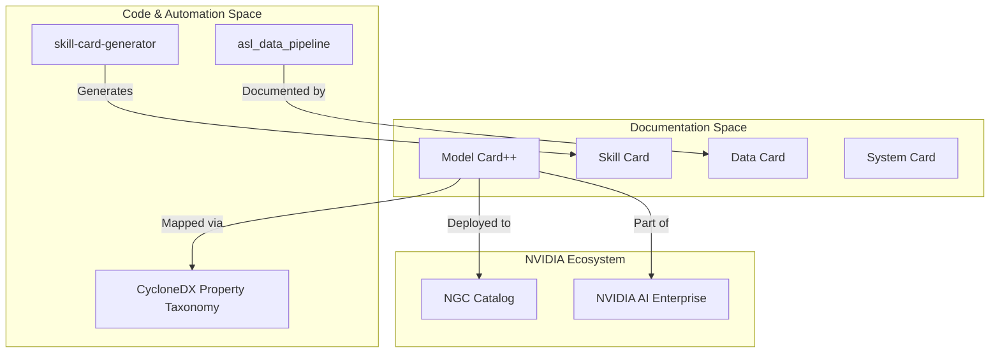

<!-- source: DeepWiki mcp.deepwiki.com · repo NVIDIA/Trustworthy-AI · page 1 Overview: NVIDIA Trustworthy AI Repository · fetched 2026-10-26 -->

# Overview: NVIDIA Trustworthy AI Repository

Relevant source files

The following files were used as context for generating this wiki page:

- [LICENSE.md](LICENSE.md)
- [Model Card++ Templates/README.md](Model Card++ Templates/README.md)
- [README.md](README.md)

NVIDIA is committed to advancing AI that is reliable, transparent, and ethical. The **NVIDIA Trustworthy AI** repository serves as a central hub for products, tools, and documentation frameworks designed to enable developers, partners, and the larger ecosystem to build and deploy AI responsibly. This repository provides a blend of standardized documentation templates and active codebases to support the end-to-end AI lifecycle.

### Guiding Principles and Framework
The repository is built upon NVIDIA's core Trustworthy AI values, aiming to democratize AI responsibly by providing model consumers—including enterprise developers, policymakers, and investors—with clear, uniform metadata. These resources clarify intended domains, dataset characterizations, and technical limitations to accelerate the adoption of state-of-the-art software.

**Sources:** [README.md:1-5](), [Model Card++ Templates/README.md:1-4]()

---

## Core Sub-systems

The repository is organized into three primary pillars that bridge the gap between high-level governance and technical implementation:

1.  **Model Card++ Templates**: An enhanced documentation standard that uplevels traditional model cards by providing a modular architecture. It includes specialized subcards for Explainability, Bias, Safety, and Privacy, alongside machine-readable taxonomies.
2.  **Skill Card Ecosystem**: A framework specifically for AI agents. It includes the `skill-card-generator` tool to automate the creation of governance documentation for agentic skills.
3.  **ASL Developer Community**: A practical application of Trustworthy AI principles featuring the `asl_data_pipeline` and the `SIGNS` model, demonstrating how to document and process sensitive data (American Sign Language) transparently.

### System Interconnectivity
The following diagram illustrates how the various "Card" entities and code tools relate to the overall Trustworthy AI framework.

**Trustworthy AI Entity Relationship**

**Sources:** [README.md:7-9](), [Model Card++ Templates/README.md:5-9](), [LICENSE.md:1-3]()

---

## Licensing and Community Cadence

To maximize accessibility and utility, the repository employs a dual-licensing model:

*   **Creative Commons Zero (CC0) 1.0 Universal**: Applied to AI Transparency Card Templates (Model Cards, Skill Cards, etc.), allowing the public to freely build upon, modify, and redistribute these works for any purpose.
*   **Apache License**: Generally applied to the source code and tools (e.g., the ASL data pipeline and Skill Card generator).

**Update Cadence**: NVIDIA maintains this repository with a **monthly update cycle**, ensuring that templates and tools evolve alongside the rapidly changing AI landscape.

**Sources:** [README.md:3-8](), [LICENSE.md:1-7](), [Model Card++ Templates/README.md:7-8]()

---

## Detailed Component Overviews

### 1. Model Card++ Documentation
Model Card++ provides a common software quality expectation. It extends basic model documentation into a suite of specialized subcards that address specific ethical and technical vectors, such as bias prevalence and life-critical impact assessments. These are bridged to machine-readable formats via the **CycloneDX Property Taxonomy**.

*   For details on the framework and templates, see **[Repository Structure & Key Concepts](#1.2)**.
*   For details on the machine-readable mapping, see **[CycloneDX Property Taxonomy](#2.7)**.

### 2. Skill Card Ecosystem
Designed for AI agents, this system manages the governance of specific "skills." It includes an automated pipeline (`skill-card-generator`) that extracts signals from code assets to generate human-verifiable documentation.

*   For details on the automation pipeline, see **[Skill Card Generator: Automated Pipeline](#3.2)**.

### 3. ASL Developer Community
This section contains the source code for the `asl_data_pipeline`, which processes video data into landmarks for sign language recognition. It serves as a reference implementation for the repository's documentation standards.

*   For details on the processing modules, see **[Preprocessing Modules: Extractors & Converters](#4.1.1)**.

---

## Getting Started

To begin using the templates or contributing to the tools:
1.  **Explore the Templates**: Review the `Model Card++ Templates` directory for the latest standards.
2.  **Clone and Install**: Follow the Poetry-based setup for the Python tools.
3.  **Contribute**: NVIDIA invites the community to open GitHub issues or pull requests to improve the transparency standards.

For a practical onboarding guide, see **[Getting Started & Contributing](#1.1)**.

**Sources:** [README.md:7-9](), [Model Card++ Templates/README.md:7-8]()

---

