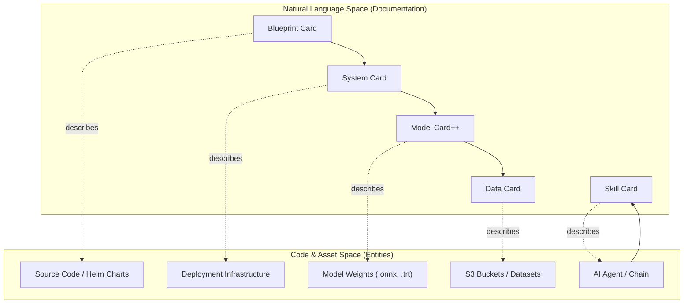
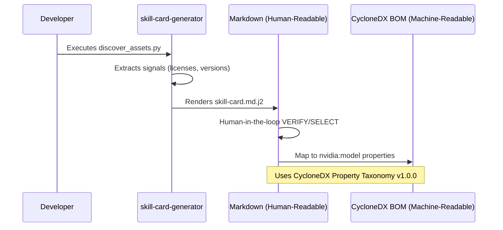

<!-- source: DeepWiki mcp.deepwiki.com · repo NVIDIA/Trustworthy-AI · page 1.2 Repository Structure & Key Concepts · fetched 2026-10-26 -->

# Repository Structure & Key Concepts

Relevant source files

The following files were used as context for generating this wiki page:

- [CycloneDX-Property-Taxonomy/cyclonedx-property-taxonomy.md](CycloneDX-Property-Taxonomy/cyclonedx-property-taxonomy.md)
- [Model Card++ Templates/README.md](Model Card++ Templates/README.md)
- [README.md](README.md)

This page provides a technical map of the NVIDIA Trustworthy AI repository. It outlines the directory organization, the conceptual framework of the "Card" ecosystem, and the data flow between human-readable documentation and machine-readable Bill of Materials (BOM) files via the CycloneDX Property Taxonomy.

## Repository Map

The repository is organized into three primary pillars: documentation frameworks, automated governance tools, and reference implementations.

| Directory | Purpose | Key Contents |
|:---|:---|:---|
| `Model Card++ Templates/` | Standardized documentation framework for AI assets. | Markdown templates for Model, Data, System, and Container cards. |
| `Skill Card Ecosystem/` | Governance for AI agents and modular skills. | `skill-card-generator` tool and `Skill Card` schemas. |
| `ASL Developer Community/` | Reference implementation for trustworthy data pipelines. | `asl_data_pipeline` source code and SIGNS model cards. |
| `CycloneDX-Property-Taxonomy/` | Machine-readable mapping layer. | Taxonomy definitions for `nvidia:` namespaces. |

**Sources:** [README.md:1-9](), [Model Card++ Templates/README.md:1-10](), [CycloneDX-Property-Taxonomy/cyclonedx-property-taxonomy.md:1-22]()

## The "Card" Ecosystem & Documentation Chain

The repository introduces a modular "Card" architecture. Rather than a single monolithic document, NVIDIA utilizes a chain of specialized cards that provide transparency across the AI lifecycle.

### Card Types
*   **Model Card++:** An enhanced version of the Google Model Card, featuring subcards for Explainability, Bias, Safety & Security, and Privacy [Model Card++ Templates/README.md:1-5]().
*   **Data Card:** Focuses on dataset provenance, licensing, and ethical compliance [CycloneDX-Property-Taxonomy/cyclonedx-property-taxonomy.md:50-61]().
*   **System Card:** Defines the Operational Design Domain (ODD) and fail-safe mechanisms for the end-to-end AI system.
*   **Container Card:** Provides transparency for the deployment environment, including CVE links and versioning tags.
*   **Blueprint Card:** Maps the software component chain and minimum system requirements.
*   **Skill Card:** A specific format for AI Agent "skills," documenting intent, risks, and evaluation results [Skill Card Ecosystem/README.md:1-10]().

### The Documentation Chain
The following diagram illustrates how these entities relate to one another in the "Natural Language Space" vs. the "Code/Asset Space."

**Documentation Chain & Entity Mapping**

**Sources:** [Model Card++ Templates/README.md:3-5](), [CycloneDX-Property-Taxonomy/cyclonedx-property-taxonomy.md:5-22]()

## CycloneDX Property Taxonomy

To bridge human-readable Markdown cards with automated supply chain security tools, the repository defines a **CycloneDX Property Taxonomy**. This allows Model Card++ fields to be embedded directly into CycloneDX Software Bill of Materials (SBOM) or AI Bill of Materials (AI/OBOM) files.

### Namespace Implementation
The taxonomy is divided into eight namespaces under the `nvidia` prefix:

| Namespace | Usage | Example Properties |
|:---|:---|:---|
| `nvidia:model` | Core identity | `deployment_geography`, `release_dates` |
| `nvidia:architecture` | Technical design | `runtime_engines`, `hardware_compatibility` |
| `nvidia:dataset` | Data provenance | `training_license`, `gpai:total_size` |
| `nvidia:inference` | Runtime metrics | `computational_load`, `latency` |
| `nvidia:bias` | Fairness metrics | `bias_mitigation_strategies` |
| `nvidia:privacy` | Data protection | `personal_data_handled` |
| `nvidia:safety` | Risk management | `life_critical_impact` |
| `nvidia:explainability` | Transparency | `intended_users`, `limitations` |

**Sources:** [CycloneDX-Property-Taxonomy/cyclonedx-property-taxonomy.md:11-22](), [CycloneDX-Property-Taxonomy/cyclonedx-property-taxonomy.md:26-47]()

## Data Flow: From Markdown to Machine-Readable BOM

The repository facilitates a workflow where high-level documentation is transformed into machine-parsable properties. This is particularly evident in the `Skill Card Ecosystem`, where the `skill-card-generator` automates the extraction of signals from code to populate these schemas.

**Technical Data Flow: Card Generation & Mapping**

**Sources:** [CycloneDX-Property-Taxonomy/cyclonedx-property-taxonomy.md:1-9](), [Skill Card Ecosystem/README.md:5-15]()

---

