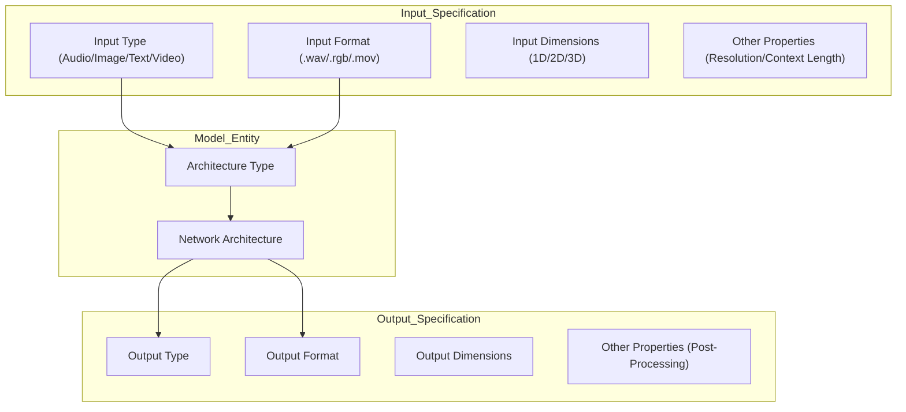
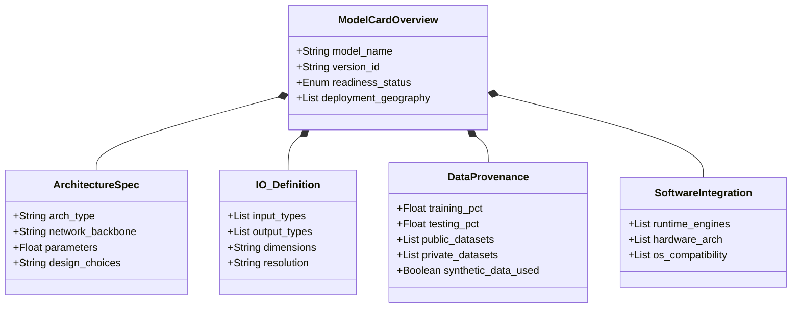

<!-- source: DeepWiki mcp.deepwiki.com · repo NVIDIA/Trustworthy-AI · page 2.1 Model Card Overview Template · fetched 2026-10-26 -->

# Model Card Overview Template

Relevant source files

The following files were used as context for generating this wiki page:

- [Model Card++ Templates/Model Card Overview Template](Model Card++ Templates/Model Card Overview Template)

The **Model Card Overview Template** serves as the primary entry point for NVIDIA's Model Card++ documentation framework. It provides a standardized, high-level technical summary of an AI model's identity, architecture, operational requirements, and data provenance. This template is designed to ensure transparency for both general-purpose AI (GPAI) and specialized models, bridging the gap between high-level descriptions and technical specifications required for integration.

[Model Card++ Templates/Model Card Overview Template:1-125]()

## Model Identity and Metadata

Every model card begins with fundamental metadata that establishes the model's lineage, ownership, and intended deployment environment.

| Field | Description |
| :--- | :--- |
| **Description** | A concise statement of the model's function and development context. |
| **Readiness Status** | Categorization as Commercial, Research & Development, or Demonstration. |
| **Deployment Geography** | Specific regions (e.g., APAC, EMEA, NAM) or countries where the model is supported. |
| **Use Case** | Detailed definition of expected users and specific applications. |
| **License/Terms** | Legal framework governing the model's distribution and usage. |

[Model Card++ Templates/Model Card Overview Template:3-22]()

## Architecture Specifications

The template requires granular detail regarding the model's neural network structure. This section is critical for developers assessing hardware compatibility and performance characteristics.

*   **Architecture Type:** High-level classification such as CNN, RNN, Transformer, or State Machine.
*   **Network Architecture:** Specific backbone identification (e.g., `ResNet50`, `MobileNetv2`, `DarkNet53`).
*   **Model Parameters:** Recorded with at least two significant figures (e.g., $7.3 \times 10^{10}$).
*   **GPAI Design Choices:** (Internal only) Documentation of initialization techniques, hyperparameter tuning, regularization, and optimization damping.

[Model Card++ Templates/Model Card Overview Template:26-35]()

### Data Flow: Input/Output Definitions
The following diagram illustrates how the Model Card++ template structures the I/O interface for software integration.

**Model Interface Mapping**

Sources: [Model Card++ Templates/Model Card Overview Template:40-69]()

## Software and Hardware Integration

The template tracks the runtime environment necessary for the model to execute correctly. This includes the relationship between software engines and the underlying microarchitecture.

*   **Runtime Engines:** Specific execution environments (e.g., TensorRT, ONNX Runtime).
*   **Microarchitecture:** Supported hardware generations (e.g., Hopper, Blackwell, Ampere).
*   **Operating Systems:** Compatibility with Linux, Linux 4 Tegra, QNX, or Windows.
*   **Model Versions:** Unique identifiers for variations such as `pruned`, `quantized`, or `deployable`.

[Model Card++ Templates/Model Card Overview Template:70-92]()

## Data Provenance for GPAI Models

For General-Purpose AI (GPAI) models, the template mandates a deep dive into the data lifecycle to address transparency and safety requirements.

### Dataset Partitioning and Collection
The template tracks the statistical distribution and temporal bounds of the data used across the model lifecycle:
1.  **Training Partition:** Percentage and collection time period.
2.  **Testing Partition:** Percentage and collection time period.
3.  **Validation Partition:** Percentage and collection time period.

[Model Card++ Templates/Model Card Overview Template:95-103]()

### Provenance Categories
The framework distinguishes between different data acquisition methods to assess risk and compliance:

| Category | Requirements |
| :--- | :--- |
| **Public Datasets** | List of datasets representing >3% of total data, including unique IDs and links. |
| **Private Datasets** | Documentation of third-party acquired data and narrative descriptions. |
| **Crawling/Scraping** | Identification of crawlers, modality size, and opt-out/exclusion verification. |
| **Synthetic Data** | Description of generators, software used, and the ratio of synthetic to real data. |

[Model Card++ Templates/Model Card Overview Template:108-132]()

## Computational Load and Benchmarking

To support environmental and efficiency tracking, the template includes sections for:
*   **Cumulative Compute:** Total floating-point operations or GPU-hours.
*   **Energy and Emissions:** Estimated carbon footprint and power consumption during training.
*   **Inference Performance:** Benchmarking results across different hardware configurations, typically reported in frames per second (FPS) or latency (ms).

[Model Card++ Templates/Model Card Overview Template:36-39]()

## Implementation Mapping: Template to Code

The following diagram maps the conceptual sections of the Model Card Overview Template to the structural components found in the repository's documentation and schema files.

**Template Structure to Entity Mapping**

Sources: [Model Card++ Templates/Model Card Overview Template:1-132]()

**Sources:**
* [Model Card++ Templates/Model Card Overview Template:1-132]()

---

