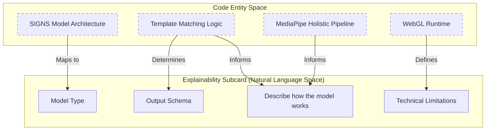
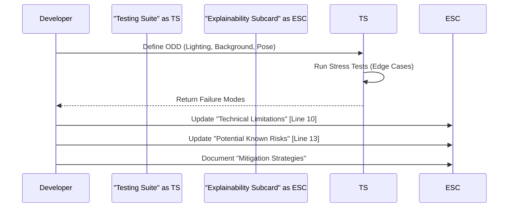

<!-- source: DeepWiki mcp.deepwiki.com · repo NVIDIA/Trustworthy-AI · page 2.2 Explainability Subcard · fetched 2026-10-26 -->

# Explainability Subcard

Relevant source files

The following files were used as context for generating this wiki page:

- [Model Card++ Templates/Model Card Explainability Subcard](Model Card++ Templates/Model Card Explainability Subcard)

The **Explainability Subcard** is a specialized module within the NVIDIA Model Card++ framework designed to provide transparency regarding a model's operational mechanics, its limitations within a defined Operational Design Domain (ODD), and its impact on diverse user groups. It serves as a technical bridge between raw model performance and human-understandable logic, ensuring that stakeholders can interpret model outputs and understand the boundaries of safe operation.

## Purpose and Scope

The primary objective of the Explainability Subcard is to document the "how" and "why" behind model behavior. While the [Model Card Overview Template:2.1]() focuses on architecture and metadata, the Explainability Subcard addresses:
*   **Operational Boundaries**: Defining the specific conditions under which the model is reliable.
*   **User Context**: Identifying who should use the model and what outputs they should expect.
*   **Risk Mitigation**: Disclosing known failure modes and the technical measures taken to address them.
*   **GPAI Transparency**: For General Purpose AI (GPAI) models, documenting the provenance of data and the tools used to verify authenticity.

## Template Schema and Data Flow

The Explainability Subcard follows a structured schema that maps directly to the `nvidia:explainability` namespace in the [CycloneDX Property Taxonomy:2.7]().

### Explainability Subcard Structure
| Field | Description | Technical Requirement |
| :--- | :--- | :--- |
| **Intended Task/Domain** | The specific application area (e.g., ASL Recognition, Autonomous Perception). | [Model Card++ Templates/Model Card Explainability Subcard:3-3]() |
| **Model Type** | Categorization of the model (e.g., Transformer, Template Matching, CNN). | [Model Card++ Templates/Model Card Explainability Subcard:4-4]() |
| **Intended Users** | The profile of end-users or developers integrating the model. | [Model Card++ Templates/Model Card Explainability Subcard:5-5]() |
| **Output Schema** | Detailed description of the model's inference results and formats. | [Model Card++ Templates/Model Card Explainability Subcard:6-6]() |
| **GPAI Synthetic Tools** | Tools used to detect synthetic data and ensure authenticity in GPAI training sets. | [Model Card++ Templates/Model Card Explainability Subcard:7-7]() |
| **Functional Description** | A high-level explanation of the internal logic and processing steps. | [Model Card++ Templates/Model Card Explainability Subcard:8-8]() |
| **Adversely Impacted Groups** | Groups for which the model has been tested to ensure comparable outcomes. | [Model Card++ Templates/Model Card Explainability Subcard:9-9]() |
| **Technical Limitations** | Failures or performance degradation within the intended ODD. | [Model Card++ Templates/Model Card Explainability Subcard:10-10]() |
| **Quality Standards** | Verification of compliance with internal corporate quality benchmarks. | [Model Card++ Templates/Model Card Explainability Subcard:11-11]() |
| **Performance Metrics** | Key indicators used to measure explainability or reliability. | [Model Card++ Templates/Model Card Explainability Subcard:12-12]() |
| **Known Risks** | Consequences of model failure or misuse. | [Model Card++ Templates/Model Card Explainability Subcard:13-13]() |

**Sources:**
* [Model Card++ Templates/Model Card Explainability Subcard:1-14]()

## Technical Implementation: Logic to Documentation

The following diagram illustrates how technical attributes from the codebase (using the SIGNS model as an example) are mapped into the Explainability Subcard fields.

### Logic Mapping Diagram
"This diagram bridges the gap between model implementation logic and the documentation fields."

**Sources:**
* [Model Card++ Templates/Model Card Explainability Subcard:4-10]()
* [ASL Developer Community/SIGNS Model: ASL Recognition Model Cards:4.2]()

## Operational Design Domain (ODD) and Limitations

A critical component of the Explainability Subcard is the definition of the **Operational Design Domain (ODD)**. This section must detail where the model is expected to perform and, more importantly, where it is likely to fail.

### ODD Verification Workflow
"The process of validating model performance against the ODD to fill the Subcard."

### Key Considerations for Limitations
1.  **Environmental Factors**: Sensitivity to lighting conditions, sensor noise, or occlusion [Model Card++ Templates/Model Card Explainability Subcard:10-10]().
2.  **Hardware Constraints**: Minimum compute requirements (e.g., WebGL support) that impact model inference speed and reliability [Model Card++ Templates/Model Card Explainability Subcard:10-10]().
3.  **Data Drifts**: How the model handles inputs that deviate significantly from the training or template distribution [Model Card++ Templates/Model Card Explainability Subcard:13-13]().

**Sources:**
* [Model Card++ Templates/Model Card Explainability Subcard:10-13]()

## GPAI and Synthetic Data Transparency

For General Purpose AI (GPAI) models, the subcard requires specific disclosures regarding synthetic data. This is essential for maintaining a "Trustworthy AI" posture when training involves non-organic data sources.

*   **Detection Tools**: Documentation of the algorithms or software used to distinguish between human-generated and AI-generated data during the training phase [Model Card++ Templates/Model Card Explainability Subcard:7-7]().
*   **Data Authenticity**: Verification methods used to ensure that the datasets used for training or evaluation have not been tampered with or corrupted [Model Card++ Templates/Model Card Explainability Subcard:7-7]().

## Integration with CycloneDX

The Explainability Subcard is designed to be machine-readable. Every field in the Markdown template corresponds to a property in the `nvidia:explainability` namespace of the [CycloneDX Property Taxonomy:2.7]().

| Markdown Field | CycloneDX Property |
| :--- | :--- |
| `Intended Task/Domain` | `nvidia:explainability:task_domain` |
| `Model Type` | `nvidia:explainability:model_type` |
| `Technical Limitations` | `nvidia:explainability:limitations` |
| `Performance Metrics` | `nvidia:explainability:metrics` |

This mapping allows the documentation to be exported as a Software Bill of Materials (SBOM), facilitating automated compliance checks across the AI lifecycle.

**Sources:**
* [Model Card++ Templates/Model Card Explainability Subcard:1-14]()
* [CycloneDX Property Taxonomy:2.7]()

---

