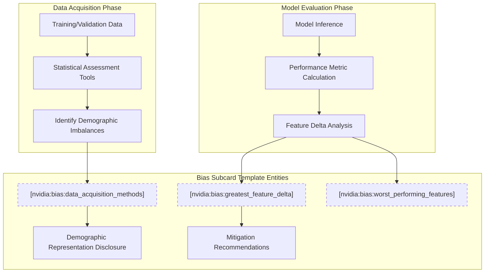
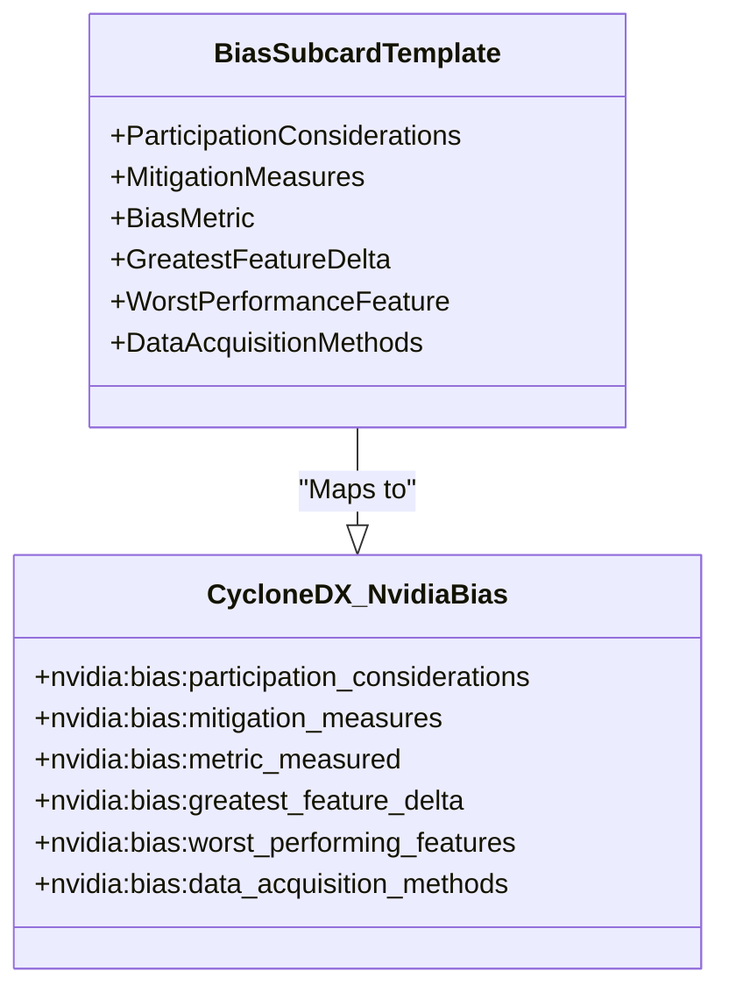

<!-- source: DeepWiki mcp.deepwiki.com · repo NVIDIA/Trustworthy-AI · page 2.3 Bias Subcard · fetched 2026-10-26 -->

# Bias Subcard

Relevant source files

The following files were used as context for generating this wiki page:

- [Model Card++ Templates/Bias Subcard Template](Model Card++ Templates/Bias Subcard Template)

The **Bias Subcard** is a modular component of the NVIDIA Model Card++ framework designed to document the ethical considerations, statistical imbalances, and mitigation strategies associated with AI models. It provides a structured schema for reporting how protected classes were considered during development, the specific metrics used to quantify bias, and performance deltas across different demographic features, particularly for General Purpose AI (GPAI) models.

## Subcard Structure and Data Flow

The Bias Subcard operates as a specialized extension of the Model Card++ ecosystem, focusing on the social and statistical implications of model behavior. It transitions from qualitative participation considerations to quantitative performance analysis.

### Bias Analysis Workflow
The following diagram illustrates the data flow from data acquisition to the final reporting within the Bias Subcard template.

**Bias Documentation Pipeline**

**Sources:** [Model Card++ Templates/Bias Subcard Template:1-11]()

## Key Technical Fields

The template defines several critical fields for documenting bias, with specific requirements for GPAI (General Purpose AI) models to ensure compliance with emerging transparency standards.

### 1. Participation and Mitigation
*   **Protected Class Considerations:** Documentation of how members of protected classes (as defined by legal frameworks like the California Senate protected classes) were involved in the design and testing phases [Model Card++ Templates/Bias Subcard Template:3]().
*   **Mitigation Measures:** A technical description of the specific interventions (e.g., re-weighting, adversarial debiasing, or curated sampling) taken to reduce unwanted bias [Model Card++ Templates/Bias Subcard Template:4]().

### 2. Quantitative Metrics
*   **Bias Metric:** The specific statistical measure used to evaluate fairness (e.g., Disparate Impact, Equalized Odds, or Demographic Parity) [Model Card++ Templates/Bias Subcard Template:5]().
*   **GPAI Feature Deltas:** For GPAI models, developers must identify which specific features show the greatest performance variance and which features exhibit the lowest absolute performance [Model Card++ Templates/Bias Subcard Template:6-7]().

### 3. Data Provenance and Statistical Tools
For GPAI models, the subcard requires a deep dive into the internal data processing pipeline:
*   **Methodology:** A ~200-word description of methods used during data acquisition to address bias prevalence [Model Card++ Templates/Bias Subcard Template:8]().
*   **Tooling:** Identification of specific software tools used to assess statistical imbalances [Model Card++ Templates/Bias Subcard Template:9]().

**Sources:** [Model Card++ Templates/Bias Subcard Template:3-9]()

## Demographic Representation Disclosures

The subcard includes a standardized disclosure format for dataset limitations. This section acknowledges that datasets are rarely exhaustive and requires explicit naming of missing or underrepresented taxonomies.

| Disclosure Component | Description |
| :--- | :--- |
| **Dataset Name** | Identification of the specific datasets evaluated. |
| **Excluded Classes** | Explicit list of classes from the relevant taxonomy not represented in the data. |
| **Proportional Split** | Known representation percentages of the included taxonomy. |
| **Recommendations** | Suggested fine-tuning or evaluation techniques for end-users to align model behavior. |

**Sources:** [Model Card++ Templates/Bias Subcard Template:10-11]()

## Implementation Mapping: Template to Taxonomy

The fields defined in the `Bias Subcard Template` map directly to the `nvidia:bias` namespace in the machine-readable CycloneDX Property Taxonomy. This allows the natural language responses in the markdown file to be parsed into automated governance workflows.

**Mapping Natural Language to Code Entities**

**Sources:** [Model Card++ Templates/Bias Subcard Template:1-11](), [2.7 CycloneDX Property Taxonomy]() (referenced for namespace context).

---

