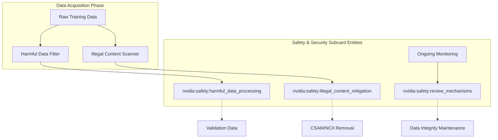
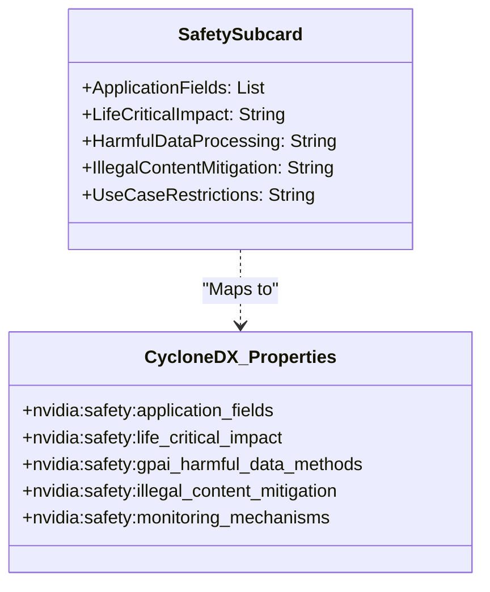

<!-- source: DeepWiki mcp.deepwiki.com · repo NVIDIA/Trustworthy-AI · page 2.4 Safety & Security Subcard · fetched 2026-10-26 -->

# Safety & Security Subcard

Relevant source files

The following files were used as context for generating this wiki page:

- [Model Card++ Templates/Safety & Security Subcard](Model Card++ Templates/Safety & Security Subcard)

The **Safety & Security Subcard** is a specialized module within the NVIDIA Model Card++ framework designed to document the operational safety boundaries, application-specific risks, and content mitigation strategies of an AI model. It provides a structured format for identifying life-critical impacts and detailing the rigorous data-cleansing processes required for General Purpose AI (GPAI) models, particularly regarding illegal content like CSAM and NCII.

### 1. Application Taxonomy and Impact Assessment
This section categorizes the model's intended deployment environments and evaluates the potential for life-critical consequences. By defining the **Model Application Field(s)**, developers can signal the level of safety-criticality inherent in the model's use case.

| Field | Description |
| :--- | :--- |
| **Model Application Field(s)** | A selection of industry-specific domains where the model is intended to be integrated (e.g., Autonomous Vehicles, Healthcare, Critical Infrastructure). |
| **Life Critical Impact** | A technical assessment of how model failure or misuse could lead to physical harm, loss of life, or catastrophic environmental damage. |

**Sources:**
- `Model Card++ Templates/Safety & Security Subcard`: [3-4]()

### 2. GPAI Harmful Data Processing
For General Purpose AI (GPAI) models, the subcard requires detailed disclosures regarding the methods used to sanitize training, testing, and validation datasets. This is critical for transparency in how the model handles "potentially harmful data" that may not be strictly illegal but could lead to unsafe model behaviors.

#### Data Flow: Harmful Content Mitigation
The following diagram illustrates the conceptual data flow for GPAI model data acquisition as described in the subcard requirements.

**GPAI Data Safety Pipeline**

**Sources:**
- `Model Card++ Templates/Safety & Security Subcard`: [5-6]()
- `Model Card++ Templates/Safety & Security Subcard`: [9-9]()

### 3. Illegal Content Mitigation (CSAM/NCII)
A mandatory disclosure for GPAI models involves the specific technical methods used to detect and remove illegal content. This includes, but is not limited to, **Child Sexual Abuse Material (CSAM)** and **Non-Consensual Intimate Imagery (NCII)**. 

The subcard explicitly states that models developed under this framework must be scanned for such content consistent with corporate responsible data handling policies.

**Sources:**
- `Model Card++ Templates/Safety & Security Subcard`: [6-6]()
- `Model Card++ Templates/Safety & Security Subcard`: [9-9]()

### 4. Restrictions and Monitoring
The subcard defines the legal and operational boundaries of the model through use case restrictions and continuous monitoring protocols.

*   **Use Case Restrictions:** Specifies the legal framework and license agreements (e.g., NVIDIA Community Model License) that govern how the model can be deployed.
*   **Model and Dataset Restrictions:** Technical limitations on how the dataset can be utilized or how the model can be fine-tuned.
*   **Ongoing Review:** Documents the mechanisms in place to maintain data integrity and risk mitigation after the initial model release.

**Sources:**
- `Model Card++ Templates/Safety & Security Subcard`: [7-9]()

### 5. Technical Implementation: CycloneDX Mapping
The fields defined in the Safety & Security Subcard are mapped to machine-readable properties in the `nvidia:safety` namespace of the CycloneDX Property Taxonomy. This allows for automated compliance checking against the Model Card++ specifications.

**Subcard to Taxonomy Mapping**

**Sources:**
- `Model Card++ Templates/Safety & Security Subcard`: [1-9]()

---

