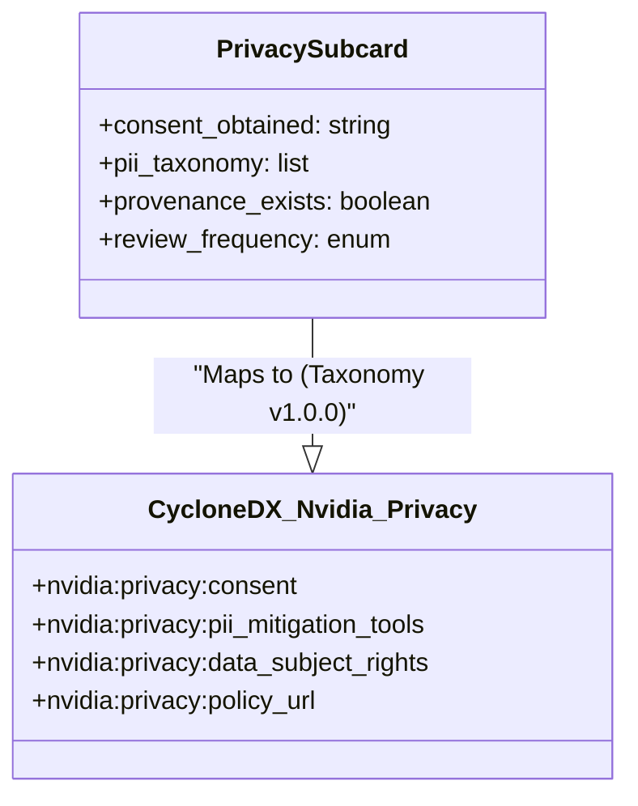

<!-- source: DeepWiki mcp.deepwiki.com · repo NVIDIA/Trustworthy-AI · page 2.5 Privacy Subcard · fetched 2026-10-26 -->

# Privacy Subcard

<details>
<summary>Relevant source files</summary>

The following files were used as context for generating this wiki page:

- [Model Card++ Templates/Model Card Privacy Subcard](Model Card++ Templates/Model Card Privacy Subcard)

</details>


The **Privacy Subcard** is a specialized module within the NVIDIA Model Card++ framework designed to document personal data governance, regulatory compliance, and privacy-preserving technical measures. It provides a structured schema for reporting on data provenance, consent mechanisms, and automated PII (Personally Identifiable Information) mitigation strategies, with specific extensions for General Purpose AI (GPAI) models.

## Purpose and Scope

The Privacy Subcard serves as a transparency artifact for legal, compliance, and technical stakeholders. Its primary objectives include:
*   **Data Governance**: Tracking the lifecycle of personal data from acquisition to model integration.
*   **Regulatory Alignment**: Documenting mechanisms that support data subject rights (access, deletion, correction) as required by global privacy frameworks (e.g., GDPR, CCPA).
*   **GPAI Risk Mitigation**: Detailing automated scanning for PII and copyright-reserved content in massive-scale datasets.
*   **Provenance Verification**: Ensuring all training data has a verifiable chain of custody.

## Technical Implementation & Fields

The template defines a set of mandatory and conditional fields that describe the privacy posture of an AI model.

### 1. Personal Data Governance
These fields track the presence and handling of personal data within the model's training pipeline.

| Field | Description |
| :--- | :--- |
| `Generatable personal data` | Assessment of whether the model can output or be reverse-engineered to reveal personal data [Model Card++ Templates/Model Card Privacy Subcard:3-3](). |
| `Consent Status` | Verification of whether explicit consent was obtained for personal data used [Model Card++ Templates/Model Card Privacy Subcard:5-5](). |
| `Data Minimization` | Confirmation that only the minimum necessary personal data was collected for model development [Model Card++ Templates/Model Card Privacy Subcard:11-11](). |
| `User Interaction Data` | Disclosure of whether user prompts or inputs were fed back into training loops [Model Card++ Templates/Model Card Privacy Subcard:12-12](). |

### 2. Data Subject Rights Pipeline
The subcard requires documentation of the technical and procedural "pipelines" used to honor legal requests from individuals.

| Mechanism | Description |
| :--- | :--- |
| **Access/Deletion** | Technical mechanisms to remove specific data points from training sets or associated metadata [Model Card++ Templates/Model Card Privacy Subcard:8-8](). |
| **Correction** | Procedures for updating inaccurate personal data within the dataset [Model Card++ Templates/Model Card Privacy Subcard:15-15](). |
| **Disclosures** | Maintenance of records regarding what was disclosed to data subjects at the time of collection [Model Card++ Templates/Model Card Privacy Subcard:10-10](). |

### 3. GPAI & Automated PII Mitigation
For General Purpose AI, the subcard focuses on automated risk reduction at scale.

*   **Taxonomy-Based Scanning**: Implementation of automated tools to identify and filter specific categories of PII [Model Card++ Templates/Model Card Privacy Subcard:18-18]().
*   **Copyright Opt-Out**: Verification of processes to identify "reserved rights" content and honor rightsholder opt-outs [Model Card++ Templates/Model Card Privacy Subcard:17-17]().
*   **Verification Cycles**: Documentation of findings where automated tools detected potential PII and the subsequent removal techniques applied [Model Card++ Templates/Model Card Privacy Subcard:19-19]().

**Sources:**
* [Model Card++ Templates/Model Card Privacy Subcard:1-22]()

---

## Data Flow: Privacy Review Lifecycle

The following diagram illustrates the lifecycle of a dataset through the privacy review states defined in the subcard.

**Privacy Review State Machine**
```mermaid
graph TD
    "START"["Data Acquisition"] --> "PROV"["Provenance Verification"]
    "PROV" --> "CONSENT"{"Consent Obtained?"}
    
    "CONSENT" -- "No" --> "MIN"["Data Minimization / Anonymization"]
    "CONSENT" -- "Yes" --> "PII_SCAN"["Automated PII Scanning"]
    
    "MIN" --> "PII_SCAN"
    
    subgraph "GPAI_Mitigation_Logic"
        "PII_SCAN" --> "TAXONOMY"["Apply PII Taxonomy Filter"]
        "TAXONOMY" --> "OPT_OUT"["Verify Copyright Opt-outs"]
    end
    
    "OPT_OUT" --> "REVIEW"{"Review State"}
    
    "REVIEW" -- "Initial" --> "DEV"["Model Development"]
    "REVIEW" -- "Periodic" --> "AUDIT"["Post-Release Audit"]
    "REVIEW" -- "Triggered" --> "DSAR"["Data Subject Request (Access/Delete)"]
    
    "DSAR" --> "REMOVAL"["Removal/Correction Pipeline"]
    "REMOVAL" --> "DEV"
```
**Sources:**
* [Model Card++ Templates/Model Card Privacy Subcard:6-8]()
* [Model Card++ Templates/Model Card Privacy Subcard:17-19]()

---

## Relationship to CycloneDX Taxonomy

The fields in the Privacy Subcard map directly to the `nvidia:privacy` namespace in the CycloneDX Property Taxonomy. This allows the human-readable markdown responses to be exported as machine-readable BOM (Bill of Materials) properties.

**Privacy Property Mapping**


### Dataset Review Lifecycle States
The subcard defines specific intervals for dataset reviews [Model Card++ Templates/Model Card Privacy Subcard:7-7]():
1.  **Pre-Release**: Final audit before the model is made available.
2.  **Integrated Lifecycle**: Continuous review during creation, training, and evaluation.
3.  **Ad-hoc**: Triggered by change requests or external data subject requests.

**Sources:**
* [Model Card++ Templates/Model Card Privacy Subcard:7-7]()
* [Model Card++ Templates/Model Card Privacy Subcard:13-16]()

---

