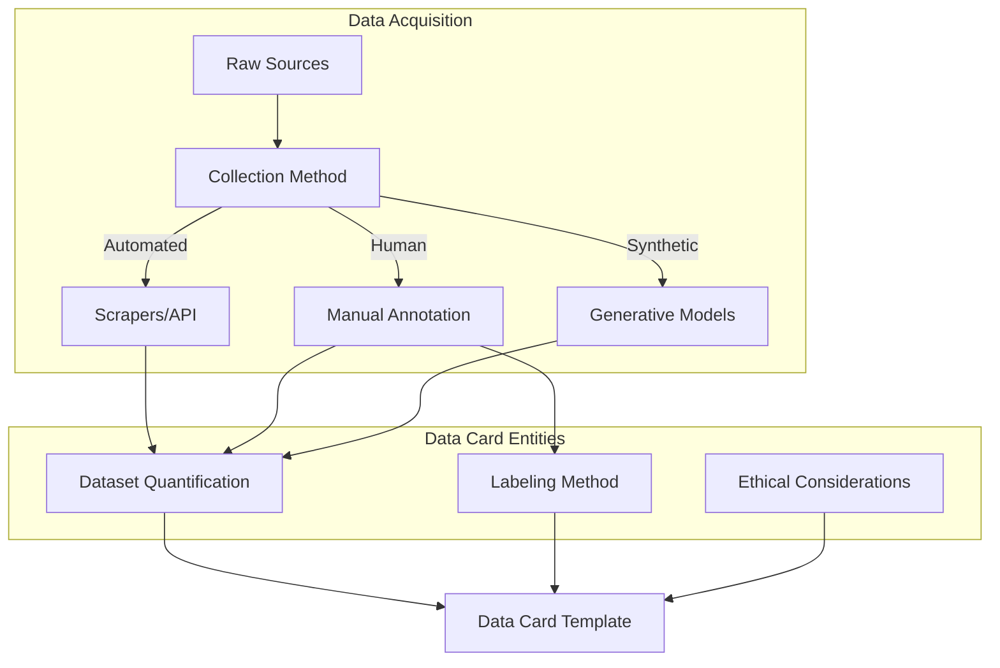
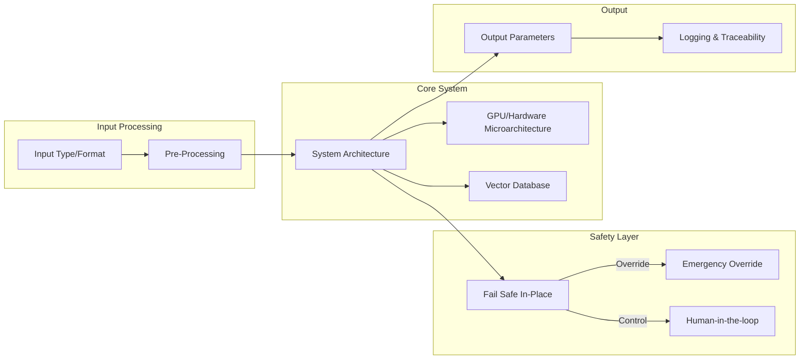
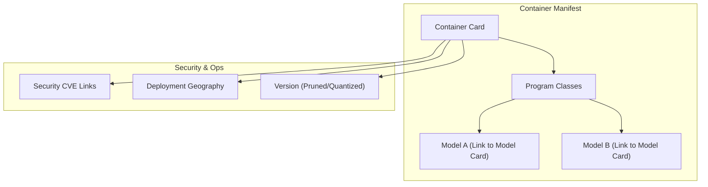
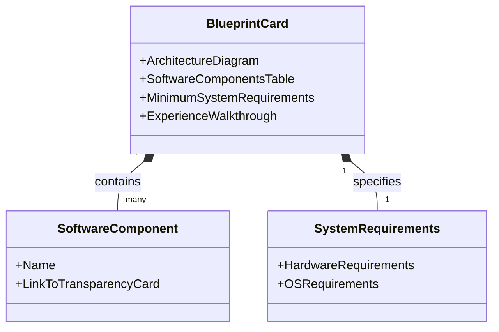

<!-- source: DeepWiki mcp.deepwiki.com · repo NVIDIA/Trustworthy-AI · page 2.6 Supplementary Card Types: Data, System, Container & Blueprint Cards · fetched 2026-10-26 -->

# Supplementary Card Types: Data, System, Container & Blueprint Cards

Relevant source files

The following files were used as context for generating this wiki page:

- [Blueprint Card](Blueprint Card)
- [Container Card](Container Card)
- [Data Card](Data Card)
- [System Card](System Card)

The NVIDIA Trustworthy AI framework extends beyond the **Model Card++** to provide a comprehensive documentation chain for the entire AI lifecycle. These four supplementary card templates—Data, System, Container, and Blueprint—standardize the disclosure of dataset provenance, integrated system behavior, deployment packaging, and end-to-end architectural transparency.

## Data Card

The **Data Card** focuses on the lifecycle of the data used to train or evaluate AI models. It captures critical metadata regarding collection, labeling, and quantification to ensure ethical compliance and technical suitability.

### Key Components
*   **Dataset Characterization**: Specifies the collection method (Automated, Sensors, Human, Synthetic, or Hybrid) [Data Card:19-26]() and the labeling method (e.g., Scraper, Machine-derived, or Human) [Data Card:27-34]().
*   **Quantification**: Requires explicit metrics for record count (images, audio, etc.), feature count (tags), and total data storage [Data Card:39-42]().
*   **Provenance**: Documents the owner, creation date, and licensing terms [Data Card:6-14]().

### Data Flow for Dataset Documentation
The following diagram illustrates how raw data sources are transformed into documented datasets within the framework.

**Dataset Metadata Extraction Flow**

*Sources: [Data Card:1-55]()*

---

## System Card

The **System Card** documents the operational environment where models reside. It defines the **Operational Design Domain (ODD)**, automation levels, and fail-safe mechanisms necessary for safe deployment.

### Technical Specifications
*   **Automation Level**: Categorizes the system as Autonomous, Partial Automation, or Assistant [System Card:19-22]().
*   **I/O Pipeline**: Defines input/output types (Audio, RGB, Lidar, etc.), formats (1D, 2D, 3D), and specific resolution requirements [System Card:48-59]().
*   **Fail-Safe Mechanisms**: Documents explicit overrides, including Emergency Override, Shut-Down, Human-in-the-loop, and Policy Enforcement [System Card:33-37]().
*   **Traceability**: Includes fields for logging user data and identifying the specific Vector Database (Type and Name) used for RAG or search tasks [System Card:85-89]().

**System Operational Logic**

*Sources: [System Card:1-98]()*

---

## Container Card

The **Container Card** provides transparency for the software packaging layer. It bridges the gap between the AI model and the infrastructure by documenting the manifest and security posture of the container image.

### Manifest and Security
*   **Program Classes**: Lists the specific software classes and models housed within the container, including instructions on how to pull them (Automatic vs. Manual) [Container Card:21-28]().
*   **Security (CVEs)**: Provides a direct link to security scan results for Common Vulnerabilities and Exposures [Container Card:38-40]().
*   **Versioning Tags**: Tracks variations such as `pruned`, `quantized`, or `deployable` alongside standard version numbers [Container Card:35-37]().

**Container Dependency Mapping**

*Sources: [Container Card:1-56]()*

---

## Blueprint Card

The **Blueprint Card** serves as the "transparency chain" for complex AI solutions. It provides a high-level view of how multiple software components and models integrate to solve a specific use case.

### Structural Requirements
*   **Architecture Diagram**: A mandatory visual representation of the overall blueprint [Blueprint Card:16-18]().
*   **Transparency Chain**: A table mapping each software component to its respective AI Transparency Card (Model Card++, etc.) [Blueprint Card:19-24]().
*   **System Requirements**: Defines the minimum Hardware and OS requirements needed to execute the blueprint [Blueprint Card:37-41]().
*   **Experience Walkthrough**: A narrative overview of the end-user interaction with the system [Blueprint Card:28-30]().

**Blueprint Transparency Chain**

*Sources: [Blueprint Card:1-52]()*

---

## Summary of Supplementary Card Fields

| Feature | Data Card | System Card | Container Card | Blueprint Card |
| :--- | :--- | :--- | :--- | :--- |
| **Primary Focus** | Dataset Provenance | Operational ODD | Deployment Manifest | Solution Architecture |
| **Key Metric** | Record/Feature Count | Automation Level | CVE Security Links | Component Chain |
| **Hardware** | N/A | GPU/Microarchitecture | Deployment Details | Min. System Requirements |
| **Safety** | Ethical Collection | Fail-Safe Mechanisms | Ethical Usage | Ethical Considerations |

*Sources: [Data Card:1-55](), [System Card:1-98](), [Container Card:1-56](), [Blueprint Card:1-52]()*

---

