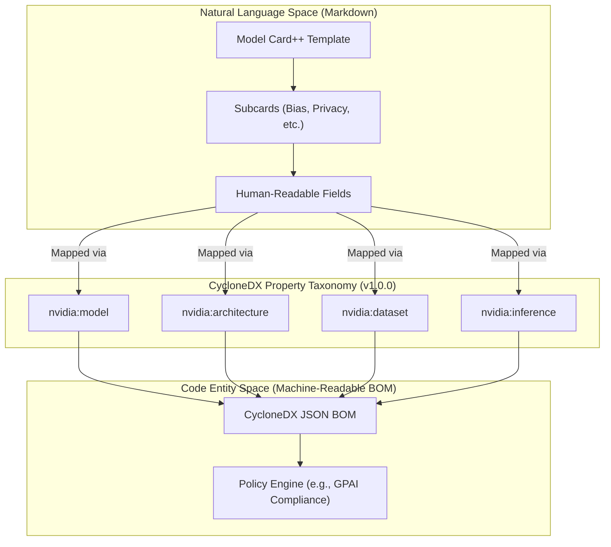
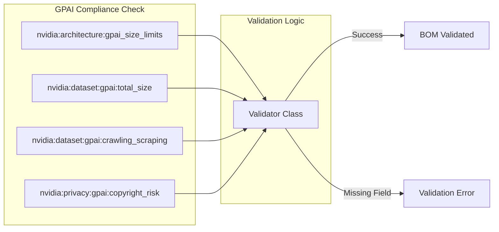

<!-- source: DeepWiki mcp.deepwiki.com · repo NVIDIA/Trustworthy-AI · page 2.7 CycloneDX Property Taxonomy · fetched 2026-10-26 -->

# CycloneDX Property Taxonomy

Relevant source files

The following files were used as context for generating this wiki page:

- [CycloneDX-Property-Taxonomy/cyclonedx-property-taxonomy.md](CycloneDX-Property-Taxonomy/cyclonedx-property-taxonomy.md)

The NVIDIA CycloneDX Property Taxonomy (v1.0.0) provides a standardized, machine-readable mapping for the **Model Card++** documentation framework. By extending the standard CycloneDX Software Bill of Materials (SBOM) schema, this taxonomy enables AI model metadata—such as architectural choices, bias metrics, and safety assessments—to be integrated into automated governance pipelines and supply chain security tools.

## Overview and Namespace Structure

The taxonomy is organized into eight distinct namespaces, each corresponding to specific facets of the Model Card++ and its subcards. These properties allow tools to parse NVIDIA Model Cards as structured CycloneDX BOM files.

### Taxonomy Namespaces

| Namespace | Description |
|:---|:---|
| `nvidia:model` | Core metadata, deployment geography, and versioning. |
| `nvidia:architecture` | Design choices, hardware compatibility, and GPAI size limits. |
| `nvidia:dataset` | Data provenance, licensing, and GPAI-specific data partitioning. |
| `nvidia:inference` | Computational load, inference engines, and benchmark results. |
| `nvidia:bias` | Performance deltas, demographic representation, and mitigation strategies. |
| `nvidia:privacy` | PII handling, data subject rights, and copyright risk mitigation. |
| `nvidia:safety` | Application field categorization and risk management. |
| `nvidia:explainability` | Technical limitations, intended users, and ODD definitions. |

**Sources:**
- [CycloneDX-Property-Taxonomy/cyclonedx-property-taxonomy.md:11-23]()

---

## Technical Implementation and Data Flow

The taxonomy bridges the gap between natural language documentation (Markdown templates) and machine-readable artifacts (JSON/XML BOMs). In a typical CI/CD or governance workflow, Model Card++ fields are extracted and mapped to these properties to generate a `cyclonedx:modelCard` object.

### Data Mapping Architecture

The following diagram illustrates how the Taxonomy facilitates the transition from human-readable documentation to automated policy enforcement.

**Model Card++ to CycloneDX Property Mapping**

**Sources:**
- [CycloneDX-Property-Taxonomy/cyclonedx-property-taxonomy.md:3-9]()

---

## Detailed Property Specifications

### 1. Model and Architecture (`nvidia:model`, `nvidia:architecture`)
These namespaces define the identity and technical constraints of the model.

*   **`nvidia:model:deployment_geography`**: Defines regional compliance (e.g., `APAC`, `EMEA`, `NAM`). **SHOULD** occur exactly once [CycloneDX-Property-Taxonomy/cyclonedx-property-taxonomy.md:30-30]().
*   **`nvidia:architecture:gpai_size_limits`**: Specifies input modality limits. **MUST** occur exactly once for GPAI models [CycloneDX-Property-Taxonomy/cyclonedx-property-taxonomy.md:43-43]().
*   **`nvidia:architecture:hardware_compatibility`**: Lists supported microarchitectures (e.g., `NVIDIA Blackwell`, `NVIDIA Hopper`) [CycloneDX-Property-Taxonomy/cyclonedx-property-taxonomy.md:45-45]().

### 2. Dataset and GPAI Compliance (`nvidia:dataset`)
This namespace tracks data provenance and legal status. For General Purpose AI (GPAI) models, specific cardinality rules apply to satisfy regulatory requirements.

| Property | Cardinality | Purpose |
|:---|:---|:---|
| `nvidia:dataset:training_license` | SHOULD (1) | Legal compliance for training data. |
| `nvidia:dataset:gpai:total_size` | MUST (1) | Total data points (GPAI only). |
| `nvidia:dataset:gpai:crawling_scraping` | MUST (1) | Disclosure of web-crawled data usage. |

**Sources:**
- [CycloneDX-Property-Taxonomy/cyclonedx-property-taxonomy.md:54-72]()

### 3. Trustworthy AI Subcard Mapping
The remaining namespaces map directly to the specialized subcards:

*   **`nvidia:bias`**: Includes `nvidia:bias:performance_deltas` to document feature-level performance variance [CycloneDX-Property-Taxonomy/cyclonedx-property-taxonomy.md:112-112]().
*   **`nvidia:privacy`**: Includes `nvidia:privacy:pii_scanning` to document the taxonomy used for identifying personal data [CycloneDX-Property-Taxonomy/cyclonedx-property-taxonomy.md:129-129]().
*   **`nvidia:safety`**: Includes `nvidia:safety:application_field` (e.g., Healthcare, Autonomous Vehicles) to define the model's impact scope [CycloneDX-Property-Taxonomy/cyclonedx-property-taxonomy.md:144-144]().
*   **`nvidia:explainability`**: Includes `nvidia:explainability:odd` to define the Operational Design Domain [CycloneDX-Property-Taxonomy/cyclonedx-property-taxonomy.md:162-162]().

---

## GPAI-Specific Requirements and Cardinality

The taxonomy enforces strict cardinality (MUST/SHOULD/MAY) to ensure that models classified as GPAI meet mandatory disclosure standards.

**GPAI Mandatory Field Flow**

**Cardinality Rules Summary:**
*   **MUST**: Mandatory for specific model types (e.g., `nvidia:dataset:gpai:total_datasets` for GPAI) [CycloneDX-Property-Taxonomy/cyclonedx-property-taxonomy.md:58-58]().
*   **SHOULD**: Strongly recommended for all NVIDIA models (e.g., `nvidia:model:deployment_geography`) [CycloneDX-Property-Taxonomy/cyclonedx-property-taxonomy.md:30-30]().
*   **MAY**: Optional contextual information (e.g., `nvidia:model:references`) [CycloneDX-Property-Taxonomy/cyclonedx-property-taxonomy.md:32-32]().

**Sources:**
- [CycloneDX-Property-Taxonomy/cyclonedx-property-taxonomy.md:30-170]()

---

