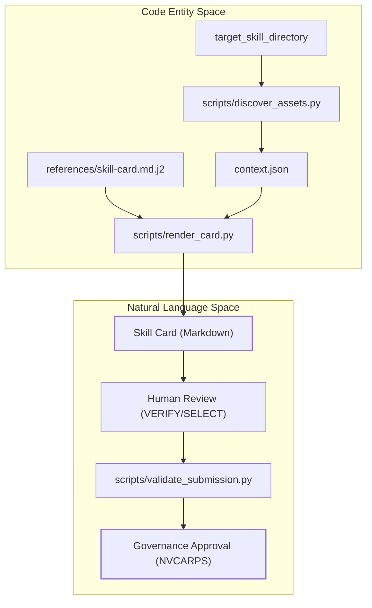
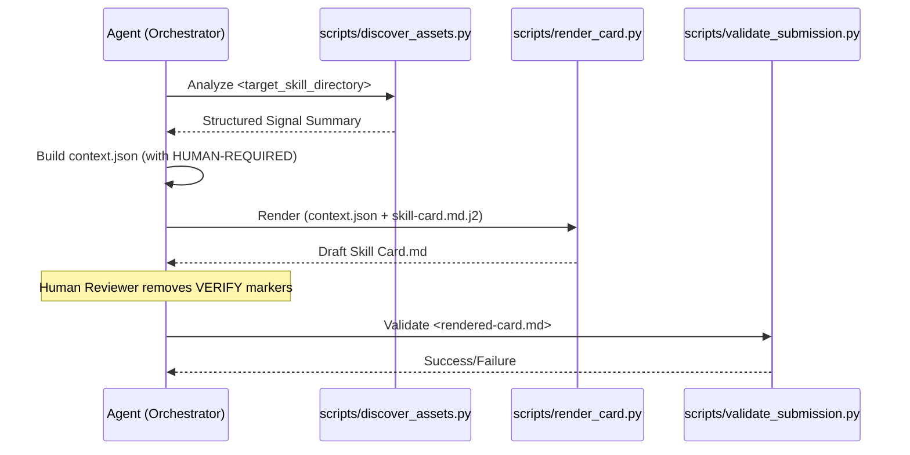

<!-- source: DeepWiki mcp.deepwiki.com · repo NVIDIA/Trustworthy-AI · page 3 Skill Card Ecosystem · fetched 2026-10-26 -->

# Skill Card Ecosystem

Relevant source files

The following files were used as context for generating this wiki page:

- [Skill Card.md](Skill Card.md)
- [skills/skill-card-generator/SKILL.md](skills/skill-card-generator/SKILL.md)

The **Skill Card Ecosystem** provides a standardized framework for documenting, governing, and verifying the capabilities and safety profiles of AI agent skills. It bridges the gap between raw code and executive-level governance by providing a structured schema for recording a skill's purpose, deployment geography, risk mitigations, and evaluation results.

The ecosystem consists of three primary components:
1.  **The Skill Card Template**: A comprehensive markdown schema for documenting skill metadata and governance signals.
2.  **The Skill Card Generator**: An automated agent skill that uses a five-stage pipeline to extract signals from source code and generate draft cards.
3.  **The Evaluation Framework**: A test suite and benchmark suite used to verify the accuracy and safety of generated documentation.

### High-Level Architecture

The following diagram illustrates how the Skill Card Ecosystem bridges the "Natural Language Space" of governance requirements with the "Code Entity Space" of the repository.

**Skill Card Logic Flow**

Sources: [skills/skill-card-generator/SKILL.md:33-40](), [skills/skill-card-generator/SKILL.md:69-76]()

---

## Skill Card Template & Schema
The foundation of the ecosystem is the **Skill Card Template**. This template ensures that every AI skill is documented with a consistent set of fields required for NVIDIA's Trustworthy AI governance process.

Key fields in the schema include:
*   **Readiness Status**: Categorizes the skill as Commercial, R&D, or Demonstration [Skill Card.md:4-4]().
*   **Deployment Geography**: Tracks where the skill is intended for use (e.g., APAC, EMEA, LATAM, NAM) [Skill Card.md:15-16]().
*   **Risk Management**: Explicitly lists known risks and their corresponding mitigations [Skill Card.md:18-19]().
*   **Technical Specifications**: Defines output types (Analysis, API Calls, Code, Files) and formats [Skill Card.md:24-28]().
*   **Evaluation Metadata**: Records the evaluation agent, tasks, metrics, and results used to validate the skill [Skill Card.md:30-41]().

For a detailed breakdown of the schema and style guide, see **[Skill Card Template & Schema (#3.1)]**.

Sources: [Skill Card.md:1-48]()

---

## Skill Card Generator: Automated Pipeline
To reduce the manual burden of documentation, the repository includes the `skill-card-generator`. This is an AI agent skill designed to analyze an existing skill directory and produce a high-quality draft of a Skill Card.

The generator operates through a structured pipeline:
1.  **Discovery**: `scripts/discover_assets.py` extracts signals from the target skill's `SKILL.md`, code, and metadata [skills/skill-card-generator/SKILL.md:73-73]().
2.  **Context Construction**: The agent builds a `context.json` file, using `HUMAN-REQUIRED` placeholders where automated extraction is impossible [skills/skill-card-generator/SKILL.md:63-64]().
3.  **Rendering**: `scripts/render_card.py` uses Jinja2 to transform the JSON context into a markdown card while validating against the schema [skills/skill-card-generator/SKILL.md:74-74]().
4.  **Human-in-the-loop**: The draft contains `VERIFY` and `SELECT` markers that require human intervention to ensure legal and safety correctness [skills/skill-card-generator/SKILL.md:68-68]().
5.  **Validation**: `scripts/validate_submission.py` acts as a gatekeeper, failing if any review markers remain in the document [skills/skill-card-generator/SKILL.md:75-75]().

**Automated Generation Pipeline**

Sources: [skills/skill-card-generator/SKILL.md:58-68](), [skills/skill-card-generator/SKILL.md:120-130]()

For implementation details and permission models, see **[Skill Card Generator: Automated Pipeline (#3.2)]**.

---

## Skill Card Generator: Evaluation & Benchmarks
The reliability of the generator is tracked through a dedicated evaluation framework. This ensures that the generator itself adheres to Trustworthy AI principles by not leaking secrets and accurately reflecting the target skill's capabilities.

*   **Test Suite**: Includes positive cases (successful generation), negative cases (refusing to discuss capabilities), and safety cases (preventing path traversal or `.env` leakage) [skills/skill-card-generator/SKILL.md:42-47]().
*   **Performance Targets**: Benchmarks measure the agent's ability to ground its responses in the provided `references/catalog/risks.json` and `references/catalog/limitations.json` [skills/skill-card-generator/SKILL.md:126-127]().
*   **Integrity**: Final submissions are governed by version signing identifiers to ensure traceability [Skill Card.md:42-43]().

For evaluation metrics and benchmark results, see **[Skill Card Generator: Evaluation & Benchmarks (#3.3)]**.

Sources: [skills/skill-card-generator/SKILL.md:104-110](), [Skill Card.md:42-43]()

---

