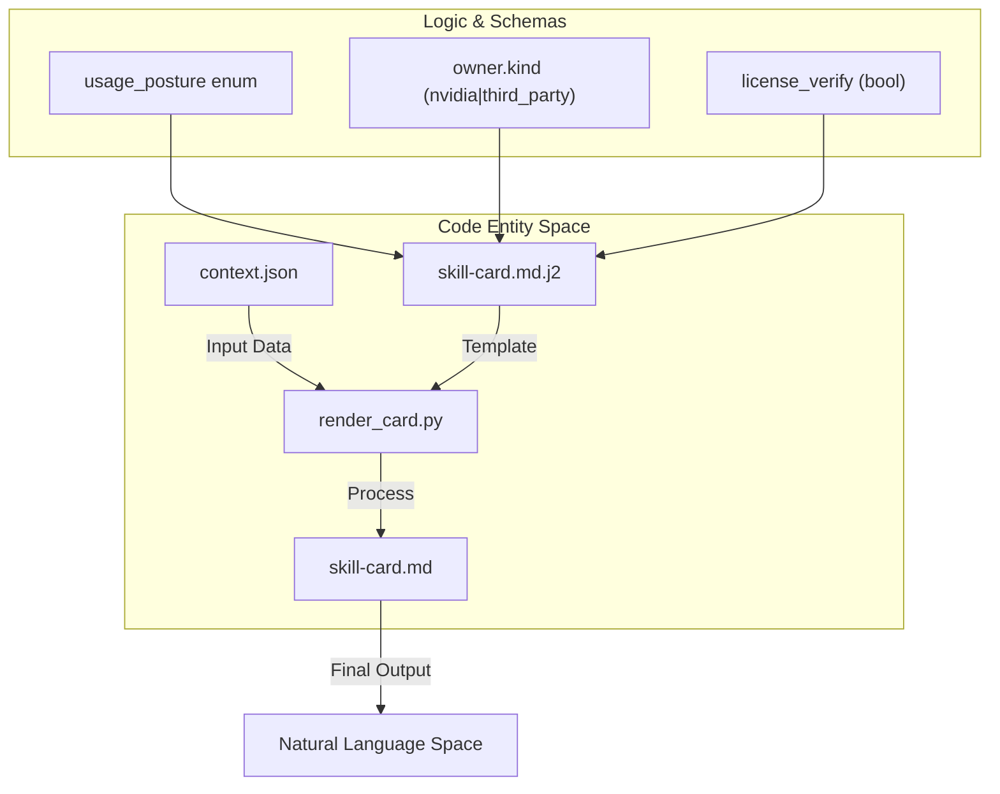
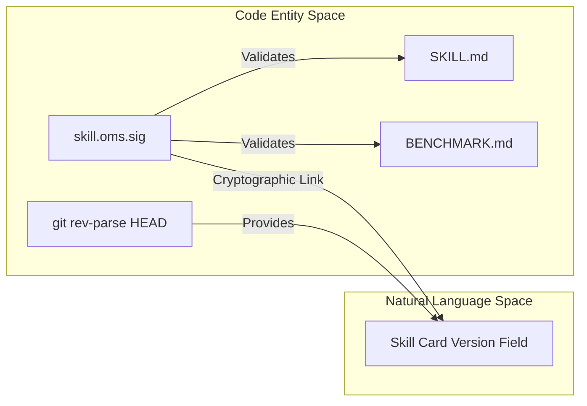

<!-- source: DeepWiki mcp.deepwiki.com · repo NVIDIA/Trustworthy-AI · page 3.1 Skill Card Template & Schema · fetched 2026-10-26 -->

# Skill Card Template & Schema

Relevant source files

The following files were used as context for generating this wiki page:

- [Skill Card.md](Skill Card.md)
- [skills/skill-card-generator/BENCHMARK.md](skills/skill-card-generator/BENCHMARK.md)
- [skills/skill-card-generator/references/skill-card.md.j2](skills/skill-card-generator/references/skill-card.md.j2)
- [skills/skill-card-generator/references/style-guide.md](skills/skill-card-generator/references/style-guide.md)
- [skills/skill-card-generator/skill-card.md](skills/skill-card-generator/skill-card.md)
- [skills/skill-card-generator/skill.oms.sig](skills/skill-card-generator/skill.oms.sig)

The Skill Card is a standardized documentation framework designed to provide transparency and governance for AI agent skills. It captures essential metadata, safety assessments, and performance metrics required for both internal review and external deployment. The framework consists of a human-readable template and a machine-interpretable schema used by automated generation tools.

## Skill Card Structure

The Skill Card is organized into several key sections that define the skill's identity, legal posture, and operational constraints.

### Identity and Readiness
Each card begins with a concise description and a readiness status to signal the intended environment for the skill [Skill Card.md:1-4]().
*   **Description**: A one-sentence summary of the skill's function [Skill Card.md:2]().
*   **Usage Posture**: Categorized into `Commercial` (ready for production), `R&D` (research only), or `Demonstration` (samples/blueprints) [Skill Card.md:4](), [skills/skill-card-generator/references/style-guide.md:52-58]().
*   **Owner**: Identification of the developing entity (NVIDIA or Third-Party) [Skill Card.md:6-7]().
*   **License/Terms of Use**: Links to the authoritative license governing the skill's code and assets [Skill Card.md:9-10]().

### Deployment and Use Case
*   **Use Case**: Defines the target persona (e.g., IT Enterprise Agents, Developers) and the specific tasks the skill is expected to perform [Skill Card.md:12-13]().
*   **Deployment Geography**: Specifies the regions (APAC, EMEA, LATAM, NAM) or specific countries where the skill is cleared for use [Skill Card.md:15-16]().

### Risk and Technical Output
*   **Known Risks and Mitigations**: Standardized risk disclosures, such as the potential for incorrect guidance, and corresponding mitigation strategies [Skill Card.md:18-19]().
*   **Skill Output**: Detailed technical specifications of the skill's artifacts [Skill Card.md:24-28]():
    *   **Type**: Analysis, API Calls, Code, or Files.
    *   **Format**: e.g., String, JSON, Markdown.
    *   **Parameters**: Dimensionality and specific properties.

### Evaluation and Ethics
*   **Evaluation Agent**: The specific AI agent used to benchmark the skill [Skill Card.md:30-31]().
*   **Tasks and Metrics**: Description of the datasets used and the metrics computed (e.g., accuracy, token reduction) [Skill Card.md:33-37]().
*   **Results**: Tabular or markdown reporting of performance across dimensions like Security, Correctness, and Efficiency [skills/skill-card-generator/skill-card.md:60-68]().
*   **Ethical Considerations**: Boilerplate regarding shared responsibility and adherence to NVIDIA's Trustworthy AI policies [Skill Card.md:45-46]().

**Sources:** [Skill Card.md:1-48](), [skills/skill-card-generator/references/style-guide.md:41-110](), [skills/skill-card-generator/skill-card.md:1-77]()

---

## Implementation: Jinja2 Template

The repository uses a Jinja2 template (`skill-card.md.j2`) to programmatically render Skill Cards from a JSON context object. This ensures consistency while allowing for conditional logic based on ownership and evaluation data.

### Logical Flow: Context to Markdown
The following diagram illustrates how the `render_card.py` script utilizes the Jinja2 template to transform structured JSON data into the final `skill-card.md`.

**Skill Card Rendering Pipeline**

**Sources:** [skills/skill-card-generator/references/skill-card.md.j2:1-132](), [skills/skill-card-generator/references/style-guide.md:3-14]()

### Key Template Features
*   **Verify Markers**: The template implements a "Red VERIFY" convention. If a field like `owner` or `license_identifier` is inferred rather than explicitly stated in source files, it is wrapped in a `` tag [skills/skill-card-generator/references/skill-card.md.j2:9-12]().
*   **Conditional Ownership**: If `owner.kind` is set to `nvidia`, the card displays standard ethical boilerplate; if `third_party`, it renders a disclaimer linking to the vendor's own agent card [skills/skill-card-generator/references/skill-card.md.j2:27-41]().
*   **Evaluation Mapping**: The template iterates through `evaluation.metrics.dimensions` and `evaluation.metrics.signals` to generate detailed benchmark reports [skills/skill-card-generator/references/skill-card.md.j2:89-107]().

**Sources:** [skills/skill-card-generator/references/skill-card.md.j2:27-131]()

---

## Data Schema and Style Guide

The `style-guide.md` defines the JSON schema for the context object that populates the Skill Card. This bridges the gap between raw codebase signals and the final documentation.

### Context Object Fields
| Field | Type | Description | Source Mapping |
| :--- | :--- | :--- | :--- |
| `skill_name` | String | Title-cased display name | `SKILL.md` frontmatter |
| `usage_posture` | Enum | commercial, research_dev, demonstration | Documentation keywords |
| `owner` | Object | `kind`, `verify`, `name`, `card_link` | Author email, GitHub Org |
| `license_identifier` | String | SPDX identifier (e.g., Apache-2.0) | `LICENSE` file or frontmatter |
| `evaluation` | Object | Agents, tasks, metrics, and results | `BENCHMARK.md` or `evals.json` |

### Signal Extraction Hierarchy
The system prioritizes signals based on scope:
1.  **Skill Scope**: Local `SKILL.md` frontmatter and `references/` folder [skills/skill-card-generator/references/style-guide.md:34]().
2.  **Repo Scope**: Global `LICENSE`, `pyproject.toml`, or `CHANGELOG` files found at the repository root [skills/skill-card-generator/references/style-guide.md:35-38]().

**Sources:** [skills/skill-card-generator/references/style-guide.md:9-14](), [skills/skill-card-generator/references/style-guide.md:41-110]()

---

## Skill Versioning and Signing

Every Skill Card includes a **Skill Version** field, which serves as a unique signing identifier. In the NVIDIA ecosystem, this is often linked to a Git SHA or a cryptographic signature.

**Signature and Metadata Association**

The `skill.oms.sig` file provides an `in-toto` statement that cryptographically binds the skill's assets (including the Skill Card and Benchmark reports) to a signature, ensuring the integrity of the documented performance and risks [skills/skill-card-generator/skill.oms.sig:1-10]().

**Sources:** [skills/skill-card-generator/skill.oms.sig:1-10](), [skills/skill-card-generator/skill-card.md:69-70]()

---

