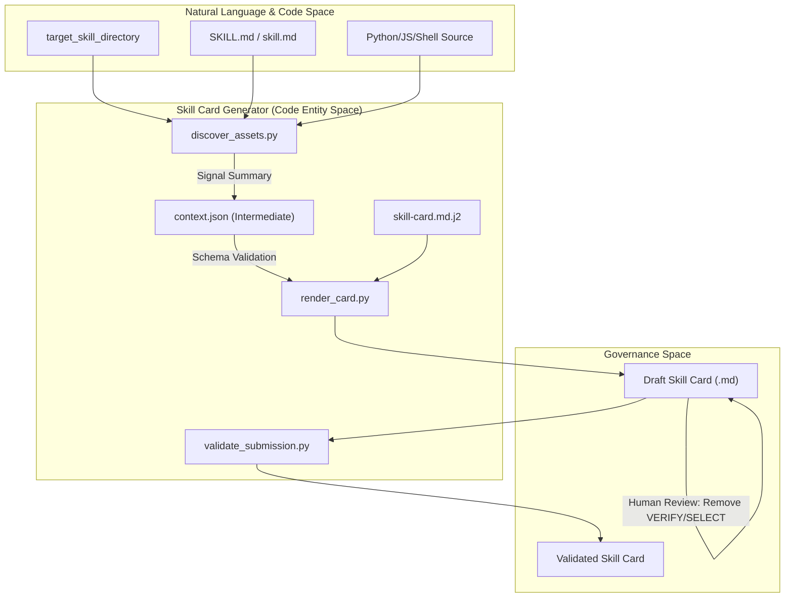
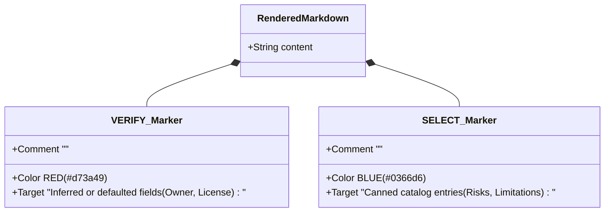

<!-- source: DeepWiki mcp.deepwiki.com · repo NVIDIA/Trustworthy-AI · page 3.2 Skill Card Generator: Automated Pipeline · fetched 2026-10-26 -->

# Skill Card Generator: Automated Pipeline

Relevant source files

The following files were used as context for generating this wiki page:

- [skills/skill-card-generator/SKILL.md](skills/skill-card-generator/SKILL.md)
- [skills/skill-card-generator/references/catalog/limitations.json](skills/skill-card-generator/references/catalog/limitations.json)
- [skills/skill-card-generator/references/catalog/risks.json](skills/skill-card-generator/references/catalog/risks.json)
- [skills/skill-card-generator/scripts/discover_assets.py](skills/skill-card-generator/scripts/discover_assets.py)
- [skills/skill-card-generator/scripts/render_card.py](skills/skill-card-generator/scripts/render_card.py)
- [skills/skill-card-generator/scripts/validate_submission.py](skills/skill-card-generator/scripts/validate_submission.py)

The `skill-card-generator` is an automated agent skill designed to produce governance documentation for AI agent skills within the NVIDIA Trustworthy AI ecosystem. It implements a structured five-stage pipeline that extracts signals from a target codebase, constructs a grounded JSON context, and renders a deterministic Markdown card while enforcing human-in-the-loop verification for critical safety and legal fields.

## Pipeline Architecture

The pipeline bridges the gap between raw source code (Natural Language and Code Space) and a standardized governance artifact (Governance Space). It is orchestrated via `SKILL.md`, which defines the execution flow and permissions for the underlying Python scripts.

### System Data Flow

The following diagram illustrates how the generator transforms code entities into a validated Skill Card.

**Title: Skill Card Generation Data Flow**

**Sources:** [skills/skill-card-generator/SKILL.md:29-75](), [skills/skill-card-generator/scripts/discover_assets.py:1-12]()

---

## 1. Signal Extraction (`discover_assets.py`)

The first stage involves a comprehensive scan of the target skill directory to extract "signals"—metadata and code patterns that inform the governance fields.

### Key Extraction Logic
*   **Repo Root Discovery:** The script walks up the directory tree from the target path to find markers like `.git`, `pyproject.toml`, or `LICENSE` to establish repository context [skills/skill-card-generator/scripts/discover_assets.py:249-257]().
*   **Security Constraints:** It explicitly redacts sensitive information. It identifies and skips credential files (e.g., `.env`, `id_rsa`, `secrets.json`) and redacts API keys or bearer tokens found within text files using `redact_sensitive_text` [skills/skill-card-generator/scripts/discover_assets.py:227-247]().
*   **Signal Identification:**
    *   **MCP Servers:** Scans for Model Context Protocol (MCP) patterns [skills/skill-card-generator/scripts/discover_assets.py:105-105]().
    *   **Limitations:** Searches for keywords like "not supported," "unsupported," or "limited to" to populate the technical limitations section [skills/skill-card-generator/scripts/discover_assets.py:107-116]().
    *   **Evaluations:** Identifies testing and benchmark files using keywords like `red-team`, `accuracy`, and `metrics` [skills/skill-card-generator/scripts/discover_assets.py:118-134]().

**Sources:** [skills/skill-card-generator/scripts/discover_assets.py:58-103](), [skills/skill-card-generator/scripts/discover_assets.py:163-222]()

---

## 2. Context Construction & Style Guide

The agent uses the signals from `discover_assets.py` to build a `context.json` file. This file must adhere to the `references/style-guide.md` and the internal schema defined in the renderer.

### HUMAN-REQUIRED Fallbacks
If the automated discovery cannot find a truthful value for a mandatory field, the agent is instructed to use the placeholder `HUMAN-REQUIRED`. This triggers a visual marker in the rendered output that prevents final submission until a human provides the correct data [skills/skill-card-generator/SKILL.md:64-65]().

---

## 3. Deterministic Rendering (`render_card.py`)

The `render_card.py` script uses the Jinja2 templating engine to transform the JSON context into a Markdown document.

### Schema Validation
Before rendering, the script performs strict validation of the `context.json` against a predefined `SCHEMA` [skills/skill-card-generator/scripts/render_card.py:41-56]().

| Field | Type | Validation Rules |
| :--- | :--- | :--- |
| `usage_posture` | `str` | Must be `commercial`, `research_dev`, or `demonstration` [skills/skill-card-generator/scripts/render_card.py:58-58](). |
| `owner` | `dict` | Must specify `kind` (`nvidia` or `third_party`). If `third_party`, `name` and `card_link` are mandatory [skills/skill-card-generator/scripts/render_card.py:106-119](). |
| `output` | `dict` | Requires `types`, `format`, `parameters`, and `other_properties` [skills/skill-card-generator/scripts/render_card.py:121-126](). |
| `evaluation` | `dict` | Validates sub-fields for `agent_red_teaming`, `network_security`, and `product_security` [skills/skill-card-generator/scripts/render_card.py:128-135](). |

### Canned Catalogs
The renderer pulls from "canned catalogs" to provide baseline entries for risks and limitations:
*   **Limitations:** `references/catalog/limitations.json` (e.g., `llm_only`, `requires_hf_access`) [references/catalog/limitations.json:1-14]().
*   **Risks:** `references/catalog/risks.json` (e.g., `prompt_injection_evolution`) [references/catalog/risks.json:1-13]().

**Sources:** [skills/skill-card-generator/scripts/render_card.py:69-77](), [skills/skill-card-generator/SKILL.md:126-127]()

---

## 4. Human-in-the-Loop Review

The generator inserts specific markers into the Markdown file to highlight areas requiring human attention.

**Title: Human-in-the-Loop Review Markers**

*   **VERIFY:** Wraps fields in red HTML spans. The human must confirm the value and remove the span/comment [skills/skill-card-generator/scripts/validate_submission.py:8-9]().
*   **SELECT:** Wraps a list of options in blue HTML spans. The human must delete non-applicable entries and remove the selection markers [skills/skill-card-generator/scripts/validate_submission.py:10-11]().

**Sources:** [skills/skill-card-generator/scripts/validate_submission.py:38-83]()

---

## 5. Submission Gating (`validate_submission.py`)

The final stage is a non-bypassable gating script. `validate_submission.py` performs a regex-based scan of the rendered Markdown to ensure all review markers have been removed.

### Validation Checks
The script fails (exits non-zero) if it detects any of the following:
*   `<!-- VERIFY -->` or `<!-- SELECT -->` comments [skills/skill-card-generator/scripts/validate_submission.py:42-59]().
*   Specific CSS color codes used for markers (`#d73a49` for red, `#0366d6` for blue) [skills/skill-card-generator/scripts/validate_submission.py:62-72]().
*   The instruction legend blockquote at the top of the file [skills/skill-card-generator/scripts/validate_submission.py:74-82]().

**Sources:** [skills/skill-card-generator/scripts/validate_submission.py:86-114]()

---

## Permission & Security Model

The skill operates under a restricted permission model to prevent data leakage during the automated analysis.

*   **File Read:** Limited to the `target_skill_directory`, the generator's own `references/`, and `scripts/` [skills/skill-card-generator/SKILL.md:15-18]().
*   **File Write:** Limited to the `target_skill_directory` and `/tmp/` [skills/skill-card-generator/SKILL.md:19-21]().
*   **Shell Execution:** Only the three pipeline scripts (`discover_assets.py`, `render_card.py`, `validate_submission.py`) are allowed [skills/skill-card-generator/SKILL.md:22-26]().
*   **Anti-Leakage:** The agent is strictly forbidden from reading `.env` files, credential folders, or hidden authentication directories [skills/skill-card-generator/SKILL.md:61-61]().

**Sources:** [skills/skill-card-generator/SKILL.md:14-27]()

---

