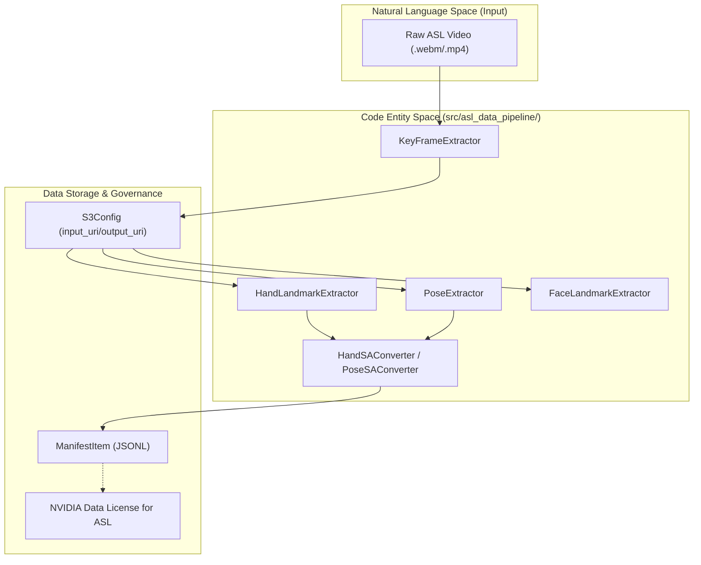
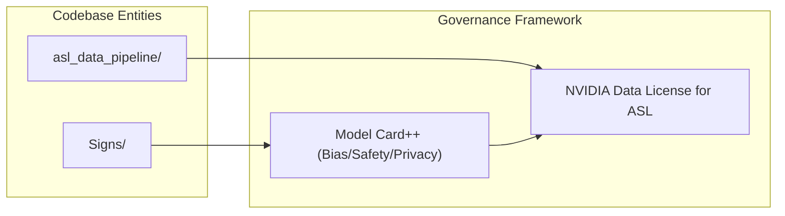

<!-- source: DeepWiki mcp.deepwiki.com · repo NVIDIA/Trustworthy-AI · page 4 ASL Developer Community · fetched 2026-10-26 -->

# ASL Developer Community

<details>
<summary>Relevant source files</summary>

The following files were used as context for generating this wiki page:

- [ASL Developer Community/NVIDIA Data License for ASL Project.pdf](ASL Developer Community/NVIDIA Data License for ASL Project.pdf)
- [ASL Developer Community/README.md](ASL Developer Community/README.md)
- [ASL Developer Community/get-onboarded-with-superannotate.md](ASL Developer Community/get-onboarded-with-superannotate.md)
- [Signs (American Sign Language)/ReadMe](Signs (American Sign Language)/ReadMe)

</details>


The **ASL Developer Community** is an open-source initiative within the Trustworthy AI repository dedicated to advancing American Sign Language (ASL) research and accessibility. This project provides a robust ecosystem for ASL data processing, featuring a production-grade data pipeline, the **SIGNS** real-time recognition model, and a strategic partnership with **SuperAnnotate** for high-fidelity dataset curation [ASL Developer Community/README.md:1-13]().

The community's mission is to support the creation of the world's largest ASL dataset, providing developers with the tools to process video into machine-readable landmarks for 3D digital human feedback and model training [ASL Developer Community/get-onboarded-with-superannotate.md:3-10]().

## System Architecture: Video to Annotation

The ASL initiative bridges the gap between raw video capture and structured data suitable for AI training. The following diagram illustrates how the codebase entities transform raw "Natural Language" video inputs into "Code Entity" landmark manifests.

### ASL Data Processing Flow

**Sources:** [ASL Developer Community/README.md:66-78](), [ASL Developer Community/README.md:113-137]()

## Core Components

### 1. SIGNS Model
The **SIGNS** model is a real-time ASL recognition system designed for web-based deployment. It utilizes **MediaPipe Holistic** landmarks and a custom template matching state machine to provide instant feedback via a 3D digital human [ASL Developer Community/get-onboarded-with-superannotate.md:5-10](). Unlike deep learning models requiring massive inference compute, SIGNS is optimized for WebGL, achieving 15-30 FPS with low latency.

For detailed model specifications and ethical disclosures, see [SIGNS Model: ASL Recognition Model Cards](#4.2).

### 2. ASL Data Pipeline
The repository includes a four-stage automated pipeline built for high-throughput processing of ASL video data [ASL Developer Community/README.md:66-70]().

| Stage | Component | Primary Responsibility |
| :--- | :--- | :--- |
| **1** | `KeyFrameExtractor` | Motion analysis via optical flow and sharpness refinement to select meaningful frames [ASL Developer Community/README.md:141-164](). |
| **2** | `HandLandmarkExtractor` | Extraction of 21 landmarks per hand using MediaPipe [ASL Developer Community/README.md:168-190](). |
| **3** | `PoseExtractor` | Full-body pose extraction (33 landmarks) with out-of-bound coordinate removal [ASL Developer Community/README.md:193-216](). |
| **4** | `SAConverters` | Transformation of landmark data into **SuperAnnotate** format for labeling workflows [ASL Developer Community/README.md:219-231](). |

For implementation details and configuration guides, see [ASL Data Pipeline: Architecture & Usage](#4.1).

### 3. SuperAnnotate Partnership
NVIDIA, AWS, and SuperAnnotate have partnered to provide the research community with scalable annotation tools [ASL Developer Community/get-onboarded-with-superannotate.md:3-6](). This partnership allows developers to manage and extend ASL annotations within a unified environment.
*   **Request Access**: Researchers can request access to the specialized annotation environment at [superannotate.com/nvidia-asl-request](https://www.superannotate.com/nvidia-asl-request) [ASL Developer Community/get-onboarded-with-superannotate.md:15-17]().

## Licensing & Data Governance
The ASL dataset and associated assets are governed by the **NVIDIA Data License for ASL Project** [ASL Developer Community/NVIDIA Data License for ASL Project.pdf:1-3](). This license ensures that the data is used in alignment with trustworthy AI principles, particularly regarding the representation of sign language users.

### Code to License Mapping

**Sources:** [ASL Developer Community/README.md:26](), [ASL Developer Community/NVIDIA Data License for ASL Project.pdf:1-12]()

## Getting Started for Developers
The pipeline requires **Python 3.11** for MediaPipe compatibility and uses **Poetry** for dependency management [ASL Developer Community/README.md:30-34]().

```bash
# Install the ASL Data Pipeline
poetry install --with dev
```
[ASL Developer Community/README.md:43-48]()

Developers can begin processing data by configuring a `KeyFrameExtractorConfig` object with an `S3Config` pointing to their video source [ASL Developer Community/README.md:121-134]().

---
**Sources:**
* [ASL Developer Community/README.md:1-231]()
* [ASL Developer Community/get-onboarded-with-superannotate.md:1-17]()
* [ASL Developer Community/NVIDIA Data License for ASL Project.pdf:1-12]()

---

