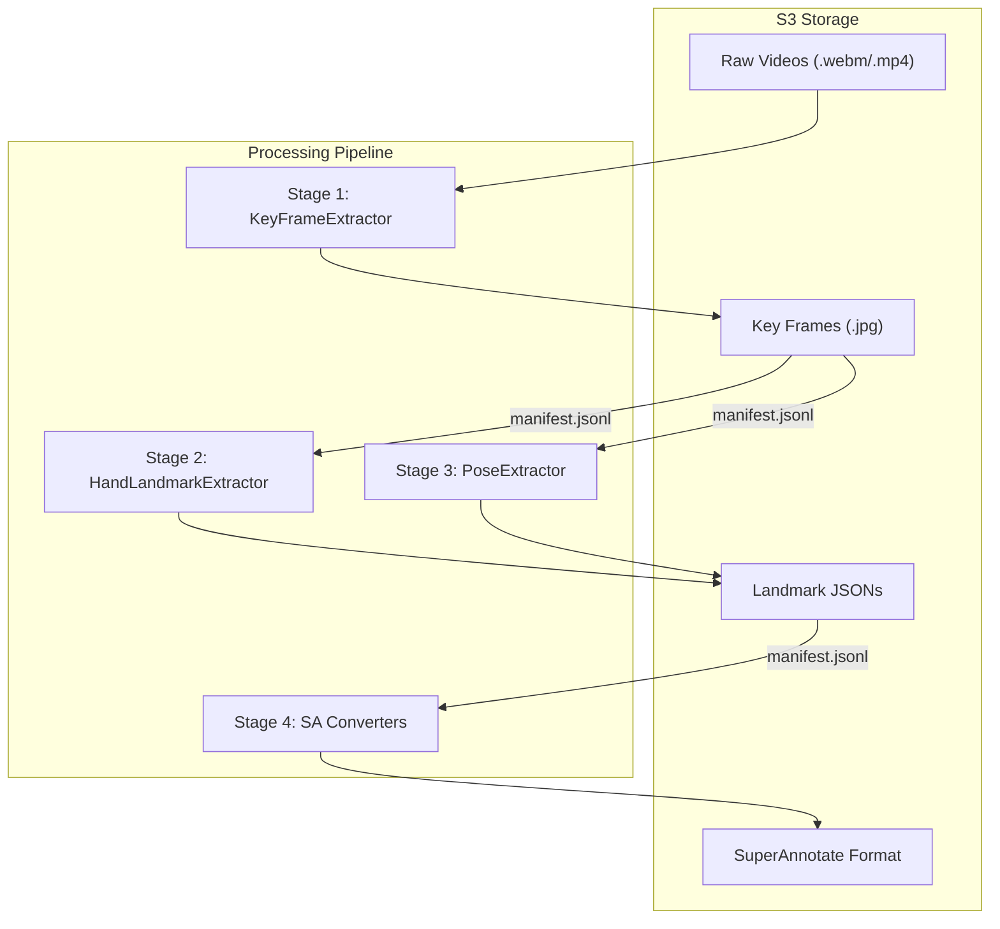

<!-- source: DeepWiki mcp.deepwiki.com · repo NVIDIA/Trustworthy-AI · page 4.1 ASL Data Pipeline: Architecture & Usage · fetched 2026-10-26 -->

# ASL Data Pipeline: Architecture & Usage

<details>
<summary>Relevant source files</summary>

The following files were used as context for generating this wiki page:

- [ASL Developer Community/README.md](ASL Developer Community/README.md)
- [ASL Developer Community/notebooks/asl_data_pipeline.ipynb](ASL Developer Community/notebooks/asl_data_pipeline.ipynb)
- [ASL Developer Community/scripts/asl_data_pipeline.py](ASL Developer Community/scripts/asl_data_pipeline.py)
- [ASL Developer Community/scripts/asl_data_postprocessing.py](ASL Developer Community/scripts/asl_data_postprocessing.py)
- [ASL Developer Community/src/asl_data_pipeline/__init__.py](ASL Developer Community/src/asl_data_pipeline/__init__.py)
- [ASL Developer Community/src/asl_data_pipeline/models/manifest.py](ASL Developer Community/src/asl_data_pipeline/models/manifest.py)
- [ASL Developer Community/src/asl_data_pipeline/models/s3.py](ASL Developer Community/src/asl_data_pipeline/models/s3.py)

</details>


The American Sign Language (ASL) Data Pipeline is a modular, multi-stage processing system designed to transform raw video data into structured, annotated landmarks. It supports production-grade features including seamless AWS S3 integration, parallel processing via `ThreadPoolExecutor` and `ProcessPoolExecutor`, and automated manifest generation to chain processing steps.

### High-Level Architecture

The pipeline follows a sequential flow where the output of one stage (typically a JSONL manifest) serves as the input for the next. This architecture ensures that large datasets can be processed incrementally and reliably.

#### System Flow: Video to SuperAnnotate

**Sources:** [ASL Developer Community/README.md:64-77](), [ASL Developer Community/scripts/asl_data_pipeline.py:50-119]()

---

### Pipeline Stages

The pipeline is divided into four primary stages, with an optional face extraction module.

#### 1. KeyFrameExtractor
This stage performs intelligent motion analysis using optical flow to identify meaningful frames in ASL videos. It applies sharpness refinement to ensure extracted frames are suitable for landmark detection.
*   **Input**: S3 folder containing video files.
*   **Output**: JPEG frames and a `manifest.jsonl` file.
*   **Code Reference**: `KeyFrameExtractor` [ASL Developer Community/src/asl_data_pipeline/preprocessing/key_frame_extractor/extractor.py]().

#### 2. HandLandmarkExtractor
Utilizes MediaPipe to detect 21 landmarks per hand. It processes the frames listed in the manifest generated by Stage 1.
*   **Features**: Left/Right hand detection, confidence scoring, and handling of partial occlusions.
*   **Code Reference**: `HandLandmarkExtractor` [ASL Developer Community/src/asl_data_pipeline/preprocessing/hand_landmark_extractor/extractor.py]().

#### 3. PoseExtractor
Extracts 33 full-body pose landmarks, with a specific focus on the upper body required for ASL analysis.
*   **Features**: Visibility/presence scoring and out-of-bound coordinate removal.
*   **Code Reference**: `PoseExtractor` [ASL Developer Community/src/asl_data_pipeline/preprocessing/pose_extractor/extractor.py]().

#### 4. HandSAConverter & PoseSAConverter
Transforms the raw landmark JSON files into the specific format required by the SuperAnnotate platform for manual review or further training.
*   **Code Reference**: `HandSAConverter` [ASL Developer Community/src/asl_data_pipeline/preprocessing/hand_sa_converter/converter.py](), `PoseSAConverter` [ASL Developer Community/src/asl_data_pipeline/preprocessing/pose_sa_converter/converter.py]().

For detailed technical specifications of these modules, see [Preprocessing Modules: Extractors & Converters](#4.1.1).

---

### Data Models & Configuration

The pipeline relies on standardized Pydantic models to manage configuration and data flow across S3.

#### Configuration Mapping
The following diagram bridges the high-level configuration concepts to the specific Python classes used in the codebase.

```mermaid
classDiagram
    class S3Config {
        +str input_uri
        +InputType input_type
        +str output_uri
        +str aws_profile
    }
    class InputType {
        <<enumeration>>
        FOLDER
        MANIFEST
    }
    class ManifestItem {
        +str file_uri
        +str metadata_file
    }
    class ExtractorConfig {
        +S3Config s3
        +int max_workers
        +bool force_write
    }

    S3Config --> InputType : uses
    ExtractorConfig --> S3Config : contains
    ManifestItem --o "manifest.jsonl" : represents line
```
**Sources:** [ASL Developer Community/src/asl_data_pipeline/models/s3.py:26-46](), [ASL Developer Community/src/asl_data_pipeline/models/manifest.py:21-25]()

| Component | Purpose |
| :--- | :--- |
| `S3Config` | Defines input/output URIs and AWS credentials/profiles [ASL Developer Community/src/asl_data_pipeline/models/s3.py:33-46](). |
| `InputType` | Enum to switch between processing an entire `FOLDER` or a specific `MANIFEST` [ASL Developer Community/src/asl_data_pipeline/models/s3.py:26-31](). |
| `ManifestItem` | Standardizes the structure of the `manifest.jsonl` files that link frames to their metadata [ASL Developer Community/src/asl_data_pipeline/models/manifest.py:21-25](). |

---

### Execution & Parallelization

The pipeline is designed for high-throughput processing using Python's concurrency libraries.
*   **Parallelism**: Extractors utilize `ThreadPoolExecutor` for I/O-bound tasks (S3 uploads/downloads) and `ProcessPoolExecutor` for CPU-bound tasks (MediaPipe inference) [ASL Developer Community/README.md:178-231]().
*   **Post-processing**: A dedicated `DataPostprocessor` script is available to redact sensitive information (e.g., emails) and strip internal metadata before sharing datasets [ASL Developer Community/scripts/asl_data_postprocessing.py:43-85]().

#### Development Environment
The project uses **Poetry** for dependency management and requires **Python 3.11** for MediaPipe compatibility [ASL Developer Community/README.md:32-33]().

For instructions on setting up the environment and running tests, see [Testing & Development Setup](#4.1.2).

**Sources:** [ASL Developer Community/README.md:3-13](), [ASL Developer Community/README.md:141-235](), [ASL Developer Community/scripts/asl_data_pipeline.py:42-120]()

---

