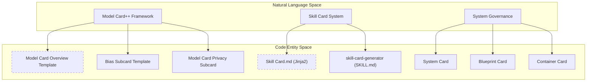
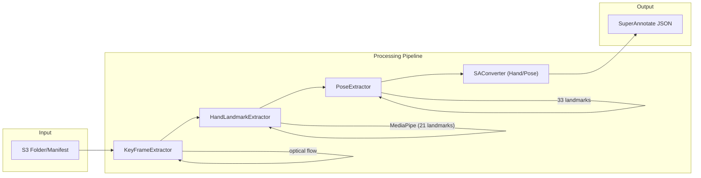

<!-- source: DeepWiki mcp.deepwiki.com · repo NVIDIA/Trustworthy-AI · page 5 Glossary · fetched 2026-10-26 -->

# Glossary

Relevant source files

The following files were used as context for generating this wiki page:

- [ASL Developer Community/README.md](ASL Developer Community/README.md)
- [Blueprint Card](Blueprint Card)
- [Container Card](Container Card)
- [CycloneDX-Property-Taxonomy/cyclonedx-property-taxonomy.md](CycloneDX-Property-Taxonomy/cyclonedx-property-taxonomy.md)
- [Data Card](Data Card)
- [Model Card++ Templates/Bias Subcard Template](Model Card++ Templates/Bias Subcard Template)
- [Model Card++ Templates/Model Card Explainability Subcard](Model Card++ Templates/Model Card Explainability Subcard)
- [Model Card++ Templates/Model Card Overview Template](Model Card++ Templates/Model Card Overview Template)
- [Model Card++ Templates/Model Card Privacy Subcard](Model Card++ Templates/Model Card Privacy Subcard)
- [Model Card++ Templates/Safety & Security Subcard](Model Card++ Templates/Safety & Security Subcard)
- [Signs (American Sign Language)/overview (SIGNS External).md](Signs (American Sign Language)/overview (SIGNS External).md)
- [Skill Card.md](Skill Card.md)
- [System Card](System Card)
- [skills/skill-card-generator/SKILL.md](skills/skill-card-generator/SKILL.md)

This glossary provides definitions for codebase-specific terms, acronyms, and domain concepts used throughout the NVIDIA Trustworthy AI repository. It serves as a technical reference for engineers and AI practitioners working with Model Card++ templates, Skill Cards, and the ASL Developer Community assets.

## Core Framework Concepts

### Model Card++
An enhanced version of the standard AI Model Card documentation. It consists of a primary **Overview Template** and four specialized **Subcards** (Bias, Explainability, Privacy, Safety & Security) to provide a comprehensive transparency report for AI models, particularly General Purpose AI (GPAI) models.
*   **Implementation:** [Model Card++ Templates/Model Card Overview Template:1-125]()
*   **Key Sections:** Model Architecture, Computational Load, Input/Output, Software Integration, and Dataset Provenance.

### Skill Card
A governance document specifically designed for **AI Agent Skills**. It documents the purpose, owner, deployment geography, and evaluation metrics of a specific capability (skill) within an AI agent ecosystem.
*   **Implementation:** [Skill Card.md:1-49]()
*   **Key Fields:** `Skill Output`, `Evaluation Agent`, `Evaluation Tasks`, and `Signing Identifier`.

### CycloneDX Property Taxonomy
A standardized mapping that translates human-readable Model Card++ fields into machine-readable JSON/XML properties using the CycloneDX Bill of Materials (BOM) standard. It uses eight namespaces (e.g., `nvidia:model`, `nvidia:bias`) to ensure interoperability.
*   **Source:** [CycloneDX-Property-Taxonomy/cyclonedx-property-taxonomy.md:1-50]()

---

## Code Entity Mapping

The following diagram bridges the natural language concepts of the documentation framework to the specific code entities and files that implement them.

**Diagram: Documentation Framework to Code Entity Mapping**

**Sources:** [Model Card++ Templates/Model Card Overview Template:1-10](), [Skill Card.md:1-10](), [System Card:1-10](), [Blueprint Card:1-10](), [Container Card:1-10]()

---

## Technical Terms & Acronyms

| Term | Definition | Code Pointer |
| :--- | :--- | :--- |
| **GPAI** | **General Purpose AI**. Models designed to perform a wide range of tasks rather than a single specific application. | [Model Card++ Templates/Model Card Overview Template:33-35]() |
| **ODD** | **Operational Design Domain**. The specific conditions (geographic, environmental, etc.) under which a system is designed to function. | [Model Card++ Templates/Model Card Explainability Subcard:10-10]() |
| **CSAM / NCII** | **Child Sexual Abuse Material / Non-Consensual Intimate Imagery**. Categories of illegal content that GPAI models must be scanned for during development. | [Model Card++ Templates/Safety & Security Subcard:6-9]() |
| **PII** | **Personally Identifiable Information**. Data that can be used to identify an individual, which is screened and filtered in the Privacy Subcard. | [Model Card++ Templates/Model Card Privacy Subcard:18-19]() |
| **V-Model** | A methodology for iterative testing and validation at both unit and system levels used during software integration. | [Model Card++ Templates/Model Card Overview Template:84-84]() |
| **NVCARPS** | NVIDIA's internal review process for legal, safety, and owner review of AI assets. | [skills/skill-card-generator/SKILL.md:35-40]() |

---

## ASL Data Pipeline Components

The ASL (American Sign Language) Developer Community uses a multi-stage pipeline to process video into landmark data for sign language recognition.

**Diagram: ASL Pipeline Data Flow and Classes**

**Sources:** [ASL Developer Community/README.md:64-82](), [ASL Developer Community/README.md:141-235]()

### Key ASL Code Entities:
*   **`KeyFrameExtractor`**: Analyzes motion via optical flow and sharpness to select meaningful frames. [ASL Developer Community/README.md:160-165]()
*   **`HandLandmarkExtractor`**: Uses MediaPipe to detect 21 landmarks per hand with confidence scores. [ASL Developer Community/README.md:185-190]()
*   **`PoseExtractor`**: Extracts 33 body landmarks, with an option for `out_of_bound_removal`. [ASL Developer Community/README.md:211-216]()
*   **`S3Client`**: Utility for handling AWS S3 interactions, supporting `InputType.FOLDER` and `InputType.MANIFEST`. [ASL Developer Community/README.md:113-127]()

---

## Card Types & Definitions

### 1. Blueprint Card
Documents the software component transparency chain, including architecture diagrams and minimum system requirements (Hardware/OS).
*   **Pointer:** [Blueprint Card:1-52]()

### 2. Container Card
Describes the program classes housed within a container, versioning (e.g., pruned, quantized), and links to security CVE scan results.
*   **Pointer:** [Container Card:1-54]()

### 3. Data Card
Focuses on dataset characterization, including collection methods (Automated, Human, Synthetic, Hybrid) and quantification (record/feature counts).
*   **Pointer:** [Data Card:1-55]()

### 4. System Card
Defines the overall AI system, including automation levels (Autonomous, Partial, Assistant), fail-safe mechanisms (Emergency Override, Human-in-the-loop), and vector database specifications.
*   **Pointer:** [System Card:1-98]()

---

## Skill Card Generator Tools

The `skill-card-generator` is a specialized agent skill used to automate the creation of governance documentation.

*   **`discover_assets.py`**: Extracts skill files and repo signals into a discovery report. [skills/skill-card-generator/SKILL.md:73-73]()
*   **`render_card.py`**: A Jinja2-based renderer that validates a `context.json` against the `skill-card.md.j2` template. [skills/skill-card-generator/SKILL.md:74-74]()
*   **`validate_submission.py`**: A gating script that ensures all `VERIFY` and `SELECT` markers have been addressed by a human reviewer. [skills/skill-card-generator/SKILL.md:75-75]()
*   **`HUMAN-REQUIRED`**: A placeholder value used in the context JSON when the automated tool cannot find a truthful value in the source code. [skills/skill-card-generator/SKILL.md:64-64]()

**Sources:** [skills/skill-card-generator/SKILL.md:1-130]()