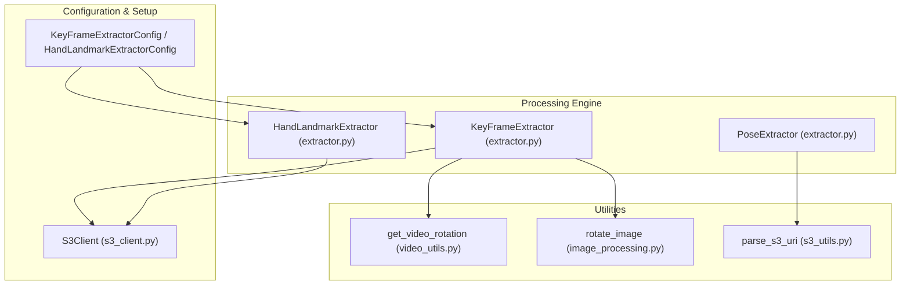
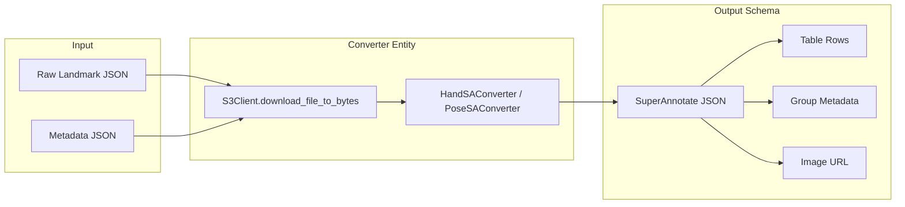

<!-- source: DeepWiki mcp.deepwiki.com · repo NVIDIA/Trustworthy-AI · extra page Preprocessing Modules: Extractors & Converters · fetched 2026-10-26 -->

# Preprocessing Modules: Extractors & Converters

Relevant source files

The following files were used as context for generating this wiki page:

- [ASL Developer Community/src/asl_data_pipeline/preprocessing/__init__.py](ASL Developer Community/src/asl_data_pipeline/preprocessing/__init__.py)
- [ASL Developer Community/src/asl_data_pipeline/preprocessing/face_landmark_extractor/extractor.py](ASL Developer Community/src/asl_data_pipeline/preprocessing/face_landmark_extractor/extractor.py)
- [ASL Developer Community/src/asl_data_pipeline/preprocessing/hand_landmark_extractor/extractor.py](ASL Developer Community/src/asl_data_pipeline/preprocessing/hand_landmark_extractor/extractor.py)
- [ASL Developer Community/src/asl_data_pipeline/preprocessing/hand_sa_converter/converter.py](ASL Developer Community/src/asl_data_pipeline/preprocessing/hand_sa_converter/converter.py)
- [ASL Developer Community/src/asl_data_pipeline/preprocessing/key_frame_extractor/extractor.py](ASL Developer Community/src/asl_data_pipeline/preprocessing/key_frame_extractor/extractor.py)
- [ASL Developer Community/src/asl_data_pipeline/preprocessing/pose_extractor/extractor.py](ASL Developer Community/src/asl_data_pipeline/preprocessing/pose_extractor/extractor.py)
- [ASL Developer Community/src/asl_data_pipeline/preprocessing/pose_sa_converter/converter.py](ASL Developer Community/src/asl_data_pipeline/preprocessing/pose_sa_converter/converter.py)
- [ASL Developer Community/src/asl_data_pipeline/utils/image_processing.py](ASL Developer Community/src/asl_data_pipeline/utils/image_processing.py)
- [ASL Developer Community/src/asl_data_pipeline/utils/s3_client.py](ASL Developer Community/src/asl_data_pipeline/utils/s3_client.py)
- [ASL Developer Community/src/asl_data_pipeline/utils/video_utils.py](ASL Developer Community/src/asl_data_pipeline/utils/video_utils.py)

The preprocessing layer of the ASL Data Pipeline provides specialized modules for temporal segment extraction and spatial landmark detection. These modules follow a standardized architectural pattern: they consume a configuration object, initialize an S3 client for cloud data handling, perform batch processing via parallel executors, and produce a manifest or structured JSON output.

## Extractor Architectural Pattern

All extractors in `src/asl_data_pipeline/preprocessing/` implement a consistent lifecycle. They are designed to be "production-grade," meaning they handle S3 bucket verification, local temporary file management, and error handling through custom exception classes.

### Common Data Flow
1.  **Initialization**: The `__init__` method validates the `InputType` (e.g., `FOLDER` for video extraction or `MANIFEST` for landmark detection) and initializes the `S3Client` [ASL Developer Community/src/asl_data_pipeline/preprocessing/key_frame_extractor/extractor.py:59-71]().
2.  **S3 Verification**: The module checks for the existence of input and output buckets [ASL Developer Community/src/asl_data_pipeline/preprocessing/hand_landmark_extractor/extractor.py:57-61]().
3.  **Parallel Execution**: Batch processing is performed using `ThreadPoolExecutor` for I/O-bound tasks (landmark extraction) or `ProcessPoolExecutor` for CPU-bound tasks (motion analysis) [ASL Developer Community/src/asl_data_pipeline/preprocessing/key_frame_extractor/extractor.py:21](), [ASL Developer Community/src/asl_data_pipeline/preprocessing/hand_landmark_extractor/extractor.py:20]().
4.  **Artifact Generation**: Results are uploaded to S3, and a final manifest is generated to link processed artifacts.

### Code Entity Mapping: Extractor Pattern
The following diagram maps the logical processing stages to specific classes and utility functions.

**Extractor Logic to Code Mapping**

Sources: [ASL Developer Community/src/asl_data_pipeline/preprocessing/key_frame_extractor/extractor.py:52-94](), [ASL Developer Community/src/asl_data_pipeline/preprocessing/hand_landmark_extractor/extractor.py:47-83](), [ASL Developer Community/src/asl_data_pipeline/utils/s3_client.py:36-56]()

---

## Key Frame Extractor

The `KeyFrameExtractor` identifies salient frames within a video by analyzing motion intensity and image sharpness.

-   **Motion Analysis**: It calculates motion scores between frames and uses `scipy.signal.find_peaks` to identify local maxima in motion [ASL Developer Community/src/asl_data_pipeline/preprocessing/key_frame_extractor/extractor.py:29]().
-   **Sharpness Refinement**: For each motion peak, it calculates sharpness using the variance of the Laplacian to ensure the extracted frame is not blurred [ASL Developer Community/src/asl_data_pipeline/preprocessing/key_frame_extractor/extractor.py:109-131]().
-   **Rotation Handling**: It automatically detects video rotation metadata via `ffprobe` and applies corrections using `rotate_image` [ASL Developer Community/src/asl_data_pipeline/preprocessing/key_frame_extractor/extractor.py:169-181]().

Sources: [ASL Developer Community/src/asl_data_pipeline/preprocessing/key_frame_extractor/extractor.py:109-181](), [ASL Developer Community/src/asl_data_pipeline/utils/video_utils.py:22-51]()

---

## Landmark Extractors

These modules utilize MediaPipe to extract spatial coordinates for hands, poses, and faces.

| Module | Engine | Key Features |
| :--- | :--- | :--- |
| `HandLandmarkExtractor` | MediaPipe Hands | Extracts 21 landmarks per hand; supports multi-hand detection [ASL Developer Community/src/asl_data_pipeline/preprocessing/hand_landmark_extractor/extractor.py:71-75](). |
| `PoseExtractor` | MediaPipe Pose | Extracts 33 pose landmarks; includes out-of-bound removal logic [ASL Developer Community/src/asl_data_pipeline/preprocessing/pose_extractor/extractor.py:71-76](). |
| `FaceLandmarkExtractor` | MediaPipe Face Landmarker | Extracts 468+ landmarks; supports face blendshapes and transformation matrices [ASL Developer Community/src/asl_data_pipeline/preprocessing/face_landmark_extractor/extractor.py:84-91](). |

### Out-of-Bound Removal
Both Hand and Pose extractors implement `_remove_out_of_bound_landmarks`, which filters out coordinates that fall outside the image dimensions (0 <= x < width, 0 <= y < height) [ASL Developer Community/src/asl_data_pipeline/preprocessing/hand_landmark_extractor/extractor.py:132-146]().

Sources: [ASL Developer Community/src/asl_data_pipeline/preprocessing/hand_landmark_extractor/extractor.py:85-131](), [ASL Developer Community/src/asl_data_pipeline/preprocessing/pose_extractor/extractor.py:86-131](), [ASL Developer Community/src/asl_data_pipeline/preprocessing/face_landmark_extractor/extractor.py:50-92]()

---

## SuperAnnotate (SA) Converters

The `HandSAConverter` and `PoseSAConverter` transform raw landmark JSON data into the specific schema required by the SuperAnnotate platform for manual verification and labeling.

-   **Taxonomy Mapping**: The `PoseSAConverter` maintains a `MEDIAPIPE_TO_SA_MAPPING` to translate MediaPipe labels (e.g., `LEFT_EYE_INNER`) to SA-compliant class names and IDs [ASL Developer Community/src/asl_data_pipeline/preprocessing/pose_sa_converter/converter.py:35-69]().
-   **Grouping**: Hand landmarks are grouped by hand ID (Hand 1, Hand 2) within the SA table metadata [ASL Developer Community/src/asl_data_pipeline/preprocessing/hand_sa_converter/converter.py:94-102]().
-   **URL Resolution**: Converters resolve the source image's S3 location to an HTTPS URL for display within the SA interface [ASL Developer Community/src/asl_data_pipeline/preprocessing/hand_sa_converter/converter.py:158-160]().

**Converter Data Transformation**

Sources: [ASL Developer Community/src/asl_data_pipeline/preprocessing/hand_sa_converter/converter.py:73-118](), [ASL Developer Community/src/asl_data_pipeline/preprocessing/pose_sa_converter/converter.py:109-157]()

---

## Utility Layer

The preprocessing modules rely on a shared utility layer for file operations and image manipulation.

### S3 Utilities
-   **`S3Client`**: A wrapper around `boto3` that handles authentication via `S3Config`. It provides high-level methods like `upload_json_as_dict` and `download_file_to_temp_dir` [ASL Developer Community/src/asl_data_pipeline/utils/s3_client.py:36-118]().
-   **`parse_s3_uri`**: A helper to split `s3://bucket/prefix` strings into bucket and key components [ASL Developer Community/src/asl_data_pipeline/utils/s3_utils.py:27]().

### Image & Video Processing
-   **`rotate_image`**: Uses `cv2.rotate` to handle 90, -90, and 180-degree adjustments [ASL Developer Community/src/asl_data_pipeline/utils/image_processing.py:20-37]().
-   **`get_video_rotation`**: Executes `ffprobe` to extract the `Display Matrix` rotation attribute from video streams [ASL Developer Community/src/asl_data_pipeline/utils/video_utils.py:22-53]().

Sources: [ASL Developer Community/src/asl_data_pipeline/utils/s3_client.py:1-129](), [ASL Developer Community/src/asl_data_pipeline/utils/image_processing.py:20-37](), [ASL Developer Community/src/asl_data_pipeline/utils/video_utils.py:22-53]()

---

