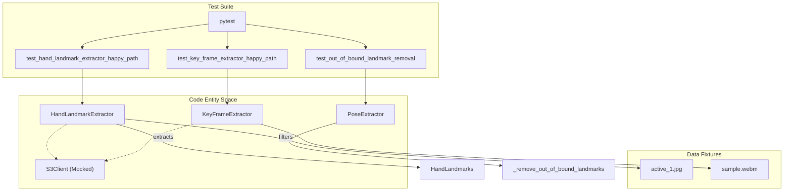
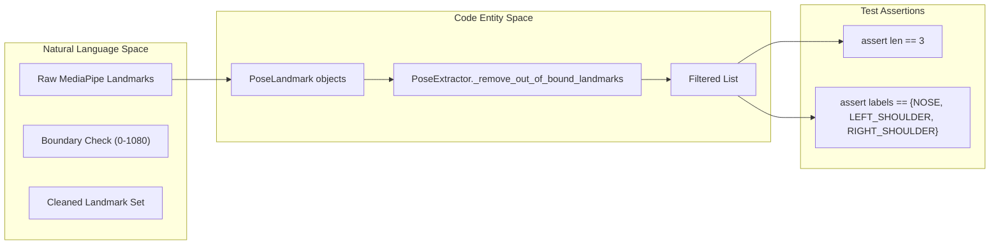

<!-- source: DeepWiki mcp.deepwiki.com · repo NVIDIA/Trustworthy-AI · extra page Testing & Development Setup · fetched 2026-10-26 -->

# Testing & Development Setup

Relevant source files

The following files were used as context for generating this wiki page:

- [ASL Developer Community/.pre-commit-config.yaml](ASL Developer Community/.pre-commit-config.yaml)
- [ASL Developer Community/Makefile](ASL Developer Community/Makefile)
- [ASL Developer Community/pyproject.toml](ASL Developer Community/pyproject.toml)
- [ASL Developer Community/tests/__init__.py](ASL Developer Community/tests/__init__.py)
- [ASL Developer Community/tests/preprocessing/hand_landmark_extractor/test_extractor.py](ASL Developer Community/tests/preprocessing/hand_landmark_extractor/test_extractor.py)
- [ASL Developer Community/tests/preprocessing/key_frame_extractor/test_extractor.py](ASL Developer Community/tests/preprocessing/key_frame_extractor/test_extractor.py)
- [ASL Developer Community/tests/preprocessing/pose_extractor/test_extractor.py](ASL Developer Community/tests/preprocessing/pose_extractor/test_extractor.py)
- [ASL Developer Community/tests/preprocessing/test_out_of_bound_removal.py](ASL Developer Community/tests/preprocessing/test_out_of_bound_removal.py)

This page provides a comprehensive guide to the testing infrastructure and development environment for the **ASL Data Pipeline**. It covers the suite of unit tests, data fixtures, and the configuration required to maintain and contribute to the codebase.

## Purpose and Scope

The development environment is designed to ensure high code quality and consistency across the `asl-data-pipeline` package. The setup utilizes **Poetry** for dependency management, **Pre-commit** for automated linting/formatting, and **Pytest** for verifying the extraction and conversion logic within the preprocessing modules.

---

## Development Environment Setup

The pipeline requires **Python 3.11** as specified in the project configuration [ASL Developer Community/pyproject.toml:25-25]().

### Core Toolchain
The project uses several tools to manage the lifecycle of the application:
*   **Poetry**: Handles dependency resolution, virtual environments, and packaging [ASL Developer Community/pyproject.toml:16-23]().
*   **Make**: Provides a simplified interface for common developer tasks [ASL Developer Community/Makefile:16-16]().
*   **Pre-commit**: Runs a series of hooks (Black, Isort, Flake8) before every commit to ensure style compliance [ASL Developer Community/.pre-commit-config.yaml:6-61]().

### Makefile Targets
The `Makefile` defines the following entry points for development:

| Target | Command | Description |
| :--- | :--- | :--- |
| `install` | `poetry install --with dev` | Installs all dependencies including development tools [ASL Developer Community/Makefile:36-37](). |
| `format` | `black`, `isort`, `autoflake` | Automatically formats code and cleans up unused imports [ASL Developer Community/Makefile:42-45](). |
| `lint` | `pre-commit run --all-files` | Runs the full suite of static analysis tools [ASL Developer Community/Makefile:21-22](). |
| `test` | `pytest` + `coverage` | Executes unit tests and generates a coverage report [ASL Developer Community/Makefile:27-31](). |
| `clean` | `rm -rf ...` | Removes build artifacts, caches, and coverage files [ASL Developer Community/Makefile:50-59](). |

### Configuration (pyproject.toml)
The `pyproject.toml` file centralizes tool configurations:
*   **Black**: Configured for a line length of 120 [ASL Developer Community/pyproject.toml:63-65]().
*   **Mypy**: Enforces strict type checking with `disallow_untyped_defs = true` [ASL Developer Community/pyproject.toml:81-86]().
*   **Isort**: Uses the `black` profile to ensure compatibility [ASL Developer Community/pyproject.toml:97-99]().

**Sources:** [ASL Developer Community/Makefile:1-60](), [ASL Developer Community/pyproject.toml:1-115](), [ASL Developer Community/.pre-commit-config.yaml:1-61]()

---

## Test Suite Structure

The tests are located in the `tests/` directory and mirror the structure of the `src/` directory to provide clear coverage for each preprocessing module.

### Unit Test Modules
1.  **Hand Landmark Extractor**: Validates `HandLandmarkExtractor` by mocking S3 and processing a sample image to verify landmark detection [ASL Developer Community/tests/preprocessing/hand_landmark_extractor/test_extractor.py:28-57]().
2.  **Key Frame Extractor**: Tests `KeyFrameExtractor` using a sample `.webm` video to ensure motion-based frame selection works as expected [ASL Developer Community/tests/preprocessing/key_frame_extractor/test_extractor.py:25-59]().
3.  **Pose Extractor**: Verifies `PoseExtractor` functionality, ensuring 33 pose landmarks are correctly identified from input frames [ASL Developer Community/tests/preprocessing/pose_extractor/test_extractor.py:28-58]().
4.  **Out-of-Bound Removal**: A specialized test suite for the `_remove_out_of_bound_landmarks` method in the `PoseExtractor`. It validates that landmarks outside the 1080x1080 coordinate space are filtered out [ASL Developer Community/tests/preprocessing/test_out_of_bound_removal.py:27-76]().

### Test Data Fixtures
The suite relies on static assets located in `tests/data/`:
*   `active_1.jpg`: A sample image used for landmark extraction testing [ASL Developer Community/tests/preprocessing/hand_landmark_extractor/test_extractor.py:47-48]().
*   `5xwRgAwJrmW3VhrBTNhicgWpXS33_1740260341-707000000.webm`: A sample ASL video used for keyframe extraction testing [ASL Developer Community/tests/preprocessing/key_frame_extractor/test_extractor.py:43-43]().

### Testing Logic Flow

The following diagram illustrates how the test suite interacts with the core pipeline entities and mocks external services.

**Test Execution & Mocking Flow**

**Sources:** [ASL Developer Community/tests/preprocessing/hand_landmark_extractor/test_extractor.py:28-57](), [ASL Developer Community/tests/preprocessing/key_frame_extractor/test_extractor.py:25-59](), [ASL Developer Community/tests/preprocessing/test_out_of_bound_removal.py:51-76]()

---

## Detailed Implementation: Out-of-Bound Removal

The `PoseExtractor` includes logic to ensure data quality by removing landmarks that fall outside the image boundaries. This is critical for downstream annotation tools like SuperAnnotate.

### Logic Association
The test `test_out_of_bound_landmark_removal` validates this behavior by providing a list of `PoseLandmark` objects with coordinates ranging from valid (0-1079) to invalid (negative or >1080).

**Landmark Filtering Logic Mapping**

**Sources:** [ASL Developer Community/tests/preprocessing/test_out_of_bound_removal.py:51-76]()

---

## Prerequisites & AWS Setup

While the test suite mocks S3 interactions using `pytest-mock` and `MagicMock` [ASL Developer Community/tests/preprocessing/hand_landmark_extractor/test_extractor.py:31-35](), local development and execution of the pipeline require the following:

1.  **AWS CLI**: Must be installed and configured with credentials that have access to the S3 buckets defined in your `S3Config`.
2.  **Environment Variables**: The `python-dotenv` package is used to load configuration [ASL Developer Community/pyproject.toml:38-38](). Ensure a `.env` file is present if not using standard AWS environment variables.
3.  **MediaPipe**: The extraction modules depend on MediaPipe [ASL Developer Community/pyproject.toml:39-39](). Note that some tests use `model_complexity=0` to speed up execution in CI/CD environments [ASL Developer Community/tests/preprocessing/pose_extractor/test_extractor.py:44-44]().

**Sources:** [ASL Developer Community/pyproject.toml:35-39](), [ASL Developer Community/tests/preprocessing/pose_extractor/test_extractor.py:28-46]()

---

