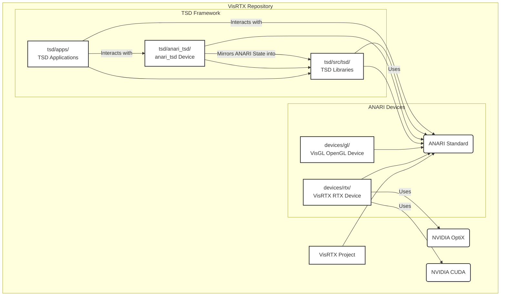

<!-- source: DeepWiki mcp.deepwiki.com · repo NVIDIA/VisRTX · page 1 VisRTX & TSD Overview · fetched 2026-10-26 -->

# VisRTX & TSD Overview

Relevant source files

The following files were used as context for generating this wiki page:

- [AGENTS.md](AGENTS.md)
- [CMakeLists.txt](CMakeLists.txt)
- [README.md](README.md)
- [devices/gl/AGENTS.md](devices/gl/AGENTS.md)
- [devices/rtx/AGENTS.md](devices/rtx/AGENTS.md)
- [devices/rtx/CMakeLists.txt](devices/rtx/CMakeLists.txt)
- [tsd/AGENTS.md](tsd/AGENTS.md)
- [tsd/README.md](tsd/README.md)
- [tsd/src/tsd/README.md](tsd/src/tsd/README.md)
- [tsd/src/tsd/algorithms/README.md](tsd/src/tsd/algorithms/README.md)
- [tsd/src/tsd/scripting/README.md](tsd/src/tsd/scripting/README.md)

This page provides a high-level introduction to the VisRTX repository, outlining its primary components: the VisRTX ANARI device, the experimental OpenGL ANARI device, and the TSD (Testing Scene Description) framework. It describes their purpose, key dependencies, and how they interrelate. For detailed information on building, configuration, and specific architectural aspects, please refer to the linked child pages.

## VisRTX: ANARI Device Implementations

VisRTX is an experimental NVIDIA implementation of the [Khronos ANARI standard](https://www.khronos.org/anari) [README.md:5-6] focused on scientific visualization. The repository provides two ANARI device implementations:

*   **VisRTX RTX Device**: An OptiX-based GPU ray tracer [README.md:13] that leverages NVIDIA's RTX platform for high-fidelity rendering. It supports a wide range of ANARI extensions, including CUDA array/framebuffer interop, NanoVDB volumes, and MDL materials [AGENTS.md:85-86].
*   **VisRTX OpenGL Device (VisGL)**: An experimental OpenGL rasterizer [README.md:14] that provides a simpler, rasterization-based ANARI implementation. It supports basic rendering features like shadow mapping and ambient occlusion [AGENTS.md:87-88].

Both devices implement the ANARI C API and are designed to be loaded as shared libraries by any ANARI application [AGENTS.md:83-84].

For details on building and configuring these devices, see [Getting Started: Build & Configuration](#1.1). For an in-depth look at the RTX device architecture, refer to [VisRTX RTX Device](#2). The OpenGL device is covered in [OpenGL Device (VisGL)](#3).

Sources: [README.md:5-6](), [README.md:13-14](), [AGENTS.md:83-88]()

## TSD: The Scientific Data Framework

TSD ("Testing Scene Description") is an experimental C++17 scene graph and testing framework for ANARI devices [tsd/AGENTS.md:5]. It serves as a platform for exploring ANARI rendering capabilities, particularly for scalable scientific visualizations [README.md:8-9]. TSD is not intended as a production piece of software and does not guarantee API stability [tsd/README.md:17-18].

The TSD framework comprises a collection of libraries and applications:

*   **Core Libraries**: These include foundational utilities (`tsd_core`), an ANARI-like scene representation (`tsd_scene`), file I/O (`tsd_io`), rendering synchronization (`tsd_rendering`), and application glue (`tsd_app`) [AGENTS.md:94-100].
*   **Optional Libraries**: TSD offers optional components for UI (`tsd_ui_imgui`), distributed computing (`tsd_mpi`), networking (`tsd_network`), and Lua scripting (`tsd_lua`) [AGENTS.md:103-107].
*   **Applications**: A suite of interactive and headless applications, such as `tsdViewer` (an interactive scene viewer), `tsdRender` (a command-line renderer), and `tsdLua` (a Lua REPL for scripting) [AGENTS.md:110-114].

For a comprehensive overview of TSD's libraries and their functionalities, see [TSD Framework](#4). Details on file I/O and scene serialization are in [File I/O & Scene Serialization](#5), while interactive applications are covered in [Interactive Applications & UI Framework](#6). Command-line tools and scripting are detailed in [Command-Line Tools & Scripting](#7).

Sources: [README.md:8-9](), [tsd/README.md:17-18](), [tsd/AGENTS.md:5](), [AGENTS.md:94-114]()

## Key Dependencies

The VisRTX project relies on several core dependencies:

*   **ANARI-SDK**: The Khronos ANARI SDK is a fundamental requirement for both device implementations and the TSD framework [devices/rtx/CMakeLists.txt:72](), [tsd/AGENTS.md:23]().
*   **CUDA 12+**: Essential for the VisRTX RTX device, which is built on NVIDIA's CUDA platform [devices/rtx/CMakeLists.txt:73](), [AGENTS.md:25]().
*   **OptiX**: The NVIDIA OptiX ray tracing engine is the core technology behind the VisRTX RTX device [devices/rtx/CMakeLists.txt:97](), [AGENTS.md:25](). Specific OptiX versions (7.7, 8.0, 8.1, 9.0) can be selected during the build process [devices/rtx/CMakeLists.txt:78-90]().
*   **GLM**: The OpenGL Mathematics library is used for vector and matrix operations [devices/rtx/CMakeLists.txt:74]().

Optional dependencies enable additional features:

*   **MDL (Material Definition Language)**: Support for NVIDIA MDL materials can be enabled for the RTX device [devices/rtx/CMakeLists.txt:53-56](), [AGENTS.md:43]().
*   **Neural Graphics Primitives**: Requires OptiX 9.0+ and can be enabled for the RTX device [devices/rtx/CMakeLists.txt:58](), [devices/rtx/CMakeLists.txt:99-103](), [AGENTS.md:44]().
*   **NVTX**: NVIDIA Tools Extension for profiling instrumentation [devices/rtx/CMakeLists.txt:59](), [AGENTS.md:45]().
*   **MPI**: For distributed workflows within TSD [tsd/AGENTS.md:31](), [AGENTS.md:51]().
*   **Networking**: For client/server scene streaming in TSD [tsd/AGENTS.md:31](), [AGENTS.md:52]().
*   **Lua**: For scripting capabilities within TSD [tsd/AGENTS.md:31](), [AGENTS.md:53]().

For a detailed guide on building and configuring the project with these dependencies, see [Getting Started: Build & Configuration](#1.1).

Sources: [devices/rtx/CMakeLists.txt:53-59](), [devices/rtx/CMakeLists.txt:72-74](), [devices/rtx/CMakeLists.txt:78-90](), [devices/rtx/CMakeLists.txt:97](), [devices/rtx/CMakeLists.txt:99-103](), [tsd/AGENTS.md:23](), [tsd/AGENTS.md:31](), [AGENTS.md:25](), [AGENTS.md:43-45](), [AGENTS.md:51-53]()

## Component Relationships

The VisRTX repository is structured to allow for both integrated and standalone builds of its major components. The top-level `CMakeLists.txt` [CMakeLists.txt:41]() orchestrates the build process, allowing users to enable or disable the VisRTX RTX device, the VisGL OpenGL device, and the TSD framework [CMakeLists.txt:46-59]().

The ANARI devices (`devices/rtx` and `devices/gl`) are independent implementations of the ANARI standard. The TSD framework, while capable of standalone operation, is designed to interact with ANARI devices, including those provided by VisRTX.

The `anari_tsd` device [tsd/src/tsd/README.md:10] acts as a bridge, mirroring ANARI object state into a TSD scene [AGENTS.md:100]. This allows for offline inspection, serialization, and networking of ANARI scenes through the TSD framework.

The following diagram illustrates the high-level relationships between the main components:

### VisRTX Component Overview

Sources: [CMakeLists.txt:41](), [CMakeLists.txt:46-59](), [tsd/src/tsd/README.md:10](), [AGENTS.md:100]()

For a detailed breakdown of the repository's directory structure and how each component maps to build targets and CMake options, see [Repository Structure & Module Map](#1.2).

---

