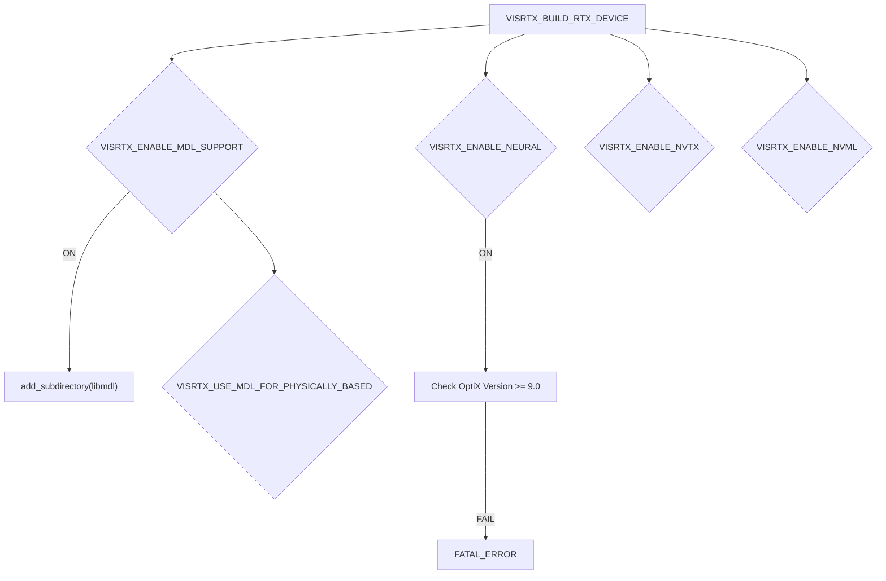
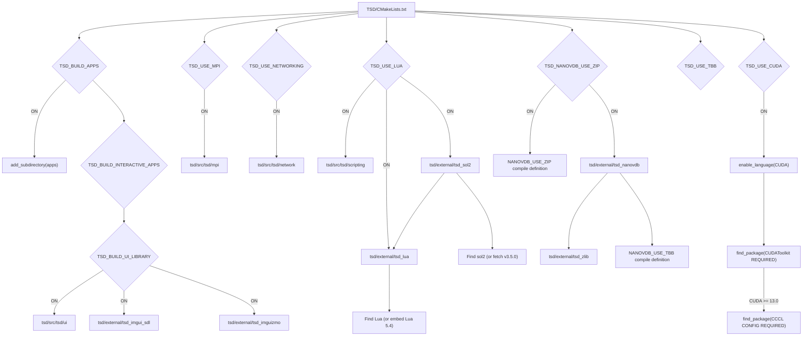

<!-- source: DeepWiki mcp.deepwiki.com · repo NVIDIA/VisRTX · page 1.1 Getting Started: Build & Configuration · fetched 2026-10-26 -->

# Getting Started: Build & Configuration

<details>
<summary>Relevant source files</summary>

The following files were used as context for generating this wiki page:

- [.github/actions/build-anari-sdk/action.yml](.github/actions/build-anari-sdk/action.yml)
- [.github/actions/setup-cuda/action.yml](.github/actions/setup-cuda/action.yml)
- [.github/actions/setup-cuda/components.json](.github/actions/setup-cuda/components.json)
- [.github/actions/setup-cuda/scripts/install-cuda.ps1](.github/actions/setup-cuda/scripts/install-cuda.ps1)
- [.github/actions/setup-cuda/scripts/install-cuda.sh](.github/actions/setup-cuda/scripts/install-cuda.sh)
- [.github/scripts/cuda-version-manager.py](.github/scripts/cuda-version-manager.py)
- [.github/workflows/build-tsd.yml](.github/workflows/build-tsd.yml)
- [.github/workflows/build-visrtx.yml](.github/workflows/build-visrtx.yml)
- [CMakeLists.txt](CMakeLists.txt)
- [README.md](README.md)
- [devices/rtx/CMakeLists.txt](devices/rtx/CMakeLists.txt)
- [devices/rtx/cmake/EmbedPTX.cmake](devices/rtx/cmake/EmbedPTX.cmake)
- [devices/rtx/cmake/EmbedPTXRun.cmake](devices/rtx/cmake/EmbedPTXRun.cmake)
- [devices/rtx/cmake/FindOptiX.cmake](devices/rtx/cmake/FindOptiX.cmake)
- [devices/rtx/cmake/FindVisRTX.cmake](devices/rtx/cmake/FindVisRTX.cmake)
- [devices/rtx/cmake/appendSearchPaths.cmake](devices/rtx/cmake/appendSearchPaths.cmake)
- [devices/rtx/cmake/build_deps/CMakeLists.txt](devices/rtx/cmake/build_deps/CMakeLists.txt)
- [devices/rtx/cmake/build_deps/superbuild_macros.cmake](devices/rtx/cmake/build_deps/superbuild_macros.cmake)
- [devices/rtx/cmake/embed_resource.cmake](devices/rtx/cmake/embed_resource.cmake)
- [devices/rtx/libmdl/ArgumentBlockDescriptor.cpp](devices/rtx/libmdl/ArgumentBlockDescriptor.cpp)
- [devices/rtx/libmdl/ArgumentBlockDescriptor.h](devices/rtx/libmdl/ArgumentBlockDescriptor.h)
- [tsd/CMakeLists.txt](tsd/CMakeLists.txt)
- [tsd/cmake/build_deps/superbuild_macros.cmake](tsd/cmake/build_deps/superbuild_macros.cmake)
- [tsd/cmake/mark_cache_variables_as_advanced.cmake](tsd/cmake/mark_cache_variables_as_advanced.cmake)
- [tsd/external/CMakeLists.txt](tsd/external/CMakeLists.txt)
- [tsd/external/tsd_imguizmo/CMakeLists.txt](tsd/external/tsd_imguizmo/CMakeLists.txt)
- [tsd/external/tsd_imoguizmo/CMakeLists.txt](tsd/external/tsd_imoguizmo/CMakeLists.txt)
- [tsd/external/tsd_imoguizmo/imoguizmo.hpp](tsd/external/tsd_imoguizmo/imoguizmo.hpp)
- [tsd/external/tsd_lua/CMakeLists.txt](tsd/external/tsd_lua/CMakeLists.txt)
- [tsd/external/tsd_nanovdb/CMakeLists.txt](tsd/external/tsd_nanovdb/CMakeLists.txt)
- [tsd/external/tsd_sol2/CMakeLists.txt](tsd/external/tsd_sol2/CMakeLists.txt)
- [tsd/external/tsd_zlib/CMakeLists.txt](tsd/external/tsd_zlib/CMakeLists.txt)
- [tsd/src/tsd/CMakeLists.txt](tsd/src/tsd/CMakeLists.txt)
- [tsd/src/tsd/io/importers/import_NVDB.cpp](tsd/src/tsd/io/importers/import_NVDB.cpp)

</details>


This page provides a comprehensive guide to building the VisRTX project using CMake. It details the necessary dependencies, top-level configuration options for enabling or disabling specific components and features, and explains how to configure optional functionalities like MDL, Neural Graphics Primitives, NVTX profiling, MPI, networking, and Lua scripting.

## Building with CMake

The VisRTX project uses CMake for its build system. You can build the entire project from the root directory or build individual subprojects (VisRTX device, VisGL device, TSD framework) separately. Building from the root directory is generally recommended for a complete setup.

The core `CMakeLists.txt` [CMakeLists.txt:30-59]() in the repository root defines the main build options and includes subdirectories.

### Core Build Options

The following top-level CMake options control which major components of the VisRTX project are built:

| Option Name             | Description                                | Default Value |
| :---------------------- | :----------------------------------------- | :------------ |
| `VISRTX_BUILD_RTX_DEVICE` | Build the CUDA/OptiX-based ANARI device. | `ON`          |
| `VISRTX_BUILD_GL_DEVICE`  | Build the experimental OpenGL ANARI device. | `ON`          |
| `VISRTX_BUILD_TSD`        | Build the TSD (The Scientific Data) framework and its sample applications. | `OFF`         |

Sources: [CMakeLists.txt:47-53]()

### Step-by-Step Build Process

1.  **Clone the repository:**
    ```bash
    git clone https://github.com/NVIDIA/VisRTX.git
    cd VisRTX
    ```

2.  **Create a build directory:**
    ```bash
    mkdir build
    cd build
    ```

3.  **Configure with CMake:**
    Use `cmake` to configure the project. You can specify build options using the `-D` flag.

    ```bash
    cmake .. -DCMAKE_BUILD_TYPE=Release \
             -DVISRTX_BUILD_RTX_DEVICE=ON \
             -DVISRTX_BUILD_GL_DEVICE=ON \
             -DVISRTX_BUILD_TSD=ON \
             # Add other optional flags here
    ```
    The `CMAKE_BUILD_TYPE` is initialized to `Release` [CMakeLists.txt:34](). The `CMAKE_CXX_STANDARD` is set to `17` [CMakeLists.txt:35]().

4.  **Build the project:**
    ```bash
    cmake --build . --config Release --parallel
    ```

### Build System Overview

The build process is orchestrated by CMake. The root `CMakeLists.txt` [CMakeLists.txt:41]() defines the main project `VisRTX`. It then conditionally includes subdirectories based on the `VISRTX_BUILD_*` options.

#### Diagram: Top-Level CMake Build Flow

```mermaid
graph TD
    A["CMakeLists.txt (Root)"] --> B{{"option(VISRTX_BUILD_RTX_DEVICE)"}};
    A --> C{{"option(VISRTX_BUILD_GL_DEVICE)"}};
    A --> D{{"option(VISRTX_BUILD_TSD)"}};

    B -- "ON" --> B1["add_subdirectory(devices/rtx)"];
    C -- "ON" --> C1["add_subdirectory(devices/gl)"];
    D -- "ON" --> D1["add_subdirectory(tsd)"];

    B1 --> "devices/rtx/CMakeLists.txt";
    C1 --> "devices/gl/CMakeLists.txt";
    D1 --> "tsd/CMakeLists.txt";
```
Sources: [CMakeLists.txt:47-59]()

## Required Dependencies

VisRTX has several core dependencies that must be met for a successful build.

### CUDA Toolkit

CUDA Toolkit version 12 or higher is required. The build system explicitly checks for this requirement [devices/rtx/CMakeLists.txt:73](), [tsd/CMakeLists.txt:85]().

### NVIDIA OptiX SDK

The RTX device relies on NVIDIA OptiX. The build system fetches OptiX headers from GitHub based on the `OPTIX_FETCH_VERSION` CMake variable [devices/rtx/CMakeLists.txt:78-94]().
Currently supported versions are `7.7`, `8.0`, `8.1`, and `9.0`.
The `find_package(OptiX REQUIRED)` command [devices/rtx/CMakeLists.txt:97]() then locates the OptiX library.

### ANARI-SDK

The Khronos ANARI SDK is a fundamental dependency. The build system uses `find_package(anari 0.15.0 REQUIRED)` [devices/rtx/CMakeLists.txt:72](), [tsd/CMakeLists.txt:81]() to locate it. The ANARI SDK is often built as part of the CI process [build-visrtx.yml:43-48]().

### GLM (OpenGL Mathematics)

GLM is used for mathematical operations. It is found via `find_package(glm MODULE REQUIRED)` [devices/rtx/CMakeLists.txt:74]().

## Optional Features and Configuration

Many features in VisRTX and TSD can be enabled or disabled via CMake options.

### VisRTX RTX Device Specific Options

These options are defined in `devices/rtx/CMakeLists.txt` [devices/rtx/CMakeLists.txt:53-67]().

| Option Name                         | Description                                                              | Default Value |
| :---------------------------------- | :----------------------------------------------------------------------- | :------------ |
| `VISRTX_ENABLE_MDL_SUPPORT`         | Enables NVIDIA MDL (Material Definition Language) support for materials. | `OFF`         |
| `VISRTX_ENABLE_NEURAL`              | Enables Neural Graphics Primitives. Requires OptiX 9.0+.                 | `OFF`         |
| `VISRTX_ENABLE_NVTX`                | Enables NVTX profiling instrumentation.                                  | `OFF`         |
| `VISRTX_ENABLE_NVML`                | Enables NVML for runtime driver checks.                                  | `ON`          |
| `VISRTX_USE_MDL_FOR_PHYSICALLY_BASED` | Uses MDL for physically based materials if `VISRTX_ENABLE_MDL_SUPPORT` is ON. | `OFF`         |
| `VISRTX_ENABLE_HDRI_SAMPLING_DEBUG` | Enables possibly costly debug support for HDRI sampling.                 | `OFF`         |

**Neural Graphics Primitives (`VISRTX_ENABLE_NEURAL`)**: If enabled, the build system enforces that `OPTIX_FETCH_VERSION` must be `9.0` or higher [devices/rtx/CMakeLists.txt:101-103]().

#### Diagram: VisRTX RTX Device Feature Dependencies


Sources: [devices/rtx/CMakeLists.txt:53-67](), [devices/rtx/CMakeLists.txt:101-103](), [devices/rtx/CMakeLists.txt:109-111]()

### TSD Framework Specific Options

These options are defined in `tsd/CMakeLists.txt` [tsd/CMakeLists.txt:39-74]().

| Option Name                       | Description                                                              | Default Value |
| :-------------------------------- | :----------------------------------------------------------------------- | :------------ |
| `TSD_BUILD_APPS`                  | Build TSD sample applications.                                           | `ON`          |
| `TSD_BUILD_INTERACTIVE_APPS`      | Build interactive applications (depends on `TSD_BUILD_APPS`).            | `ON`          |
| `TSD_BUILD_UI_LIBRARY`            | Build the TSD ImGui UI library (depends on `TSD_BUILD_APPS` or `TSD_BUILD_INTERACTIVE_APPS`). | `ON`          |
| `TSD_USE_HDF5`                    | Support loading AMR grids from HDF5.                                     | `OFF`         |
| `TSD_USE_ASSIMP`                  | Support loading geometry with libassimp.                                 | `OFF`         |
| `TSD_USE_SDL3`                    | Use SDL3 interop in the render pipeline.                                 | `ON`          |
| `TSD_USE_TBB`                     | Use TBB (Threading Building Blocks) code paths.                          | `ON`          |
| `TSD_USE_USD`                     | Use OpenUSD where relevant.                                              | `OFF`         |
| `TSD_USE_TORCH`                   | Use PyTorch for importing neural geometries.                             | `OFF`         |
| `TSD_USE_VTK`                     | Use VTK for importing VTK file formats.                                  | `OFF`         |
| `TSD_USE_SILO`                    | Use Silo for importing Silo file formats.                                | `OFF`         |
| `TSD_USE_MPI`                     | Enable MPI support.                                                      | `OFF`         |
| `TSD_USE_NETWORKING`              | Enable networking support via Boost.Asio.                                | `OFF`         |
| `TSD_NANOVDB_SKIP_INVALID_VOLUMES` | Skip NanoVDB volumes with zero active voxels during import.              | `OFF`         |
| `TSD_NANOVDB_USE_ZIP`             | Enable zlib for NanoVDB importer to read ZIP-compressed `.nvdb` files.   | `ON`          |
| `TSD_USE_LUA`                     | Enable Lua scripting support.                                            | `ON`          |
| `TSD_USE_CUDA`                    | Use CUDA code paths where relevant (default `ON` on Linux/Windows, `OFF` on macOS). | `ON`          |

#### Diagram: TSD Framework Feature Dependencies


Sources: [tsd/CMakeLists.txt:39-74](), [tsd/src/tsd/CMakeLists.txt:13-25](), [tsd/external/CMakeLists.txt:20-30](), [tsd/external/tsd_lua/CMakeLists.txt:4-25](), [tsd/external/tsd_sol2/CMakeLists.txt:9-29](), [tsd/external/tsd_nanovdb/CMakeLists.txt:13-20](), [tsd/src/tsd/io/importers/import_NVDB.cpp:200-207]()

### Advanced CMake Variables

Many internal or less frequently changed CMake variables are marked as advanced using `mark_as_advanced()`. This hides them from typical CMake GUI views unless "Advanced" options are shown. The `tsd/cmake/mark_cache_variables_as_advanced.cmake` script [tsd/cmake/mark_cache_variables_as_advanced.cmake:19-38]() marks several categories of variables as advanced, including those related to Boost, CPM, Embree, FetchContent, HDF5, and Sol2.

---

