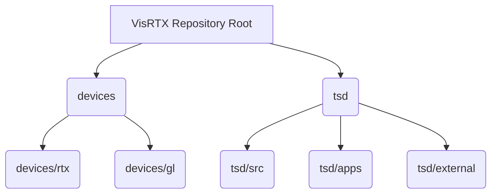
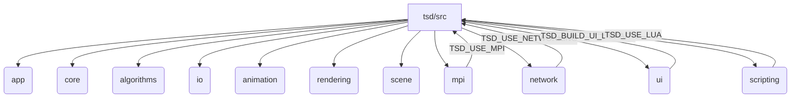
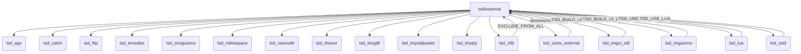

<!-- source: DeepWiki mcp.deepwiki.com · repo NVIDIA/VisRTX · page 1.2 Repository Structure & Module Map · fetched 2026-10-26 -->

# Repository Structure & Module Map

Relevant source files

The following files were used as context for generating this wiki page:

- [CMakeLists.txt](CMakeLists.txt)
- [README.md](README.md)
- [devices/rtx/CMakeLists.txt](devices/rtx/CMakeLists.txt)
- [devices/rtx/external/CMakeLists.txt](devices/rtx/external/CMakeLists.txt)
- [devices/rtx/external/fmtlib/CMakeLists.txt](devices/rtx/external/fmtlib/CMakeLists.txt)
- [devices/rtx/external/nonstd/CMakeLists.txt](devices/rtx/external/nonstd/CMakeLists.txt)
- [devices/rtx/external/stb_image/CMakeLists.txt](devices/rtx/external/stb_image/CMakeLists.txt)
- [tsd/CMakeLists.txt](tsd/CMakeLists.txt)
- [tsd/cmake/mark_cache_variables_as_advanced.cmake](tsd/cmake/mark_cache_variables_as_advanced.cmake)
- [tsd/external/CMakeLists.txt](tsd/external/CMakeLists.txt)
- [tsd/external/tsd_imguizmo/CMakeLists.txt](tsd/external/tsd_imguizmo/CMakeLists.txt)
- [tsd/external/tsd_imoguizmo/CMakeLists.txt](tsd/external/tsd_imoguizmo/CMakeLists.txt)
- [tsd/external/tsd_imoguizmo/imoguizmo.hpp](tsd/external/tsd_imoguizmo/imoguizmo.hpp)
- [tsd/external/tsd_lua/CMakeLists.txt](tsd/external/tsd_lua/CMakeLists.txt)
- [tsd/external/tsd_nanovdb/CMakeLists.txt](tsd/external/tsd_nanovdb/CMakeLists.txt)
- [tsd/external/tsd_sol2/CMakeLists.txt](tsd/external/tsd_sol2/CMakeLists.txt)
- [tsd/external/tsd_tinygltf/CMakeLists.txt](tsd/external/tsd_tinygltf/CMakeLists.txt)
- [tsd/external/tsd_tinygltf/include/tiny_gltf.h](tsd/external/tsd_tinygltf/include/tiny_gltf.h)
- [tsd/external/tsd_tinygltf/src/json.hpp](tsd/external/tsd_tinygltf/src/json.hpp)
- [tsd/external/tsd_tinygltf/src/tiny_gltf.cc](tsd/external/tsd_tinygltf/src/tiny_gltf.cc)
- [tsd/external/tsd_zlib/CMakeLists.txt](tsd/external/tsd_zlib/CMakeLists.txt)
- [tsd/src/tsd/CMakeLists.txt](tsd/src/tsd/CMakeLists.txt)
- [tsd/src/tsd/io/importers/import_NVDB.cpp](tsd/src/tsd/io/importers/import_NVDB.cpp)

This page details the top-level directory structure of the VisRTX repository, mapping each directory to its primary function, the libraries it builds, and the CMake flags that control its compilation. Understanding this layout is crucial for navigating the codebase, identifying relevant components, and configuring builds.

## Top-Level Directory Layout

The VisRTX repository is organized into several key directories, each serving a distinct purpose in the overall project.

Sources:
- [CMakeLists.txt:40-58]()
- [README.md:1-39]()

### `devices/`

This directory contains the ANARI device implementations.

Sources:
- [CMakeLists.txt:55]()
- [README.md:11-15]()

#### `devices/rtx/`

This subdirectory houses the VisRTX ANARI device, which is built on NVIDIA OptiX. It includes the core device implementation, shaders, and its own set of external dependencies.

| Component | Description | CMake Flag | Library Target |
| :-------- | :---------- | :--------- | :------------- |
| `device/` | Core VisRTX OptiX device implementation | `VISRTX_BUILD_RTX_DEVICE` (default: ON) | `visrtx_device` |
| `shaders/` | OptiX PTX shaders | N/A | N/A (embedded) |
| `external/` | Vendored dependencies specific to the RTX device | N/A | `visrtx_external` |
| `libmdl/` | NVIDIA MDL integration | `VISRTX_ENABLE_MDL_SUPPORT` (default: OFF) | `visrtx_libmdl` |
| `apps/` | Sample applications for the RTX device | N/A | N/A |

The `VISRTX_BUILD_RTX_DEVICE` option in the top-level `CMakeLists.txt` controls whether this device is built [CMakeLists.txt:52](). Within `devices/rtx/CMakeLists.txt`, additional options like `VISRTX_ENABLE_MDL_SUPPORT` [devices/rtx/CMakeLists.txt:54-57]() and `VISRTX_ENABLE_NEURAL` [devices/rtx/CMakeLists.txt:58]() control specific features.

Sources:
- [devices/rtx/CMakeLists.txt:54-112]()
- [CMakeLists.txt:52]()
- [README.md:13]()

#### `devices/gl/`

This directory contains the experimental OpenGL ANARI device implementation.

| Component | Description | CMake Flag | Library Target |
| :-------- | :---------- | :--------- | :------------- |
| `device/` | Core VisGL OpenGL device implementation | `VISRTX_BUILD_GL_DEVICE` (default: ON) | `visgl_device` |
| `apps/` | Sample applications for the GL device | N/A | N/A |

The `VISRTX_BUILD_GL_DEVICE` option in the top-level `CMakeLists.txt` controls whether this device is built [CMakeLists.txt:53]().

Sources:
- [CMakeLists.txt:53]()
- [README.md:14]()

### `tsd/`

This directory contains the TSD (The Scientific Data) framework, which provides a collection of C++ libraries, applications, and tools for scientific visualization.

Sources:
- [CMakeLists.txt:56-58]()
- [README.md:19-21]()

#### `tsd/src/`

This subdirectory contains the core TSD libraries. These libraries provide foundational utilities, scene management, rendering infrastructure, and algorithms.

| Component | Description | CMake Flag | Library Target |
| :-------- | :---------- | :--------- | :------------- |
| `app/` | Application utilities | N/A | `tsd_app` |
| `core/` | Foundational utilities (e.g., `Any`, `Token`, `ObjectPool`) | N/A | `tsd_core` |
| `algorithms/` | CPU/CUDA dual-backend algorithms | N/A | `tsd_algorithms` |
| `io/` | File I/O and scene importers/exporters | N/A | `tsd_io` |
| `animation/` | Animation system | N/A | `tsd_animation` |
| `rendering/` | Rendering infrastructure (e.g., `RenderIndex`, `ImagePipeline`) | N/A | `tsd_rendering` |
| `scene/` | Scene graph and object management | N/A | `tsd_scene` |
| `mpi/` | MPI support | `TSD_USE_MPI` (default: OFF) | `tsd_mpi` |
| `network/` | Networking support via Boost.Asio | `TSD_USE_NETWORKING` (default: OFF) | `tsd_network` |
| `ui/` | ImGui-based UI library | `TSD_BUILD_UI_LIBRARY` (default: ON if `TSD_BUILD_INTERACTIVE_APPS` is ON, else OFF) | `tsd_ui_imgui` |
| `scripting/` | Lua scripting API | `TSD_USE_LUA` (default: ON) | `tsd_lua` |

The `tsd/src/tsd/CMakeLists.txt` file orchestrates the building of these libraries, conditionally including some based on CMake flags [tsd/src/tsd/CMakeLists.txt:5-26]().

Sources:
- [tsd/src/tsd/CMakeLists.txt:5-26]()
- [tsd/CMakeLists.txt:39-73]()

#### `tsd/apps/`

This directory contains various applications and tools built on the TSD framework.

| Component | Description | CMake Flag |
| :-------- | :---------- | :---------- |
| `tsdViewer/` | Interactive scene viewer | `TSD_BUILD_APPS` (default: ON) |
| `tsdRender/` | Headless rendering tool | `TSD_BUILD_APPS` (default: ON) |
| `tsdOffline/` | CLI-driven headless renderer | `TSD_BUILD_APPS` (default: ON) |
| `tsdVolumeToNanoVDB/` | Volume conversion tool | `TSD_BUILD_APPS` (default: ON) |
| `tsdPrint/` | DataTree inspection tool | `TSD_BUILD_APPS` (default: ON) |
| `tsdLua/` | Lua REPL tool | `TSD_BUILD_APPS` (default: ON) |
| `SciVisStudio/` | Scientific visualization studio | `TSD_BUILD_APPS` (default: ON) |
| `demos/` | Various demonstration applications | `TSD_BUILD_APPS` (default: ON) |

The `TSD_BUILD_APPS` option in `tsd/CMakeLists.txt` controls whether these applications are built [tsd/CMakeLists.txt:39](). `TSD_BUILD_INTERACTIVE_APPS` further refines which applications are built [tsd/CMakeLists.txt:40-45]().

Sources:
- [tsd/CMakeLists.txt:39-45]()
- [tsd/CMakeLists.txt:100-102]()

#### `tsd/external/`

This directory contains vendored third-party dependencies used by the TSD framework. These are typically header-only libraries or small, self-contained projects.

| Component | Description | CMake Flag | Library Target |
| :-------- | :---------- | :--------- | :------------- |
| `tsd_agx/` | AGX library | N/A | `tsd_ext_agx` |
| `tsd_catch/` | Catch2 testing framework | N/A | `tsd_ext_catch` |
| `tsd_flip/` | FLIP library | N/A | `tsd_ext_flip` |
| `tsd_imnodes/` | ImNodes library | N/A | `tsd_ext_imnodes` |
| `tsd_imoguizmo/` | ImGuizmo library | N/A | `tsd_ext_imoguizmo` |
| `tsd_mikktspace/` | MikkTSpace library | N/A | `tsd_ext_mikktspace` |
| `tsd_nanovdb/` | NanoVDB library | N/A | `tsd_ext_nanovdb` |
| `tsd_tinyexr/` | TinyEXR library | N/A | `tsd_ext_tinyexr` |
| `tsd_tinygltf/` | TinyGLTF library | N/A | `tsd_ext_tinygltf` |
| `tsd_tinyobjloader/` | TinyObjLoader library | N/A | `tsd_ext_tinyobjloader` |
| `tsd_tinyply/` | TinyPLY library | N/A | `tsd_ext_tinyply` |
| `tsd_zlib/` | Zlib library | N/A | `tsd_ext_zlib` |
| `tsd_visrtx_external/` | External dependencies from `devices/rtx/external` | N/A | N/A |
| `tsd_imgui_sdl/` | ImGui SDL integration | `TSD_BUILD_UI_LIBRARY` | `tsd_ext_imgui_sdl` |
| `tsd_imguizmo/` | ImGuizmo library | `TSD_BUILD_UI_LIBRARY` | `tsd_ext_imguizmo` |
| `tsd_lua/` | Lua 5.4 embedding | `TSD_USE_LUA` | `tsd_ext_lua` |
| `tsd_sol2/` | Sol2 Lua bindings | `TSD_USE_LUA` | `tsd_ext_sol2` |

Many of these external dependencies are conditionally included or configured based on TSD-specific CMake flags. For example, `tsd_nanovdb` can be configured to use `zlib` via `TSD_NANOVDB_USE_ZIP` [tsd/external/tsd_nanovdb/CMakeLists.txt:13-20](), and `tsd_sol2` and `tsd_lua` are included if `TSD_USE_LUA` is enabled [tsd/external/CMakeLists.txt:27-30]().

Sources:
- [tsd/external/CMakeLists.txt:4-30]()
- [tsd/external/tsd_nanovdb/CMakeLists.txt:13-20]()
- [tsd/external/tsd_lua/CMakeLists.txt:4-79]()
- [tsd/external/tsd_sol2/CMakeLists.txt:4-32]()
- [tsd/external/tsd_tinygltf/CMakeLists.txt:4-11]()
- [tsd/src/tsd/io/importers/import_NVDB.cpp:200-206]()

## Build Control Flags

The following table summarizes the primary CMake options that control which parts of the VisRTX repository are built. These flags are typically set when configuring the project with CMake.

| CMake Flag | Description | Default Value | Controlled Directory/Component |
| :--------- | :---------- | :------------ | :----------------------------- |
| `VISRTX_BUILD_RTX_DEVICE` | Build the CUDA/OptiX ANARI device. | ON | `devices/rtx/` |
| `VISRTX_BUILD_GL_DEVICE` | Build the OpenGL ANARI device. | ON | `devices/gl/` |
| `VISRTX_BUILD_TSD` | Build TSD sample applications and libraries. | OFF | `tsd/` |
| `VISRTX_ENABLE_MDL_SUPPORT` | Enable NVIDIA MDL support for VisRTX materials. | OFF | `devices/rtx/libmdl/` |
| `VISRTX_ENABLE_NEURAL` | Enable Neural Graphics Primitives support in VisRTX (requires OptiX 9.0+). | OFF | `devices/rtx/` |
| `TSD_BUILD_APPS` | Build TSD applications (e.g., `tsdViewer`, `tsdRender`). | ON | `tsd/apps/` |
| `TSD_BUILD_INTERACTIVE_APPS` | Build interactive TSD applications. | ON (if `TSD_BUILD_APPS` is ON) | `tsd/apps/` (subset) |
| `TSD_BUILD_UI_LIBRARY` | Build the TSD ImGui UI library. | ON (if `TSD_BUILD_INTERACTIVE_APPS` is ON, else OFF) | `tsd/src/tsd/ui/` |
| `TSD_USE_HDF5` | Support loading AMR grids from HDF5. | OFF | `tsd/src/tsd/io/` |
| `TSD_USE_ASSIMP` | Support loading geometry with libassimp. | OFF | `tsd/src/tsd/io/` |
| `TSD_USE_SDL3` | Use SDL3 interop in the render pipeline. | ON | `tsd/src/tsd/rendering/` |
| `TSD_USE_TBB` | Use TBB code paths where relevant. | ON | `tsd/src/tsd/algorithms/`, `tsd/external/tsd_nanovdb/` |
| `TSD_USE_USD` | Use OpenUSD where relevant. | OFF | `tsd/src/tsd/io/` |
| `TSD_USE_TORCH` | Use PyTorch for importing neural geometries. | OFF | `tsd/src/tsd/io/` |
| `TSD_USE_VTK` | Use VTK for importing VTK file formats. | OFF | `tsd/src/tsd/io/` |
| `TSD_USE_SILO` | Use Silo for importing Silo file formats. | OFF | `tsd/src/tsd/io/` |
| `TSD_USE_MPI` | Enable MPI support. | OFF | `tsd/src/tsd/mpi/` |
| `TSD_USE_NETWORKING` | Enable networking support via Boost.Asio. | OFF | `tsd/src/tsd/network/` |
| `TSD_NANOVDB_SKIP_INVALID_VOLUMES` | Skip NanoVDB volumes with zero active voxels. | OFF | `tsd/src/tsd/io/importers/` |
| `TSD_NANOVDB_USE_ZIP` | Enable zlib for NanoVDB importer to read ZIP-compressed .nvdb files. | ON | `tsd/external/tsd_nanovdb/` |
| `TSD_USE_LUA` | Enable Lua scripting support. | ON | `tsd/src/tsd/scripting/`, `tsd/external/tsd_lua/`, `tsd/external/tsd_sol2/` |
| `TSD_USE_CUDA` | Use CUDA code paths where relevant (disabled on macOS). | ON | `tsd/src/tsd/algorithms/`, `tsd/src/tsd/rendering/` |

Sources:
- [CMakeLists.txt:47-53]()
- [devices/rtx/CMakeLists.txt:54-65]()
- [tsd/CMakeLists.txt:39-73]()
- [tsd/src/tsd/io/importers/import_NVDB.cpp:85-90]()
- [tsd/external/tsd_nanovdb/CMakeLists.txt:13-20]()

---

