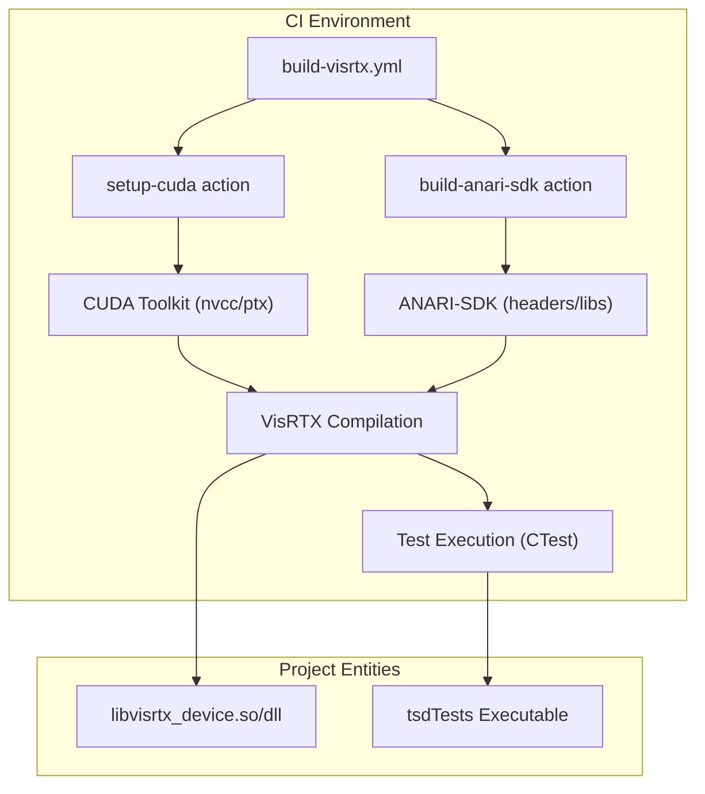
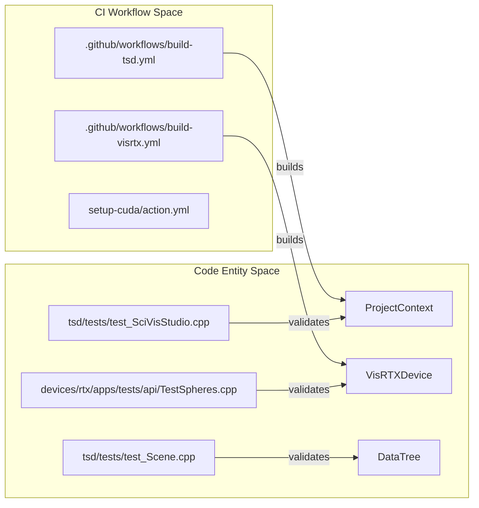

<!-- source: DeepWiki mcp.deepwiki.com · repo NVIDIA/VisRTX · page 10 Testing & CI · fetched 2026-10-26 -->

# Testing & CI

Relevant source files

The following files were used as context for generating this wiki page:

- [.github/actions/build-anari-sdk/action.yml](.github/actions/build-anari-sdk/action.yml)
- [.github/actions/setup-cuda/action.yml](.github/actions/setup-cuda/action.yml)
- [.github/actions/setup-cuda/components.json](.github/actions/setup-cuda/components.json)
- [.github/actions/setup-cuda/scripts/install-cuda.ps1](.github/actions/setup-cuda/scripts/install-cuda.ps1)
- [.github/actions/setup-cuda/scripts/install-cuda.sh](.github/actions/setup-cuda/scripts/install-cuda.sh)
- [.github/scripts/cuda-version-manager.py](.github/scripts/cuda-version-manager.py)
- [.github/workflows/build-tsd.yml](.github/workflows/build-tsd.yml)
- [.github/workflows/build-visrtx.yml](.github/workflows/build-visrtx.yml)
- [devices/rtx/apps/tests/api/TestEvictGPUArray.cpp](devices/rtx/apps/tests/api/TestEvictGPUArray.cpp)
- [devices/rtx/apps/tests/api/TestSpheres.cpp](devices/rtx/apps/tests/api/TestSpheres.cpp)
- [devices/rtx/cmake/build_deps/CMakeLists.txt](devices/rtx/cmake/build_deps/CMakeLists.txt)
- [devices/rtx/cmake/build_deps/superbuild_macros.cmake](devices/rtx/cmake/build_deps/superbuild_macros.cmake)
- [devices/rtx/device/renderer/Debug.cpp](devices/rtx/device/renderer/Debug.cpp)
- [devices/rtx/device/renderer/DebugMethod.h](devices/rtx/device/renderer/DebugMethod.h)
- [tsd/apps/interactive/scivisStudio/Dataset.h](tsd/apps/interactive/scivisStudio/Dataset.h)
- [tsd/apps/interactive/scivisStudio/Project.cpp](tsd/apps/interactive/scivisStudio/Project.cpp)
- [tsd/apps/interactive/scivisStudio/Project.h](tsd/apps/interactive/scivisStudio/Project.h)
- [tsd/apps/interactive/scivisStudio/ProjectContext.cpp](tsd/apps/interactive/scivisStudio/ProjectContext.cpp)
- [tsd/apps/interactive/scivisStudio/ProjectContext.h](tsd/apps/interactive/scivisStudio/ProjectContext.h)
- [tsd/apps/interactive/scivisStudio/ProjectSerialization.cpp](tsd/apps/interactive/scivisStudio/ProjectSerialization.cpp)
- [tsd/apps/interactive/scivisStudio/ProjectSerialization.h](tsd/apps/interactive/scivisStudio/ProjectSerialization.h)
- [tsd/apps/interactive/scivisStudio/Shot.h](tsd/apps/interactive/scivisStudio/Shot.h)
- [tsd/apps/interactive/scivisStudio/windows/CameraRigEditor.cpp](tsd/apps/interactive/scivisStudio/windows/CameraRigEditor.cpp)
- [tsd/apps/interactive/scivisStudio/windows/CameraRigEditor.h](tsd/apps/interactive/scivisStudio/windows/CameraRigEditor.h)
- [tsd/apps/interactive/scivisStudio/windows/LightRigEditor.cpp](tsd/apps/interactive/scivisStudio/windows/LightRigEditor.cpp)
- [tsd/apps/interactive/scivisStudio/windows/LightRigEditor.h](tsd/apps/interactive/scivisStudio/windows/LightRigEditor.h)
- [tsd/cmake/build_deps/superbuild_macros.cmake](tsd/cmake/build_deps/superbuild_macros.cmake)
- [tsd/src/tsd/core/AnyArray.hpp](tsd/src/tsd/core/AnyArray.hpp)
- [tsd/src/tsd/core/TSDMath.hpp](tsd/src/tsd/core/TSDMath.hpp)
- [tsd/src/tsd/io/importers/import_E57XYZ.cpp](tsd/src/tsd/io/importers/import_E57XYZ.cpp)
- [tsd/src/tsd/io/importers/import_HDRI.cpp](tsd/src/tsd/io/importers/import_HDRI.cpp)
- [tsd/src/tsd/io/importers/import_NBODY.cpp](tsd/src/tsd/io/importers/import_NBODY.cpp)
- [tsd/src/tsd/io/importers/import_OBJ.cpp](tsd/src/tsd/io/importers/import_OBJ.cpp)
- [tsd/tests/CMakeLists.txt](tsd/tests/CMakeLists.txt)
- [tsd/tests/test_Algorithms.cpp](tsd/tests/test_Algorithms.cpp)
- [tsd/tests/test_AnyArray.cpp](tsd/tests/test_AnyArray.cpp)
- [tsd/tests/test_Math.cpp](tsd/tests/test_Math.cpp)
- [tsd/tests/test_ObjectUsePtr.cpp](tsd/tests/test_ObjectUsePtr.cpp)
- [tsd/tests/test_SciVisStudio.cpp](tsd/tests/test_SciVisStudio.cpp)

This page documents the validation infrastructure for the VisRTX repository, covering the TSD framework test suite, RTX device API tests, and the GitHub Actions Continuous Integration (CI) workflows.

## TSD Test Suite (`tsd/tests`)

The TSD framework uses **Catch2** as its primary testing framework [tsd/tests/CMakeLists.txt:40-41](). Tests are organized by library component and are added as CTest targets during the build process if `BUILD_TESTING` is enabled [tsd/tests/CMakeLists.txt:4-9]().

### Core & Scene Tests
These tests validate the foundational data structures and the ANARI-mirroring scene graph logic.

| Test Name | Source File | Description |
| :--- | :--- | :--- |
| `tsd::DataTree` | `test_DataTree.cpp` | Validates hierarchical serialization, node insertion, and value retrieval [tsd/tests/CMakeLists.txt:50](). |
| `tsd::Object` | `test_Object.cpp` | Tests the `tsd::scene::Object` base class and parameter management [tsd/tests/CMakeLists.txt:59](). |
| `tsd::Scene` | `test_Scene.cpp` | Verifies object database integrity and `UpdateDelegate` notifications [tsd/tests/CMakeLists.txt:62](). |
| `tsd::Forest` | `test_Forest.cpp` | Validates the tree-based scene graph container used for layers [tsd/tests/CMakeLists.txt:52](). |
| `tsd::ObjectPool` | `test_ObjectPool.cpp` | Tests the defrag-safe pool allocator [tsd/tests/CMakeLists.txt:56](). |
| `tsd::AnyArray` | `test_AnyArray.cpp` | Validates type-safe storage for heterogeneous ANARI arrays [tsd/tests/CMakeLists.txt:48](). |

### Math & Algorithms
*   **`tsd::Math`**: Validates linear algebra utilities, including matrix decomposition (`decomposeMatrix`), coordinate conversions (`azelToDir`), and degree normalization [tsd/src/tsd/core/TSDMath.hpp:101-130](), [tsd/tests/CMakeLists.txt:58]().
*   **`tsd::Algorithms`**: Tests the CPU/CUDA backends for tone mapping, auto-exposure, and buffer conversions [tsd/tests/CMakeLists.txt:47]().

### SciVis Studio Integration Tests
The `test_SciVisStudio.cpp` file provides a high-level integration test for the SciVis Studio project model. It utilizes `SCENARIO` blocks to validate:
1.  **Project Serialization**: Ensures that datasets, shots, light rigs, and camera rigs survive a round-trip through the `DataTree` [test_SciVisStudio.cpp:52-140]().
2.  **Path Resolution**: Verifies that `ProjectContext` correctly resolves project-relative paths for source files [test_SciVisStudio.cpp:142-166]().
3.  **Camera Interpolation**: Tests the logic for sampling keyframes across different interpolation modes (`Hold`, `Linear`, `EaseOutIn`) [test_SciVisStudio.cpp:168-201]().

**Sources:** [tsd/tests/CMakeLists.txt:1-68](), [tsd/tests/test_SciVisStudio.cpp:1-201](), [tsd/src/tsd/core/TSDMath.hpp:1-172]().

---

## RTX Device API Tests

Located in `devices/rtx/apps/tests/api`, these tests focus on the stability and correctness of the OptiX-based ANARI device implementation.

### Key Test Cases
*   **`TestSpheres`**: Validates the rendering and intersection logic for sphere geometries [devices/rtx/apps/tests/api/TestSpheres.cpp]().
*   **`TestEvictGPUArray`**: Tests the `UploadableArray` memory management system, specifically verifying that GPU memory is correctly freed when arrays are evicted or released [devices/rtx/apps/tests/api/TestEvictGPUArray.cpp]().
*   **`TestDeviceInit`**: Ensures the `VisRTXDevice` initializes correctly, setting up the CUDA context and OptiX pipeline [devices/rtx/apps/tests/api/TestDeviceInit.cpp]().
*   **`TestMultiThreadedObjectCreation`**: Stress tests the device's thread-safety when creating and destroying ANARI objects simultaneously across multiple threads.

**Sources:** [devices/rtx/apps/tests/api/TestEvictGPUArray.cpp](), [devices/rtx/apps/tests/api/TestSpheres.cpp]().

---

## GitHub Actions CI Workflows

The repository uses GitHub Actions to automate builds and testing across Linux and Windows.

### Build Workflow Architecture
The CI system relies on composite actions to manage complex dependencies like CUDA and the ANARI-SDK.

#### CI Workflow: build-visrtx.yml
This workflow handles the core VisRTX device build [build-visrtx.yml:1-17]().
*   **Triggers**: Pushes to `next_release` or PRs to `main` involving `devices/**` [build-visrtx.yml:2-14]().
*   **Matrix**: Builds on `ubuntu-22.04` and `windows-2022` using multiple CUDA versions (e.g., 12.4.1, 13.0.2) [build-visrtx.yml:18-31]().
*   **Steps**:
    1.  **CUDA Setup**: Uses `./.github/actions/setup-cuda` to install the toolkit [build-visrtx.yml:38-41]().
    2.  **ANARI-SDK**: Uses `./.github/actions/build-anari-sdk` to compile the SDK as a dependency [build-visrtx.yml:42-48]().
    3.  **Configure**: Sets `VISRTX_BUILD_RTX_DEVICE=ON` and points to the compiled SDK [build-visrtx.yml:49-58]().
    4.  **Build**: Executes parallel build and installation [build-visrtx.yml:59-61]().

### CI Logic Flow

Title: CI Build and Dependency Flow

**Sources:** [.github/workflows/build-visrtx.yml:1-62](), [.github/actions/setup-cuda/action.yml](), [.github/actions/build-anari-sdk/action.yml]().

---

## System Integration Diagram

This diagram bridges the high-level CI and Testing concepts to the specific code entities that implement them.

Title: Testing and CI Code Mapping

**Sources:** [.github/workflows/build-visrtx.yml:1-62](), [tsd/tests/CMakeLists.txt:1-68](), [tsd/tests/test_SciVisStudio.cpp:1-201](), [tsd/apps/interactive/scivisStudio/ProjectContext.h:22-98]().

---

