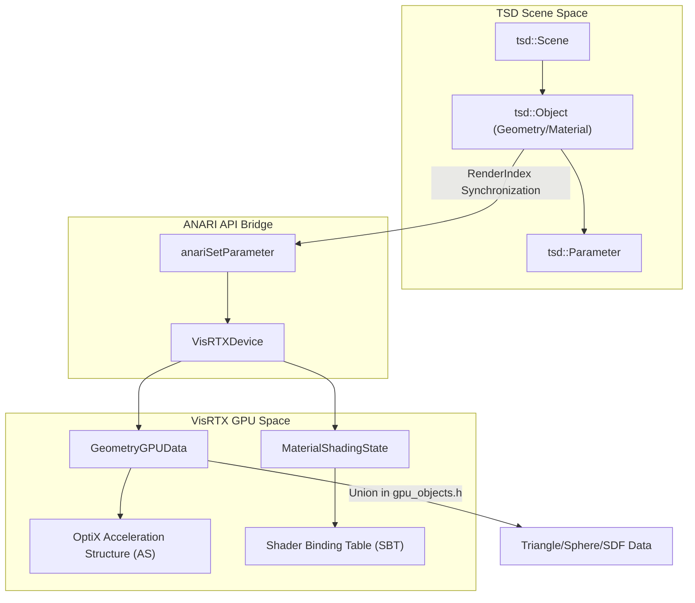
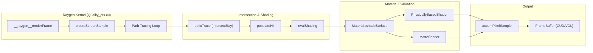

<!-- source: DeepWiki mcp.deepwiki.com · repo NVIDIA/VisRTX · page 11 Glossary · fetched 2026-10-26 -->

# Glossary

Relevant source files

The following files were used as context for generating this wiki page:

- [CMakeLists.txt](CMakeLists.txt)
- [README.md](README.md)
- [devices/rtx/CMakeLists.txt](devices/rtx/CMakeLists.txt)
- [devices/rtx/device/CMakeLists.txt](devices/rtx/device/CMakeLists.txt)
- [devices/rtx/device/VisRTXDevice.cpp](devices/rtx/device/VisRTXDevice.cpp)
- [devices/rtx/device/geometry/ComputeTangent.cu](devices/rtx/device/geometry/ComputeTangent.cu)
- [devices/rtx/device/gpu/gpu_math.h](devices/rtx/device/gpu/gpu_math.h)
- [devices/rtx/device/gpu/gpu_objects.h](devices/rtx/device/gpu/gpu_objects.h)
- [devices/rtx/device/gpu/gpu_util.h](devices/rtx/device/gpu/gpu_util.h)
- [devices/rtx/device/gpu/shadingState.h](devices/rtx/device/gpu/shadingState.h)
- [devices/rtx/device/gpu/uniformGrid.h](devices/rtx/device/gpu/uniformGrid.h)
- [devices/rtx/device/gpu/volumeIntegration.h](devices/rtx/device/gpu/volumeIntegration.h)
- [devices/rtx/device/material/shaders/MDLShader_ptx.cu](devices/rtx/device/material/shaders/MDLShader_ptx.cu)
- [devices/rtx/device/material/shaders/MatteShader_ptx.cu](devices/rtx/device/material/shaders/MatteShader_ptx.cu)
- [devices/rtx/device/material/shaders/PhysicallyBasedShader_ptx.cu](devices/rtx/device/material/shaders/PhysicallyBasedShader_ptx.cu)
- [devices/rtx/device/optix_visrtx.h](devices/rtx/device/optix_visrtx.h)
- [devices/rtx/device/renderer/Quality_ptx.cu](devices/rtx/device/renderer/Quality_ptx.cu)
- [devices/rtx/device/renderer/Renderer.cpp](devices/rtx/device/renderer/Renderer.cpp)
- [devices/rtx/device/renderer/Renderer.h](devices/rtx/device/renderer/Renderer.h)
- [devices/rtx/device/spatial_field/NvdbRectilinearField.cpp](devices/rtx/device/spatial_field/NvdbRectilinearField.cpp)
- [devices/rtx/device/spatial_field/NvdbRectilinearField.h](devices/rtx/device/spatial_field/NvdbRectilinearField.h)
- [devices/rtx/device/spatial_field/StructuredRectilinearField.cpp](devices/rtx/device/spatial_field/StructuredRectilinearField.cpp)
- [devices/rtx/device/spatial_field/space_skipping/UniformGrid.cu](devices/rtx/device/spatial_field/space_skipping/UniformGrid.cu)
- [devices/rtx/device/spatial_field/space_skipping/UniformGrid.h](devices/rtx/device/spatial_field/space_skipping/UniformGrid.h)
- [devices/rtx/device/spatial_field/space_skipping/UniformGridAccessors.h](devices/rtx/device/spatial_field/space_skipping/UniformGridAccessors.h)
- [devices/rtx/device/visrtx_device.json](devices/rtx/device/visrtx_device.json)
- [devices/rtx/device/volume/TransferFunction1D.cpp](devices/rtx/device/volume/TransferFunction1D.cpp)
- [tsd/CMakeLists.txt](tsd/CMakeLists.txt)
- [tsd/cmake/mark_cache_variables_as_advanced.cmake](tsd/cmake/mark_cache_variables_as_advanced.cmake)
- [tsd/external/CMakeLists.txt](tsd/external/CMakeLists.txt)
- [tsd/external/tsd_imguizmo/CMakeLists.txt](tsd/external/tsd_imguizmo/CMakeLists.txt)
- [tsd/external/tsd_imoguizmo/CMakeLists.txt](tsd/external/tsd_imoguizmo/CMakeLists.txt)
- [tsd/external/tsd_imoguizmo/imoguizmo.hpp](tsd/external/tsd_imoguizmo/imoguizmo.hpp)
- [tsd/external/tsd_lua/CMakeLists.txt](tsd/external/tsd_lua/CMakeLists.txt)
- [tsd/external/tsd_nanovdb/CMakeLists.txt](tsd/external/tsd_nanovdb/CMakeLists.txt)
- [tsd/external/tsd_sol2/CMakeLists.txt](tsd/external/tsd_sol2/CMakeLists.txt)
- [tsd/external/tsd_zlib/CMakeLists.txt](tsd/external/tsd_zlib/CMakeLists.txt)
- [tsd/src/tsd/CMakeLists.txt](tsd/src/tsd/CMakeLists.txt)
- [tsd/src/tsd/animation/Animation.cpp](tsd/src/tsd/animation/Animation.cpp)
- [tsd/src/tsd/animation/Animation.hpp](tsd/src/tsd/animation/Animation.hpp)
- [tsd/src/tsd/animation/CMakeLists.txt](tsd/src/tsd/animation/CMakeLists.txt)
- [tsd/src/tsd/core/ColorMapUtil.cpp](tsd/src/tsd/core/ColorMapUtil.cpp)
- [tsd/src/tsd/core/ColorMapUtil.hpp](tsd/src/tsd/core/ColorMapUtil.hpp)
- [tsd/src/tsd/core/DataStream.cpp](tsd/src/tsd/core/DataStream.cpp)
- [tsd/src/tsd/core/DataStream.hpp](tsd/src/tsd/core/DataStream.hpp)
- [tsd/src/tsd/core/DataTree.hpp](tsd/src/tsd/core/DataTree.hpp)
- [tsd/src/tsd/core/FlatMap.hpp](tsd/src/tsd/core/FlatMap.hpp)
- [tsd/src/tsd/core/TaskQueue.hpp](tsd/src/tsd/core/TaskQueue.hpp)
- [tsd/src/tsd/core/Timer.hpp](tsd/src/tsd/core/Timer.hpp)
- [tsd/src/tsd/core/Token.cpp](tsd/src/tsd/core/Token.cpp)
- [tsd/src/tsd/core/Token.hpp](tsd/src/tsd/core/Token.hpp)
- [tsd/src/tsd/core/TypeMacros.hpp](tsd/src/tsd/core/TypeMacros.hpp)
- [tsd/src/tsd/io/importers/detail/importer_common.cpp](tsd/src/tsd/io/importers/detail/importer_common.cpp)
- [tsd/src/tsd/io/importers/detail/importer_common.hpp](tsd/src/tsd/io/importers/detail/importer_common.hpp)
- [tsd/src/tsd/io/importers/import_ASSIMP.cpp](tsd/src/tsd/io/importers/import_ASSIMP.cpp)
- [tsd/src/tsd/io/importers/import_GLTF.cpp](tsd/src/tsd/io/importers/import_GLTF.cpp)
- [tsd/src/tsd/io/importers/import_NVDB.cpp](tsd/src/tsd/io/importers/import_NVDB.cpp)
- [tsd/src/tsd/io/importers/import_PDB.cpp](tsd/src/tsd/io/importers/import_PDB.cpp)
- [tsd/src/tsd/io/importers/import_PLY.cpp](tsd/src/tsd/io/importers/import_PLY.cpp)
- [tsd/src/tsd/io/importers/import_SWC.cpp](tsd/src/tsd/io/importers/import_SWC.cpp)
- [tsd/src/tsd/io/importers/import_USD.cpp](tsd/src/tsd/io/importers/import_USD.cpp)
- [tsd/src/tsd/io/serialization.hpp](tsd/src/tsd/io/serialization.hpp)
- [tsd/src/tsd/io/serialization/serialization_datatree.cpp](tsd/src/tsd/io/serialization/serialization_datatree.cpp)
- [tsd/src/tsd/rendering/index/RenderIndex.cpp](tsd/src/tsd/rendering/index/RenderIndex.cpp)
- [tsd/src/tsd/rendering/index/RenderIndex.hpp](tsd/src/tsd/rendering/index/RenderIndex.hpp)
- [tsd/src/tsd/rendering/index/RenderIndexAllLayers.cpp](tsd/src/tsd/rendering/index/RenderIndexAllLayers.cpp)
- [tsd/src/tsd/rendering/index/RenderIndexAllLayers.hpp](tsd/src/tsd/rendering/index/RenderIndexAllLayers.hpp)
- [tsd/src/tsd/rendering/index/RenderIndexFlatRegistry.cpp](tsd/src/tsd/rendering/index/RenderIndexFlatRegistry.cpp)
- [tsd/src/tsd/rendering/index/RenderIndexFlatRegistry.hpp](tsd/src/tsd/rendering/index/RenderIndexFlatRegistry.hpp)
- [tsd/src/tsd/rendering/index/RenderToAnariObjectsVisitor.hpp](tsd/src/tsd/rendering/index/RenderToAnariObjectsVisitor.hpp)
- [tsd/src/tsd/rendering/index/TransformsToAnariVisitor.hpp](tsd/src/tsd/rendering/index/TransformsToAnariVisitor.hpp)
- [tsd/src/tsd/scene/AnariHandleCache.hpp](tsd/src/tsd/scene/AnariHandleCache.hpp)
- [tsd/src/tsd/scene/Object.hpp](tsd/src/tsd/scene/Object.hpp)
- [tsd/src/tsd/scene/Parameter.hpp](tsd/src/tsd/scene/Parameter.hpp)
- [tsd/src/tsd/scene/Scene.cpp](tsd/src/tsd/scene/Scene.cpp)
- [tsd/src/tsd/scene/Scene.hpp](tsd/src/tsd/scene/Scene.hpp)
- [tsd/src/tsd/scene/UpdateDelegate.hpp](tsd/src/tsd/scene/UpdateDelegate.hpp)
- [tsd/src/tsd/scripting/bindings/ArrayHelpers.hpp](tsd/src/tsd/scripting/bindings/ArrayHelpers.hpp)
- [tsd/src/tsd/scripting/bindings/CoreBindings.cpp](tsd/src/tsd/scripting/bindings/CoreBindings.cpp)
- [tsd/src/tsd/scripting/bindings/ObjectBindings.cpp](tsd/src/tsd/scripting/bindings/ObjectBindings.cpp)
- [tsd/src/tsd/ui/imgui/windows/Timeline.cpp](tsd/src/tsd/ui/imgui/windows/Timeline.cpp)
- [tsd/tests/test_DataTree.cpp](tsd/tests/test_DataTree.cpp)
- [tsd/tests/test_Scene.cpp](tsd/tests/test_Scene.cpp)

This page provides a comprehensive glossary of codebase-specific terms, abbreviations, and domain concepts used across the VisRTX and TSD projects. It serves as a technical reference for implementation details, data flow, and key class relationships.

## 1. Core Architecture Concepts

### ANARI (Analytic Rendering Interface)
The industry standard API for scalable 3D data visualization. VisRTX implements this standard via the `VisRTXDevice` class [devices/rtx/device/VisRTXDevice.cpp](). The repository contains two primary implementations: the OptiX-based RTX device and the experimental OpenGL device.

### TSD (The Scientific Data)
A high-level C++ framework designed to simplify the development of scientific visualization applications. It acts as a bridge between raw data formats (USD, glTF, VTK) and ANARI devices. The framework is modularized into several libraries such as `tsd_core`, `tsd_scene`, and `tsd_rendering` [tsd/src/tsd/CMakeLists.txt:5-11]().

### DeviceGlobalState
A central structure in the VisRTX RTX device that holds GPU-side pointers, OptiX context handles, and the Shader Binding Table (SBT). It is passed to almost all device-side functions to provide access to world data and renderer parameters [devices/rtx/device/VisRTXDevice.cpp]().

---

## 2. Rendering & GPU Terms

### AOV (Arbitrary Output Variable)
Additional image channels produced during rendering beyond the final color. VisRTX supports several ANARI channels including `primitiveId`, `objectId`, and `instanceId` [devices/rtx/device/visrtx_device.json:17-19](). These are used in TSD for features like picking and pseudo-color visualization [tsd/src/tsd/rendering/index/RenderIndex.cpp]().

### Path Tracing (Quality Renderer)
The high-fidelity rendering mode implemented in `Quality_ptx.cu`. It uses a Monte Carlo approach with Russian Roulette termination to simulate light transport [devices/rtx/device/renderer/Quality_ptx.cu:102-127]().

### SBT (Shader Binding Table)
An OptiX-specific data structure that links geometry instances in the scene to specific GPU programs (Hit Groups). VisRTX constructs the SBT to map ANARI geometries (Triangle, Sphere, etc.) to their respective `__closesthit__` and `__anyhit__` kernels [devices/rtx/device/gpu/sbt.h]().

### ScreenSample
A per-pixel state structure used during the rendering loop. It carries the random number generator state (`RandState`), the current ray payload, and accumulation buffers [devices/rtx/device/renderer/Quality_ptx.cu:129-132]().

### ShadingState
A set of material-specific structures (e.g., `PhysicallyBasedShadingState`, `MatteShadingState`) that store evaluated material parameters like base color, roughness, and opacity for a specific hit point [devices/rtx/device/material/shaders/PhysicallyBasedShader_ptx.cu:76-80]().

### System Flow: Scene to GPU Data
The following diagram illustrates how high-level TSD Scene objects are transformed into GPU-ready data structures within the VisRTX RTX device.

**Diagram: Scene Data Transformation**

Sources: [tsd/src/tsd/scene/Scene.hpp](), [devices/rtx/device/VisRTXDevice.cpp](), [devices/rtx/device/gpu/gpu_objects.h:263-282]()

---

## 3. TSD Framework Entities

### Any / AnyArray
A type-safe container for ANARI-compatible data types. It allows TSD to store and pass parameters of varying types (floats, vectors, strings) without losing type information [tsd/src/tsd/core/DataTree.hpp]().

### DataTree / DataNode
The hierarchical serialization format used by TSD. It supports binary and JSON representations and is the primary format for `.tsd` state files. A `DataNode` can hold a value or children nodes [tsd/src/tsd/core/DataTree.hpp]().

### Forest
A specialized container in `tsd_core` used for representing hierarchical relationships, such as the scene graph layers [tsd/src/tsd/scene/Scene.hpp]().

### RenderIndex
A key component in `tsd_rendering` that maintains a mapping between TSD `Scene` objects and ANARI handles. It ensures that changes in the TSD scene are efficiently pushed to the ANARI device [tsd/src/tsd/rendering/index/RenderIndex.hpp]().

### UpdateDelegate
An observer pattern implementation used to track changes to TSD objects. When a parameter is modified, the `UpdateDelegate` notifies the `RenderIndex` to perform an `anariSetParameter` call [tsd/src/tsd/rendering/index/RenderIndex.cpp]().

---

## 4. Material & Geometry Models

### MDL (Material Definition Language)
An NVIDIA-developed language for defining physically based materials. VisRTX supports MDL through a dedicated backend that compiles MDL expressions into OptiX-callable programs [devices/rtx/device/material/shaders/MDLShader_ptx.cu]().

### SDF (Signed Distance Fields)
A geometry type where surfaces are defined by a distance function rather than explicit mesh topology. VisRTX supports various SDF primitives (Sphere, Pill, Torus) and uses sphere-tracing for intersection [devices/rtx/device/gpu/gpu_objects.h:137-148]().

### Space-Skipping (UniformGrid)
An optimization for volume rendering. A `UniformGrid` is built over spatial fields to quickly skip empty regions of the volume during ray marching [devices/rtx/device/spatial_field/space_skipping/UniformGrid.h]().

### System Flow: Rendering Pipeline
The diagram below shows the flow from the ray generation kernel to the final pixel accumulation.

**Diagram: Ray Generation to Pixel Accumulation**

Sources: [devices/rtx/device/renderer/Quality_ptx.cu:83-91](), [devices/rtx/device/gpu/gpu_util.h:150-186](), [devices/rtx/device/material/shaders/PhysicallyBasedShader_ptx.cu]()

---

## 5. Abbreviations Table

| Abbreviation | Full Term | Context | Code Pointer |
| :--- | :--- | :--- | :--- |
| **AS** | Acceleration Structure | OptiX geometry organization | [devices/rtx/device/VisRTXDevice.cpp]() |
| **MIS** | Multiple Importance Sampling | Combining light and BRDF sampling | [devices/rtx/device/renderer/Quality_ptx.cu:147-149]() |
| **PRD** | Per-Ray Data | Payload carried by rays in OptiX | [devices/rtx/device/gpu/gpu_util.h:166-184]() |
| **RR** | Russian Roulette | Probabilistic path termination | [devices/rtx/device/renderer/Quality_ptx.cu:102-127]() |
| **SBT** | Shader Binding Table | Mapping geometry to programs | [devices/rtx/device/gpu/sbt.h]() |
| **TSD** | The Scientific Data | Framework for scientific viz | [tsd/src/tsd/CMakeLists.txt]() |
| **VNDF** | Visible Normal Distribution Function | Advanced GGX sampling technique | [devices/rtx/device/material/shaders/PhysicallyBasedShader_ptx.cu:130-147]() |

Sources: [devices/rtx/device/renderer/Quality_ptx.cu](), [devices/rtx/device/gpu/gpu_util.h](), [tsd/src/tsd/CMakeLists.txt]()