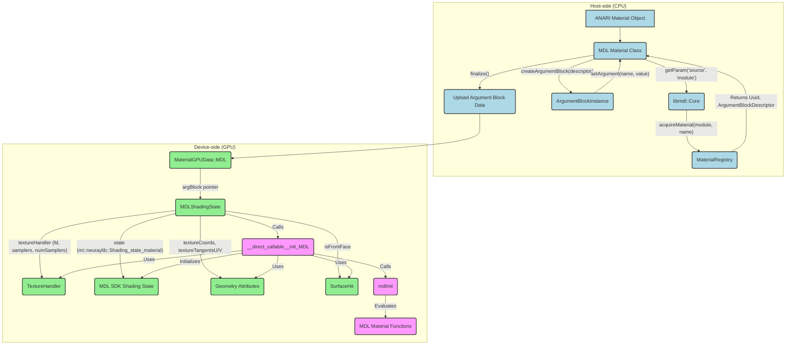

<!-- source: DeepWiki mcp.deepwiki.com · repo NVIDIA/VisRTX · page 2.3 Material System · fetched 2026-10-26 -->

# Material System

<details>
<summary>Relevant source files</summary>

The following files were used as context for generating this wiki page:

- [devices/rtx/device/gpu/evalMaterialParameters.h](devices/rtx/device/gpu/evalMaterialParameters.h)
- [devices/rtx/device/gpu/gpu_decl.h](devices/rtx/device/gpu/gpu_decl.h)
- [devices/rtx/device/gpu/gpu_math.h](devices/rtx/device/gpu/gpu_math.h)
- [devices/rtx/device/gpu/gpu_util.h](devices/rtx/device/gpu/gpu_util.h)
- [devices/rtx/device/gpu/shadingState.h](devices/rtx/device/gpu/shadingState.h)
- [devices/rtx/device/gpu/shading_api.h](devices/rtx/device/gpu/shading_api.h)
- [devices/rtx/device/material/MDL.cpp](devices/rtx/device/material/MDL.cpp)
- [devices/rtx/device/material/MDL.h](devices/rtx/device/material/MDL.h)
- [devices/rtx/device/material/Material.h](devices/rtx/device/material/Material.h)
- [devices/rtx/device/material/Matte.cpp](devices/rtx/device/material/Matte.cpp)
- [devices/rtx/device/material/Matte.h](devices/rtx/device/material/Matte.h)
- [devices/rtx/device/material/PBR.cpp](devices/rtx/device/material/PBR.cpp)
- [devices/rtx/device/material/PBR.h](devices/rtx/device/material/PBR.h)
- [devices/rtx/device/material/shaders/MDLShader_ptx.cu](devices/rtx/device/material/shaders/MDLShader_ptx.cu)
- [devices/rtx/device/material/shaders/MatteShader_ptx.cu](devices/rtx/device/material/shaders/MatteShader_ptx.cu)
- [devices/rtx/device/material/shaders/PhysicallyBasedShader_ptx.cu](devices/rtx/device/material/shaders/PhysicallyBasedShader_ptx.cu)
- [devices/rtx/device/renderer/Quality_ptx.cu](devices/rtx/device/renderer/Quality_ptx.cu)
- [devices/rtx/libmdl/Core.cpp](devices/rtx/libmdl/Core.cpp)
- [devices/rtx/libmdl/Core.h](devices/rtx/libmdl/Core.h)
- [devices/rtx/libmdl/MDLBackendConfig.h](devices/rtx/libmdl/MDLBackendConfig.h)
- [devices/rtx/libmdl/types.h](devices/rtx/libmdl/types.h)
- [tsd/scripts/init.lua](tsd/scripts/init.lua)
- [tsd/src/tsd/core/CMakeLists.txt](tsd/src/tsd/core/CMakeLists.txt)
- [tsd/src/tsd/ui/imgui/ExtensionManager.cpp](tsd/src/tsd/ui/imgui/ExtensionManager.cpp)
- [tsd/src/tsd/ui/imgui/ExtensionManager.h](tsd/src/tsd/ui/imgui/ExtensionManager.h)

</details>


The VisRTX material system defines how surfaces interact with light, determining their visual appearance. It supports three primary material models: Matte, Physically Based Rendering (PBR), and Material Definition Language (MDL). This page details these models, the underlying GPU-side `ShadingState` structures, the direct-callable interface for material evaluation, the MDL backend, and helper functions for parameter evaluation.

## Material Models

VisRTX implements three distinct material models, each with its own set of properties and shading characteristics.

### Matte Material

The Matte material model represents a perfectly diffuse surface, scattering light equally in all directions. It is characterized by a `baseColor` and `opacity`.

**GPU-side Structure:**
The `MatteShadingState` struct [devices/rtx/device/gpu/shadingState.h:68-73]() holds the necessary parameters for Matte materials on the GPU:
```c++
struct MatteShadingState
{
  vec3 baseColor;
  vec3 normal;
  float opacity;
};
```
- `baseColor`: The diffuse color of the material.
- `normal`: The surface normal at the hit point.
- `opacity`: The transparency of the material.

**Implementation:**
The `Matte` class [devices/rtx/device/material/Matte.h]() in the host-side code manages the parameters for Matte materials. Its `commitParameters()` method processes ANARI parameters like `baseColor`, `opacity`, `alphaMode`, and `alphaCutoff`. The `gpuData()` method [devices/rtx/device/material/Matte.cpp:50-60]() then populates the `MaterialGPUData` structure for transfer to the device.

The device-side shading logic for Matte materials is found in `MatteShader_ptx.cu` [devices/rtx/device/material/shaders/MatteShader_ptx.cu]().

Sources:
* [devices/rtx/device/gpu/shadingState.h:68-73]()
* [devices/rtx/device/material/Matte.h]()
* [devices/rtx/device/material/Matte.cpp:50-60]()
* [devices/rtx/device/material/shaders/MatteShader_ptx.cu]()

### Physically Based (PBR) Material

The Physically Based material model provides a more realistic representation of surfaces by adhering to physical laws of light interaction. It supports a wide range of material properties, including metallic, roughness, transmission, and various advanced effects like clearcoat, sheen, and iridescence.

**GPU-side Structure:**
The `PhysicallyBasedShadingState` struct [devices/rtx/device/gpu/shadingState.h:76-105]() contains the extensive set of parameters for PBR materials:
```c++
struct PhysicallyBasedShadingState
{
  vec3 baseColor;
  vec3 normal;
  float opacity;
  float metallic;
  float roughness;
  float transmission;
  float eta; // Refraction ratio n1/n2
  vec3 emission;
  float occlusion;
  float specular;
  vec3 specularColor;
  uint32_t useSpecular;
  float clearcoat;
  float clearcoatRoughness;
  vec3 clearcoatNormal;
  float thickness;
  float attenuationDistance;
  vec3 attenuationColor;
  vec3 sheenColor;
  float sheenRoughness;
  float iridescence;
  float iridescenceIor;
  float iridescenceThickness;
};
```
These parameters control properties such as:
- `baseColor`: The primary color of the surface.
- `metallic`: How metallic the surface is (0.0 for dielectric, 1.0 for metallic).
- `roughness`: The microsurface roughness, affecting specular reflection.
- `transmission`: How much light passes through the surface.
- `eta`: Index of refraction.
- `emission`: Emitted light from the surface.
- `clearcoat`, `sheen`, `iridescence`: Parameters for advanced layered material effects.

**Implementation:**
The `PBR` class [devices/rtx/device/material/PBR.h]() handles the host-side management of PBR material parameters. Its `commitParameters()` method [devices/rtx/device/material/PBR.cpp:60-148]() retrieves various ANARI parameters, including `baseColor`, `opacity`, `metallic`, `roughness`, `normal`, `emissive`, `occlusion`, `specular`, `specularColor`, `clearcoat`, `clearcoatRoughness`, `clearcoatNormal`, `transmission`, `ior`, `thickness`, `attenuationDistance`, `attenuationColor`, `sheenColor`, `sheenRoughness`, `iridescence`, `iridescenceIor`, `iridescenceThickness`, `alphaCutoff`, and `alphaMode`.

The `gpuData()` method [devices/rtx/device/material/PBR.cpp:150-184]() then populates the `MaterialGPUData` structure, including sampler indices for texture-based parameters.

The device-side shading logic for PBR materials is implemented in `PhysicallyBasedShader_ptx.cu` [devices/rtx/device/material/shaders/PhysicallyBasedShader_ptx.cu](). This shader includes helper functions for applying normal maps (`applyNormalMap`, `sampleNormalMap`), computing volume transmission (`computeVolumeTransmission`, `computeTransmissionFilter`), and various microfacet BRDF terms like `smithLambdaGGX`, `smithG2GGX`, `smithG1GGX`, `ggxD`, `sampleGGXVNDF`, `charlieD`, `charlieV`, and thin-film Fresnel calculations (`fresnel0ToIor`, `iorToFresnel0`).

Sources:
* [devices/rtx/device/gpu/shadingState.h:76-105]()
* [devices/rtx/device/material/PBR.h]()
* [devices/rtx/device/material/PBR.cpp:60-148]()
* [devices/rtx/device/material/PBR.cpp:150-184]()
* [devices/rtx/device/material/shaders/PhysicallyBasedShader_ptx.cu]()

### Material Definition Language (MDL)

The MDL material model allows for complex, physically accurate materials defined using NVIDIA's Material Definition Language. This provides a highly flexible and extensible way to describe material properties.

**GPU-side Structure:**
The `MDLShadingState` struct [devices/rtx/device/gpu/shadingState.h:122-140]() is used for MDL materials on the GPU:
```c++
struct alignas(8) MDLShadingState
{
  const char *argBlock;
  ShadingStateMaterial state;
  TextureHandler textureHandler;
  ResourceData resData;
  glm::vec4 textureResults[libmdl::kNumTextureResults];
  glm::vec3 textureCoords[libmdl::kNumTextureSpaces];
  glm::vec3 textureTangentsU[libmdl::kNumTextureSpaces];
  glm::vec3 textureTangentsV[libmdl::kNumTextureSpaces];
  bool isFrontFace;
};
```
- `argBlock`: Pointer to the argument block containing material parameters.
- `state`: An `mi::neuraylib::Shading_state_material` object, which is the core MDL shading state.
- `textureHandler`: A `TextureHandler` struct [devices/rtx/device/gpu/shadingState.h:113-117]() that provides access to textures and samplers.
- `resData`: An `mi::neuraylib::Resource_data` object, used by MDL for resource management.
- `textureResults`, `textureCoords`, `textureTangentsU`, `textureTangentsV`: Arrays for texture data and tangent frames, sized according to `libmdl::kNumTextureResults` and `libmdl::kNumTextureSpaces` [devices/rtx/libmdl/MDLBackendConfig.h]().
- `isFrontFace`: Boolean indicating if the hit is on the front face of the geometry.

**Implementation:**
The `MDL` class [devices/rtx/device/material/MDL.h]() manages MDL materials on the host. Its `commitParameters()` method [devices/rtx/device/material/MDL.cpp:90-94]() stores parameters, and `finalize()` [devices/rtx/device/material/MDL.cpp:99-112]() synchronizes the material source and parameters.

The `syncSource()` method [devices/rtx/device/material/MDL.cpp:114-182]() handles loading MDL modules and materials. It uses `libmdl::parseMaterialSourceName` [devices/rtx/libmdl/helpers.h]() to extract module and material names, then `materialRegistry.acquireMaterial` [devices/rtx/device/mdl/MaterialRegistry.h]() to obtain a `libmdl::Uuid` and `libmdl::ArgumentBlockDescriptor`. If successful, it releases any previous material and creates a new `libmdl::ArgumentBlockInstance`. It also acquires samplers for textures defined in the MDL material.

The `syncParameters()` method [devices/rtx/device/material/MDL.cpp:184-210]() updates the `ArgumentBlockInstance` with values from ANARI parameters.

The device-side shading logic for MDL materials is in `MDLShader_ptx.cu` [devices/rtx/device/material/shaders/MDLShader_ptx.cu](). This file defines the direct-callable functions for MDL materials, including `mdlInit`, `mdlBsdf_sample`, `mdlBsdf_evaluate`, `mdlBsdf_pdf`, `mdl_isThinWalled`, `mdlTint`, `mdlOpacity`, `mdlTransmission`, `mdlEmission_evaluate`, and `mdlEmissionIntensity`.

Sources:
* [devices/rtx/device/gpu/shadingState.h:122-140]()
* [devices/rtx/device/gpu/shadingState.h:113-117]()
* [devices/rtx/libmdl/MDLBackendConfig.h]()
* [devices/rtx/device/material/MDL.h]()
* [devices/rtx/device/material/MDL.cpp:90-94]()
* [devices/rtx/device/material/MDL.cpp:99-112]()
* [devices/rtx/device/material/MDL.cpp:114-182]()
* [devices/rtx/libmdl/helpers.h]()
* [devices/rtx/device/mdl/MaterialRegistry.h]()
* [devices/rtx/device/material/MDL.cpp:184-210]()
* [devices/rtx/device/material/shaders/MDLShader_ptx.cu]()

## ShadingState Structs

The `MaterialShadingState` union [devices/rtx/device/gpu/shadingState.h:142-156]() is a central component, allowing the GPU to store and access the specific shading state for any of the supported material types.

```c++
struct MaterialShadingState
{
  unsigned int callableBaseIndex{~0u};

  union
  {
    MatteShadingState matte;
    PhysicallyBasedShadingState physicallyBased;
#ifdef USE_MDL
    MDLShadingState mdl;
#endif
  } data;

  VISRTX_DEVICE MaterialShadingState() = default;
};
```
- `callableBaseIndex`: An index used to dispatch to the correct direct-callable functions for the material type. This is set to `SbtCallableEntryPoints::MATTE`, `SbtCallableEntryPoints::PBR`, or `SbtCallableEntryPoints::MDL` [devices/rtx/device/gpu/sbt.h]().
- `data`: A union holding the specific shading state struct (`MatteShadingState`, `PhysicallyBasedShadingState`, or `MDLShadingState`) for the active material.

Sources:
* [devices/rtx/device/gpu/shadingState.h:142-156]()
* [devices/rtx/device/gpu/sbt.h]()

## Direct-Callable Material Interface

Materials in VisRTX expose a set of direct-callable functions on the GPU, allowing the ray tracing pipeline to interact with them uniformly regardless of their underlying model. These functions are defined with the `VISRTX_CALLABLE` macro [devices/rtx/device/gpu/gpu_decl.h]() and are invoked via OptiX direct callables.

The core functions are:
- `__direct_callable__init`: Initializes the material's shading state at a given hit point.
  - For Matte: `__direct_callable__init(MatteShadingState *shadingState, const FrameGPUData *fd, const SurfaceHit *hit, const MaterialGPUData::Matte *md)` [devices/rtx/device/material/shaders/MatteShader_ptx.cu:39-57]()
  - For PBR: `__direct_callable__init(PhysicallyBasedShadingState *shadingState, const FrameGPUData *fd, const SurfaceHit *hit, const MaterialGPUData::PhysicallyBased *md)` [devices/rtx/device/material/shaders/PhysicallyBasedShader_ptx.cu:300-330]()
  - For MDL: `__direct_callable__init(MDLShadingState *shadingState, const FrameGPUData *fd, const SurfaceHit *hit, const MaterialGPUData::MDL *md)` [devices/rtx/device/material/shaders/MDLShader_ptx.cu:83-154]()
- `evaluateTint`: Returns the base color or tint of the material.
  - For Matte: `__direct_callable__evaluateTint(const MatteShadingState *shadingState)` [devices/rtx/device/material/shaders/MatteShader_ptx.cu:66-69]()
  - For PBR: `__direct_callable__evaluateTint(const PhysicallyBasedShadingState *shadingState)` [devices/rtx/device/material/shaders/PhysicallyBasedShader_ptx.cu:332-335]()
  - For MDL: `__direct_callable__evaluateTint(const MDLShadingState *shadingState)` [devices/rtx/device/material/shaders/MDLShader_ptx.cu:200-203]()
- `evaluateOpacity`: Returns the opacity of the material.
  - For Matte: `__direct_callable__evaluateOpacity(const MatteShadingState *shadingState)` [devices/rtx/device/material/shaders/MatteShader_ptx.cu:72-75]()
  - For PBR: `__direct_callable__evaluateOpacity(const PhysicallyBasedShadingState *shadingState)` [devices/rtx/device/material/shaders/PhysicallyBasedShader_ptx.cu:338-341]()
  - For MDL: `__direct_callable__evaluateOpacity(const MDLShadingState *shadingState)` [devices/rtx/device/material/shaders/MDLShader_ptx.cu:206-209]()
- `evaluateEmission`: Returns the emitted light from the material.
  - For Matte: `__direct_callable__evaluateEmission(const MatteShadingState *shadingState, const vec3 *outgoingDir)` [devices/rtx/device/material/shaders/MatteShader_ptx.cu:78-82]()
  - For PBR: `__direct_callable__evaluateEmission(const PhysicallyBasedShadingState *shadingState, const vec3 *outgoingDir)` [devices/rtx/device/material/shaders/PhysicallyBasedShader_ptx.cu:344-347]()
  - For MDL: `__direct_callable__evaluateEmission(const MDLShadingState *shadingState, const vec3 *outgoingDir)` [devices/rtx/device/material/shaders/MDLShader_ptx.cu:212-215]()
- `shadeSurface`: Calculates the surface shading for a given light sample.
  - For Matte: `__direct_callable__shadeSurface(const MatteShadingState *shadingState, const SurfaceHit *hit, const LightSample *lightSample, const vec3 *outgoingDir)` [devices/rtx/device/material/shaders/MatteShader_ptx.cu:98-107]()
  - For PBR: `__direct_callable__shadeSurface(const PhysicallyBasedShadingState *shadingState, const SurfaceHit *hit, const LightSample *lightSample, const vec3 *outgoingDir)` [devices/rtx/device/material/shaders/PhysicallyBasedShader_ptx.cu:350-359]()
  - For MDL: `__direct_callable__shadeSurface(const MDLShadingState *shadingState, const SurfaceHit *hit, const LightSample *lightSample, const vec3 *outgoingDir)` [devices/rtx/device/material/shaders/MDLShader_ptx.cu:158-176]()
- `nextRay`: Determines the direction and contribution weight of the next ray to be traced from the surface.
  - For Matte: `__direct_callable__nextRay(const MatteShadingState *, const Ray *, RandState *)` [devices/rtx/device/material/shaders/MatteShader_ptx.cu:59-62]()
  - For PBR: `__direct_callable__nextRay(const PhysicallyBasedShadingState *shadingState, const Ray *ray, RandState *rs)` [devices/rtx/device/material/shaders/PhysicallyBasedShader_ptx.cu:362-400]()
  - For MDL: `__direct_callable__nextRay(const MDLShadingState *shadingState, const Ray *ray, RandState *rs)` [devices/rtx/device/material/shaders/MDLShader_ptx.cu:179-197]()

The `NextRay` struct [devices/rtx/device/gpu/shadingState.h:59-64]() describes the result of `nextRay` calls:
```c++
struct NextRay
{
  vec3 direction;
  vec3 contributionWeight;
  uint32_t flags{NEXT_RAY_NONE};
};
```
- `direction`: The direction of the new ray.
- `contributionWeight`: The color contribution of the new ray.
- `flags`: Additional flags, e.g., `NEXT_RAY_CONTINUES_THROUGH_SURFACE` [devices/rtx/device/gpu/shadingState.h:54-57]() if the ray passes through the material.

**Diagram: Material Direct-Callable Interface**

```mermaid
graph TD
    subgraph "OptiX Ray Tracing Pipeline"
        A[Ray Hit Surface] --> B{Material Type?};
    end

    subgraph "Material Direct-Callable Interface"
        B -- "Matte" --> C1(__direct_callable__init_Matte);
        B -- "PBR" --> C2(__direct_callable__init_PBR);
        B -- "MDL" --> C3(__direct_callable__init_MDL);

        C1 --> D1(MatteShadingState);
        C2 --> D2(PhysicallyBasedShadingState);
        C3 --> D3(MDLShadingState);

        D1 -- "Evaluate" --> E1(__direct_callable__evaluateTint_Matte);
        D1 -- "Evaluate" --> E2(__direct_callable__evaluateOpacity_Matte);
        D1 -- "Evaluate" --> E3(__direct_callable__evaluateEmission_Matte);
        D1 -- "Shade" --> E4(__direct_callable__shadeSurface_Matte);
        D1 -- "Next Ray" --> E5(__direct_callable__nextRay_Matte);

        D2 -- "Evaluate" --> F1(__direct_callable__evaluateTint_PBR);
        D2 -- "Evaluate" --> F2(__direct_callable__evaluateOpacity_PBR);
        D2 -- "Evaluate" --> F3(__direct_callable__evaluateEmission_PBR);
        D2 -- "Shade" --> F4(__direct_callable__shadeSurface_PBR);
        D2 -- "Next Ray" --> F5(__direct_callable__nextRay_PBR);

        D3 -- "Evaluate" --> G1(__direct_callable__evaluateTint_MDL);
        D3 -- "Evaluate" --> G2(__direct_callable__evaluateOpacity_MDL);
        D3 -- "Evaluate" --> G3(__direct_callable__evaluateEmission_MDL);
        D3 -- "Shade" --> G4(__direct_callable__shadeSurface_MDL);
        D3 -- "Next Ray" --> G5(__direct_callable__nextRay_MDL);
    end

    E5 --> H(NextRay);
    F5 --> H;
    G5 --> H;
    H --> I[Continue Ray Tracing];

    style C1 fill:#f9f,stroke:#333,stroke-width:2px
    style C2 fill:#f9f,stroke:#333,stroke-width:2px
    style C3 fill:#f9f,stroke:#333,stroke-width:2px
    style E1 fill:#f9f,stroke:#333,stroke-width:2px
    style E2 fill:#f9f,stroke:#333,stroke-width:2px
    style E3 fill:#f9f,stroke:#333,stroke-width:2px
    style E4 fill:#f9f,stroke:#333,stroke-width:2px
    style E5 fill:#f9f,stroke:#333,stroke-width:2px
    style F1 fill:#f9f,stroke:#333,stroke-width:2px
    style F2 fill:#f9f,stroke:#333,stroke-width:2px
    style F3 fill:#f9f,stroke:#333,stroke-width:2px
    style F4 fill:#f9f,stroke:#333,stroke-width:2px
    style F5 fill:#f9f,stroke:#333,stroke-width:2px
    style G1 fill:#f9f,stroke:#333,stroke-width:2px
    style G2 fill:#f9f,stroke:#333,stroke-width:2px
    style G3 fill:#f9f,stroke:#333,stroke-width:2px
    style G4 fill:#f9f,stroke:#333,stroke-width:2px
    style G5 fill:#f9f,stroke:#333,stroke-width:2px
```


Sources:
* [devices/rtx/device/gpu/gpu_decl.h]()
* [devices/rtx/device/material/shaders/MatteShader_ptx.cu:39-57]()
* [devices/rtx/device/material/shaders/PhysicallyBasedShader_ptx.cu:300-330]()
* [devices/rtx/device/material/shaders/MDLShader_ptx.cu:83-154]()
* [devices/rtx/device/material/shaders/MatteShader_ptx.cu:66-69]()
* [devices/rtx/device/material/shaders/PhysicallyBasedShader_ptx.cu:332-335]()
* [devices/rtx/device/material/shaders/MDLShader_ptx.cu:200-203]()
* [devices/rtx/device/material/shaders/MatteShader_ptx.cu:72-75]()
* [devices/rtx/device/material/shaders/PhysicallyBasedShader_ptx.cu:338-341]()
* [devices/rtx/device/material/shaders/MDLShader_ptx.cu:206-209]()
* [devices/rtx/device/material/shaders/MatteShader_ptx.cu:78-82]()
* [devices/rtx/device/material/shaders/PhysicallyBasedShader_ptx.cu:344-347]()
* [devices/rtx/device/material/shaders/MDLShader_ptx.cu:212-215]()
* [devices/rtx/device/material/shaders/MatteShader_ptx.cu:98-107]()
* [devices/rtx/device/material/shaders/PhysicallyBasedShader_ptx.cu:350-359]()
* [devices/rtx/device/material/shaders/MDLShader_ptx.cu:158-176]()
* [devices/rtx/device/material/shaders/MatteShader_ptx.cu:59-62]()
* [devices/rtx/device/material/shaders/PhysicallyBasedShader_ptx.cu:362-400]()
* [devices/rtx/device/material/shaders/MDLShader_ptx.cu:179-197]()
* [devices/rtx/device/gpu/shadingState.h:59-64]()
* [devices/rtx/device/gpu/shadingState.h:54-57]()

## MDL Backend

The MDL backend in VisRTX leverages the NVIDIA MDL SDK to compile and execute MDL materials on the GPU.

**`libmdl::Core`:**
The `libmdl::Core` class [devices/rtx/libmdl/Core.h]() is the primary interface to the MDL SDK. It handles:
- Loading the `libmdl_sdk` library [devices/rtx/libmdl/Core.cpp:85-104]().
- Initializing the `mi::neuraylib::INeuray` instance [devices/rtx/libmdl/Core.cpp:107-124]().
- Configuring MDL system and user paths [devices/rtx/libmdl/Core.cpp:128-131]().
- Loading necessary plugins like `nv_openimageio` and `dds` [devices/rtx/libmdl/Core.cpp:145-156]().
- Managing the global scope and execution context [devices/rtx/libmdl/Core.cpp:169-194]().

**`ArgumentBlockDescriptor`:**
The `libmdl::ArgumentBlockDescriptor` [devices/rtx/libmdl/ArgumentBlockDescriptor.h]() describes the parameters of an MDL material. It is used by the `MaterialRegistry` to compile and manage MDL materials. When a material is acquired, an `ArgumentBlockDescriptor` is returned, which is then used to create an `ArgumentBlockInstance` [devices/rtx/libmdl/ArgumentBlockInstance.h]() for a specific material instance.

**Diagram: MDL Material Data Flow**


Sources:
* [devices/rtx/libmdl/Core.h]()
* [devices/rtx/libmdl/Core.cpp:85-104]()
* [devices/rtx/libmdl/Core.cpp:107-124]()
* [devices/rtx/libmdl/Core.cpp:128-131]()
* [devices/rtx/libmdl/Core.cpp:145-156]()
* [devices/rtx/libmdl/Core.cpp:169-194]()
* [devices/rtx/libmdl/ArgumentBlockDescriptor.h]()
* [devices/rtx/libmdl/ArgumentBlockInstance.h]()

## `evalMaterialParameters` Helper

The `evalMaterialParameters` helper function (defined in `gpu/evalMaterialParameters.h` [devices/rtx/device/gpu/evalMaterialParameters.h]()) is a utility used on the GPU to evaluate material parameters, which can be either a constant value or sampled from a texture.

```c++
template <typename T>
VISRTX_DEVICE T getMaterialParameter(
    const FrameGPUData &fd, const MaterialParameter<T> &param, const SurfaceHit &hit)
{
  if (param.samplerIdx != ~visrtx::DeviceObjectIndex{0}) {
    return evaluateSampler(fd, param.samplerIdx, hit);
  } else if (param.attribute != MaterialAttribute::NONE) {
    return readAttributeValue(param.attribute, hit);
  }
  return param.value;
}
```
This function takes a `MaterialParameter` struct (which encapsulates a value, a sampler index, and an attribute) and a `SurfaceHit`. It checks:
1. If a sampler is provided (`param.samplerIdx != ~visrtx::DeviceObjectIndex{0}`), it calls `evaluateSampler` [devices/rtx/device/gpu/shading_api.h]() to get the value from the texture.
2. If an attribute is specified (`param.attribute != MaterialAttribute::NONE`), it calls `readAttributeValue` [devices/rtx/device/gpu/shading_api.h]() to get the value from the geometry attributes.
3. Otherwise, it returns the constant `param.value`.

This mechanism allows materials to dynamically fetch properties from textures or geometry attributes, enabling complex and varied appearances.

Sources:
* [devices/rtx/device/gpu/evalMaterialParameters.h]()
* [devices/rtx/device/gpu/shading_api.h]()

---

