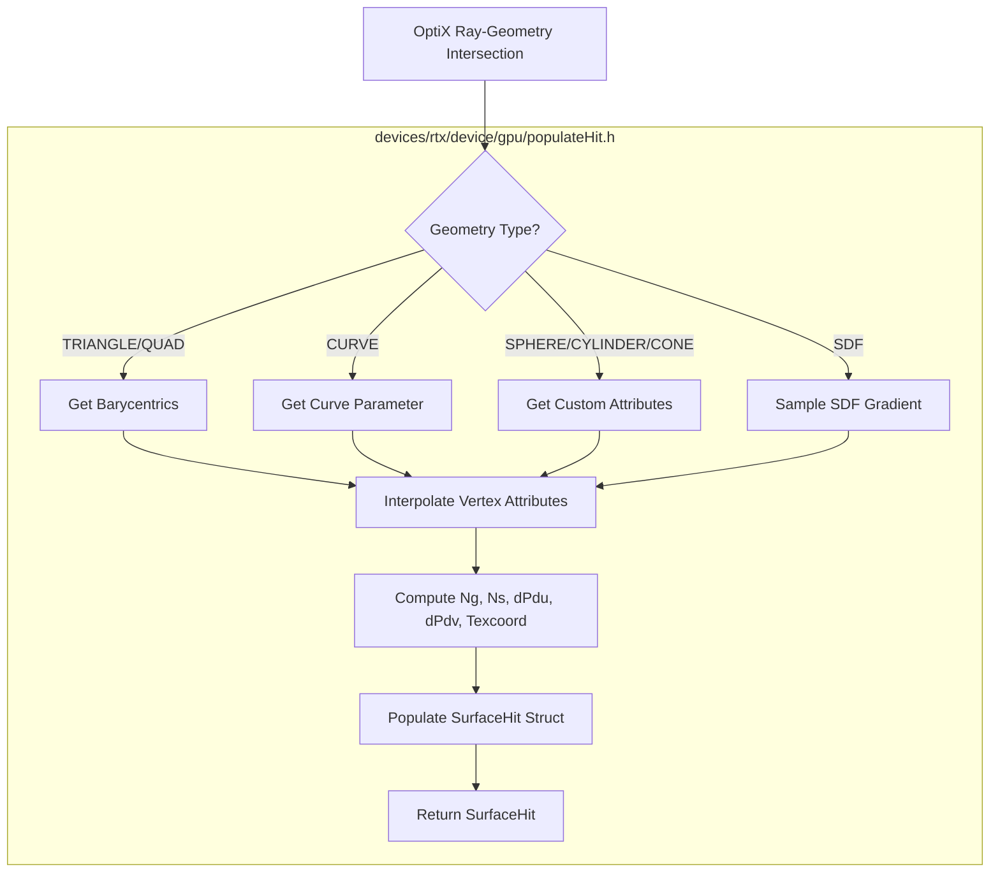

<!-- source: DeepWiki mcp.deepwiki.com · repo NVIDIA/VisRTX · page 2.4 Geometry, Spatial Fields & Volume Rendering · fetched 2026-10-26 -->

# Geometry, Spatial Fields & Volume Rendering

<details>
<summary>Relevant source files</summary>

The following files were used as context for generating this wiki page:

- [devices/rtx/README.md](devices/rtx/README.md)
- [devices/rtx/device/geometry/Geometry.cpp](devices/rtx/device/geometry/Geometry.cpp)
- [devices/rtx/device/geometry/Intersectors_ptx.cu](devices/rtx/device/geometry/Intersectors_ptx.cu)
- [devices/rtx/device/geometry/SDF.cpp](devices/rtx/device/geometry/SDF.cpp)
- [devices/rtx/device/geometry/SDF.h](devices/rtx/device/geometry/SDF.h)
- [devices/rtx/device/gpu/gpu_sdf.h](devices/rtx/device/gpu/gpu_sdf.h)
- [devices/rtx/device/gpu/intersectRay.h](devices/rtx/device/gpu/intersectRay.h)
- [devices/rtx/device/gpu/populateHit.h](devices/rtx/device/gpu/populateHit.h)
- [devices/rtx/device/gpu/sbt.h](devices/rtx/device/gpu/sbt.h)
- [devices/rtx/device/gpu/uniformGrid.h](devices/rtx/device/gpu/uniformGrid.h)
- [devices/rtx/device/gpu/volumeIntegration.h](devices/rtx/device/gpu/volumeIntegration.h)
- [devices/rtx/device/include/anari/ext/visrtx/visrtx_extensions.h](devices/rtx/device/include/anari/ext/visrtx/visrtx_extensions.h)
- [devices/rtx/device/spatial_field/CustomFieldSampler_ptx.cu](devices/rtx/device/spatial_field/CustomFieldSampler_ptx.cu)
- [devices/rtx/device/spatial_field/NvdbRectilinearField.cpp](devices/rtx/device/spatial_field/NvdbRectilinearField.cpp)
- [devices/rtx/device/spatial_field/NvdbRectilinearField.h](devices/rtx/device/spatial_field/NvdbRectilinearField.h)
- [devices/rtx/device/spatial_field/NvdbRectilinearSamplerInline.h](devices/rtx/device/spatial_field/NvdbRectilinearSamplerInline.h)
- [devices/rtx/device/spatial_field/NvdbRectilinearSampler_ptx.cu](devices/rtx/device/spatial_field/NvdbRectilinearSampler_ptx.cu)
- [devices/rtx/device/spatial_field/NvdbRegularField.cpp](devices/rtx/device/spatial_field/NvdbRegularField.cpp)
- [devices/rtx/device/spatial_field/NvdbRegularField.h](devices/rtx/device/spatial_field/NvdbRegularField.h)
- [devices/rtx/device/spatial_field/NvdbRegularSamplerInline.h](devices/rtx/device/spatial_field/NvdbRegularSamplerInline.h)
- [devices/rtx/device/spatial_field/NvdbRegularSampler_ptx.cu](devices/rtx/device/spatial_field/NvdbRegularSampler_ptx.cu)
- [devices/rtx/device/spatial_field/SpatialField.cpp](devices/rtx/device/spatial_field/SpatialField.cpp)
- [devices/rtx/device/spatial_field/StructuredRectilinearField.cpp](devices/rtx/device/spatial_field/StructuredRectilinearField.cpp)
- [devices/rtx/device/spatial_field/StructuredRectilinearSamplerInline.h](devices/rtx/device/spatial_field/StructuredRectilinearSamplerInline.h)
- [devices/rtx/device/spatial_field/StructuredRectilinearSampler_ptx.cu](devices/rtx/device/spatial_field/StructuredRectilinearSampler_ptx.cu)
- [devices/rtx/device/spatial_field/StructuredRegularField.cpp](devices/rtx/device/spatial_field/StructuredRegularField.cpp)
- [devices/rtx/device/spatial_field/StructuredRegularField.h](devices/rtx/device/spatial_field/StructuredRegularField.h)
- [devices/rtx/device/spatial_field/StructuredRegularSampler_ptx.cu](devices/rtx/device/spatial_field/StructuredRegularSampler_ptx.cu)
- [devices/rtx/device/spatial_field/space_skipping/UniformGrid.cu](devices/rtx/device/spatial_field/space_skipping/UniformGrid.cu)
- [devices/rtx/device/spatial_field/space_skipping/UniformGrid.h](devices/rtx/device/spatial_field/space_skipping/UniformGrid.h)
- [devices/rtx/device/spatial_field/space_skipping/UniformGridAccessors.h](devices/rtx/device/spatial_field/space_skipping/UniformGridAccessors.h)
- [devices/rtx/device/surface/Surface.cpp](devices/rtx/device/surface/Surface.cpp)
- [devices/rtx/device/visrtx_geometry_sdf.json](devices/rtx/device/visrtx_geometry_sdf.json)
- [devices/rtx/device/volume/TransferFunction1D.cpp](devices/rtx/device/volume/TransferFunction1D.cpp)
- [devices/rtx/device/volume/Volume.cpp](devices/rtx/device/volume/Volume.cpp)
- [devices/rtx/device/world/Group.cpp](devices/rtx/device/world/Group.cpp)
- [devices/rtx/device/world/Group.h](devices/rtx/device/world/Group.h)
- [devices/rtx/device/world/World.cpp](devices/rtx/device/world/World.cpp)
- [devices/rtx/device/world/World.h](devices/rtx/device/world/World.h)

</details>


This page details the geometry types supported by the VisRTX ANARI device, the `populateHit` pipeline for surface intersections, the various spatial field types available for volumetric data, the space-skipping `UniformGrid` optimization, the volume integration techniques (delta tracking and ratio tracking), and the `TransferFunction1D` for mapping field values to optical properties.

## Geometry Types

VisRTX supports a variety of geometry types, each with specific OptiX intersectors and data structures. These geometries are processed by the `populateHit` pipeline to determine surface properties at the intersection point.

The supported geometry types include:

*   **Triangle Mesh (`ANARI_GEOMETRY_TRIANGLE`):** Defined by vertices and optional indices. Barycentric coordinates are used to interpolate vertex attributes.
    *   `GeometryType::TRIANGLE` [devices/rtx/device/gpu/populateHit.h:125]()
*   **Sphere (`ANARI_GEOMETRY_SPHERE`):** Defined by a center and radius.
    *   `GeometryType::SPHERE` [devices/rtx/device/gpu/populateHit.h:134]()
*   **Cylinder (`ANARI_GEOMETRY_CYLINDER`):** Defined by two endpoints and a radius.
    *   `GeometryType::CYLINDER` [devices/rtx/device/gpu/populateHit.h:135]()
*   **Cone (`ANARI_GEOMETRY_CONE`):** Defined by two endpoints and two radii.
    *   `GeometryType::CONE` [devices/rtx/device/gpu/populateHit.h:136]()
*   **Curve (`ANARI_GEOMETRY_CURVE`):** Supports various curve types (e.g., linear, cubic B-spline) with associated radii.
    *   `GeometryType::CURVE` [devices/rtx/device/gpu/populateHit.h:131]()
*   **Quad (`ANARI_GEOMETRY_QUAD`):** A planar quadrilateral.
    *   `GeometryType::QUAD` [devices/rtx/device/gpu/populateHit.h:126]()
*   **Signed Distance Field (SDF):** Implicit surfaces defined by a function that returns the shortest distance to the surface from any given point.
    *   `GeometryType::SDF` [devices/rtx/device/geometry/SDF.h:19]()
    *   The `SDF` class [devices/rtx/device/geometry/SDF.cpp:36]() manages the SDF data and its GPU representation.
    *   The `gpu_sdf.h` [devices/rtx/device/gpu/gpu_sdf.h:34]() header defines the GPU-side data structures and sampling functions for SDFs.
    *   Intersectors for SDFs are defined in `Intersectors_ptx.cu` [devices/rtx/device/geometry/Intersectors_ptx.cu:100]().
*   **Neural Geometry:** (Not explicitly detailed in provided files, but mentioned in `visrtx_geometry_sdf.json` as `ANARI_GEOMETRY_NEURAL`). This likely refers to geometries represented or sampled by neural networks.

### `populateHit` Pipeline

The `populateHit` function [devices/rtx/device/gpu/populateHit.h:209]() is a crucial GPU-side function responsible for computing detailed surface intersection information (`SurfaceHit`) after an OptiX ray-geometry intersection. This function is templated to handle different geometry types and calculates:

*   **Geometric Normal (`Ng`):** The true geometric normal of the surface.
*   **Shading Normal (`Ns`):** The normal used for shading, which can be interpolated from vertex normals or derived from the geometric normal.
*   **Tangent Space (`dPdu`, `dPdv`):** Basis vectors for the tangent space, used for normal mapping and anisotropic shading.
*   **Texture Coordinates (`texcoord`):** Interpolated texture coordinates.
*   **Primitive ID (`primID`):** The index of the intersected primitive.
*   **Object ID (`objID`):** The index of the intersected object within the GAS (Geometry Acceleration Structure).
*   **Instance ID (`instID`):** The index of the intersected instance within the IAS (Instance Acceleration Structure).

The `populateHit` function uses `optixGetTriangleBarycentrics()` [devices/rtx/device/gpu/populateHit.h:127]() for triangles and quads, `optixGetCurveParameter()` [devices/rtx/device/gpu/populateHit.h:132]() for curves, and custom attributes for spheres, cylinders, and cones to determine UV coordinates. For SDFs, the normal is derived from the gradient of the signed distance function.


**Diagram: `populateHit` Pipeline**
Sources: [devices/rtx/device/gpu/populateHit.h:125-250]()

## Spatial Fields & Volume Rendering

VisRTX provides robust support for volumetric data rendering through various spatial field types and advanced volume integration techniques.

### Spatial Field Types

Spatial fields represent the underlying data of a volume. VisRTX supports several types:

1.  **StructuredRegular (`ANARI_SPATIAL_FIELD_STRUCTURED_REGULAR`):**
    *   Represents a 3D grid with uniform spacing.
    *   Parameters: `data` (3D array), `origin`, `spacing`, `filter`, `dataCentering`.
    *   The `StructuredRegularField` class [devices/rtx/device/spatial_field/StructuredRegularField.h]() manages this type.
    *   The `VISRTX_SPATIAL_FIELD_DATA_CENTERING` extension [devices/rtx/README.md:78]() allows specifying if data is node-centered or cell-centered.
    *   The `StructuredRegularSampler_ptx.cu` [devices/rtx/device/spatial_field/StructuredRegularSampler_ptx.cu]() defines the GPU sampling logic.

2.  **StructuredRectilinear (`VISRTX_SPATIAL_FIELD_STRUCTURED_RECTILINEAR`):**
    *   An extension to ANARI, supporting non-uniform spacing along axes.
    *   Parameters: `data` (3D array), `coordsX`, `coordsY`, `coordsZ` (1D coordinate arrays), `filter`, `dataCentering`.
    *   The `StructuredRectilinearField` class [devices/rtx/device/spatial_field/StructuredRectilinearField.h]() handles this field type.
    *   The `StructuredRectilinearSampler_ptx.cu` [devices/rtx/device/spatial_field/StructuredRectilinearSampler_ptx.cu]() implements the GPU sampling.
    *   Described in `README.md` [devices/rtx/README.md:105]().

3.  **NvdbRegular (`ANARI_SPATIAL_FIELD_NANOVDB`):**
    *   Supports OpenVDB's NanoVDB format for sparse, hierarchical volumetric data.
    *   Parameters: `data` (serialized NanoVDB grid data), `filter`, `dataCentering`.
    *   The `NvdbRegularField` class [devices/rtx/device/spatial_field/NvdbRegularField.h]() manages NanoVDB grids.
    *   It automatically detects the grid type (Fp4, Fp8, Fp16, FpN, Float) and dispatches to the appropriate sampler.
    *   Sampling is implemented in `NvdbRegularSampler_ptx.cu` [devices/rtx/device/spatial_field/NvdbRegularSampler_ptx.cu]() and `NvdbRegularSamplerInline.h` [devices/rtx/device/spatial_field/NvdbRegularSamplerInline.h]().

4.  **NvdbRectilinear (`VISRTX_SPATIAL_FIELD_NANOVDB_RECTILINEAR`):**
    *   An extension to ANARI, combining NanoVDB with rectilinear coordinate transforms.
    *   Parameters: `gridData` (serialized NanoVDB grid data), `coordsX`, `coordsY`, `coordsZ` (1D coordinate arrays), `filter`, `dataCentering`.
    *   The `NvdbRectilinearField` class [devices/rtx/device/spatial_field/NvdbRectilinearField.h]() handles this.
    *   Sampling is in `NvdbRectilinearSampler_ptx.cu` [devices/rtx/device/spatial_field/NvdbRectilinearSampler_ptx.cu]() and `NvdbRectilinearSamplerInline.h` [devices/rtx/device/spatial_field/NvdbRectilinearSamplerInline.h]().
    *   Described in `README.md` [devices/rtx/README.md:123]().

5.  **CustomField:**
    *   Allows users to define their own spatial field sampling logic.
    *   The `CustomFieldSampler_ptx.cu` [devices/rtx/device/spatial_field/CustomFieldSampler_ptx.cu]() provides the framework for integrating custom samplers.
    *   Users can define `VISRTX_CUSTOM_FIELD_DATA_HEADER` and `VISRTX_CUSTOM_SAMPLERS_HEADER` to provide their data structures and sampling functions.
    *   The `__direct_callable__sampleCustom` function [devices/rtx/device/spatial_field/CustomFieldSampler_ptx.cu:62]() dispatches to the user-provided sampling logic.

All spatial fields can define a `roi` (region of interest) parameter (`VISRTX_SPATIAL_FIELD_REGION_OF_INTEREST` extension) [devices/rtx/README.md:94]() to clip the field to a specific bounding box.

### Space-Skipping with `UniformGrid`

To optimize volume rendering, VisRTX employs a space-skipping technique using a `UniformGrid` [devices/rtx/device/spatial_field/space_skipping/UniformGrid.h](). This grid divides the volume into macrocells and precomputes value and opacity ranges for each macrocell.

*   **Macrocells:** The volume is subdivided into a uniform grid of macrocells, typically `8x8x8` voxels (`MACROCELL_SIZE = 8`) [devices/rtx/device/spatial_field/space_skipping/UniformGrid.h:39]().
*   **`computeValueRanges`:** For each macrocell, the minimum and maximum field values (`box1`) are computed and stored in `m_valueRanges` [devices/rtx/device/spatial_field/space_skipping/UniformGrid.cu:88](). This is done on the GPU using `computeValueRangesGPU` [devices/rtx/device/spatial_field/space_skipping/UniformGrid.cu:41](), which iterates over the voxels within each macrocell (with a 1-voxel margin for trilinear interpolation).
*   **`computeOpacityBounds`:** After the `TransferFunction1D` is finalized, the minimum and maximum opacity values (`float2`) for each macrocell are computed and stored in `m_opacityBounds` [devices/rtx/device/spatial_field/space_skipping/UniformGrid.h:60](). This uses `computeOpacityBoundsGPU` [devices/rtx/device/spatial_field/space_skipping/UniformGrid.cu:41]() to sample the transfer function texture over the value range of each macrocell.
*   **Ray Traversal:** During ray traversal, if a ray passes through a macrocell with zero maximum opacity, it can be skipped, significantly accelerating rendering of sparse volumes.

```mermaid
graph TD
    A[SpatialField Object] --> B{UniformGrid::init};
    B --> C[Divide Volume into Macrocells];
    C --> D[UniformGrid::computeValueRanges];
    D --> E[GPU Kernel: computeValueRangesGPU];
    E --> F[Store per-Macrocell Value Ranges (min/max)];
    F --> G[TransferFunction1D::finalize];
    G --> H[UniformGrid::computeOpacityBounds];
    H --> I[GPU Kernel: computeOpacityBoundsGPU];
    I --> J[Store per-Macrocell Opacity Bounds (min/max)];
    J --> K[Volume Rendering: Ray Traversal];
    K --> L{Ray enters Macrocell?};
    L -- Yes --> M{Check Opacity Bounds};
    M -- Max Opacity == 0 --> N[Skip Macrocell];
    M -- Max Opacity > 0 --> O[Process Macrocell (e.g., Woodcock tracking)];

    subgraph UniformGrid [devices/rtx/device/spatial_field/space_skipping/UniformGrid.h]
        B; C; D; E; F; H; I; J;
    end
    subgraph TransferFunction1D [devices/rtx/device/volume/TransferFunction1D.cpp]
        G;
    end
```
**Diagram: UniformGrid Space-Skipping Pipeline**
Sources: [devices/rtx/device/spatial_field/space_skipping/UniformGrid.h:39-64](), [devices/rtx/device/spatial_field/space_skipping/UniformGrid.cu:41-138](), [devices/rtx/device/volume/TransferFunction1D.cpp:92]()

### Volume Integration

VisRTX implements two primary volume integration techniques:

1.  **Delta Tracking (Woodcock Tracking):**
    *   Used for stochastic sampling of scattering events within a volume.
    *   The `sampleDistanceVolume` function [devices/rtx/device/gpu/volumeIntegration.h:67]() dispatches to per-sampler Woodcock bodies.
    *   The `sampleDistanceAllVolumes` template function [devices/rtx/device/gpu/volumeIntegration.h:202]() iterates through intersected volume segments, calling the appropriate sampler.
    *   Implemented in `volumeIntegrationDetail.h` (not fully provided, but referenced).
    *   The `VISRTX_DEFINE_NVDB_WOODCOCK_CALLABLES` macro [devices/rtx/device/spatial_field/NvdbRegularSampler_ptx.cu:116]() and `VISRTX_DEFINE_NVDB_RECT_WOODCOCK_CALLABLES` macro [devices/rtx/device/spatial_field/NvdbRectilinearSampler_ptx.cu:121]() define the direct-callable entry points for Woodcock tracking for NanoVDB fields.

2.  **Ratio Tracking:**
    *   A variance reduction technique for estimating transmittance.
    *   The `ratioTrackTransmittanceVolume` function [devices/rtx/device/gpu/volumeIntegration.h:86]() dispatches to per-sampler ratio tracking bodies.
    *   The `woodcockRatioTrackTransmittance` function (referenced in `CustomFieldSampler_ptx.cu` [devices/rtx/device/spatial_field/CustomFieldSampler_ptx.cu:137]()) is part of the implementation.

3.  **Ray Marching:**
    *   A deterministic method for integrating optical properties along a ray.
    *   The `rayMarchVolume` function [devices/rtx/device/gpu/volumeIntegration.h:98]() dispatches to per-sampler ray marching bodies.
    *   The `rayMarchAllVolumes` template function [devices/rtx/device/gpu/volumeIntegration.h:140]() iterates through volume segments, accumulating color and opacity.
    *   The `latticeRayMarchVolume` function (referenced in `CustomFieldSampler_ptx.cu` [devices/rtx/device/spatial_field/CustomFieldSampler_ptx.cu:166]()) is part of the implementation.

These integration methods utilize OptiX direct-callables, where `optixDirectCall` [devices/rtx/device/gpu/volumeIntegration.h:76]() is used to invoke specific sampler entry points (e.g., `SpatialFieldSamplerEntryPoints::SampleDistance`) [devices/rtx/device/gpu/sbt.h:60]().

### `TransferFunction1D`

The `TransferFunction1D` class [devices/rtx/device/volume/TransferFunction1D.cpp:37]() maps scalar field values to optical properties (color and opacity) for volume rendering.

*   **Parameters:**
    *   `color` (`Array1D` or `FLOAT32_VEC3`/`FLOAT32_VEC4`): Defines the color mapping.
    *   `opacity` (`Array1D` or `float`): Defines the opacity mapping.
    *   `value` (`SpatialField`): The spatial field providing the scalar values.
    *   `valueRange` (`FLOAT32_VEC2`/`BOX1`): The range of field values to map.
    *   `unitDistance` (`float`): The distance over which the opacity is defined.
*   **`discritizeTFData()`:** This method [devices/rtx/device/volume/TransferFunction1D.cpp:119]() samples the input `color` and `opacity` arrays (or uses uniform values) to create a discrete 1D texture (`m_tf`) [devices/rtx/device/volume/TransferFunction1D.cpp:121()] of `vec4` (RGBA) values. It handles interpolation and combines color and opacity.
*   **`createTFTexture()`:** This function [devices/rtx/device/volume/TransferFunction1D.cpp:170]() uploads the discretized transfer function data to a CUDA texture object (`m_textureObject`) [devices/rtx/device/volume/TransferFunction1D.cpp:91](), which is then used by the GPU for sampling.
*   **`gpuData()`:** Returns a `VolumeGPUData` struct [devices/rtx/device/volume/TransferFunction1D.cpp:102]() containing the texture object, value range, unit distance, and a reference to the associated spatial field.

```mermaid
graph TD
    A[ANARI Volume Object] --> B{TransferFunction1D::commitParameters};
    B --> C[Get "color" (Array1D/vec3/vec4)];
    B --> D[Get "opacity" (Array1D/float)];
    B --> E[Get "value" (SpatialField)];
    B --> F[Get "valueRange" (box1)];
    B --> G[Get "unitDistance" (float)];
    G --> H{TransferFunction1D::finalize};
    H --> I[Check for valid SpatialField];
    I -- Valid --> J[TransferFunction1D::discritizeTFData];
    J --> K[Interpolate Color/Opacity Arrays];
    K --> L[Combine into discrete vec4 array (m_tf)];
    L --> M[TransferFunction1D::createTFTexture];
    M --> N[Upload m_tf to CUDA Texture Object (m_textureObject)];
    N --> O[SpatialField::computeOpacityBounds];
    O --> P[UniformGrid::computeOpacityBounds];
    P --> Q[VolumeGPUData::tf1d.tfTex];
    Q --> R[GPU Volume Integration];

    subgraph TransferFunction1D [devices/rtx/device/volume/TransferFunction1D.cpp]
        B; C; D; E; F; G; H; I; J; K; L; M; N; O; Q;
    end
    subgraph UniformGrid [devices/rtx/device/spatial_field/space_skipping/UniformGrid.h]
        P;
    end
```
**Diagram: TransferFunction1D Pipeline**
Sources: [devices/rtx/device/volume/TransferFunction1D.cpp:37-185](), [devices/rtx/device/spatial_field/space_skipping/UniformGrid.h:60]()

Sources:
*   [devices/rtx/device/gpu/populateHit.h:125-250]()
*   [devices/rtx/device/gpu/volumeIntegration.h:67-217]()
*   [devices/rtx/device/gpu/sbt.h:60]()
*   [devices/rtx/device/spatial_field/space_skipping/UniformGrid.h:39-64]()
*   [devices/rtx/device/spatial_field/space_skipping/UniformGrid.cu:41-138]()
*   [devices/rtx/device/spatial_field/NvdbRegularSampler_ptx.cu:116]()
*   [devices/rtx/device/spatial_field/NvdbRectilinearSampler_ptx.cu:121]()
*   [devices/rtx/device/spatial_field/CustomFieldSampler_ptx.cu:62-166]()
*   [devices/rtx/device/volume/TransferFunction1D.cpp:37-185]()
*   [devices/rtx/device/spatial_field/StructuredRegularField.h]()
*   [devices/rtx/device/spatial_field/StructuredRectilinearField.h]()
*   [devices/rtx/device/spatial_field/NvdbRegularField.h]()
*   [devices/rtx/device/spatial_field/NvdbRectilinearField.h]()
*   [devices/rtx/device/geometry/SDF.h:19]()
*   [devices/rtx/device/geometry/SDF.cpp:36]()
*   [devices/rtx/device/gpu/gpu_sdf.h:34]()
*   [devices/rtx/device/geometry/Intersectors_ptx.cu:100]()
*   [devices/rtx/README.md:78]()
*   [devices/rtx/README.md:94]()
*   [devices/rtx/README.md:105]()
*   [devices/rtx/README.md:123]()
*   [devices/rtx/device/spatial_field/StructuredRegularSampler_ptx.cu]()
*   [devices/rtx/device/spatial_field/StructuredRectilinearSampler_ptx.cu]()
*   [devices/rtx/device/spatial_field/NvdbRegularSamplerInline.h]()
*   [devices/rtx/device/spatial_field/NvdbRectilinearSamplerInline.h]()

---

