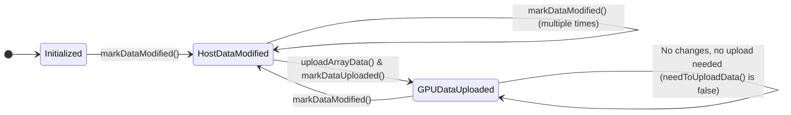

<!-- source: DeepWiki mcp.deepwiki.com · repo NVIDIA/VisRTX · page 2.5 Frame, Denoiser & Samplers · fetched 2026-10-26 -->

# Frame, Denoiser & Samplers

<details>
<summary>Relevant source files</summary>

The following files were used as context for generating this wiki page:

- [devices/rtx/device/array/Array1D.cpp](devices/rtx/device/array/Array1D.cpp)
- [devices/rtx/device/array/UploadableArray.cpp](devices/rtx/device/array/UploadableArray.cpp)
- [devices/rtx/device/array/UploadableArray.h](devices/rtx/device/array/UploadableArray.h)
- [devices/rtx/device/frame/Denoiser.cu](devices/rtx/device/frame/Denoiser.cu)
- [devices/rtx/device/frame/Denoiser.h](devices/rtx/device/frame/Denoiser.h)
- [devices/rtx/device/frame/Frame.cu](devices/rtx/device/frame/Frame.cu)
- [devices/rtx/device/frame/Frame.h](devices/rtx/device/frame/Frame.h)
- [devices/rtx/device/light/HDRI.cpp](devices/rtx/device/light/HDRI.cpp)
- [devices/rtx/device/light/HDRI.h](devices/rtx/device/light/HDRI.h)
- [devices/rtx/device/sampler/CompressedImage2D.cpp](devices/rtx/device/sampler/CompressedImage2D.cpp)
- [devices/rtx/device/sampler/CompressedImage2D.h](devices/rtx/device/sampler/CompressedImage2D.h)
- [devices/rtx/device/sampler/Image1D.cpp](devices/rtx/device/sampler/Image1D.cpp)
- [devices/rtx/device/sampler/Image1D.h](devices/rtx/device/sampler/Image1D.h)
- [devices/rtx/device/sampler/Image2D.cpp](devices/rtx/device/sampler/Image2D.cpp)
- [devices/rtx/device/sampler/Image2D.h](devices/rtx/device/sampler/Image2D.h)
- [devices/rtx/device/sampler/Image3D.cpp](devices/rtx/device/sampler/Image3D.cpp)
- [devices/rtx/device/sampler/Image3D.h](devices/rtx/device/sampler/Image3D.h)

</details>


This page details the `Frame` object, which manages rendering output, accumulation, and channel mapping. It also covers the integration of the OptiX AI denoiser, various image sampler types (`Image1D`, `Image2D`, `Image3D`, `CompressedImage2D`, `Primitive`, `Transform`), and the `UploadableArray` GPU memory management pattern.

## Frame Object

The `Frame` object [devices/rtx/device/frame/Frame.h:48-48]() in VisRTX is responsible for managing the rendered output, including pixel buffers, accumulation buffers, and handling post-processing steps like denoising and background compositing. It inherits from `helium::BaseFrame` and `DeviceObject<FrameGPUData>`, providing both ANARI frame functionality and GPU data management.

### Frame Lifecycle and Parameters

The `Frame` object's lifecycle involves parameter commitment, finalization, rendering, and mapping/unmapping channels.
Key parameters include:
*   `channel.color`: Specifies the format for the color buffer (e.g., `ANARI_FLOAT32_VEC4`, `ANARI_UFIXED8_RGBA_SRGB`). [devices/rtx/device/frame/Frame.h:105-105]()
*   `channel.depth`: Specifies the format for the depth buffer. [devices/rtx/device/frame/Frame.h:106-106]()
*   `channel.primID`, `channel.objID`, `channel.instID`: Formats for primitive, object, and instance ID buffers, respectively. [devices/rtx/device/frame/Frame.h:107-109]()
*   `channel.albedo`, `channel.normal`: Formats for albedo and normal buffers, used by the denoiser. [devices/rtx/device/frame/Frame.h:110-111]()
*   `denoiser.enabled`: Boolean to enable/disable the OptiX denoiser. [devices/rtx/device/frame/Frame.h:96-96]()
*   `denoiser.temporal`: Boolean to enable temporal denoising.
*   `denoiser.hdr`: Boolean to enable HDR denoising.
*   `denoiser.blend`: Float value for denoiser blend.
*   `denoiser.inputAlbedo`, `denoiser.inputNormal`: Booleans to control if albedo and normal buffers are used by the denoiser. [devices/rtx/device/frame/Frame.h:97-98]()

The `commitParameters()` method [devices/rtx/device/frame/Frame.h:62-62]() reads these parameters and updates the internal state. `finalize()` [devices/rtx/device/frame/Frame.h:63-63]() prepares the frame for rendering, including allocating necessary GPU buffers.

### Accumulation and Checkerboarding

The `Frame` object supports accumulation rendering, where multiple samples are rendered and averaged over time to reduce noise. The `frameID` parameter tracks the current accumulation frame. [devices/rtx/device/frame/Frame.cu:55-55]()
Checkerboarding is used to distribute rendering work across frames, where only a subset of pixels are rendered in each frame. The `resolveSample()` kernel [devices/rtx/device/frame/Frame.cu:53-73]() determines the source pixel and divisor for accumulation based on the current `frameID` and `checkerboardID`.

The `checkAccumulationReset()` method [devices/rtx/device/frame/Frame.h:87-87]() determines if the accumulation buffers need to be reset, for example, when camera or renderer parameters change.

### Channel Mapping and CUDA Buffer Extensions

The `Frame` object provides methods to map various output channels (`color`, `depth`, `primID`, `objID`, `instID`, `albedo`, `normal`) for host or device access. [devices/rtx/device/frame/Frame.h:67-81]()
The `mapColorBuffer()` [devices/rtx/device/frame/Frame.h:74-74]() and other `map*Buffer()` methods return a pointer to the requested buffer, optionally on the GPU.

VisRTX leverages the `NV_FRAME_BUFFERS_CUDA` extension for direct CUDA buffer access, allowing efficient data transfer and interoperability with other CUDA-based components. The `HostDeviceArray` and `DeviceBuffer` classes manage these GPU memory allocations.

### Background Compositing

After rendering, the `compositeBackground()` kernel [devices/rtx/device/frame/Frame.cu:146-208]() composites the rendered image with a background. The background can be a solid color or a texture, specified by the `RendererGPUData::backgroundMode` and `RendererGPUData::background` fields. [devices/rtx/device/frame/Frame.cu:186-191]() It also handles linear to sRGB conversion and packing for `ANARI_UFIXED8_RGBA_SRGB` and `ANARI_UINT` formats.

#### Frame Object Data Flow
```mermaid
graph TD
    subgraph "Host (CPU)"
        A[Frame::commitParameters()] --> B{Parameters Changed?}
        B -- Yes --> C[Frame::checkAccumulationReset()]
        C --> D[Frame::newFrame()]
        D --> E[Frame::renderFrame()]
        E --> F[Frame::map()]
        F --> G[Frame::unmap()]
    end

    subgraph "Device (GPU)"
        H[Renderer::render()] --> I[Accumulation Buffers]
        I --> J[prepareDenoiseInputs Kernel]
        J --> K[Denoiser::launch()]
        K --> L[Denoiser Output Buffer]
        L --> M[compositeBackground Kernel]
        M --> N[Output Pixel Buffer]
    end

    E -- Calls --> H
    J -- Input --> I
    K -- Input --> J
    K -- Output --> L
    M -- Input --> L
    M -- Output --> N
    F -- Accesses --> N
```
Sources:
* [devices/rtx/device/frame/Frame.cu:53-73]()
* [devices/rtx/device/frame/Frame.cu:146-208]()
* [devices/rtx/device/frame/Frame.cu:186-191]()
* [devices/rtx/device/frame/Frame.h:48-48]()
* [devices/rtx/device/frame/Frame.h:62-62]()
* [devices/rtx/device/frame/Frame.h:63-63]()
* [devices/rtx/device/frame/Frame.h:67-81]()
* [devices/rtx/device/frame/Frame.h:74-74]()
* [devices/rtx/device/frame/Frame.h:87-87]()
* [devices/rtx/device/frame/Frame.h:96-96]()
* [devices/rtx/device/frame/Frame.h:97-98]()
* [devices/rtx/device/frame/Frame.h:105-105]()
* [devices/rtx/device/frame/Frame.h:106-106]()
* [devices/rtx/device/frame/Frame.h:107-109]()
* [devices/rtx/device/frame/Frame.h:110-111]()

## OptiX AI Denoiser Integration

VisRTX integrates the NVIDIA OptiX AI denoiser to reduce noise in rendered images. The `Denoiser` class [devices/rtx/device/frame/Denoiser.h:39-40]() encapsulates the OptiX denoiser functionality.

### Denoiser Setup and Usage

The `Denoiser::setup()` method [devices/rtx/device/frame/Denoiser.cu:52-110]() initializes the OptiX denoiser, allocating necessary state and scratch buffers on the GPU. It takes the frame size, output buffer, ANARI pixel format, and input buffers (color, albedo, normal) as arguments.
The `init()` method [devices/rtx/device/frame/Denoiser.cu:182-208]() creates the `OptixDenoiser` object, configuring it based on whether albedo and normal buffers are provided. It uses `OPTIX_DENOISER_MODEL_KIND_AOV`. [devices/rtx/device/frame/Denoiser.cu:204-204]()

Before denoising, the `prepareDenoiseInputs()` kernel [devices/rtx/device/frame/Frame.cu:76-117]() processes the accumulated color, albedo, and normal buffers. It divides accumulated values by the `divisor` (number of samples) and normalizes normals. It also applies an inverse tonemap if `fireflyFilter` is enabled.
The `Denoiser::launch()` method [devices/rtx/device/frame/Denoiser.cu:118-136]() invokes `optixDenoiserInvoke()` [devices/rtx/device/frame/Denoiser.cu:123-134]() to perform the denoising operation on the GPU.

After denoising, `Denoiser::convertOutput()` [devices/rtx/device/frame/Denoiser.cu:138-163]() converts the denoised output to the requested ANARI format (e.g., `ANARI_UFIXED8_RGBA_SRGB`) using `thrust::transform` for parallel processing on the GPU. [devices/rtx/device/frame/Denoiser.cu:148-161]()

#### Denoiser Integration Diagram
```mermaid
graph TD
    A[Frame::renderFrame()] --> B{Denoiser Enabled?}
    B -- Yes --> C[launchPrepareDenoiseInputs Kernel]
    C --> D[Denoiser::setup()]
    D --> E[Denoiser::launch()]
    E --> F[Denoiser::convertOutput()]
    F --> G[launchCompositeBackground Kernel]
    B -- No --> G
    G --> H[Output Frame]

    subgraph "Denoiser Internals"
        D_init[Denoiser::init()] --> D_create[optixDenoiserCreate()]
        D_setup[optixDenoiserSetup()]
        D_invoke[optixDenoiserInvoke()]
        D_transform[thrust::transform]
    end

    D --> D_init
    D --> D_setup
    E --> D_invoke
    F --> D_transform

    C -- Reads --> "Accumulated Color, Albedo, Normal Buffers"
    C -- Writes --> "Denoise Input Buffers (Color, Albedo, Normal)"
    E -- Reads --> "Denoise Input Buffers"
    E -- Writes --> "Denoised Output Buffer (m_pixelBuffer)"
    F -- Reads --> "Denoised Output Buffer"
    F -- Writes --> "m_uintPixels (if format != ANARI_FLOAT32_VEC4)"
    G -- Reads --> "Denoised Output Buffer / m_uintPixels"
    G -- Writes --> "Final Output Frame"
```
Sources:
* [devices/rtx/device/frame/Denoiser.cu:52-110]()
* [devices/rtx/device/frame/Denoiser.cu:118-136]()
* [devices/rtx/device/frame/Denoiser.cu:123-134]()
* [devices/rtx/device/frame/Denoiser.cu:138-163]()
* [devices/rtx/device/frame/Denoiser.cu:148-161]()
* [devices/rtx/device/frame/Denoiser.cu:182-208]()
* [devices/rtx/device/frame/Denoiser.cu:204-204]()
* [devices/rtx/device/frame/Denoiser.h:39-40]()
* [devices/rtx/device/frame/Frame.cu:76-117]()

## Image Sampler Types

VisRTX provides several sampler types for accessing image data on the GPU, including `Image1D`, `Image2D`, `Image3D`, `CompressedImage2D`, `Primitive`, and `Transform`. These samplers are used to define how textures and other data are sampled in shaders.

All image samplers (`Image1D`, `Image2D`, `Image3D`, `CompressedImage2D`) manage `cudaTextureObject_t` and `cudaArray_t` for efficient GPU texture access. They handle parameter commitment for filtering (`linear`, `nearest`) and wrapping modes (`clampToEdge`, `repeat`, `mirrorRepeat`).

### Image1D

The `Image1D` class [devices/rtx/device/sampler/Image1D.h:40-41]() samples a 1D array. It takes an `Array1D` object as its `image` parameter.
*   `commitParameters()`: Sets `filter` and `wrapMode`. [devices/rtx/device/sampler/Image1D.cpp:46-48]()
*   `finalize()`: Acquires a `cudaArray_t` from the `Array1D` and creates `cudaTextureObject_t` for both filtered (`m_texture`) and nearest-neighbor (`m_texels`) sampling. [devices/rtx/device/sampler/Image1D.cpp:73-85]()
*   `gpuData()`: Returns `SamplerGPUData` with `SamplerType::TEXTURE1D` and the texture objects. [devices/rtx/device/sampler/Image1D.cpp:103-108]()

Sources:
* [devices/rtx/device/sampler/Image1D.cpp:46-48]()
* [devices/rtx/device/sampler/Image1D.cpp:73-85]()
* [devices/rtx/device/sampler/Image1D.cpp:103-108]()
* [devices/rtx/device/sampler/Image1D.h:40-41]()

### Image2D

The `Image2D` class [devices/rtx/device/sampler/Image2D.h:40-41]() samples a 2D array. It takes an `Array2D` object as its `image` parameter.
*   `commitParameters()`: Sets `filter`, `wrapMode1`, and `wrapMode2`. [devices/rtx/device/sampler/Image2D.cpp:46-49]()
*   `finalize()`: Acquires a `cudaArray_t` from the `Array2D` and creates `cudaTextureObject_t` for both filtered (`m_texture`) and nearest-neighbor (`m_texels`) sampling. [devices/rtx/device/sampler/Image2D.cpp:75-86]()
*   `gpuData()`: Returns `SamplerGPUData` with `SamplerType::TEXTURE2D` and the texture objects, along with image size and inverse size. [devices/rtx/device/sampler/Image2D.cpp:107-115]()

Sources:
* [devices/rtx/device/sampler/Image2D.cpp:46-49]()
* [devices/rtx/device/sampler/Image2D.cpp:75-86]()
* [devices/rtx/device/sampler/Image2D.cpp:107-115]()
* [devices/rtx/device/sampler/Image2D.h:40-41]()

### Image3D

The `Image3D` class [devices/rtx/device/sampler/Image3D.h:40-41]() samples a 3D array. It takes an `Array3D` object as its `image` parameter.
*   `commitParameters()`: Sets `filter`, `wrapMode1`, `wrapMode2`, and `wrapMode3`. [devices/rtx/device/sampler/Image3D.cpp:50-54]()
*   `finalize()`: Acquires a `cudaArray_t` from the `Array3D` and creates `cudaTextureObject_t` for both filtered (`m_texture`) and nearest-neighbor (`m_texels`) sampling. [devices/rtx/device/sampler/Image3D.cpp:71-91]()
*   `gpuData()`: Returns `SamplerGPUData` with `SamplerType::TEXTURE3D` and the texture objects, along with image size and inverse size. [devices/rtx/device/sampler/Image3D.cpp:126-134]()

Sources:
* [devices/rtx/device/sampler/Image3D.cpp:50-54]()
* [devices/rtx/device/sampler/Image3D.cpp:71-91]()
* [devices/rtx/device/sampler/Image3D.cpp:126-134]()
* [devices/rtx/device/sampler/Image3D.h:40-41]()

### CompressedImage2D

The `CompressedImage2D` class handles sampling of compressed 2D image data, typically used for HDRI backgrounds.
*   It uses `CudaImageTexture` to manage the compressed image data and its corresponding `cudaTextureObject_t`.
*   `commitParameters()`: Reads `image` (an `Array2D` of `ANARI_UFIXED8_RGBA_BC1` or `ANARI_UFIXED8_RGBA_BC3`), `filter`, `wrapMode1`, `wrapMode2`. [devices/rtx/device/sampler/CompressedImage2D.cpp:46-50]()
*   `finalize()`: Creates the `CudaImageTexture` from the input `Array2D`. [devices/rtx/device/sampler/CompressedImage2D.cpp:69-70]()
*   `gpuData()`: Returns `SamplerGPUData` with `SamplerType::COMPRESSED_TEXTURE2D` and the texture object. [devices/rtx/device/sampler/CompressedImage2D.cpp:90-95]()

Sources:
* [devices/rtx/device/sampler/CompressedImage2D.cpp:46-50]()
* [devices/rtx/device/sampler/CompressedImage2D.cpp:69-70]()
* [devices/rtx/device/sampler/CompressedImage2D.cpp:90-95]()

### Primitive Sampler

The `Primitive` sampler is used to sample attributes directly from geometry primitives.
*   It takes an `attribute` parameter (e.g., `color`, `opacity`, `radiance`) and a `value` parameter (an `Array1D` or `Array2D`).
*   `gpuData()`: Returns `SamplerGPUData` with `SamplerType::PRIMITIVE` and the `attribute` and `value` array data. [devices/rtx/device/sampler/Primitive.cpp:100-106]()

Sources:
* [devices/rtx/device/sampler/Primitive.cpp:100-106]()

### Transform Sampler

The `Transform` sampler applies a transformation matrix to the sampled coordinates.
*   It takes an `in` sampler and a `transform` matrix.
*   `gpuData()`: Returns `SamplerGPUData` with `SamplerType::TRANSFORM` and the `in` sampler's GPU data and the transformation matrix. [devices/rtx/device/sampler/Transform.cpp:70-75]()

Sources:
* [devices/rtx/device/sampler/Transform.cpp:70-75]()

## UploadableArray GPU Memory Management

The `UploadableArray` class [devices/rtx/device/array/UploadableArray.h:40-41]() is a base class for arrays that manage data on both host and device, and need to track when data has been modified and needs to be uploaded to the GPU. It inherits from `helium::BaseArray`.

### Key Features

*   `markDataModified()`: Updates a timestamp (`m_lastDataModified`) to indicate that the host-side data has changed. [devices/rtx/device/array/UploadableArray.cpp:43-45]()
*   `lastDataModified()`: Returns the timestamp of the last data modification. [devices/rtx/device/array/UploadableArray.cpp:47-50]()
*   `markDataUploaded()`: Updates a timestamp (`m_lastDataUploaded`) to indicate that the data has been successfully uploaded to the GPU. [devices/rtx/device/array/UploadableArray.cpp:52-55]()
*   `lastDataUploaded()`: Returns the timestamp of the last data upload. [devices/rtx/device/array/UploadableArray.cpp:57-60]()
*   `needToUploadData()`: Returns `true` if `m_lastDataModified` is more recent than `m_lastDataUploaded`, indicating that the GPU data is out of sync with the host data. [devices/rtx/device/array/UploadableArray.cpp:62-65]()
*   `uploadArrayData()`: A pure virtual function that derived classes must implement to perform the actual data transfer to the GPU. [devices/rtx/device/array/UploadableArray.h:45-45]()

This pattern ensures that GPU memory transfers only occur when necessary, optimizing performance by avoiding redundant uploads.

#### UploadableArray State Transitions

Sources:
* [devices/rtx/device/array/UploadableArray.cpp:43-45]()
* [devices/rtx/device/array/UploadableArray.cpp:47-50]()
* [devices/rtx/device/array/UploadableArray.cpp:52-55]()
* [devices/rtx/device/array/UploadableArray.cpp:57-60]()
* [devices/rtx/device/array/UploadableArray.cpp:62-65]()
* [devices/rtx/device/array/UploadableArray.h:40-41]()
* [devices/rtx/device/array/UploadableArray.h:45-45]()

---

