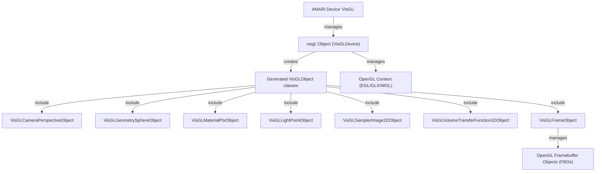

<!-- source: DeepWiki mcp.deepwiki.com · repo NVIDIA/VisRTX · page 3 OpenGL Device (VisGL) · fetched 2026-10-26 -->

# OpenGL Device (VisGL)

Relevant source files

The following files were used as context for generating this wiki page:

- [devices/gl/CMakeLists.txt](devices/gl/CMakeLists.txt)
- [devices/gl/generated/VisGLDeviceFactories.cpp](devices/gl/generated/VisGLDeviceFactories.cpp)
- [devices/gl/generated/VisGLObjects.cpp](devices/gl/generated/VisGLObjects.cpp)
- [devices/gl/generated/VisGLObjects.h](devices/gl/generated/VisGLObjects.h)
- [devices/gl/src/VisGLDeviceObject.cpp](devices/gl/src/VisGLDeviceObject.cpp)
- [devices/gl/src/VisGLDeviceObject.h](devices/gl/src/VisGLDeviceObject.h)
- [devices/gl/src/VisGLFrameObject.cpp](devices/gl/src/VisGLFrameObject.cpp)
- [devices/gl/src/VisGLFrameObject.h](devices/gl/src/VisGLFrameObject.h)
- [devices/gl/src/VisGLSpecializations.h](devices/gl/src/VisGLSpecializations.h)
- [devices/gl/src/VisGLVolumeTransferFunction1DObject.cpp](devices/gl/src/VisGLVolumeTransferFunction1DObject.cpp)
- [devices/gl/src/VisGLWorldObject.h](devices/gl/src/VisGLWorldObject.h)
- [devices/gl/src/math_util.h](devices/gl/src/math_util.h)
- [devices/gl/src/shader_blocks.h](devices/gl/src/shader_blocks.h)

This section provides a high-level overview of the experimental OpenGL ANARI device implementation within the VisRTX codebase, known as the VisGL device. It details its core architecture, the types of ANARI objects it supports, its unique shader generation approach, and highlights distinctions from the RTX device. For in-depth details on architecture and individual object implementations, links to child pages are provided.

---

## Overview

The VisGL device is an **experimental OpenGL-based ANARI device** within the VisRTX repository designed to leverage OpenGL rendering capabilities for scientific visualization and scene rendering. Unlike the RTX device which is built on NVIDIA OptiX and CUDA for GPU ray tracing, VisGL implements rendering and scene management as OpenGL abstractions, focusing on rasterization and shader-based rendering within an OpenGL context.

The device is designed to be modular and extensible, supporting a broad set of ANARI objects such as cameras, geometries, materials, lights, samplers, volumes, frames, groups, and worlds. Shaders for materials and scene components are generated and managed dynamically based on the scene configuration.

Being experimental, this device demonstrates an alternative rendering backend within VisRTX that complements the ray-tracer based RTX device by targeting OpenGL rasterization pipelines and supporting different hardware/platform constraints.

---

## Device Architecture

The core of the VisGL device is the `VisGLDevice` class which manages the OpenGL context, rendering state, and the lifecycle of ANARI objects. The device supports multiple OpenGL context backends including EGL, GLX, and WGL for cross-platform compatibility.

Object management is handled through subclasses of the generic `VisGLDeviceObject` base, representing individual ANARI object types (e.g. cameras, geometries, materials). These objects interact closely with OpenGL buffer objects, shader programs, and texture resources.

Shader management employs a custom system `AppendableShader` that generates and composes GLSL shaders at runtime from segments, supporting flexible shading models. OpenGL buffer objects are used heavily, with thread-safe abstractions (`ConcurrentArray`, `StorageBuffer`) to manage uniform buffers, SSBOs, transforms, and materials.

The device's capabilities and supported extensions are described in `visgl_device.json`, feeding into code generation for frontend ANARI code related to object factories and parameter handling.

For a comprehensive breakdown covering the device internals, context abstraction, concurrency mechanisms, shader building, and the capability descriptor, see the child page:

- [VisGL Device Architecture](#3.1)

---

## Supported ANARI Object Types

VisGL supports a wide range of ANARI object types tailored for scientific visualization, including:

- **Cameras:** Perspective and orthographic camera models.
- **Geometries:** Triangle mesh, sphere, and cylinder primitives.
- **Materials:** Matte and physically-based rendering (PBR) materials.
- **Lights:** Directional, point, and spot lights.
- **Samplers:** 1D, 2D, 3D image samplers, compressed image samplers, transform samplers, and primitive samplers.
- **Volumes:** 1D transfer function volumes.
- **Frames:** Render targets managing color and depth buffers, multisampling, and shader-based resolve passes.
- **Groups & Worlds:** Scene graph container objects supporting instances, surfaces, volumes, and lights.
- **Renderers:** Default renderer object controlling render passes.

Factory functions to create these ANARI objects are implemented using a generated `VisGLDeviceFactories.cpp` and `VisGLObjects.cpp` codebase linking object types to their constructors and parameter packs dynamically.

For detailed information on each ANARI object implementation, the shader interactions, and OpenGL resource management per object type, consult the child page:

- [VisGL Object Implementations](#3.2)

---

## Shader Generation & Rendering

The VisGL device employs a **segmented shader generation approach** that builds reusable GLSL shader segments for different materials, geometries, and lighting combinations. It uses a system of `AppendableShader` objects that dynamically compose GLSL code from modular blocks.

Shader source snippets include preambles defining uniform buffers for scene transforms, lights, materials, and shadow data. Support for occlusion and shadow mapping is integrated with dedicated compute shader and fragment shader snippets.

Render passes involve managing multisampled framebuffer objects, color and depth targets, and resolve shaders to produce final output. The `Frame` object encapsulates these OpenGL resources and rendering commands.

This approach contrasts with the RTX device’s OptiX-based ray tracing pipeline; VisGL's rendering is driven by rasterization and multi-pass shader programs within the OpenGL pipeline.

---

## Differences from the RTX Device

| Aspect                | VisGL Device                                        | RTX Device                                      |
|-----------------------|----------------------------------------------------|------------------------------------------------|
| **Rendering API**     | OpenGL (EGL/GLX/WGL contexts), rasterization based | OptiX and CUDA, ray-tracing based               |
| **Shader System**     | Modular GLSL segment composition via `AppendableShader` | CUDA PTX raygen, closest-hit, miss programs    |
| **Primary Focus**     | Experimental rasterization pipeline for ANARI       | Production-quality GPU ray tracing with OptiX  |
| **Object Handling**   | Uses OpenGL buffer objects, UBOs, SSBOs, textures  | Uses CUDA device memory, OptiX SBT and acceleration structures |
| **Context Management**| Abstracted via platform-specific context backends  | CUDA context and OptiX context                   |
| **Supported Primitives** | Triangle, sphere, cylinder with custom materials  | Triangle, sphere, cylinder, cone, curve, SDF, neural |
| **Extensions**        | Supports compressed texture formats and OpenGL extensions | Supports advanced volumetric, neural fields, and MDL materials |
| **Use Cases**         | Platform-flexible, rasterization fallback, experimental visualization | High-quality scientific path tracing and ray tracing |

---

## Relationship and Flow

To understand the relationship between user-facing ANARI concepts and VisGL's internal code entities, here is a summary mapping:

---

## Summary and Next Steps

The VisGL device presents an alternative rendering backend under VisRTX emphasizing OpenGL rasterization, dynamically generated shaders, and a modular ANARI object system compatible with many scientific visualization use cases. 

While experimental and having a different rendering paradigm than the ray tracing RTX device, it shares many core design philosophies such as object lifetime management, parameter passing, and extensibility via code generation.

For detailed exploration of the architectural components and OpenGL device internals, please refer to:

- [VisGL Device Architecture](#3.1)

For usage and implementation details of individual ANARI objects and their OpenGL resource/shader interplay, see:

- [VisGL Object Implementations](#3.2)

---

## References and Sources

- `devices/gl/CMakeLists.txt:30-196` (device build and configuration)
- `devices/gl/src/VisGLDeviceObject.cpp:32-200` (VisGLDevice class, context init, extension querying)
- `devices/gl/src/VisGLDeviceObject.h:141-175` (`Object<Device>` class)
- `devices/gl/generated/VisGLObjects.cpp:30-258` (generated ANARI object implementations)
- `devices/gl/generated/VisGLDeviceFactories.cpp:30-120` (object factories and constructors)
- `devices/gl/src/shader_blocks.h:30-210` (shader preambles and GLSL blocks)
- `devices/gl/src/VisGLFrameObject.cpp:1-240` (frame object managing OpenGL framebuffers and resolve shaders)
- `devices/gl/src/VisGLSpecializations.h:30-60` (includes all VisGL object headers and class specializations)
- `devices/gl/src/VisGLVolumeTransferFunction1DObject.cpp:30-218` (volume transfer function object and shader updates)
- `devices/gl/src/math_util.h:30-200` (math utilities used by shader computations)

---

This overview is curated for engineers and developers delving into the VisRTX codebase to understand the VisGL device's design, supported features, and its role within the broader ANARI ecosystem of VisRTX.

---

