<!-- source: DeepWiki mcp.deepwiki.com · repo NVIDIA/VisRTX · page 3.1 VisGL Device Architecture · fetched 2026-10-26 -->

# VisGL Device Architecture

<details>
<summary>Relevant source files</summary>

The following files were used as context for generating this wiki page:

- [devices/gl/CMakeLists.txt](devices/gl/CMakeLists.txt)
- [devices/gl/generated/VisGLDeviceFactories.cpp](devices/gl/generated/VisGLDeviceFactories.cpp)
- [devices/gl/generated/VisGLObjects.cpp](devices/gl/generated/VisGLObjects.cpp)
- [devices/gl/generated/VisGLObjects.h](devices/gl/generated/VisGLObjects.h)
- [devices/gl/generated/VisGLParameter.h](devices/gl/generated/VisGLParameter.h)
- [devices/gl/generated/VisGLString.cpp](devices/gl/generated/VisGLString.cpp)
- [devices/gl/generated/VisGLString.h](devices/gl/generated/VisGLString.h)
- [devices/gl/src/AppendableShader.h](devices/gl/src/AppendableShader.h)
- [devices/gl/src/ConcurrentArray.h](devices/gl/src/ConcurrentArray.h)
- [devices/gl/src/DrawCommand.h](devices/gl/src/DrawCommand.h)
- [devices/gl/src/MaterialMacros.h](devices/gl/src/MaterialMacros.h)
- [devices/gl/src/VisGLArrayObjects.cpp](devices/gl/src/VisGLArrayObjects.cpp)
- [devices/gl/src/VisGLArrayObjects.h](devices/gl/src/VisGLArrayObjects.h)
- [devices/gl/src/VisGLCameraPerspectiveObject.h](devices/gl/src/VisGLCameraPerspectiveObject.h)
- [devices/gl/src/VisGLDevice.cpp](devices/gl/src/VisGLDevice.cpp)
- [devices/gl/src/VisGLDevice.h](devices/gl/src/VisGLDevice.h)
- [devices/gl/src/VisGLObject.h](devices/gl/src/VisGLObject.h)
- [devices/gl/src/VisGLSamplerCompressedImage2DObject.cpp](devices/gl/src/VisGLSamplerCompressedImage2DObject.cpp)
- [devices/gl/src/VisGLSamplerPrimitiveObject.cpp](devices/gl/src/VisGLSamplerPrimitiveObject.cpp)
- [devices/gl/src/VisGLSamplerTransformObject.cpp](devices/gl/src/VisGLSamplerTransformObject.cpp)
- [devices/gl/src/VisGLSpecializations.h](devices/gl/src/VisGLSpecializations.h)
- [devices/gl/src/VisGLVolumeTransferFunction1DObject.cpp](devices/gl/src/VisGLVolumeTransferFunction1DObject.cpp)
- [devices/gl/src/anari2gl_types.h](devices/gl/src/anari2gl_types.h)
- [devices/gl/src/glad/include/glad/gl.h](devices/gl/src/glad/include/glad/gl.h)
- [devices/gl/src/glad/src/gl.c](devices/gl/src/glad/src/gl.c)
- [devices/gl/src/glx/glx_context.h](devices/gl/src/glx/glx_context.h)
- [devices/gl/src/ogl.h](devices/gl/src/ogl.h)
- [devices/gl/visgl_device.json](devices/gl/visgl_device.json)

</details>


This page details the architecture of the VisGL ANARI device, an experimental OpenGL-based implementation within VisRTX. It covers the core `VisGLDevice` class, the `VisGLDeviceObject`, the automatically generated code for `VisGLObjects` and `VisGLDeviceFactories`, `VisGLSpecializations`, the abstraction layer for OpenGL contexts (EGL/GLX/WGL), the `ConcurrentArray` data structure, the `AppendableShader` class, and the `visgl_device.json` capability descriptor.

## VisGLDevice Class

The `VisGLDevice` class [devices/gl/src/VisGLDevice.h:71-204]() serves as the primary entry point for the ANARI API within the VisGL device. It inherits from `anari::DeviceImpl` and implements all the necessary ANARI object creation, parameter management, and frame rendering functions. This class manages the lifecycle of all ANARI objects created within the VisGL device.

Key responsibilities of `VisGLDevice` include:
*   **Object Creation**: Methods like `newArray1D`, `newLight`, `newCamera`, `newGeometry`, `newMaterial`, `newGroup`, `newInstance`, `newWorld`, `newFrame`, and `newRenderer` are responsible for instantiating the appropriate `VisGLObject` subclasses based on the requested ANARI object type and subtype. [devices/gl/src/VisGLDevice.h:74-201]()
*   **Parameter Management**: It provides `setParameter`, `unsetParameter`, `unsetAllParameters`, `mapParameterArray*D`, and `unmapParameterArray` methods to handle parameter manipulation on ANARI objects. [devices/gl/src/VisGLDevice.h:149-178]()
*   **Object Lifetime**: `retain` and `release` methods manage the reference counts of ANARI objects, including internal references. [devices/gl/src/VisGLDevice.h:218-250]()
*   **Frame Management**: `newFrame`, `frameBufferMap`, `frameBufferUnmap`, `renderFrame`, `frameReady`, and `discardFrame` handle the rendering pipeline and framebuffer access. [devices/gl/src/VisGLDevice.h:187-203]()
*   **Query Functions**: `getObjectSubtypes`, `getObjectInfo`, and `getParameterInfo` provide introspection capabilities based on the `visgl_device.json` descriptor. [devices/gl/src/VisGLDevice.h:129-139]()

The `VisGLDevice` also holds a `VisGLDeviceObject` instance (`deviceObject`) [devices/gl/src/VisGLDevice.h:209](), which stores device-specific parameters like status callbacks and OpenGL context information.

Sources:
*   [devices/gl/src/VisGLDevice.h:71-204]()
*   [devices/gl/src/VisGLDevice.cpp:45-250]()

## VisGLDeviceObject and VisGLObject Hierarchy

The `VisGLDeviceObject` is a specialized `ObjectBase` that represents the ANARI device itself. It holds parameters specific to the device, such as the OpenGL API to use (`glAPI`), debug flags (`glDebug`), and external EGL context pointers (`EGLDisplay`, `EGlContext`). [devices/gl/generated/VisGLObjects.h:44-67]()

All ANARI objects within the VisGL device inherit from `ObjectBase` [devices/gl/src/VisGLObject.h:61-151](). This base class provides fundamental functionality for reference counting (`refcount`), parameter management (`set`, `unset`, `unsetAll`, `mapParameter*D`, `unmapParameter`), and object lifecycle (`retain`, `release`, `retainInternal`, `releaseInternal`). Each concrete ANARI object type (e.g., `VisGLGeometryTriangleObject`, `VisGLMaterialMatteObject`) then inherits from `ObjectBase` and implements its specific OpenGL rendering logic.

The `ObjectBase` uses a combined reference count (`refcount`) [devices/gl/src/VisGLObject.h:66]() where the lower 32 bits track public ANARI references and the upper 32 bits track internal references. When both counts drop to zero, the object is deleted. [devices/gl/src/VisGLObject.h:83-101]()

```mermaid
classDiagram
    direction LR
    class "anari::DeviceImpl" as ANARIDeviceImpl
    class "visgl::VisGLDevice" as VisGLDevice
    class "visgl::ObjectBase" as ObjectBase
    class "visgl::VisGLDeviceObject" as VisGLDeviceObject
    class "visgl::ArrayObjectBase" as ArrayObjectBase
    class "visgl::ObjectArray1D" as ObjectArray1D
    class "visgl::DataArray1D" as DataArray1D
    class "visgl::FrameObjectBase" as FrameObjectBase
    class "visgl::SurfaceObjectBase" as SurfaceObjectBase
    class "visgl::GeometryObjectBase" as GeometryObjectBase
    class "visgl::MaterialObjectBase" as MaterialObjectBase
    class "visgl::CameraObjectBase" as CameraObjectBase
    class "visgl::LightObjectBase" as LightObjectBase
    class "visgl::SamplerObjectBase" as SamplerObjectBase
    class "visgl::SpatialFieldObjectBase" as SpatialFieldObjectBase
    class "visgl::VolumeObjectBase" as VolumeObjectBase
    class "visgl::GroupObjectBase" as GroupObjectBase
    class "visgl::InstanceObjectBase" as InstanceObjectBase
    class "visgl::WorldObjectBase" as WorldObjectBase
    class "visgl::RendererObjectBase" as RendererObjectBase

    ANARIDeviceImpl <|-- VisGLDevice : implements
    ObjectBase <|-- VisGLDeviceObject : inherits
    ObjectBase <|-- ArrayObjectBase : inherits
    ObjectBase <|-- FrameObjectBase : inherits
    ObjectBase <|-- SurfaceObjectBase : inherits
    ObjectBase <|-- GeometryObjectBase : inherits
    ObjectBase <|-- MaterialObjectBase : inherits
    ObjectBase <|-- CameraObjectBase : inherits
    ObjectBase <|-- LightObjectBase : inherits
    ObjectBase <|-- SamplerObjectBase : inherits
    ObjectBase <|-- SpatialFieldObjectBase : inherits
    ObjectBase <|-- VolumeObjectBase : inherits
    ObjectBase <|-- GroupObjectBase : inherits
    ObjectBase <|-- InstanceObjectBase : inherits
    ObjectBase <|-- WorldObjectBase : inherits
    ObjectBase <|-- RendererObjectBase : inherits

    ArrayObjectBase <|-- ObjectArray1D : inherits
    ArrayObjectBase <|-- DataArray1D : inherits

    VisGLDevice "1" -- "1" VisGLDeviceObject : has
    VisGLDevice "1" -- "*" ObjectBase : manages
```
Diagram: VisGL Object Hierarchy

Sources:
*   [devices/gl/src/VisGLDevice.h:209]()
*   [devices/gl/src/VisGLObject.h:61-151]()
*   [devices/gl/generated/VisGLObjects.h:44-67]()

## Generated VisGLObjects and VisGLDeviceFactories Code

The VisGL device leverages code generation to create boilerplate for ANARI object types and their parameters. This is driven by the `visgl_device.json` descriptor.

*   **`VisGLObjects.h` / `VisGLObjects.cpp`**: These files [devices/gl/generated/VisGLObjects.h]() [devices/gl/generated/VisGLObjects.cpp]() contain C++ classes for each ANARI object type (e.g., `Device`, `Array1D`, `Frame`, `GeometryTriangle`, `MaterialMatte`). Each class inherits from `ParameterPack` [devices/gl/generated/VisGLObjects.h:35]() and defines `Parameter<ANARIDataType>` members for all supported parameters of that object type. The `set` and `unset` methods are implemented to manage these parameters. The `param_hash` function [devices/gl/generated/VisGLObjects.cpp:34]() is used for efficient lookup of parameter names.
*   **`VisGLDeviceFactories.cpp`**: This file contains factory functions for creating `VisGLObject` instances. For example, `VisGLDevice::newCamera` [devices/gl/src/VisGLDevice.cpp:260-270]() uses a switch statement to call the appropriate factory function based on the `type` string. These factory functions instantiate the concrete `VisGLObject` subclasses.
*   **`VisGLString.h` / `VisGLString.cpp`**: These files [devices/gl/generated/VisGLString.h]() [devices/gl/generated/VisGLString.cpp]() define string enums and a `parameter_string_hash` function for efficient lookup of ANARI parameter strings. This is used internally by the generated parameter handling code.

This code generation simplifies the implementation of the ANARI API by automating the creation of parameter storage and dispatch logic. The `anari_generate_frontend` and `anari_generate_queries` CMake functions [devices/gl/CMakeLists.txt:53-62, 100-105]() are responsible for generating these files from `visgl_device.json`.

Sources:
*   [devices/gl/generated/VisGLObjects.h]()
*   [devices/gl/generated/VisGLObjects.cpp]()
*   [devices/gl/generated/VisGLString.h]()
*   [devices/gl/generated/VisGLString.cpp]()
*   [devices/gl/src/VisGLDevice.cpp:260-270]()
*   [devices/gl/CMakeLists.txt:53-62]()
*   [devices/gl/CMakeLists.txt:100-105]()

## VisGLSpecializations

The `VisGLSpecializations.h` header [devices/gl/src/VisGLSpecializations.h]() acts as a central point for including all concrete `VisGLObject` implementations. This allows the `VisGLDevice` to instantiate the correct object types without needing to include each specific header individually. It includes headers for various ANARI object types like `VisGLArrayObjects.h`, `VisGLInstanceObject.h`, `VisGLGeometryTriangleObject.h`, `VisGLMaterialMatteObject.h`, etc.

Sources:
*   [devices/gl/src/VisGLSpecializations.h]()

## OpenGL Context Abstraction (EGL/GLX/WGL)

The VisGL device needs to interact with an OpenGL context, which varies depending on the operating system and display server. It provides an abstraction layer to handle EGL (Embedded-GL), GLX (OpenGL Extension to X Window System), and WGL (Windows GL) contexts.

*   **CMake Logic**: The `CMakeLists.txt` [devices/gl/CMakeLists.txt:130-183]() dynamically links against the appropriate OpenGL backend based on the platform and available libraries.
    *   **Windows**: Uses WGL. `src/wgl/wgl_context.cpp` is compiled, and `VISGL_USE_WGL` is defined. [devices/gl/CMakeLists.txt:130-142]()
    *   **Linux (EGL)**: If `OpenGL_EGL_FOUND` is true, `src/egl/egl_context.cpp` is compiled, and `VISGL_USE_EGL` is defined. [devices/gl/CMakeLists.txt:150-162]()
    *   **Linux (GLX)**: If `OpenGL_GLX_FOUND` and `X11_FOUND` are true, `src/glx/glx_context.cpp` is compiled, and `VISGL_USE_GLX` is defined. [devices/gl/CMakeLists.txt:164-183]()
*   **`ogl.h`**: This header [devices/gl/src/ogl.h]() likely provides a common interface or includes the necessary platform-specific OpenGL headers (e.g., `glad/gl.h` [devices/gl/src/glad/include/glad/gl.h]()) and context management functions.
*   **`glad`**: The `glad` library [devices/gl/src/glad/src/gl.c]() is used for loading OpenGL function pointers, ensuring compatibility across different OpenGL versions and drivers.

This modular approach allows the VisGL device to operate on various platforms with different OpenGL context management systems.

Sources:
*   [devices/gl/CMakeLists.txt:130-183]()
*   [devices/gl/src/ogl.h]()
*   [devices/gl/src/glad/include/glad/gl.h]()
*   [devices/gl/src/glad/src/gl.c]()

## ConcurrentArray

The `ConcurrentArray` class [devices/gl/src/ConcurrentArray.h:49-118]() is a thread-safe, dynamically growing array designed for scenarios where elements are added concurrently, but access to existing elements can happen without locking.

*   **Exponentially Growing Chunks**: It uses an array of `std::unique_ptr<T[]>` blocks [devices/gl/src/ConcurrentArray.h:54]() to store data. The size of these blocks grows exponentially, allowing for efficient allocation and reducing the frequency of reallocations.
*   **Atomic Element Count**: `std::atomic<uint64_t> elements` [devices/gl/src/ConcurrentArray.h:52]() tracks the total number of elements, enabling lock-free reads of the array size.
*   **Mutex for Add Operations**: A `std::mutex` [devices/gl/src/ConcurrentArray.h:55]() protects the `add()` operation, specifically when a new block needs to be allocated. This ensures that block allocation is thread-safe.
*   **Lock-Free Access**: The `operator[]` for accessing elements is lock-free, as it only involves calculating the block and index within that block. [devices/gl/src/ConcurrentArray.h:93-104]()
*   **Bit Manipulation for Indexing**: `msb`, `block`, and `index` helper functions [devices/gl/src/ConcurrentArray.h:57-86]() use bit manipulation to efficiently determine which block an element belongs to and its index within that block.

This data structure is particularly useful for managing collections of objects or data that are frequently added but rarely removed or resized, and where concurrent read access is important.

Sources:
*   [devices/gl/src/ConcurrentArray.h:49-118]()

## AppendableShader

The `AppendableShader` class [devices/gl/src/AppendableShader.h]() is designed to facilitate the dynamic construction of OpenGL Shading Language (GLSL) shaders. It allows different components of the rendering pipeline (e.g., geometry, material, sampler) to contribute snippets of GLSL code to a single shader program.

*   **Modular Shader Construction**: Instead of monolithic shaders, `AppendableShader` enables a modular approach where various parts of the ANARI scene graph can inject their GLSL code for vertex, fragment, and other shader stages.
*   **Dynamic Code Generation**: This is crucial for the VisGL device, as the exact shader logic depends on the combination of ANARI objects (e.g., geometry type, material type, sampler type) present in a scene.
*   **GLSL Type Mapping**: The `anari2gl_types.h` header [devices/gl/src/anari2gl_types.h]() provides utility functions like `gl_type` and `gl_format` to map ANARI data types to their corresponding OpenGL GLSL types and formats, which is essential for generating correct shader code.

Sources:
*   [devices/gl/src/AppendableShader.h]()
*   [devices/gl/src/anari2gl_types.h]()

## `visgl_device.json` Capability Descriptor

The `visgl_device.json` file [devices/gl/visgl_device.json]() is a JSON descriptor that defines the capabilities and supported object types and parameters of the VisGL ANARI device. It plays a crucial role in the code generation process.

*   **Device Information**: It specifies the device name ("VisGL") and type ("device"). [devices/gl/visgl_device.json:3-4]()
*   **Supported Extensions**: The `dependencies` array lists all ANARI extensions and custom VisGL extensions supported by the device. This includes core ANARI objects, various geometry types (triangle, sphere, cylinder), materials (matte, physically_based), lights (directional, point, spot), samplers (image1D/2D/3D, compressed), spatial fields, and volume transfer functions. [devices/gl/visgl_device.json:5-39]()
*   **Custom Extensions**: It defines VisGL-specific extensions like `visgl_gl_context_params`, `visgl_precision_params`, `visgl_shadow_map_params`, and `visgl_occlusion_params`, which expose device-specific parameters to the ANARI API. [devices/gl/visgl_device.json:35-38]()

This JSON file is parsed by the `anari_generate_frontend` and `anari_generate_queries` CMake functions [devices/gl/CMakeLists.txt:53-62, 100-105]() to automatically generate the `VisGLObjects.h`, `VisGLObjects.cpp`, `VisGLDeviceFactories.cpp`, and `VisGLString.h/cpp` files. This ensures that the C++ implementation accurately reflects the declared ANARI capabilities.

Sources:
*   [devices/gl/visgl_device.json]()
*   [devices/gl/CMakeLists.txt:53-62]()
*   [devices/gl/CMakeLists.txt:100-105]()


```mermaid
graph TD
    subgraph "Code Generation"
        A[visgl_device.json] --> B(anari_generate_frontend CMake)
        A --> C(anari_generate_queries CMake)
        B --> D[generated/VisGLObjects.h]
        B --> E[generated/VisGLObjects.cpp]
        B --> F[generated/VisGLString.h]
        B --> G[generated/VisGLString.cpp]
        C --> H[generated/VisGLDeviceFactories.cpp]
    end

    subgraph "VisGL Device Implementation"
        I[VisGLDevice.h] --> J[VisGLDevice.cpp]
        J --> D
        J --> E
        J --> F
        J --> G
        J --> H
        J --> K[VisGLSpecializations.h]
        K --> L[VisGLObject.h]
        L --> M[AppendableShader.h]
        L --> N[ConcurrentArray.h]
        J --> O[ogl.h]
        O --> P[glad/gl.h]
        O --> Q[wgl_context.h]
        O --> R[glx_context.h]
        O --> S[egl_context.h]
    end

    subgraph "OpenGL Context Backends"
        T[src/wgl/wgl_context.cpp]
        U[src/glx/glx_context.cpp]
        V[src/egl/egl_context.cpp]
        W[src/glad/src/gl.c]
    end

    J -- "Uses" --> T
    J -- "Uses" --> U
    J -- "Uses" --> V
    J -- "Uses" --> W

    style A fill:#f9f,stroke:#333,stroke-width:2px
    style B fill:#ccf,stroke:#333,stroke-width:2px
    style C fill:#ccf,stroke:#333,stroke-width:2px
    style D fill:#cfc,stroke:#333,stroke-width:2px
    style E fill:#cfc,stroke:#333,stroke-width:2px
    style F fill:#cfc,stroke:#333,stroke-width:2px
    style G fill:#cfc,stroke:#333,stroke-width:2px
    style H fill:#cfc,stroke:#333,stroke-width:2px
    style I fill:#f9f,stroke:#333,stroke-width:2px
    style J fill:#f9f,stroke:#333,stroke-width:2px
    style K fill:#f9f,stroke:#333,stroke-width:2px
    style L fill:#f9f,stroke:#333,stroke-width:2px
    style M fill:#f9f,stroke:#333,stroke-width:2px
    style N fill:#f9f,stroke:#333,stroke-width:2px
    style O fill:#f9f,stroke:#333,stroke-width:2px
    style P fill:#f9f,stroke:#333,stroke-width:2px
    style Q fill:#f9f,stroke:#333,stroke-width:2px
    style R fill:#f9f,stroke:#333,stroke-width:2px
    style S fill:#f9f,stroke:#333,stroke-width:2px
    style T fill:#f9f,stroke:#333,stroke-width:2px
    style U fill:#f9f,stroke:#333,stroke-width:2px
    style V fill:#f9f,stroke:#333,stroke-width:2px
    style W fill:#f9f,stroke:#333,stroke-width:2px
```

Diagram: VisGL Device Architecture Overview

---

