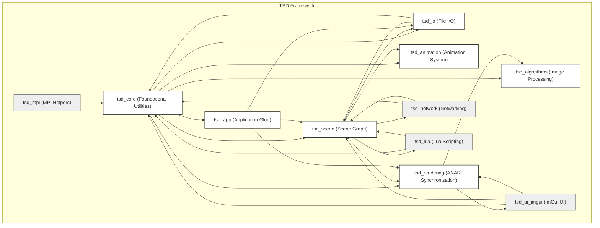

<!-- source: DeepWiki mcp.deepwiki.com · repo NVIDIA/VisRTX · page 4 TSD Framework · fetched 2026-10-26 -->

# TSD Framework

Relevant source files

The following files were used as context for generating this wiki page:

- [tsd/CMakeLists.txt](tsd/CMakeLists.txt)
- [tsd/README.md](tsd/README.md)
- [tsd/cmake/mark_cache_variables_as_advanced.cmake](tsd/cmake/mark_cache_variables_as_advanced.cmake)
- [tsd/external/CMakeLists.txt](tsd/external/CMakeLists.txt)
- [tsd/external/tsd_imguizmo/CMakeLists.txt](tsd/external/tsd_imguizmo/CMakeLists.txt)
- [tsd/external/tsd_imoguizmo/CMakeLists.txt](tsd/external/tsd_imoguizmo/CMakeLists.txt)
- [tsd/external/tsd_imoguizmo/imoguizmo.hpp](tsd/external/tsd_imoguizmo/imoguizmo.hpp)
- [tsd/external/tsd_lua/CMakeLists.txt](tsd/external/tsd_lua/CMakeLists.txt)
- [tsd/external/tsd_nanovdb/CMakeLists.txt](tsd/external/tsd_nanovdb/CMakeLists.txt)
- [tsd/external/tsd_sol2/CMakeLists.txt](tsd/external/tsd_sol2/CMakeLists.txt)
- [tsd/external/tsd_zlib/CMakeLists.txt](tsd/external/tsd_zlib/CMakeLists.txt)
- [tsd/src/tsd/CMakeLists.txt](tsd/src/tsd/CMakeLists.txt)
- [tsd/src/tsd/README.md](tsd/src/tsd/README.md)
- [tsd/src/tsd/algorithms/README.md](tsd/src/tsd/algorithms/README.md)
- [tsd/src/tsd/io/importers/import_NVDB.cpp](tsd/src/tsd/io/importers/import_NVDB.cpp)
- [tsd/src/tsd/scripting/README.md](tsd/src/tsd/scripting/README.md)

The TSD (The Scientific Data) framework is a C++ library collection designed primarily for testing ANARI devices. It provides a comprehensive set of tools for scene description, manipulation, rendering, and interaction, closely mirroring the ANARI object hierarchy [tsd/README.md:28-31](). While not intended as a production-grade visualization or VFX pipeline, TSD serves as an educational platform for exploring 3D scene graph design and ANARI integration [tsd/README.md:4-19]().

The framework is organized into several core libraries, with additional optional components for specific functionalities like networking or scripting. This page provides a high-level overview of these libraries and their interrelationships. For detailed information on each component, please refer to the linked child pages.

## Design Philosophy

TSD's design emphasizes:
*   **ANARI Alignment**: The `tsd_scene` library, in particular, closely follows the ANARI object hierarchy, making it an ideal testbed for ANARI device development [tsd/README.md:28-31]().
*   **Modularity**: The framework is composed of distinct libraries, allowing for flexible integration and selective compilation of features [tsd/src/tsd/CMakeLists.txt:4-25]().
*   **Extensibility**: Many components are designed to be extensible, such as the `tsd_io` library with its various importers [tsd/src/tsd/README.md:14](), and the `tsd_ui_imgui` library with its plugin system [tsd/src/tsd/README.md:19]().
*   **Cross-Platform Support**: TSD is primarily tested on Linux but is designed to work on other platforms like macOS and Windows [tsd/README.md:33-34]().

## Library Collection

The TSD framework comprises several libraries, each serving a specific purpose. These libraries can be broadly categorized into core components and optional extensions.

### Core Libraries

These libraries are fundamental to the TSD framework and are always built [tsd/src/tsd/CMakeLists.txt:4-11]().

*   **Core Library (`tsd_core`)**: Provides foundational utilities for the entire framework. For details, see [Core Library (tsd_core)](#4.1).
*   **Scene Library (`tsd_scene`)**: Manages the core scene representation, including objects, parameters, and the scene graph. For details, see [Scene Library (tsd_scene)](#4.2).
*   **I/O Library (`tsd_io`)**: Handles file importing, procedural scene generation, and scene serialization. For details, see [File I/O & Scene Serialization](#5).
*   **Animation System (`tsd_animation`)**: Manages animation data and playback for scene parameters and transformations. For details, see [Animation System (tsd_animation)](#4.3).
*   **Rendering Library (`tsd_rendering`)**: Bridges TSD scenes to ANARI worlds and manages render passes. For details, see [Rendering Library (tsd_rendering)](#4.4).
*   **Algorithms Library (`tsd_algorithms`)**: Offers image-processing kernels with CPU and optional CUDA backends. For details, see [Algorithms Library (tsd_algorithms)](#4.5).
*   **Application Library (`tsd_app`)**: Provides application-facing glue for command-line parsing, ANARI device management, and offline rendering [tsd/src/tsd/README.md:13]().

### Optional Libraries

These libraries provide additional functionality and are built only if their respective CMake options are enabled [tsd/src/tsd/CMakeLists.txt:13-25]().

*   **MPI Library (`tsd_mpi`)**: Contains helper types for rank-replicated state in distributed workflows, enabled with `TSD_USE_MPI=ON` [tsd/src/tsd/README.md:17]().
*   **Networking Library (`tsd_network`)**: Provides Boost.Asio-based messaging and scene synchronization for client/server architectures, enabled with `TSD_USE_NETWORKING=ON` [tsd/src/tsd/README.md:18]().
*   **UI Library (`tsd_ui_imgui`)**: An ImGui-based UI framework for interactive applications, enabled with `TSD_BUILD_UI_LIBRARY=ON` [tsd/src/tsd/README.md:19]().
*   **Lua Scripting Library (`tsd_lua`)**: Offers Lua bindings and a scripting API for scene authoring and automation, enabled with `TSD_USE_LUA=ON` [tsd/src/tsd/README.md:20]().

## Library Composition

The TSD libraries are designed to compose together to form a complete scene description and visualization framework. The `tsd_core` library forms the base, providing fundamental data structures and utilities. On top of this, `tsd_scene` builds the core scene graph, which is then populated by `tsd_io` through various importers. `tsd_animation` adds dynamic behavior to scene elements. For visualization, `tsd_rendering` synchronizes the TSD scene with an ANARI device, and `tsd_algorithms` provides post-processing capabilities. Interactive applications leverage `tsd_ui_imgui` for user interfaces, while `tsd_network` and `tsd_lua` enable distributed and scriptable workflows, respectively.

The following diagram illustrates the dependencies and relationships between the main TSD libraries:

**Diagram 1: TSD Library Dependencies**
Sources: [tsd/src/tsd/CMakeLists.txt:4-25](), [tsd/src/tsd/README.md:10-20]()

### External Dependencies

TSD also integrates with several external libraries, some of which are vendored (e.g., `tsd_nanovdb`, `tsd_sol2`, `tsd_lua`, `tsd_zlib`) [tsd/external/CMakeLists.txt:4-15](), [tsd/external/tsd_nanovdb/CMakeLists.txt:1-20](), [tsd/external/tsd_sol2/CMakeLists.txt:1-32](), [tsd/external/tsd_lua/CMakeLists.txt:1-77](), [tsd/external/tsd_zlib/CMakeLists.txt:1-59](). Others are found via `find_package` (e.g., ANARI, CUDA, TBB, HDF5, ASSIMP, SDL3, USD, VTK, SILO, MPI, Boost.Asio) [tsd/CMakeLists.txt:53-67]().

For example, the `tsd_nanovdb` external library can optionally use `zlib` for reading compressed NanoVDB files, controlled by the `TSD_NANOVDB_USE_ZIP` CMake option [tsd/external/tsd_nanovdb/CMakeLists.txt:13-20](), [tsd/src/tsd/io/importers/import_NVDB.cpp:200-207](). Similarly, `tsd_lua` uses `sol2` for C++ bindings, which in turn depends on the Lua library [tsd/external/tsd_sol2/CMakeLists.txt:28-29]().

```mermaid
graph TD
    subgraph "TSD Libraries"
        tsd_io["tsd_io"]
        tsd_lua["tsd_lua"]
        tsd_ui_imgui["tsd_ui_imgui"]
    end

    subgraph "External Dependencies (Vendored)"
        tsd_nanovdb["tsd_nanovdb"]
        tsd_sol2["tsd_sol2"]
        tsd_ext_lua["tsd_ext_lua (Lua 5.4)"]
        tsd_zlib["tsd_zlib (zlib 1.3.1)"]
        tsd_imguizmo["tsd_imguizmo"]
        tsd_imoguizmo["tsd_imoguizmo"]
    end

    subgraph "External Dependencies (Found via find_package)"
        ANARI["ANARI SDK"]
        CUDA["CUDA Toolkit"]
        TBB["TBB"]
        HDF5["HDF5"]
        ASSIMP["ASSIMP"]
        SDL3["SDL3"]
        USD["OpenUSD"]
        VTK["VTK"]
        SILO["SILO"]
        MPI["MPI"]
        Boost_Asio["Boost.Asio"]
        Lua_System["Lua (System)"]
        ZLIB_System["ZLIB (System)"]
    end

    tsd_io --> tsd_nanovdb
    tsd_nanovdb --> tsd_zlib
    tsd_nanovdb --> TBB
    tsd_io --> HDF5
    tsd_io --> ASSIMP
    tsd_io --> USD
    tsd_io --> VTK
    tsd_io --> SILO

    tsd_lua --> tsd_sol2
    tsd_sol2 --> tsd_ext_lua
    tsd_sol2 --> Lua_System

    tsd_ui_imgui --> tsd_imguizmo
    tsd_ui_imgui --> tsd_imoguizmo
    tsd_ui_imgui --> SDL3

    tsd_ext_lua --> ZLIB_System

    tsd_core --> CUDA
    tsd_core --> TBB

    tsd_network --> Boost_Asio
    tsd_mpi --> MPI

    tsd_rendering --> ANARI

    style tsd_io fill:#fff,stroke:#333,stroke-width:2px
    style tsd_lua fill:#fff,stroke:#333,stroke-width:2px
    style tsd_ui_imgui fill:#fff,stroke:#333,stroke-width:2px

    style tsd_nanovdb fill:#eee,stroke:#666,stroke-width:1px
    style tsd_sol2 fill:#eee,stroke:#666,stroke-width:1px
    style tsd_ext_lua fill:#eee,stroke:#666,stroke-width:1px
    style tsd_zlib fill:#eee,stroke:#666,stroke-width:1px
    style tsd_imguizmo fill:#eee,stroke:#666,stroke-width:1px
    style tsd_imoguizmo fill:#eee,stroke:#666,stroke-width:1px

    style ANARI fill:#ddd,stroke:#999,stroke-width:1px
    style CUDA fill:#ddd,stroke:#999,stroke-width:1px
    style TBB fill:#ddd,stroke:#999,stroke-width:1px
    style HDF5 fill:#ddd,stroke:#999,stroke-width:1px
    style ASSIMP fill:#ddd,stroke:#999,stroke-width:1px
    style SDL3 fill:#ddd,stroke:#999,stroke-width:1px
    style USD fill:#ddd,stroke:#999,stroke-width:1px
    style VTK fill:#ddd,stroke:#999,stroke-width:1px
    style SILO fill:#ddd,stroke:#999,stroke-width:1px
    style MPI fill:#ddd,stroke:#999,stroke-width:1px
    style Boost_Asio fill:#ddd,stroke:#999,stroke-width:1px
    style Lua_System fill:#ddd,stroke:#999,stroke-width:1px
    style ZLIB_System fill:#ddd,stroke:#999,stroke-width:1px
```

**Diagram 2: TSD External Dependencies**
Sources: [tsd/CMakeLists.txt:53-67](), [tsd/external/CMakeLists.txt:4-30](), [tsd/external/tsd_nanovdb/CMakeLists.txt:1-20](), [tsd/external/tsd_sol2/CMakeLists.txt:1-32](), [tsd/external/tsd_lua/CMakeLists.txt:1-77](), [tsd/external/tsd_zlib/CMakeLists.txt:1-59]()

---

