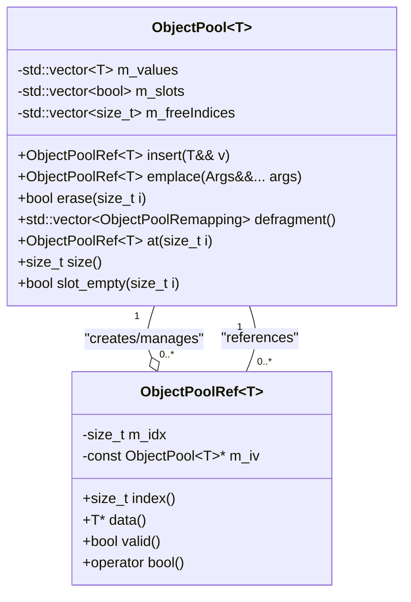

<!-- source: DeepWiki mcp.deepwiki.com · repo NVIDIA/VisRTX · page 4.1 Core Library (tsd_core) · fetched 2026-10-26 -->

# Core Library (tsd_core)

<details>
<summary>Relevant source files</summary>

The following files were used as context for generating this wiki page:

- [devices/rtx/device/gpu/evalMaterialParameters.h](devices/rtx/device/gpu/evalMaterialParameters.h)
- [devices/rtx/libmdl/Core.cpp](devices/rtx/libmdl/Core.cpp)
- [devices/rtx/libmdl/Core.h](devices/rtx/libmdl/Core.h)
- [devices/rtx/libmdl/MDLBackendConfig.h](devices/rtx/libmdl/MDLBackendConfig.h)
- [tsd/apps/CMakeLists.txt](tsd/apps/CMakeLists.txt)
- [tsd/apps/tutorial/tsdTutorialForestDemo.cpp](tsd/apps/tutorial/tsdTutorialForestDemo.cpp)
- [tsd/src/tsd/animation/Binding.hpp](tsd/src/tsd/animation/Binding.hpp)
- [tsd/src/tsd/animation/Interpolation.hpp](tsd/src/tsd/animation/Interpolation.hpp)
- [tsd/src/tsd/animation/ObjectParameterBinding.cpp](tsd/src/tsd/animation/ObjectParameterBinding.cpp)
- [tsd/src/tsd/animation/ObjectParameterBinding.hpp](tsd/src/tsd/animation/ObjectParameterBinding.hpp)
- [tsd/src/tsd/animation/TransformBinding.cpp](tsd/src/tsd/animation/TransformBinding.cpp)
- [tsd/src/tsd/animation/TransformBinding.hpp](tsd/src/tsd/animation/TransformBinding.hpp)
- [tsd/src/tsd/core/Any.hpp](tsd/src/tsd/core/Any.hpp)
- [tsd/src/tsd/core/CMakeLists.txt](tsd/src/tsd/core/CMakeLists.txt)
- [tsd/src/tsd/core/ColorMapUtil.cpp](tsd/src/tsd/core/ColorMapUtil.cpp)
- [tsd/src/tsd/core/ColorMapUtil.hpp](tsd/src/tsd/core/ColorMapUtil.hpp)
- [tsd/src/tsd/core/DataStream.cpp](tsd/src/tsd/core/DataStream.cpp)
- [tsd/src/tsd/core/DataStream.hpp](tsd/src/tsd/core/DataStream.hpp)
- [tsd/src/tsd/core/DataTree.hpp](tsd/src/tsd/core/DataTree.hpp)
- [tsd/src/tsd/core/FlatMap.hpp](tsd/src/tsd/core/FlatMap.hpp)
- [tsd/src/tsd/core/Forest.hpp](tsd/src/tsd/core/Forest.hpp)
- [tsd/src/tsd/core/Logging.cpp](tsd/src/tsd/core/Logging.cpp)
- [tsd/src/tsd/core/Logging.hpp](tsd/src/tsd/core/Logging.hpp)
- [tsd/src/tsd/core/ObjectPool.hpp](tsd/src/tsd/core/ObjectPool.hpp)
- [tsd/src/tsd/core/TaskQueue.hpp](tsd/src/tsd/core/TaskQueue.hpp)
- [tsd/src/tsd/core/Timer.hpp](tsd/src/tsd/core/Timer.hpp)
- [tsd/src/tsd/core/Token.cpp](tsd/src/tsd/core/Token.cpp)
- [tsd/src/tsd/core/Token.hpp](tsd/src/tsd/core/Token.hpp)
- [tsd/src/tsd/core/TypeMacros.hpp](tsd/src/tsd/core/TypeMacros.hpp)
- [tsd/src/tsd/scene/LayerNodeData.hpp](tsd/src/tsd/scene/LayerNodeData.hpp)
- [tsd/tests/test_DataTree.cpp](tsd/tests/test_DataTree.cpp)
- [tsd/tests/test_Forest.cpp](tsd/tests/test_Forest.cpp)
- [tsd/tests/test_ObjectPool.cpp](tsd/tests/test_ObjectPool.cpp)

</details>


The `tsd_core` library provides foundational utilities and data structures that are essential across the entire TSD framework. It includes type-erasure containers, string interning, memory management, tree structures, serialization mechanisms, I/O operations, color mapping, logging, task management, and mathematical type aliases. This library forms the bedrock upon which other TSD modules are built.

## Any

The `tsd::core::Any` class is a type-erasure container designed to store values of any ANARI data type, including scalars, vectors, and strings. It uses fixed-size local storage for smaller types to avoid heap allocations, falling back to `std::string` for string types. This allows for flexible parameter passing and storage where the exact type is not known at compile time but needs to conform to ANARI's type system.

### Implementation Details

The `Any` class internally uses an `std::array<uint8_t, MAX_LOCAL_STORAGE>` for small value storage and an `std::string m_string` for string values [tsd/src/tsd/core/Any.hpp:88-90](). The `m_type` member stores the `anari::DataType` of the held value [tsd/src/tsd/core/Any.hpp:90]().

- **Constructors**: `Any` can be constructed from various C++ types (e.g., `int`, `float`, `std::string`) [tsd/src/tsd/core/Any.hpp:34-37]() or directly from an `anari::DataType` and a `void*` pointer [tsd/src/tsd/core/Any.hpp:39]().
- **Value Storage**: For non-string types, `std::memcpy` is used to copy the value into `m_storage` [tsd/src/tsd/core/Any.hpp:148-150](). For `ANARI_STRING`, the value is stored in `m_string` [tsd/src/tsd/core/Any.hpp:146]().
- **Accessors**:
    - `get<T>()`: Retrieves the stored value, performing a type check [tsd/src/tsd/core/Any.hpp:218-222]().
    - `is<T>()` / `is(anari::DataType t)`: Checks if the `Any` instance holds a specific type [tsd/src/tsd/core/Any.hpp:72-73, 270-281]().
    - `getString()`: Returns the stored string [tsd/src/tsd/core/Any.hpp:66]().
    - `data()`: Provides a raw `void*` pointer to the stored data [tsd/src/tsd/core/Any.hpp:251-259]().
- **Operators**: Overloaded `operator=` for assignment [tsd/src/tsd/core/Any.hpp:170-193]() and `operator==`/`operator!=` for comparison [tsd/src/tsd/core/Any.hpp:195-214]().

### Example Usage

```cpp
// Sources: [tsd/src/tsd/core/Any.hpp:26-27]()
tsd::core::Any a(ANARI_FLOAT32, &myFloat);
float v = a.get<float>();
a = std::string("hello");
bool isStr = a.is<std::string>();
```

Sources: [tsd/src/tsd/core/Any.hpp:1-295]()

## Token

The `tsd::core::Token` class implements a string interning mechanism. This means that for any given string, only one instance of that string is stored in memory, and all `Token` objects referring to that string share a pointer to that single instance. This is highly efficient for frequently used strings (e.g., parameter names) as it reduces memory consumption and allows for fast comparisons (pointer comparison instead of string comparison).

### Implementation Details

The `Token` class likely uses a global map or hash table to store unique strings and return references to them. When a `Token` is created from a `const char*` or `std::string`, it checks if the string already exists in the interned pool. If it does, it uses the existing entry; otherwise, it adds the new string to the pool.

Sources: [tsd/src/tsd/core/Token.cpp:1-10](), [tsd/src/tsd/core/Token.hpp:1-10]()

## ObjectPool

The `tsd::core::ObjectPool<T>` is a sparse object store that provides O(1) insertion and erasure of objects. It manages a contiguous block of memory (`std::vector<T> m_values`) and tracks occupied slots using a `std::vector<bool> m_slots`. When an object is erased, its index is added to a `m_freeIndices` stack for recycling, preventing memory fragmentation and reducing reallocations.

### Implementation Details

- **`m_values`**: `std::vector<T>` storing the actual objects [tsd/src/tsd/core/ObjectPool.hpp:71]().
- **`m_slots`**: `std::vector<bool>` indicating whether a slot at a given index is occupied [tsd/src/tsd/core/ObjectPool.hpp:72]().
- **`m_freeIndices`**: `std::vector<size_t>` storing indices of available (empty) slots [tsd/src/tsd/core/ObjectPool.hpp:73]().
- **`insert(T&& v)` / `emplace(Args&&... args)`**: Adds a new object. If `m_freeIndices` is not empty, it reuses a slot; otherwise, it appends to `m_values` [tsd/src/tsd/core/ObjectPool.hpp:217-237]().
- **`erase(size_t i)`**: Marks a slot as empty and adds its index to `m_freeIndices` [tsd/src/tsd/core/ObjectPool.hpp:240-250]().
- **`defragment()`**: Reorganizes the pool to remove empty slots, making it dense. This operation returns a `std::vector<ObjectPoolRemapping>` to update any external references to moved objects [tsd/src/tsd/core/ObjectPool.hpp:268-272]().
- **`ObjectPoolRef<T>`**: A nullable, safe reference to an object within the pool. It stores a pointer to the `ObjectPool` and the object's index. It validates slot occupancy on every dereference [tsd/src/tsd/core/ObjectPool.hpp:84-87]().

### ObjectPool Diagram



Sources: [tsd/src/tsd/core/ObjectPool.hpp:1-300](), [tsd/tests/test_ObjectPool.cpp:1-10]()

## Forest

The `tsd::core::Forest<T>` is a cycle-free tree container based on `stlab::forest`, backed by an `ObjectPool<ForestNode<T>>`. It allows for hierarchical organization of data, where each node (`ForestNode<T>`) holds a value of type `T` and maintains references to its parent, siblings, and children.

### Implementation Details

- **`ForestNode<T>`**: Represents a node in the tree. It stores the actual value (`m_value`), and `ObjectPoolRef`s to its `m_prev`, `m_children_begin`, `m_children_end`, `m_next`, and `m_parent` nodes [tsd/src/tsd/core/Forest.hpp:69-74](). It also holds a `m_self` reference to itself within the `ObjectPool` [tsd/src/tsd/core/Forest.hpp:75]().
- **`Forest<T>`**: The main container, which uses an `ObjectPool<ForestNode<T>> m_nodes` to store all nodes [tsd/src/tsd/core/Forest.hpp:201]().
- **Node Manipulation**:
    - `insert_first_child(NodeRef n, T&& v)` / `insert_last_child(NodeRef n, T&& v)`: Adds new child nodes [tsd/src/tsd/core/Forest.hpp:166-167]().
    - `erase(NodeRef n)` / `erase_subtree(NodeRef n)`: Removes nodes or entire subtrees [tsd/src/tsd/core/Forest.hpp:169-170]().
    - `copy_subtree(NodeRef source, NodeRef newParent)` / `move_subtree(NodeRef source, NodeRef newParent)`: Copies or moves subtrees within the forest [tsd/src/tsd/core/Forest.hpp:171-172]().
- **Traversal**: Provides `traverse` methods that accept `ForestVisitor` objects or lambda functions for depth-first traversal [tsd/src/tsd/core/Forest.hpp:181-193]().

### Forest Diagram

```mermaid
classDiagram
    class Forest~T~ {
        -ObjectPool~ForestNode~T~~ m_nodes
        -NodeRef m_root
        +NodeRef root()
        +NodeRef insert_last_child(NodeRef n, T&& v)
        +void erase_subtree(NodeRef n)
        +void traverse(NodeRef start, ForestVisitor~T~& visitor)
    }

    class ForestNode~T~ {
        -T m_value
        -Ref m_prev
        -Ref m_children_begin
        -Ref m_children_end
        -Ref m_next
        -Ref m_parent
        -Ref m_self
        -Forest~T~* m_forest
        +T& value()
        +Ref parent()
        +Ref sibling()
        +Ref insert_last_child(T&& v)
        +void erase_self()
    }

    class ObjectPoolRef~ForestNode~T~~ {
        +size_t index()
        +ForestNode~T~* data()
        +bool valid()
    }

    Forest~T~ "1" --o "0..*" ForestNode~T~ : "manages nodes"
    ForestNode~T~ "1" -- "0..1" ForestNode~T~ : "m_parent"
    ForestNode~T~ "1" -- "0..1" ForestNode~T~ : "m_prev"
    ForestNode~T~ "1" -- "0..1" ForestNode~T~ : "m_next"
    ForestNode~T~ "1" -- "0..1" ForestNode~T~ : "m_children_begin"
    ForestNode~T~ "1" -- "0..1" ForestNode~T~ : "m_children_end"
    ForestNode~T~ "1" -- "1" ObjectPoolRef~ForestNode~T~~ : "m_self"
    ObjectPoolRef~ForestNode~T~~ "0..*" -- "1" ForestNode~T~ : "references"
```

Sources: [tsd/src/tsd/core/Forest.hpp:1-295](), [tsd/tests/test_Forest.cpp:1-10]()

## FlatMap

The `tsd::core::FlatMap` is a utility that provides a map-like interface, likely implemented using sorted `std::vector`s for keys and values. This can offer better cache performance and smaller memory footprint compared to `std::map` for small to medium-sized collections, especially when insertions and deletions are less frequent than lookups.

Sources: [tsd/src/tsd/core/FlatMap.hpp:1-10]()

## DataTree/DataNode

The `tsd::core::DataTree` and `tsd::core::DataNode` classes provide a hierarchical serialization mechanism. A `DataTree` is a tree of `DataNode` instances, rooted at a single unnamed node. Each `DataNode` can hold an `Any` value and an ordered list of named child nodes. This structure is ideal for representing configuration, scene graphs, or any data that benefits from a hierarchical organization and needs to be serialized.

### Implementation Details

- **`DataNode`**:
    - Stores a `std::string name` and an `Any value` [tsd/src/tsd/core/DataTree.hpp:139-140]().
    - Can hold array data (`std::vector<uint8_t> arrayBytes`, `anari::DataType arrayType`) or external array data (`const void *externalArray`, `size_t externalArraySize`) [tsd/src/tsd/core/DataTree.hpp:141-144]().
    - Provides `operator[]` for convenient access to child nodes, creating them if they don't exist [tsd/src/tsd/core/DataTree.hpp:111]().
    - Methods for setting and getting values, including arrays and object indices [tsd/src/tsd/core/DataTree.hpp:53-95]().
    - `traverse()`: Allows depth-first traversal of the node's children [tsd/src/tsd/core/DataTree.hpp:119]().
- **`DataTree`**:
    - Manages the overall tree structure using a `Forest<std::unique_ptr<DataNode>> m_tree` [tsd/src/tsd/core/DataTree.hpp:201]().
    - Provides access to the `root()` node [tsd/src/tsd/core/DataTree.hpp:169-170]().
    - `save()` / `load()`: Methods for serializing the tree to a file or `std::vector<std::byte>` buffer, and deserializing from them [tsd/src/tsd/core/DataTree.hpp:182-185]().
    - `traverse()`: Allows traversal of the entire tree [tsd/src/tsd/core/DataTree.hpp:175-178]().

### DataTree/DataNode Diagram

```mermaid
classDiagram
    class DataTree {
        -Forest~std::unique_ptr~DataNode~~~ m_tree
        +DataNode& root()
        +bool save(const char* filename)
        +bool load(const std::vector~std::byte~& buffer)
        +void traverse(DataTreeVisitorEntryFunction&& onNodeEntry, ...)
    }

    class DataNode {
        -NodeData m_data
        +const std::string& name()
        +void setValue(const Any& v)
        +template~typename T~ T getValueAs()
        +DataNode& operator[](std::string_view childName)
        +DataNode& append(std::string_view newChildName)
        +size_t numChildren()
        +bool holdsArray()
    }

    class NodeData {
        Ref self
        std::string name
        Any value
        std::vector~uint8_t~ arrayBytes
        anari::DataType arrayType
        const void* externalArray
        size_t externalArraySize
    }

    class Any {
        -std::array~uint8_t, MAX_LOCAL_STORAGE~ m_storage
        -std::string m_string
        -anari::DataType m_type
        +template~typename T~ Any(T value)
        +template~typename T~ T get()
    }

    DataTree "1" --o "1" DataNode : "root()"
    DataNode "1" -- "0..*" DataNode : "children"
    DataNode "1" -- "1" NodeData : "contains"
    NodeData "1" -- "1" Any : "value"
    DataNode "1" -- "1" ForestNodeRef~std::unique_ptr~DataNode~~~ : "self"
```

Sources: [tsd/src/tsd/core/DataTree.hpp:1-274](), [tsd/tests/test_DataTree.cpp:1-237]()

## DataStream

The `tsd::core::DataStream` provides utilities for efficient binary serialization and deserialization of data to and from files or memory buffers. It includes `DataReader` and `DataWriter` classes for structured I/O. This is used by `DataTree` for its `save` and `load` operations.

### Implementation Details

- **`DataReader`**: Reads data from a buffer or file.
- **`DataWriter`**: Writes data to a buffer or file.
- These classes handle basic types, strings, and arrays, ensuring proper byte ordering and data integrity during serialization.

Sources: [tsd/src/tsd/core/DataStream.cpp:1-10](), [tsd/src/tsd/core/DataStream.hpp:1-10]()

## ColorMapUtil

The `tsd::core::ColorMapUtil` provides utilities for managing and generating color maps and transfer functions, which are crucial for scientific visualization.

### Implementation Details

- **`TransferFunction`**: A struct defining a transfer function with `colorPoints` (RGBA `float4`), `opacityPoints` (`float2`), and a `math::box1 range` [tsd/src/tsd/core/ColorMapUtil.hpp:26-31]().
- **`makeDefaultTransferFunction()`**: Creates a default transfer function, typically using the Viridis colormap and a linear opacity ramp [tsd/src/tsd/core/ColorMapUtil.cpp:60-73]().
- **`makeDefaultColorMap()`**: Generates a default color map as a `std::vector<math::float4>` [tsd/src/tsd/core/ColorMapUtil.cpp:75-80]().
- **`resampleArray<T>()`**: A templated utility to resample an array of values to a new size, performing linear interpolation [tsd/src/tsd/core/ColorMapUtil.hpp:66-82]().
- **`detail::interpolateColor()` / `detail::interpolateOpacity()`**: Internal helper functions for interpolating color and opacity values based on control points [tsd/src/tsd/core/ColorMapUtil.cpp:10-56]().
- **`colormap` namespace**: Contains predefined static `std::vector<float3>` colormaps like `jet`, `cool_to_warm`, `viridis`, `black_body`, `inferno`, `ice_fire`, and `grayscale` [tsd/src/tsd/core/ColorMapUtil.hpp:52-59, tsd/src/tsd/core/ColorMapUtil.cpp:88-160]().

### ColorMapUtil Diagram

```mermaid
classDiagram
    class ColorMapUtil {
        +static TransferFunction makeDefaultTransferFunction()
        +static std::vector~math::float4~ makeDefaultColorMap(size_t size)
        +template~typename T~ static std::vector~T~ resampleArray(const std::vector~T~& input, size_t newSize)
    }

    struct TransferFunction {
        std::vector~ColorPoint~ colorPoints
        std::vector~OpacityPoint~ opacityPoints
        math::box1 range
    }

    struct ColorPoint {
        float x
        float y
        float z
        float w
    }

    struct OpacityPoint {
        float x
        float y
    }

    namespace detail {
        +static math::float3 interpolateColor(const std::vector~ColorPoint~& controlPoints, float x)
        +static float interpolateOpacity(const std::vector~OpacityPoint~& controlPoints, float x)
    }

    namespace colormap {
        +static std::vector~float3~ jet
        +static std::vector~float3~ viridis
        +...
    }

    ColorMapUtil ..> TransferFunction
    TransferFunction *-- ColorPoint
    TransferFunction *-- OpacityPoint
    ColorMapUtil ..> detail
    ColorMapUtil ..> colormap
```

Sources: [tsd/src/tsd/core/ColorMapUtil.hpp:1-85](), [tsd/src/tsd/core/ColorMapUtil.cpp:1-167]()

## Logging

The `tsd::core::Logging` module provides a flexible logging system with different severity levels and the ability to set custom logging callbacks. It includes functions for status, error, warning, performance warning, info, and debug messages.

### Implementation Details

- **`LogLevel`**: An enum defining different logging severities (STATUS, ERROR, WARNING, PERF_WARNING, INFO, DEBUG) [tsd/src/tsd/core/Logging.hpp:1-10]().
- **`LoggingCallback`**: A `std::function` type that takes a `LogLevel` and a `std::string` message, allowing custom handling of log messages [tsd/src/tsd/core/Logging.hpp:12]().
- **`logStatus`, `logError`, `logWarning`, `logPerfWarning`, `logInfo`, `logDebug`**: Variadic functions for logging messages at specific levels [tsd/src/tsd/core/Logging.cpp:44-90]().
- **`setLoggingCallback(LoggingCallback cb)`**: Sets the global logging callback [tsd/src/tsd/core/Logging.cpp:92-95]().
- **`setLogToStdout(bool verbose)` / `setLogToStderr(bool verbose)`**: Convenience functions to direct log output to stdout or stderr, with an option for verbose (including DEBUG) output [tsd/src/tsd/core/Logging.cpp:97-111]().
- **`setNoLogging()`**: Disables all logging by clearing the callback [tsd/src/tsd/core/Logging.cpp:113-116]().
- **Timestamping**: Log messages are automatically prefixed with a timestamp indicating the time since the logger was initialized [tsd/src/tsd/core/Logging.cpp:37-38]().

Sources: [tsd/src/tsd/core/Logging.hpp:1-15](), [tsd/src/tsd/core/Logging.cpp:1-119]()

## TaskQueue

The `tsd::core::TaskQueue` provides a mechanism for managing and executing asynchronous tasks. It is likely used for background processing, parallel operations, or deferring work.

Sources: [tsd/src/tsd/core/TaskQueue.hpp:1-10]()

## Timer

The `tsd::core::Timer` class provides a simple utility for measuring elapsed time. It is used internally by the `Logging` module to timestamp log messages.

### Implementation Details

- Likely uses `std::chrono` for high-resolution time measurements.
- Provides `start()` and `end()` methods to mark time intervals and a way to retrieve the duration (e.g., `seconds()`) [tsd/src/tsd/core/Logging.cpp:37-38]().

Sources: [tsd/src/tsd/core/Timer.hpp:1-10](), [tsd/src/tsd/core/Logging.cpp:18-20]()

## TSDMath Type Aliases

The `tsd_core` library also defines various mathematical type aliases through `tsd/core/TSDMath.hpp`. These aliases typically map to types from the GLM (OpenGL Mathematics) library or custom vector/matrix types, providing a consistent mathematical interface across the TSD framework.

### Example Aliases

- `float2`, `float3`, `float4` for 2D, 3D, and 4D vectors of floats.
- `int2`, `int3`, `int4` for integer vectors.
- `mat4` for 4x4 matrices.
- `box1`, `box2`, `box3` for bounding boxes.

These aliases are used extensively throughout the codebase, for example, in `ColorMapUtil` for `ColorPoint` and `OpacityPoint` [tsd/src/tsd/core/ColorMapUtil.hpp:13-14]().

Sources: [tsd/src/tsd/core/TSDMath.hpp:1-10](), [tsd/src/tsd/core/ColorMapUtil.hpp:7]()

---

