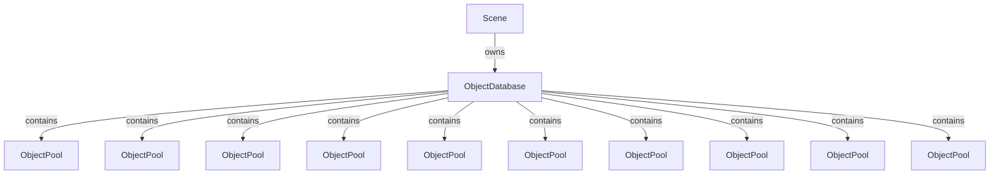
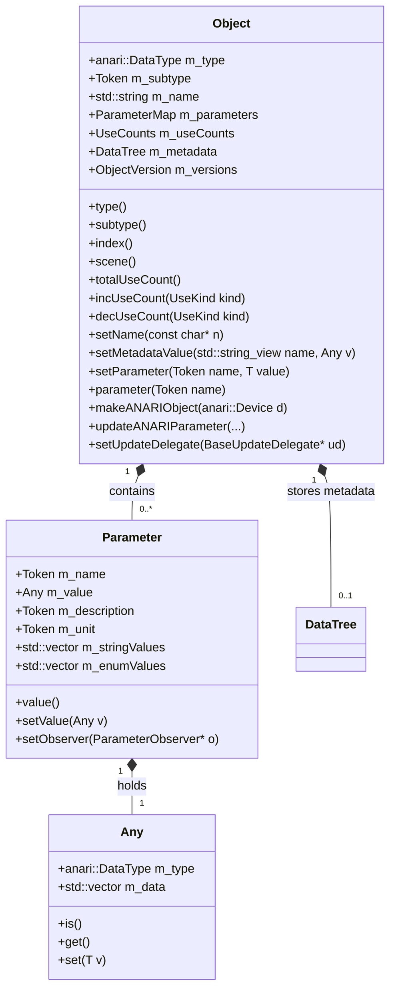
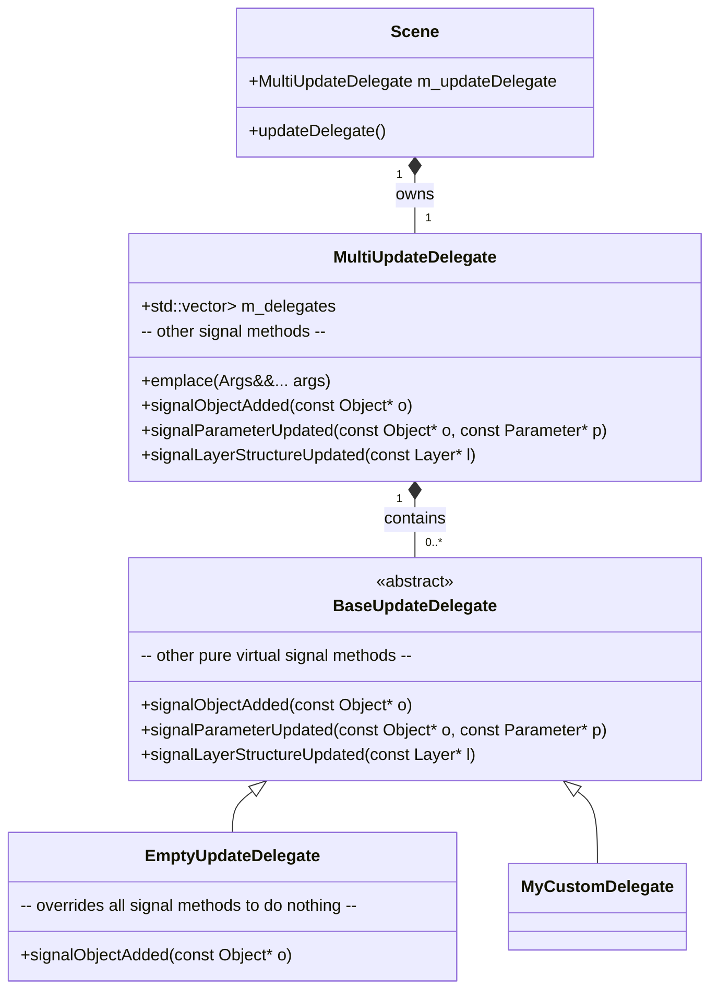

<!-- source: DeepWiki mcp.deepwiki.com · repo NVIDIA/VisRTX · page 4.2 Scene Library (tsd_scene) · fetched 2026-10-26 -->

# Scene Library (tsd_scene)

<details>
<summary>Relevant source files</summary>

The following files were used as context for generating this wiki page:

- [tsd/src/tsd/scene/AnariHandleCache.hpp](tsd/src/tsd/scene/AnariHandleCache.hpp)
- [tsd/src/tsd/scene/AnyObjectUsePtr.hpp](tsd/src/tsd/scene/AnyObjectUsePtr.hpp)
- [tsd/src/tsd/scene/CMakeLists.txt](tsd/src/tsd/scene/CMakeLists.txt)
- [tsd/src/tsd/scene/Layer.hpp](tsd/src/tsd/scene/Layer.hpp)
- [tsd/src/tsd/scene/Object.cpp](tsd/src/tsd/scene/Object.cpp)
- [tsd/src/tsd/scene/Object.hpp](tsd/src/tsd/scene/Object.hpp)
- [tsd/src/tsd/scene/ObjectUsePtr.hpp](tsd/src/tsd/scene/ObjectUsePtr.hpp)
- [tsd/src/tsd/scene/Parameter.hpp](tsd/src/tsd/scene/Parameter.hpp)
- [tsd/src/tsd/scene/Scene.cpp](tsd/src/tsd/scene/Scene.cpp)
- [tsd/src/tsd/scene/Scene.hpp](tsd/src/tsd/scene/Scene.hpp)
- [tsd/src/tsd/scene/UpdateDelegate.hpp](tsd/src/tsd/scene/UpdateDelegate.hpp)
- [tsd/src/tsd/scene/objects/Array.cpp](tsd/src/tsd/scene/objects/Array.cpp)
- [tsd/src/tsd/scene/objects/Array.hpp](tsd/src/tsd/scene/objects/Array.hpp)
- [tsd/src/tsd/scene/objects/Camera.hpp](tsd/src/tsd/scene/objects/Camera.hpp)
- [tsd/src/tsd/scene/objects/Geometry.cpp](tsd/src/tsd/scene/objects/Geometry.cpp)
- [tsd/src/tsd/scene/objects/Geometry.hpp](tsd/src/tsd/scene/objects/Geometry.hpp)
- [tsd/tests/test_Array.cpp](tsd/tests/test_Array.cpp)
- [tsd/tests/test_Object.cpp](tsd/tests/test_Object.cpp)
- [tsd/tests/test_Scene.cpp](tsd/tests/test_Scene.cpp)

</details>


The `tsd_scene` library provides the core data structures and management logic for representing and manipulating a 3D scene within the TSD framework. It defines the `Scene` class, which acts as the central repository for all scene objects, manages their lifecycle, and provides mechanisms for scene graph organization, parameter management, and change notification.

## Scene Class

The `Scene` class [tsd/src/tsd/scene/Scene.hpp:95-97]() is the central container for all ANARI-typed objects, a named layer hierarchy, and animations. It serves as the main entry point for creating, retrieving, and removing scene content.

### Object Databases

The `Scene` class internally manages various types of objects through an `ObjectDatabase` [tsd/src/tsd/scene/Scene.hpp:54-70](). This database is a collection of `ObjectPool` instances, one for each ANARI object type. This structure provides canonical storage for all scene objects, indexed by their pool slot.

The `ObjectDatabase` contains pools for:
*   `Array` [tsd/src/tsd/scene/Scene.hpp:56]()
*   `Surface` [tsd/src/tsd/scene/Scene.hpp:57]()
*   `Geometry` [tsd/src/tsd/scene/Scene.hpp:58]()
*   `Material` [tsd/src/tsd/scene/Scene.hpp:59]()
*   `Sampler` [tsd/src/tsd/scene/Scene.hpp:60]()
*   `Volume` [tsd/src/tsd/scene/Scene.hpp:61]()
*   `SpatialField` [tsd/src/tsd/scene/Scene.hpp:62]()
*   `Light` [tsd/src/tsd/scene/Scene.hpp:63]()
*   `Camera` [tsd/src/tsd/scene/Scene.hpp:64]()
*   `Renderer` [tsd/src/tsd/scene/Scene.hpp:65]()


Title: Scene Object Database Structure
Sources: [tsd/src/tsd/scene/Scene.hpp:54-70]()

Objects can be created using `Scene::createObject<T>(Token subtype)` [tsd/src/tsd/scene/Scene.hpp:118-119]() or specific `createArray`, `createSurface`, `createRenderer` methods [tsd/src/tsd/scene/Scene.hpp:120-134](). Objects are retrieved using `Scene::getObject(size_t i)` or `Scene::getObject(anari::DataType type, size_t i)` [tsd/src/tsd/scene/Scene.hpp:137-138]().

### Object and Parameter Model

The `Object` class [tsd/src/tsd/scene/Object.hpp:67-75]() is the base class for all TSD scene objects. It manages a named parameter map, reference-counted use tracking, optional metadata tree, and change-version counters.

Key features of the `Object` class:
*   **Type and Subtype**: Each object has an `anari::DataType` [tsd/src/tsd/scene/Object.hpp:82]() and a `Token` subtype [tsd/src/tsd/scene/Object.hpp:83]() (e.g., `ANARI_GEOMETRY` with subtype `sphere` [tsd/src/tsd/scene/objects/Geometry.cpp:9-17]()).
*   **Parameters**: Objects can have named parameters, stored in a `FlatMap<Token, Parameter>` [tsd/src/tsd/scene/Object.hpp:69](). Parameters can be set using `setParameter` [tsd/src/tsd/scene/Object.hpp:123-125]() and retrieved using `parameter` [tsd/src/tsd/scene/Object.hpp:130-131]() or `parameterValueAs` [tsd/src/tsd/scene/Object.hpp:132-135]().
*   **Metadata**: Objects can store arbitrary metadata as a `DataTree` [tsd/src/tsd/scene/Object.hpp:198](). Metadata can be set using `setMetadataValue` or `setMetadataArray` [tsd/src/tsd/scene/Object.hpp:108-113]() and retrieved using `getMetadataValue` or `getMetadataArray` [tsd/src/tsd/scene/Object.hpp:104-107]().
*   **Use Counts**: Objects track their usage through different `UseKind` categories (APP, PARAMETER, LAYER, ANIM, INTERNAL) [tsd/src/tsd/scene/Object.hpp:71-72](). This is crucial for garbage collection and scene maintenance. `incUseCount` and `decUseCount` [tsd/src/tsd/scene/Object.hpp:92-93]() manage these counts.
*   **Change Tracking**: `ObjectVersion` counters track `lastParameterChange` and `lastMetadataChange` [tsd/src/tsd/scene/Object.hpp:209-210]().
*   **ANARI Object Creation**: `makeANARIObject` [tsd/src/tsd/scene/Object.hpp:155]() creates the corresponding ANARI object, and `updateANARIParameter` / `updateAllANARIParameters` [tsd/src/tsd/scene/Object.hpp:157-162]() update ANARI object parameters.

The `Parameter` class [tsd/src/tsd/scene/Parameter.hpp]() represents a single parameter of an `Object`. It holds an `Any` value, which is a type-erased storage for ANARI-typed values [tsd/src/tsd/core/Any.hpp]().


Title: Object and Parameter Model
Sources: [tsd/src/tsd/scene/Object.hpp:67-75](), [tsd/src/tsd/scene/Parameter.hpp](), [tsd/src/tsd/core/Any.hpp]()

### Layer and Forest Scene Graph

The `Scene` organizes objects into a hierarchical scene graph using `Layer` objects [tsd/src/tsd/scene/Layer.hpp]() and a `Forest` data structure [tsd/src/tsd/core/Forest.hpp](). Each `Layer` contains a `Forest` of `LayerNode`s, which can represent transformations, objects, or simple groups.

*   **`Layer`**: A named collection of scene nodes, allowing for modular organization and activation/deactivation [tsd/src/tsd/scene/Scene.hpp:165-182]().
*   **`LayerNode`**: A node in the scene graph, holding `LayerNodeData` [tsd/src/tsd/scene/Layer.hpp:100-101]().
*   **`LayerNodeData`**: Contains the actual data for a node, which can be a transform (`mat4`), an object reference (`Object*`), or a simple group [tsd/src/tsd/scene/Layer.hpp:103-105](). It also stores instance parameters [tsd/src/tsd/scene/Layer.hpp:106]().

The `Scene` provides methods to `insertChildNode`, `insertChildTransformNode`, `insertChildObjectNode` [tsd/src/tsd/scene/Scene.hpp:188-200]() to build the scene graph. It also supports cloning subtrees with `cloneLayerSubtree` [tsd/src/tsd/scene/Scene.hpp:210-211](), with an option to deep-clone referenced objects [tsd/src/tsd/scene/Scene.cpp:141-148]().

```mermaid
graph TD
    Scene -- "manages" --> LayerMap["LayerMap (FlatMap<Token, LayerState>)"]
    LayerMap -- "contains" --> LayerState
    LayerState -- "holds" --> LayerPtr["std::shared_ptr<Layer>"]
    Layer -- "contains" --> Forest_LayerNode["Forest<LayerNodeData>"]
    Forest_LayerNode -- "composed of" --> LayerNode
    LayerNode -- "holds" --> LayerNodeData

    LayerNodeData -- "can be" --> "Transform (mat4)"
    LayerNodeData -- "can be" --> "Object Reference (Object*)"
    LayerNodeData -- "can be" --> "Group"
    LayerNodeData -- "also has" --> "InstanceParameterMap"

    Object -- "referenced by" --> LayerNodeData
```
Title: Layer and Forest Scene Graph Structure
Sources: [tsd/src/tsd/scene/Scene.hpp:79-81](), [tsd/src/tsd/scene/Layer.hpp](), [tsd/src/tsd/core/Forest.hpp]()

### AnyObjectUsePtr Reference Counting

The `AnyObjectUsePtr` [tsd/src/tsd/scene/AnyObjectUsePtr.hpp:22-23]() is a type-erased owning pointer to any `Object` subclass. It automatically increments the object's use count (by default, `Object::UseKind::APP`) on assignment and decrements it on release [tsd/src/tsd/scene/AnyObjectUsePtr.hpp:68-74](). This mechanism helps the `Scene` track object references and manage their lifecycle, preventing premature deletion.

```cpp
// Example usage of AnyObjectUsePtr
auto geometry = scene.createObject<tsd::scene::Geometry>(tsd::scene::tokens::geometry::sphere);
tsd::scene::AnyObjectUsePtr<tsd::scene::Object::UseKind::APP> geomPtr(*geometry); // Increments APP use count
// ... use geomPtr ...
geomPtr.reset(); // Decrements APP use count
```
Sources: [tsd/src/tsd/scene/AnyObjectUsePtr.hpp:22-23](), [tsd/src/tsd/scene/AnyObjectUsePtr.hpp:68-74]()

### AnariHandleCache

The `AnariHandleCache` [tsd/src/tsd/scene/AnariHandleCache.hpp]() is used to cache ANARI handles for objects. When an `Object` needs to create or update its corresponding ANARI object (e.g., in `Object::makeANARIObject` or `Object::updateANARIParameter` [tsd/src/tsd/scene/Object.hpp:155-162]()), it can use this cache to avoid redundant ANARI object creation or handle lookups.

### UpdateDelegate Notification System

The `Scene` employs an `UpdateDelegate` system to notify interested parties about changes within the scene. The `MultiUpdateDelegate` [tsd/src/tsd/scene/UpdateDelegate.hpp:104-105]() acts as a root delegate that can fan out notifications to multiple child delegates.

*   **`BaseUpdateDelegate`**: An abstract interface for observers [tsd/src/tsd/scene/UpdateDelegate.hpp:33-59](). It defines virtual methods for various scene events, such as `signalObjectAdded`, `signalParameterUpdated`, `signalLayerStructureUpdated`, etc.
*   **`EmptyUpdateDelegate`**: A concrete implementation that silently discards all signals, useful as a placeholder [tsd/src/tsd/scene/UpdateDelegate.hpp:69-93]().
*   **`MultiUpdateDelegate`**: Owns a list of child delegates and dispatches all signals to them [tsd/src/tsd/scene/UpdateDelegate.hpp:104-105](). This allows multiple independent systems (e.g., rendering, networking) to observe the scene simultaneously.

Delegates can be added to the scene's `MultiUpdateDelegate` using `emplace<T>()` [tsd/src/tsd/scene/UpdateDelegate.hpp:146-151]().


Title: UpdateDelegate Notification System
Sources: [tsd/src/tsd/scene/UpdateDelegate.hpp:33-59](), [tsd/src/tsd/scene/UpdateDelegate.hpp:69-93](), [tsd/src/tsd/scene/UpdateDelegate.hpp:104-105]()

### Scene Maintenance (Defrag, Cleanup)

The `Scene` performs maintenance operations to ensure efficiency and correctness:
*   **Defragmentation**: The `Scene` registers a `DefragCallback` [tsd/src/tsd/scene/Scene.hpp:222-233]() to handle object index remapping when `ObjectPool`s are defragmented. This callback updates object references within `LayerNode`s and object parameters to reflect new indices.
*   **Cleanup**: When objects are removed or their use counts drop to zero, the `Scene` handles their proper destruction and removal from the `ObjectPool`s. The `Object::UseKind` system is central to this garbage collection. For example, `signalObjectParameterUseCountZero` and `signalObjectLayerUseCountZero` [tsd/src/tsd/scene/UpdateDelegate.hpp:82-83]() are part of this mechanism.

Sources: [tsd/src/tsd/scene/Scene.hpp:222-233](), [tsd/src/tsd/scene/UpdateDelegate.hpp:82-83]()

---

