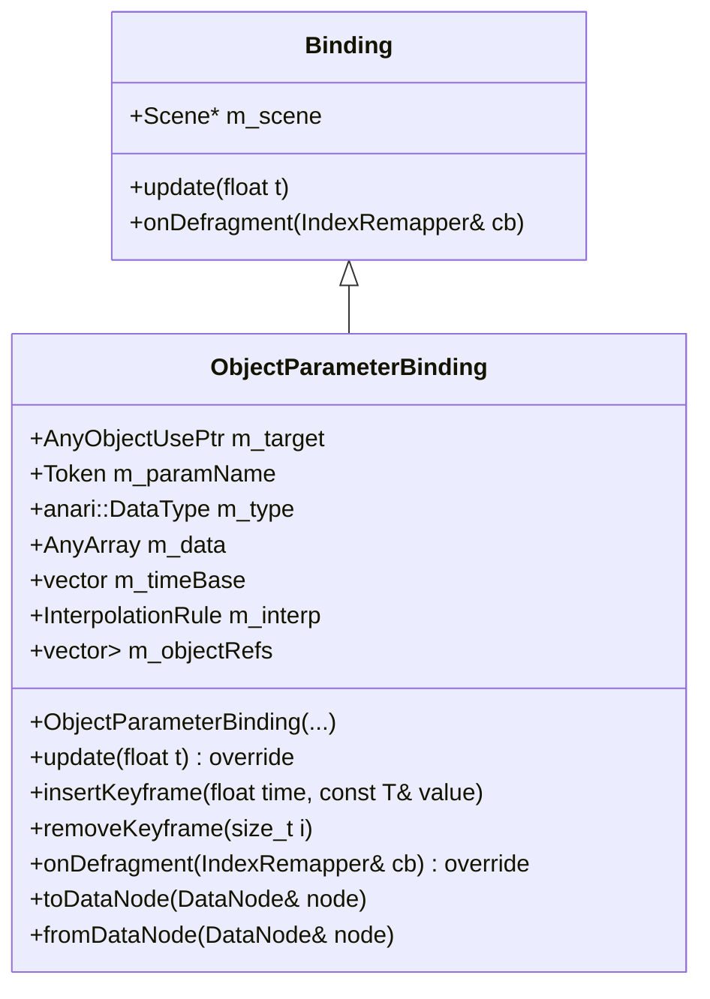
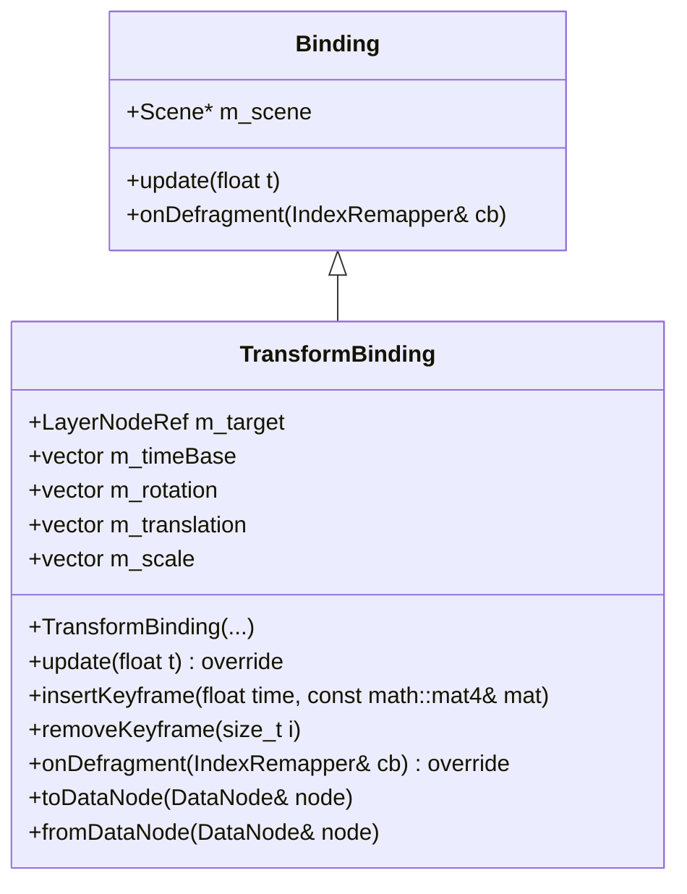
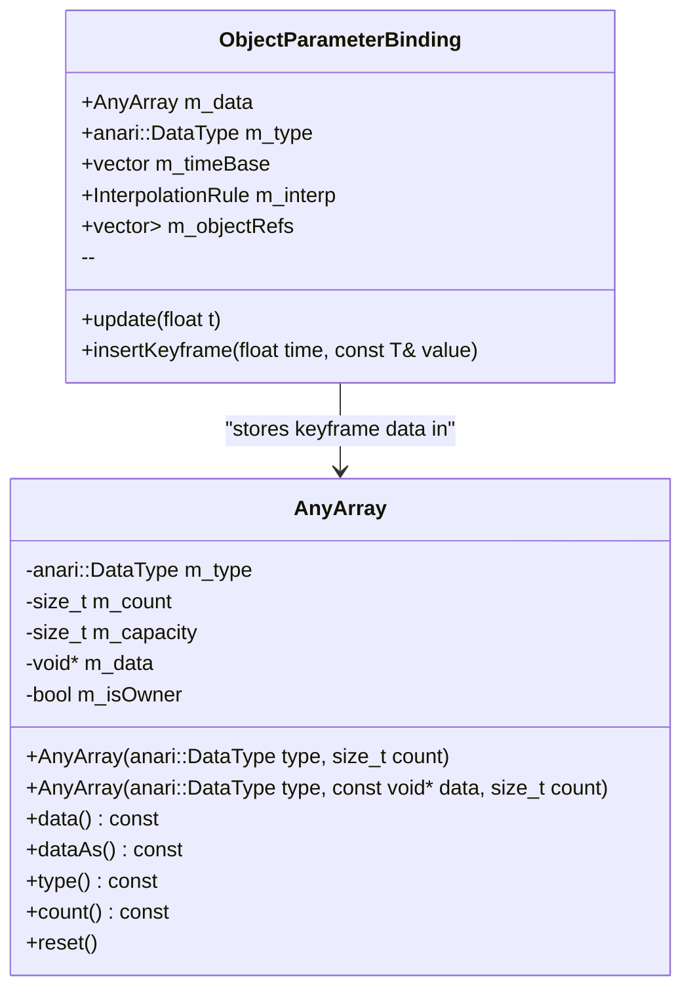

<!-- source: DeepWiki mcp.deepwiki.com · repo NVIDIA/VisRTX · page 4.3 Animation System (tsd_animation) · fetched 2026-10-26 -->

# Animation System (tsd_animation)

<details>
<summary>Relevant source files</summary>

The following files were used as context for generating this wiki page:

- [tsd/scripts/test_lua_api.lua](tsd/scripts/test_lua_api.lua)
- [tsd/src/tsd/animation/Animation.cpp](tsd/src/tsd/animation/Animation.cpp)
- [tsd/src/tsd/animation/Animation.hpp](tsd/src/tsd/animation/Animation.hpp)
- [tsd/src/tsd/animation/AnimationManager.cpp](tsd/src/tsd/animation/AnimationManager.cpp)
- [tsd/src/tsd/animation/AnimationManager.hpp](tsd/src/tsd/animation/AnimationManager.hpp)
- [tsd/src/tsd/animation/Binding.hpp](tsd/src/tsd/animation/Binding.hpp)
- [tsd/src/tsd/animation/CMakeLists.txt](tsd/src/tsd/animation/CMakeLists.txt)
- [tsd/src/tsd/animation/FileBinding.hpp](tsd/src/tsd/animation/FileBinding.hpp)
- [tsd/src/tsd/animation/Interpolation.hpp](tsd/src/tsd/animation/Interpolation.hpp)
- [tsd/src/tsd/animation/ObjectParameterBinding.cpp](tsd/src/tsd/animation/ObjectParameterBinding.cpp)
- [tsd/src/tsd/animation/ObjectParameterBinding.hpp](tsd/src/tsd/animation/ObjectParameterBinding.hpp)
- [tsd/src/tsd/animation/README.md](tsd/src/tsd/animation/README.md)
- [tsd/src/tsd/animation/TransformBinding.cpp](tsd/src/tsd/animation/TransformBinding.cpp)
- [tsd/src/tsd/animation/TransformBinding.hpp](tsd/src/tsd/animation/TransformBinding.hpp)
- [tsd/src/tsd/core/Any.hpp](tsd/src/tsd/core/Any.hpp)
- [tsd/src/tsd/io/animation/SpatialFieldFileBinding.cpp](tsd/src/tsd/io/animation/SpatialFieldFileBinding.cpp)
- [tsd/src/tsd/io/animation/SpatialFieldFileBinding.hpp](tsd/src/tsd/io/animation/SpatialFieldFileBinding.hpp)
- [tsd/src/tsd/io/serialization.hpp](tsd/src/tsd/io/serialization.hpp)
- [tsd/src/tsd/io/serialization/serialization_datatree.cpp](tsd/src/tsd/io/serialization/serialization_datatree.cpp)
- [tsd/src/tsd/scripting/Sol2Helpers.hpp](tsd/src/tsd/scripting/Sol2Helpers.hpp)
- [tsd/src/tsd/scripting/bindings/ArrayHelpers.hpp](tsd/src/tsd/scripting/bindings/ArrayHelpers.hpp)
- [tsd/src/tsd/scripting/bindings/CoreBindings.cpp](tsd/src/tsd/scripting/bindings/CoreBindings.cpp)
- [tsd/src/tsd/scripting/bindings/ObjectBindings.cpp](tsd/src/tsd/scripting/bindings/ObjectBindings.cpp)
- [tsd/src/tsd/scripting/bindings/ParameterHelpers.cpp](tsd/src/tsd/scripting/bindings/ParameterHelpers.cpp)
- [tsd/src/tsd/ui/imgui/windows/Animations.cpp](tsd/src/tsd/ui/imgui/windows/Animations.cpp)
- [tsd/src/tsd/ui/imgui/windows/Animations.h](tsd/src/tsd/ui/imgui/windows/Animations.h)
- [tsd/src/tsd/ui/imgui/windows/Timeline.cpp](tsd/src/tsd/ui/imgui/windows/Timeline.cpp)
- [tsd/src/tsd/ui/imgui/windows/Timeline.h](tsd/src/tsd/ui/imgui/windows/Timeline.h)
- [tsd/tests/test_AnimationManager.cpp](tsd/tests/test_AnimationManager.cpp)

</details>


The `tsd_animation` library provides a robust and flexible system for animating scene parameters and object transformations over time. It includes core components for managing animations, defining various types of bindings to scene objects, and handling keyframe interpolation. This system is integrated with the `tsd_scene` library to directly manipulate scene objects and their parameters.

## Core Components

The animation system revolves around two main classes: `AnimationManager` and `Animation`.

### AnimationManager

The `AnimationManager` class [tsd/src/tsd/animation/AnimationManager.hpp:24-24]() is responsible for overseeing all active animations within a `tsd::scene::Scene` [tsd/src/tsd/animation/AnimationManager.hpp:27-27](). It provides functionalities for adding, removing, playing, pausing, and controlling the global animation time.

**Key Responsibilities:**
*   **Animation Lifecycle:** Manages the creation and destruction of `Animation` objects [tsd/src/tsd/animation/AnimationManager.hpp:30-30]().
*   **Global Time Control:** Maintains the current animation time, playback speed (FPS), and total animation frames [tsd/src/tsd/animation/AnimationManager.hpp:32-32]().
*   **Playback Control:** Offers methods to `play()` [tsd/src/tsd/animation/AnimationManager.hpp:40-40](), `stop()` [tsd/src/tsd/animation/AnimationManager.hpp:41-41](), and `setLoop()` [tsd/src/tsd/animation/AnimationManager.hpp:42-42]() animations.
*   **Update Mechanism:** The `update()` method [tsd/src/tsd/animation/AnimationManager.hpp:44-44]() is called periodically to advance the animation time and trigger updates on all managed `Animation` objects.
*   **Serialization:** Can be serialized to and deserialized from a `core::DataNode` [tsd/src/tsd/io/serialization.hpp:105-106]().

**Data Flow:**
1.  The `AnimationManager` is initialized with a `tsd::scene::Scene` instance [tsd/src/tsd/animation/AnimationManager.cpp:14-15]().
2.  `Animation` objects are added to the manager [tsd/src/tsd/animation/AnimationManager.hpp:46-46]().
3.  When `update()` is called [tsd/src/tsd/animation/AnimationManager.cpp:40-40](), it calculates the new animation time based on `m_fps` [tsd/src/tsd/animation/AnimationManager.cpp:46-46]() and `m_increment` [tsd/src/tsd/animation/AnimationManager.cpp:47-47]().
4.  It then iterates through all `Animation` objects and calls their `setAnimationTime()` method [tsd/src/tsd/animation/AnimationManager.cpp:54-54]().
5.  The `Timeline` UI window [tsd/src/tsd/ui/imgui/windows/Timeline.cpp:63-63]() interacts with the `AnimationManager` to control playback and display animation progress.

```mermaid
graph TD
    A[Application] --> B{AnimationManager};
    B -- "Manages" --> C[Animation];
    B -- "setAnimationTime(t)" --> C;
    C -- "Updates" --> D[Binding (ObjectParameterBinding, TransformBinding, CallbackBinding, FileBinding)];
    D -- "Applies changes to" --> E[tsd::scene::Object];
    E -- "Affects" --> F[Rendered Scene];

    subgraph UI
        G[Timeline Window] --> B;
        H[Animations Window] --> B;
    end
```
**Diagram: Animation System Overview**
Sources: [tsd/src/tsd/animation/AnimationManager.hpp:24-24](), [tsd/src/tsd/animation/AnimationManager.hpp:27-27](), [tsd/src/tsd/animation/AnimationManager.hpp:30-30](), [tsd/src/tsd/animation/AnimationManager.hpp:32-32](), [tsd/src/tsd/animation/AnimationManager.hpp:40-40](), [tsd/src/tsd/animation/AnimationManager.hpp:41-41](), [tsd/src/tsd/animation/AnimationManager.hpp:42-42](), [tsd/src/tsd/animation/AnimationManager.hpp:44-44](), [tsd/src/tsd/animation/AnimationManager.cpp:14-15](), [tsd/src/tsd/animation/AnimationManager.hpp:46-46](), [tsd/src/tsd/animation/AnimationManager.cpp:40-40](), [tsd/src/tsd/animation/AnimationManager.cpp:46-46](), [tsd/src/tsd/animation/AnimationManager.cpp:47-47](), [tsd/src/tsd/animation/AnimationManager.cpp:54-54](), [tsd/src/tsd/ui/imgui/windows/Timeline.cpp:63-63](), [tsd/src/tsd/io/serialization.hpp:105-106]()

### Animation

An `Animation` object [tsd/src/tsd/animation/Animation.hpp:32-32]() represents a named sequence of animated changes. It holds a collection of different `Binding` types that define what parameters or transformations are animated.

**Key Responsibilities:**
*   **Binding Container:** Stores `ObjectParameterBinding`, `TransformBinding`, `CallbackBinding`, and `FileBinding` objects [tsd/src/tsd/animation/Animation.hpp:112-115]().
*   **Time Evaluation:** When `setAnimationTime(float t)` is called [tsd/src/tsd/animation/Animation.hpp:44-44](), it iterates through all its bindings and triggers their `update(t)` method [tsd/src/tsd/animation/Animation.cpp:35-39]().
*   **Object Index Remapping:** Implements `updateObjectDefragmentedIndices()` [tsd/src/tsd/animation/Animation.hpp:45-45]() to handle changes in object indices due to scene defragmentation [tsd/src/tsd/animation/Animation.cpp:42-51]().
*   **Serialization:** Can be serialized to and deserialized from a `core::DataNode` [tsd/src/tsd/io/serialization.hpp:103-104]().

## Bindings

Bindings are the core mechanism for connecting animation data to scene objects. All binding types inherit from the `Binding` base class [tsd/src/tsd/animation/Binding.hpp:14-14]().

### Binding Base Class

The `Binding` base class [tsd/src/tsd/animation/Binding.hpp:14-14]() provides a common interface for all animation bindings. It holds a reference to the `tsd::scene::Scene` [tsd/src/tsd/animation/Binding.hpp:16-16]() and defines the `update()` [tsd/src/tsd/animation/Binding.hpp:18-18]() and `onDefragment()` [tsd/src/tsd/animation/Binding.hpp:19-19]() virtual methods.

### ObjectParameterBinding

The `ObjectParameterBinding` [tsd/src/tsd/animation/ObjectParameterBinding.hpp:31-31]() animates a single named parameter on a `tsd::scene::Object`. It stores keyframe values in an `AnyArray` [tsd/src/tsd/animation/ObjectParameterBinding.hpp:71-71]() and interpolates them based on a specified `InterpolationRule` [tsd/src/tsd/animation/ObjectParameterBinding.hpp:73-73]().

**Key Features:**
*   **Target Object:** Points to a `tsd::scene::Object` [tsd/src/tsd/animation/ObjectParameterBinding.hpp:68-68]() using an `AnyObjectUsePtr` [tsd/src/tsd/animation/ObjectParameterBinding.hpp:68-68]() to ensure robust referencing even after scene defragmentation.
*   **Parameter Name:** Identifies the parameter to animate using a `core::Token` [tsd/src/tsd/animation/ObjectParameterBinding.hpp:69-69]().
*   **Typed Keyframes:** Stores keyframe values in a `core::AnyArray` [tsd/src/tsd/animation/ObjectParameterBinding.hpp:71-71()], allowing for various ANARI data types (e.g., `ANARI_FLOAT32`, `ANARI_FLOAT32_VEC3`, `ANARI_OBJECT`) [tsd/src/tsd/animation/ObjectParameterBinding.cpp:30-45]().
*   **Time Base:** Keyframes are associated with specific time values stored in `m_timeBase` [tsd/src/tsd/animation/ObjectParameterBinding.hpp:72-72]().
*   **Interpolation:** Supports `STEP` and `LINEAR` interpolation for numeric types [tsd/src/tsd/animation/ObjectParameterBinding.cpp:93-128](). Object types use `STEP` interpolation [tsd/src/tsd/animation/ObjectParameterBinding.cpp:75-78]().
*   **Keyframe Management:** Provides `insertKeyframe()` [tsd/src/tsd/animation/ObjectParameterBinding.hpp:55-56]() and `removeKeyframe()` [tsd/src/tsd/animation/ObjectParameterBinding.hpp:57-57]() methods.

**Implementation Details:**
*   The `update()` method [tsd/src/tsd/animation/ObjectParameterBinding.cpp:131-148]() finds the relevant time sample using `findTimeSample()` [tsd/src/tsd/animation/Interpolation.hpp:29-29]() and then calls `interpolate()` [tsd/src/tsd/animation/ObjectParameterBinding.cpp:82-129]() to get the interpolated value.
*   The interpolated value is then applied to the target object's parameter using `setParameter()` or `setParameterObject()` [tsd/src/tsd/animation/ObjectParameterBinding.cpp:142-146]().
*   For object parameters, `m_objectRefs` [tsd/src/tsd/animation/ObjectParameterBinding.hpp:75-76]() stores `AnyObjectUsePtr`s to the actual objects, ensuring they remain valid even if the scene's object pool is defragmented [tsd/src/tsd/animation/ObjectParameterBinding.cpp:35-40]().


**Diagram: ObjectParameterBinding Class Diagram**
Sources: [tsd/src/tsd/animation/ObjectParameterBinding.hpp:31-31](), [tsd/src/tsd/animation/ObjectParameterBinding.hpp:68-68](), [tsd/src/tsd/animation/ObjectParameterBinding.hpp:69-69](), [tsd/src/tsd/animation/ObjectParameterBinding.hpp:71-71](), [tsd/src/tsd/animation/ObjectParameterBinding.hpp:73-73](), [tsd/src/tsd/animation/ObjectParameterBinding.cpp:30-45](), [tsd/src/tsd/animation/ObjectParameterBinding.hpp:72-72](), [tsd/src/tsd/animation/ObjectParameterBinding.cpp:93-128](), [tsd/src/tsd/animation/ObjectParameterBinding.cpp:75-78](), [tsd/src/tsd/animation/ObjectParameterBinding.hpp:55-56](), [tsd/src/tsd/animation/ObjectParameterBinding.hpp:57-57](), [tsd/src/tsd/animation/ObjectParameterBinding.cpp:131-148](), [tsd/src/tsd/animation/Interpolation.hpp:29-29](), [tsd/src/tsd/animation/ObjectParameterBinding.cpp:82-129](), [tsd/src/tsd/animation/ObjectParameterBinding.cpp:142-146](), [tsd/src/tsd/animation/ObjectParameterBinding.hpp:75-76](), [tsd/src/tsd/animation/ObjectParameterBinding.cpp:35-40]()

### TransformBinding

The `TransformBinding` [tsd/src/tsd/animation/TransformBinding.hpp:24-24]() animates the transformation (rotation, translation, scale) of a `tsd::scene::LayerNode` [tsd/src/tsd/animation/TransformBinding.hpp:27-27](). It uses quaternion spherical linear interpolation (SLERP) for rotations and linear interpolation for translation and scale.

**Key Features:**
*   **Target Node:** Animates a `tsd::scene::LayerNode` [tsd/src/tsd/animation/TransformBinding.hpp:27-27](), which represents an object in the scene graph.
*   **Keyframe Data:** Stores keyframes for rotation (quaternions), translation (float3), and scale (float3) [tsd/src/tsd/animation/TransformBinding.hpp:30-32]().
*   **Interpolation:**
    *   **Rotation:** Uses SLERP for smooth rotational transitions [tsd/src/tsd/animation/TransformBinding.cpp:100-100]().
    *   **Translation/Scale:** Uses linear interpolation [tsd/src/tsd/animation/TransformBinding.cpp:101-102]().
*   **Matrix Application:** The interpolated transformation is converted into a 4x4 matrix and applied to the target `LayerNode` [tsd/src/tsd/animation/TransformBinding.cpp:104-105]().


**Diagram: TransformBinding Class Diagram**
Sources: [tsd/src/tsd/animation/TransformBinding.hpp:24-24](), [tsd/src/tsd/animation/TransformBinding.hpp:27-27](), [tsd/src/tsd/animation/TransformBinding.hpp:30-32](), [tsd/src/tsd/animation/TransformBinding.cpp:100-100](), [tsd/src/tsd/animation/TransformBinding.cpp:101-102](), [tsd/src/tsd/animation/TransformBinding.cpp:104-105]()

### CallbackBinding

The `CallbackBinding` [tsd/src/tsd/animation/CallbackBinding.hpp:20-20]() allows custom logic to be executed at specific animation times. It holds a `std::function` [tsd/src/tsd/animation/CallbackBinding.hpp:23-23]() that is invoked during the `update()` call.

**Key Features:**
*   **Custom Logic:** Enables arbitrary code execution, useful for triggering events, loading data, or performing complex non-interpolated actions.
*   **Time-based Trigger:** The callback is invoked when the animation time reaches a keyframe's time.
*   **No Interpolation:** This binding type does not involve interpolation; it's purely event-driven.

### FileBinding

The `FileBinding` [tsd/src/tsd/animation/FileBinding.hpp:18-18]() is an abstract base class for bindings that load animation data from external files. It provides a mechanism for dynamically updating scene objects based on file contents over time.

**Key Features:**
*   **Abstract Interface:** Defines `update()` [tsd/src/tsd/animation/FileBinding.hpp:21-21]() and `addCallbackToAnimation()` [tsd/src/tsd/animation/FileBinding.hpp:22-22]() methods that concrete file bindings must implement.
*   **Dynamic Loading:** Designed for scenarios where animation data is too large to store in memory or needs to be streamed from disk.
*   **Type-erased Storage:** `Animation` stores `std::unique_ptr<FileBinding>` [tsd/src/tsd/animation/Animation.hpp:115-115](), allowing for different concrete file binding types.

#### SpatialFieldFileBinding

The `SpatialFieldFileBinding` [tsd/src/tsd/io/animation/SpatialFieldFileBinding.hpp:20-20]() is a concrete `FileBinding` that animates a `tsd::scene::SpatialField` [tsd/src/tsd/io/animation/SpatialFieldFileBinding.hpp:23-23()] by loading different spatial field files (e.g., NanoVDB, MHD) at specified time steps.

**Key Features:**
*   **Spatial Field Animation:** Changes the underlying data of a `SpatialField` object over time.
*   **File Sequence:** Expects a sequence of files, where each file corresponds to a specific time step.
*   **Importer Integration:** Uses `tsd::io::import_SpatialField()` [tsd/src/tsd/io/animation/SpatialFieldFileBinding.cpp:100-100]() to load the spatial field data.

#### EnSightFileBinding

The `EnSightFileBinding` [tsd/src/tsd/io/animation/EnSightFileBinding.hpp:20-20]() is another concrete `FileBinding` that animates a `tsd::scene::SpatialField` [tsd/src/tsd/io/animation/EnSightFileBinding.hpp:23-23()] by loading time-varying data from EnSight files.

**Key Features:**
*   **EnSight Data:** Specifically designed to handle the EnSight file format, common in scientific visualization.
*   **Time Steps:** Loads different time steps from an EnSight case file.
*   **Importer Integration:** Uses `tsd::io::import_EnSight()` [tsd/src/tsd/io/animation/EnSightFileBinding.cpp:100-100]() to load the EnSight data.

## InterpolationRule

The `InterpolationRule` enum [tsd/src/tsd/animation/Interpolation.hpp:16-20]() defines how keyframe values are interpolated between time steps.

*   `STEP`: The value remains constant until the next keyframe, then immediately jumps to the new value.
*   `LINEAR`: Values are linearly interpolated between keyframes. Applicable to numeric types.
*   `SLERP`: Spherical Linear Interpolation. Specifically used for quaternions in `TransformBinding` to ensure smooth rotational transitions.

The `findTimeSample()` function [tsd/src/tsd/animation/Interpolation.hpp:29-29]() is a utility that determines the `lo` and `hi` keyframe indices and the `alpha` interpolation factor for a given animation time `t`.

## AnyArray Keyframe Storage

`core::AnyArray` [tsd/src/tsd/core/AnyArray.hpp:20-20]() is a type-erased container used to store keyframe data for `ObjectParameterBinding`. It can hold arrays of any ANARI data type, including scalars, vectors, and object references.

**Key Features:**
*   **Type-erased Storage:** Stores data of various ANARI types without compile-time knowledge of the specific type.
*   **Dynamic Sizing:** Can be resized to accommodate different numbers of keyframes.
*   **Data Access:** Provides methods to access the raw data pointer (`data()`) [tsd/src/tsd/core/AnyArray.hpp:40-40]() and to cast it to a specific type (`dataAs<T>()`) [tsd/src/tsd/core/AnyArray.hpp:41-41]().
*   **Object References:** For ANARI object types, it stores object indices, and `ObjectParameterBinding` maintains `AnyObjectUsePtr`s to the actual objects [tsd/src/tsd/animation/ObjectParameterBinding.hpp:75-76]().


**Diagram: AnyArray and ObjectParameterBinding**
Sources: [tsd/src/tsd/core/AnyArray.hpp:20-20](), [tsd/src/tsd/core/AnyArray.hpp:40-40](), [tsd/src/tsd/core/AnyArray.hpp:41-41](), [tsd/src/tsd/animation/ObjectParameterBinding.hpp:75-76]()

Sources: [tsd/src/tsd/animation/AnimationManager.hpp:24-24](), [tsd/src/tsd/animation/Animation.hpp:32-32](), [tsd/src/tsd/animation/Binding.hpp:14-14](), [tsd/src/tsd/animation/ObjectParameterBinding.hpp:31-31](), [tsd/src/tsd/animation/TransformBinding.hpp:24-24](), [tsd/src/tsd/animation/CallbackBinding.hpp:20-20](), [tsd/src/tsd/animation/FileBinding.hpp:18-18](), [tsd/src/tsd/io/animation/SpatialFieldFileBinding.hpp:20-20](), [tsd/src/tsd/io/animation/EnSightFileBinding.hpp:20-20](), [tsd/src/tsd/animation/Interpolation.hpp:16-20](), [tsd/src/tsd/core/AnyArray.hpp:20-20]()

---

