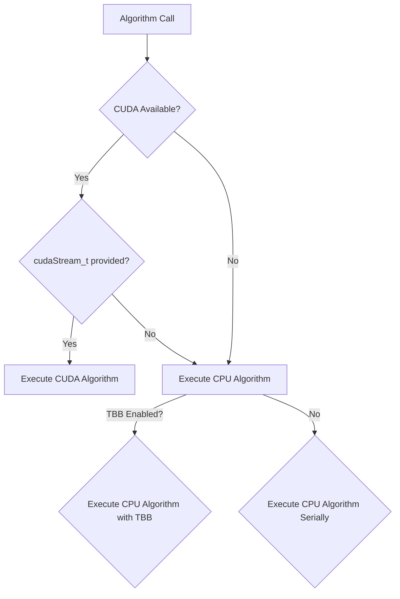
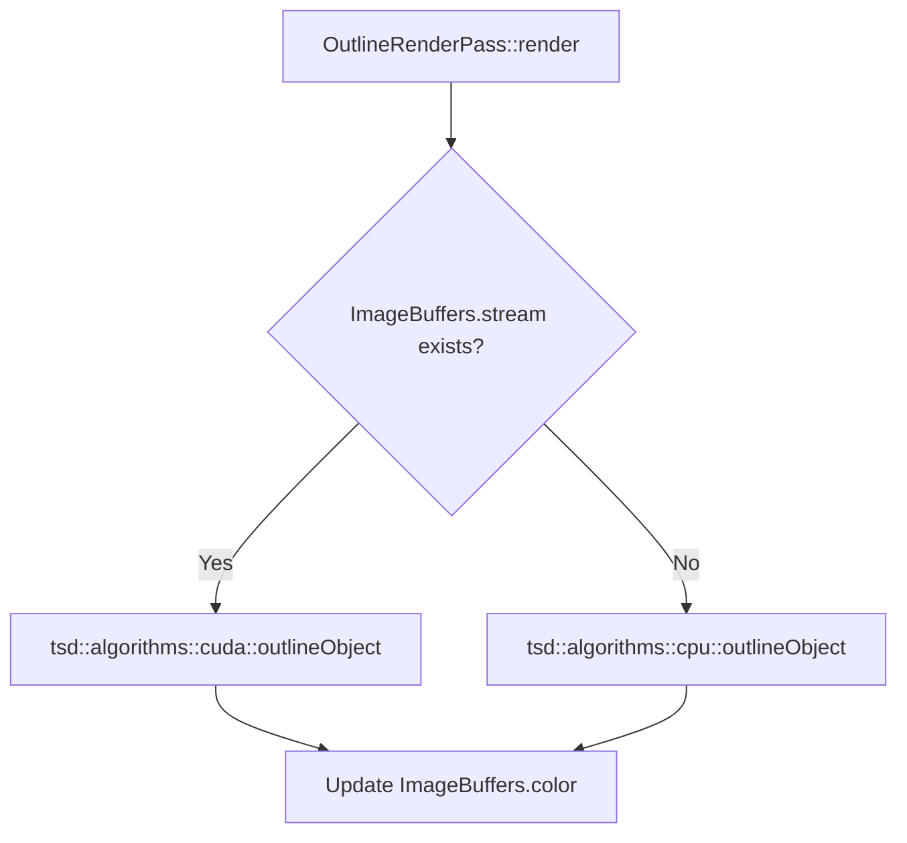
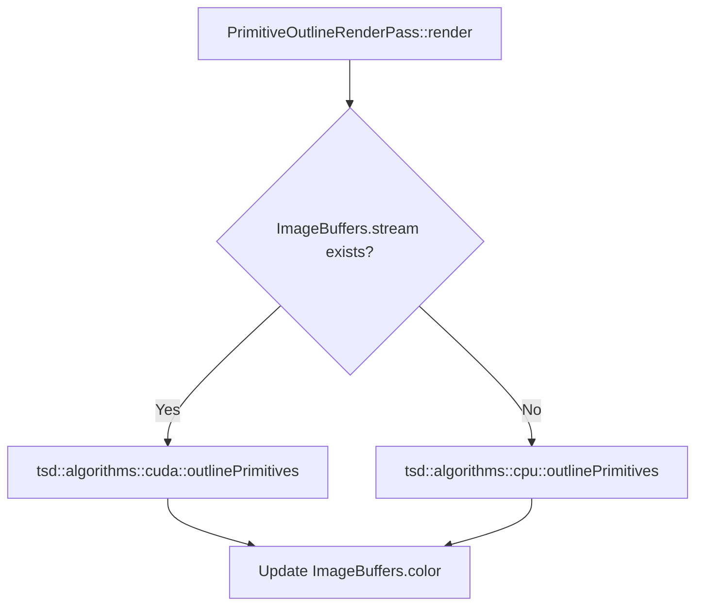

<!-- source: DeepWiki mcp.deepwiki.com · repo NVIDIA/VisRTX · page 4.5 Algorithms Library (tsd_algorithms) · fetched 2026-10-26 -->

# Algorithms Library (tsd_algorithms)

<details>
<summary>Relevant source files</summary>

The following files were used as context for generating this wiki page:

- [tsd/src/tsd/algorithms/CMakeLists.txt](tsd/src/tsd/algorithms/CMakeLists.txt)
- [tsd/src/tsd/algorithms/cpu/autoExposure.cpp](tsd/src/tsd/algorithms/cpu/autoExposure.cpp)
- [tsd/src/tsd/algorithms/cpu/autoExposure.hpp](tsd/src/tsd/algorithms/cpu/autoExposure.hpp)
- [tsd/src/tsd/algorithms/cpu/depthCompositeFrame.cpp](tsd/src/tsd/algorithms/cpu/depthCompositeFrame.cpp)
- [tsd/src/tsd/algorithms/cpu/depthCompositeFrame.hpp](tsd/src/tsd/algorithms/cpu/depthCompositeFrame.hpp)
- [tsd/src/tsd/algorithms/cpu/outline.cpp](tsd/src/tsd/algorithms/cpu/outline.cpp)
- [tsd/src/tsd/algorithms/cpu/outline.hpp](tsd/src/tsd/algorithms/cpu/outline.hpp)
- [tsd/src/tsd/algorithms/cuda/autoExposure.cu](tsd/src/tsd/algorithms/cuda/autoExposure.cu)
- [tsd/src/tsd/algorithms/cuda/autoExposure.hpp](tsd/src/tsd/algorithms/cuda/autoExposure.hpp)
- [tsd/src/tsd/algorithms/cuda/depthCompositeFrame.cu](tsd/src/tsd/algorithms/cuda/depthCompositeFrame.cu)
- [tsd/src/tsd/algorithms/cuda/depthCompositeFrame.hpp](tsd/src/tsd/algorithms/cuda/depthCompositeFrame.hpp)
- [tsd/src/tsd/algorithms/cuda/outline.cu](tsd/src/tsd/algorithms/cuda/outline.cu)
- [tsd/src/tsd/algorithms/cuda/outline.hpp](tsd/src/tsd/algorithms/cuda/outline.hpp)
- [tsd/src/tsd/algorithms/math/color.h](tsd/src/tsd/algorithms/math/color.h)
- [tsd/src/tsd/rendering/pipeline/passes/CopyFromColorBufferPass.cpp](tsd/src/tsd/rendering/pipeline/passes/CopyFromColorBufferPass.cpp)
- [tsd/src/tsd/rendering/pipeline/passes/CopyToColorBufferPass.cpp](tsd/src/tsd/rendering/pipeline/passes/CopyToColorBufferPass.cpp)
- [tsd/src/tsd/rendering/pipeline/passes/OutlineRenderPass.cpp](tsd/src/tsd/rendering/pipeline/passes/OutlineRenderPass.cpp)
- [tsd/src/tsd/rendering/pipeline/passes/PrimitiveOutlineRenderPass.cpp](tsd/src/tsd/rendering/pipeline/passes/PrimitiveOutlineRenderPass.cpp)
- [tsd/src/tsd/rendering/pipeline/passes/PrimitiveOutlineRenderPass.h](tsd/src/tsd/rendering/pipeline/passes/PrimitiveOutlineRenderPass.h)

</details>


The `tsd_algorithms` library provides a collection of image processing and computational algorithms with dual CPU and CUDA backends. This design allows for flexible deployment, leveraging GPU acceleration when available, or falling back to CPU execution. The library includes functionalities for tone mapping, auto-exposure, output transformations, AOV (Arbitrary Output Variable) visualization, outline rendering, depth compositing, and buffer manipulation.

Sources:
- [tsd/src/tsd/algorithms/CMakeLists.txt:1-56]()

## Architecture and Backend Selection

The `tsd_algorithms` library is built with a dual-backend approach, supporting both CPU and CUDA implementations for its algorithms. The CPU backend is always present, while the CUDA backend is conditionally compiled based on the `TSD_USE_CUDA` CMake option.

When `TSD_USE_CUDA` is enabled, the library links against `CUDA::cudart` and `Thrust::Thrust`, and defines `TSD_ALGORITHMS_HAS_CUDA`. This allows for runtime selection of the appropriate backend, typically by checking for the presence of a `cudaStream_t` in the `ImageBuffers` structure within the `tsd::rendering` pipeline.

The CPU implementations can optionally use Intel TBB for parallel execution if `TSD_USE_TBB` is enabled.

### Backend Selection Flow



Sources:
- [tsd/src/tsd/algorithms/CMakeLists.txt:25-32]()
- [tsd/src/tsd/algorithms/CMakeLists.txt:34-56]()
- [tsd/src/tsd/rendering/pipeline/passes/OutlineRenderPass.cpp:32-37]()

## Algorithms

The `tsd_algorithms` library provides the following categories of algorithms:

### Tone Mapping

Tone mapping algorithms convert HDR (High Dynamic Range) color values to LDR (Low Dynamic Range) for display. The library supports several tone mapping operators:
*   `NONE`
*   `REINHARD`
*   `ACES`
*   `HABLE`
*   `KHRONOS_PBR_NEUTRAL`
*   `AGX`

These algorithms are implemented in `cpu/toneMap.cpp` and `cuda/toneMap.cu`.

Sources:
- [tsd/src/tsd/algorithms/CMakeLists.txt:10-11]()
- [tsd/src/tsd/algorithms/CMakeLists.txt:41-42]()

### Auto-Exposure

The auto-exposure algorithm calculates an appropriate exposure value for an image. It typically involves computing the sum of log-luminance values across the image to determine an average brightness.

The CUDA implementation `sumLogLuminance` uses `thrust::transform_reduce` to efficiently compute the sum of log-luminance values on the GPU. It takes `hdrColor` (a pointer to the HDR color buffer), `numSamples`, and `stride` as input, and returns a single `float` representing the sum. A `MIN_LUMINANCE` constant is used to avoid issues with zero or negative luminance values.

Sources:
- [tsd/src/tsd/algorithms/cpu/autoExposure.cpp]()
- [tsd/src/tsd/algorithms/cpu/autoExposure.hpp]()
- [tsd/src/tsd/algorithms/cuda/autoExposure.cu:1-43]()
- [tsd/src/tsd/algorithms/cuda/autoExposure.hpp]()
- [tsd/src/tsd/algorithms/CMakeLists.txt:11-12]()
- [tsd/src/tsd/algorithms/CMakeLists.txt:42-43]()

### Output Transform

Output transform algorithms apply gamma correction and pack color values into a `uint32_t` format suitable for display. These are implemented in `cpu/outputTransform.cpp` and `cuda/outputTransform.cu`.

Sources:
- [tsd/src/tsd/algorithms/CMakeLists.txt:12-13]()
- [tsd/src/tsd/algorithms/CMakeLists.txt:43-44]()

### AOV Visualization

AOV visualization algorithms convert various auxiliary buffers (like object ID, depth, normals) into visually interpretable color images.
*   **ID Pseudo-Color**: Assigns a unique color to each object ID.
*   **Depth Visualization**: Maps depth values to a grayscale or color gradient.
*   **Normals Visualization**: Maps normal vectors to RGB colors.
*   **Edges Visualization**: Detects and highlights edges based on depth or normal discontinuities.

These are implemented in `cpu/visualizeAOV.cpp` and `cuda/visualizeAOV.cu`.

Sources:
- [tsd/src/tsd/algorithms/CMakeLists.txt:13-14]()
- [tsd/src/tsd/algorithms/CMakeLists.txt:44-45]()

### Outline Rendering

Outline rendering highlights the boundaries of objects or primitives.

#### `outlineObject`

The `outlineObject` function highlights the edges of a selected object by blending an orange tint on pixels where the 3x3 neighborhood straddles the object boundary.

The CPU implementation `tsd::algorithms::cpu::outlineObject` iterates over each pixel. For each pixel, it checks its 3x3 neighborhood. If the neighborhood contains pixels belonging to the `outlineId` and pixels not belonging to it (i.e., `cnt > 1 && cnt < 8`), the pixel's color is blended with an orange tint.

The CUDA implementation `tsd::algorithms::cuda::outlineObject` uses `thrust::for_each` to parallelize this operation on the GPU. The core logic for determining if a pixel is an outline pixel and shading it is identical to the CPU version, but executed in parallel across CUDA threads.

```cpp
// CPU implementation snippet
void outlineObject(const uint32_t *objectId,
    uint32_t *color,
    uint32_t outlineId,
    uint32_t width,
    uint32_t height)
{
  detail::parallel_for(0u, width * height, [=](uint32_t i) {
    // ... calculate x, y ...
    int cnt = 0;
    for (unsigned fy = std::max(0u, y - 1); fy <= std::min(height - 1, y + 1); fy++) {
      for (unsigned fx = std::max(0u, x - 1); fx <= std::min(width - 1, x + 1); fx++) {
        size_t fi = fx + size_t(width) * fy;
        if (objectId[fi] == outlineId)
          cnt++;
      }
    }
    if (cnt > 1 && cnt < 8)
      color[i] = shadePixel(color[i], helium::cvt_color_to_uint32({1.f, 0.5f, 0.f, 1.f}));
  });
}
```

Sources:
- [tsd/src/tsd/algorithms/cpu/outline.hpp:12-17]()
- [tsd/src/tsd/algorithms/cpu/outline.cpp:37-61]()
- [tsd/src/tsd/algorithms/cuda/outline.hpp:11-16]()
- [tsd/src/tsd/algorithms/cuda/outline.cu:43-74]()
- [tsd/src/tsd/algorithms/CMakeLists.txt:14-15]()
- [tsd/src/tsd/algorithms/CMakeLists.txt:45-46]()
- [tsd/src/tsd/rendering/pipeline/passes/OutlineRenderPass.cpp:24-40]()

#### `outlinePrimitives`

The `outlinePrimitives` function highlights edges between neighboring primitive identities, where identity is defined by the pair (`objectId`, `primitiveId`). Background transitions are treated as silhouettes. The `thickness` parameter controls the radius of the neighborhood check.

The CPU implementation `tsd::algorithms::cpu::outlinePrimitives` iterates over each pixel. For each pixel, it checks a neighborhood defined by `radius`. It determines if the neighborhood contains pixels belonging to different primitive keys (a combination of `objectId` and `primitiveId`) or invalid primitives. If such a boundary is found, the pixel is shaded with the `outlineColor`.

The CUDA implementation `tsd::algorithms::cuda::outlinePrimitives` uses `thrust::for_each` for parallel execution on the GPU, applying the same logic as the CPU version.

```cpp
// CPU implementation snippet
void outlinePrimitives(const uint32_t *objectId,
    const uint32_t *primitiveId,
    uint32_t *color,
    uint32_t outlineColor,
    uint32_t thickness,
    uint32_t width,
    uint32_t height)
{
  const uint32_t radius = std::max(1u, thickness);
  detail::parallel_for(0u, width * height, [=](uint32_t i) {
    // ... calculate x, y ...
    bool sawValid = false;
    bool sawInvalid = false;
    bool sawDifferentValid = false;
    uint64_t firstValidKey = 0;

    for (unsigned fy = std::max(0u, y - radius); fy <= std::min(height - 1, y + radius) && !sawDifferentValid; fy++) {
      for (unsigned fx = std::max(0u, x - radius); fx <= std::min(width - 1, x + radius); fx++) {
        // ... check neighbor primitive keys ...
      }
    }
    if (sawValid && (sawInvalid || sawDifferentValid))
      color[i] = shadePixel(color[i], outlineColor);
  });
}
```

Sources:
- [tsd/src/tsd/algorithms/cpu/outline.hpp:20-28]()
- [tsd/src/tsd/algorithms/cpu/outline.cpp:64-111]()
- [tsd/src/tsd/algorithms/cuda/outline.hpp:24-32]()
- [tsd/src/tsd/algorithms/cuda/outline.cu:85-137]()
- [tsd/src/tsd/rendering/pipeline/passes/PrimitiveOutlineRenderPass.cpp:30-57]()

### Depth Compositing

Depth compositing combines multiple image layers based on their depth information. For each pixel, it compares the incoming depth with the current depth and updates the color, depth, and object ID buffers if the incoming pixel is closer.

The `depthCompositeFrame` function takes `outColor`, `outDepth`, `outObjectId` (output buffers), `inColor`, `inDepth`, `inObjectId` (input buffers), `pixelCount`, and a `firstPass` flag. If `firstPass` is true, all input pixels are written. Otherwise, only pixels with `currentDepth < incomingDepth` are written.

Sources:
- [tsd/src/tsd/algorithms/cpu/depthCompositeFrame.cpp:9-29]()
- [tsd/src/tsd/algorithms/cpu/depthCompositeFrame.hpp]()
- [tsd/src/tsd/algorithms/cuda/depthCompositeFrame.cu]()
- [tsd/src/tsd/algorithms/cuda/depthCompositeFrame.hpp]()
- [tsd/src/tsd/algorithms/CMakeLists.txt:17-18]()
- [tsd/src/tsd/algorithms/CMakeLists.txt:48-49]()

### Buffer Clear and Convert Operations

The library provides utilities for clearing image buffers and converting color buffer formats.
*   `clearBuffers.cpp`/`clearBuffers.cu`: Functions to clear color, depth, and other auxiliary buffers.
*   `convertColorBuffer.cpp`/`convertColorBuffer.cu`: Functions to convert color data between different formats (e.g., `float4` to `uint32_t`).

These operations are fundamental for managing image data within the rendering pipeline.

Sources:
- [tsd/src/tsd/algorithms/CMakeLists.txt:15-17]()
- [tsd/src/tsd/algorithms/CMakeLists.txt:46-48]()
- [tsd/src/tsd/rendering/pipeline/passes/CopyFromColorBufferPass.cpp:39-40]()
- [tsd/src/tsd/rendering/pipeline/passes/CopyToColorBufferPass.cpp:40-41]()

## Integration with `tsd::rendering`

The `tsd_algorithms` library is heavily utilized by the `tsd::rendering` library, particularly within its `ImagePipeline` and `ImagePass` system. For example, `OutlineRenderPass` and `PrimitiveOutlineRenderPass` directly call the `tsd::algorithms::cpu::outlineObject` and `tsd::algorithms::cuda::outlineObject` (or `outlinePrimitives`) functions based on whether a CUDA stream is available in the `ImageBuffers`.

### `OutlineRenderPass` Integration



Sources:
- [tsd/src/tsd/rendering/pipeline/passes/OutlineRenderPass.cpp:24-40]()

### `PrimitiveOutlineRenderPass` Integration



Sources:
- [tsd/src/tsd/rendering/pipeline/passes/PrimitiveOutlineRenderPass.cpp:30-57]()

## CMake Configuration

The `tsd_algorithms` library is configured via CMake.
*   It defines a static library target `tsd_algorithms`.
*   CPU source files are added directly.
*   If `TSD_USE_TBB` is enabled, TBB is found and linked, and `ENABLE_TBB` is defined.
*   If `TSD_USE_CUDA` is enabled, CUDA-specific sources (`.cu` files) are added, `CUDA::cudart` and `Thrust::Thrust` are linked, and `TSD_ALGORITHMS_HAS_CUDA` is defined. CUDA compilation options are also set.

Sources:
- [tsd/src/tsd/algorithms/CMakeLists.txt:1-56]()

---

