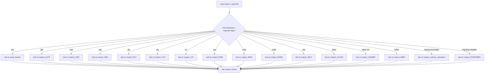
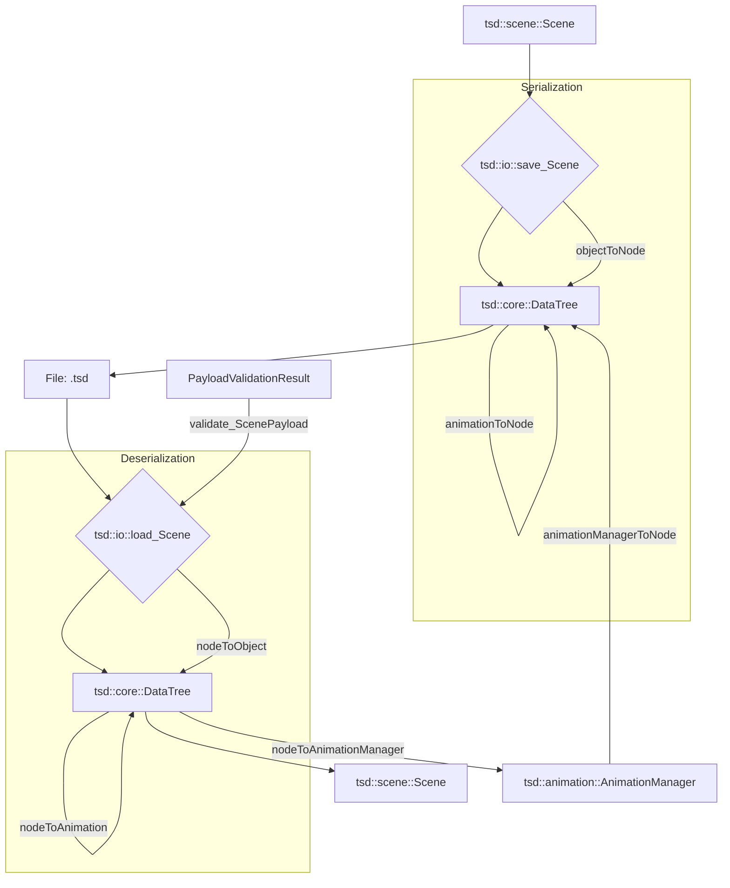

<!-- source: DeepWiki mcp.deepwiki.com · repo NVIDIA/VisRTX · page 5 File I/O & Scene Serialization · fetched 2026-10-26 -->

# File I/O & Scene Serialization

Relevant source files

The following files were used as context for generating this wiki page:

- [tsd/src/tsd/animation/Animation.cpp](tsd/src/tsd/animation/Animation.cpp)
- [tsd/src/tsd/animation/Animation.hpp](tsd/src/tsd/animation/Animation.hpp)
- [tsd/src/tsd/animation/CMakeLists.txt](tsd/src/tsd/animation/CMakeLists.txt)
- [tsd/src/tsd/app/Context.cpp](tsd/src/tsd/app/Context.cpp)
- [tsd/src/tsd/io/CMakeLists.txt](tsd/src/tsd/io/CMakeLists.txt)
- [tsd/src/tsd/io/importers.hpp](tsd/src/tsd/io/importers.hpp)
- [tsd/src/tsd/io/importers/import_file.cpp](tsd/src/tsd/io/importers/import_file.cpp)
- [tsd/src/tsd/io/importers/import_volume.cpp](tsd/src/tsd/io/importers/import_volume.cpp)
- [tsd/src/tsd/io/serialization.hpp](tsd/src/tsd/io/serialization.hpp)
- [tsd/src/tsd/io/serialization/serialization_datatree.cpp](tsd/src/tsd/io/serialization/serialization_datatree.cpp)
- [tsd/src/tsd/scripting/bindings/ArrayHelpers.hpp](tsd/src/tsd/scripting/bindings/ArrayHelpers.hpp)
- [tsd/src/tsd/scripting/bindings/CoreBindings.cpp](tsd/src/tsd/scripting/bindings/CoreBindings.cpp)
- [tsd/src/tsd/scripting/bindings/ObjectBindings.cpp](tsd/src/tsd/scripting/bindings/ObjectBindings.cpp)
- [tsd/src/tsd/ui/imgui/modals/ImportFileDialog.cpp](tsd/src/tsd/ui/imgui/modals/ImportFileDialog.cpp)
- [tsd/src/tsd/ui/imgui/windows/Timeline.cpp](tsd/src/tsd/ui/imgui/windows/Timeline.cpp)

This page provides a high-level overview of the `tsd_io` library, which handles file input/output, scene serialization and deserialization, procedural scene generation, and various export functionalities within the VisRTX codebase. It serves as a central hub for managing how scene data is loaded, saved, and generated.

The `tsd_io` library is structured into several key components:
*   **Importers**: For loading various 3D model, scientific data, and image formats into the `tsd::scene::Scene` graph.
*   **Serialization**: For saving and loading the entire scene or subsets of it using a custom DataTree-based format (`.tsd`).
*   **Procedural Generators**: For creating synthetic scene elements programmatically.
*   **Exporters**: For converting `tsd::scene::Scene` data into other formats, such as USD or NanoVDB.

For detailed information on specific importers, refer to the [Scene Importers](#5.1) child page. For in-depth coverage of scene serialization and export options, see the [Scene Serialization & Export](#5.2) child page.

## Importers

The `tsd_io` library includes a comprehensive set of importers for a wide range of file formats, enabling VisRTX to load diverse datasets. These importers convert external file data into `tsd::scene::Scene` objects, such as `Geometry`, `Material`, `Volume`, and `SpatialField`. The `import_file` function [tsd/src/tsd/io/importers/import_file.cpp:35-133]() acts as a dispatcher, selecting the appropriate importer based on the file type.

The `ImporterType` enum [tsd/src/tsd/io/importers.hpp:138-140]() defines the supported file formats. When loading a file, the system can automatically determine the importer type or it can be explicitly specified, for example, via command-line arguments [tsd/src/tsd/app/Context.cpp:49-122]() or through the UI [tsd/src/tsd/ui/imgui/modals/ImportFileDialog.cpp:28-57]().

### Importer Dispatch Diagram

Sources: [tsd/src/tsd/io/importers.hpp:138-140](), [tsd/src/tsd/io/importers/import_file.cpp:35-133](), [tsd/src/tsd/app/Context.cpp:49-122](), [tsd/src/tsd/ui/imgui/modals/ImportFileDialog.cpp:28-57]()

Many importers also support animation sequences, where a series of files can be loaded to represent a time-varying dataset. For example, `import_volume_animation` [tsd/src/tsd/io/importers.hpp:128-132]() handles sequences of spatial field files, creating a `Volume` for the first frame and registering a `SpatialFieldFileBinding` [tsd/src/tsd/io/animation/SpatialFieldFileBinding.hpp]() with the `AnimationManager` [tsd/src/tsd/animation/AnimationManager.hpp]() to load subsequent frames on demand [tsd/src/tsd/io/importers/import_volume.cpp:158-193]().

For details on specific file formats and their corresponding importers, see [Scene Importers](#5.1).

Sources: [tsd/src/tsd/io/importers.hpp:29-109](), [tsd/src/tsd/io/importers/import_file.cpp:35-133](), [tsd/src/tsd/io/importers/import_volume.cpp:66-96](), [tsd/src/tsd/io/importers/import_volume.cpp:158-193](), [tsd/src/tsd/animation/Animation.hpp:92-98]()

## Scene Serialization & Export

The `tsd_io` library provides robust mechanisms for saving and loading `tsd::scene::Scene` objects, as well as exporting scene data to other formats. The primary serialization format is a custom DataTree-based `.tsd` file.

### Scene Serialization (`.tsd` format)

The `save_Scene` [tsd/src/tsd/io/serialization.hpp:110-111]() and `load_Scene` [tsd/src/tsd/io/serialization.hpp:112-113]() functions are central to saving and loading entire scenes. These functions utilize the `tsd::core::DataTree` [tsd/src/tsd/core/DataTree.hpp]() structure to represent the scene hierarchy and object parameters. The serialization process converts `tsd::scene::Object` instances and their parameters into `DataNode`s [tsd/src/tsd/io/serialization/serialization_datatree.cpp:158-215](), including handling `Array` data [tsd/src/tsd/io/serialization/serialization_datatree.cpp:219-230]().

The `.tsd` format supports schema validation through `PayloadValidationResult` [tsd/src/tsd/io/serialization.hpp:58-74](), which checks for metadata, schema compatibility, and required nodes [tsd/src/tsd/io/serialization/serialization_datatree.cpp:71-133](). This ensures that loaded scenes conform to expected structures.

Additionally, specific subsets of the scene can be serialized, such as cameras and renderers, using `save_SceneCamerasAndRenderers` [tsd/src/tsd/io/serialization.hpp:117-118]() and `load_SceneCamerasAndRenderers` [tsd/src/tsd/io/serialization.hpp:119-120](). This is useful for preserving view configurations independently of the main scene data.

### Scene Serialization Process

Sources: [tsd/src/tsd/io/serialization.hpp:110-120](), [tsd/src/tsd/io/serialization/serialization_datatree.cpp:158-230](), [tsd/src/tsd/io/serialization/serialization_datatree.cpp:71-133]()

### Export Paths

The `tsd_io` library also supports exporting scene data to other formats:
*   **USD Export**: `export_SceneToUSD` [tsd/src/tsd/io/serialization.hpp:130-131]() allows exporting the current scene to a Universal Scene Description (USD) file, including animation data if an `AnimationManager` is provided. This enables interoperability with other 3D applications and pipelines that support USD.
*   **NanoVDB Export**: `export_StructuredVolumeToNanoVDB` [tsd/src/tsd/io/serialization.hpp:132-139]() converts `SpatialField` objects, particularly structured volumes, into NanoVDB format. This function offers various quantization options (`VDBPrecision`) to control file size and precision.

For more detailed information on scene serialization, schema validation, and export options, refer to [Scene Serialization & Export](#5.2).

Sources: [tsd/src/tsd/io/serialization.hpp:130-139]()

## Procedural Generators

The `tsd_io` library includes a set of procedural functions for generating common scene elements programmatically. These generators are useful for creating test scenes, default environments, or simple geometric primitives without requiring external asset files. Examples include:
*   `generate_default_lights` [tsd/src/tsd/io/procedural.hpp:20-21](): Creates a standard set of lights for a scene.
*   `generate_hdri_dome` [tsd/src/tsd/io/procedural.hpp:22-23](): Generates an HDRI dome for image-based lighting.
*   `generate_material_orb` [tsd/src/tsd/io/procedural.hpp:24-25](): Creates a material test orb, often used for evaluating material properties.
*   `generate_randomSpheres` [tsd/src/tsd/io/procedural.hpp:28-29](): Populates a scene with randomly placed spheres.

These procedural generators are often used when no specific scene file is loaded, providing a default visual context [tsd/src/tsd/app/Context.cpp:177-181]().

Sources: [tsd/src/tsd/io/procedural.hpp:20-29](), [tsd/src/tsd/app/Context.cpp:177-181]()

---

