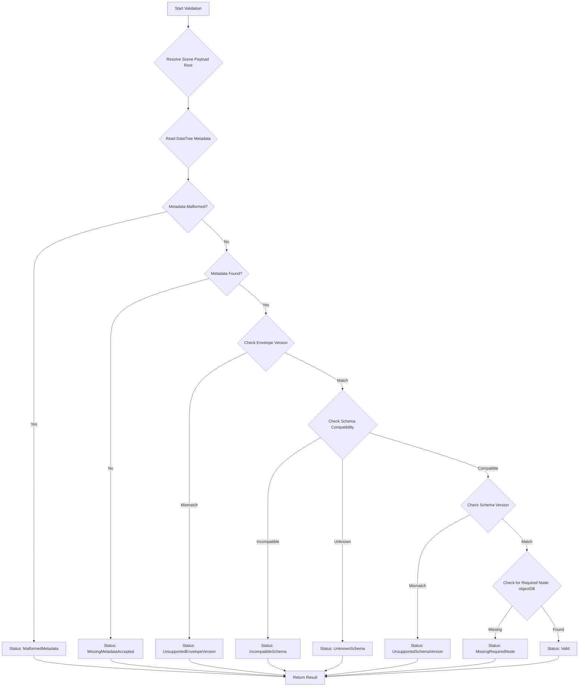

<!-- source: DeepWiki mcp.deepwiki.com · repo NVIDIA/VisRTX · page 5.2 Scene Serialization & Export · fetched 2026-10-26 -->

# Scene Serialization & Export

<details>
<summary>Relevant source files</summary>

The following files were used as context for generating this wiki page:

- [tsd/apps/tools/tsdVolumeToNanoVDB.cpp](tsd/apps/tools/tsdVolumeToNanoVDB.cpp)
- [tsd/python/merge_agx_timeseries.py](tsd/python/merge_agx_timeseries.py)
- [tsd/src/anari_tsd/Device.cpp](tsd/src/anari_tsd/Device.cpp)
- [tsd/src/anari_tsd/DeviceGlobalState.cpp](tsd/src/anari_tsd/DeviceGlobalState.cpp)
- [tsd/src/anari_tsd/DeviceGlobalState.h](tsd/src/anari_tsd/DeviceGlobalState.h)
- [tsd/src/anari_tsd/Frame.cpp](tsd/src/anari_tsd/Frame.cpp)
- [tsd/src/anari_tsd/Frame.h](tsd/src/anari_tsd/Frame.h)
- [tsd/src/anari_tsd/Library.cpp](tsd/src/anari_tsd/Library.cpp)
- [tsd/src/anari_tsd/Object.cpp](tsd/src/anari_tsd/Object.cpp)
- [tsd/src/anari_tsd/Object.h](tsd/src/anari_tsd/Object.h)
- [tsd/src/anari_tsd/World.cpp](tsd/src/anari_tsd/World.cpp)
- [tsd/src/anari_tsd/World.h](tsd/src/anari_tsd/World.h)
- [tsd/src/tsd/animation/Animation.cpp](tsd/src/tsd/animation/Animation.cpp)
- [tsd/src/tsd/animation/Animation.hpp](tsd/src/tsd/animation/Animation.hpp)
- [tsd/src/tsd/animation/CMakeLists.txt](tsd/src/tsd/animation/CMakeLists.txt)
- [tsd/src/tsd/io/importers/import_AGX.cpp](tsd/src/tsd/io/importers/import_AGX.cpp)
- [tsd/src/tsd/io/importers/import_AXYZ.cpp](tsd/src/tsd/io/importers/import_AXYZ.cpp)
- [tsd/src/tsd/io/importers/import_HSMESH.cpp](tsd/src/tsd/io/importers/import_HSMESH.cpp)
- [tsd/src/tsd/io/importers/import_POINTSBIN.cpp](tsd/src/tsd/io/importers/import_POINTSBIN.cpp)
- [tsd/src/tsd/io/importers/import_PT.cpp](tsd/src/tsd/io/importers/import_PT.cpp)
- [tsd/src/tsd/io/importers/import_SMESH.cpp](tsd/src/tsd/io/importers/import_SMESH.cpp)
- [tsd/src/tsd/io/importers/import_TRK.cpp](tsd/src/tsd/io/importers/import_TRK.cpp)
- [tsd/src/tsd/io/procedural/generate_material_orb.cpp](tsd/src/tsd/io/procedural/generate_material_orb.cpp)
- [tsd/src/tsd/io/serialization.hpp](tsd/src/tsd/io/serialization.hpp)
- [tsd/src/tsd/io/serialization/export_SceneToUSD.cpp](tsd/src/tsd/io/serialization/export_SceneToUSD.cpp)
- [tsd/src/tsd/io/serialization/export_StructuredVolumeToNanoVDB.cpp](tsd/src/tsd/io/serialization/export_StructuredVolumeToNanoVDB.cpp)
- [tsd/src/tsd/io/serialization/serialization_datatree.cpp](tsd/src/tsd/io/serialization/serialization_datatree.cpp)
- [tsd/src/tsd/scripting/bindings/ArrayHelpers.hpp](tsd/src/tsd/scripting/bindings/ArrayHelpers.hpp)
- [tsd/src/tsd/scripting/bindings/CoreBindings.cpp](tsd/src/tsd/scripting/bindings/CoreBindings.cpp)
- [tsd/src/tsd/scripting/bindings/ObjectBindings.cpp](tsd/src/tsd/scripting/bindings/ObjectBindings.cpp)
- [tsd/src/tsd/ui/imgui/modals/ExportNanoVDBFileDialog.cpp](tsd/src/tsd/ui/imgui/modals/ExportNanoVDBFileDialog.cpp)
- [tsd/src/tsd/ui/imgui/modals/ExportNanoVDBFileDialog.h](tsd/src/tsd/ui/imgui/modals/ExportNanoVDBFileDialog.h)
- [tsd/src/tsd/ui/imgui/windows/LayerTree.cpp](tsd/src/tsd/ui/imgui/windows/LayerTree.cpp)
- [tsd/src/tsd/ui/imgui/windows/LayerTree.h](tsd/src/tsd/ui/imgui/windows/LayerTree.h)
- [tsd/src/tsd/ui/imgui/windows/Timeline.cpp](tsd/src/tsd/ui/imgui/windows/Timeline.cpp)

</details>


This page details the mechanisms within the VisRTX codebase for serializing and exporting scene data. It covers the native `.tsd` format, which is based on the `DataTree` framework, including schema validation and partial scene saving/loading. Additionally, it describes export functionalities to Universal Scene Description (USD) and NanoVDB formats, and touches upon the ANARI-TSD device's live capture mode.

## TSD Scene Serialization (`save_Scene`/`load_Scene`)

The primary serialization format for VisRTX scenes is the `.tsd` format, which leverages the `tsd::core::DataTree` for hierarchical data representation. This format allows for comprehensive saving and loading of the entire scene, including objects, parameters, layers, and animations.

### DataTree Structure for Scenes

A `.tsd` scene file is essentially a `tsd::core::DataNode` hierarchy. The root node typically contains a "context" child node, which then holds the actual scene payload. Key components serialized include:

*   **`objectDB`**: Contains all scene objects (geometries, materials, cameras, lights, volumes, samplers, arrays) stored in `tsd::scene::ObjectPool`s. Each object is converted into a `DataNode` via `objectToNode()` [tsd/src/tsd/io/serialization/serialization_datatree.cpp:151-153]().
*   **`layers`**: The scene graph structure, represented by `tsd::scene::Layer` objects, is serialized. Each layer's nodes and their relationships are stored.
*   **`animations`**: `tsd::animation::Animation` objects and their associated `ObjectParameterBinding`, `TransformBinding`, and `FileBinding` instances are serialized.
*   **`cameraPoses`**: Saved camera viewpoints.

### Serialization Process

The `save_Scene()` function [tsd/src/tsd/io/serialization.hpp:111]() orchestrates the serialization of a `tsd::scene::Scene` into a `tsd::core::DataNode`.

1.  **Root Node Creation**: A `DataNode` is created to represent the scene.
2.  **Metadata**: Scene metadata, including schema (`tsd.scene.full`) and version, is written to the root node.
3.  **Object Database**: The `tsd::scene::ObjectDB` is iterated, and each object type (e.g., `geometries`, `materials`, `cameras`) is serialized into its own `DataNode` array within the `objectDB` node. The `objectPoolToNode()` template function [tsd/src/tsd/io/serialization/serialization_datatree.cpp:135-154]() handles this, converting each `tsd::scene::Object` into a `DataNode` using `objectToNode()` [tsd/src/tsd/io/serialization/serialization_datatree.cpp:152]().
    *   **Parameters**: Object parameters are serialized using `parameterToNode()` [tsd/src/tsd/io/serialization/serialization_datatree.cpp:158-177]().
    *   **Arrays**: `tsd::scene::Array` objects can be serialized directly or as proxies, depending on the `forceProxyArrays` flag [tsd/src/tsd/io/serialization.hpp:112]().
4.  **Layers**: Each `tsd::scene::Layer` is serialized into a `DataNode` using `layerToNode()` [tsd/src/tsd/io/serialization.hpp:98]().
5.  **Animations**: If an `AnimationManager` is provided, its animations are serialized using `animationManagerToNode()` [tsd/src/tsd/io/serialization.hpp:105]().
6.  **Camera Poses**: Saved camera poses are serialized using `cameraPoseToNode()` [tsd/src/tsd/io/serialization.hpp:93]().
7.  **File Output**: The resulting `DataNode` is then written to the specified file.

### Deserialization Process

The `load_Scene()` function [tsd/src/tsd/io/serialization.hpp:113]() reverses this process:

1.  **File Input**: The `.tsd` file is read into a `tsd::core::DataNode`.
2.  **Validation**: The `validate_ScenePayload()` function [tsd/src/tsd/io/serialization.hpp:114]() is called to check the integrity and schema compatibility of the loaded data.
3.  **Object Database**: `nodeToObject()` [tsd/src/tsd/io/serialization.hpp:87]() and `nodeToNewObject()` [tsd/src/tsd/io/serialization.hpp:89]() are used to reconstruct `tsd::scene::Object`s from their `DataNode` representations.
4.  **Layers**: `nodeToLayer()` [tsd/src/tsd/io/serialization.hpp:99]() reconstructs the scene layers.
5.  **Animations**: `nodeToAnimationManager()` [tsd/src/tsd/io/serialization.hpp:106]() reconstructs the animation state.
6.  **Camera Poses**: `nodeToCameraPose()` [tsd/src/tsd/io/serialization.hpp:94]() reconstructs camera poses.

### Schema Validation

The `PayloadValidationResult` struct [tsd/src/tsd/io/serialization.hpp:58-68]() is used to report the outcome of payload validation. The `validateScenePayloadImpl()` function [tsd/src/tsd/io/serialization/serialization_datatree.cpp:71-133]() performs checks against predefined schemas (`tsd.scene.full`, `tsd.scene.cameras-and-renderers`, etc. [tsd/src/tsd/io/serialization.hpp:38-42]()) and envelope versions.

**Payload Validation Flow**

Sources:
- [tsd/src/tsd/io/serialization/serialization_datatree.cpp:71-133]()
- [tsd/src/tsd/io/serialization.hpp:58-68]()

### Saving/Loading Camera and Renderer Subsets

For scenarios where only camera and renderer configurations need to be persisted, the `save_SceneCamerasAndRenderers()` [tsd/src/tsd/io/serialization.hpp:116]() and `load_SceneCamerasAndRenderers()` [tsd/src/tsd/io/serialization.hpp:118]() functions are available. These functions use a specific schema (`tsd.scene.cameras-and-renderers` [tsd/src/tsd/io/serialization.hpp:39]()) to ensure only the relevant parts of the scene are serialized/deserialized.

Sources:
- [tsd/src/tsd/io/serialization/serialization_datatree.cpp]()
- [tsd/src/tsd/io/serialization.hpp]()

## Export to USD (`export_SceneToUSD`)

VisRTX provides functionality to export a `tsd::scene::Scene` to the Universal Scene Description (USD) format, enabling interoperability with other 3D applications and pipelines. The `export_SceneToUSD()` function [tsd/src/tsd/io/serialization.hpp:130]() handles this conversion.

### USD Export Process

The `export_SceneToUSD()` function [tsd/src/tsd/io/serialization/export_SceneToUSD.cpp:64-65]() performs the following steps:

1.  **Stage Creation**: A new USD stage is created.
2.  **Object Mapping**: A global map (`objectToUsdPathMap` [tsd/src/tsd/io/serialization/export_SceneToUSD.cpp:77]()) is used to track the USD paths for each `tsd::scene::Object` to ensure unique naming and proper referencing.
3.  **Scene Traversal**: The `tsd::scene::Scene` is traversed, and each object type is converted to its USD equivalent:
    *   **Cameras**: `tsd::scene::Camera` objects are converted to `pxr::usdGeom::Camera` primitives.
    *   **Geometries**: `tsd::scene::Geometry` objects (e.g., triangles, spheres) are converted to `pxr::usdGeom::Mesh` or other appropriate geometry primitives.
    *   **Materials**: `tsd::scene::Material` objects are converted to `pxr::usdShade::Material` and `pxr::usdShade::Shader` primitives, often using the `OmniPBR` schema.
    *   **Samplers**: `tsd::scene::Sampler` objects, especially image samplers, are converted into texture files (e.g., `.exr` for HDR, `.png` for LDR) and referenced in USD materials. The `tsdSamplerToFile()` function [tsd/src/tsd/io/serialization/export_SceneToUSD.cpp:128-219]() handles image conversion and saving.
    *   **Lights**: `tsd::scene::Light` objects are converted to `pxr::usdLux` primitives.
    *   **Transforms**: `tsd::scene::LayerNodeRef` transforms are applied to USD primitives using `pxr::usdGeom::XformOp`.
4.  **Animation Export**: If an `AnimationManager` is provided, animated properties are exported as time-sampled USD attributes.
5.  **File Output**: The populated USD stage is saved to the specified filename.

### Texture Handling

During USD export, image samplers are converted into separate texture files. The `tsdSamplerToFile()` function [tsd/src/tsd/io/serialization/export_SceneToUSD.cpp:128-219]() determines the appropriate image format (EXR for HDR, PNG for LDR) and saves the image data to a "textures" subdirectory. A queue (`textureWriteQueue` [tsd/src/tsd/io/serialization/export_SceneToUSD.cpp:83]()) is used to asynchronously write these texture files.

**USD Export Data Flow**
```mermaid
graph TD
    A[tsd::scene::Scene] --> B{export_SceneToUSD(scene, filename, ...)}
    B --> C[Create pxr::UsdStage]
    C --> D{Traverse Scene Layers and Objects}
    D --> E{Convert tsd::scene::Camera to pxr::usdGeom::Camera}
    D --> F{Convert tsd::scene::Geometry to pxr::usdGeom::Mesh}
    D --> G{Convert tsd::scene::Material to pxr::usdShade::Material/Shader}
    G --> H{Process tsd::scene::Sampler (Image)}
    H --> I[tsdSamplerToFile()]
    I --> J[Save Image as .exr/.png]
    D --> K{Convert tsd::scene::Light to pxr::usdLux}
    D --> L{Apply tsd::scene::LayerNodeRef Transforms to USD Primitives}
    B --> M{Process tsd::animation::AnimationManager (if present)}
    M --> N[Export Animated Properties as Time-Sampled Attributes]
    C --> O[Save pxr::UsdStage to filename]
    O --> P[USD File (.usd/.usdc)]
```
Sources:
- [tsd/src/tsd/io/serialization/export_SceneToUSD.cpp]()
- [tsd/src/tsd/io/serialization.hpp:130]()

## Export to NanoVDB (`export_StructuredVolumeToNanoVDB`)

VisRTX supports exporting `tsd::scene::SpatialField` objects, specifically structured volumes, to the NanoVDB format. This is particularly useful for efficient storage and rendering of volumetric data. The `export_StructuredVolumeToNanoVDB()` function [tsd/src/tsd/io/serialization.hpp:132-139]() handles this conversion.

### NanoVDB Export Process

The `export_StructuredVolumeToNanoVDB()` function [tsd/src/tsd/io/serialization/export_StructuredVolumeToNanoVDB.cpp]() takes a `tsd::scene::SpatialField` (which must be a structured regular or rectilinear volume) and converts its data into a NanoVDB grid.

Key parameters for the export include:

*   `spatialField`: The source `tsd::scene::SpatialField` object.
*   `outputFilename`: The path to the output `.vdb` file.
*   `useUndefinedValue`: A boolean indicating whether to use a specific `undefinedValue` to skip voxels.
*   `undefinedValue`: The float value to treat as undefined.
*   `precision`: The quantization precision for the NanoVDB grid, specified by `tsd::io::VDBPrecision` [tsd/src/tsd/io/serialization.hpp:26-33](). Options range from `Float32` (no quantization) to `Fp4` (4-bit fixed-point).
*   `enableDithering`: A boolean to enable dithering during quantization, which can improve visual quality at lower bit depths.

This functionality is also exposed via the `tsdVolumeToNanoVDB` command-line tool [tsd/apps/tools/tsdVolumeToNanoVDB.cpp]() and through the `ExportNanoVDBFileDialog` UI modal [tsd/src/tsd/ui/imgui/modals/ExportNanoVDBFileDialog.cpp]().

**NanoVDB Export Flow**
```mermaid
graph TD
    A[tsd::scene::SpatialField (StructuredVolume)] --> B{export_StructuredVolumeToNanoVDB()}
    B --> C{Determine Grid Type (Regular/Rectilinear)}
    C --> D{Apply Undefined Value Filtering (if enabled)}
    D --> E{Apply Quantization (VDBPrecision)}
    E --> F{Apply Dithering (if enabled)}
    F --> G[Create NanoVDB Grid]
    G --> H[Write NanoVDB Grid to .vdb file]
    H --> I[NanoVDB File (.vdb)]
```
Sources:
- [tsd/src/tsd/io/serialization/export_StructuredVolumeToNanoVDB.cpp]()
- [tsd/src/tsd/io/serialization.hpp:132-139]()
- [tsd/apps/tools/tsdVolumeToNanoVDB.cpp]()
- [tsd/src/tsd/ui/imgui/modals/ExportNanoVDBFileDialog.cpp]()

## ANARI-TSD Device Live Capture

The `anari_tsd` device acts as a bridge, mirroring ANARI object state into a TSD scene. It supports a "live capture" mode where the internal TSD scene state can be continuously saved to a `.tsd` file.

When the `anari_tsd` device is used, it can be configured to operate in a pass-through mode, where ANARI API calls are not only processed by the `anari_tsd` device but also forwarded to another underlying ANARI device (e.g., `visrtx`). In this mode, the `anari_tsd` device can also write out its internal scene representation to a file named `live_capture.tsd`. This allows for debugging, inspection, or later re-loading of the exact scene state that was passed through the ANARI API.

This feature is controlled by environment variables or device parameters that enable the `anari_tsd` device to write out the `live_capture.tsd` file, providing a snapshot of the ANARI scene graph as a `DataTree`.

Sources:
- [tsd/src/anari_tsd/Device.cpp]()
- [tsd/src/anari_tsd/Frame.cpp]()
- [tsd/src/anari_tsd/Object.cpp]()
- [tsd/src/anari_tsd/World.cpp]()

---

