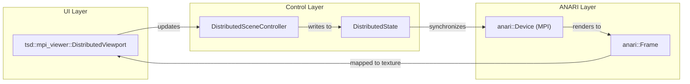

<!-- source: DeepWiki mcp.deepwiki.com · repo NVIDIA/VisRTX · page 6 Interactive Applications & UI Framework · fetched 2026-10-26 -->

# Interactive Applications & UI Framework

<details>
<summary>Relevant source files</summary>

The following files were used as context for generating this wiki page:

- [tsd/apps/interactive/CMakeLists.txt](tsd/apps/interactive/CMakeLists.txt)
- [tsd/apps/interactive/demos/CMakeLists.txt](tsd/apps/interactive/demos/CMakeLists.txt)
- [tsd/apps/interactive/mpiViewer/DistributedViewport.cpp](tsd/apps/interactive/mpiViewer/DistributedViewport.cpp)
- [tsd/apps/interactive/mpiViewer/DistributedViewport.h](tsd/apps/interactive/mpiViewer/DistributedViewport.h)
- [tsd/apps/interactive/viewer/tsdViewer.cpp](tsd/apps/interactive/viewer/tsdViewer.cpp)
- [tsd/src/tsd/ui/imgui/Application.cpp](tsd/src/tsd/ui/imgui/Application.cpp)
- [tsd/src/tsd/ui/imgui/Application.h](tsd/src/tsd/ui/imgui/Application.h)
- [tsd/src/tsd/ui/imgui/CMakeLists.txt](tsd/src/tsd/ui/imgui/CMakeLists.txt)
- [tsd/src/tsd/ui/imgui/modals/AppSettingsDialog.cpp](tsd/src/tsd/ui/imgui/modals/AppSettingsDialog.cpp)
- [tsd/src/tsd/ui/imgui/modals/Modal.cpp](tsd/src/tsd/ui/imgui/modals/Modal.cpp)
- [tsd/src/tsd/ui/imgui/modals/Modal.h](tsd/src/tsd/ui/imgui/modals/Modal.h)
- [tsd/src/tsd/ui/imgui/windows/Window.cpp](tsd/src/tsd/ui/imgui/windows/Window.cpp)
- [tsd/src/tsd/ui/imgui/windows/Window.h](tsd/src/tsd/ui/imgui/windows/Window.h)

</details>


The TSD framework provides a robust, ImGui-based application layer designed for building high-performance interactive visualization tools. This layer abstracts the complexities of window management, event loops, and ANARI device lifecycles, allowing developers to focus on scene interaction and data analysis.

The framework supports a range of applications, from the general-purpose `tsdViewer` to specialized scientific visualization tools like `SciVis Studio`, as well as distributed viewers utilizing MPI for large-scale data.

### System Architecture Overview

The UI framework is built upon **SDL3** for windowing and input, with **Dear ImGui** providing the docking interface and widget system. The core of any interactive application is the `tsd::ui::imgui::Application` class, which manages the main loop and coordinates between the `tsd::app::Context` (data/scene state) and the various UI `Window` components.

#### Code Entity Map: UI Framework to Application
The following diagram illustrates how the abstract framework classes map to concrete application entities.

```mermaid
graph TD
    subgraph "Framework Core (tsd_ui_imgui)"
        App["tsd::ui::imgui::Application"]
        BaseWin["tsd::ui::imgui::Window"]
        BaseModal["tsd::ui::imgui::Modal"]
        AppCtx["tsd::app::Context"]
    end

    subgraph "Interactive Apps (tsd/apps/interactive)"
        TSDViewer["tsdViewer::Application"]
        SciVis["SciVisStudio::Application"]
        MPIViewer["tsd::mpi_viewer::DistributedViewport"]
    end

    App -->|manages| BaseWin
    App -->|owns| AppCtx
    TSDViewer --|> App
    SciVis --|> App
    MPIViewer --|> BaseWin
    
    BaseWin -->|buildUI()| ImGui["Dear ImGui Context"]
```
**Sources:** [tsd/src/tsd/ui/imgui/Application.h:56-214](), [tsd/src/tsd/ui/imgui/windows/Window.h:21-49](), [tsd/apps/interactive/viewer/tsdViewer.cpp:28-32]()

---

## 6.1 ImGui Application Framework (`tsd_ui_imgui`)
The `tsd_ui_imgui` library is the foundation for all interactive tools in the repository. It provides the `Application` base class which handles:
*   **Lifecycle Management**: Initialization of SDL3 and ImGui, the main rendering loop, and clean teardown [tsd/src/tsd/ui/imgui/Application.cpp:74-85]().
*   **Task Management**: A `TaskQueue` for offloading heavy operations (like file loading) to background threads, coupled with `BlockingTaskModal` to provide user feedback [tsd/src/tsd/ui/imgui/Application.h:191-237]().
*   **Persistence**: Automatic serialization of window layouts and application settings to `.tsd` or `.json` files [tsd/src/tsd/ui/imgui/Application.cpp:187-190]().
*   **Reusable Components**: A library of standard windows including `DatabaseEditor`, `LayerTree`, `TransferFunctionEditor`, and `Timeline` [tsd/src/tsd/ui/imgui/CMakeLists.txt:18-31]().

For details, see [ImGui Application Framework (tsd_ui_imgui)](#6.1).

**Sources:** [tsd/src/tsd/ui/imgui/Application.h:1-214](), [tsd/src/tsd/ui/imgui/Application.cpp:1-100]()

---

## 6.2 Viewport & ANARI Scene Rendering
The `Viewport` and `BaseViewport` classes serve as the primary visual interface to ANARI devices. They bridge the `tsd_rendering` library's `RenderIndex` with the UI.
*   **Device Integration**: Supports hot-switching between different ANARI libraries (e.g., switching from `visrtx` to `vortice`) [tsd/apps/interactive/viewer/tsdViewer.cpp:155-158]().
*   **Post-Processing**: Integrates the `ImagePipeline` for tone mapping, AOV visualization, and selection highlighting.
*   **Interaction**: Implements camera manipulators (arcball/fly) and gizmos for object transformation [tsd/src/tsd/ui/imgui/windows/Viewport.h]().

For details, see [Viewport & ANARI Scene Rendering](#6.2).

**Sources:** [tsd/src/tsd/ui/imgui/windows/BaseViewport.cpp:1-50](), [tsd/src/tsd/ui/imgui/windows/Viewport.cpp:1-100]()

---

## 6.3 tsdViewer: Interactive Scene Viewer
`tsdViewer` is the flagship general-purpose visualization application. It provides a comprehensive suite of tools for inspecting and rendering complex scenes.
*   **Layout**: Uses a default docking layout that organizes the `LayerTree`, `ObjectEditor`, and `Log` windows around a central `Viewport` [tsd/apps/interactive/viewer/tsdViewer.cpp:173-253]().
*   **Command Line**: Supports advanced loading flags for importers and secondary viewports for side-by-side comparison [tsd/src/tsd/ui/imgui/Application.cpp:199-214]().
*   **Workflow**: Includes session save/load functionality to preserve the state of the entire scene and UI [tsd/apps/interactive/viewer/tsdViewer.cpp:34-86]().

For details, see [tsdViewer: Interactive Scene Viewer](#6.3).

**Sources:** [tsd/apps/interactive/viewer/tsdViewer.cpp:1-260]()

---

## 6.4 SciVis Studio & Specialized Apps
The framework supports specialized applications tailored for specific workflows:
*   **SciVis Studio**: A project-oriented tool focused on high-end scientific visualization, featuring "Shots," "Datasets," and dedicated Light/Camera rig editors.
*   **Multi-Device Viewer**: A specialized viewer capable of compositing output from multiple ANARI devices simultaneously (e.g., combining a ray-traced background with a point-cloud foreground).
*   **MPI Distributed Viewer**: Built on `DistributedViewport` and `DistributedSceneController`, this application allows for interactive steering of large-scale simulations rendered across a cluster [tsd/apps/interactive/mpiViewer/DistributedViewport.h:26-37]().

### Code Entity Map: Distributed Rendering
This diagram shows the relationship between the UI and the MPI controller logic.


**Sources:** [tsd/apps/interactive/mpiViewer/DistributedViewport.cpp:127-167](), [tsd/apps/interactive/mpiViewer/DistributedViewport.h:54-68]()

For details, see [SciVis Studio & Other Interactive Apps](#6.4).

**Sources:** [tsd/apps/interactive/CMakeLists.txt:1-15](), [tsd/apps/interactive/demos/CMakeLists.txt:1-13]()

---

