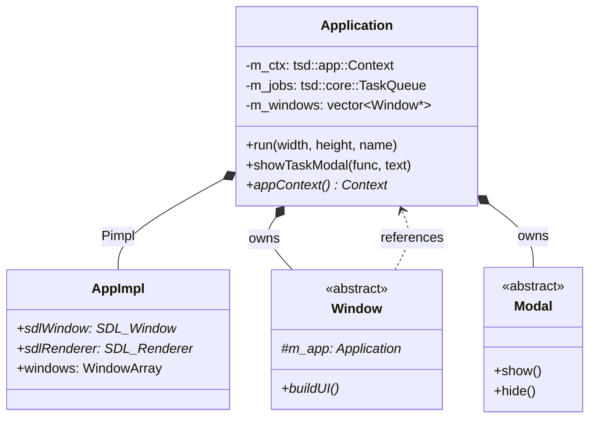
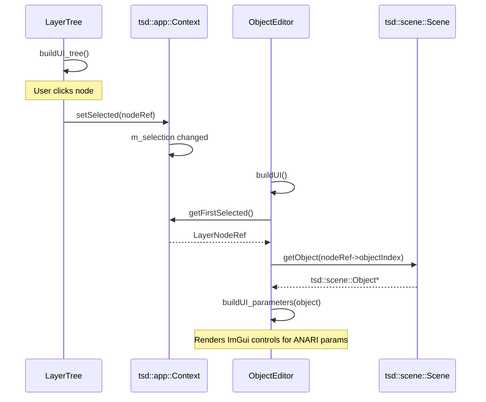

<!-- source: DeepWiki mcp.deepwiki.com · repo NVIDIA/VisRTX · page 6.1 ImGui Application Framework (tsd_ui_imgui) · fetched 2026-10-26 -->

# ImGui Application Framework (tsd_ui_imgui)

Relevant source files

The following files were used as context for generating this wiki page:

- [tsd/apps/interactive/CMakeLists.txt](tsd/apps/interactive/CMakeLists.txt)
- [tsd/apps/interactive/demos/CMakeLists.txt](tsd/apps/interactive/demos/CMakeLists.txt)
- [tsd/apps/interactive/mpiViewer/DistributedViewport.cpp](tsd/apps/interactive/mpiViewer/DistributedViewport.cpp)
- [tsd/apps/interactive/mpiViewer/DistributedViewport.h](tsd/apps/interactive/mpiViewer/DistributedViewport.h)
- [tsd/apps/interactive/mpiViewer/mpiViewer.cpp](tsd/apps/interactive/mpiViewer/mpiViewer.cpp)
- [tsd/apps/interactive/viewer/tsdViewer.cpp](tsd/apps/interactive/viewer/tsdViewer.cpp)
- [tsd/apps/tools/tsdVolumeToNanoVDB.cpp](tsd/apps/tools/tsdVolumeToNanoVDB.cpp)
- [tsd/scripts/test_lua_api.lua](tsd/scripts/test_lua_api.lua)
- [tsd/src/tsd/animation/AnimationManager.cpp](tsd/src/tsd/animation/AnimationManager.cpp)
- [tsd/src/tsd/animation/AnimationManager.hpp](tsd/src/tsd/animation/AnimationManager.hpp)
- [tsd/src/tsd/animation/README.md](tsd/src/tsd/animation/README.md)
- [tsd/src/tsd/io/serialization/export_StructuredVolumeToNanoVDB.cpp](tsd/src/tsd/io/serialization/export_StructuredVolumeToNanoVDB.cpp)
- [tsd/src/tsd/rendering/view/CameraPath.h](tsd/src/tsd/rendering/view/CameraPath.h)
- [tsd/src/tsd/rendering/view/Manipulator.hpp](tsd/src/tsd/rendering/view/Manipulator.hpp)
- [tsd/src/tsd/rendering/view/ManipulatorToTSD.cpp](tsd/src/tsd/rendering/view/ManipulatorToTSD.cpp)
- [tsd/src/tsd/scripting/Sol2Helpers.hpp](tsd/src/tsd/scripting/Sol2Helpers.hpp)
- [tsd/src/tsd/scripting/bindings/ParameterHelpers.cpp](tsd/src/tsd/scripting/bindings/ParameterHelpers.cpp)
- [tsd/src/tsd/ui/imgui/Application.cpp](tsd/src/tsd/ui/imgui/Application.cpp)
- [tsd/src/tsd/ui/imgui/Application.h](tsd/src/tsd/ui/imgui/Application.h)
- [tsd/src/tsd/ui/imgui/ArrayPreview.cpp](tsd/src/tsd/ui/imgui/ArrayPreview.cpp)
- [tsd/src/tsd/ui/imgui/ArrayPreview.h](tsd/src/tsd/ui/imgui/ArrayPreview.h)
- [tsd/src/tsd/ui/imgui/CMakeLists.txt](tsd/src/tsd/ui/imgui/CMakeLists.txt)
- [tsd/src/tsd/ui/imgui/modals/AppSettingsDialog.cpp](tsd/src/tsd/ui/imgui/modals/AppSettingsDialog.cpp)
- [tsd/src/tsd/ui/imgui/modals/BlockingTaskModal.cpp](tsd/src/tsd/ui/imgui/modals/BlockingTaskModal.cpp)
- [tsd/src/tsd/ui/imgui/modals/BlockingTaskModal.h](tsd/src/tsd/ui/imgui/modals/BlockingTaskModal.h)
- [tsd/src/tsd/ui/imgui/modals/ExportNanoVDBFileDialog.cpp](tsd/src/tsd/ui/imgui/modals/ExportNanoVDBFileDialog.cpp)
- [tsd/src/tsd/ui/imgui/modals/ExportNanoVDBFileDialog.h](tsd/src/tsd/ui/imgui/modals/ExportNanoVDBFileDialog.h)
- [tsd/src/tsd/ui/imgui/modals/Modal.cpp](tsd/src/tsd/ui/imgui/modals/Modal.cpp)
- [tsd/src/tsd/ui/imgui/modals/Modal.h](tsd/src/tsd/ui/imgui/modals/Modal.h)
- [tsd/src/tsd/ui/imgui/modals/OfflineRenderModal.cpp](tsd/src/tsd/ui/imgui/modals/OfflineRenderModal.cpp)
- [tsd/src/tsd/ui/imgui/modals/OfflineRenderModal.h](tsd/src/tsd/ui/imgui/modals/OfflineRenderModal.h)
- [tsd/src/tsd/ui/imgui/tsd_ui_imgui.cpp](tsd/src/tsd/ui/imgui/tsd_ui_imgui.cpp)
- [tsd/src/tsd/ui/imgui/tsd_ui_imgui.h](tsd/src/tsd/ui/imgui/tsd_ui_imgui.h)
- [tsd/src/tsd/ui/imgui/windows/Animations.cpp](tsd/src/tsd/ui/imgui/windows/Animations.cpp)
- [tsd/src/tsd/ui/imgui/windows/Animations.h](tsd/src/tsd/ui/imgui/windows/Animations.h)
- [tsd/src/tsd/ui/imgui/windows/CameraPoses.cpp](tsd/src/tsd/ui/imgui/windows/CameraPoses.cpp)
- [tsd/src/tsd/ui/imgui/windows/CameraPoses.h](tsd/src/tsd/ui/imgui/windows/CameraPoses.h)
- [tsd/src/tsd/ui/imgui/windows/DatabaseEditor.cpp](tsd/src/tsd/ui/imgui/windows/DatabaseEditor.cpp)
- [tsd/src/tsd/ui/imgui/windows/IsosurfaceEditor.cpp](tsd/src/tsd/ui/imgui/windows/IsosurfaceEditor.cpp)
- [tsd/src/tsd/ui/imgui/windows/LayerTree.cpp](tsd/src/tsd/ui/imgui/windows/LayerTree.cpp)
- [tsd/src/tsd/ui/imgui/windows/LayerTree.h](tsd/src/tsd/ui/imgui/windows/LayerTree.h)
- [tsd/src/tsd/ui/imgui/windows/Log.cpp](tsd/src/tsd/ui/imgui/windows/Log.cpp)
- [tsd/src/tsd/ui/imgui/windows/Log.h](tsd/src/tsd/ui/imgui/windows/Log.h)
- [tsd/src/tsd/ui/imgui/windows/ObjectEditor.cpp](tsd/src/tsd/ui/imgui/windows/ObjectEditor.cpp)
- [tsd/src/tsd/ui/imgui/windows/Timeline.h](tsd/src/tsd/ui/imgui/windows/Timeline.h)
- [tsd/src/tsd/ui/imgui/windows/TransferFunctionEditor.cpp](tsd/src/tsd/ui/imgui/windows/TransferFunctionEditor.cpp)
- [tsd/src/tsd/ui/imgui/windows/TransferFunctionEditor.h](tsd/src/tsd/ui/imgui/windows/TransferFunctionEditor.h)
- [tsd/src/tsd/ui/imgui/windows/Window.cpp](tsd/src/tsd/ui/imgui/windows/Window.cpp)
- [tsd/src/tsd/ui/imgui/windows/Window.h](tsd/src/tsd/ui/imgui/windows/Window.h)
- [tsd/tests/test_AnimationManager.cpp](tsd/tests/test_AnimationManager.cpp)

The `tsd_ui_imgui` library provides a comprehensive framework for building interactive ANARI-based applications using Dear ImGui and SDL3. It abstracts window management, event handling, and complex UI components like transfer function editors and scene hierarchy trees.

## Application Architecture

The core of the framework is the `tsd::ui::imgui::Application` class. It manages the lifecycle of an SDL3 window and renderer, handles the ImGui docking environment, and orchestrates the interaction between the TSD scene and the user interface.

### Key Lifecycle Methods
*   **`run()`**: Initializes SDL, ImGui, and enters the main event loop [tsd/src/tsd/ui/imgui/Application.cpp:74-85]().
*   **`setupWindows()`**: A virtual method where applications define which UI windows (Viewports, Editors, etc.) should be instantiated [tsd/src/tsd/ui/imgui/Application.cpp:81]().
*   **`mainLoop()`**: Handles SDL events, frame timing, and triggers the UI rendering passes [tsd/src/tsd/ui/imgui/Application.cpp:181]().
*   **`teardown()`**: Cleans up resources, including stopping background tasks and destroying the SDL window [tsd/src/tsd/ui/imgui/Application.cpp:83-84]().

### Background Task Management
The application includes a `tsd::core::TaskQueue` [tsd/src/tsd/ui/imgui/Application.h:191]() to prevent UI blocking during heavy operations (like loading large scenes).
*   **`enqueueTask()`**: Submits a function to the background thread pool [tsd/src/tsd/ui/imgui/Application.h:219-222]().
*   **`showTaskModal()`**: Enqueues a task and immediately displays a `BlockingTaskModal` that prevents user interaction until the task completes [tsd/src/tsd/ui/imgui/Application.h:225-237]().

### Application Class Diagram
The following diagram illustrates the relationship between the `Application` base class and its core components.

"Application Component Relationships"

Sources: [tsd/src/tsd/ui/imgui/Application.h:56-215](), [tsd/src/tsd/ui/imgui/Application.cpp:31-48](), [tsd/src/tsd/ui/imgui/windows/Window.h:11-30]()

## Window and Modal System

All UI elements inherit from either `Window` or `Modal`.

### Window Base Class
The `Window` class represents a dockable ImGui window. Subclasses must implement `buildUI()` to define their contents [tsd/src/tsd/ui/imgui/windows/Window.h:23]().
*   **Visibility**: Windows can be shown or hidden via `show()` and `hide()` [tsd/src/tsd/ui/imgui/windows/Window.h:21-22]().
*   **Accessors**: Windows have access to the `appContext()` and `tsd::scene::Scene` through the parent `Application` pointer [tsd/src/tsd/ui/imgui/windows/Window.h:26-27]().

### Modal Base Class
Modals are specialized windows that typically overlay the entire application and focus user input.
*   **`BlockingTaskModal`**: Used for long-running operations like `populateScene` in `tsdViewer` [tsd/apps/interactive/viewer/tsdViewer.cpp:161]().
*   **`ImportFileDialog`**: Wraps SDL3's file dialogs to provide a TSD-specific import interface [tsd/src/tsd/ui/imgui/Application.cpp:165-168]().
*   **`ExportNanoVDBFileDialog`**: Provides configuration for volume quantization (Float32, Fp16, Fp8, etc.) before exporting to NanoVDB [tsd/src/tsd/ui/imgui/modals/ExportNanoVDBFileDialog.cpp:67-157]().

Sources: [tsd/src/tsd/ui/imgui/windows/Window.h:11-30](), [tsd/src/tsd/ui/imgui/modals/Modal.h:11-25](), [tsd/src/tsd/ui/imgui/modals/ExportNanoVDBFileDialog.cpp:67-157]()

## Reusable UI Windows

The framework provides several pre-built windows for scene management and editing:

| Window Class | Purpose | Key Functionality |
| :--- | :--- | :--- |
| `LayerTree` | Scene Hierarchy | Displays the `tsd::scene::Forest` structure; handles drag-and-drop, object visibility, and layer management [tsd/src/tsd/ui/imgui/windows/LayerTree.cpp:152-181](). |
| `DatabaseEditor` | Raw Object Access | Provides a flat list of all ANARI objects in the `ObjectDB` for direct editing [tsd/src/tsd/ui/imgui/windows/DatabaseEditor.cpp:1-50](). |
| `ObjectEditor` | Parameter Editing | Inspects and modifies ANARI parameters of the currently selected object [tsd/src/tsd/ui/imgui/windows/ObjectEditor.cpp:1-40](). |
| `TransferFunctionEditor` | Volume Shading | Interactive widget for editing color control points and opacity curves [tsd/src/tsd/ui/imgui/windows/TransferFunctionEditor.cpp:107-202](). |
| `Animations` | Animation Control | Playback controls (play/stop/fps) and listing of `AnimationManager` bindings [tsd/src/tsd/ui/imgui/windows/Animations.cpp:18-81](). |
| `CameraPoses` | View Management | Saves and interpolates between camera viewpoints (Turntable, Linear, Smooth) [tsd/src/tsd/ui/imgui/windows/CameraPoses.cpp:29-115](). |
| `Log` / `Terminal` | Diagnostics | Displays application logs and provides a command interface [tsd/src/tsd/ui/imgui/windows/Log.cpp:1-20](). |

### Transfer Function Editor Implementation
The `TransferFunctionEditor` manages a `SDL_Texture` to preview the resulting colormap [tsd/src/tsd/ui/imgui/windows/TransferFunctionEditor.cpp:49-51](). It uses `ImGui::InvisibleButton` and `ImDrawList` to create a custom interactive canvas where users can double-click to add points and drag to modify opacity/color [tsd/src/tsd/ui/imgui/windows/TransferFunctionEditor.cpp:153-215]().

Sources: [tsd/src/tsd/ui/imgui/windows/LayerTree.cpp:152-181](), [tsd/src/tsd/ui/imgui/windows/TransferFunctionEditor.cpp:107-215](), [tsd/src/tsd/ui/imgui/windows/CameraPoses.cpp:161-215]()

## Extension Manager (Plugin System)

When `TSD_USE_LUA` is enabled, the `ExtensionManager` allows the UI to be extended dynamically via Lua scripts [tsd/src/tsd/ui/imgui/Application.cpp:192-197]().

*   **Action Menus**: Extensions can register custom actions that appear in the application's main menu bar [tsd/src/tsd/ui/imgui/Application.h:131]().
*   **Integration**: The `Application` class calls `uiMainMenuBar_Lua()` to render these dynamic entries [tsd/src/tsd/ui/imgui/Application.h:128]().

Sources: [tsd/src/tsd/ui/imgui/Application.h:128-131](), [tsd/src/tsd/ui/imgui/Application.cpp:192-197]()

## Data Flow: Scene Selection to Editor

The following diagram traces how selecting a node in the `LayerTree` updates the `ObjectEditor`.

"Selection and Editor Data Flow"

Sources: [tsd/src/tsd/ui/imgui/windows/LayerTree.cpp:205-220](), [tsd/src/tsd/ui/imgui/windows/ObjectEditor.cpp:1-40](), [tsd/src/tsd/ui/imgui/tsd_ui_imgui.cpp:78-166]()

---

