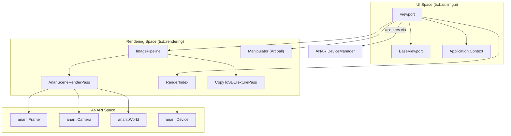
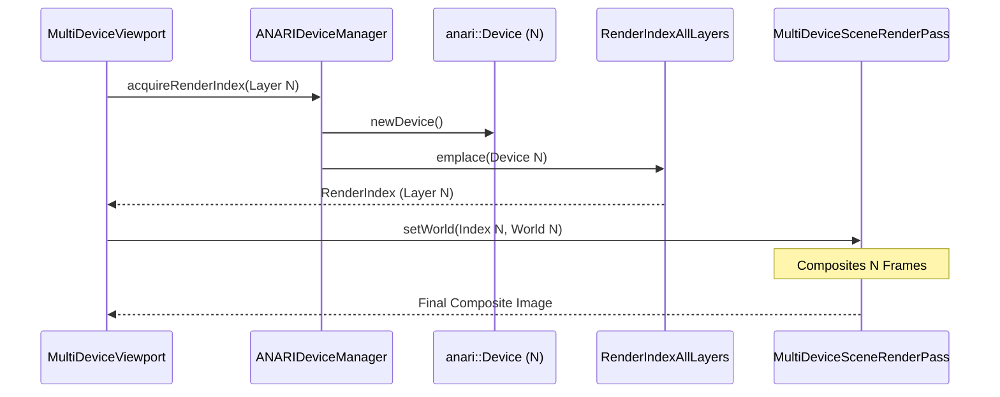

<!-- source: DeepWiki mcp.deepwiki.com · repo NVIDIA/VisRTX · page 6.2 Viewport & ANARI Scene Rendering · fetched 2026-10-26 -->

# Viewport & ANARI Scene Rendering

Relevant source files

The following files were used as context for generating this wiki page:

- [tsd/src/tsd/app/ANARIDeviceManager.cpp](tsd/src/tsd/app/ANARIDeviceManager.cpp)
- [tsd/src/tsd/app/ANARIDeviceManager.h](tsd/src/tsd/app/ANARIDeviceManager.h)
- [tsd/src/tsd/rendering/CMakeLists.txt](tsd/src/tsd/rendering/CMakeLists.txt)
- [tsd/src/tsd/rendering/pipeline/ImagePipeline.h](tsd/src/tsd/rendering/pipeline/ImagePipeline.h)
- [tsd/src/tsd/rendering/pipeline/passes/AnariAxesRenderPass.cpp](tsd/src/tsd/rendering/pipeline/passes/AnariAxesRenderPass.cpp)
- [tsd/src/tsd/rendering/pipeline/passes/AnariAxesRenderPass.h](tsd/src/tsd/rendering/pipeline/passes/AnariAxesRenderPass.h)
- [tsd/src/tsd/rendering/pipeline/passes/AnariSceneRenderPass.cpp](tsd/src/tsd/rendering/pipeline/passes/AnariSceneRenderPass.cpp)
- [tsd/src/tsd/rendering/pipeline/passes/AnariSceneRenderPass.h](tsd/src/tsd/rendering/pipeline/passes/AnariSceneRenderPass.h)
- [tsd/src/tsd/rendering/pipeline/passes/CopyToSDLTexturePass.cpp](tsd/src/tsd/rendering/pipeline/passes/CopyToSDLTexturePass.cpp)
- [tsd/src/tsd/rendering/pipeline/passes/CopyToSDLTexturePass.h](tsd/src/tsd/rendering/pipeline/passes/CopyToSDLTexturePass.h)
- [tsd/src/tsd/rendering/pipeline/passes/OutlineRenderPass.h](tsd/src/tsd/rendering/pipeline/passes/OutlineRenderPass.h)
- [tsd/src/tsd/rendering/pipeline/passes/PickPass.h](tsd/src/tsd/rendering/pipeline/passes/PickPass.h)
- [tsd/src/tsd/rendering/pipeline/passes/SaveToFilePass.h](tsd/src/tsd/rendering/pipeline/passes/SaveToFilePass.h)
- [tsd/src/tsd/rendering/pipeline/passes/VisualizeAOVPass.cpp](tsd/src/tsd/rendering/pipeline/passes/VisualizeAOVPass.cpp)
- [tsd/src/tsd/rendering/pipeline/passes/VisualizeAOVPass.h](tsd/src/tsd/rendering/pipeline/passes/VisualizeAOVPass.h)
- [tsd/src/tsd/ui/imgui/windows/BaseViewport.cpp](tsd/src/tsd/ui/imgui/windows/BaseViewport.cpp)
- [tsd/src/tsd/ui/imgui/windows/BaseViewport.h](tsd/src/tsd/ui/imgui/windows/BaseViewport.h)
- [tsd/src/tsd/ui/imgui/windows/MultiDeviceViewport.cpp](tsd/src/tsd/ui/imgui/windows/MultiDeviceViewport.cpp)
- [tsd/src/tsd/ui/imgui/windows/MultiDeviceViewport.h](tsd/src/tsd/ui/imgui/windows/MultiDeviceViewport.h)
- [tsd/src/tsd/ui/imgui/windows/Viewport.cpp](tsd/src/tsd/ui/imgui/windows/Viewport.cpp)
- [tsd/src/tsd/ui/imgui/windows/Viewport.h](tsd/src/tsd/ui/imgui/windows/Viewport.h)

The Viewport system in TSD provides the interactive bridge between the ANARI rendering backend and the ImGui-based user interface. It manages the lifecycle of ANARI devices, synchronizes scene state via the `RenderIndex`, and orchestrates a multi-stage `ImagePipeline` for post-processing and display.

## Viewport Architecture

The viewport implementation is split into a base class providing common UI/interaction logic and a specialized class for ANARI-driven rendering.

*   **`BaseViewport`**: A base class for UI windows that require a 3D view. It manages the `ImagePipeline` lifecycle, camera manipulators (arcball), and common UI elements like the orientation widget and animation slider [tsd/src/tsd/ui/imgui/windows/BaseViewport.h:26-33]().
*   **`Viewport`**: The primary implementation that integrates with ANARI. It handles device loading, renderer selection, and populates the `ImagePipeline` with ANARI-specific passes [tsd/src/tsd/ui/imgui/windows/Viewport.h:36-54]().

### Viewport Entity Relationship
The following diagram illustrates how the Viewport class interacts with TSD core rendering entities and the ANARI API.

Title: Viewport and Rendering Entity Space

Sources: [tsd/src/tsd/ui/imgui/windows/Viewport.h:36-151](), [tsd/src/tsd/ui/imgui/windows/BaseViewport.h:26-119](), [tsd/src/tsd/app/ANARIDeviceManager.h:35-57]()

## ANARI Device & RenderIndex Management

The `Viewport` class utilizes the `ANARIDeviceManager` to handle the complexity of loading ANARI libraries and maintaining synchronization between the TSD `Scene` and the ANARI `World`.

### Device Loading and Switching
When `setLibrary()` is called, the viewport tears down the existing device and requests a new one from the manager [tsd/src/tsd/ui/imgui/windows/Viewport.cpp:137-154]().
1.  **Library Loading**: Loads the specified library (e.g., "visrtx", "visgl") via `anari::loadLibrary` [tsd/src/tsd/app/ANARIDeviceManager.cpp:113-118]().
2.  **RenderIndex Acquisition**: The `ANARIDeviceManager` provides a `RenderIndex` (either `RenderIndexAllLayers` or `RenderIndexFlatRegistry`) which mirrors TSD scene objects into ANARI objects [tsd/src/tsd/app/ANARIDeviceManager.cpp:153-186]().
3.  **Renderer Setup**: The viewport either retrieves existing renderer objects from the scene or creates "standard" renderers for the specific device [tsd/src/tsd/ui/imgui/windows/Viewport.cpp:187-206]().

Sources: [tsd/src/tsd/ui/imgui/windows/Viewport.cpp:137-210](), [tsd/src/tsd/app/ANARIDeviceManager.cpp:101-141](), [tsd/src/tsd/app/ANARIDeviceManager.cpp:153-186]()

## The Image Pipeline

TSD uses a composable `ImagePipeline` consisting of multiple `ImagePass` stages. The `Viewport` populates this pipeline to handle the flow from raw ANARI rendering to the final SDL texture displayed in ImGui.

### Pipeline Stages
The `Viewport::imagePipeline_populate` function defines the order of operations [tsd/src/tsd/ui/imgui/windows/Viewport.cpp:430-460]():

| Pass Class | Responsibility |
| :--- | :--- |
| `AnariSceneRenderPass` | Triggers `anariRenderFrame` and retrieves color/depth/AOV buffers [tsd/src/tsd/rendering/pipeline/passes/AnariSceneRenderPass.h:21-44](). |
| `PickPass` | Handles GPU-side object picking using `objectId` channel [tsd/src/tsd/rendering/pipeline/passes/PickPass.h:12-15](). |
| `VisualizeAOVPass` | Overlays AOVs like Depth, Normals, or Albedo onto the color buffer [tsd/src/tsd/rendering/pipeline/passes/VisualizeAOVPass.cpp:36-104](). |
| `ToneMapPass` | Applies ACES, Reinhard, or other tone mapping operators [tsd/src/tsd/ui/imgui/windows/Viewport.h:140](). |
| `OutlinePass` | Renders selection outlines based on `objectId` [tsd/src/tsd/ui/imgui/windows/Viewport.h:143](). |
| `CopyToSDLTexturePass` | Copies the final GPU/CPU buffer to an `SDL_Texture` for ImGui display [tsd/src/tsd/rendering/pipeline/passes/CopyToSDLTexturePass.cpp:93-127](). |

### AnariSceneRenderPass Implementation
This pass is the core of the rendering loop. It manages an `anari::Frame` and handles the mapping of ANARI frame buffers to TSD `ImageBuffers` [tsd/src/tsd/rendering/pipeline/passes/AnariSceneRenderPass.cpp:45-59]().
*   **CUDA Interop**: If the device supports `ANARI_NV_FRAME_BUFFERS_CUDA`, the pass uses CUDA-mapped pointers to avoid host-device copies [tsd/src/tsd/rendering/pipeline/passes/AnariSceneRenderPass.cpp:23-41]().
*   **AOV Management**: Channels like `objectId`, `primitiveId`, and `instanceId` are enabled dynamically based on UI needs (e.g., picking or AOV visualization) [tsd/src/tsd/rendering/pipeline/passes/AnariSceneRenderPass.cpp:113-185]().

Sources: [tsd/src/tsd/ui/imgui/windows/Viewport.cpp:430-460](), [tsd/src/tsd/rendering/pipeline/passes/AnariSceneRenderPass.cpp:45-135](), [tsd/src/tsd/rendering/pipeline/passes/CopyToSDLTexturePass.cpp:93-127]()

## Interaction and Picking

### Camera Manipulation
The `BaseViewport` handles mouse and keyboard input to drive a `tsd::rendering::Manipulator` (Arcball) [tsd/src/tsd/ui/imgui/windows/BaseViewport.cpp:217-260](). The manipulator state is then synchronized back to the `anari::Camera` object [tsd/src/tsd/ui/imgui/windows/BaseViewport.cpp:129-141]().

### Picking Logic
Picking is performed by sampling the `objectId` channel from the `AnariSceneRenderPass` output.
1.  **Coordinate Mapping**: Screen-space mouse coordinates are mapped to the render resolution [tsd/src/tsd/ui/imgui/windows/Viewport.cpp:525-540]().
2.  **Pick Pass**: The `PickPass` retrieves the `uint32_t` ID at the specified coordinate from the GPU/Host buffer [tsd/src/tsd/ui/imgui/windows/Viewport.cpp:542-555]().
3.  **Selection**: The retrieved ID is used to look up the `AnyObject` in the `RenderIndex`, which is then set as the application's selection [tsd/src/tsd/ui/imgui/windows/Viewport.cpp:557-575]().

### Transformation Gizmos
The viewport integrates `ImGuizmo` to allow direct manipulation of object transforms in the 3D view [tsd/src/tsd/ui/imgui/windows/BaseViewport.cpp:167-203](). If a selected node has a transform, the `ui_gizmo()` function renders the translation/rotation/scale handles and updates the underlying TSD scene node [tsd/src/tsd/ui/imgui/windows/BaseViewport.cpp:65-72]().

Sources: [tsd/src/tsd/ui/imgui/windows/BaseViewport.cpp:217-260](), [tsd/src/tsd/ui/imgui/windows/Viewport.cpp:525-575](), [tsd/src/tsd/ui/imgui/windows/BaseViewport.cpp:167-211]()

## Multi-Device and Distributed Rendering

Beyond the standard `Viewport`, TSD provides specialized viewports for complex scenarios:
*   **`MultiDeviceViewport`**: Manages multiple ANARI devices simultaneously, often used for "tethered" rendering where each device handles a specific layer of the scene [tsd/src/tsd/ui/imgui/windows/MultiDeviceViewport.cpp:115-159](). It uses a `MultiDeviceSceneRenderPass` to composite depth-sorted results from all devices [tsd/src/tsd/ui/imgui/windows/MultiDeviceViewport.cpp:136-159]().

Title: Multi-Device Rendering Flow

Sources: [tsd/src/tsd/ui/imgui/windows/MultiDeviceViewport.cpp:93-180](), [tsd/src/tsd/app/ANARIDeviceManager.cpp:153-186]()

---

