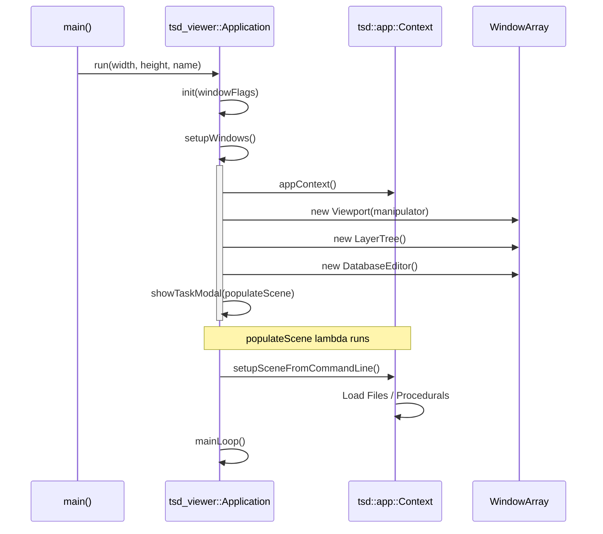
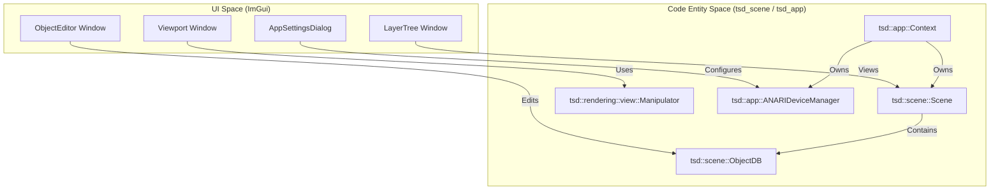

<!-- source: DeepWiki mcp.deepwiki.com · repo NVIDIA/VisRTX · page 6.3 tsdViewer: Interactive Scene Viewer · fetched 2026-10-26 -->

# tsdViewer: Interactive Scene Viewer

Relevant source files

The following files were used as context for generating this wiki page:

- [tsd/apps/interactive/demos/animatedParticles/SimulationControls.cpp](tsd/apps/interactive/demos/animatedParticles/SimulationControls.cpp)
- [tsd/apps/interactive/demos/animatedParticles/SimulationControls.h](tsd/apps/interactive/demos/animatedParticles/SimulationControls.h)
- [tsd/apps/interactive/demos/animatedParticles/tsdDemoAnimatedParticles.cpp](tsd/apps/interactive/demos/animatedParticles/tsdDemoAnimatedParticles.cpp)
- [tsd/apps/interactive/demos/animatedVolume/SolverControls.cpp](tsd/apps/interactive/demos/animatedVolume/SolverControls.cpp)
- [tsd/apps/interactive/demos/animatedVolume/SolverControls.h](tsd/apps/interactive/demos/animatedVolume/SolverControls.h)
- [tsd/apps/interactive/demos/animatedVolume/tsdDemoAnimatedVolume.cpp](tsd/apps/interactive/demos/animatedVolume/tsdDemoAnimatedVolume.cpp)
- [tsd/apps/interactive/demos/arrayInstancing/tsdDemoArrayInstancing.cpp](tsd/apps/interactive/demos/arrayInstancing/tsdDemoArrayInstancing.cpp)
- [tsd/apps/interactive/demos/manualAccumulationReset/tsdDemoAccumulationReset.cpp](tsd/apps/interactive/demos/manualAccumulationReset/tsdDemoAccumulationReset.cpp)
- [tsd/apps/interactive/demos/viskores/CMakeLists.txt](tsd/apps/interactive/demos/viskores/CMakeLists.txt)
- [tsd/apps/interactive/demos/viskores/tsdDemoViskores.cpp](tsd/apps/interactive/demos/viskores/tsdDemoViskores.cpp)
- [tsd/apps/interactive/viewer/CMakeLists.txt](tsd/apps/interactive/viewer/CMakeLists.txt)
- [tsd/apps/interactive/viewer/tsdViewer.cpp](tsd/apps/interactive/viewer/tsdViewer.cpp)
- [tsd/src/tsd/app/CMakeLists.txt](tsd/src/tsd/app/CMakeLists.txt)
- [tsd/src/tsd/ui/imgui/Application.cpp](tsd/src/tsd/ui/imgui/Application.cpp)
- [tsd/src/tsd/ui/imgui/Application.h](tsd/src/tsd/ui/imgui/Application.h)
- [tsd/src/tsd/ui/imgui/CMakeLists.txt](tsd/src/tsd/ui/imgui/CMakeLists.txt)
- [tsd/src/tsd/ui/imgui/modals/AppSettingsDialog.cpp](tsd/src/tsd/ui/imgui/modals/AppSettingsDialog.cpp)
- [tsd/src/tsd/ui/imgui/windows/Terminal.cpp](tsd/src/tsd/ui/imgui/windows/Terminal.cpp)
- [tsd/src/tsd/ui/imgui/windows/Terminal.h](tsd/src/tsd/ui/imgui/windows/Terminal.h)

The `tsdViewer` application is the primary interactive 3D scene viewer built on the TSD framework. It provides a comprehensive ImGui-based interface for loading, inspecting, and manipulating ANARI scenes, supporting advanced features like multi-viewport rendering, animation timeline control, and live object editing.

### Command-Line Usage and Options

`tsdViewer` leverages the `tsd::ui::imgui::Application` base class to handle command-line arguments and application lifecycle [tsd/apps/interactive/viewer/tsdViewer.cpp:28-31]().

| Flag | Description |
| :--- | :--- |
| `--noDefaultLayout` | Disables the hardcoded ImGui docking layout [tsd/src/tsd/ui/imgui/Application.cpp:205-206](). |
| `--secondaryView` / `-sv` | Specifies an ANARI library for a second viewport (e.g., for side-by-side comparison) [tsd/src/tsd/ui/imgui/Application.cpp:207-208](). |
| `--noDefaultRenderer` | Prevents the viewer from automatically creating a default renderer if none is found in the state file [tsd/src/tsd/ui/imgui/Application.cpp:209-210](). |
| `TSD_ANARI_LIBRARIES` | Environment variable used by the underlying `ANARIDeviceManager` to discover available ANARI backends. |

**Sources:** [tsd/src/tsd/ui/imgui/Application.cpp:199-214](), [tsd/apps/interactive/viewer/tsdViewer.cpp:124-125]()

---

### Window Architecture and Default Layout

The application initializes a suite of specialized windows that interact with the `tsd::app::Context` [tsd/apps/interactive/viewer/tsdViewer.cpp:92-121]().

#### Core Windows
*   **Viewport**: The primary rendering window. It uses a `tsd::rendering::view::Manipulator` for camera control [tsd/apps/interactive/viewer/tsdViewer.cpp:94-95]().
*   **LayerTree**: Displays the hierarchical scene graph (Layers and Nodes) [tsd/apps/interactive/viewer/tsdViewer.cpp:104]().
*   **DatabaseEditor**: Provides a raw view of all objects currently in the `tsd::scene::ObjectDB` [tsd/apps/interactive/viewer/tsdViewer.cpp:102]().
*   **ObjectEditor**: A context-sensitive editor for modifying parameters of the currently selected ANARI object [tsd/apps/interactive/viewer/tsdViewer.cpp:103]().
*   **Timeline & Animations**: Controls for playback and keyframe management [tsd/apps/interactive/viewer/tsdViewer.cpp:98-99]().
*   **Transfer Function Editor**: Specialized UI for editing 1D transfer functions used in volume rendering [tsd/apps/interactive/viewer/tsdViewer.cpp:105]().

#### Application Initialization Flow
The following diagram illustrates the startup sequence and data ownership between the Application and its UI components.

**tsdViewer Initialization Sequence**

**Sources:** [tsd/apps/interactive/viewer/tsdViewer.cpp:88-121](), [tsd/src/tsd/ui/imgui/Application.cpp:74-85]()

---

### Session Management: Save/Load State

`tsdViewer` supports saving and loading the entire application state into `.tsd` files. This includes not just the scene objects, but also UI settings, camera positions, and renderer configurations.

*   **Metadata Validation**: The viewer implements `validateApplicationStateMetadata` to ensure that loaded files match the `tsd.viewer.state` schema [tsd/apps/interactive/viewer/tsdViewer.cpp:42-86]().
*   **Default Lights**: If a scene is loaded without lights, the viewer automatically invokes `tsd::io::generate_default_lights` to ensure the scene is visible [tsd/apps/interactive/viewer/tsdViewer.cpp:140-145]().
*   **Global Settings**: Application-wide preferences (font scale, rounding, default libraries) are stored in a global configuration file determined by `globalApplicationSettingsFile()` [tsd/src/tsd/ui/imgui/Application.cpp:187-190]().

**Sources:** [tsd/apps/interactive/viewer/tsdViewer.cpp:34-86](), [tsd/src/tsd/ui/imgui/Application.h:135-146]()

---

### User Configuration and AppSettings

The `AppSettingsDialog` allows users to modify the runtime environment and offline rendering parameters.

| Category | Entities / Parameters Managed |
| :--- | :--- |
| **UI Config** | `fontScale`, `rounding` (ImGui style) [tsd/src/tsd/ui/imgui/modals/AppSettingsDialog.cpp:59-64]() |
| **Render Index** | `ALL_LAYERS` (Instancing support) vs `FLAT` [tsd/src/tsd/ui/imgui/modals/AppSettingsDialog.cpp:66-75]() |
| **Offline Render** | Output directory, prefix, resolution, and sample counts for `tsdRender` [tsd/src/tsd/ui/imgui/modals/AppSettingsDialog.cpp:86-123]() |
| **Animation** | `numFrames`, `startFrame`, `endFrame`, and `frameIncrement` [tsd/src/tsd/ui/imgui/modals/AppSettingsDialog.cpp:139-175]() |

**Sources:** [tsd/src/tsd/ui/imgui/modals/AppSettingsDialog.cpp:50-84](), [tsd/src/tsd/ui/imgui/modals/AppSettingsDialog.cpp:86-181]()

---

### Implementation Details: Data Flow

The relationship between the UI and the underlying ANARI/TSD data structures is managed through the `tsd::app::Context`.

**UI-to-Code Entity Mapping**

**Sources:** [tsd/apps/interactive/viewer/tsdViewer.cpp:92-107](), [tsd/src/tsd/ui/imgui/Application.h:186-189](), [tsd/src/tsd/app/Context.cpp:9-11]()

### Interactive Demos
The repository includes several specialized versions of the viewer for demonstrating specific TSD features:
*   **animatedVolume**: Demonstrates CUDA/TSD interop using a Jacobi solver to update a `SpatialField` in real-time [tsd/apps/interactive/demos/animatedVolume/tsdDemoAnimatedVolume.cpp:66-80]().
*   **viskores**: A node-based editor integrated with the viewer for visual programming of ANARI scenes [tsd/apps/interactive/demos/viskores/tsdDemoViskores.cpp:76-77]().
*   **manualAccumulationReset**: Shows how to use `setCustomFrameParameter` to control ANARI accumulation versions [tsd/apps/interactive/demos/manualAccumulationReset/tsdDemoAccumulationReset.cpp:59-63]().

**Sources:** [tsd/apps/interactive/demos/animatedVolume/SolverControls.cpp:104-111](), [tsd/apps/interactive/demos/viskores/tsdDemoViskores.cpp:128-145](), [tsd/apps/interactive/demos/manualAccumulationReset/tsdDemoAccumulationReset.cpp:57-81]()

---

