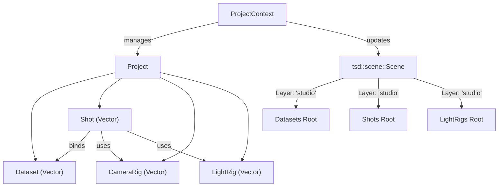
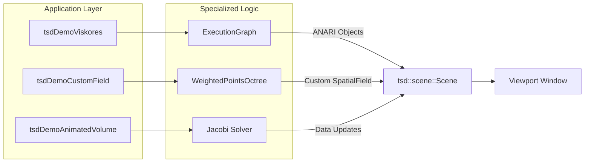

<!-- source: DeepWiki mcp.deepwiki.com · repo NVIDIA/VisRTX · page 6.4 SciVis Studio & Other Interactive Apps · fetched 2026-10-26 -->

# SciVis Studio & Other Interactive Apps

Relevant source files

The following files were used as context for generating this wiki page:

- [tsd/apps/interactive/demos/animatedParticles/SimulationControls.cpp](tsd/apps/interactive/demos/animatedParticles/SimulationControls.cpp)
- [tsd/apps/interactive/demos/animatedParticles/SimulationControls.h](tsd/apps/interactive/demos/animatedParticles/SimulationControls.h)
- [tsd/apps/interactive/demos/animatedParticles/tsdDemoAnimatedParticles.cpp](tsd/apps/interactive/demos/animatedParticles/tsdDemoAnimatedParticles.cpp)
- [tsd/apps/interactive/demos/animatedVolume/SolverControls.cpp](tsd/apps/interactive/demos/animatedVolume/SolverControls.cpp)
- [tsd/apps/interactive/demos/animatedVolume/SolverControls.h](tsd/apps/interactive/demos/animatedVolume/SolverControls.h)
- [tsd/apps/interactive/demos/animatedVolume/tsdDemoAnimatedVolume.cpp](tsd/apps/interactive/demos/animatedVolume/tsdDemoAnimatedVolume.cpp)
- [tsd/apps/interactive/demos/arrayInstancing/tsdDemoArrayInstancing.cpp](tsd/apps/interactive/demos/arrayInstancing/tsdDemoArrayInstancing.cpp)
- [tsd/apps/interactive/demos/customField/CMakeLists.txt](tsd/apps/interactive/demos/customField/CMakeLists.txt)
- [tsd/apps/interactive/demos/customField/README.md](tsd/apps/interactive/demos/customField/README.md)
- [tsd/apps/interactive/demos/customField/WeightedPointsControls.cpp](tsd/apps/interactive/demos/customField/WeightedPointsControls.cpp)
- [tsd/apps/interactive/demos/customField/WeightedPointsControls.h](tsd/apps/interactive/demos/customField/WeightedPointsControls.h)
- [tsd/apps/interactive/demos/customField/WeightedPointsOctree.cpp](tsd/apps/interactive/demos/customField/WeightedPointsOctree.cpp)
- [tsd/apps/interactive/demos/customField/WeightedPointsOctree.h](tsd/apps/interactive/demos/customField/WeightedPointsOctree.h)
- [tsd/apps/interactive/demos/customField/fields/RegisterWeightedPointsField.cpp](tsd/apps/interactive/demos/customField/fields/RegisterWeightedPointsField.cpp)
- [tsd/apps/interactive/demos/customField/fields/WeightedPointsField.cpp](tsd/apps/interactive/demos/customField/fields/WeightedPointsField.cpp)
- [tsd/apps/interactive/demos/customField/fields/WeightedPointsField.h](tsd/apps/interactive/demos/customField/fields/WeightedPointsField.h)
- [tsd/apps/interactive/demos/customField/tsdDemoCustomField.cpp](tsd/apps/interactive/demos/customField/tsdDemoCustomField.cpp)
- [tsd/apps/interactive/demos/manualAccumulationReset/tsdDemoAccumulationReset.cpp](tsd/apps/interactive/demos/manualAccumulationReset/tsdDemoAccumulationReset.cpp)
- [tsd/apps/interactive/demos/viskores/CMakeLists.txt](tsd/apps/interactive/demos/viskores/CMakeLists.txt)
- [tsd/apps/interactive/demos/viskores/NodeEditor.cpp](tsd/apps/interactive/demos/viskores/NodeEditor.cpp)
- [tsd/apps/interactive/demos/viskores/NodeEditor.h](tsd/apps/interactive/demos/viskores/NodeEditor.h)
- [tsd/apps/interactive/demos/viskores/NodeInfoWindow.cpp](tsd/apps/interactive/demos/viskores/NodeInfoWindow.cpp)
- [tsd/apps/interactive/demos/viskores/NodeInfoWindow.h](tsd/apps/interactive/demos/viskores/NodeInfoWindow.h)
- [tsd/apps/interactive/demos/viskores/tsdDemoViskores.cpp](tsd/apps/interactive/demos/viskores/tsdDemoViskores.cpp)
- [tsd/apps/interactive/multiDeviceViewer/multiDeviceViewer.cpp](tsd/apps/interactive/multiDeviceViewer/multiDeviceViewer.cpp)
- [tsd/apps/interactive/scivisStudio/Dataset.h](tsd/apps/interactive/scivisStudio/Dataset.h)
- [tsd/apps/interactive/scivisStudio/Project.cpp](tsd/apps/interactive/scivisStudio/Project.cpp)
- [tsd/apps/interactive/scivisStudio/Project.h](tsd/apps/interactive/scivisStudio/Project.h)
- [tsd/apps/interactive/scivisStudio/ProjectContext.cpp](tsd/apps/interactive/scivisStudio/ProjectContext.cpp)
- [tsd/apps/interactive/scivisStudio/ProjectContext.h](tsd/apps/interactive/scivisStudio/ProjectContext.h)
- [tsd/apps/interactive/scivisStudio/ProjectSerialization.cpp](tsd/apps/interactive/scivisStudio/ProjectSerialization.cpp)
- [tsd/apps/interactive/scivisStudio/ProjectSerialization.h](tsd/apps/interactive/scivisStudio/ProjectSerialization.h)
- [tsd/apps/interactive/scivisStudio/Shot.h](tsd/apps/interactive/scivisStudio/Shot.h)
- [tsd/apps/interactive/scivisStudio/windows/CameraRigEditor.cpp](tsd/apps/interactive/scivisStudio/windows/CameraRigEditor.cpp)
- [tsd/apps/interactive/scivisStudio/windows/CameraRigEditor.h](tsd/apps/interactive/scivisStudio/windows/CameraRigEditor.h)
- [tsd/apps/interactive/scivisStudio/windows/LightRigEditor.cpp](tsd/apps/interactive/scivisStudio/windows/LightRigEditor.cpp)
- [tsd/apps/interactive/scivisStudio/windows/LightRigEditor.h](tsd/apps/interactive/scivisStudio/windows/LightRigEditor.h)
- [tsd/apps/interactive/scivisStudio/windows/ShotEditor.cpp](tsd/apps/interactive/scivisStudio/windows/ShotEditor.cpp)
- [tsd/external/tsd_imnodes/CMakeLists.txt](tsd/external/tsd_imnodes/CMakeLists.txt)
- [tsd/external/tsd_tinyobjloader/CMakeLists.txt](tsd/external/tsd_tinyobjloader/CMakeLists.txt)
- [tsd/external/tsd_tinyobjloader/tiny_obj_loader.h](tsd/external/tsd_tinyobjloader/tiny_obj_loader.h)
- [tsd/src/tsd/app/CMakeLists.txt](tsd/src/tsd/app/CMakeLists.txt)
- [tsd/tests/test_SciVisStudio.cpp](tsd/tests/test_SciVisStudio.cpp)

This page documents the high-level interactive applications built on the TSD framework, specifically focusing on **SciVis Studio** and its project-based workflow, specialized viewers for multi-device and distributed rendering, and a suite of technical demo applications.

## SciVis Studio

SciVis Studio is a project-oriented application designed for scientific visualization workflows. Unlike the general-purpose `tsdViewer`, it utilizes a structured data model consisting of **Projects**, **Shots**, and **Datasets**.

### Project Model & Context
The application state is managed by the `ProjectContext` class, which bridges the TSD `app::Context` with the specialized `Project` data structures [tsd/apps/interactive/scivisStudio/ProjectContext.h:22-98]().

*   **Project**: The top-level container holding metadata, lists of datasets, shots, and rigs [tsd/apps/interactive/scivisStudio/Project.h:80-100]().
*   **Dataset**: Represents source data (static or file-animated) and its corresponding scene graph representation in the "studio" layer [tsd/apps/interactive/scivisStudio/Dataset.h:35-55]().
*   **Shot**: A specific configuration of the scene, including active datasets, render settings, and bindings to camera and light rigs [tsd/apps/interactive/scivisStudio/Shot.h:30-50]().
*   **Rigs**: Collections of settings (CameraRig, LightRig) that can be shared across multiple shots [tsd/apps/interactive/scivisStudio/Project.h:45-75]().

### Project Serialization
Serialization is handled via `ProjectSerialization.h`, which converts the `Project` struct into a `tsd::core::DataTree` [tsd/apps/interactive/scivisStudio/ProjectSerialization.cpp:10-50](). This allows for human-readable and portable `.tsdproj` files.
*   `projectToNode()`: Serializes the project hierarchy [tsd/apps/interactive/scivisStudio/ProjectSerialization.cpp:150-200]().
*   `nodeToProject()`: Deserializes and validates the project structure [tsd/apps/interactive/scivisStudio/ProjectSerialization.cpp:300-350]().

### Specialized Editors
SciVis Studio provides dedicated UI windows for managing the project model:
*   **ShotEditor**: Manages the lifecycle of shots and their associations [tsd/apps/interactive/scivisStudio/windows/ShotEditor.cpp:10-100]().
*   **LightRigEditor**: Allows adding and configuring lights (Directional, Point, Quad, Spot, Ring) within a rig [tsd/apps/interactive/scivisStudio/windows/LightRigEditor.cpp:27-32](). It uses `resolveLightRigRoot` to manage light nodes in a dedicated "studio" layer [tsd/apps/interactive/scivisStudio/ProjectContext.cpp:164-180]().
*   **CameraRigEditor**: Provides tools for keyframing camera poses and setting interpolation modes (Hold, Linear, EaseIn, EaseOut, EaseOutIn) [tsd/apps/interactive/scivisStudio/windows/CameraRigEditor.cpp:22-37]().

### Data Flow: Project to Scene
SciVis Studio organizes the TSD scene into a reserved "studio" layer with sub-roots for organizational clarity.

| Root Node | Purpose |
| :--- | :--- |
| `datasets` | Contains the geometry/volume nodes for imported data [tsd/apps/interactive/scivisStudio/ProjectContext.cpp:108-111](). |
| `shots` | Stores shot-specific overrides and cameras [tsd/apps/interactive/scivisStudio/ProjectContext.cpp:113-116](). |
| `lightRigs` | Groups light objects associated with rigs [tsd/apps/interactive/scivisStudio/ProjectContext.cpp:118-121](). |

**Diagram: SciVis Studio Entity Relationships**

Sources: [tsd/apps/interactive/scivisStudio/ProjectContext.cpp:47-121](), [tsd/apps/interactive/scivisStudio/Project.h:80-100](), [tsd/apps/interactive/scivisStudio/Shot.h:30-50]()

---

## Multi-Device & Distributed Viewers

### Multi-Device Viewer
The `multiDeviceViewer` application utilizes the `MultiDeviceViewport` to facilitate rendering across different ANARI devices simultaneously [tsd/apps/interactive/multiDeviceViewer/multiDeviceViewer.cpp:53-54](). 
*   **Functionality**: It allows users to compare renderers (e.g., "barney" vs "visrtx") or perform depth compositing between devices.
*   **Implementation**: It inherits from `tsd::ui::imgui::Application` and overrides `setupWindows()` to inject the multi-device capable viewport [tsd/apps/interactive/multiDeviceViewer/multiDeviceViewer.cpp:45-75]().

### Distributed Viewers
For large-scale datasets, TSD provides viewports capable of interacting with MPI-distributed renderers.
*   **DistributedViewport**: Handles the display of frames coming from a distributed cluster.
*   **DistributedSceneController**: Synchronizes scene changes across all MPI ranks using the `tsd_network` protocol.

---

## Demo Applications

TSD includes several specialized demos showcasing specific features or custom extensions.

### 1. Viskores Node Editor
A node-based visual programming interface for constructing ANARI scenes.
*   **Implementation**: Uses `ImNodes` for the UI and `viskores::graph::ExecutionGraph` for the backend logic [tsd/apps/interactive/demos/viskores/tsdDemoViskores.cpp:44-45]().
*   **Data Flow**: The graph execution generates ANARI instances which are then passed to the viewport via `setExternalInstances()` [tsd/apps/interactive/demos/viskores/tsdDemoViskores.cpp:139-141]().

### 2. Custom Field Demo (`tsdDemoCustomField`)
Demonstrates the registration and rendering of a non-standard ANARI spatial field.
*   **WeightedPointsField**: Implements a Gaussian-blob field using an octree for Level-of-Detail (LOD) far-field approximations [tsd/apps/interactive/demos/customField/WeightedPointsControls.cpp:146-151]().
*   **Controls**: The `WeightedPointsControls` window allows real-time adjustment of `sigma` (kernel width) and `cutoff` (LOD distance) [tsd/apps/interactive/demos/customField/WeightedPointsControls.cpp:66-80]().

### 3. Animated Volume Demo
Focuses on time-varying volumetric data.
*   **SolverControls**: Provides a UI to drive a simple Jacobi solver that updates a `structuredRegular` spatial field every frame [tsd/apps/interactive/demos/animatedVolume/tsdDemoAnimatedVolume.cpp:45-54]().
*   **Update Loop**: The application recomputes the field's value range and signals the scene for updates [tsd/apps/interactive/demos/animatedVolume/tsdDemoAnimatedVolume.cpp:94-97]().

### 4. Other Demos
*   **animatedParticles**: Showcases high-frequency updates to sphere geometry arrays.
*   **arrayInstancing**: Demonstrates efficient rendering of repeated geometry using ANARI instances and transform arrays.
*   **manualAccumulationReset**: Illustrates manual control over the ANARI frame accumulation buffer.

**Diagram: Demo Application Architecture**

Sources: [tsd/apps/interactive/demos/viskores/tsdDemoViskores.cpp:128-145](), [tsd/apps/interactive/demos/customField/WeightedPointsControls.cpp:153-220](), [tsd/apps/interactive/demos/animatedVolume/tsdDemoAnimatedVolume.cpp:60-90]()

---

