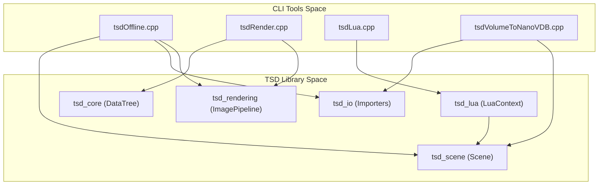
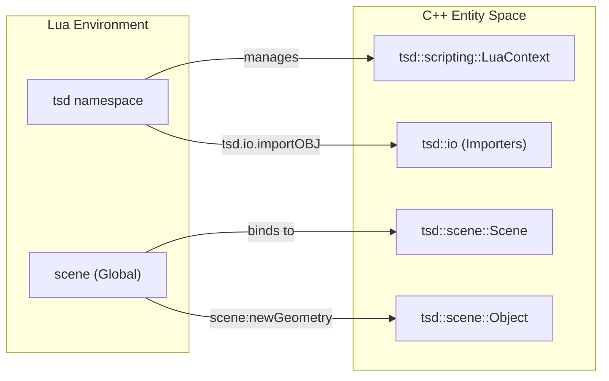

<!-- source: DeepWiki mcp.deepwiki.com · repo NVIDIA/VisRTX · page 7 Command-Line Tools & Scripting · fetched 2026-10-26 -->

# Command-Line Tools & Scripting

<details>
<summary>Relevant source files</summary>

The following files were used as context for generating this wiki page:

- [tsd/apps/interactive/demos/README.md](tsd/apps/interactive/demos/README.md)
- [tsd/apps/interactive/demos/animatedParticles/README.md](tsd/apps/interactive/demos/animatedParticles/README.md)
- [tsd/apps/interactive/demos/animatedVolume/README.md](tsd/apps/interactive/demos/animatedVolume/README.md)
- [tsd/apps/interactive/demos/arrayInstancing/README.md](tsd/apps/interactive/demos/arrayInstancing/README.md)
- [tsd/apps/interactive/demos/manualAccumulationReset/README.md](tsd/apps/interactive/demos/manualAccumulationReset/README.md)
- [tsd/apps/interactive/demos/viskores/README.md](tsd/apps/interactive/demos/viskores/README.md)
- [tsd/apps/tools/CMakeLists.txt](tsd/apps/tools/CMakeLists.txt)
- [tsd/apps/tools/README.md](tsd/apps/tools/README.md)
- [tsd/apps/tools/tsdLua.cpp](tsd/apps/tools/tsdLua.cpp)
- [tsd/apps/tools/tsdOffline.cpp](tsd/apps/tools/tsdOffline.cpp)
- [tsd/src/anari_tsd/README.md](tsd/src/anari_tsd/README.md)
- [tsd/src/tsd/app/README.md](tsd/src/tsd/app/README.md)
- [tsd/src/tsd/scripting/CMakeLists.txt](tsd/src/tsd/scripting/CMakeLists.txt)
- [tsd/src/tsd/scripting/LuaBindings.cpp](tsd/src/tsd/scripting/LuaBindings.cpp)
- [tsd/src/tsd/scripting/LuaBindings.hpp](tsd/src/tsd/scripting/LuaBindings.hpp)
- [tsd/src/tsd/scripting/LuaContext.cpp](tsd/src/tsd/scripting/LuaContext.cpp)
- [tsd/src/tsd/scripting/LuaContext.hpp](tsd/src/tsd/scripting/LuaContext.hpp)
- [tsd/src/tsd/scripting/bindings/LayerBindings.cpp](tsd/src/tsd/scripting/bindings/LayerBindings.cpp)
- [tsd/src/tsd/scripting/bindings/MathBindings.cpp](tsd/src/tsd/scripting/bindings/MathBindings.cpp)
- [tsd/src/tsd/scripting/bindings/ObjectMethodBindings.hpp](tsd/src/tsd/scripting/bindings/ObjectMethodBindings.hpp)

</details>


The TSD framework provides a suite of headless utilities and a comprehensive Lua scripting API for automation, batch processing, and scene manipulation without a graphical user interface. These tools bridge the gap between interactive exploration in `tsdViewer` and large-scale rendering or data conversion workflows.

## Headless Rendering & Utility Tools

The `tsd/apps/tools` directory contains several standalone executables designed for specific technical tasks, ranging from scene inspection to high-quality offline rendering.

| Tool | Role | Primary Libraries |
| :--- | :--- | :--- |
| `tsdOffline` | General-purpose CLI renderer with full import/camera/light control. | `tsd_app`, `tsd_scene`, `tsd_io`, `tsd_rendering` |
| `tsdRender` | Renders frames from a saved `.tsd` state file, including animations. | `tsd_app`, `tsd_scene`, `tsd_io`, `tsd_rendering` |
| `tsdLua` | Scripting host and REPL for batch scene processing. | `tsd_lua`, `tsd_scene`, `tsd_io`, `tsd_rendering` |
| `tsdPrint` | Debugging tool to inspect the hierarchical `DataTree` of a `.tsd` file. | `tsd_core` |
| `tsdVolumeToNanoVDB` | Converts structured volumes (RAW, VTI, etc.) to NanoVDB with quantization. | `tsd_scene`, `tsd_io` |
| `obj2header` | Converts OBJ meshes into C++ headers for embedding geometry in code. | `tsd_core`, `tsd_io` |

### System Mapping: CLI Tools to Code Entities

The following diagram illustrates how the command-line tools interface with the core TSD libraries.


**Sources:** [tsd/apps/tools/CMakeLists.txt:1-53](), [tsd/apps/tools/README.md:1-15]()

For detailed command-line arguments and usage examples for each tool, see **[Headless Rendering Tools (#7.1)]**.

---

## Lua Scripting API

The `tsd_lua` library provides a high-level scripting interface built on top of [sol2](https://github.com/ThePhD/sol2). It allows users to automate complex scene setups, perform batch rendering, and extend the interactive applications via `init.lua` scripts.

### Core Scripting Components

*   **`LuaContext`**: The primary host class that manages the `sol::state`, handles script execution (`executeFile`, `executeString`), and manages search paths for Lua modules [tsd/src/tsd/scripting/LuaContext.hpp:34-79]().
*   **`LuaBindings`**: A collection of registration functions that expose TSD's C++ types to Lua. These are organized into modules: `Math`, `Object`, `Layer`, `IO`, and `Render` [tsd/src/tsd/scripting/LuaBindings.hpp:12-23]().
*   **`ObjectMethodBindings`**: A shared template that ensures all `tsd::scene::Object` methods (like `setParameter`, `setMetadata`, and `subtype`) are consistently available across different Lua types [tsd/src/tsd/scripting/bindings/ObjectMethodBindings.hpp:29-194]().

### API Space Mapping

The Lua API mirrors the C++ class hierarchy, providing a "Natural Language" style interface for scene construction.


**Sources:** [tsd/src/tsd/scripting/LuaContext.cpp:164-186](), [tsd/src/tsd/scripting/LuaBindings.cpp:10-24](), [tsd/src/tsd/scripting/bindings/ObjectMethodBindings.hpp:55-128]()

### Scripting Example
The `tsdLua` tool provides a REPL and batch runner. A typical script might look like this:
```lua
local scene = tsd.Scene.new()
tsd.io.importOBJ(scene, "model.obj")
local device = tsd.render.loadDevice("visrtx")
local index = tsd.render.createRenderIndex(scene, device)
index:populate()
local pipeline = tsd.render.createPipeline(1920, 1080, device, index)
tsd.render.renderToFile(pipeline, 128, "output.png")
```
**Sources:** [tsd/apps/tools/tsdLua.cpp:31-42]()

For a full list of bound functions, math types, and extension patterns, see **[Lua Scripting API (#7.2)]**.

---

