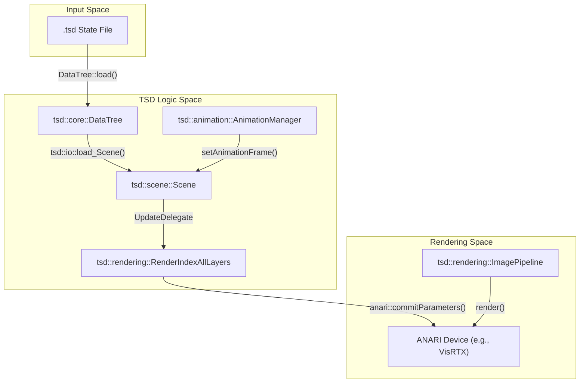
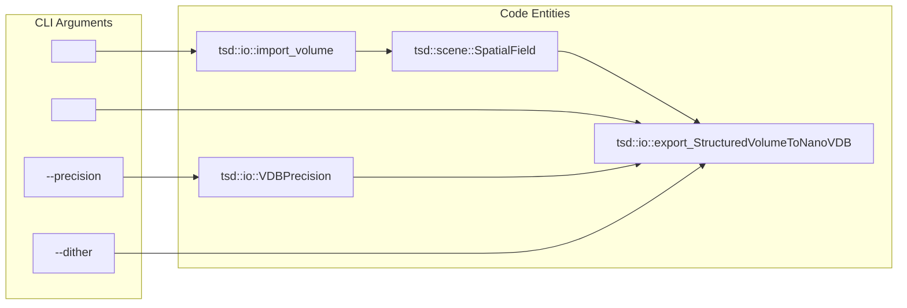

<!-- source: DeepWiki mcp.deepwiki.com · repo NVIDIA/VisRTX · page 7.1 Headless Rendering Tools · fetched 2026-10-26 -->

# Headless Rendering Tools

Relevant source files

The following files were used as context for generating this wiki page:

- [tsd/apps/interactive/demos/README.md](tsd/apps/interactive/demos/README.md)
- [tsd/apps/interactive/demos/animatedParticles/README.md](tsd/apps/interactive/demos/animatedParticles/README.md)
- [tsd/apps/interactive/demos/animatedVolume/README.md](tsd/apps/interactive/demos/animatedVolume/README.md)
- [tsd/apps/interactive/demos/arrayInstancing/README.md](tsd/apps/interactive/demos/arrayInstancing/README.md)
- [tsd/apps/interactive/demos/manualAccumulationReset/README.md](tsd/apps/interactive/demos/manualAccumulationReset/README.md)
- [tsd/apps/interactive/demos/viskores/README.md](tsd/apps/interactive/demos/viskores/README.md)
- [tsd/apps/tools/CMakeLists.txt](tsd/apps/tools/CMakeLists.txt)
- [tsd/apps/tools/README.md](tsd/apps/tools/README.md)
- [tsd/apps/tools/tsdLua.cpp](tsd/apps/tools/tsdLua.cpp)
- [tsd/apps/tools/tsdOffline.cpp](tsd/apps/tools/tsdOffline.cpp)
- [tsd/apps/tools/tsdRender.cpp](tsd/apps/tools/tsdRender.cpp)
- [tsd/apps/tools/tsdVolumeToNanoVDB.cpp](tsd/apps/tools/tsdVolumeToNanoVDB.cpp)
- [tsd/apps/tutorial/tsdTutorialFlipDiff.cpp](tsd/apps/tutorial/tsdTutorialFlipDiff.cpp)
- [tsd/apps/tutorial/tsdTutorialLoadObj.cpp](tsd/apps/tutorial/tsdTutorialLoadObj.cpp)
- [tsd/apps/tutorial/tsdTutorialLoadUSD.cpp](tsd/apps/tutorial/tsdTutorialLoadUSD.cpp)
- [tsd/apps/tutorial/tsdTutorialMultiRender.cpp](tsd/apps/tutorial/tsdTutorialMultiRender.cpp)
- [tsd/apps/tutorial/tsdTutorialPipeline.cpp](tsd/apps/tutorial/tsdTutorialPipeline.cpp)
- [tsd/apps/tutorial/tsdTutorialRender.cpp](tsd/apps/tutorial/tsdTutorialRender.cpp)
- [tsd/src/anari_tsd/README.md](tsd/src/anari_tsd/README.md)
- [tsd/src/tsd/app/README.md](tsd/src/tsd/app/README.md)
- [tsd/src/tsd/app/renderAnimationSequence.cpp](tsd/src/tsd/app/renderAnimationSequence.cpp)
- [tsd/src/tsd/io/serialization/export_StructuredVolumeToNanoVDB.cpp](tsd/src/tsd/io/serialization/export_StructuredVolumeToNanoVDB.cpp)
- [tsd/src/tsd/ui/imgui/modals/ExportNanoVDBFileDialog.cpp](tsd/src/tsd/ui/imgui/modals/ExportNanoVDBFileDialog.cpp)
- [tsd/src/tsd/ui/imgui/modals/ExportNanoVDBFileDialog.h](tsd/src/tsd/ui/imgui/modals/ExportNanoVDBFileDialog.h)
- [tsd/src/tsd/ui/imgui/windows/LayerTree.cpp](tsd/src/tsd/ui/imgui/windows/LayerTree.cpp)
- [tsd/src/tsd/ui/imgui/windows/LayerTree.h](tsd/src/tsd/ui/imgui/windows/LayerTree.h)

The TSD framework provides a suite of command-line tools for high-performance, headless rendering and data processing. These tools leverage the `tsd_scene` and `tsd_rendering` libraries to execute complex visualization tasks without a graphical user interface, making them suitable for batch processing, cluster environments, and remote server execution.

## Tool Suite Overview

The headless tools are located in `tsd/apps/tools` and share a common dependency structure on `tsd_core`, `tsd_scene`, `tsd_io`, and `tsd_rendering` [tsd/apps/tools/CMakeLists.txt:1-53]().

| Tool | Purpose | Key Dependencies |
| :--- | :--- | :--- |
| `tsdRender` | Renders high-quality images/animations from `.tsd` state files. | `tsd_scene`, `tsd_rendering`, `tsd_io` |
| `tsdOffline` | CLI-driven renderer with manual control over imports and scene setup. | `tsd_app`, `tsd_scene`, `tsd_rendering` |
| `tsdVolumeToNanoVDB` | Converts structured volumes to quantized NanoVDB files. | `tsd_scene`, `tsd_io` |
| `tsdPrint` | Inspects the hierarchical structure of `.tsd` (DataTree) files. | `tsd_core` |

## State-Driven Rendering: tsdRender

`tsdRender` is the primary tool for reproducing scenes authored in interactive applications (like `tsdViewer` or `SciVis Studio`). It loads a `.tsd` state file, reconstructs the scene, and executes a rendering pipeline.

### Execution Pipeline
1.  **Context Initialization**: Loads the ANARI device specified in the settings and initializes the `tsd::scene::Scene` and `tsd::animation::AnimationManager` [tsd/apps/tools/tsdRender.cpp:47-113]().
2.  **State Loading**: Deserializes the `.tsd` file into a `tsd::core::DataTree` and populates the scene [tsd/apps/tools/tsdRender.cpp:128-168]().
3.  **Render Indexing**: Synchronizes the TSD scene objects with the ANARI device using `tsd::rendering::RenderIndexAllLayers` [tsd/apps/tools/tsdRender.cpp:170-180]().
4.  **Pipeline Construction**: Sets up a `tsd::rendering::ImagePipeline` including an `AnariSceneRenderPass` and optional `VisualizeAOVPass` [tsd/apps/tools/tsdRender.cpp:207-258]().
5.  **Rendering**: Iterates through camera poses or animation frames, accumulating samples and writing output files via `stb_image_write` [tsd/apps/tools/tsdRender.cpp:260-310]().

### Data Flow Diagram
This diagram illustrates how `tsdRender` bridges the gap between serialized state and the ANARI rendering backend.

Title: tsdRender Data Flow

Sources: [tsd/apps/tools/tsdRender.cpp:128-180](), [tsd/apps/tools/tsdRender.cpp:260-310]()

## CLI-Driven Rendering: tsdOffline

`tsdOffline` provides a flexible command-line interface for importing multiple data formats, setting up lighting, and configuring cameras without a pre-existing state file.

### Key Features
*   **Multi-Format Import**: Supports `-gltf`, `-obj`, `-usd`, `-volume`, and `-ply` via the `tsd_io` importers [tsd/apps/tools/tsdOffline.cpp:139-158]().
*   **Manual Camera Control**: Allows explicit setting of `--campos`, `--lookpos`, and `--upvec` [tsd/apps/tools/tsdOffline.cpp:94-98]().
*   **Headless Lighting**: Provides flags for `--bg-color`, `--ambient`, and `--dir-light` to inject light objects directly into the TSD scene [tsd/apps/tools/tsdOffline.cpp:102-113]().
*   **MPI Support**: When built with `TSD_USE_MPI`, ranks render interleaved subsets of animation frames for parallel batch processing [tsd/apps/tools/tsdOffline.cpp:131-137]().

Sources: [tsd/apps/tools/tsdOffline.cpp:78-178]()

## Animation Sequence Helper

The `renderAnimationSequence` function is a shared utility used by both headless and interactive tools to export high-quality image sequences.

### Implementation Details
The function encapsulates the entire lifecycle of an animation render [tsd/src/tsd/app/renderAnimationSequence.cpp:24-195]():
*   **Isolated Device**: It creates a fresh `anari::Device` specifically for the sequence to avoid state contamination from viewport rendering [tsd/src/tsd/app/renderAnimationSequence.cpp:48-64]().
*   **Pipeline Configuration**: Emplaces a `SaveToFilePass` into the `ImagePipeline` to handle disk I/O [tsd/src/tsd/app/renderAnimationSequence.cpp:128-130]().
*   **Frame Loop**: Iterates from `frameStart` to `frameEnd`. For each frame, it calls `animMgr.setAnimationFrame(frameIndex)`, which triggers the `UpdateDelegate` to synchronize the scene with ANARI before the pipeline executes `render()` [tsd/src/tsd/app/renderAnimationSequence.cpp:164-190]().

Sources: [tsd/src/tsd/app/renderAnimationSequence.cpp:24-195]()

## Volume Processing: tsdVolumeToNanoVDB

`tsdVolumeToNanoVDB` is a specialized utility for converting standard structured volume formats (RAW, VTI, MHD) into the NanoVDB format, which is optimized for GPU rendering in VisRTX.

### Technical Detail: Quantization
The tool supports several `tsd::io::VDBPrecision` levels to balance memory usage and visual fidelity [tsd/apps/tools/tsdVolumeToNanoVDB.cpp:82-106]():
*   **Float32**: No compression.
*   **Fp16 / Half**: 2:1 compression, standard for most scientific visualization.
*   **Fp8 / Fp4**: Significant compression (4:1 and 8:1) using fixed-point quantization.
*   **Dithering**: Can be enabled via `--dither` to reduce banding artifacts in low-precision modes [tsd/apps/tools/tsdVolumeToNanoVDB.cpp:107-108]().

The core logic resides in `tsd::io::export_StructuredVolumeToNanoVDB`, which is also exposed in the UI via `ExportNanoVDBFileDialog` [tsd/src/tsd/ui/imgui/modals/ExportNanoVDBFileDialog.cpp:146-153]().

### Code Entity Association
This diagram maps the CLI arguments to the internal C++ classes and functions.

Title: tsdVolumeToNanoVDB Entity Mapping

Sources: [tsd/apps/tools/tsdVolumeToNanoVDB.cpp:39-169](), [tsd/src/tsd/ui/imgui/modals/ExportNanoVDBFileDialog.cpp:121-153]()

## Data Inspection: tsdPrint

`tsdPrint` is a diagnostic tool used to inspect the contents of `.tsd` files without loading the full rendering stack. It utilizes the `tsd::core::DataTree` and `tsd::core::DataNode` classes to traverse the hierarchical data.

### Functionality
*   **Hierarchy Printing**: Recursively prints the names and types of all nodes in the state file.
*   **Value Inspection**: Displays leaf node values (parameters, transforms, file paths).
*   **Metadata**: Shows scene versioning and object counts.

Sources: [tsd/apps/tools/tsdPrint.cpp:1-11](), [tsd/apps/tools/CMakeLists.txt:8-10]()

---

