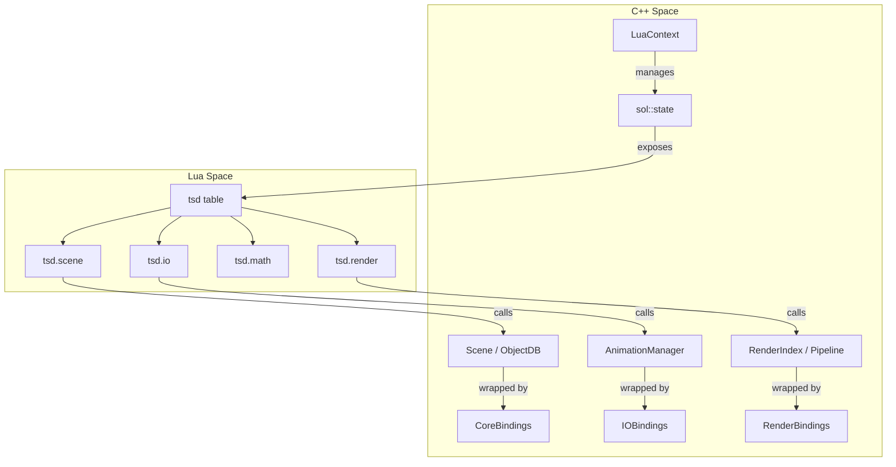
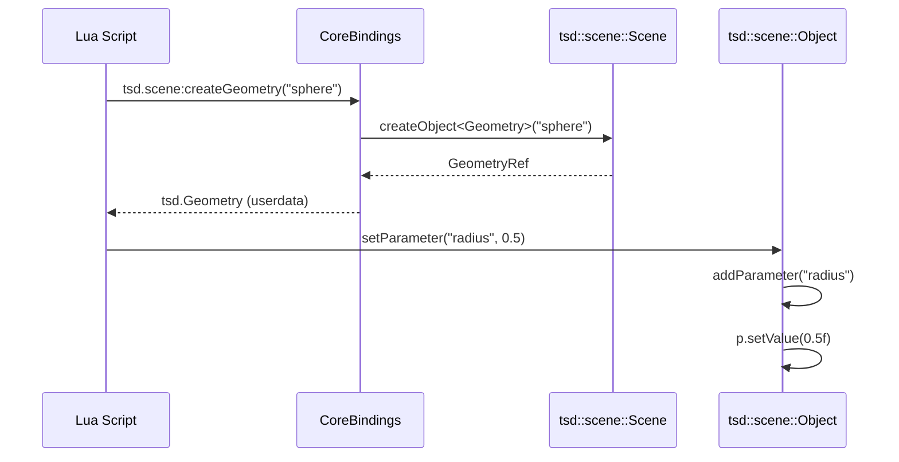

<!-- source: DeepWiki mcp.deepwiki.com · repo NVIDIA/VisRTX · page 7.2 Lua Scripting API · fetched 2026-10-26 -->

# Lua Scripting API

<details>
<summary>Relevant source files</summary>

The following files were used as context for generating this wiki page:

- [tsd/apps/tools/CMakeLists.txt](tsd/apps/tools/CMakeLists.txt)
- [tsd/apps/tools/tsdLua.cpp](tsd/apps/tools/tsdLua.cpp)
- [tsd/apps/tools/tsdOffline.cpp](tsd/apps/tools/tsdOffline.cpp)
- [tsd/src/tsd/animation/Animation.cpp](tsd/src/tsd/animation/Animation.cpp)
- [tsd/src/tsd/animation/Animation.hpp](tsd/src/tsd/animation/Animation.hpp)
- [tsd/src/tsd/animation/CMakeLists.txt](tsd/src/tsd/animation/CMakeLists.txt)
- [tsd/src/tsd/io/serialization.hpp](tsd/src/tsd/io/serialization.hpp)
- [tsd/src/tsd/io/serialization/serialization_datatree.cpp](tsd/src/tsd/io/serialization/serialization_datatree.cpp)
- [tsd/src/tsd/scripting/CMakeLists.txt](tsd/src/tsd/scripting/CMakeLists.txt)
- [tsd/src/tsd/scripting/LuaBindings.cpp](tsd/src/tsd/scripting/LuaBindings.cpp)
- [tsd/src/tsd/scripting/LuaBindings.hpp](tsd/src/tsd/scripting/LuaBindings.hpp)
- [tsd/src/tsd/scripting/LuaContext.cpp](tsd/src/tsd/scripting/LuaContext.cpp)
- [tsd/src/tsd/scripting/LuaContext.hpp](tsd/src/tsd/scripting/LuaContext.hpp)
- [tsd/src/tsd/scripting/bindings/ArrayHelpers.hpp](tsd/src/tsd/scripting/bindings/ArrayHelpers.hpp)
- [tsd/src/tsd/scripting/bindings/CoreBindings.cpp](tsd/src/tsd/scripting/bindings/CoreBindings.cpp)
- [tsd/src/tsd/scripting/bindings/IOBindings.cpp](tsd/src/tsd/scripting/bindings/IOBindings.cpp)
- [tsd/src/tsd/scripting/bindings/LayerBindings.cpp](tsd/src/tsd/scripting/bindings/LayerBindings.cpp)
- [tsd/src/tsd/scripting/bindings/MathBindings.cpp](tsd/src/tsd/scripting/bindings/MathBindings.cpp)
- [tsd/src/tsd/scripting/bindings/ObjectBindings.cpp](tsd/src/tsd/scripting/bindings/ObjectBindings.cpp)
- [tsd/src/tsd/scripting/bindings/ObjectMethodBindings.hpp](tsd/src/tsd/scripting/bindings/ObjectMethodBindings.hpp)
- [tsd/src/tsd/scripting/bindings/RenderBindings.cpp](tsd/src/tsd/scripting/bindings/RenderBindings.cpp)
- [tsd/src/tsd/scripting/tsd.lua](tsd/src/tsd/scripting/tsd.lua)
- [tsd/src/tsd/ui/imgui/windows/Timeline.cpp](tsd/src/tsd/ui/imgui/windows/Timeline.cpp)

</details>


The TSD framework provides a comprehensive Lua scripting interface built on the `sol2` library. This API allows for scene manipulation, automation, procedural content generation, and custom tool development within the TSD ecosystem. The scripting system is primarily encapsulated in the `tsd_lua` library [tsd/src/tsd/scripting/CMakeLists.txt:4-19]().

## System Architecture

The scripting system is centered around the `LuaContext` class, which manages the lifetime of the Lua state and provides the interface for executing scripts and registering bindings.

### Data Flow and Integration

The Lua API bridges the high-level TSD C++ classes (Scene, Object, Layer, Animation) to the Lua environment.

Title: Lua Scripting Architecture and Data Flow

Sources: [tsd/src/tsd/scripting/LuaContext.hpp](), [tsd/src/tsd/scripting/LuaBindings.cpp:15-35]().

## Key Components

### LuaContext
The `LuaContext` is the primary entry point for the scripting engine. It initializes the `sol::state` and invokes the registration of all binding modules [tsd/src/tsd/scripting/LuaContext.cpp:10-25]().

### Binding Modules
The API is organized into several functional modules:

| Module | Implementation File | Responsibility |
| :--- | :--- | :--- |
| **Core** | `CoreBindings.cpp` | `Token`, `Parameter`, and `Scene` management (creation of Geometries, Materials, etc.) [tsd/src/tsd/scripting/bindings/CoreBindings.cpp:134-180](). |
| **Object** | `ObjectBindings.cpp` | Specialized methods for `Geometry`, `Material`, `Light`, `Camera`, `Sampler`, `Surface`, `Volume`, and `SpatialField` [tsd/src/tsd/scripting/tsd.lua:178-235](). |
| **Math** | `MathBindings.cpp` | GLM-based types: `float2`, `float3`, `float4`, `mat3`, `mat4` [tsd/src/tsd/scripting/tsd.lua:10-60](). |
| **IO** | `IOBindings.cpp` | File importers (OBJ, GLTF, USD, etc.) and scene serialization [tsd/src/tsd/scripting/bindings/IOBindings.cpp:109-175](). |
| **Layer** | `LayerBindings.cpp` | Scene graph manipulation, `LayerNode` transforms, and parent-child relationships [tsd/src/tsd/scripting/tsd.lua:264-310](). |
| **Render** | `RenderBindings.cpp` | Interaction with `RenderIndex`, `ImagePipeline`, and frame capture [tsd/src/tsd/scripting/bindings/RenderBindings.cpp](). |

Sources: [tsd/src/tsd/scripting/CMakeLists.txt:8-19](), [tsd/src/tsd/scripting/tsd.lua:1-310]().

## Scripting API Details

### Object and Parameter Helpers
The `Object` base type in Lua provides methods for getting and setting parameters, which are internally mapped to TSD `Any` values.

*   **`Object:setParameter(name, value)`**: Automatically converts Lua types (numbers, strings, tables) to the appropriate ANARI/TSD type [tsd/src/tsd/scripting/tsd.lua:118-121]().
*   **`Object:setParameterArray(name, typeStr, data)`**: A powerful helper that creates a TSD `Array` object from a Lua table and binds it to the specified parameter in one call [tsd/src/tsd/scripting/tsd.lua:123-133]().

### IO and Procedural Generation
The `tsd.io` table exposes the full suite of TSD importers.

*   **`tsd.io.importOBJ(scene, anim, path)`**: Imports a Wavefront OBJ into the provided scene [tsd/src/tsd/scripting/bindings/IOBindings.cpp:110-124]().
*   **`tsd.io.saveScene(scene, path)`**: Serializes the current scene state to a `.tsd` file [tsd/src/tsd/scripting/bindings/IOBindings.cpp:218-222]().

Title: Scene Object Creation and Binding

Sources: [tsd/src/tsd/scripting/bindings/CoreBindings.cpp:170-171](), [tsd/src/tsd/scripting/tsd.lua:118-121]().

## Tooling and Stubs

### tsd.lua Annotated Stubs
To support IDE features like autocomplete and type checking (e.g., via LuaLS), the repository includes `tsd/src/tsd/scripting/tsd.lua`. This file contains `@meta` annotations that define the classes, methods, and type aliases available in the C++-provided `tsd` module [tsd/src/tsd/scripting/tsd.lua:1-10]().

### tsdLua REPL
The `tsdLua` tool is a standalone executable that provides a Read-Eval-Print Loop (REPL) for the TSD environment. It allows developers to interactively build scenes and test scripts [tsd/apps/tools/tsdLua.cpp](). It links against `tsd_lua`, `tsd_scene`, and `tsd_rendering` [tsd/apps/tools/CMakeLists.txt:27-36]().

### UI Integration (init.lua)
Applications like `tsdViewer` or `SciVis Studio` can look for an `init.lua` file in the working directory. This script can be used to register custom menu actions or automate the initial loading of datasets.

## Example Script: Procedural Spheres

```lua
-- Create a simple scene with procedurally generated spheres
local scene = tsd.scene.new()

for i = 1, 10 do
    local sphere = scene:createGeometry("sphere")
    sphere:setParameter("radius", math.random() * 0.5)
    
    local surface = scene:createSurface("sphere_" .. i, sphere, nil)
    
    -- Set position via layer node
    local node = scene:rootLayer():addChild("node_" .. i)
    node:setLocalTransform(tsd.mat4.identity:translate(tsd.float3.new(i, 0, 0)))
    node:addSurface(surface)
end

tsd.io.saveScene(scene, "procedural_spheres.tsd")
```
Sources: [tsd/src/tsd/scripting/tsd.lua:170-210](), [tsd/src/tsd/scripting/bindings/IOBindings.cpp:218-222]().

---

